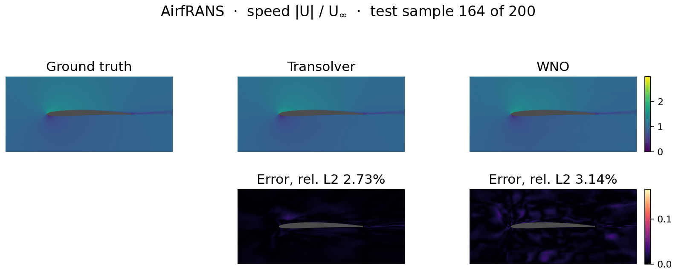
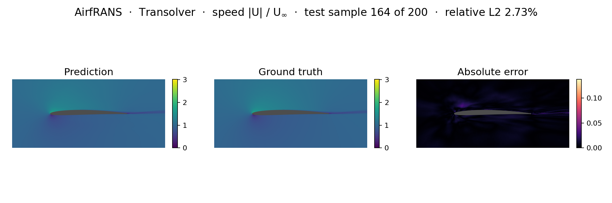
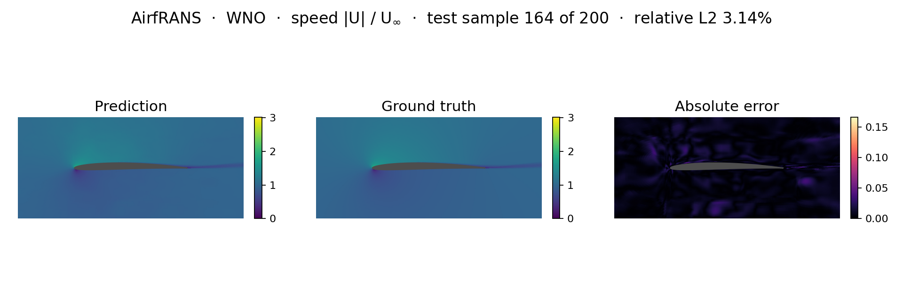
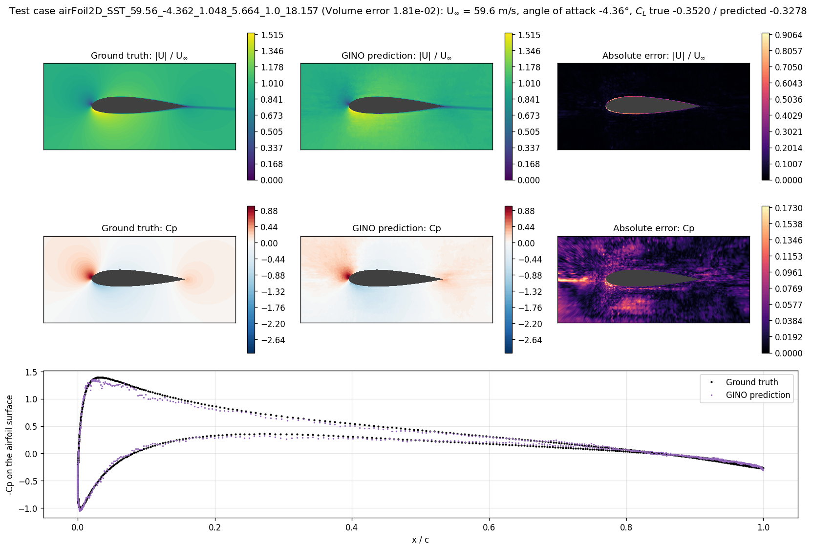
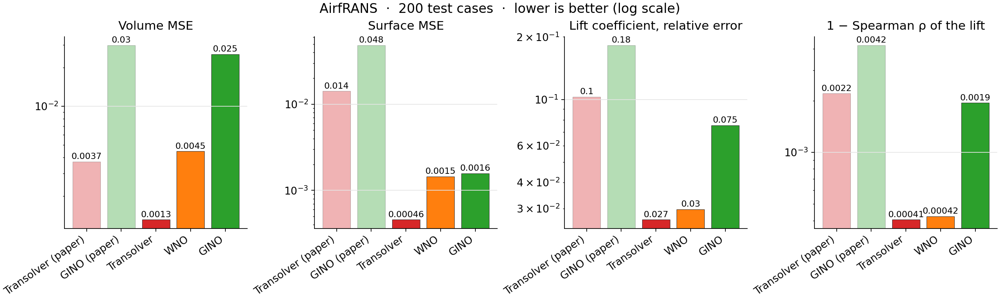
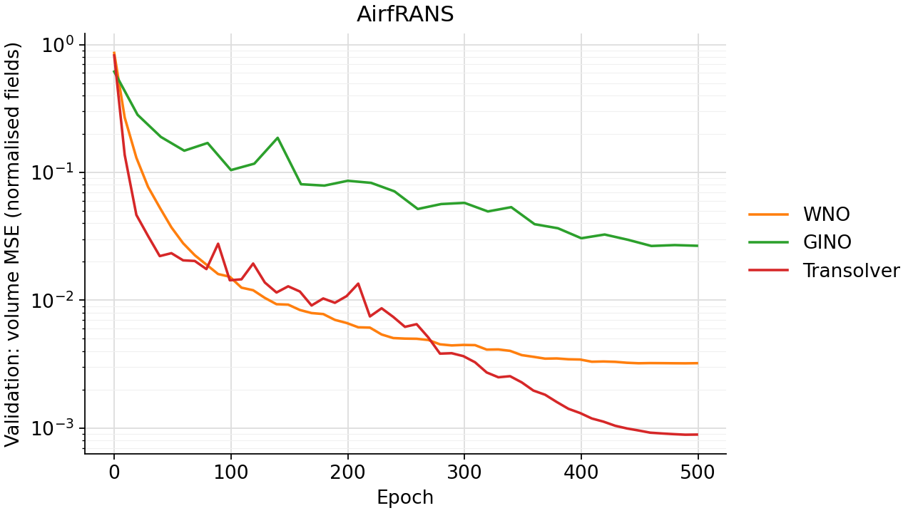
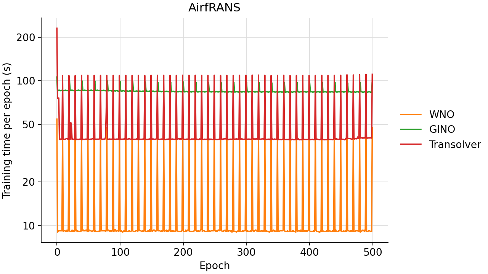

<!--
SPDX-FileCopyrightText: 2026 ZenteiQ AiTech Innovations Pvt. Ltd.
License notice: Documentation text and diagrams on this page are licensed
under CC BY 4.0. Source-code examples are licensed under LGPL-3.0-only
unless the example states otherwise.
-->

# AirfRANS: Results

> **Benchmarked against the Transolver paper [[1]](#ref1)** (AirfRANS). All three operators are scored with the paper's official
> evaluation code at Transolver's parameter budget (about 3.9 M).

The ScireX implementations of three published neural operators, [Transolver](../../../api/models.md#scirex.models.Transolver) [[1]](#ref1), [WNO](../../../api/models.md#scirex.models.WNO) [[2]](#ref2) and [GINO](../../../api/models.md#scirex.models.GINO) [[3]](#ref3), on AirfRANS ([[4]](#ref4)): 1,000 steady 2-D RANS simulations (k-ω SST) of NACA airfoils on irregular CFD meshes of about 180,000 nodes. Each simulation has its own shape, inflow speed (31 to 94 m/s) and angle of attack (−5° to 15°). A model predicts the velocity `(Ux, Uy)`, pressure `p` and turbulent viscosity `nut` at every node. The Transolver is trained on the "full" task with the official Transolver AirfRANS recipe and all three are scored with a re-implementation of the official evaluation code, so the numbers sit on the same scale as the Transolver paper's Table 3. The commands that reproduce a run are on the [problem card](../README.md#reproduce).

## Setup

| Item | Transolver (`transolver`) | WNO (`wno`) | GINO (`gino`) |
|---|---|---|---|
| Model | [`scirex.models.Transolver`](../../../api/models.md#scirex.models.Transolver), irregular geometry, unified position (8 × 8 reference grid), exact GELU, LayerNorm eps 1e-5, official weight initialisation | `WNOGridOperator`: grid encoder (128 × 256; tanh(signed distance / 0.5), inside mask, normalised inflow) → [`scirex.models.WNO`](../../../api/models.md#scirex.models.WNO) → bilinear sampling at each node + the node's 9 features → MLP (256, 256) → 4 outputs | [`scirex.models.GINO`](../../../api/models.md#scirex.models.GINO): input GNO → FNO on a 128 × 64 latent grid with the distance to the airfoil as an extra latent channel → output GNO, with each node's 7 features added in the decoder |
| Parameter count | 3,894,596 | 3,964,728 | 3,894,069 |
| Key hyperparameters | `n_hidden=256`, `n_layers=8`, `n_head=8`, `mlp_ratio=2`, `slice_num=32`; 9 inputs, 4 outputs | WNO `hidden_channels=28`, `n_layers=4`, `level=4`, wavelet db4, `projection_hidden_channels=128`, 64 latent channels | FNO 4 layers, width 48, modes 21 × 16, lifting ratio 4; input GNO radius 0.16, up to 128 neighbours; output GNO radius 0.15, up to 32 neighbours, kernel MLP (512, 362) |
| Inputs / targets | 9 features; inflow-scaled targets | same as Transolver | 7 features; raw targets |
| Loss | Volume MSE + 1.0 x surface MSE (normalised, each averaged over the 4 channels) | same | same; surface term on the loader's surface mask (`--loader-surf-mask`, distance below 1e-5 to an airfoil point, which also covers the first off-wall layers) |
| Optimiser and schedule | Adam (β2 0.999, eps 1e-8), one-cycle as `torch.optim.lr_scheduler.OneCycleLR` (peak 1e-3, `pct_start` 0.3, `div_factor` 25, `final_div_factor` 1e4, cosine, β1 cycled 0.95 → 0.85 → 0.95), over (720 + 1) x 500 steps; batch 1 case of 32,000 nodes; EMA of the weights (decay 0.9995) is the reported model; gradient clip at global norm 10; FP32 matmuls; 500 epochs; seed 0 | same | Adam (β1 0.9, β2 0.999, eps 1e-8; complex-aware [`scale_by_adam_cx`](../../../api/training.md#scirex.training.optim.scale_by_adam_cx)), `optax.cosine_onecycle_schedule` (peak 1e-3, `pct_start` 0.3, `div_factor` 25, `final_div_factor` 1e4) over (800 + 1) x 500 steps; batch 1 case of 32,000 nodes; no EMA, no clipping; XLA default (TF32) matmuls; 500 epochs; seed 0 |
| Weights reported | The EMA weights after the last epoch; nothing is selected on held-out data (the validation loss is only logged) | same | The last-epoch weights; nothing is selected on held-out data |
| Metric (with unit) | Volume, Surf (normalised MSE), $E_{C_L}$ (relative error), Spearman $\rho_L$, over the 200 test cases, all dimensionless; inference averages random 32,000-node passes until every node is covered | same | same |

The Transolver recipe is the official `Airfoil-Design-AirfRANS` one (`main.py`, `params.yaml`) with four additions: the two extra input features, inflow-scaled targets, EMA and spike clipping, and 500 instead of 398 epochs; plus FP32 matmuls. The additions were not ablated one by one. GINO follows the recipe the Transolver paper applies to its baselines (398 epochs by default in `_gino.py`, 500 in the published run).

Data and inputs, shared unless noted:

| | Value |
|---|---|
| Train / validation / test | `full_train[:-80]` (720) / `full_train[-80:]` (80) / `full_test` (200), as the official `main.py` |
| Nodes | Every node of the internal mesh, no crop |
| Input | The official 7 node features (position, inflow `U∞ (cos α, sin α)`, `-implicit_distance`, wall normal), plus `log10(\|wall distance\| + 1e-6)` and `log10(Re)` (Transolver and WNO: 9 features; GINO: the 7 official ones) |
| Output | `(Ux, Uy)/U∞`, `p/U∞²`, `nut/U∞`, normalised with training statistics; scored in physical units (GINO: raw targets, normalised with training statistics) |
| Parameters | Transolver 3,894,596 (the paper's model: 3,893,572; the 1,024 extra are the two added input features); WNO 3,964,728 (1.8% more than the paper's); GINO 3,894,069 |
| Hardware | One NVIDIA RTX PRO 6000 Blackwell GPU, shared with other jobs (the WNO run used at most half of it) |

The split, sampling, loss, optimiser, schedule, model and weight initialisation of the Transolver are those of the official [`Airfoil-Design-AirfRANS`](https://github.com/thuml/Transolver/tree/main/Airfoil-Design-AirfRANS) code. Four things are added on top of it, all data-driven (there is no physics loss): the two extra input features, inflow-scaled targets, EMA with spike clipping, and 500 instead of 398 epochs. The precision setting (`jax_default_matmul_precision="highest"`) matches PyTorch's default FP32; on this GPU XLA would otherwise run float32 matmuls in TF32. The WNO is trained exactly like the Transolver. All settings are in [`scripts/benchmarks/airfrans/_config.py`](../../../../scripts/benchmarks/airfrans/_config.py).

How each model reads the mesh:

| Model | Details |
|---|---|
| Transolver | [`scirex.models.Transolver`](../../../api/models.md#scirex.models.Transolver) as the official `main.py`: unified position over an 8 × 8 reference grid on x ∈ [−2, 4], y ∈ [−1.5, 1.5] chords. Stabilisation: EMA of the weights (decay 0.9995) and gradient clip at global norm 10, which only cuts spikes. Sampling: 32,000 random nodes per case per step, batch size 1 |
| WNO | Grid encoder: a 128 × 256 grid over the same box (Transolver's reference box). Channels per case: tanh(signed distance to the airfoil outline / 0.5), inside mask, normalised inflow; WNO appends the grid coordinates. The geometry is computed on the GPU from the outline segments of `<case>_aerofoil.vtp`. Operator: 64 latent output channels, float32 compute. Decoder: per queried node, the latent field sampled bilinearly at the node (clamped to the box), concatenated with the node's 9 features, then an MLP (256, 256, exact GELU) to the 4 outputs |
| GINO | Latent grid: 128 × 64 over the same box, with the distance to the airfoil as an extra latent channel. Decoder: each node's 7 input features are concatenated to the output-GNO result before the projection ([`GINO`](../../../api/models.md#scirex.models.GINO)'s optional per-query features). Sampling: a fresh random 32,000-node subset of each case every epoch, one case per step; the neighbour graphs are rebuilt on the GPU at every step. Precision: XLA's default matmul precision (TF32 on this GPU) |

`train.py --run gino` runs GINO's own trainer, [`scripts/benchmarks/airfrans/_gino.py`](../../../../scripts/benchmarks/airfrans/_gino.py), with `--epochs 500 --latent-sdf --decoder-point-features --out-gno-mlp 512 362 --latent-res 128 64 --loader-surf-mask`, and saves `params_final.msgpack` and the per-epoch `loss_curve.csv` under `scripts/benchmarks/checkpoints/airfrans/gino/`. `infer.py` scores each checkpoint and writes `contour.png`, `error_curve.png`, `compute_cost.png` and `metrics.json` to `doc/assets/benchmarks/airfrans_<model>/`.

### The metric

The paper's Volume and Surf are **not** relative L2 errors. They come from the official `utils/metrics.py::Results_test`, reproduced in [`scripts/benchmarks/airfrans/_metrics.py`](../../../../scripts/benchmarks/airfrans/_metrics.py):

- **Inference:** random 32,000-node subsets are predicted until every node has been hit at least once, and each node's predictions are averaged.
- **Wall values:** on wall nodes, `Ux`, `Uy` and `nut` are set to their exact value 0.
- **Volume and Surf:** the MSE of each channel in the official normalisation (mean and std of the raw targets over the 720 training cases), on non-wall and on wall nodes, averaged over the 4 channels. Surf is therefore in effect the wall-pressure MSE / 4.
- **C_L and C_D:** pressure and wall shear stress (the VTK gradient of `U`, ν = 1.56e-5) integrated over the airfoil cells. The paper reports the mean of `|C_L − C_L,true| / |C_L,true|` and Spearman's ρ of `C_L` over the 200 test cases.
- **ρ_L:** Spearman rank correlation of C_L.

Which Surf the paper reports is discussed under [Accuracy](#accuracy).

## Prediction

One test case per figure, with the speed |U|/U∞ as prediction, ground truth and absolute error; the title of each figure names the case and its relative L2 error. The combined figure shows the Transolver and the WNO on the same case.

=== "Transolver and WNO"

    

=== "Transolver"

    

=== "WNO"

    

=== "GINO"

    

## Accuracy

Official metrics over the 200 test cases (paper rows: [[1]](#ref1)):

| Model | Parameters | Volume (normalised MSE) ↓ | Surf (normalised MSE) ↓ | C_L (relative error) ↓ | Spearman ρ_L ↑ | Training time |
|---|---|---|---|---|---|---|
| Transolver, paper | 3,893,572 | 0.0037 | 0.0142 | 0.1030 | 0.9978 | – |
| GINO, paper | – | 0.0297 | 0.0482 | 0.1821 | 0.9958 | – |
| Transolver, ScireX | 3,894,596 | **0.00131** | **0.00046** | **0.0265** | **0.99959** | ~6.5 h |
| WNO, ScireX | 3,964,728 | 0.00446 | 0.00145 | 0.0297 | 0.99958 | ~1.8 h |
| GINO, ScireX | 3,894,069 | 0.0254 | 0.00158 | 0.0752 | 0.99806 | ~11.8 h |

**Which models beat the paper's Transolver:**

| Model | Volume | Surf | C_L | ρ_L |
|---|---|---|---|---|
| Transolver | ✔ | ✔ | ✔ | ✔ |
| WNO | ✘ (21% higher) | ✔ | ✔ | ✔ |
| GINO | ✘ | ✔ | ✔ | ✔ |

The ScireX GINO also beats the paper's own GINO row on all four metrics.

Which Surf the paper reports is not certain. The official code returns Surf per channel. Its value of 0.0142 may be the
4-channel mean, as scored here, or the wall-pressure MSE alone, which is
4 times larger. In the ScireX reproduction of the paper's own recipe, the
wall-pressure MSE came out at 0.0134, close to 0.0142, which is consistent with
the second reading. Under that reading, every ScireX Surf below is
4 times larger: Transolver 0.0018, WNO 0.0058, GINO 0.0063. All three
stay below the paper's 0.0142. Volume, C_L and ρ_L are not affected.

**Breakdown** (Volume per channel is the normalised MSE of that channel):

| | Transolver | WNO | GINO |
|---|---|---|---|
| Volume, Ux | 6.5e-4 | 1.0e-3 | 0.056 |
| Volume, Uy | 4.6e-4 | 9.7e-4 | 0.032 |
| Volume, p | 4.8e-4 | 1.6e-3 | 0.0024 |
| Volume, nut | 3.7e-3 | 1.4e-2 | 0.011 |
| Volume per case: median / 90th percentile / worst | 3.6e-4 / 2.0e-3 / 0.067 | 1.3e-3 / 7.7e-3 / 0.12 | 0.019 / 0.051 / 0.12 |
| C_L relative error, median case | 0.97% | 1.1% | 2.8% |
| Drag (not in the paper): C_D relative error / ρ_D | 0.18 / 0.75 | 0.17 / 0.75 | 5.4 / 0.26 |

Against the paper, the ScireX Transolver's Volume is 0.35 times, its Surf 0.032 times and its C_L error 0.26 times the paper's. The 18 test cases whose lift is close to zero (|C_L| < 0.1) carry most of the mean C_L error: for the Transolver they dominate it, and for GINO they average 34%, against 4.9% for the others. Drag depends on the wall shear stress, i.e. on velocity gradients at the wall, which is the hardest quantity here.

What the numbers show:

- **Transolver** has the lowest error on every metric, 2.8 times below the
  paper's Volume.
- **WNO** matches Transolver on lift (C_L error and ρ_L) and trains about
  3.6 times faster. Its Volume error is 3.4 times higher than Transolver's,
  mostly in `nut`, which makes up most of its gap to the paper; its Surf is 3.2
  times higher. Its generalisation gap is larger: its final training volume loss is 3
  times lower than its validation loss (0.0010 against 0.0032), while the
  Transolver's two are close (0.0006 against 0.0009).
- **GINO's** error is concentrated in the velocity channels close to the
  airfoil, where its latent grid (spacing about 0.05 chord) is coarse. That
  also makes its drag, which depends on the wall shear stress, the least
  accurate of the three. Its surface pressure and lift are still better than
  the paper's Transolver. Against the ScireX Transolver and WNO, its Volume error is 19 and 6 times higher; its lift is less accurate, but its ranking of the test cases by lift is close (ρ_L 0.998). The velocity channels carry most of its error.

### What the Transolver additions are worth

These numbers come from development runs made with the research scripts that this package replaces. They are not regenerated by `infer.py`. All were scored with the same official metric on the 200 test cases.

| Run | Volume (normalised MSE) | Surf (normalised MSE) | C_L (relative error) | Spearman ρ_L |
|---|---|---|---|---|
| Official recipe only, in JAX (7 features, raw targets, 398 epochs, TF32) | 0.0405 | 0.0034 | 0.174 | 0.9915 |
| With the four additions and FP32 (the Transolver above) | **0.00131** | **0.00046** | **0.0265** | **0.99959** |

- **Where the error was.** With the official recipe alone, 47% of the non-wall nodes lie within 0.01 chord of the wall, and they carried 84% of the Volume error, mostly `Ux` and `Uy`. With the wall distance as a linear input, distances from 1e-5 to 1e-2 chord are almost indistinguishable after normalisation. The log wall distance targets exactly that.
- **Precision.** XLA's TF32 matmuls give a relative error of 3e-4, against 1e-6 in FP32. In a 30-epoch run of the same recipe, FP32 lowered the final validation loss by 31%.
- **Single seed.** The four additions were not ablated one by one.

### Error curves

Training losses per epoch and validation losses of each run (the Transolver and WNO: the EMA weights, every 10 epochs, on the 80 validation cases; GINO: test every 20 epochs, logged for monitoring only). Each
model's losses are in its own normalisation, so they are shown side by side,
not overlaid:

## Compute cost

| Model | Steady-state compute cost | First epoch | Total (500 epochs) |
|---|---|---|---|
| Transolver | ~39 s/epoch (720 steps) | ~230 s | ~6.5 h |
| WNO | ~9.2 s/epoch (720 steps; GPU share capped at 50%) | ~54 s | ~1.8 h |
| GINO | ~84 s/epoch | ~106 s | ~11.8 h |

- **The WNO run** was throttled to at most half of the GPU, by an idle period after every step as long as the step itself. Its unthrottled cost would be roughly half.
- **The Transolver run** used the full GPU after epoch 3; epochs 1 to 3 ran with the GPU share capped at 50% (~75 s). Its first epoch includes compilation and data loading.
- **GINO:** most of the cost is the neighbour search, which is rebuilt on the GPU for every 32k-node subset.
- **Spikes** every 10 epochs are the validation passes (80 cases × 20 random subsets); in the published Transolver run they were measured for both the raw and the EMA weights.

Per-epoch cost of the three runs (the spikes are the periodic validation or
test passes; log scale):

All runs shared their GPU with other jobs, so the times are indicative. The y-axis is log-scaled.

## Notes

- **Provenance of the Transolver and WNO checkpoints.** The Transolver was trained on 2026-10-09/10 and the WNO on 2026-10-10 by the research script that `train.py` replaces, with the same recipe, features and model code. Each was converted to this benchmark's format without retraining, and its `config.json` records this. The conversion checked that the model normalisation recomputed by `_data.model_stats` equals the training run's statistics, that the parameter tree matches (`WNOSpec` for the WNO), and that `infer.py` reproduces the development evaluation: Transolver Volume 0.0013126, Surf 0.00045714, C_L error 0.026514; WNO Volume 0.0044650, Surf 0.0014535, C_L error 0.029695.
- **Provenance of the GINO checkpoint.** It was trained with [`scripts/benchmarks/airfrans/_gino.py`](../../../../scripts/benchmarks/airfrans/_gino.py) and scored with the same script's evaluation path.
- **Shared-code changes.** [`Transolver`](../../../api/models.md#scirex.models.Transolver) and `TransolverBlock` gain a `layer_norm_epsilon` field. Its default, 1e-6, is Flax's, so every other model is unchanged; this benchmark uses 1e-5, as `torch.nn.LayerNorm`. [`GINO`](../../../api/models.md#scirex.models.GINO) gains optional per-query features in its decoder, off by default, so every existing GINO model is unchanged.
- **x64 at import.** Importing `scirex` switches `jax_enable_x64` on (a side effect of `spectral_convolution.py`). With it on, the attention's temperature parameter becomes float64 and the slice matmuls run in float64, about 70× slower on this GPU. The benchmark scripts switch it off after their imports, as the other benchmark runners do.
- **Normalisation statistics.** This package computes them in float64 over the 720 training cases. The older [`load_airfrans`](../../../api/data.md#scirex.data.load_airfrans) loader computes them as float32 sums over ~130 M nodes, which are inaccurate; it is not used here.
- **The WNO grid geometry.** The signed distance and inside mask are computed from the airfoil outline: the distance to the nearest outline segment, and a crossing-number test for inside. The outline segments are added to the per-case cache (a cache written before this change is completed on first use), and outlines are padded to 1,280 segments so the geometry function compiles once.
- **GINO surface mask during training.** The published model was trained with the loader's surface mask (`--loader-surf-mask`). That mask is "distance below 1e-5 to an airfoil point", which also includes the first off-wall mesh layers. It only changes which nodes the surface loss term covers. The evaluation always uses the exact wall nodes, and the script uses them for training too unless the flag is given.

## Data licence

The figures and numbers on this page are derived from AirfRANS ([[4]](#ref4),
[github.com/Extrality/AirfRANS](https://github.com/Extrality/AirfRANS)),
made available under the
[Open Data Commons Open Database License (ODbL) v1.0](https://opendatacommons.org/licenses/odbl/1-0/).

## References

1. Wu et al., *Transolver: A Fast Transformer Solver for PDEs on General Geometries*, ICML 2024. <https://arxiv.org/abs/2402.02366>
2. Tripura and Chakraborty, *Wavelet Neural Operator for Solving Parametric Partial Differential Equations in Computational Mechanics Problems*, Computer Methods in Applied Mechanics and Engineering 404, 115783 (2023). <https://arxiv.org/abs/2205.02191>
3. Li et al., *Geometry-Informed Neural Operator for Large-Scale 3D PDEs*, NeurIPS 2023. <https://arxiv.org/abs/2309.00583>
4. Bonnet et al., *AirfRANS: High Fidelity Computational Fluid Dynamics Dataset for Approximating Reynolds-Averaged Navier-Stokes Solutions*, NeurIPS 2022, Datasets and Benchmarks. <https://arxiv.org/abs/2212.07564>
