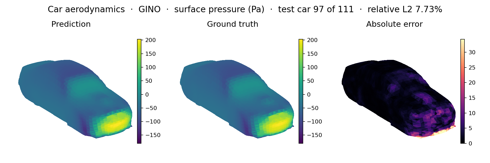
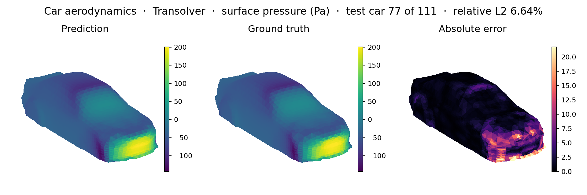
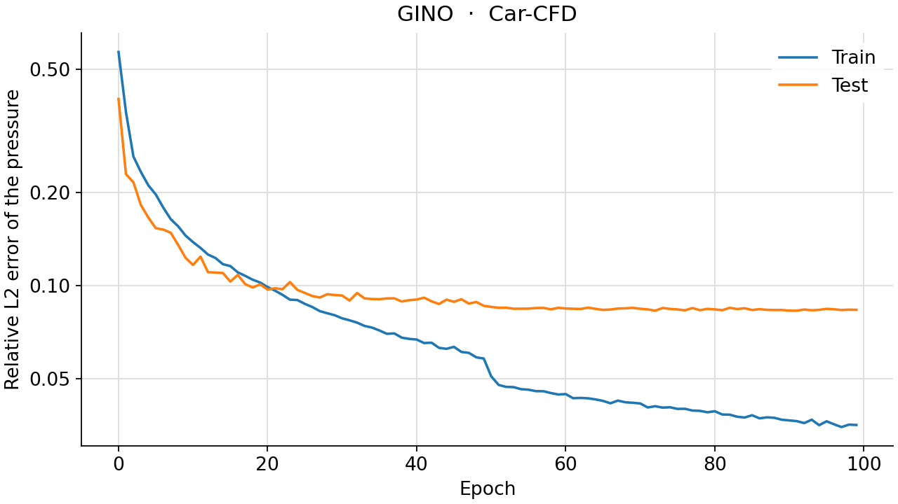
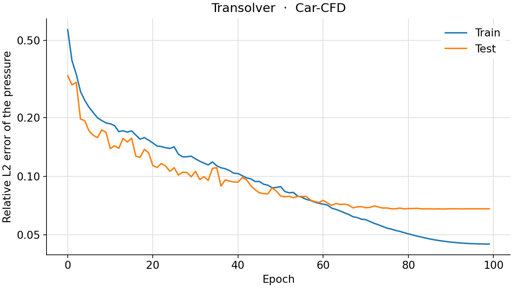

<!--
SPDX-FileCopyrightText: 2026 ZenteiQ AiTech Innovations Pvt. Ltd.
License notice: Documentation text and diagrams on this page are licensed
under CC BY 4.0. Source-code examples are licensed under LGPL-3.0-only
unless the example states otherwise.
-->

# Car-CFD: Results

The ScireX implementations of two published neural operators, [GINO](../../../api/models.md#scirex.models.GINO) [[1]](#ref1) and [Transolver](../../../api/models.md#scirex.models.Transolver) [[2]](#ref2), on the [Car-CFD benchmark](../README.md): the Shape-Net Car study of [[1]](#ref1), under the paper's data split, training budget and error metric. Each model predicts the surface pressure at the 3,586 mesh vertices of a car and is tested on 111 cars it never saw during training. The commands that reproduce a run are on the [problem card](../README.md#reproduce).

Only GINO is in the paper, so the GINO run is a reproduction. Transolver is a ScireX model, sized to GINO's parameter count so that a difference in accuracy is a difference in architecture; neither the GINO paper nor the Transolver paper reports this protocol, so there is no published Transolver number to match. No number here claims otherwise. The experimental GIWO is benchmarked separately, under [Experimental](../../experimental/car_cfd_giwo.md).

This is a different protocol from [ShapeNetCar](../../shapenetcar/results/comparative.md), which follows the Transolver paper's point-cloud setup on the same car geometries; the two are not comparable.

## Setup

Reported ("headline") runs, all trained from [`scripts/benchmarks/car_cfd/_config.py`](../../../../scripts/benchmarks/car_cfd/_config.py). GINO `paper` is the reproduction of the GINO paper's "GINO (decoder)" row; Transolver is a ScireX model and is sized to GINO's parameter count.

| Item | GINO (`paper`) | Transolver (`transolver_val`) |
|---|---|---|
| Model | [`GINO`](../../../api/models.md#scirex.models.GINO), decoder-only (`use_in_gno=False`): SDF on the 64³ grid, 4 FNO layers, width 64, 16³ Fourier modes, no factorisation, no normalisation, then the output graph kernel to the surface | [`Transolver`](../../../api/models.md#scirex.models.Transolver), irregular geometry, input per vertex = position (3) + unit normal (3), output 1 |
| Parameter count | 75,917,953 | 75,481,841 |
| Key hyperparameters | 64³ latent grid, output GNO radius 0.033, batch 1 | 8 layers, 8 heads, 32 slices, MLP ratio 2, width 1,136, batch 1 |
| Loss | Relative L2 of the normalised pressure | same |
| Optimiser and schedule | Adam ($\beta_2=0.999$, $\epsilon=10^{-6}$, weight decay 0), 100 epochs, lr 2.5e-4 halved at epoch 50 | Adam (same), 100 epochs, peak lr 1e-4, 1-epoch linear warm-up then cosine decay to 0 |
| Metric (with unit) | Relative L2 of the de-normalised pressure, mean over 111 test cars (dimensionless) | same |

The peak learning rate of `transolver_val` was chosen on the held-out last 50 training cars, not on the test cars.

What each model reads and predicts:

| Model | Input and output |
|---|---|
| GINO | Input: the signed distance function (SDF) of the car on a 64³ grid (decoder-only: no input graph kernel). Output: surface pressure at the 3,586 mesh vertices, through the output graph kernel |
| Transolver | Input: vertex position (scaled into [0, 1] with the dataset-wide bounding box) and unit vertex normal, 3,586 points per car, one token per vertex (the model reads the surface mesh directly, so there is no latent grid in between). Output: surface pressure at each vertex |

The pressure is normalised by one scalar mean and std, fitted on all loaded cars (train and test; see the [dataset guide](../../../dataset_guide/car_cfd.md#get-the-data)). The `paper` run is the reported GINO run, and `transolver_val` the reported Transolver run.

Reproduce. From the repo root, install the package first (the scripts import `scirex`): `pip install -e ".[benchmark]"` (the `benchmark` extra adds `vtk`).

```bash
# 1. Train and save the headline checkpoints
python scripts/benchmarks/car_cfd/train.py --run paper          # GINO, ~31 min on one RTX PRO 6000 Blackwell GPU
python scripts/benchmarks/car_cfd/train.py --run transolver_val # ~25 min
python scripts/benchmarks/car_cfd/train.py --run giwo_val       # experimental GIWO, needed by infer.py, ~21 min

# Optional: a validation screen (train on 450 cars, score the held-out 50)
python scripts/benchmarks/car_cfd/train.py --run transolver_val --val 50 --epochs 20

# 2. Re-score the saved checkpoints on the 111 test cars and redraw the
#    figures and metrics.json (no training). infer.py takes no --run: it
#    needs the headline checkpoints of GINO `paper`, `transolver_val` and
#    the experimental `giwo_val`, and stops with an error if one is missing.
python scripts/benchmarks/car_cfd/infer.py
```

`--run` takes one or more run names. Runs that already have a checkpoint are skipped. A non-zero `--seed` seeds the initialisation and the training-set shuffle and saves to `<run>_seed<N>/` (`--run transolver_val --seed 1`); if `transolver_val_seed1` and `transolver_val_seed2` exist, `infer.py` adds the seed mean and spread to `metrics.json` and the comparison figures. The `--val 50` screen saves to `<run>_val50/`, which `infer.py` ignores. Checkpoints are saved to `scripts/benchmarks/checkpoints/car_cfd/<run>/`, which is not committed to git: the weights (`params.msgpack`), the per-epoch history (`history.json`) and `config.json` with the run, the training settings and the git commit and library versions used. `infer.py` also writes `truth.vtu`/`pred.vtu` of the first test car to `scripts/benchmarks/vtk_outputs/car_cfd/gino/` for [ParaView](https://www.paraview.org/) (gitignored; skipped with `--no-vtk` or without the `vtk` package).

## Prediction

Surface pressure on the first test car: ground truth and each model's prediction (top), and its absolute error (bottom).

=== "GINO"

    

=== "Transolver"

    

## Accuracy

Relative L2 of the de-normalised surface pressure on the 111 test cars,
final epoch (lower is better):

Training error is the relative L2 of the normalised pressure the model trains on, a different metric from the test error.

| Model | Run | Parameters | Train error | Test error | Best test error (epoch) |
|---|---|---:|---|---|---|
| GINO (decoder), [[1]](#ref1) | – | – | 6.37% | 7.12% | – |
| GINO (encoder-decoder), paper | – | – | 7.95% | 9.47% | – |
| FNO (interp), paper | – | – | 9.65% | 9.42% | – |
| <span id="transolver">Transolver</span> | `transolver_val`, seed 0 | 75,481,841 | 4.49% | **6.81%** | 6.79% (88) |
| <span id="gino">GINO</span> | `paper` | 75,917,953 | 3.55% | 8.37% | 8.31% (91) |

**Transolver is the most accurate, and the only model below the paper's
7.12%.** It reads the surface mesh directly, with no latent grid in
between. Its learning rate was chosen without the test set (see [Learning-rate searches](#learning-rate-searches)), and it also beats the ScireX GINO `paper` run at the same parameter count and epoch budget. Every model here is a single seed (0), and the paper does not report a seed spread either, so this compares one run against one reported number. Re-scoring the saved checkpoint gives its final-epoch number again (6.810%).

**GINO is 1.2 points above the paper's own number** with every setting the
paper states, except the output GNO radius (see below). Its training error is far below the paper's (3.55% against
6.37%), so the gap is in generalisation, most likely from a detail the paper
does not state. This is a generalisation gap, not a capacity or optimisation shortfall: a train-to-test gap of 4.8 points against the paper's 0.75 means the model already fits the training cars harder than the paper's does, so more epochs would not help. The `paper` run beats the paper's encoder-decoder row (9.47%) and its FNO-interp row (9.42%), and re-scoring the saved checkpoint gives 8.37% again.

### Training curves

Training (dotted) and test (solid) relative L2 per epoch, headline runs:

=== "GINO"

    

=== "Transolver"

    

### Against the published reference

The Car-CFD GINO reaches 8.37%, 1.2 points above the paper's 7.12%. The paper's numbers are as reported, not re-run.

| | [[1]](#ref1) | Ours |
|---|---|---|
| GINO (decoder) | 7.12% | 8.37% |
| GINO (encoder-decoder) | 9.47% | – |
| FNO (interp) | 9.42% | – |
| Transolver | not in the paper | **6.81%** |

## Compute cost

Seconds per training epoch (500 cars, one at a time; the first epoch
includes JAX compilation):

| Model | Seconds per epoch | Training time (100 epochs) |
|---|---|---|
| Transolver | ~14 (about 28 ms per car) | ~25 min |
| GINO | ~17 | ~31 min |

Measured on one NVIDIA RTX PRO 6000 Blackwell GPU. The neighbour lists are built once per car before training (each car sits at a different distance from the fixed latent grid) and padded to one length, so the training step compiles once.

Transolver is the most accurate and cheaper to train than GINO. GINO's cost
is in its output graph kernel at width 64.

## Notes

- **GINO is a reproduction; Transolver is not in the paper.** No number here claims otherwise. The decoder-only GINO variant is this repo's addition, not something the released `neuralop` library exposes, so the paper's "GINO (decoder)" row is not reachable by running the public code as shipped.
- **Pressure statistics include the test cars.** The scalar mean and std used to normalise the pressure are fitted on all loaded cars, the 500 training and 111 test cars together, as in neuraloperator's reference loader. The numbers on this page, the validation screens included, were produced this way. See the [dataset guide](../../../dataset_guide/car_cfd.md#get-the-data).
- **One seed.** Each headline run is a single run, so there is no estimate of run-to-run noise here.

### Learning-rate searches

The peak learning rate of `transolver_val` was chosen on a validation split (train on the first 450 training cars, score the held-out last 50, `train.py --val 50`), not on the test cars.

Transolver's own recipe (peak lr 1e-3) diverged at this width, so only the
optimiser was tuned, with 20-epoch screens: a 1-epoch linear warm-up into
cosine decay, compressed to 20 epochs.

The first screens were ranked by *test* error, which makes a test number
chosen that way optimistic, since the test set helped pick the settings.
`transolver_val` therefore redoes the one choice that mattered, the peak
learning rate, on a validation split: train on the first 450 training cars,
score the held-out last 50 (`train.py --val 50`). Validation error at epoch
20:

| Peak lr | Validation error |
|---|---|
| 2.5e-5 | 10.04% |
| 5e-5 | 9.50% |
| 7.5e-5 | 9.25% |
| **1e-4** | **9.19%** |
| 7.5e-5, gradient clip 1.0 | 11.76% |

1e-4 won and was retrained on all 500 cars.

The earlier test-set screens (full 500/111 split, test error at epoch 20):

| Peak lr | Clip (global norm) | Other | Test error |
|---|---|---|---|
| 1e-3 | 1.0 | | 20.27% |
| 5e-4 | 1.0 | | 15.98% |
| 5e-4 | 0.1 | | 15.62% |
| 5e-4 | 1.0 | Adam β2 0.99 | 18.60% |
| 2.5e-4 | 1.0 | | 13.64% |
| 2.5e-4 | 1.0 | Adam ε 1e-8 | 14.48% |
| 2.5e-4 | 1.0 | batch 4 | 19.41% |
| 1e-4 | 1.0 | | 12.61% |
| 5e-5 | 1.0 | | 10.85% |
| 2.5e-5 | 1.0 | | 10.63% |
| 1e-5 | 1.0 | | 11.53% |
| 1e-4 | none | | 9.36% |
| **7.5e-5** | **none** | | **9.23%** |
| 5e-5 | none | | 9.45% |
| 2.5e-5 | none | | 10.45% |

Two findings carried the result. First, the peak learning rate: at 75M
parameters, Transolver wants a step about 10x smaller than its paper's 1e-3
for the 3.9M-parameter model, consistent with the usual inverse-width
scaling. Second, no gradient clipping: at the same rate, clipping at norm
1.0 left test error 1.4 points higher (10.85% against 9.45% at 5e-5), which
is what a clip that is active on most steps does, acting as a further
learning-rate cut. Batch 4 (a quarter of the steps), Adam β2 0.99 and ε 1e-8
were all worse.

### Sizing

Transolver is sized to GINO's `paper` budget (75,917,953 parameters).

- **Transolver.** The model keeps the Transolver paper's ShapeNetCar shape (8 layers, 8 heads, MLP ratio 2, 32 slices) and is widened to GINO's parameter budget: 75,481,841 parameters (-0.57%), width 1,136 (the closest to the budget that divides by the head count; 1,144 gives +0.83%). The input is the Transolver paper's car input (position, SDF, normal) without the SDF, which is zero on the surface where the pressure lives.

### The paper's settings, not the demo's

[`src/scirex/config/gino_carcfd_config.py`](../../../../src/scirex/config/gino_carcfd_config.py) was copied from neuraloperator's own
`config/gino_carcfd_config.py`, which is a reduced-cost demo, not the
configuration the paper reports: a 32³ latent grid, a constant learning rate
of 1e-3, and a Tucker-factorised, rank-0.4, instance-normalised FNO, none of
which the paper uses.

The paper's protocol is a 64³ latent grid, a graph-kernel
radius of 0.055, Adam, 100 epochs, and a learning rate of 2.5e-4 halved at
epoch 50. Its best row, "GINO (decoder)", has no input graph kernel: the SDF
on the latent grid is the model's whole input. The released `neuralop`
library cannot run that variant (`GINO.encode()` always runs the input graph
kernel), so this repo's [`GINO`](../../../api/models.md#scirex.models.GINO) adds a `use_in_gno` flag, and the `paper` run
sets `use_in_gno=False`. It also uses the reference FNO (no factorisation,
full rank, no normalisation) and plain Adam.

#### The GNO radius

The `paper` run sets the config field `gno_radius=0.055`, but [`GINO`](../../../api/models.md#scirex.models.GINO) never
reads that field: its graph kernels use `in_gno_radius` and
`out_gno_radius`, which default to 0.033. **The `paper` run therefore
trained with radius 0.033**; setting `out_gno_radius=0.055` is what applies
the paper's radius.

## References

1. <span id="ref1"></span>Li et al., *Geometry-Informed Neural Operator for Large-Scale 3D PDEs*, NeurIPS 2023. <https://arxiv.org/abs/2309.00583>
2. <span id="ref2"></span>Wu et al., *Transolver: A Fast Transformer Solver for PDEs on General Geometries*, ICML 2024. <https://arxiv.org/abs/2402.02366>
