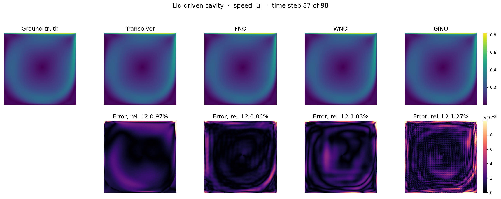
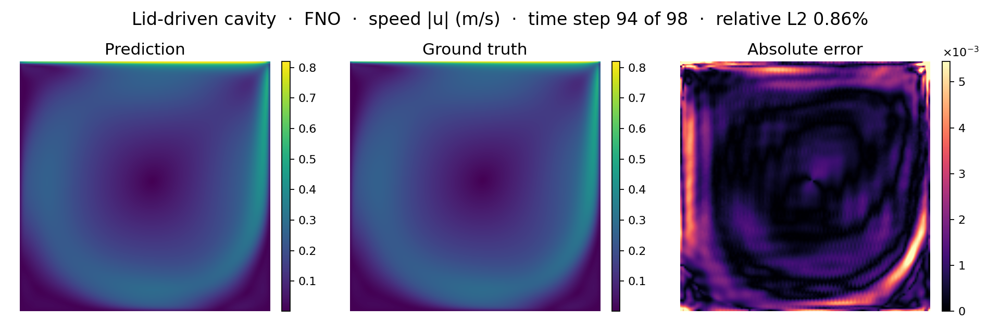
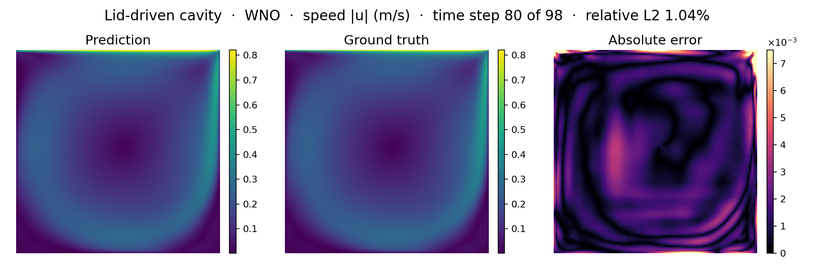
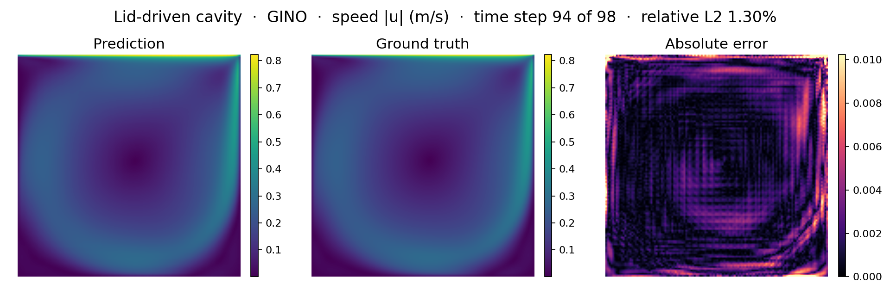
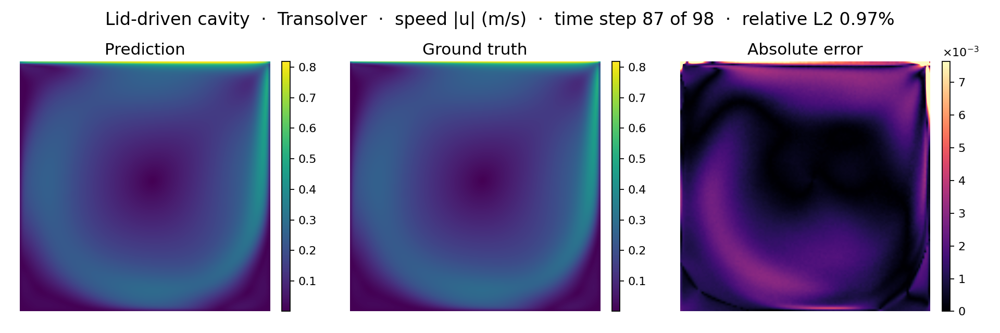
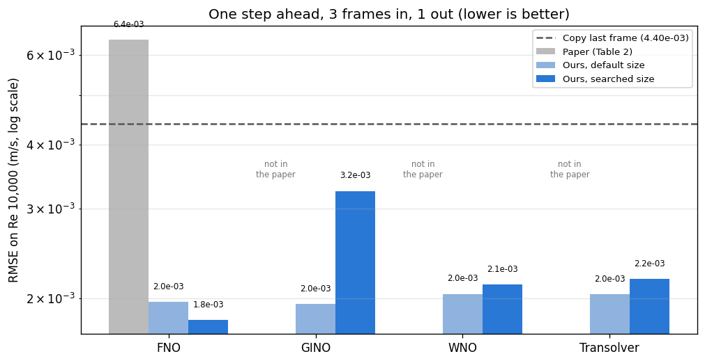
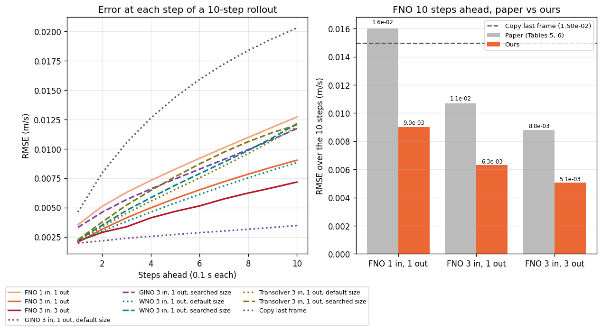
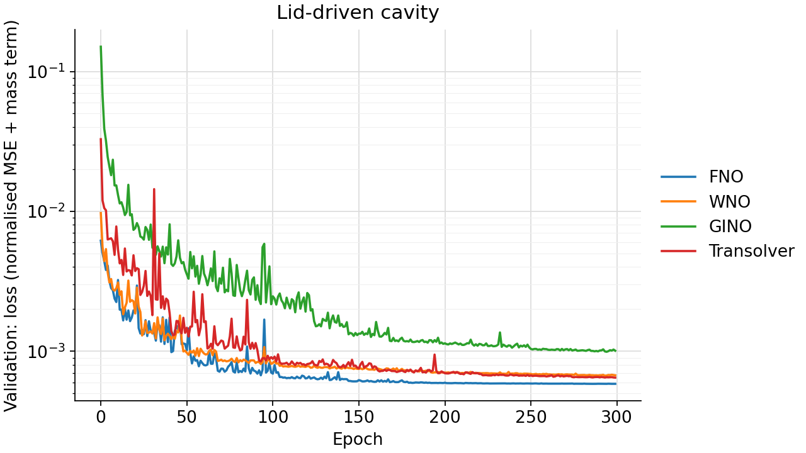
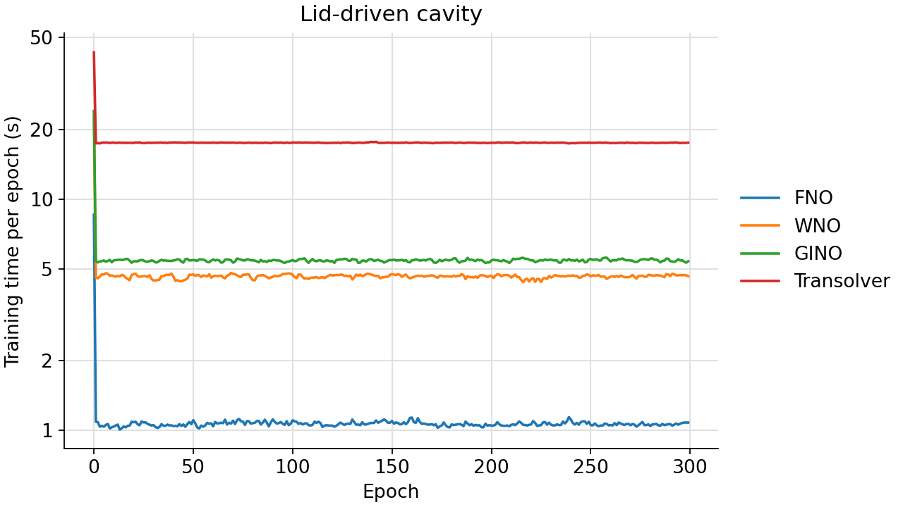

<!--
SPDX-FileCopyrightText: 2026 ZenteiQ AiTech Innovations Pvt. Ltd.
License notice: Documentation text and diagrams on this page are licensed
under CC BY 4.0. Source-code examples are licensed under LGPL-3.0-only
unless the example states otherwise.
-->

# Lid-Driven Cavity: Results

The ScireX implementations of four published neural operators, [FNO](../../../api/models.md#scirex.models.FNO) [[1]](#ref1), [WNO](../../../api/models.md#scirex.models.WNO) [[2]](#ref2), [GINO](../../../api/models.md#scirex.models.GINO) [[3]](#ref3) and [Transolver](../../../api/models.md#scirex.models.Transolver) [[4]](#ref4), on the [lid-driven cavity benchmark](../README.md). The benchmark repeats the study of [[5]](#ref5), with the same data split, training settings and error metric, so the numbers can be compared with its tables directly. Each model sees the flow at 3 past time steps, predicts the next one, and is tested on a lid speed it never saw during training (Re 10,000). The commands that reproduce a run are on the [problem card](../README.md#reproduce).

Only the FNO is in the paper, and this benchmark did not run the authors' code: the FNO is compared with the numbers the paper reports. The WNO, GINO and Transolver are ScireX models, each sized to the FNO's parameter count so that a difference in accuracy is a difference in architecture. They have no paper number, so they are measured against the ScireX FNO at a matched parameter count and against the copy-last-frame baseline. No number here claims otherwise.

## Setup

One row per model, default size (`<model>_3to1`), 3 frames in, 1 frame out. All four are matched to the FNO's parameter count (parameters are counted as trained real values; complex spectral weights count twice).

| Model | Parameter count | Key hyperparameters |
|---|---|---|
| FNO (`fno_3to1`, [`scirex.models.FNOClassic2d`](../../../api/models.md#scirex.models.FNOClassic2d)) | 1,056,739 | 1 layer, 16 × 16 modes, width 32; input window folded into 9 channels; split real/imaginary spectral weights; appends its own 2 coordinate channels |
| WNO (`wno_3to1`, [`scirex.models.WNO`](../../../api/models.md#scirex.models.WNO)) | 1,042,073 | 3 layers, decomposition level 5, 21 hidden channels, wavelet db6, float32; appends its own 2 coordinate channels |
| GINO (`gino_3to1`, [`scirex.models.GINO`](../../../api/models.md#scirex.models.GINO)) | 1,058,861 | 3 spectral layers, 16 modes, width 34, 32 × 32 latent grid; graph-kernel MLPs (64, 64), 32 GNO channels; input radius 1.5 and output radius 1.0 times the latent spacing; input kernel `nonlinear_kernelonly` |
| Transolver (`transolver_3to1`, [`scirex.models.Transolver`](../../../api/models.md#scirex.models.Transolver)) | 1,093,851 | 3 layers, hidden width 128, 64 slices, 8 heads, MLP ratio 1, `unified_pos=True` with 8 × 8 reference grid, `geometry="structured_2d"` |

`fno_3to1` and the matched sizes of the other three are the default size. The `best_<model>_3to1` runs are the sizes that won the [model size search](#model-size-search), picked by validation loss, and `fno_1to1` and `fno_3to3` are the paper's time-window study. All runs are defined in [`scripts/benchmarks/cavity/_config.py`](../../../../scripts/benchmarks/cavity/_config.py):

| Run | Model | Size | Frames in / out | Parameters |
|---|---|---|---|---|
| `fno_3to1` | FNO | 1 layer, 16 modes, width 32 | 3 / 1 | 1,056,739 |
| `fno_1to1` | FNO | as `fno_3to1` | 1 / 1 | 1,056,547 |
| `fno_3to3` | FNO | as `fno_3to1` | 3 / 3 | 1,057,513 |
| `best_fno_3to1` | FNO | 1 layer, 8 modes, width 32 | 3 / 1 | 270,307 |
| `wno_3to1` | WNO | 3 layers, level 5, 21 channels, db6 | 3 / 1 | 1,042,073 |
| `best_wno_3to1` | WNO | 1 layer, level 4, 32 channels, db6 | 3 / 1 | 1,333,155 |
| `gino_3to1` | GINO | 3 layers, 16 modes, width 34, 32 × 32 latent grid | 3 / 1 | 1,058,861 |
| `best_gino_3to1` | GINO | 1 layer, 4 modes, width 16, 32 × 32 latent grid | 3 / 1 | 52,260 |
| `transolver_3to1` | Transolver | 3 layers, width 128, 64 slices, 8 heads | 3 / 1 | 1,093,851 |
| `best_transolver_3to1` | Transolver | 3 layers, width 128, 16 slices, 8 heads | 3 / 1 | 1,091,403 |

Each model is the package's own class over the same 3-frame input window; the benchmark adds only the adapter that folds the window into the channel axis and splits the output back into frames. The GINO reads the cells as a point cloud with a coarse latent grid carrying the spectral layers; the Transolver reads them as tokens, with its physics attention learning the slices.

Train the runs of a model; each model's size search is optional (10 runs of 50 epochs):

```bash
python scripts/benchmarks/cavity/train.py --run fno_3to1 fno_1to1 fno_3to3 best_fno_3to1
python scripts/benchmarks/cavity/train.py --run wno_3to1 best_wno_3to1
python scripts/benchmarks/cavity/train.py --run gino_3to1 best_gino_3to1
python scripts/benchmarks/cavity/train.py --run transolver_3to1 best_transolver_3to1
python scripts/benchmarks/cavity/train.py --search fno    # or wno, gino, transolver
```

Common to all models:

| | |
|---|---|
| Loss | $\mathcal{L}$ = MSE on the normalised fields + 0.1 x MC, as defined under Governing equations |
| Optimiser and schedule | Adam, learning rate $10^{-3}$, batch size 8; learning rate halved after 10 epochs without a lower validation loss; early stopping after 50 epochs without a lower validation loss; at most 300 epochs; the weights of the epoch with the lowest validation loss are saved; seed 0 (parameter initialisation and batch shuffling) |
| Normalisation | Per-channel zero mean, unit standard deviation ([`UnitGaussianNormalizer`](../../../api/data.md#scirex.data.UnitGaussianNormalizer)), statistics from the training windows only |
| Metric (with unit) | RMSE in m/s pooled over $p, U_x, U_y$ on Re 10,000, one step ahead (also 10 steps ahead, 1 s) |
| Baseline | Copy the last input frame: 4.40e-3 m/s one step, 1.50e-2 m/s over 10 steps |
| Cases | Training: Re 1,000, 2,000, 4,000, 6,000, 14,000, 16,000, 18,000, 20,000. Test: Re 10,000 (lid speed 1 m/s), never seen in training. Re 8,000 and 12,000 are left out, as in the paper |
| Frames and grid | First 10 s, one frame every 0.1 s (101 frames per case); fields $p$, $U_x$, $U_y$ on 128 × 128 cells. The data gives values at the 129 × 129 cell corners, so each cell value is the average of its 4 corners |
| Validation and weights | 10% of the training windows, picked at random (seed 0); the weights of the epoch with the lowest validation loss are saved and reported |
| Metric note | The unit of $p$ is not confirmed, so the pooled RMSE is not strictly in m/s (see the [dataset guide](../../../dataset_guide/cavity.md#how-the-benchmark-reads-the-data)) |
| Hardware | One NVIDIA GB10 GPU |

## Prediction

Speed |u| on the test case at t = 1.0 s, predicted one step ahead. The bottom row shows the error of each prediction, on one shared colour scale. "Copy last frame" is the simplest possible guess: the previous frame, unchanged. The tabs show the default size of every model together, then each model at its default and searched sizes.

=== "All four"

    

=== "FNO"

    

=== "WNO"

    

=== "GINO"

    

=== "Transolver"

    

## Accuracy

One step ahead, RMSE in m/s on Re 10,000 (lower is better):



| Model | [[5]](#ref5), 300 epochs | Ours, default size | Ours, searched size | Default size vs FNO |
|---|---|---|---|---|
| <span id="fno">FNO</span> | 6.43e-3 (6.83e-3 at 50 epochs) | 1.97e-3 | **1.81e-3** | |
| <span id="gino">GINO</span> | not in the paper | **1.95e-3** | 3.25e-3 | -0.9% |
| <span id="wno">WNO</span> | not in the paper | **2.04e-3** | 2.13e-3 | +3.7% |
| <span id="transolver">Transolver</span> | not in the paper | **2.04e-3** | 2.18e-3 | +3.6% |
| Copy last frame | | 4.40e-3 | | |

The paper [[5]](#ref5) uses only the FNO, so the other three have no paper number. For them the bold figure is the default (FNO-matched) size, which is the better of their two sizes here.

- **At a matched parameter count the four operators sit within 4% of each other one step ahead.** The GINO is 0.9% ahead of the FNO, the WNO and the Transolver 3.7% and 3.6% behind. A point cloud, a wavelet basis or a learned decomposition changes one-step accuracy little.
- **Every model beats copying the last frame** (4.40e-3; 5.36e-3 for velocity only), at both sizes. The paper's FNO number (6.43e-3) does not: the flow changes slowly over most of the first 10 s, so the simple guess is already good.
- **WNO:** 2.04e-3 against the FNO's 1.97e-3 on a model 1.4% smaller. A local wavelet basis in place of a global Fourier one neither helps nor hurts much. Its searched size has 28% more parameters and the same validation loss (6.6911e-4 against 6.6948e-4), so the extra capacity did not transfer to the unseen Reynolds number.
- **GINO:** 1.95e-3, level with the FNO (parameters within 0.2%). Going through a point cloud and a 32 × 32 latent grid costs nothing one step ahead, and it wins over ten steps (below).
- **Transolver:** 2.04e-3 (2.0387e-3 against the WNO's 2.0409e-3), 3.6% behind the FNO on a model 3.5% larger. It is the only model whose validation loss was still falling at the last epoch, so a longer budget might close the gap; that is untested.
- **The searched size is not reliably the better one.** It helps the FNO (1.81e-3 against 1.97e-3) and hurts the other three, most of all the GINO (3.25e-3 against 1.95e-3). See [Model size search](#model-size-search).

Per field, one step ahead, for every run:

| Run | RMSE | Velocity only | p | Ux | Uy |
|---|---|---|---|---|---|
| `best_fno_3to1` | 1.81e-3 | 2.21e-3 | 3.12e-4 | 2.42e-3 | 1.98e-3 |
| `fno_3to1` | 1.97e-3 | 2.40e-3 | 3.34e-4 | 2.67e-3 | 2.10e-3 |
| `fno_3to3` (3 frames out) | 2.76e-3 | 3.37e-3 | 4.41e-4 | 3.73e-3 | 2.96e-3 |
| `fno_1to1` | 3.40e-3 | 4.14e-3 | 6.16e-4 | 4.96e-3 | 3.12e-3 |
| `gino_3to1` | 1.95e-3 | 2.37e-3 | 4.29e-4 | 2.51e-3 | 2.22e-3 |
| `best_gino_3to1` | 3.25e-3 | 3.95e-3 | 6.76e-4 | 4.18e-3 | 3.69e-3 |
| `wno_3to1` | 2.04e-3 | 2.48e-3 | 3.91e-4 | 2.56e-3 | 2.41e-3 |
| `best_wno_3to1` | 2.13e-3 | 2.59e-3 | 4.11e-4 | 2.81e-3 | 2.35e-3 |
| `transolver_3to1` | 2.04e-3 | 2.48e-3 | 3.75e-4 | 2.72e-3 | 2.22e-3 |
| `best_transolver_3to1` | 2.18e-3 | 2.65e-3 | 4.68e-4 | 2.86e-3 | 2.43e-3 |

### Ten steps ahead

To go 10 steps (1 s) ahead, each prediction is fed back in as input. The
10-step RMSE below is over all 10 predicted steps.



| Run | Parameters | One step | 10 steps | Ratio |
|---|---|---|---|---|
| `gino_3to1` | 1,058,861 | 1.95e-3 | **2.80e-3** | 1.4x |
| `fno_3to3` (the paper's best setting) | 1,057,513 | 2.76e-3 | 5.08e-3 | 1.8x |
| `wno_3to1` | 1,042,073 | 2.04e-3 | 6.04e-3 | 3.0x |
| `best_fno_3to1` | 270,307 | 1.81e-3 | 6.29e-3 | 3.5x |
| `fno_3to1` | 1,056,739 | 1.97e-3 | 6.31e-3 | 3.2x |
| `transolver_3to1` | 1,093,851 | 2.04e-3 | 7.66e-3 | 3.8x |
| `best_wno_3to1` | 1,333,155 | 2.13e-3 | 7.92e-3 | 3.7x |
| `best_gino_3to1` | 52,260 | 3.25e-3 | 8.17e-3 | 2.5x |
| `best_transolver_3to1` | 1,091,403 | 2.18e-3 | 8.39e-3 | 3.8x |
| `fno_1to1` | 1,056,547 | 3.40e-3 | 8.99e-3 | 2.6x |
| Copy last frame | 0 | 4.40e-3 | 1.50e-2 | 3.4x |

"Ratio" is the 10-step error divided by the one-step error: how fast a model
degrades when fed its own predictions.

**The GINO is the most stable model over the rollout, by a wide margin.** `gino_3to1` has the lowest 10-step error of every run, 1.8x better than the FNO's best setting (3 frames in, 3 out, which the paper found best) and 2.3x better than the equally sized FNO, from a 3-in 1-out window. It also degrades the most slowly: 1.4x from one step to ten, against 3.0x to 3.8x for the three models that keep the field at 128 × 128.

That points at the resolution bottleneck, not the operator. The FNO, WNO and Transolver all hold 128 × 128 throughout and degrade alike; the GINO's output passes through a 32 × 32 latent grid, and detail it cannot represent is detail it cannot get wrong and feed back in. This is a plausible reading, not a tested one: it would take a sweep of the latent resolution against the rollout horizon.

The WNO's 10-step error is 4.3% better than the equally sized FNO's (6.04e-3 against 6.31e-3), the reverse of its one-step ranking. The Transolver degrades faster than any other FNO-matched run, 3.8x, ending at 7.66e-3 (21% worse than the FNO): its slice decomposition averages cells into tokens and scatters straight back, so nothing is represented on a coarser grid. `fno_3to3` reaches 5.08e-3 because predicting 3 frames at a time needs fewer feedback steps to cover 10 frames.

One-step accuracy does not predict this: `best_fno_3to1` is the most accurate model one step ahead and 3.5x worse after ten. Choosing a model on single-step validation loss, as the paper's search does, does not select for rollout stability.

### Training curves

Training and validation loss per epoch of the 3-frames-in runs, default size
(left) and searched size (right):



### Against the published reference

The paper [[5]](#ref5) reports an FNO on this dataset (numbers as reported, not re-run). The other three operators are not in the paper.

| Setting (FNO) | [[5]](#ref5) | Ours |
|---|---|---|
| 3 frames in, 1 out, one step ahead | 6.43e-3 | 1.97e-3 (searched size 1.81e-3) |
| 1 frame in, 1 out, one step ahead | 6.07e-3 | 3.40e-3 |
| 1 frame in, 1 out, one step ahead, velocity only | 6.07e-3 | 4.14e-3 |
| 1 frame in, 1 out, 10 steps ahead | 1.60e-2 | 8.99e-3 |
| 3 frames in, 1 out, 10 steps ahead | 1.07e-2 | 6.31e-3 |
| 3 frames in, 3 out, 10 steps ahead (the paper's best result) | 8.79e-3 | 5.08e-3 |

"Ours" is the ScireX default size unless noted. The paper's 300-epoch run (mass conservation weight 0.1) is its closest setting to ours; it is 3.3x worse than ours one step ahead (3.6x against the searched size) and 1.7x worse in its best 10-step setting. The paper found 1 input frame best; here 3 frames give 1.7x lower error than 1 (1.97e-3 against 3.40e-3), and 3 in with 3 out gives the lowest error 10 steps ahead, as in the paper.

Part of the gap is the FNO block (the ScireX [`FNOClassic2d`](../../../api/models.md#scirex.models.FNOClassic2d) adds a pointwise MLP the paper's FNO does not have) and part the mass conservation term; see [Differences from the paper](#differences-from-the-paper).

## Compute cost

Seconds per training epoch (the first epoch includes JAX compilation):



| Run | Seconds per epoch | First epoch | Epochs | Total |
|---|---|---|---|---|
| `fno_3to1` | 1.1 s | 8.6 s | 300 | 5.5 min |
| `best_fno_3to1` | 1.2 s | 8.8 s | 300 | 5.9 min |
| `fno_1to1` | 1.2 s | 4.2 s | 300 | 5.8 min |
| `fno_3to3` | 1.2 s | 7.9 s | 300 | 6.1 min |
| `gino_3to1` | 5.4 s | 24.0 s | 300 | 27.5 min |
| `best_gino_3to1` | 4.9 s | 20.0 s | 300 | 24.8 min |
| `wno_3to1` | 4.6 s | 22.6 s | 300 | 23.5 min |
| `best_wno_3to1` | 2.9 s | 15.5 s | 300 | 14.6 min |
| `transolver_3to1` | 17.5 s | 43.1 s | 300 | 88.0 min |
| `best_transolver_3to1` | 12.9 s | 41.9 s | 300 | 64.8 min |

The FFT does the heavy lifting, so the FNO is the cheapest by a wide margin (one layer is enough for a field this smooth): at the same parameter count the Transolver costs about 16x, the GINO about 5x and the WNO about 4x. The cost is not in the weights:

- **Transolver:** not the attention among the 64 slice tokens, but getting there and back. Every layer projects all 16,384 cells into slice space with two 3 × 3 convolutions of width 128, then gathers and scatters with an einsum over cells, heads and slices. `best_transolver_3to1` costs 12.9 s with a quarter of the slices.
- **GINO:** an MLP on every edge of the neighbour graph. The two sizes cost almost the same per epoch despite a 20x difference in parameters. The neighbour search is not the cost: the mesh is fixed, so it runs once when the model is built.
- **WNO:** a full wavelet decomposition and reconstruction in every layer, one sequential filter-bank pass per level, unlike the FFT. Hence `wno_3to1` (3 layers, level 5) costs 4.6 s while `best_wno_3to1` (1 layer, level 4) costs 2.9 s despite 28% more parameters.

## Notes

### Model size search

As in the paper, each model was tried at 10 random sizes for 50 epochs and the
sizes ranked by validation loss. The size ranges follow the paper's Section
2.2; the GINO reuses the FNO's ranges and adds the latent grid resolution, the
WNO puts the decomposition level and channel width where the FNO's modes and
width sit, and the Transolver puts the slice count and channel width there.

| Model | Best RMSE at 50 epochs | Sizes that beat the baseline* | Smallest size that beats it |
|---|---|---|---|
| FNO | 2.49e-3 | 10 of 10 | 5,947 parameters (3.40e-3) |
| WNO | 2.82e-3 | 10 of 10 | 51,883 parameters (3.27e-3) |
| Transolver | 3.47e-3 | 9 of 10 | 28,939 parameters (4.11e-3) |
| GINO | 5.01e-3 | 0 of 10 | none; best size is 52,260 parameters (5.01e-3) |

\* The copy-last-frame baseline (4.40e-3). For the FNO the paper's 300-epoch
number (6.43e-3) is also beaten by all 10 sizes after only 50 epochs, against
the paper's 6.83e-3 at 50 epochs.

The search's verdict was wrong for three of the four models, each in its own way:

- **GINO: the budget was too short.** All ten sizes scored between 5.01e-3 and 6.91e-3 at 50 epochs, every one worse than the copy-last-frame baseline, so the ranking is nearly flat. It picked the smallest size (52,260 parameters), which at 300 epochs reaches 3.25e-3 against 1.95e-3 for the FNO-matched size. The GINO converges more slowly, so 50 epochs ranks its sizes before the larger ones show what they can do. This is a limit of the paper's search protocol, not of the GINO.
- **WNO: the extra capacity did not transfer.** The sizes spread from 1.54e-3 to 2.15e-3 in validation loss (1.4x), so 50 epochs does separate them. It picked the *largest* (1,333,155 parameters), which at 300 epochs reaches 2.13e-3 against 2.04e-3 for the matched size, at the same validation loss to four significant figures.
- **Transolver: it changed one knob, the wrong way.** The sizes spread from 1.52e-3 to 2.69e-3 (1.8x), and nine of ten beat the baseline at 50 epochs. The winner differs from the matched size only in the slice count (16 instead of 64, 0.2% of the parameters) and is worse at 300 epochs (2.18e-3 against 2.04e-3; validation loss 7.02e-4 against 6.48e-4). Within the search the validation ranking and the test error disagree: the validation winner (1.52e-3) scores 3.66e-3 on the held-out Reynolds number, while the third-ranked size (105,483 parameters, 1.77e-3) scores 3.47e-3, the best of the ten.
- **FNO: the one that worked, modestly.** Every size beats the paper's FNO after 50 epochs, including one with 5,947 parameters. The winner wins one step ahead (1.81e-3 against 1.97e-3) and ties over ten (6.29e-3 against 6.31e-3), with a quarter of the parameters.

All three failures have the same cause: the validation split is drawn from the training Reynolds numbers, and this benchmark tests one that was never seen. Every size and its score is listed in each model's `metrics.json` (`assets/benchmarks/cavity_<model>/`) under `search`.

### Differences from the paper

- **Mass conservation term.** The paper gives this term in units that do not match a mass flux, so its exact scale cannot be copied. This benchmark uses the mean absolute divergence of the predicted velocity, made dimensionless with L = 0.1 m and U = 1 m/s, at the paper's weight of 0.1.
- **FNO block.** The ScireX [`FNOClassic2d`](../../../api/models.md#scirex.models.FNOClassic2d) runs a small pointwise MLP on each spectral convolution's output before adding the skip connection. Neither the paper nor the original FNO release does this. It is kept because it measurably helps across this repo's FNO benchmarks, and because using the package's own FNO rather than a copy written for this page is what keeps the two in step.

### Mass conservation

Mean absolute divergence of the predicted fields, default size, with the same soft constraint at the same weight:

| Model | Mean absolute divergence |
|---|---|
| FNO | 6.56e-2 |
| Transolver | 8.17e-2 |
| WNO | 7.75e-2 |
| GINO | 1.15e-1 |

The GINO's output is built by summing graph-kernel contributions at each point independently, with no mechanism tying neighbouring points together the way a convolution does, so the divergence term has less structure to work with. It is the more accurate model over a rollout regardless. The WNO and the Transolver keep the field on the grid throughout, which is what puts them close to the FNO.

### Reading the results

- The WNO and the Transolver are tested ideas that did not pay off at a matched budget (WNO: 3.7% worse one step ahead, 4.3% better over ten; Transolver: 3.6% worse one step, 21% worse over ten, 16x more expensive per epoch). The wavelet basis was worth testing because a cavity localises its difficulty in the corners and under the lid, the Transolver because it learns its decomposition. A tested idea that did not pay off is worth the same page space as one that did.
- The Transolver's budget is a caveat: it is the only operator whose validation loss was still falling at epoch 300, so the paper's budget, kept to stay comparable, may favour the cheaper models. The benchmark did not extend it for one model, because that would break the comparison.
- The GINO's numbers are not bit-reproducible. Its graph kernels reduce with a scatter-add whose summation order the GPU does not fix, so re-running `infer.py` on the same checkpoint moves `best_gino_3to1`'s 10-step RMSE in the third significant figure (8.17e-3 and 8.18e-3 have both come out). The page quotes the committed `metrics.json`.

### Sizing

Each model is sized to the parameter budget of the FNO's `fno_3to1` (1,056,739), so that a difference in accuracy is a difference in architecture. A parameter count is the number of trained real values; the complex spectral weights count twice.

Parameters, layers and widths are in the [Setup](#setup) table (WNO -1.4%, GINO +0.2%, Transolver +3.5% against the FNO).

| | `fno_3to1` | `wno_3to1` | `gino_3to1` | `transolver_3to1` |
|---|---|---|---|---|
| Basis | Fourier, lowest 16 × 16 modes kept | db6 wavelet, 5 levels deep, 14 × 14 approximation band | Fourier on a 32 × 32 latent grid, 16 modes | 64 slices per layer, learned from the data |
| Sees | the 128 × 128 grid directly | the 128 × 128 grid directly | 16,384 points, via a 32 × 32 latent grid | 16,384 cells as tokens |
| Weights are | global in space | local in space | global on the latent grid | attached to whichever cells a slice gathers |

- **WNO.** The parameter count moves in coarse steps, about 10% per channel at this size, because every channel widens four subband weight tensors at once. With the layer count at the paper's maximum of 3, the closest point of the paper's search space is level 5 with 21 channels, 1.4% below the FNO. The db6 wavelet is not searched; it is the family of the [WNO Darcy benchmark](../../darcy/results/comparative.md#wno), following [[2]](#ref2). A deeper level leaves a smaller approximation band, so it costs fewer parameters, the opposite of Fourier modes: levels 3 to 5 span 25 × 25 coefficients down to 14 × 14. The WNO trains in float32, not in its bfloat16 default: at this size, eight epochs each, float32 took 4.08 s per epoch and reached a validation loss of 2.71e-3, and bfloat16 took 4.32 s and reached 5.17e-3, because the subband weights stay float32 either way.
- **GINO.** The GINO treats the 16,384 cell centres as a point cloud: a graph kernel integrates them onto a coarse regular latent grid, the spectral layers run there, and a second graph kernel returns to the points. Holding the paper's spectral knobs at their maximum (3 layers, 16 modes) and solving for the width gives 34; the width is not restricted to powers of two, because the paper's search space does not cover this model. It adds no coordinate channels, because it applies its own positional embedding inside both graph kernels. The mesh never changes, so both neighbour searches run once when the model is built and are reused for every forward pass. The search radii are multiples of the latent spacing, not absolute distances; a radius that leaves a point without a neighbour raises an error.
- **Transolver.** The width is the only knob that moves the budget, and the count is quadratic in it, because a layer is dominated by two 3 × 3 convolutions of width by width. The width must also be a multiple of the head count. The neighbouring multiples of 8 give 962,964 parameters (8.9% below the FNO) and 1,233,076 (16.7% above), so 128 at 3.5% above is the closest point. Head count, MLP ratio, reference grid and kernel width are fixed at the values of [[4]](#ref4). Moving across the whole slice range changes the parameter count by 0.2%, so capacity here is layers and width; slices buy expressivity. `geometry="structured_2d"` projects into slice space with 3-wide convolutions and keeps the neighbourhood the grid gives for free. `unified_pos=True` encodes every cell by its distance to each point of an 8 × 8 reference grid, as in the [Transolver Darcy benchmark](../../darcy/results/comparative.md#transolver). No coordinates reach the model as channels, matching the FNO and the WNO, which append their own.

## References

1. <span id="ref1"></span>Li et al., *Fourier Neural Operator for Parametric Partial Differential Equations*, ICLR 2021. <https://arxiv.org/abs/2010.08895>
2. <span id="ref2"></span>Tripura and Chakraborty, *Wavelet Neural Operator for Solving Parametric Partial Differential Equations in Computational Mechanics Problems*, Computer Methods in Applied Mechanics and Engineering 404, 115783 (2023). <https://arxiv.org/abs/2205.02191>
3. <span id="ref3"></span>Li et al., *Geometry-Informed Neural Operator for Large-Scale 3D PDEs*, NeurIPS 2023. <https://arxiv.org/abs/2309.00583>
4. <span id="ref4"></span>Wu et al., *Transolver: A Fast Transformer Solver for PDEs on General Geometries*, ICML 2024. <https://arxiv.org/abs/2402.02366>
5. <span id="ref5"></span>Costa Rocha et al., *Deep Neural Network Modeling for CFD Simulations: Benchmarking the Fourier Neural Operator on the Lid-Driven Cavity Case*, Applied Sciences 13(5), 3165 (2023). <https://doi.org/10.3390/app13053165>
