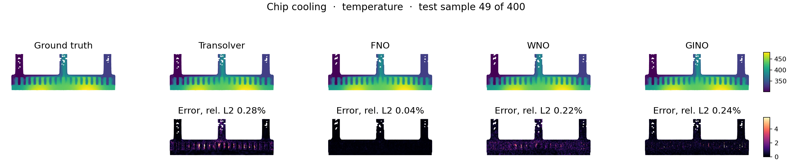
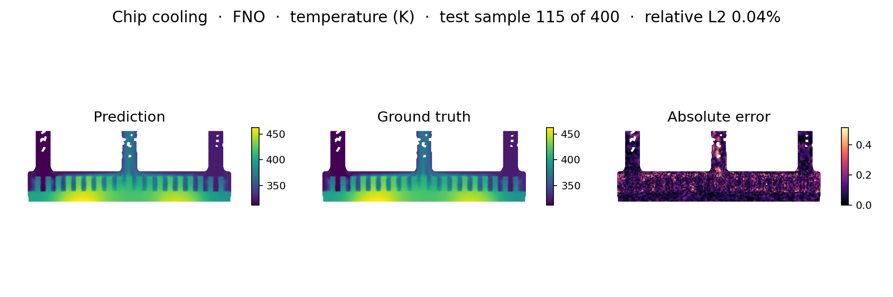
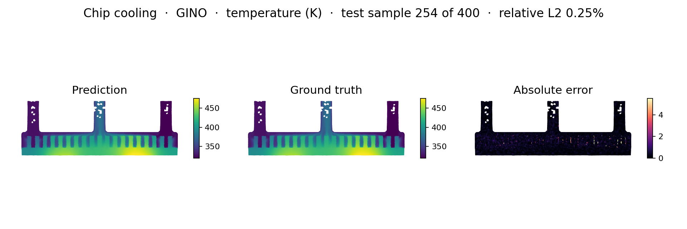
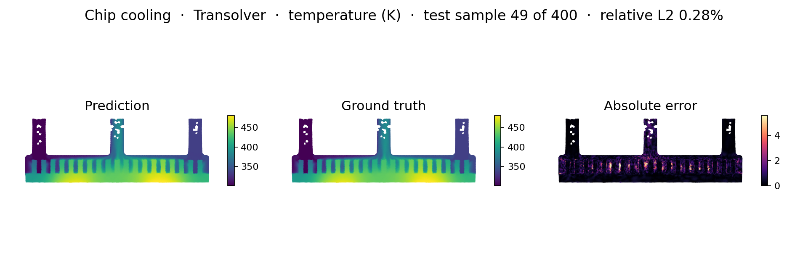
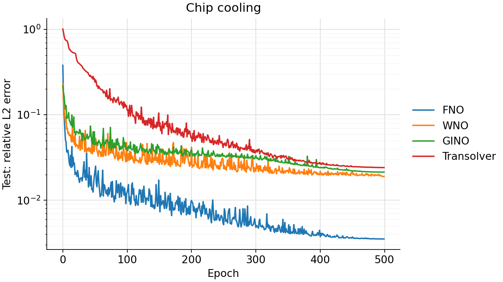
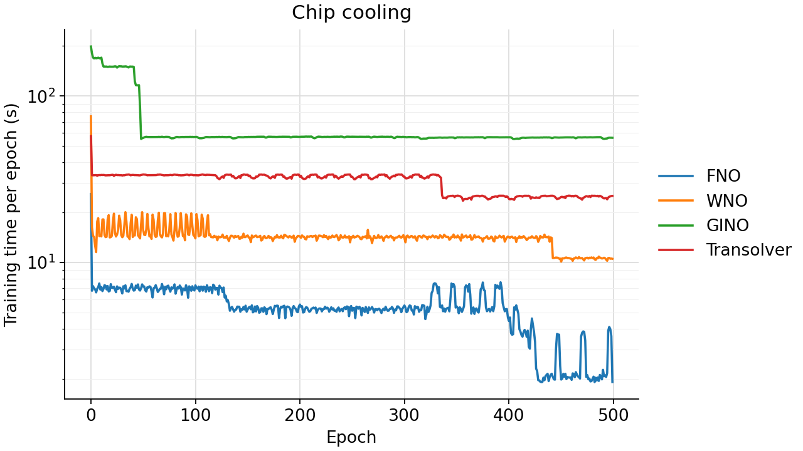

<!--
SPDX-FileCopyrightText: 2026 ZenteiQ AiTech Innovations Pvt. Ltd.
License notice: Documentation text and diagrams on this page are licensed
under CC BY 4.0. Source-code examples are licensed under LGPL-3.0-only
unless the example states otherwise.
-->

# Chip Cooling: Results

The ScireX implementations of four published neural operators, [FNO](../../../api/models.md#scirex.models.FNO) [[1]](#ref1), [WNO](../../../api/models.md#scirex.models.WNO) [[2]](#ref2), [GINO](../../../api/models.md#scirex.models.GINO) [[3]](#ref3) and [Transolver](../../../api/models.md#scirex.models.Transolver) [[4]](#ref4), on the [Chip Cooling benchmark](../README.md), trained data-only. Each model maps the 6 boundary-condition parameters of the dual-chip cold plate to its steady-state temperature field, with the data described in the [Chip Cooling dataset guide](../../../dataset_guide/chip_cooling.md). The split, the 500 epochs and the parameter budget (about 1.8M, Transolver's size used as the reference) are shared by all models; the commands that reproduce a run are on the [problem card](../README.md#reproduce).

The dataset and the POD-NN baseline come from [[5]](#ref5). Data: [doi.org/10.5061/dryad.k0p2ngfp5](https://doi.org/10.5061/dryad.k0p2ngfp5).

## Setup

Each model keeps the recipe it was first published with, so optimiser, schedule and batch size differ between models. All parameter counts are matched to about 1.8M.

| Model | Parameter count | Key hyperparameters |
|---|---|---|
| FNO (`fno`, [`scirex.models.FNO`](../../../api/models.md#scirex.models.FNO)) | 1,829,496 | 24 × 24 modes, width 27, 4 layers (default), 7 input channels (6 parameters broadcast over the grid + in-domain mask) plus the model's own grid embedding |
| WNO (`wno`, [`scirex.models.WNO`](../../../api/models.md#scirex.models.WNO)) | 1,920,481 | 4 layers, 16 hidden channels, wavelet db6, level 4, padding 1, projection 128, bfloat16 compute with float32 weights; 9 input channels (7 above + 2 grid coordinates in [0, 1]) |
| GINO (`gino`, [`scirex.models.GINO`](../../../api/models.md#scirex.models.GINO)) | 1,821,028 | 64 × 128 latent grid carrying the 6 parameters as latent features; FNO 20 × 20 modes, width 30, 4 layers, channel MLP, group norm; GNO radius 0.05 (in and out, unit-square coordinates), in-GNO MLP (80, 80, 80), out-GNO MLP (512, 256) with transformer positional embedding |
| Transolver (`transolver`, [`scirex.models.Transolver`](../../../api/models.md#scirex.models.Transolver)) | 1,807,561 | 5 layers, width 256, 8 heads, 32 slices, MLP ratio 1, irregular geometry; per-node input = scaled (y, z) + the 6 normalised parameters |

| | |
|---|---|
| Loss | Relative L2 of the normalised temperature over the batch (in-domain cells only for FNO and WNO; all nodes for GINO and Transolver), as defined under Governing equations |
| Optimiser and schedule | 500 epochs, seed 42, all models. FNO: AdamW with complex-aware updates ([`adamw_cx`](../../../api/training.md#scirex.training.adamw_cx)), lr 1e-3, weight decay 1e-4, cosine to 0 per epoch, batch 8. WNO: Adam with weight decay 1e-4 added to the gradients, lr 1e-3, cosine to 0 per step, batch 8. GINO: [`adamw_cx`](../../../api/training.md#scirex.training.adamw_cx), lr 1e-3, weight decay 1e-4, cosine to 0 stepped after each epoch, batch 1. Transolver: Adam with weight decay 1e-6 added to the gradients, gradient clipping 1.0, linear warm-up over 50 epochs to 1e-4, then cosine to 1e-6, batch 4. Final-epoch weights are kept. |
| Normalisation | Parameters z-scored per parameter, temperature z-scored with one scalar (training statistics only); see Governing equations |
| Metric (with unit) | MAE, RMSE and max AE in K; R² and mean relative L2 (dimensionless); over the 400 test samples, on the in-domain grid cells (FNO, WNO) or the 11,110 nodes (GINO, Transolver) |
| Baseline | POD-NN of [[5]](#ref5) with 4 POD modes, numbers as reported in the paper (not re-run): R² 0.998, MAE 1.534 K, max AE 8.849 K |

Note: FNO and WNO are scored on interpolated grid values and GINO and Transolver on the native nodes, and POD-NN on the paper's own evaluation points, so the rows are not strictly like-for-like (stated on the results pages).

Note: the POD-NN numbers above are as reported by the dataset guide, which attributes them to the paper; we have not checked them against the paper's own tables. The Dryad README reports different test metrics for the released POD-NN (`2_AnalyzedData/trained_model`, trained on the first 100 simulations): R² 0.998, RMSE 1.94 K, MAE 1.46 K. Treat the baseline row as indicative.

Each model's domain representation and input:

| Model | Domain representation | Input |
|---|---|---|
| FNO | Rasterized 128 × 256 grid | 7 channels: the 6 parameters broadcast over the grid plus the in-domain mask |
| WNO | Rasterized 128 × 256 grid | 9 channels: the 6 parameters, the in-domain mask and 2 grid coordinates. The cosine learning rate decays over every optimiser step (`epochs * steps_per_epoch`); an earlier version decayed it over `epochs` steps only, so with 200 batches per epoch and the previous 400-epoch budget the learning rate reached zero after 2 epochs and training stalled |
| GINO | The raw 11,110-node point cloud | The 6 parameters broadcast as latent features on a 64 × 128 latent grid |
| Transolver | All 11,110 nodes, for training and evaluation | Node coordinates (y, z), min-max scaled to [0, 1] as in the GINO run, plus 6 boundary-condition parameters per node, giving the temperature (K) |

`train.py` saves each checkpoint under `scripts/benchmarks/checkpoints/chip_cooling/<model>/`. `infer.py` scores it on the 400 test samples and writes the figures and `metrics.json` (the run's per-epoch training history) to `doc/assets/benchmarks/chip_cooling_<model>/`.

## Prediction

Held-out test sample 99, on each model's own prediction points (all mesh nodes for GINO and Transolver, the in-domain grid cells for FNO and WNO): ground truth, prediction and the absolute error at each point.

=== "All four"

    

=== "FNO"

    

=== "WNO"

    

=== "GINO"

    

=== "Transolver"

    

## Accuracy

All metrics are on the 400 test samples, in kelvin. Max AE is the largest
error over all evaluated points of all 400 samples.

| Model | Evaluated on | R² | RMSE (K) | MAE (K) | Max AE (K) | Test relative L2 | Parameters |
|---|---|---|---|---|---|---|---|
| FNO | valid cells of the 128 × 256 grid | 0.999987 | 0.167 | 0.122 | 2.873 | 0.041% | 1,829,496 |
| WNO | valid cells of the 128 × 256 grid | 0.999640 | 0.893 | 0.640 | 9.122 | 0.227% | 1,920,481 |
| GINO | all 11,110 mesh nodes | 0.999546 | 0.979 | 0.425 | 29.464 | 0.248% | 1,821,028 |
| Transolver | all 11,110 mesh nodes | 0.999419 | 1.107 | 0.665 | 16.207 | 0.281% | 1,807,561 |

The models are not all scored on the same points, so the rows are not
strictly comparable:

- **FNO and WNO** predict on a rasterized 128 × 256 grid and are scored on its
  in-domain cells.
- **GINO** predicts on the native mesh and is scored on all 11,110 nodes.
  Its RMSE and max AE are driven by a small number of nodes with large
  errors (see below).
- **Transolver** predicts on the native mesh and is scored on all 11,110
  nodes, like GINO. An earlier version trained and scored it on a fixed
  subset of 90 nodes; that model did not generalise to the rest of the mesh
  (see [Earlier 90-node run](#earlier-90-node-run)).

The models train on standardized temperatures, so their training curves are in standardized units. The final-epoch test relative L2 in those units is 0.0035 (FNO), 0.0190 (WNO), 0.0214 (GINO) and 0.024 (Transolver); the table above is in kelvin.

- **GINO.** The gap between RMSE and MAE comes from a small number of nodes with large errors: 0.6% of test nodes are off by more than 5 K, and the median per-sample maximum error is about 20 K, while the typical node error stays well under 1 K. Unlike the grid models, it is evaluated on the native mesh nodes.
- **Transolver.** Train and test errors end at the same level (0.0239 and 0.0241), so the run underfits rather than overfits, and both were still falling when the learning rate reached its floor.

### Against the published reference

The paper [[5]](#ref5) reports a POD-NN surrogate on this dataset (numbers as reported in
their paper, not re-run here):

| Model | Source | R² | MAE (K) | Max AE (K) |
|---|---|---|---|---|
| POD-NN (4 POD modes) | [[5]](#ref5) (reported) | 0.998 | 1.534 | 8.849 |
| FNO | this benchmark | 0.999987 | 0.122 | 2.873 |
| WNO | this benchmark | 0.999640 | 0.640 | 9.122 |
| GINO | this benchmark | 0.999546 | 0.425 | 29.464 |
| Transolver | this benchmark | 0.999419 | 0.665 | 16.207 |

All four models have a higher R² and a lower MAE than POD-NN. FNO also has
a lower max AE; WNO's is slightly higher, and Transolver's and GINO's are
higher.

### Error curves

Training and test relative L2 per epoch of the four runs (standardized units):

## Compute cost

Training time for 500 epochs on one shared GPU:

| Model | Steady-state compute cost | First epoch (JIT compilation) | Total (500 epochs) |
|---|---|---|---|
| FNO | ~5.4 s/epoch | ~25.8 s | ~45 min |
| WNO | ~14.2 s/epoch | ~75.7 s | ~2.0 h |
| GINO | ~56.7 s/epoch | ~198.7 s | ~9.1 h |
| Transolver | ~33 s/epoch | ~57 s | ~4.2 h |

The runs shared their GPU with other jobs, so treat these times as indicative, not a controlled compute benchmark.

Per-epoch cost of the four runs (epoch 1 includes JIT compilation; log
scale):

## Notes

### Earlier 90-node run

An earlier version of this benchmark trained and scored Transolver on a
fixed random subset of 90 of the 11,110 nodes, with the coordinates in
metres, and reported R² 0.999993 and MAE 0.079 K on those 90 nodes. That
model does not predict the rest of the mesh: on all 11,110 nodes its MAE is
19.7 K (R² 0.63), so it learned the 90 fixed points, not the field. Training
on the full mesh with the coordinates in metres reached only MAE 3.30 K
(R² 0.981): they vary by 6.9 cm (y) and 20 cm (z) around offsets of about
1 m, too little for the model to resolve the pin fins. Scaling them to
[0, 1], as the GINO run does, gives the result above.

## References

1. Li et al., *Fourier Neural Operator for Parametric Partial Differential Equations*, ICLR 2021. <https://arxiv.org/abs/2010.08895>
2. Tripura and Chakraborty, *Wavelet Neural Operator for Solving Parametric Partial Differential Equations in Computational Mechanics Problems*, Computer Methods in Applied Mechanics and Engineering 404, 115783 (2023). <https://arxiv.org/abs/2205.02191>
3. Li et al., *Geometry-Informed Neural Operator for Large-Scale 3D PDEs*, NeurIPS 2023. <https://arxiv.org/abs/2309.00583>
4. Wu et al., *Transolver: A Fast Transformer Solver for PDEs on General Geometries*, ICML 2024. <https://arxiv.org/abs/2402.02366>
5. Curl and Hu, *Physically interpretable surrogate modeling of thermal fields in electronics cooling using combined proper orthogonal decomposition and neural networks*, AI Thermal Fluids 6, 100040 (2026). <https://doi.org/10.1016/j.aitf.2026.100040>
