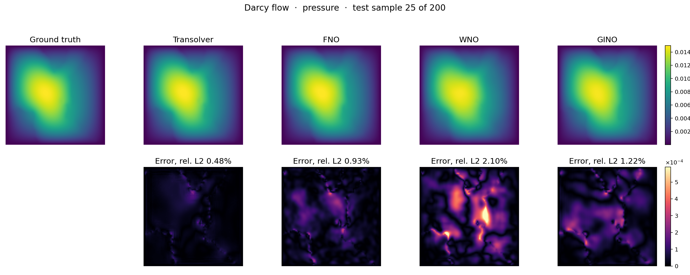
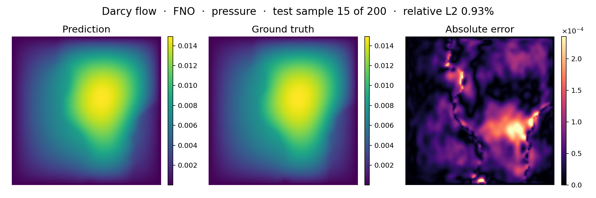
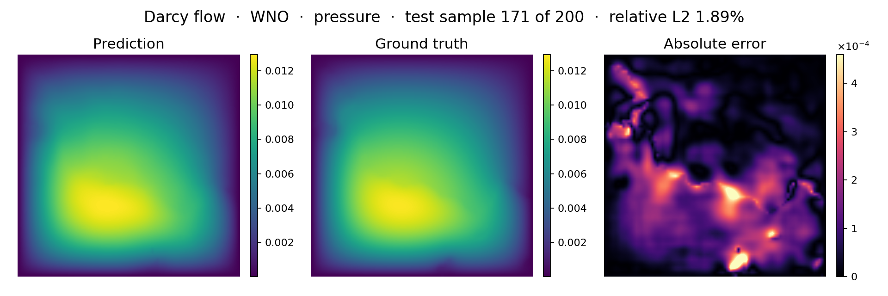
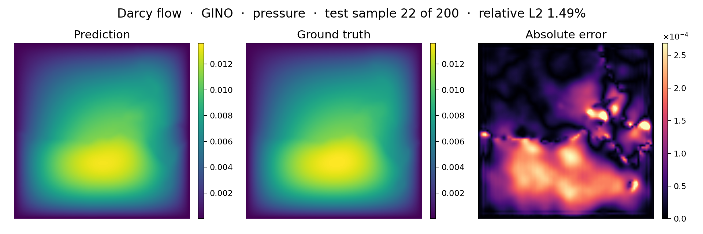
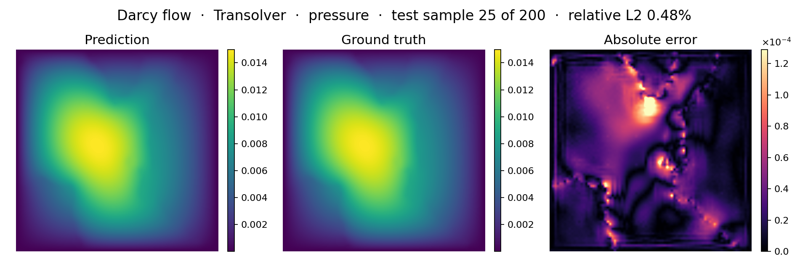

<!--
SPDX-FileCopyrightText: 2026 ZenteiQ AiTech Innovations Pvt. Ltd.
License notice: Documentation text and diagrams on this page are licensed
under CC BY 4.0. Source-code examples are licensed under LGPL-3.0-only
unless the example states otherwise.
-->

# Darcy Flow: Results

[FNO](../../../api/models.md#scirex.models.FNO) [[1]](#ref1), [WNO](../../../api/models.md#scirex.models.WNO) [[2]](#ref2), [GINO](../../../api/models.md#scirex.models.GINO) [[3]](#ref3) and [Transolver](../../../api/models.md#scirex.models.Transolver) [[4]](#ref4) on the [Darcy flow benchmark](../README.md). The data are described in the [dataset guide](../../../dataset_guide/darcy_2d.md); the checkpoints and the commands that reproduce each run are on the [problem card](../README.md#reproduce).

## Setup

| | |
| --- | --- |
| Data | The same for all four. See the [dataset guide](../../../dataset_guide/darcy_2d.md) |
| Parameter count | Every model matched to Transolver's 2,826,945 (within 1%), counting each complex spectral weight twice |
| Metric | Relative L2 on the 200 test samples, final-epoch weights |
| Adam moments | $\beta_1 = 0.9$, $\beta_2 = 0.999$, $\epsilon = 10^{-8}$ for all four |

!!! note "Only the parameter count is matched"
    Each model is trained with its own paper's recipe, so batch size, step count, loss and normalisation differ (see the next table). The errors show each backbone at this size with its own recipe, not a pure architecture effect.

### Setup per model

| | FNO | WNO | GINO | Transolver |
| --- | --- | --- | --- | --- |
| Parameters | 2,836,281 | 2,829,601 | 2,801,340 | 2,826,945 |
| Architecture | 4 layers, 20 × 20 modes, width 40; library defaults otherwise (lifting and projection ratio 2, grid positional embedding) | 4 layers, width 28, wavelet db6, level 4, padding 1, appends the $(x, y)$ grid, float32 compute | [`GINODarcy2d`](../../../api/config.md#scirex.config.GINODarcy2d) preset. FNO processor: 5 layers, 16 × 16 modes, width 31. GNO radii 0.0305 (input) and 0.0333 (output) | 8 layers, width 128, 8 heads, 64 slices, MLP ratio 1, `unified_pos=True` with an 8 × 8 reference grid, `geometry="structured_2d"`, conv kernel 3, no dropout |
| Loss | Relative L2 | Relative L2 | Relative L2 + 0.1 x gradient term | Relative L2 + 0.1 x gradient term |
| Optimiser | [`adamw_cx`](../../../api/training.md#scirex.training.adamw_cx) (complex-aware AdamW), weight decay 0 | `optax.adamw`, weight decay 1e-6 | [`adamw_cx`](../../../api/training.md#scirex.training.adamw_cx), weight decay 1e-4 | `optax.adamw`, weight decay 1e-5 |
| Learning rate | 1e-3, halved every 100 epochs | 1e-3, halved every 50 epochs | Cosine one-cycle, peak 1e-3 | Cosine one-cycle, peak 1e-3 |
| Gradient clipping | none | none | 1.0 | 0.1 |
| Batch / epochs / steps | 20 / 500 / 25,000 | 20 / 500 / 25,000 | 16 / 2000 / 124,000 | 4 / 500 / 125,000 |
| Normalisation | Per pixel, eps 1e-5 | Per pixel, eps 1e-5 | Per pixel, eps 1e-5 | One scalar per field, eps 1e-8 |
| Seed | 0 | 0 | 0 | 2 |

## Prediction

Prediction, ground truth and absolute error on one held-out test sample (sample 25 of 200 in the combined figure). The error panels are labelled with each model's relative L2 error on it.

=== "All four"

    

=== "FNO"

    

=== "WNO"

    

=== "GINO"

    

=== "Transolver"

    

## Accuracy

| Model | Test relative L2 | Against Transolver (5-seed mean) | Published reference | Total training time | Notes |
| --- | --- | --- | --- | --- | --- |
| Transolver | **0.532%** (seed 2) | 0.956× (mean 0.556%) | 0.57% ([[4]](#ref4)) | about 42 min (2,543 s) | Five seeds: 0.600, 0.539, 0.532, 0.559, 0.549%. Four of the five and the mean match or beat the paper |
| FNO | 1.109% | about 2.0× | 1.08% ([[1]](#ref1)) | about 4.6 min (276 s) | The fastest to train. Slightly better than the published figure |
| GINO | 1.60% (final epoch) | about 2.9× | none | about 89 min (5,344 s) | Lowest during training 1.47% (step 32,922). Without the gradient term 1.63%. Its own paper reports no 2D Darcy number |
| WNO | 2.02% | about 3.6× | about 0.84% ([[2]](#ref2)) | about 21 min (1,277 s) | The published figure is not reproducible from the paper's released code and data. A sweep over `level` (3, 4, 6) and `n_layers` (2 to 6) at the same budget found nothing clearly better: `n_layers=3` gave 1.988%, within noise, and every other `level` was worse |

Transolver has the lowest error and matches its paper's result. FNO is next, at about twice Transolver's error, and is the fastest to train. GINO is third, at about 1.4 times FNO's error, with about 5 times FNO's and WNO's step count and the gradient term. WNO follows at about 2%.

`infer.py` writes each model's figures and `metrics.json` to `doc/assets/benchmarks/darcy_<model>/`.

## References

1. Li et al., *Fourier Neural Operator for Parametric Partial Differential Equations*, ICLR 2021. <https://arxiv.org/abs/2010.08895>
2. Tripura and Chakraborty, *Wavelet Neural Operator for Solving Parametric Partial Differential Equations in Computational Mechanics Problems*, Computer Methods in Applied Mechanics and Engineering 404, 115783 (2023). <https://arxiv.org/abs/2205.02191>
3. Li et al., *Geometry-Informed Neural Operator for Large-Scale 3D PDEs*, NeurIPS 2023. <https://arxiv.org/abs/2309.00583>
4. Wu et al., *Transolver: A Fast Transformer Solver for PDEs on General Geometries*, ICML 2024. <https://arxiv.org/abs/2402.02366>
