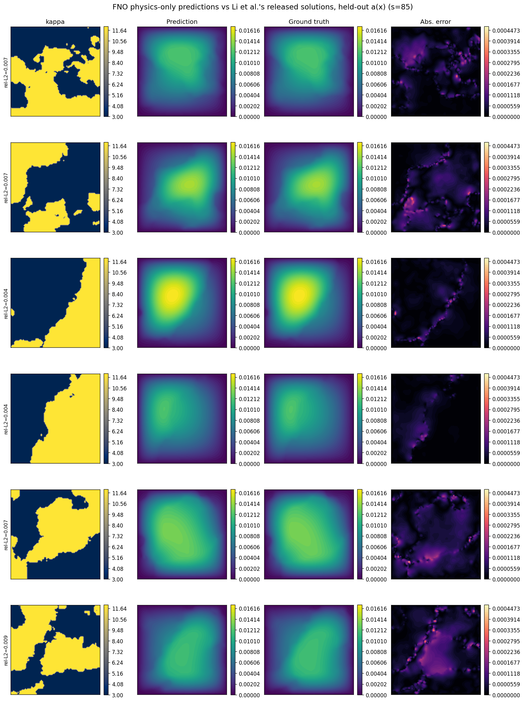
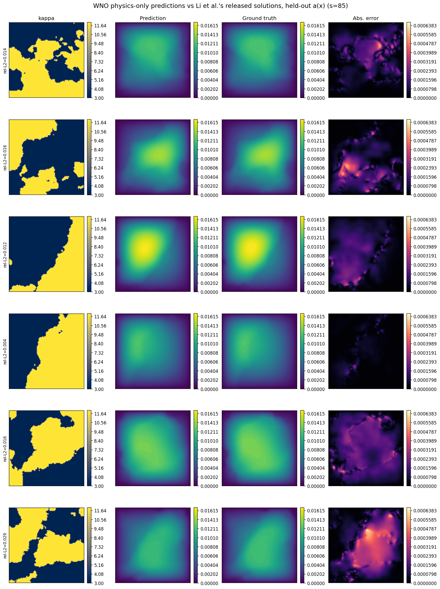
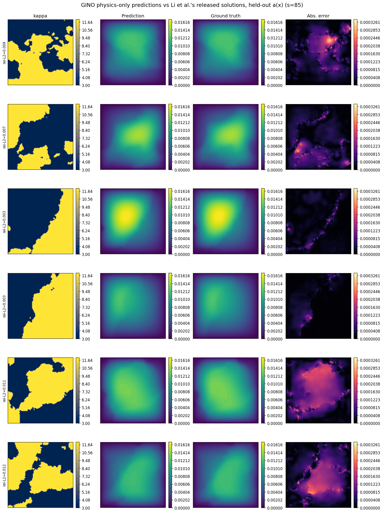
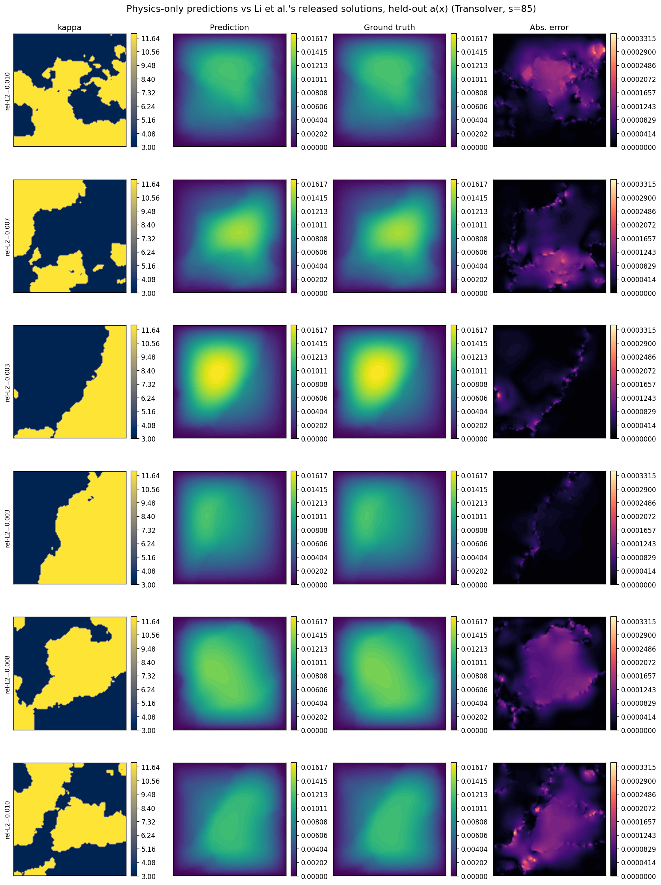
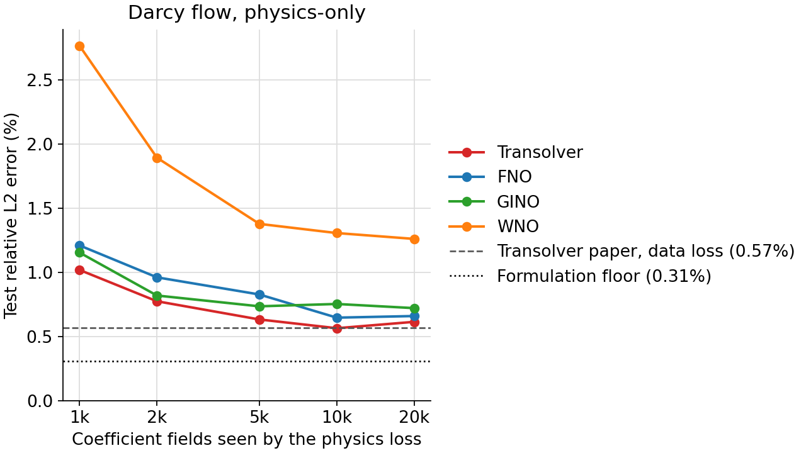
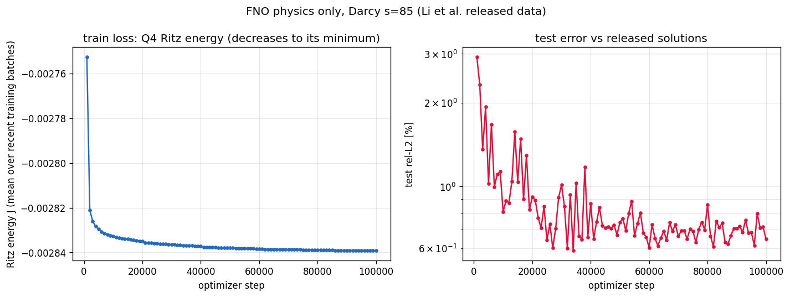
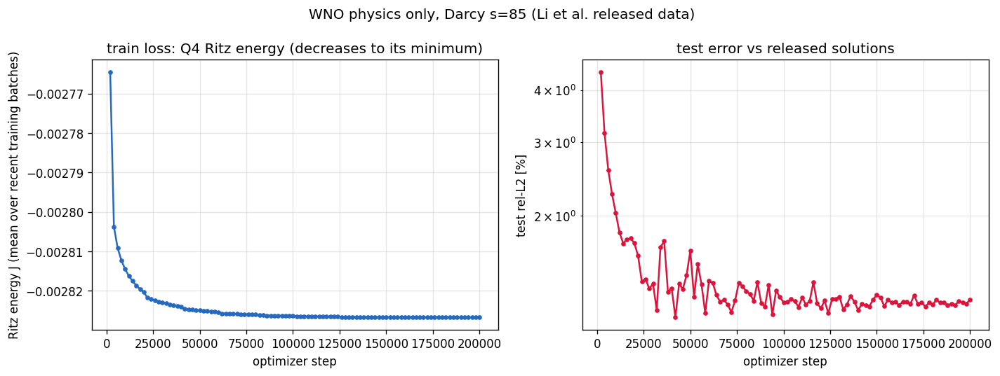
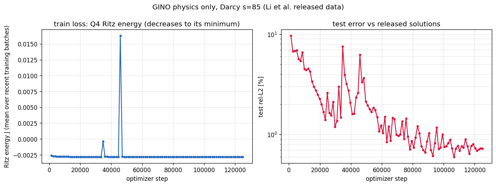
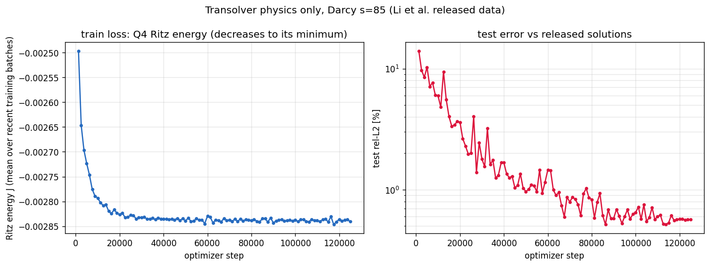

<!--
SPDX-FileCopyrightText: 2026 ZenteiQ AiTech Innovations Pvt. Ltd.
License notice: Documentation text and diagrams on this page are licensed
under CC BY 4.0. Source-code examples are licensed under LGPL-3.0-only
unless the example states otherwise.
-->

# Darcy Flow, Physics-Only: Results

The ScireX implementations of four published neural operators, [Transolver](../../../api/models.md#scirex.models.Transolver) [[1]](#ref1), [FNO](../../../api/models.md#scirex.models.FNO) [[2]](#ref2), [GINO](../../../api/models.md#scirex.models.GINO) [[3]](#ref3) and [WNO](../../../api/models.md#scirex.models.WNO) [[4]](#ref4), on the Darcy-flow benchmark trained **without any labelled solution**. Each is the parameter-matched model of the [data-driven comparison](../../darcy/results/comparative.md) with its own recipe, the loss replaced by the Q4 Ritz energy of `-div(a grad u) = 1`: first on the 1000 training coefficient fields released with [[2]](#ref2), then with extra fields drawn from the same law (a random draw each, against one PDE solve per label). The loss, the label-free choices, the formulation floor (0.31%) and the pool of extra coefficient fields are shared by every model and described in [Darcy Flow, Physics-only (Setup)](setup.md). Test set and metric are unchanged. The reproduction commands are below and on the [problem card](../README.md#reproduce).

## Setup

Each model is the parameter-matched model of the data-driven benchmark with that benchmark's optimiser recipe; only the loss and, for FNO and WNO, the step budget change. Parameter counts are trained real values (complex spectral weights count twice).

| Item | Transolver | FNO | GINO | WNO |
|---|---|---|---|---|
| Model | [`scirex.models.Transolver`](../../../api/models.md#scirex.models.Transolver), `geometry="structured_2d"`, `unified_pos=True` | [`scirex.models.FNO`](../../../api/models.md#scirex.models.FNO) | [`GINODarcy2d`](../../../api/config.md#scirex.config.GINODarcy2d) (FNO latent; input geometry, latent grid and output queries on the 85 × 85 nodes) | [`scirex.models.WNO`](../../../api/models.md#scirex.models.WNO), appended (x, y) grid, float32 |
| Parameter count | 2,826,945 | 2,836,281 | 2,801,340 | 2,829,601 |
| Key hyperparameters | 8 layers, width 128, 8 heads, 64 slices, `ref=8`, MLP ratio 1, kernel 3 | 4 layers, width 40, `n_modes=(20, 20)` | latent FNO: 5 layers, width 31, `(16, 16)` modes; GNO radii $0.16 \cdot 16/84 = 0.0305$ (in) and $0.175 \cdot 16/84 = 0.0333$ (out) | 4 layers, width 28, `db6`, level 4, padding 1 |
| Input normalisation | global scalar | per pixel | per pixel | per pixel |
| Loss | Q4 Ritz energy, $s = 1$ | Q4 Ritz energy, $s = 6889$ | Q4 Ritz energy, $s = 1$ | Q4 Ritz energy, $s = 6889$ |
| Optimiser and schedule | AdamW, peak lr $10^{-3}$, weight decay $10^{-5}$, cosine one-cycle, global-norm clip 0.1, batch 4 | [`adamw_cx`](../../../api/training.md#scirex.training.adamw_cx) (complex-aware AdamW, eps $10^{-8}$), lr $10^{-3}$ halved 4 times (staircase), no weight decay, no clipping, batch 20 | [`adamw_cx`](../../../api/training.md#scirex.training.adamw_cx) (eps $10^{-8}$), peak lr $10^{-3}$, weight decay $10^{-4}$, cosine one-cycle, global-norm clip 1.0, batch 16 | AdamW (eps $10^{-8}$), lr $10^{-3}$ halved 9 times (staircase), weight decay $10^{-6}$, no clipping, batch 20 |
| Steps per run | 125,000 | 100,000 | 124,000 (1k fields) to 125,000 | 200,000 |
| Metric (with unit) | Mean per-sample relative L2 on the 200 test samples at the released sample points (dimensionless) | same | same | same |

Common to all models: the coefficient fields are the 1,000 released ones, then those plus 1k, 4k, 9k or 19k sampled (2k to 20k), and the input normalisation is fitted on all training coefficients without labels; seed 0, final model, no validation split; finite-element geometry and energy contractions at full float32 precision (`jax.default_matmul_precision("highest")`, because the GPU TF32 default perturbs the Q4 Jacobians by up to 5%), networks at the default precision. The step budget is kept fixed across training-set sizes by lowering `--epochs` (and `--lr-decay-epochs` for FNO and WNO); the per-size commands are in the Reproduce section below.

FNO and WNO train longer than their data-driven 25,000 steps because the Ritz energy needs more steps; at initialisation 98% (FNO) and 95% (WNO) of the gradient components are below AdamW's eps $10^{-8}$, hence the loss scale. GINO keeps its data-driven recipe without a scale (52% below eps; with the scale its gradient norm would be 29 against a clip of 1.0). WNO is not converged at 200,000 steps.

Per-model details:

- **Loss scale, FNO.** The Ritz energy is small (about -0.003), and at initialisation 98% of the FNO's per-parameter gradients are below AdamW's `eps = 1e-8`, where Adam's steps become vanishingly small. The loss is multiplied by a constant 6889 (the number of interior nodes) before backpropagation; the minimiser is unchanged and, without clipping, this equals dividing `eps` by 6889.
- **Loss scale, WNO.** Likewise 95% of the WNO's gradient components are below `eps` at initialisation (median 6.4e-13; first 20 released fields, `check_wno_gradient_scale.py`), so the loss is multiplied by 6889. For the WNO this fixes the problem only in part: with the scale, 54% of the gradient components are still below `eps` (median 4.4e-9).
- **No loss scale, GINO.** At initialisation 52% of GINO's Ritz-energy gradient components are below `eps` (median 3.6e-9; first 16 released fields, `check_gino_gradient_scale.py`), fewer than for the FNO (98%) and the WNO (95%). GINO keeps the data-driven recipe unchanged: with the scale its global gradient norm would be 29 instead of 0.0042, so the clipping at 1.0 would act on every step. A scaled variant was not tested.

Steps per run by training-set size (epochs for 1k / 2k / 5k / 10k / 20k fields): FNO 100,000 (2000 / 1000 / 400 / 200 / 100); WNO 200,000 (4000 / 2000 / 800 / 400 / 200), the affordable budget, not converged (see [Budget checks](#budget-checks)); GINO 124,000 at 1k fields (2000 epochs) and 124,800 to 125,000 above (1000 / 400 / 200 / 100); Transolver 125,000 (500 / 250 / 100 / 50 / 25). The GINO and Transolver budgets are the data-driven ones.

Each run writes its `metrics.json` and figures to `--out-dir` and its final weights under `scripts/benchmarks/checkpoints/darcy_<model>_physics_s85/`.

## Reproduce

All four models take the same five training-set sizes (1k released, then 2k, 5k, 10k and 20k fields), with the step budget kept fixed by lowering `--epochs` (and `--lr-decay-epochs` for FNO and WNO). Each tab gives the commands of one model:

=== "FNO"

    ```bash
    export DARCY_DATA_DIR=<DATA_DIR>  # piececonst_r421_N1024_smooth{1,2}.mat
    P=scripts/benchmarks/darcy_physics/train_fno.py
    U=doc/assets/benchmarks/darcy_physics_fno
    python $P --out-dir $U/fields_1000_seed0
    python $P --extra-coefficients 1000 --epochs 1000 --lr-decay-epochs 200 --out-dir $U/fields_2000_seed0
    python $P --extra-coefficients 4000 --epochs 400 --lr-decay-epochs 80 --out-dir $U/fields_5000_seed0
    python $P --extra-coefficients 9000 --epochs 200 --lr-decay-epochs 40 --out-dir $U/fields_10000_seed0
    python $P --extra-coefficients 19000 --epochs 100 --lr-decay-epochs 20 --out-dir $U/fields_20000_seed0

    # Converged-budget check: 20k fields at 200k steps
    python $P --eval-every-steps 2000 \
        --extra-coefficients 19000 --epochs 200 --lr-decay-epochs 40 \
        --out-dir doc/assets/benchmarks/darcy_physics_fno/convergence/fields_20000_steps200000_seed0
    ```

=== "WNO"

    ```bash
    export DARCY_DATA_DIR=<DATA_DIR>  # piececonst_r421_N1024_smooth{1,2}.mat
    P=scripts/benchmarks/darcy_physics/train_wno.py
    U=doc/assets/benchmarks/darcy_physics_wno
    python $P --out-dir $U/fields_1000_seed0
    python $P --extra-coefficients 1000 --epochs 2000 --lr-decay-epochs 200 --out-dir $U/fields_2000_seed0
    python $P --extra-coefficients 4000 --epochs 800 --lr-decay-epochs 80 --out-dir $U/fields_5000_seed0
    python $P --extra-coefficients 9000 --epochs 400 --lr-decay-epochs 40 --out-dir $U/fields_10000_seed0
    python $P --extra-coefficients 19000 --epochs 200 --lr-decay-epochs 20 --out-dir $U/fields_20000_seed0

    # Budget check: 20k fields at 400k steps
    python $P --extra-coefficients 19000 --epochs 400 --lr-decay-epochs 40 --eval-every-steps 4000 \
        --out-dir doc/assets/benchmarks/darcy_physics_wno/convergence/fields_20000_steps400000_seed0

    # Gradient scale at initialisation
    python scripts/benchmarks/darcy_physics/check_wno_gradient_scale.py \
        --out-dir doc/assets/benchmarks/darcy_physics_wno/gradient_scale
    ```

=== "GINO"

    ```bash
    export DARCY_DATA_DIR=<DATA_DIR>  # piececonst_r421_N1024_smooth{1,2}.mat
    P=scripts/benchmarks/darcy_physics/train_gino.py
    U=doc/assets/benchmarks/darcy_physics_gino
    python $P --out-dir $U/fields_1000_seed0
    python $P --extra-coefficients 1000 --epochs 1000 --out-dir $U/fields_2000_seed0
    python $P --extra-coefficients 4000 --epochs 400 --out-dir $U/fields_5000_seed0
    python $P --extra-coefficients 9000 --epochs 200 --out-dir $U/fields_10000_seed0
    python $P --extra-coefficients 19000 --epochs 100 --out-dir $U/fields_20000_seed0

    # Budget check: 20k fields at 250k steps
    python $P --extra-coefficients 19000 --epochs 200 --eval-every-steps 2500 \
        --out-dir doc/assets/benchmarks/darcy_physics_gino/convergence/fields_20000_steps250000_seed0

    # Gradient scale at initialisation
    python scripts/benchmarks/darcy_physics/check_gino_gradient_scale.py \
        --out-dir doc/assets/benchmarks/darcy_physics_gino/gradient_scale
    ```

=== "Transolver"

    ```bash
    export DARCY_DATA_DIR=<DATA_DIR>  # piececonst_r421_N1024_smooth{1,2}.mat
    P=scripts/benchmarks/darcy_physics/train_transolver.py
    A=doc/assets/benchmarks
    U=$A/darcy_physics_transolver
    python $P --out-dir $U/fields_1000_seed0
    python $P --extra-coefficients 1000 --epochs 250 --out-dir $U/fields_2000_seed0
    python $P --extra-coefficients 4000 --epochs 100 --out-dir $U/fields_5000_seed0
    python $P --extra-coefficients 9000 --epochs 50 --out-dir $U/fields_10000_seed0
    python $P --extra-coefficients 19000 --epochs 25 --out-dir $U/fields_20000_seed0

    # Budget check: 20k fields at 250k steps
    python $P --extra-coefficients 19000 --epochs 50 --eval-every-steps 2500 \
        --out-dir $A/darcy_physics_transolver/convergence/fields_20000_steps250000_seed0

    # The test-set GIF (animations/darcy_physics/evolution.gif) from the 10k run
    python scripts/benchmarks/darcy_physics/animate.py
    ```

Then redraw the scaling figures:

```bash
python scripts/benchmarks/darcy_physics/plot.py
```

## Prediction

Prediction, released solution and absolute error on one held-out test sample per model; the title of each figure names the sample and its relative L2 error. The tabs show the run on 10k coefficient fields for the FNO and the Transolver, and on 20k for the WNO and GINO.

=== "FNO"

    

=== "WNO"

    

=== "GINO"

    

=== "Transolver"

    

## Accuracy

| Model | 1000 released fields | Best with extra fields | Data-driven, 1000 labels | Steps per run | Training time per run |
|---|---|---|---|---|---|
| <span id="transolver">Transolver</span> | **1.020%** | **0.565%** (10k) | 0.57% ([[1]](#ref1)); 0.532% ([ours](../../darcy/results/comparative.md#transolver)) | 125,000 | ~39 min |
| <span id="gino">GINO</span> | 1.156% | 0.722% (20k) | 1.603% ([ours](../../darcy/results/comparative.md#gino)) | ~125,000 | ~72 min |
| <span id="fno">FNO</span> | 1.211% | 0.648% (10k) | 1.08% ([[2]](#ref2)); 1.109% ([ours](../../darcy/results/comparative.md#fno)) | 100,000 | ~14 min |
| <span id="wno">WNO</span> | 2.769% | 1.262% (20k) | ~0.84% ([[4]](#ref4)); 2.020% ([ours](../../darcy/results/comparative.md#wno)) | 200,000 | ~170 min |

The formulation floor, an exact Q4 solve scored against the released
solutions, is 0.31%: what a perfectly trained physics-only model would reach.

- **Without labels, on the same 1000 fields**, GINO is below its
  data-driven counterpart (1.156% vs 1.603%); Transolver, FNO and WNO are
  above theirs.
- **With extra unlabelled fields**, every model improves. Transolver
  reaches 0.565% at 10k fields, comparable to the 0.57% of [[1]](#ref1) with 1000
  labels (this repository's data-driven run: 0.532%). From 2k fields on, FNO
  is below both data-driven FNO results, and WNO below this repository's
  data-driven WNO (not the published 0.84%).
- Gains beyond 5k to 10k fields are within the noise of one final
  evaluation of one seed for every model (see each page).

Test relative L2 (final model) by the number of coefficient fields the physics loss sees:

| Coefficient fields | Transolver | FNO | GINO | WNO |
|---|---|---|---|---|
| 1k (released only) | 1.020% | 1.211% | 1.156% | 2.769% |
| 2k = 1k + 1k sampled | 0.776% | 0.962% | 0.820% | 1.895% |
| 5k = 1k + 4k sampled | 0.634% | 0.829% | 0.736% | 1.379% |
| 10k = 1k + 9k sampled | **0.565%** | **0.648%** | 0.755% | 1.308% |
| 20k = 1k + 19k sampled | 0.615% | 0.660% | **0.722%** | **1.262%** |



Per model:

- **Transolver.** The error falls as the physics loss sees more unlabelled fields. At 10k fields it is comparable to the 0.57% of the data-driven Transolver of [[1]](#ref1) trained on the 1000 labelled pairs (one seed, no labels). 10k and 20k agree within the noise of a single final evaluation: over the last 10 evaluations the test error spans 0.52 to 0.61% (10k) and 0.53 to 0.64% (20k).
- **FNO.** From 2k fields on, the physics-only FNO is below the 1.08% reported in [[2]](#ref2) for the data-driven FNO on the 1000 labelled pairs at s=85 (1.109% for [this repository's run](../../darcy/results/comparative.md#fno)). At the lowest learning rate the test error of the 5k to 20k runs still moves between evaluations while the training energy is flat: over the last 10 evaluations it spans 0.72 to 0.83% (5k), 0.61 to 0.80% (10k) and 0.61 to 0.78% (20k), so differences below about 0.1 pp are not resolved by one final evaluation of one seed. With only the 1000 released fields the test error drifts up late in training (1.10% to 1.21%) while their energy keeps decreasing: over-fitting to the 1000 fields.
- **GINO.** No published GINO result exists for this benchmark; the reference is [this repository's data-driven GINO](../../darcy/results/comparative.md#gino) (same model and optimiser, 1000 labelled pairs), at 1.603%. With the 1000 released fields alone and no labels, the physics-only GINO (1.156%) is below it. The error falls from 1k to 5k fields; 5k, 10k and 20k agree within the noise of a single final evaluation: over the last 10 evaluations the test error spans 0.69 to 0.76% (5k), 0.66 to 0.86% (10k) and 0.64 to 0.90% (20k).
- **WNO.** The same WNO trained data-driven on the 1000 labelled pairs ([this repository's run](../../darcy/results/comparative.md#wno), 25,000 steps) scores 2.020%; the paper [[4]](#ref4) reports 0.84% for its own, which could not be reproduced from the paper's released code and data. From 2k unlabelled fields on, the physics-only WNO is below the data-driven one (1.895% at 2k and 1.262% at 20k); with the 1000 released fields alone it is above it (2.769%). The drops up to 5k fields (-0.87 and -0.52 pp) are clear; the differences beyond 5k (0.07 and 0.05 pp) are within the movement each run shows earlier at low learning rate (one seed). With only the 1000 released fields the model over-fits them: the test error is lowest at 2.29% (step 22k) and rises to 2.77% while the training energy keeps falling.

### Budget checks

The reported runs keep the data-driven step budget (WNO: 200,000 steps). To see whether the larger sets are saturated, the 20k-field run was repeated with a larger budget:

| Model | Steps | Training energy at the reported budget | Training energy at the larger budget | Change | Test error, larger budget (reported) |
|---|---|---|---|---|---|
| Transolver | 250k (reported 125k) | -2.8383e-3 | -2.8425e-3 | 0.15% | 0.562% (0.615%) |
| FNO | 200k (reported 100k) | -2.8376e-3 | -2.8398e-3 | 0.08% | 0.646% (0.660%) |
| GINO | 250k (reported 124k) | -2.8332e-3 | -2.8378e-3 | 0.16% | 0.608% (0.722%) |
| WNO | 400k (reported 200k) | -2.8267e-3 | -2.8291e-3 | 0.08% | 1.140% (1.262%) |

The training energy is the label-free criterion; the test error is for context only. For the FNO the test error is inside the jitter. For the Transolver and GINO the larger sets are not fully saturated at the data-driven budget, which every reported run keeps. The WNO is not converged at 200,000 steps: its energy also stays above what the FNO and Transolver reach on the same 20k fields (-2.8376e-3, -2.8383e-3), so it is limited by its optimisation with this loss rather than by the data, and the gradients still below `eps` (above) are a likely cause. The WNO numbers are budget-limited.

### Error curves

Training energy and test error of the run shown in the Prediction tabs:

=== "FNO (10k)"

    

=== "WNO (20k)"

    

=== "GINO (20k)"

    

=== "Transolver (10k)"

    

## References

1. <span id="ref1"></span>Wu et al., *Transolver: A Fast Transformer Solver for PDEs on General Geometries*, ICML 2024. <https://arxiv.org/abs/2402.02366>
2. <span id="ref2"></span>Li et al., *Fourier Neural Operator for Parametric Partial Differential Equations*, ICLR 2021. <https://arxiv.org/abs/2010.08895>
3. <span id="ref3"></span>Li et al., *Geometry-Informed Neural Operator for Large-Scale 3D PDEs*, NeurIPS 2023. <https://arxiv.org/abs/2309.00583>
4. <span id="ref4"></span>Tripura and Chakraborty, *Wavelet Neural Operator for Solving Parametric Partial Differential Equations in Computational Mechanics Problems*, Computer Methods in Applied Mechanics and Engineering 404, 115783 (2023). <https://arxiv.org/abs/2205.02191>
