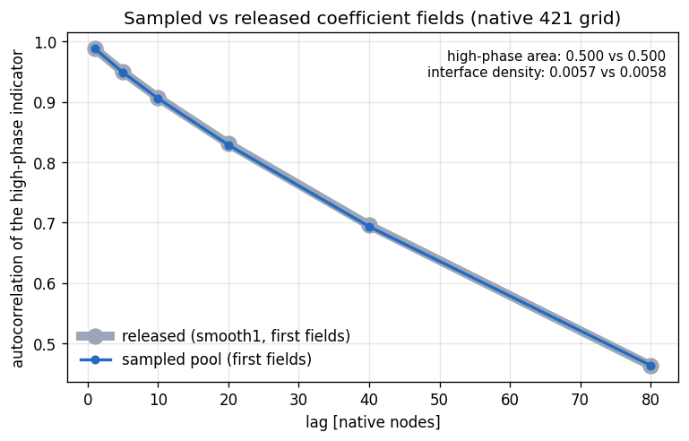

<!--
SPDX-FileCopyrightText: 2026 ZenteiQ AiTech Innovations Pvt. Ltd.
License notice: Documentation text and diagrams on this page are licensed
under CC BY 4.0. Source-code examples are licensed under LGPL-3.0-only
unless the example states otherwise.
-->

# Darcy Flow, Physics-Only (Setup)

The physics-only Darcy benchmark is the [data-driven one](../../darcy/results/comparative.md)
without labels: the same data (the `piececonst_r421_N1024`
fields released by [[1]](#ref1), at 85 × 85), the same 1000 training coefficient fields, the same 200 test
pairs and the same metric. Only the loss changes. Each network is trained on
the Ritz energy of $-\nabla\cdot(a\nabla u) = 1$, $u = 0$ on the boundary, $a(x) \in
\{3, 12\}$:

$$
J_a(u) = \frac12 \int a\,\lvert\nabla u\rvert^2\,dx - \int f\,u\,dx,
$$

and never sees a training solution. Everything on this page is independent of
the network and lives in [`scripts/benchmarks/darcy_physics/_ritz.py`](../../../../scripts/benchmarks/darcy_physics/_ritz.py).
Results: the [comparison](comparative.md) of
[Transolver](comparative.md#transolver), [FNO](comparative.md#fno),
[GINO](comparative.md#gino) and [WNO](comparative.md#wno).

## Discretisation and label-free choices

| Choice | Value |
|---|---|
| Energy | bilinear (Q4) elements on the 85 × 85 benchmark nodes (84 × 84 elements), 2 × 2 Gauss points; the minimiser is the Q4 finite-element solution |
| Element coefficient | majority of the native 421 × 421 nodes the element covers |
| Boundary condition | exact: $u = (c\,N(a) + m)\,\sin(\pi x)\sin(\pi y)$ |
| Output scale `c`, offset `m` | std / mean of the Q4 torsion function ($-\Delta\phi = 1$) divided by $\sqrt{3 \cdot 12} = 6$, the effective coefficient of a 50/50 two-phase medium in 2-D ([[2]](#ref2), [[3]](#ref3)): $c = 0.00367$, $m = 0.00572$ |
| Scoring points | the network predicts on the Q4 nodes; a fixed linear map moves the prediction to the points where the released solutions are sampled (native cell centres, half a native cell inside the nodes) |
| FE precision | geometry and energy at full float32 precision (on GPU, JAX's TF32 default perturbs the Q4 Jacobians by up to 5%); networks keep the default precision |

## Formulation floor

A perfectly trained physics-only model reproduces the Q4 finite-element
solution, not the finite-difference solution of [[1]](#ref1). An exact Q4 solve scored
with the benchmark metric on the 200 test fields (`check_floor.py`) gives the
floor shared by every model:

| Element coefficient | At the Q4 nodes | At the released sample points |
|---|---|---|
| corner node | 1.19% | 1.07% |
| mean of covered nodes | 0.92% | 0.61% |
| **majority of covered nodes (used)** | 0.60% | **0.31%** |
| native coefficient at 2 × 2 Gauss points | 0.69% | 0.34% |
| native coefficient at 3 × 3 Gauss points | 0.79% | 0.44% |

- With one coefficient per element, 2 × 2 Gauss points integrate the bilinear
  stiffness exactly: the 3 × 3 stiffness agrees to 6e-16.
- Resolving the coefficient jumps inside an element moves the floor away from
  the released solutions, whose generator smooths the coefficient.
- On the native 420 × 420 mesh the formulation is 0.12% from the released
  solutions (20 fields, mean rule), so most of the 0.31% comes from the
  84 × 84 mesh.

## Unlabelled coefficient fields

The Ritz loss needs coefficient fields only, so besides the 1000 released
training fields a model can also see extra fields: the first `K` of one fixed,
seed-independent pool drawn from the data's own law
(`sample_piecewise_coefficient`: thresholded Gaussian random field,
$C = (-\Delta + 9I)^{-2}$, native 421 × 421). Training sets of different sizes
are therefore nested. No solutions are generated. The pool matches the
released fields (`check_sampler.py`, first 1000 of each):

| | Released (smooth1) | Sampled pool |
|---|---|---|
| Values | {3, 12} | {3, 12} |
| High-phase area fraction | 0.500 | 0.500 |
| Interface density | 0.0057 | 0.0058 |
| Autocorrelation, lags 1 to 80 nodes | 0.988 to 0.463 | within 0.002 |



## Reproduce

From the repo root; neither check trains a model:

```bash
export DARCY_DATA_DIR=/path/to/dir  # piececonst_r421_N1024_smooth{1,2}.mat
python scripts/benchmarks/darcy_physics/check_floor.py
python scripts/benchmarks/darcy_physics/check_sampler.py
```

They write `doc/assets/benchmarks/darcy_q4_s85_spec_floor/metrics.json` and
`doc/assets/benchmarks/darcy_coefficient_sampler_check/`.

## References

1. <span id="ref1"></span>Li et al., *Fourier Neural Operator for Parametric Partial Differential Equations*, ICLR 2021. <https://arxiv.org/abs/2010.08895>
2. <span id="ref2"></span>Keller, *A Theorem on the Conductivity of a Composite Medium*, Journal of Mathematical Physics 5(4), 548-549 (1964). <https://doi.org/10.1063/1.1704146>
3. <span id="ref3"></span>Dykhne, *Conductivity of a Two-Dimensional Two-Phase System*, Soviet Physics JETP 32(1), 63-65 (1971).
