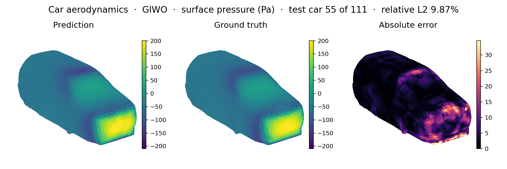
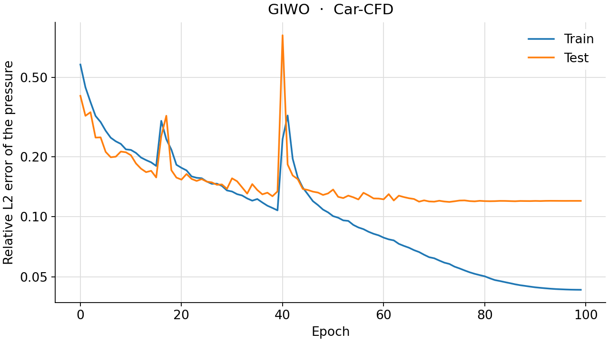
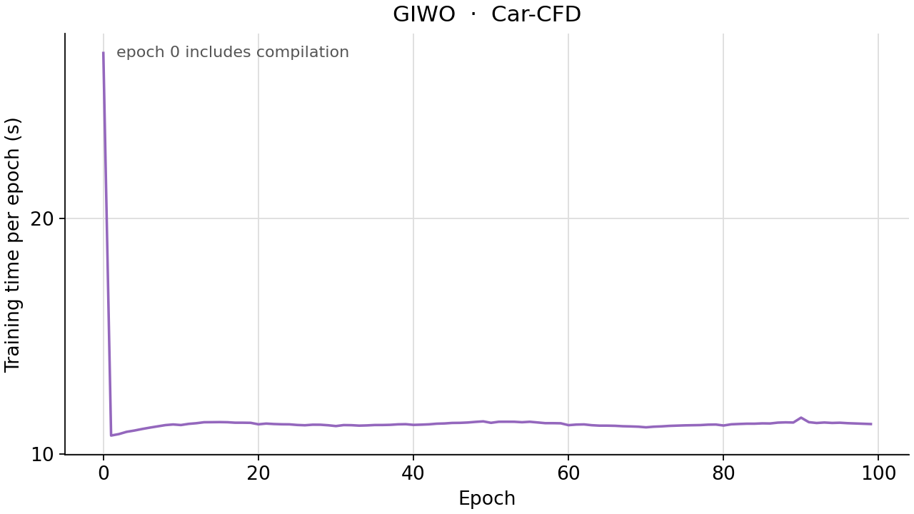

<!--
SPDX-FileCopyrightText: 2026 ZenteiQ AiTech Innovations Pvt. Ltd.
License notice: Documentation text and diagrams on this page are licensed
under CC BY 4.0. Source-code examples are licensed under LGPL-3.0-only
unless the example states otherwise.
-->

# GIWO on Car-CFD

The experimental [GIWO](../../api/experimental.md#scirex.experimental.giwo.GIWO) on the
[Car-CFD](../car_cfd/README.md) problem: surface pressure at the 3,586 mesh vertices of a car, tested on 111
cars never seen in training. It uses the same data split, training budget and metric as the
[Car-CFD results](../car_cfd/results/comparative.md), where the setup is described in full. GIWO is not a
published architecture.

## Setup

| Item | GIWO (`giwo_val`) |
|---|---|
| Model | [`GIWO`](../../api/experimental.md#scirex.experimental.giwo.GIWO): GINO's decoder-only shell with a 4-layer WNO (db4, 3 levels, width 29) instead of the FNO |
| Input and output | The SDF of the car on a 64³ grid → surface pressure at the 3,586 mesh vertices, through an output graph kernel of radius 0.033 (as GINO's `paper` run actually used) |
| Parameter count | 74,197,232 (GINO `paper`: 75,917,953) |
| Loss | Relative L2 of the normalised pressure |
| Optimiser and schedule | Adam ($\beta_2=0.999$, $\epsilon=10^{-6}$, weight decay 0), 100 epochs, peak lr 8e-3, 1-epoch linear warm-up then cosine decay to 0 |
| Metric | Relative L2 of the de-normalised pressure, mean over the 111 test cars |

## Prediction

Surface pressure on the first test car: ground truth, prediction and absolute error.



## Accuracy

| Model | Run | Parameters | Train error | Test error | Best test error (epoch) |
|---|---|---:|---|---|---|
| GIWO | `giwo_val` | 74,197,232 | 4.30% | 12.01% | 11.86% (73) |
| GINO | `paper` | 75,917,953 | 3.55% | 8.37% | 8.31% (91) |
| Transolver | `transolver_val` | 75,481,841 | 4.49% | **6.81%** | 6.79% (88) |

GINO and Transolver are the headline runs of the [Car-CFD results](../car_cfd/results/comparative.md), shown
for reference.

**GIWO is last, 3.6 points behind GINO** on the same input, output graph kernel and parameter count. At
GINO's budget a 64³ wavelet operator fits only 29 channels against the FNO's 64, and it generalises worse at
a similar training error: its test error drifts up after epoch 73 while its training error keeps falling.
Re-scoring the saved checkpoint gives 12.01% again. Weight decay was not tuned and stays at 0.

Training (dotted) and test (solid) relative L2 per epoch:



## Compute cost

About 11 s per epoch (500 cars, one at a time), about 20.5 min for 100 epochs on one NVIDIA RTX PRO 6000
Blackwell GPU: the cheapest of the three models (GINO ~17 s, Transolver ~14 s). Its output graph kernel runs
at width 29, against GINO's 64.



## Learning-rate search

`giwo_val`'s optimiser was chosen without the test set: 20-epoch runs on the first 450 training cars, scored
on the held-out last 50 (`train.py --val 50`). Validation error at epoch 20:

| Schedule | Peak lr | Validation error |
|---|---|---|
| GINO's (StepLR) | 2.5e-4 | 19.11% |
| warm-up + cosine | 2.5e-4 | 19.77% |
| warm-up + cosine | 5e-4 | 18.04% |
| warm-up + cosine | 1e-3 | 17.20% |
| warm-up + cosine | 2e-3 | 15.90% |
| warm-up + cosine | 4e-3 | 14.53% |
| **warm-up + cosine** | **8e-3** | **13.92%** |
| warm-up + cosine | 1.6e-2 | diverged (79% by epoch 4) |

8e-3 won and was retrained on all 500 cars for 100 epochs, then scored on the test set once. It sits one
doubling below divergence; the full run was stable throughout.

## Sizing

GIWO is GINO with the spectral (FNO) layers on the latent grid replaced by wavelet (WNO) layers. The SDF
input on the 64³ grid, the output graph kernel and the projection head are GINO's own, and GINO's `paper` run
is the decoder-only variant, so GIWO is too. The library's
[`GIWO`](../../api/experimental.md#scirex.experimental.giwo.GIWO) always runs an input graph kernel, so this
benchmark builds GIWO as a subclass of the library's [`GINO`](../../api/models.md#scirex.models.GINO)
([`scripts/benchmarks/car_cfd/_giwo.py`](../../../scripts/benchmarks/car_cfd/_giwo.py)).

A wavelet layer's weights are shaped by the coarsest subband of the whole grid, so on a 64³ grid the width
and the number of levels trade off:

| Width | Levels | Coarsest subband | Parameters | vs. GINO |
|---|---|---|---:|---:|
| 68 | 5 | 8³ | 76,161,293 | +0.32% |
| 49 | 4 | 10³ | 77,205,804 | +1.70% |
| **29** | **3** | **14³** | **74,197,232** | **-2.27%** |
| 30 | 3 | 14³ | 79,378,907 | +4.56% |

Width 29 at 3 levels is used. Three levels is the most that is meaningful for a 64-point axis with the db4
filter (`pywt.dwt_max_level`), its 14³ subband is the closest to GINO's 16³ Fourier modes, and it is the
cheapest. The price is width: 29 latent channels against GINO's 64.

The wavelet library (`jaxwt`) computes each 3-D level as one dense 8 × 8 × 8 convolution with a single input
channel, which a GPU runs poorly (about 95% of a GIWO training step). The db4 wavelet is separable, so
[`scripts/benchmarks/car_cfd/_fast_dwt.py`](../../../scripts/benchmarks/car_cfd/_fast_dwt.py) does the same transform as three
1-D passes with `jaxwt`'s own 1-D functions, and the benchmark points the library's
[`WaveletConv`](../../api/layers.md#scirex.layers.WaveletConv) at it. It matches `jaxwt` to float32 rounding
(a unit test checks both directions), so the model and its parameters are unchanged.

## Reproduce

```bash
python scripts/benchmarks/car_cfd/train.py --run giwo_val                          # ~21 min
python scripts/benchmarks/car_cfd/train.py --run giwo_val --val 50 --epochs 20     # validation screen
```

`infer.py` re-scores the GIWO checkpoint together with GINO and Transolver (see the
[Car-CFD problem card](../car_cfd/README.md#reproduce)). The
[tutorial](../../tutorials/Others/CarCFD_GIWO.md) walks through the model, and its checkpoint is on the
[experimental checkpoint cards](../cards/experimental.md#car-cfd).
