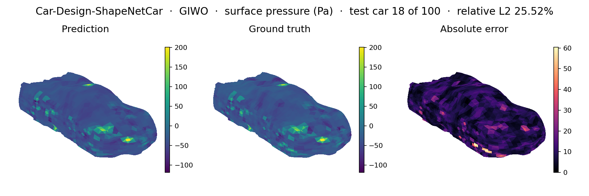
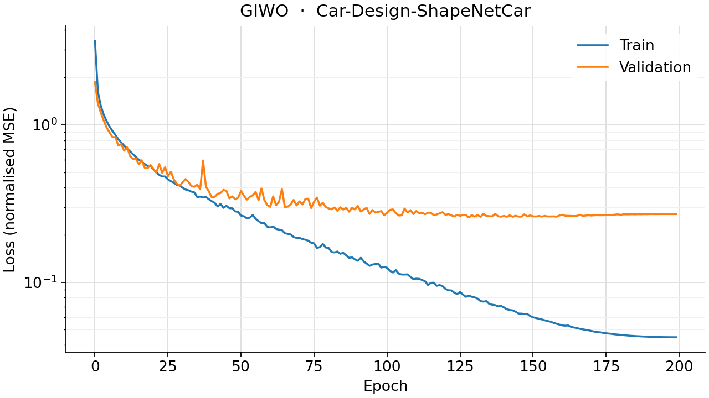
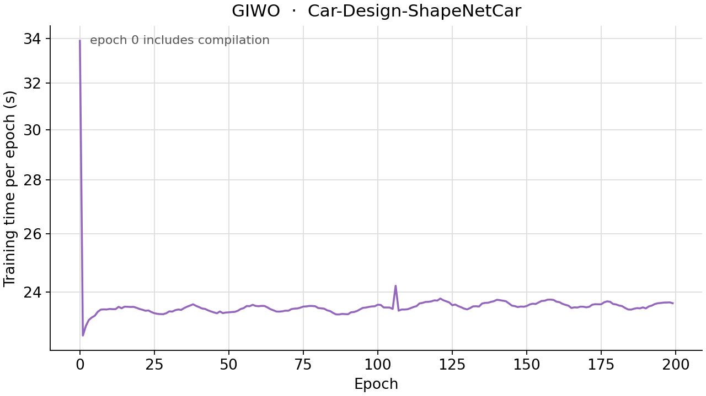

<!--
SPDX-FileCopyrightText: 2026 ZenteiQ AiTech Innovations Pvt. Ltd.
License notice: Documentation text and diagrams on this page are licensed
under CC BY 4.0. Source-code examples are licensed under LGPL-3.0-only
unless the example states otherwise.
-->

# GIWO on ShapeNetCar

The experimental [GIWO](../../api/experimental.md#scirex.experimental.giwo.GIWO) on the
[ShapeNetCar](../shapenetcar/README.md) problem: velocity at every point and pressure on the car surface,
predicted jointly from the car's point cloud. It uses the same fold (789 train / 100 validation cars), loss,
training protocol and metrics as the [ShapeNetCar results](../shapenetcar/results/comparative.md), where the
setup is described in full.

GIWO ("Geo-WNO") is not a published architecture. [`src/scirex/experimental/giwo.py`](../../../src/scirex/experimental/giwo.py)'s
GIWO is GINO's own GNO-in/GNO-out shell (same `_gino_geometry.py` latent grid, same two neighbor-search
radii) with its latent FNO swapped for a [WNO](https://arxiv.org/abs/2205.02191) block.

## Runs

| Run | Radii | Role |
|---|---|---|
| `giwo` (`_GIWO_TRANSOLVER_MATCHED`) | GINO's own "avg 5-10 neighbors" radii (identical latent grid and car geometry, so the same radius gives the same neighbor counts) | |
| `giwo_transolver_cost_matched` | Pushed further (in 0.3, out 1.65) | **The headline run**, trained for the full 200 epochs; it asks whether *spending more compute* closes the accuracy gap, not what GIWO's cheapest viable setting is |

## Prediction

Surface pressure on the held-out fold (truth, prediction and absolute error), rendered as a matplotlib point
cloud:



## Accuracy

Mean over the validation cars, on physical-unit fields (lower is better, except `rho_d`). GINO and
Transolver are the headline runs of the [ShapeNetCar results](../shapenetcar/results/comparative.md), shown
for reference.

| Metric | GIWO (`giwo_transolver_cost_matched`) | GINO (`gino_wide_radius`) | Transolver |
|---|---|---|---|
| `rel_l2_volume` | 0.0696 | 0.0730 | **0.0223** |
| `rel_l2_surface` | 0.2018 | 0.2149 | **0.0767** |
| `c_d_mean_relative_drag_error` | 0.0660 | 0.0779 | **0.0106** |
| `rho_d_spearman_drag_correlation` | 0.7870 | 0.6685 | **0.9928** |

- **GIWO is consistently closer to Transolver than GINO is**, on every metric, although the two share the
  same GNO-in/GNO-out shell and differ only in the latent operator (WNO against FNO).
- **It does not close the gap to Transolver's global slice attention**, even at a cost-matched budget.

Training and test (split MSE) loss per epoch:



## Compute cost

| Model | Seconds per epoch | Epochs | Total |
|---|---|---|---|
| GIWO (`giwo_transolver_cost_matched`) | ~23.5 | 200 | ~82.5 min |
| GINO (`gino_wide_radius`) | ~10.5 | 200 | ~37 min |
| Transolver | ~17 | 200 | ~58.6 min |



`giwo_transolver_cost_matched` uses larger GNO radii than the default neighbor-count sizing, which makes its
neighbor graph denser and each epoch costlier. GIWO's GNO kernels evaluate an MLP on every edge of the
neighbor graph, so the graph's density governs the per-epoch cost far more than the parameter count does.

## Sizing

`GIWOCarWrapper` (`_models.py`) is the same thin adapter as `GINOCarWrapper`, sized to within 2.8% of
Transolver's parameter count (3,752,638 against 3,860,804) by sweeping the latent WNO's width. A
WaveletConv's subband weights scale with the whole latent grid's wavelet-coefficient array rather than with
a fixed number of Fourier modes, so the integer-width options land further apart than they do for GINO.
`_config.py` (`_GIWO_TRANSOLVER_MATCHED`) has the derivation.

## Reproduce

```bash
python scripts/benchmarks/shapenetcar/train.py --run giwo_transolver_cost_matched \
    --data-dir ~/data/mlcfd_data/training_data
```

The [tutorial](../../tutorials/Others/ShapeNetCar_GIWO.md) walks through the model, and its checkpoint is on
the [experimental checkpoint cards](../cards/experimental.md#shapenetcar).
