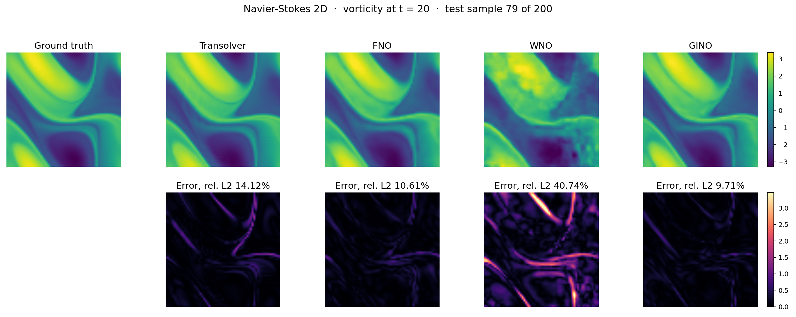
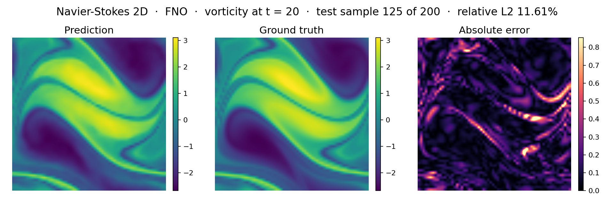
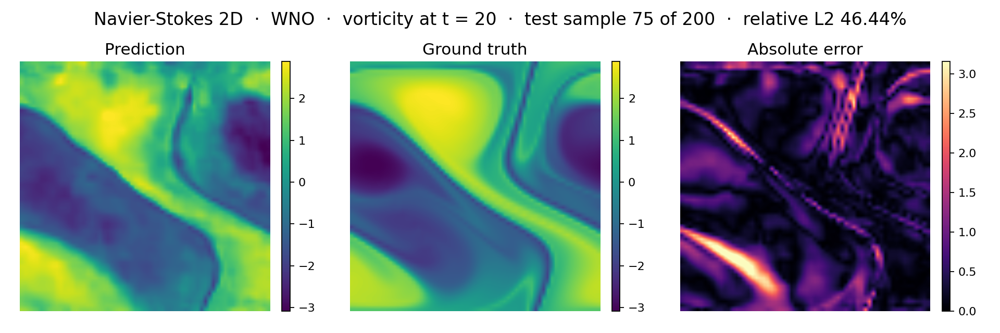
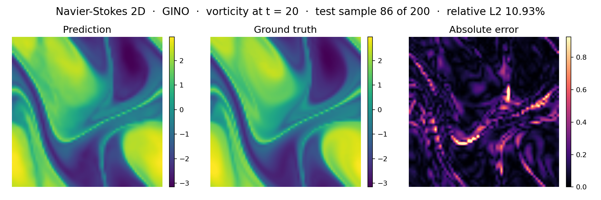
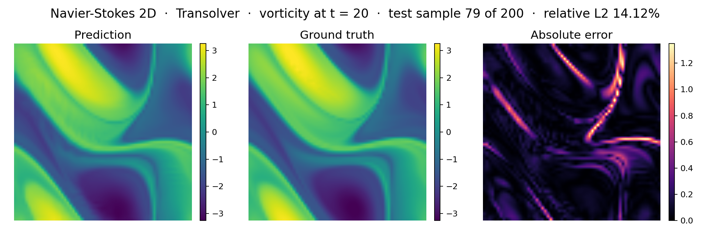
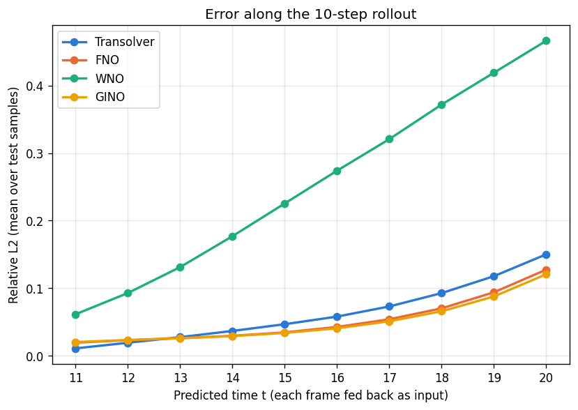
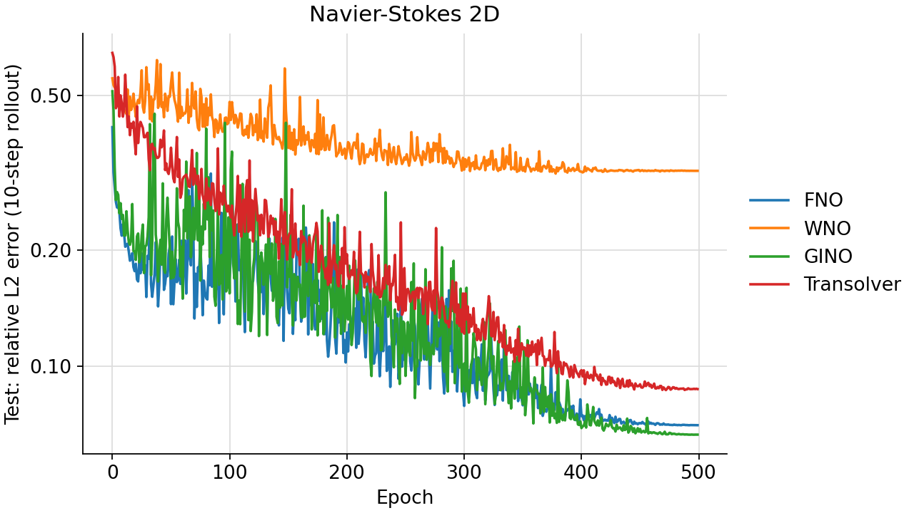
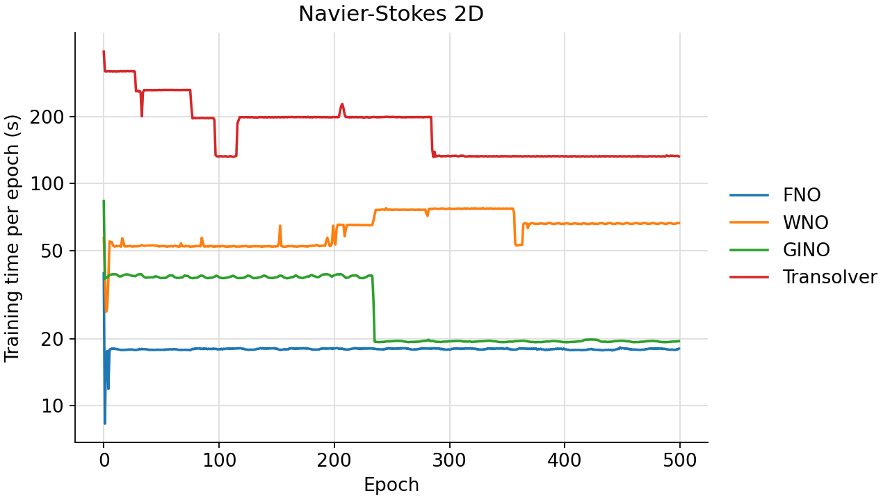

<!--
SPDX-FileCopyrightText: 2026 ZenteiQ AiTech Innovations Pvt. Ltd.
License notice: Documentation text and diagrams on this page are licensed
under CC BY 4.0. Source-code examples are licensed under LGPL-3.0-only
unless the example states otherwise.
-->

# Navier-Stokes 2D: Results

The ScireX implementations of four published neural operators, [Transolver](../../../api/models.md#scirex.models.Transolver) [[1]](#ref1), [GINO](../../../api/models.md#scirex.models.GINO) [[2]](#ref2), [FNO](../../../api/models.md#scirex.models.FNO) [[3]](#ref3) and [WNO](../../../api/models.md#scirex.models.WNO) [[4]](#ref4), on the [Navier-Stokes 2D benchmark](../README.md): the Transolver paper's [`exp_ns.py`](https://github.com/thuml/Transolver/blob/main/PDE-Solving-StandardBenchmark/exp_ns.py), launched by `Transolver_NS.sh`. Each model sees 10 vorticity frames on a 64 × 64 periodic grid at viscosity 1e-5 and predicts the next 10, one at a time, each prediction fed back as its next input. All four use the same data, recipe and parameter budget; the commands that reproduce a run are on the [problem card](../README.md#reproduce).

## Setup

One row per reported run (`_config.RUNS`). Every model is sized to Transolver's parameter count at the Transolver paper's size (11,232,321). Parameters are counted as trained real values.

| Model | Parameter count | Key hyperparameters |
|---|---|---|
| Transolver (`transolver`, [`scirex.models.Transolver`](../../../api/models.md#scirex.models.Transolver), `geometry="structured_2d"`) | 11,232,321 | 8 layers, hidden width 256, 8 heads, MLP ratio 1, 32 slices, `unified_pos=True` with 8 × 8 reference grid, dropout 0; PyTorch-reference numerics: exact GELU, LayerNorm eps $10^{-5}$, `conv_init="torch"`, reference weight init |
| FNO (`fno`, [`scirex.models.FNO`](../../../api/models.md#scirex.models.FNO)) | 11,183,467 (0.4% below Transolver) | 4 layers, 16 × 16 modes, width 98; 10 input channels (the history), appends its own grid channels |
| WNO (`wno`, [`scirex.models.WNO`](../../../api/models.md#scirex.models.WNO)) | 11,312,957 (0.7% above) | 4 layers, width 60, decomposition level 3, wavelet db4, float32 compute; appends its own grid channels |
| GINO (`gino`, [`scirex.models.GINO`](../../../api/models.md#scirex.models.GINO)) | 11,297,041 (0.6% above) | FNO block: 4 layers, 16 × 16 modes, width 97; input and output graph-kernel radius 0.033 (in the $[0,1]^2$ coordinates); input, latent and output points are the 64 × 64 grid points, one radius graph shared by both GNO layers |

Common to all models:

| | |
|---|---|
| Loss | $\mathcal{L}$: relative L2 per sample and step, summed over the batch and the 10 teacher-forced steps (see the problem card); no normalisation of the data |
| Optimiser and schedule | AdamW, weight decay $10^{-5}$, eps $10^{-8}$, no gradient clipping; cosine one-cycle learning rate, peak $10^{-3}$, `pct_start` 0.3, `div_factor` 25, `final_div_factor` $10^{4}$; 500 epochs, batch size 2, seed 0. Transolver cycles $\beta_1$ 0.95 to 0.85 and back (as PyTorch `OneCycleLR`); FNO and GINO use [`scirex.training.adamw_cx`](../../../api/training.md#scirex.training.adamw_cx), the AdamW for complex spectral weights; Transolver and WNO use `optax.adamw`. The recipe is the Transolver paper's (`exp_ns.py`, `Transolver_NS.sh`). |
| Weights reported | After the last epoch (no validation split, no epoch selection) |
| Task | Vorticity at t = 1-10 in, t = 11-20 out, one step at a time; no normalisation |
| Hardware | One NVIDIA RTX PRO 6000 Blackwell GPU, shared with other jobs; the FNO and GINO runs shared it with each other (for the first 2.5 h of the GINO run) |
| Metric (with unit) | $E_\mathrm{test}$: relative L2 per test sample over its 10 autoregressively predicted frames, mean over 200 test samples (dimensionless). Median, 90th percentile, worst sample and per-step error are also in `metrics.json`. |
| Baseline | Copy the last input frame to all 10 output frames: 0.7481 |

How each model receives the 10 history frames:

| Model | Input |
|---|---|
| Transolver | `geometry="structured_2d"`; weight initialisation as the reference's `initialize_weights`: every Linear kernel ~ N(0, 0.02²), bias 0, `in_project_slice` orthogonal |
| FNO | Channels-first `(batch, 10, 64, 64)`; the model appends its own two grid channels. Other settings at their defaults (grid positional embedding, channel MLP, linear skip) |
| WNO | Channels-last `(batch, 64, 64, 10)`; the model appends its own two grid channels. Other settings at their defaults |
| GINO | The 64 × 64 grid is one fixed geometry: input, latent and output points are the grid points in [0, 1]², one radius graph from the grid to itself serves both GNO layers, and the 10 frames are the per-point input features. `fno_in_channels` equals the 10 input channels because the input GNO's linear kernel multiplies the features channel by channel |

## Prediction

Ground truth, prediction and absolute error at t = 11, 14, 17 and 20, for the test sample with the median error of each model:

=== "All four"

    

=== "FNO"

    

=== "WNO"

    

=== "GINO"

    

=== "Transolver"

    

## Accuracy

Relative L2 over the 200 test samples, after the last epoch:

| Model | Parameters | Mean | Median | 90th percentile | Worst sample | Training time |
|---|---|---|---|---|---|---|
| GINO | 11,297,041 | **0.0666** | **0.0603** | **0.1157** | **0.2485** | 3.9 h |
| FNO | 11,183,467 | 0.0705 | 0.0631 | 0.1228 | 0.2779 | 2.5 h |
| Transolver | 11,232,321 | 0.0872 | 0.0796 | 0.1298 | 0.3617 | 25.2 h |
| WNO | 11,312,957 | 0.3198 | 0.3050 | 0.4536 | 0.6159 | 8.7 h |
| Copy the last input frame | – | 0.7481 | – | – | – | – |

The Transolver paper [[1]](#ref1) reports **0.0900** for Transolver on this benchmark ([[1]](#ref1); one seed).

- **GINO** has the lowest error on every summary statistic, and **FNO** is
  second. Each is one seed, as is every row.
- **Transolver**, 0.0872, matches the paper's 0.0900 (one seed). It uses the
  PyTorch reference's numerics, see
  [Matching the PyTorch reference](#matching-the-pytorch-reference).
  It has the lowest error on the first two predicted frames; GINO's and
  FNO's error grows more slowly along the rollout.
- **WNO** develops blocky artefacts after about t = 16 and ends at about
  four times GINO's and FNO's error.
- All four are far below copying the last input frame.

### Error along the rollout

Relative L2 of each predicted frame, averaged over the test samples. The
first frame is predicted from true history only; every later frame depends
on the model's own earlier predictions:

| Time t | 11 | 12 | 14 | 16 | 18 | 20 |
|---|---|---|---|---|---|---|
| GINO | 0.0203 | 0.0232 | **0.0290** | **0.0406** | **0.0658** | **0.1206** |
| FNO | 0.0192 | 0.0230 | 0.0295 | 0.0426 | 0.0702 | 0.1275 |
| Transolver | **0.0109** | **0.0192** | 0.0367 | 0.0579 | 0.0927 | 0.1501 |
| WNO | 0.0614 | 0.0929 | 0.1770 | 0.2741 | 0.3720 | 0.4665 |
| Copy last frame | 0.2037 | 0.3593 | 0.6116 | 0.7807 | 0.8718 | 0.8554 |

### Error curves

Training loss (teacher forced) and test relative L2 (autoregressive rollout) per epoch for each run:

## Compute cost

| Model | Steady-state compute cost | First epoch (includes JAX/XLA compilation) | Total (500 epochs) |
|---|---|---|---|
| Transolver | ~198 s/epoch (shared GPU; ~65 s/epoch alone, about 9 h for 500 epochs) | ~394 s | 25.2 h |
| GINO | ~20 s/epoch (~38 s while sharing with the FNO run) | ~84 s | 3.9 h |
| FNO | ~18 s/epoch | ~40 s | 2.5 h |
| WNO | ~66 s/epoch | ~57 s | 8.7 h |

Transolver and WNO shared one GPU with each other and with up to two
unrelated jobs; FNO and GINO were trained later, together on the same GPU.
These times are indicative only. The y-axis of the figure is log-scaled.

## Notes

### Optimiser for complex weights

??? note "Details"

    FNO's spectral weights, and those of GINO's FNO block, are complex.
    `jax.grad` returns the conjugate of the descent direction for a complex
    weight, so plain `optax.adamw` moves their imaginary parts the wrong way.
    FNO and GINO therefore train with [`scirex.training.adamw_cx`](../../../api/training.md#scirex.training.adamw_cx),
    which conjugates the gradient first. eps is 1e-8, as in `optax.adamw`;
    [`adamw_cx`](../../../api/training.md#scirex.training.adamw_cx) also applies Adam's bias correction in the paper's compact form,
    `sqrt(1 - b2^t) / (1 - b1^t) * m / (sqrt(v) + eps)`, which makes eps
    effectively `1 / sqrt(1 - b2^t)` times larger than in `optax.adamw`: 1.26x
    at step 1,000 and under 1.01x from step 5,000 on (epoch 10 of 500).
    Earlier runs with plain `optax.adamw` and the same data, schedule and seed
    reached 0.1579 (FNO) and 0.1189 (GINO). Transolver and WNO have no complex
    weights and use `optax.adamw`.

### Matching the PyTorch reference

This repo's Transolver differs from the PyTorch reference that `exp_ns.py`
runs in four numerical details. The run above sets all four to the
reference's choice:

| | Flax / optax default | PyTorch reference (used here) |
|---|---|---|
| GELU | tanh approximation | exact (`torch.nn.GELU`) |
| LayerNorm epsilon | 1e-6 | 1e-5 (`layer_norm_epsilon=1e-5`) |
| Slice-projection Conv2d init | `lecun_normal`, zero bias | `kaiming_uniform(a=sqrt(5))`, bias U(±1/sqrt(fan_in)) (`conv_init="torch"`) |
| AdamW beta1 | fixed 0.9 | cycled 0.95 → 0.85 → 0.95 (`OneCycleLR(cycle_momentum=True)`) |

With the Flax and optax defaults instead, and everything else the same, the
same seed ended at **0.0924**. With the reference's choices it ends at
0.0872. Both are single runs.

### The published checkpoints

| Model | Trained | Re-evaluated with `infer.py` | Last epoch in the training log |
|---|---|---|---|
| Transolver | 2026-10-12/13, by the script that `train.py` replaces | 0.0872 | 0.0873 |
| WNO | 2026-10-12/13, by the same script | 0.3198 | 0.3199 |
| FNO | 2026-10-30, `train.py --run fno` | 0.0705 | 0.0705 |
| GINO | 2026-10-30, `train.py --run gino` | 0.0666 | 0.0666 |

- The Transolver and WNO checkpoints were trained with the same recipe, data, model and seed as `train.py`, then converted to this benchmark's checkpoint format; each `config.json` records this. One detail differs for Transolver: that script's weight initialisation also kept the final `(256, 1)` output-projection kernel at Flax's default (a rank-1 false positive of the orthogonality check), while `train.py` reinitialises it like every other Linear layer, as the Pipe benchmark does.
- The FNO and GINO checkpoints were trained with the complex-aware optimiser [`adamw_cx`](../../../api/training.md#scirex.training.adamw_cx); their `config.json` records the training commit with `git_dirty: true`, because the optimiser change had not been committed when they were trained.
- The training log computes the test error in batches of 2 with the GPU's default matmul precision; `infer.py` uses batches of 20 and full float32, which accounts for the last-digit differences above.
- Training also logs the test error every epoch, for the error curve only; no epoch is chosen by it.
- The rollout animation (`animations/navier_stokes/evolution.gif`) is drawn with `python scripts/benchmarks/navier_stokes/animate.py --run transolver`.
- The FNO and GINO runs shared one GPU, and Transolver and WNO shared theirs with other jobs, so the compute times are indicative rather than a controlled benchmark.

## References

1. Wu et al., *Transolver: A Fast Transformer Solver for PDEs on General Geometries*, ICML 2024. <https://arxiv.org/abs/2402.02366>
2. Li et al., *Geometry-Informed Neural Operator for Large-Scale 3D PDEs*, NeurIPS 2023. <https://arxiv.org/abs/2309.00583>
3. Li et al., *Fourier Neural Operator for Parametric Partial Differential Equations*, ICLR 2021. <https://arxiv.org/abs/2010.08895>
4. Tripura and Chakraborty, *Wavelet Neural Operator for Solving Parametric Partial Differential Equations in Computational Mechanics Problems*, Computer Methods in Applied Mechanics and Engineering 404, 115783 (2023). <https://arxiv.org/abs/2205.02191>
