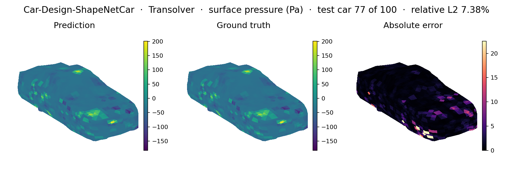
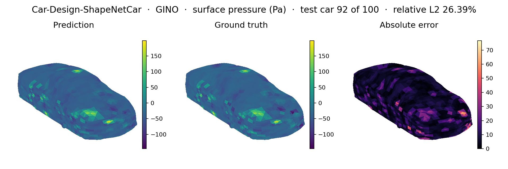
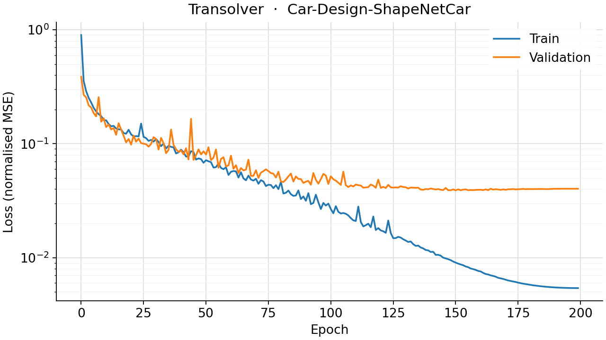
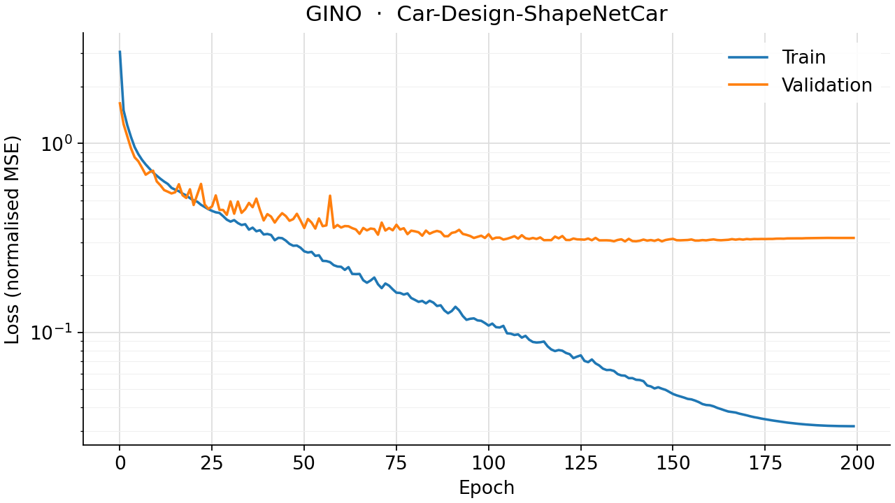

<!--
SPDX-FileCopyrightText: 2026 ZenteiQ AiTech Innovations Pvt. Ltd.
License notice: Documentation text and diagrams on this page are licensed
under CC BY 4.0. Source-code examples are licensed under LGPL-3.0-only
unless the example states otherwise.
-->

# ShapeNetCar: Results

The ScireX implementations of two published neural operators, [Transolver](../../../api/models.md#scirex.models.Transolver) [[1]](#ref1) and [GINO](../../../api/models.md#scirex.models.GINO) [[2]](#ref2), on the Transolver paper's [ShapeNetCar benchmark](../README.md): a point-cloud CFD case predicting velocity and pressure jointly on a 3D car surface and volume mesh. Both use the same fold (789 train / 100 validation samples), the same loss and training protocol, and the paper's own error metric; the commands that reproduce a run are on the [problem card](../README.md#reproduce).

Only the Transolver is in the paper: this page runs the ScireX JAX/Flax port of [Transolver: A Fast Transformer Solver for PDEs on General Geometries](https://arxiv.org/abs/2402.02366) ([[1]](#ref1)), ported from the [official PyTorch implementation](https://github.com/thuml/Transolver). Transolver replaces mesh-dependent attention with a physics-aware slice attention: points are softly assigned to a small, learned set of slices, the slices attend to each other (cheap, independent of point count), and the result is de-sliced back to every point. GINO (the [Geometry-Informed Neural Operator](https://arxiv.org/abs/2309.00583)) is a ScireX model, sized to within a few percent of Transolver's parameter count (~3.86M) so that a difference in accuracy is mostly a difference in architecture. No number here claims otherwise.

The experimental GIWO is benchmarked separately, under [Experimental](../../experimental/shapenetcar_giwo.md).

## Setup

Headline model: Transolver (the model in the paper). GINO is also benchmarked with a matched parameter count.

| | |
|---|---|
| Model | Transolver ([`scirex.models.Transolver`](../../../api/models.md#scirex.models.Transolver)), run name `transolver`; geometry contract `space_dim=7, fun_dim=0, out_dim=4, unified_pos=False, geometry="irregular"` |
| Parameter count | 3,860,804 (Transolver); GINO `gino_wide_radius` 3,852,494 |
| Key hyperparameters | `n_hidden=256, n_layers=8, n_head=8, mlp_ratio=2, slice_num=32`; batch size 1 (one gradient step per car); 200 epochs; fold 0; seed 0 |
| Loss | Velocity MSE (all points) + 0.5 x pressure MSE (surface points), on standardised fields; see Governing equations |
| Optimiser and schedule | Adam (`optax.adam`) with `optax.cosine_onecycle_schedule`: peak learning rate $10^{-3}$, `pct_start=0.3`, `div_factor=25`, `final_div_factor=1000`, `transition_steps` = (n_train + 1) x n_epochs |
| Metric (with unit) | `rel_l2_volume`, `rel_l2_surface`, `c_d_mean_relative_drag_error`, `rho_d_spearman_drag_correlation`: all dimensionless (relative errors and a rank correlation) |
| Fields | Velocity (3D, all points) + pressure (surface points only), predicted jointly |
| Data | Raw meshes (`.vtk`) read by `shapenet_car.py`, 9-fold cross-validation, one gradient step per car mesh (`batch_size=1`, matching the reference: every mesh has a different point count, so samples cannot be stacked). See the [dataset guide](../../../dataset_guide/shapenetcar.md) |
| Hardware | One NVIDIA RTX PRO 6000 Blackwell GPU |

Two GINO runs are registered; the headline run is the one trained for the full 200-epoch protocol:

| Run | Radii | Role |
|---|---|---|
| `gino` (`_GINO_TRANSOLVER_MATCHED`) | Sized so each latent or car point's average neighbor count stays in the 5-10 range, as in the cavity [GINO sizing](../../cavity/results/comparative.md#sizing) | Costs far less per epoch than Transolver |
| `gino_wide_radius` | Both radii raised (~3.25x the edges per sample) | **The GINO headline run** |

See `_config.py`'s comments for the measured edge counts and timings behind these choices.

`train.py` accepts `--epochs` (override the 200-epoch budget) for a fast smoke-scale check before a real run. Runs that already have a checkpoint are skipped, so an interrupted command can be restarted. Checkpoints are saved to `scripts/benchmarks/checkpoints/shapenetcar/<run>/` (not committed to git). Each holds the weights (via `_checkpoint.py`'s msgpack format), the per-epoch training history and `config.json`, which has the model size, the normalisation stats, the training settings and the git commit and library versions used. `infer.py` needs only these files and the test fold. The committed plots and metrics are from a 200-epoch run of the paper's default model size on fold 0 of the real `mlcfd_data.zip` dataset; `doc/assets/benchmarks/shapenetcar_<model>/metrics.json` has the per-epoch history and the final numbers.

## Prediction

Surface pressure on the held-out fold: truth, prediction and absolute error. The Transolver figure is written by `infer.py` from the true CFD surface mesh; the GINO figure is rendered as a matplotlib point cloud, because its predictions do not go through the ParaView `.vtk` export path that the Transolver's helper uses (that helper is wired to the single-sample contour loop rather than to a point-cloud output). The tabs show each model.

=== "Transolver"

    

=== "GINO"

    

??? note "Exporting the full surface"

    For the true CFD surface mesh, `infer.py` exports the ground-truth and predicted surface-pressure fields as legacy `.vtk` (`vtkUnstructuredGridWriter`) files, `scripts/benchmarks/vtk_outputs/shapenetcar/<run>/{truth,pred}.vtk` (gitignored), via a local `export_vtk_comparison_legacy` helper (the legacy-`.vtk` counterpart of the XML `.vtu` export `car_cfd/` uses for GINO's car-CFD mesh; quad cells here versus GINO's triangles, with the cell type auto-detected from the connectivity array). To inspect the full 3-D surface interactively, open `truth.vtk` and `pred.vtk` in [ParaView](https://www.paraview.org/), apply a **Surface** representation, and colour by **Pressure**.

## Accuracy

Relative L2 (velocity, pressure) and drag-coefficient metrics on the held-out fold (lower is better, except `rho_D`). Each is on denormalized (physical-unit) fields, mean over the validation set:

| Metric | Meaning |
|---|---|
| `rel_l2_volume` | Relative L2 error, velocity, over all points ("Volume" in the paper) |
| `rel_l2_surface` | Relative L2 error, pressure, over surface points only ("Surf" in the paper) |
| `c_d_mean_relative_drag_error` | Mean relative error of the drag coefficient Cd ("C_D") |
| `rho_d_spearman_drag_correlation` | Spearman rank correlation of Cd across samples ("rho_D") |

`metrics.json`'s `val_loss` is the split-MSE training and test metric (`velo_mse + press_weight * press_mse`, on normalised fields): useful for tracking convergence, but not comparable across papers or scales, since it mixes two fields with different units.

| Metric | Paper (Transolver) | Transolver (ours) | GINO (`gino_wide_radius`) |
|---|---|---|---|
| `rel_l2_volume` | 0.0207 | **0.0223** | 0.0730 |
| `rel_l2_surface` | 0.0745 | **0.0767** | 0.2149 |
| `c_d_mean_relative_drag_error` | 0.0103 | **0.0106** | 0.0779 |
| `rho_d_spearman_drag_correlation` | 0.9935 | **0.9928** | 0.6685 |

- **Transolver's global slice attention clearly outperforms the local
  operator here.** GINO does not close the gap at a matched parameter budget.
- **GINO** remains notably cheaper per epoch than Transolver, but the full 200-epoch run did not close the accuracy gap.

### Training curves

Training and test (split MSE) loss per epoch:

=== "Transolver"

    

=== "GINO"

    

### Against the published reference

The paper reports a Transolver number on this benchmark (as
reported, not re-run here). GINO is not in it.

| Setting | Paper | Ours |
|---|---|---|
| `rel_l2_volume` (Transolver) | 0.0207 | 0.0223 |
| `rel_l2_surface` (Transolver) | 0.0745 | 0.0767 |
| `c_d` (Transolver) | 0.0103 | 0.0106 |
| `rho_d` (Transolver) | 0.9935 | 0.9928 |

The ScireX Transolver reproduction is within about 8% of the paper's own numbers
on every metric.

## Compute cost

Seconds per training epoch, headline run per model (the first epoch includes
JAX compilation):

| Model | Seconds per epoch | Epochs | Total (200 epochs) |
|---|---|---|---|
| Transolver | ~17s | 200 | ~58.6 min |
| GINO (`gino_wide_radius`) | ~10.5s | 200 | ~37 min |

`gino_wide_radius` uses larger GNO radii than the default neighbor-count
sizing, which makes its neighbor graph denser and each epoch costlier.

Transolver's cost is dominated by the gather and scatter between the car's points and its learned slices in every layer. For GINO, the cost is in the neighbor graph, not the
weights: its GNO kernels evaluate an MLP on every edge of the
neighbor graph, and the graph's density (set by the search radius) governs
the per-epoch cost far more than the parameter count does.

## Notes

### Sizing

- **GINO.** `GINOCarWrapper` (`_models.py`) splits the dataset's 7 input channels into position and input function, lifts the car's point cloud onto a fixed 10 × 10 × 10 latent grid with a GNO kernel, runs a small FNO there, and projects back onto the car's own points (see `_gino_geometry.py` for the neighbour-search and padding details). It is sized to within 0.2% of Transolver's parameter count (3,852,494 against 3,860,804), by the same "match the budget, vary the architecture" convention as the cavity benchmark; `_config.py` (`_GINO_TRANSOLVER_MATCHED`) has the parameter and radius derivation. The mesh never changes within a sample, but every car has a different point count, so the neighbour search runs once per sample. The search radii follow the latent grid, not absolute distances, so a coarser or finer latent grid stays connected on its own.

### Reading the results

- **GINO is not in the paper.** No number on this page claims otherwise. It is measured against the ScireX Transolver at a matched budget.
- **The local-operator GINO does not close the gap to Transolver's global slice attention on this benchmark.**
- **GINO's numbers are not bit-reproducible.** Its graph kernels reduce with a scatter-add whose summation order the GPU does not fix, so re-running `infer.py` on the same checkpoint can move the third significant figure of a metric. The page quotes whatever the committed `metrics.json` holds.

### Data

The raw data and how to download it are in the [dataset guide](../../../dataset_guide/shapenetcar.md#get-the-data). Some sample directories are legitimately incomplete: they contain only `param1.txt` and `param2.txt` with no VTK files at all (observed on the real download, not corruption; presumably a failed raw simulation run upstream). [`load_shapenet_car`](../../../api/data.md#scirex.data.load_shapenet_car) detects and skips these automatically, as the reference's own `dataset.py::get_datalist` does, printing a one-line count per split, for example `load_shapenet_car: skipped 3 incomplete train sample(s) (missing quadpress_smpl.vtk/hexvelo_smpl.vtk, no cache hit).` This is expected and not an error; it is only worth investigating if the skipped count is a large fraction of a fold, which could indicate a bad download. Each sample's `cd.txt` already contains the ground-truth drag coefficient, and `mlcfd_data/linear_regression_code/{Cd_*.npy,I2_*.npy}` has precomputed per-fold aggregates, an independent cross-check for [`src/scirex/data/datasets/shapenet_car_drag.py`](../../../../src/scirex/data/datasets/shapenet_car_drag.py)'s own VTK-based computation.

### Checkpointing and inference

??? note "Details"

    `infer.py`'s drag-coefficient evaluation (per-sample predicted vs.
    ground-truth Cd, via `shapenet_car_drag.py::compute_drag_coefficient`, a
    faithful port of `utils/drag_coefficient.py::cal_coefficient`) reports the
    mean relative Cd error ("c_d" in the reference's `main_evaluation.py`) and
    the Spearman rank correlation between predicted and ground-truth Cd across
    samples ("rho_d"). Cd's `rho` (air density, `0.3`) and freestream velocity
    (`72/3.6` m/s) are literal constants hard-coded by the paper's own benchmark
    authors – not physical air properties, not read from any file – reproduced
    here as documented defaults for fidelity to the reference's evaluation
    protocol; see that module's docstring before overriding them.

### Performance & device selection

- `scirex._internal.torch_setup.setup()` picks the first GPU if `jax.devices("gpu")` returns any, and **silently falls back to CPU with no warning** otherwise (for example a CPU-only `jaxlib` wheel or a CUDA/driver mismatch). `train.py` prints the selected and visible devices at startup; check them before assuming a slow run means a bug. On a multi-GPU machine, pin an idle GPU with `CUDA_VISIBLE_DEVICES=<id>`.
- **The training loop is `jax.jit`-wrapped but not `lax.scan`-ed.** Point count varies per car mesh (up to ~889 distinct shapes), so `jax.jit` recompiles for every new shape. The same shapes recur every epoch, so only the first epoch pays the compilation cost. A `lax.scan` epoch loop over shape-bucketed, padded samples would remove it.
- If training is far slower than first-epoch compilation explains and XLA logs a `dot_search_space` / "all configs were filtered out" warning, check your `jax`/`jaxlib` version: this is a known regression in the 0.6.1 to 0.6.3 line ([jax-ml/jax#29740](https://github.com/jax-ml/jax/issues/29740)), fixed in later releases.

### Known limitations

| Item | Status |
|---|---|
| Training loop | `jax.jit` only, no `lax.scan`/padding – see [Performance and device selection](#performance-device-selection) |
| Checkpointing | Weights + architecture only (no optimiser/scheduler state) – resuming a run mid-training (not just loading a finished model for inference) isn't supported yet |

## References

1. Wu et al., *Transolver: A Fast Transformer Solver for PDEs on General Geometries*, ICML 2024. <https://arxiv.org/abs/2402.02366>
2. Li et al., *Geometry-Informed Neural Operator for Large-Scale 3D PDEs*, NeurIPS 2023. <https://arxiv.org/abs/2309.00583>
