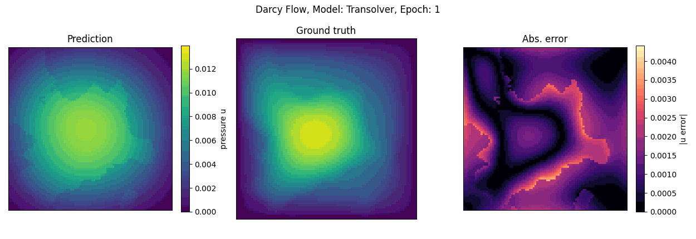
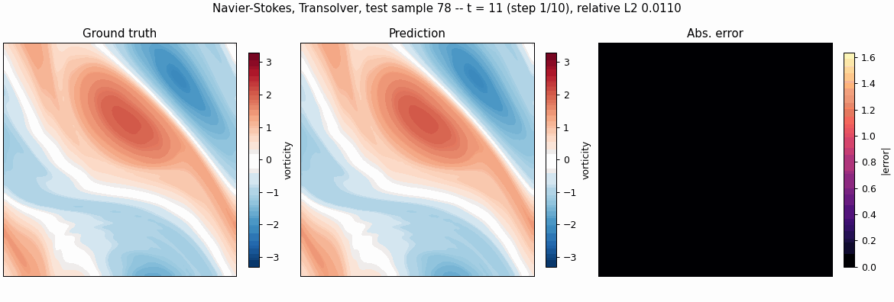
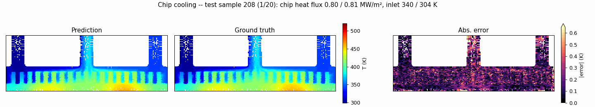
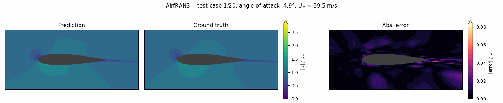
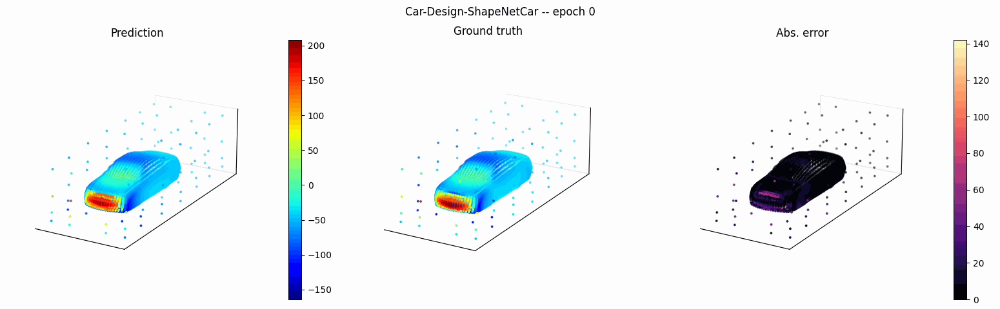

---
hide:
  - navigation
  - toc
---
<!--
SPDX-FileCopyrightText: 2026 ZenteiQ AiTech Innovations Pvt. Ltd.
License notice: Documentation text and diagrams on this page are licensed
under CC BY 4.0. Source-code examples are licensed under LGPL-3.0-only
unless the example states otherwise.
-->

<div class="zq-hero" markdown>

<div class="zq-hero__text" markdown>

# Neural operators for scientific machine learning

A JAX and Flax library of resolution-invariant neural operators (FNO, WNO, GINO and
Transolver) that learn the solution of PDEs from data or from the equations themselves,
with `jit`, `vmap` and `grad` on CPU, GPU and TPU.

[Get started](install/index.md){ .md-button .md-button--primary }
[Quickstart](user_guide/quickstart.md){ .md-button }
[API reference](api/index.md){ .md-button }

</div>

<div class="zq-hero__code" markdown>

```python
import jax, jax.numpy as jnp
from scirex.models import FNO

model = FNO(n_modes=(16, 16), hidden_channels=64,
            n_layers=4, in_channels=1, out_channels=1)

x = jnp.ones((4, 1, 64, 64))        # (batch, channels, H, W)
params = model.init(jax.random.PRNGKey(0), x)
y = model.apply(params, x)          # (4, 1, 64, 64)
```

</div>

</div>

<div class="zq-home" markdown>

<div class="zq-home__main" markdown>

<div class="zq-band" markdown>

## Why ScireX

<div class="zq-features" markdown>

<div markdown>

### Resolution invariant

Train at one discretisation and evaluate at another. Operators learn mappings between
function spaces, not between fixed-size vectors.

</div>

<div markdown>

### Built on JAX

Pure JAX and Flax. Compile with XLA, vectorise with `vmap`, differentiate with `grad`,
and run on CPU, NVIDIA GPU or TPU.

</div>

<div markdown>

### Data or physics

Train on labelled data, or on the equation alone with the Ritz energy loss, with no
solutions needed.

</div>

<div markdown>

### Reproducible benchmarks

Nine benchmark problems with the models compared at a matched parameter budget, and a script
that reproduces the tables from the saved checkpoints.

</div>

</div>

</div>

## Start learning

<div class="grid cards" markdown>

-   :material-download: **Install**

    ---

    pip, CUDA 12, TPU, Docker or from source, with troubleshooting.

    [:octicons-arrow-right-24: Install](install/index.md)

-   :material-rocket-launch: **Use it on your data**

    ---

    Save your inputs and outputs in one file, train any model with one command, predict new cases.

    [:octicons-arrow-right-24: Usage](user_guide/use_on_your_data.md)

-   :material-school: **Learn**

    ---

    The quickstart, the theory behind each operator, and a tutorial for every problem.

    [:octicons-arrow-right-24: Learn](learn/index.md)

-   :material-api: **API**

    ---

    Reference for models, layers, losses, data, training and utilities.

    [:octicons-arrow-right-24: API Reference](api/index.md)

-   :material-source-pull: **Contribute**

    ---

    Set up a development environment, run the tests and open a pull request.

    [:octicons-arrow-right-24: Developer Guide](dev_guide/index.md)

</div>

</div>

<aside class="zq-home__rail" aria-label="Results">
<div class="zq-results">
<p class="zq-results__title">Benchmark Gallery</p>
<p class="zq-results__lead">Released models on test cases they never saw. The gallery moves on by itself; hover to pause, or use the dots.</p>
<div class="zq-carousel" aria-roledescription="carousel" aria-label="Benchmark results">
<div class="zq-carousel__track" tabindex="0">
<figure class="zq-carousel__slide" aria-roledescription="slide" aria-label="1 of 9: Darcy Flow">
  <a class="zq-carousel__media" href="benchmarks/darcy/"></a>
  <figcaption><b>Darcy flow.</b> Pressure on an unseen permeability field: the ground truth, the four models and their errors. <a class="zq-results__more" href="benchmarks/darcy/">Results&nbsp;→</a></figcaption>
</figure>
<figure class="zq-carousel__slide" aria-roledescription="slide" aria-label="2 of 9: Darcy Flow, Physics-Only">
  <a class="zq-carousel__media" href="benchmarks/darcy_physics/"><video loop muted playsinline preload="none" poster="assets/landing/darcy_physics.png" aria-label="Darcy Flow, Physics-Only: prediction, ground truth and error"><source src="assets/landing/darcy_physics.mp4" type="video/mp4"></video></a>
  <figcaption><b>Darcy Flow, Physics-Only.</b> A Transolver trained on the equation alone, with no solutions to learn from, on eight test cases from the lowest to the highest error. <a class="zq-results__more" href="benchmarks/darcy_physics/">Results&nbsp;→</a></figcaption>
</figure>
<figure class="zq-carousel__slide" aria-roledescription="slide" aria-label="3 of 9: Navier-Stokes 2D">
  <a class="zq-carousel__media" href="benchmarks/navier_stokes/"></a>
  <figcaption><b>Navier-Stokes 2D.</b> Vorticity at t = 20 from an unseen initial condition: the ground truth, the four models and their errors. <a class="zq-results__more" href="benchmarks/navier_stokes/">Results&nbsp;→</a></figcaption>
</figure>
<figure class="zq-carousel__slide" aria-roledescription="slide" aria-label="4 of 9: Lid-Driven Cavity">
  <a class="zq-carousel__media" href="benchmarks/cavity/"><video loop muted playsinline preload="none" poster="assets/landing/cavity.png" aria-label="Lid-Driven Cavity: prediction, ground truth and error"><source src="assets/landing/cavity.mp4" type="video/mp4"></video></a>
  <figcaption><b>Lid-driven cavity.</b> Flow speed at a lid speed held out of training, predicted one step ahead at eight times through the simulation. <a class="zq-results__more" href="benchmarks/cavity/">Results&nbsp;→</a></figcaption>
</figure>
<figure class="zq-carousel__slide" aria-roledescription="slide" aria-label="5 of 9: Pipe Flow">
  <a class="zq-carousel__media" href="benchmarks/pipe/"><video loop muted playsinline preload="none" poster="assets/landing/pipe.png" aria-label="Pipe Flow: prediction, ground truth and error"><source src="assets/landing/pipe.mp4" type="video/mp4"></video></a>
  <figcaption><b>Pipe flow.</b> Velocity in pipes of shapes the model has not seen, predicted from the mesh coordinates alone. <a class="zq-results__more" href="benchmarks/pipe/">Results&nbsp;→</a></figcaption>
</figure>
<figure class="zq-carousel__slide" aria-roledescription="slide" aria-label="6 of 9: Chip Cooling">
  <a class="zq-carousel__media" href="benchmarks/chip_cooling/"></a>
  <figcaption><b>Chip cooling.</b> Temperature in a heat sink on an unseen test case: the ground truth, the four models and their errors. <a class="zq-results__more" href="benchmarks/chip_cooling/">Results&nbsp;→</a></figcaption>
</figure>
<figure class="zq-carousel__slide" aria-roledescription="slide" aria-label="7 of 9: AirfRANS">
  <a class="zq-carousel__media" href="benchmarks/airfrans/"></a>
  <figcaption><b>AirfRANS.</b> Flow speed around an unseen airfoil: the ground truth, Transolver and WNO, and their errors. <a class="zq-results__more" href="benchmarks/airfrans/">Results&nbsp;→</a></figcaption>
</figure>
<figure class="zq-carousel__slide" aria-roledescription="slide" aria-label="8 of 9: ShapeNetCar">
  <a class="zq-carousel__media" href="benchmarks/shapenetcar/"></a>
  <figcaption><b>ShapeNetCar.</b> Surface pressure on an unseen car: the Transolver prediction, the ground truth and the error. <a class="zq-results__more" href="benchmarks/shapenetcar/">Results&nbsp;→</a></figcaption>
</figure>
<figure class="zq-carousel__slide" aria-roledescription="slide" aria-label="9 of 9: Car-CFD">
  <a class="zq-carousel__media" href="benchmarks/car_cfd/"><video loop muted playsinline preload="none" poster="assets/landing/car_cfd.png" aria-label="Car-CFD: prediction, ground truth and error"><source src="assets/landing/car_cfd.mp4" type="video/mp4"></video></a>
  <figcaption><b>Car-CFD.</b> Surface pressure on unseen car shapes, from the geometry alone. <a class="zq-results__more" href="benchmarks/car_cfd/">Results&nbsp;→</a></figcaption>
</figure>
</div>
</div>
<a class="zq-results__all" href="benchmarks/">See all benchmarks →</a>
</div>
</aside>

</div>

## Licence

ScireX source code is licensed under the **GNU Lesser General Public License version 3.0 only (LGPL-3.0-only)**. This documentation is licensed under **Creative Commons Attribution 4.0 International (CC BY 4.0)**; embedded code examples are LGPL-3.0-only unless the example states otherwise. Datasets and model artifacts are licensed individually, see the relevant directory. The ZenteiQ and ScireX names and logos are trademarks of ZenteiQ AiTech Innovations Pvt. Ltd. and are not covered by these licences. See [LGPL v3 licence](project/license_lgpl.md), [GPL v3 licence](project/license_gpl.md) and [Notice](project/notice.md).

© 2026 ZenteiQ AiTech Innovations Pvt. Ltd.
