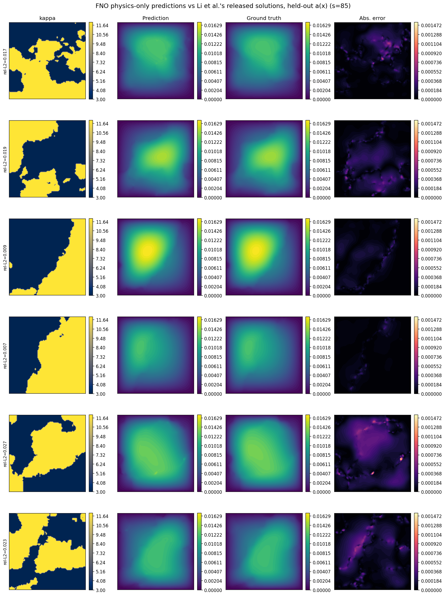
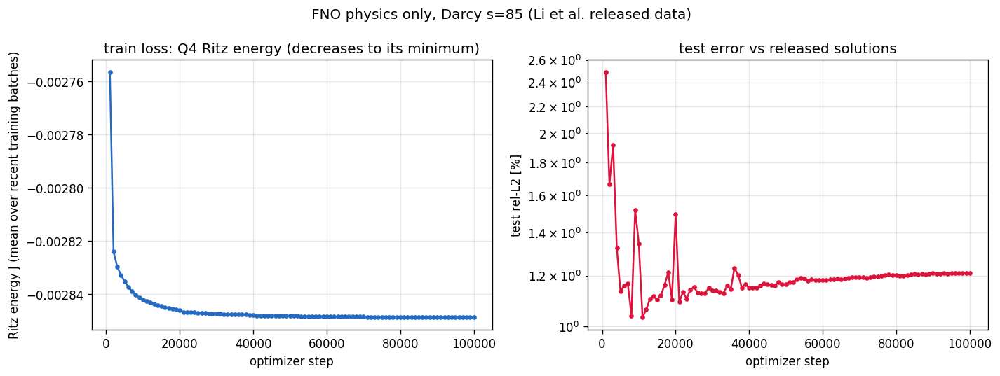
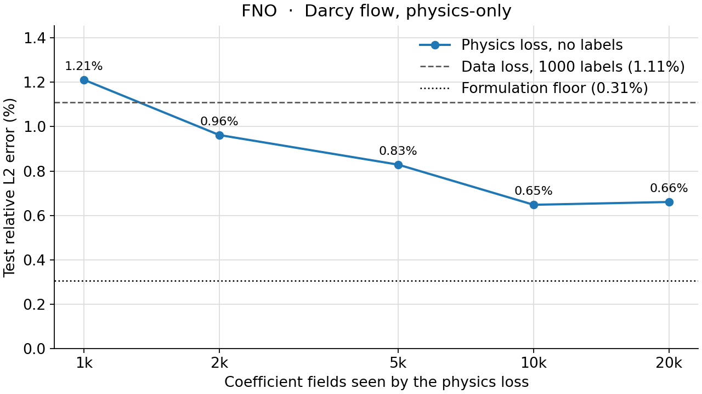

<!--
SPDX-FileCopyrightText: 2026 ZenteiQ AiTech Innovations Pvt. Ltd.
License notice: Documentation text and diagrams on this page are licensed
under CC BY 4.0. Source-code examples are licensed under LGPL-3.0-only
unless the example states otherwise.
-->

# Tutorial: Darcy Flow, Physics-Only, with FNO

In this tutorial you train a [FNO](../../theory_guide/operator_learning.md#fno) to solve
the **Darcy flow** benchmark **without any labelled solution**. Given a
piecewise-constant permeability $a(x) \in \{3, 12\}$ on the unit square,
the network predicts the pressure $u$ of $-\nabla\cdot(a\nabla u) = 1$,
$u = 0$ on the boundary. It is trained only on the finite-element Ritz energy [[4]](#ref4)
of this equation, whose minimiser is the solution: the training solutions of
the dataset are never read. The released solutions are used only to score the
200 test fields. The whole tutorial is one script, [`scripts/tutorials/darcyphysics_fno.py`](../../../scripts/tutorials/darcyphysics_fno.py). It uses only
the public ScireX API ([`scirex.losses.Q4Galerkin`](../../api/losses.md#scirex.losses.Q4Galerkin), [`scirex.models.FNO`](../../api/models.md#scirex.models.FNO), [`scirex.training.adamw_cx`](../../api/training.md#scirex.training.adamw_cx), [`scirex.utils.count_model_params`](../../api/utils.md#scirex.utils.count_model_params)) plus NumPy, SciPy, JAX and optax. The
code on this page is copied from that script.

## Summary

| | |
|---|---|
| Problem | Steady Darcy flow $-\nabla\cdot(a\nabla u) = 1$, $u = 0$ on the boundary of the unit square; permeability in, pressure out, trained without labels |
| Model | FNO, [`scirex.models.FNO`](../../api/models.md#scirex.models.FNO). Benchmark size: `hidden_channels=40, n_modes=(20, 20), n_layers=4`, grid positional embedding, linear skip, soft-gated channel MLP, 2,836,281 parameters (complex weights counted as two). Smoke size: `hidden_channels=12, n_modes=(12, 12), n_layers=2`, 49,777 parameters |
| Loss | Q4 Ritz energy of the PDE on the 85 × 85 nodes (84 × 84 bilinear elements), majority coefficient per element, exact boundary condition. No solution enters the loss |
| Data | `piececonst_r421_N1024_smooth1.mat` of [[1]](#ref1) (training coefficients, first 1000; their solutions are not read) and `smooth2.mat` (first 200 test pairs), strided 421 -> 85. Smoke: 100 training fields, 20 test fields |
| Optimiser | Complex-aware AdamW ([`adamw_cx`](../../api/training.md#scirex.training.adamw_cx)), lr 1e-3 halved every 400 epochs (4 times), no weight decay, eps 1e-8, batch 20, loss multiplied by 6889 (the interior node count) |
| Steps, full run | 100,000 (2000 epochs of 50 steps) |
| Metric | Relative L2 error per test field against the released solutions, at the released sample points, averaged over the 200 test fields |
| Full-run values | 1.211% on the 1000 released fields; 0.648% with 10k fields (1000 released + 9k sampled, no labels). Formulation floor 0.31%. Data-driven reference: 1.109% ([this repository's data-driven FNO](../../benchmarks/darcy/results/comparative.md#fno), 1000 labels); 1.08% in [[1]](#ref1) |

## Setup

Install the library from a clone of the repository (see [Install](../../install/index.md)):

```bash
pip install -e ".[all]"
```

### Data

The data are not bundled and not downloaded automatically. Download
`piececonst_r421_N1024_smooth1.mat` and `piececonst_r421_N1024_smooth2.mat`
(about 1.7 GB each) from the FNO data release of [[1]](#ref1); the WNO repository
([TapasTripura/WNO](https://github.com/TapasTripura/WNO)) links them as
"Dataset-2". Put both in one folder and pass it as `--data-dir`, or set
`DARCY_DATA_DIR`. See the [dataset guide](../../dataset_guide/darcy_2d.md) for
the source and the download.

The physics loss needs the training coefficients at the native 421 × 421
resolution (for the majority rule), so the script reads the full `coeff`
arrays of the files; it never reads `sol` from the training file. The smoke
run reads the same two files and keeps fewer fields.

## The problem

The data are the Darcy benchmark of [[1]](#ref1): permeability fields
$a(x)$ that take the values 3 and 12 (a thresholded Gaussian random field),
on a 421 × 421 grid of the unit square, with the pressure $u$ that solves

$$
-\nabla\cdot\big(a(x)\,\nabla u(x)\big) = f(x) = 1 \quad \text{in } (0, 1)^2,
\qquad u = 0 \text{ on the boundary.}
$$

The benchmark keeps every 5th node, 85 × 85. A data-driven model learns the map
$a \mapsto u$ from 1000 solved pairs. Here the network learns it from the
equation instead, through its variational form: among the functions that
vanish on the boundary, the solution minimises the Ritz energy

$$
J_a(u) = \frac12 \int_\Omega a\,\lvert\nabla u\rvert^2\,dx - \int_\Omega f\,u\,dx .
$$

**Discretisation.** $u$ is represented by its values at the 85 × 85 nodes and
interpolated bilinearly on each of the 84 × 84 square elements (Q4 elements).
Both integrals are evaluated with 2 × 2 Gauss points per element, which is exact
here. The minimiser of the discrete $J_a$ is the Q4 finite-element solution.
The training loss is the mean of $J_a(\hat u)$ over a batch of coefficient
fields; it is negative and decreases towards the energy of the
finite-element solution. No solution is needed to compute it.

**Coefficient per element.** Each element gets one value of $a$: the more
frequent of the two values over the 6 × 6 native nodes it covers. The benchmark
compared this with other rules (corner node 1.07%, mean 0.61%, majority
0.31%, see below).

**Boundary condition and output scale.** The network output $N(a)$ becomes
the pressure through

$$
\hat u(x, y) = \big(c\,N(a)(x, y) + m\big)\,\sin(\pi x)\sin(\pi y),
$$

which is zero on the boundary, so the loss needs no boundary term. A
data-driven model would normalise with the mean and standard deviation of the
training solutions; here $c$ and $m$ come without labels from one Q4 solve of
the torsion problem $-\Delta\phi = 1$, $\phi = 0$ on the boundary:
$m$ and $c$ are the mean and standard deviation of $\phi/\sqrt{a_{lo}a_{hi}}$
over the nodes, $\sqrt{3 \cdot 12} = 6$ being the effective coefficient of
a 50/50 two-phase medium in 2D ([[2]](#ref2); [[3]](#ref3)). This gives
$c = 0.00367$ and $m = 0.00572$.

**Scoring and the floor.** The released solutions were computed on the
native grid and stored at its cell centres, half a native cell inside the
nodes. A fixed linear interpolation moves the prediction there before the
relative L2 error is computed. Even the exact Q4 solution is 0.31% from the
released solutions with this rule (0.60% at the nodes): that is the floor of
this formulation, the error a perfectly trained model would reach. The
benchmark's [setup page](../../benchmarks/darcy_physics/results/setup.md) has the
checks behind these numbers.

**FNO in one paragraph.** An FNO layer adds a pointwise linear map to a convolution done in Fourier space: it takes the FFT of the hidden channels, keeps only the lowest `n_modes` frequencies, multiplies each kept frequency by a learned complex matrix and transforms back. One layer therefore couples every node with every other. The pressure of this problem is smooth inside each phase and has kinks at the interfaces, so the low modes carry most of it. The [theory guide](../../theory_guide/operator_learning.md#fno) has the details.

## Step-by-step walkthrough

### 1. Setup

Imports, the seed, the data split, the training recipe and the two model
sizes. `PROTOCOL` holds the benchmark's data split
([`scripts/benchmarks/darcy/_config.py`](../../../scripts/benchmarks/darcy/_config.py)); `RECIPE` holds the physics-only
FNO recipe of [`scripts/benchmarks/darcy_physics/train_fno.py`](../../../scripts/benchmarks/darcy_physics/train_fno.py).
`SIZES["full"]` is the benchmark's FNO; `SIZES["smoke"]` is small enough for a
CPU. `FE_PRECISION` keeps the finite-element contractions at full float32
precision: on a GPU, JAX's default TF32 matrix products perturb the Q4
Jacobians by up to 5%.

<!-- tutorial-snippet -->
```python
from __future__ import annotations

import argparse
import os
import platform
from pathlib import Path
from time import perf_counter

import flax
import jax
import jax.numpy as jnp
import matplotlib
import matplotlib.pyplot as plt
import numpy as np
import optax
from scipy.io import loadmat
from scipy.sparse import coo_matrix
from scipy.sparse.linalg import spsolve

import scirex
from scirex.losses import Q4Galerkin
from scirex.models import FNO
from scirex.training import adamw_cx
from scirex.utils import count_model_params

matplotlib.use("Agg")  # write figures to files, no display needed
# Keep float32, also if float64 was enabled earlier in the process.
jax.config.update("jax_enable_x64", False)
```

<!-- tutorial-snippet -->
```python
SEED = 0

# The data split of the Darcy benchmark (scripts/benchmarks/darcy/_config.py).
PROTOCOL = dict(
    train_file="piececonst_r421_N1024_smooth1.mat",
    test_file="piececonst_r421_N1024_smooth2.mat",
    n_train=1000,
    n_test=200,
    subsample_rate=5,  # 421 -> 85 nodes per side
)

# The physics-only FNO recipe (scripts/benchmarks/darcy_physics/train_fno.py):
# 2000 epochs of 50 steps = 100,000 steps, lr halved every 400 epochs.
RECIPE = dict(
    epochs=2000,
    batch_size=20,
    learning_rate=1e-3,
    lr_decay_epochs=400,
    lr_decay_rate=0.5,
    weight_decay=0.0,
    adam_eps=1e-8,
)

# Model sizes. "full" is the benchmark's FNO (2,836,281 parameters, matched to
# Transolver's 2,826,945). "smoke" is a tiny FNO that trains on a CPU.
SIZES = dict(
    full=dict(hidden_channels=40, n_modes=(20, 20), n_layers=4),
    smoke=dict(hidden_channels=12, n_modes=(12, 12), n_layers=2),
)

# Finite-element contractions at full float32 precision (on a GPU, JAX's
# default TF32 matmuls perturb the Q4 Jacobians by up to 5%).
FE_PRECISION = "highest"
```

`print_environment` records the library versions, the devices JAX sees and the seed;
see [how the tutorials work](../index.md#how-the-tutorials-work).

<!-- tutorial-snippet -->
```python
def print_environment(seed: int) -> None:
    """Print the versions, the devices and the seed, so a run can be repeated."""
    print(f"python {platform.python_version()} | numpy {np.__version__}")
    print(f"scirex {scirex.__version__}")
    print(
        f"jax {jax.__version__} | flax {flax.__version__} | optax {optax.__version__}"
    )
    print(f"devices: {jax.devices()}")
    print(f"SEED = {seed}")
```

### 2. Load the data

`load_darcy` reads the coefficient fields and keeps every 5th node for the
network. For the training fields it also computes the coefficient of each
element from the native nodes with `majority_per_cell`, and the two
coefficient values. The training solutions are not read. For the test fields
it keeps the released solutions, strided like the coefficient.

<!-- tutorial-snippet -->
```python
def majority_per_cell(a_native: np.ndarray, resolution: int) -> np.ndarray:
    """``(n, N, N)`` native node values -> ``(n, resolution, resolution)``:
    the more frequent of the two values over the nodes each cell covers."""
    rate = (a_native.shape[1] - 1) // resolution
    blocks = np.lib.stride_tricks.sliding_window_view(
        a_native, (rate + 1, rate + 1), axis=(1, 2)
    )[:, ::rate, ::rate]
    lo, hi = float(a_native.min()), float(a_native.max())
    return np.where(blocks.mean(axis=(-2, -1)) >= 0.5 * (lo + hi), hi, lo)
```

<!-- tutorial-snippet -->
```python
def load_darcy(data_dir: Path, n_train: int, n_test: int, rate: int = 5) -> dict:
    """Training coefficients (nodes and cells) and test coefficients and solutions."""
    out = {}
    for name, file, n in (
        ("train", PROTOCOL["train_file"], n_train),
        ("test", PROTOCOL["test_file"], n_test),
    ):
        path = Path(data_dir) / file
        if not path.is_file():
            raise FileNotFoundError(f"{path} not found")
        keys = ("coeff",) if name == "train" else ("coeff", "sol")
        raw = loadmat(path.as_posix(), variable_names=keys)
        if raw["coeff"].shape[0] < n:
            raise ValueError(f"{path} has only {raw['coeff'].shape[0]} samples")
        a_native = raw["coeff"][:n].astype(np.float32)
        out[f"a_{name}"] = a_native[:, ::rate, ::rate]
        if name == "train":
            resolution = out["a_train"].shape[1] - 1
            out["cells_train"] = majority_per_cell(a_native, resolution)
            out["a_range"] = (float(a_native.min()), float(a_native.max()))
        else:
            out["u_test"] = raw["sol"][:n, ::rate, ::rate].astype(np.float32)
    print(
        f"coefficient fields: {n_train} train (no solutions) / {n_test} test | "
        f"nodes {out['a_train'].shape[1:]} | cells {out['cells_train'].shape[1:]} | "
        f"values {out['a_range']}"
    )
    return out
```

### 3. The physics loss

`build_q4_mesh` builds the 85 × 85 nodes, the 84 × 84 elements (corners in
counter-clockwise order, the order [`Q4Galerkin`](../../api/losses.md#scirex.losses.Q4Galerkin) expects) and the boundary
mask. [`Q4Galerkin`](../../api/losses.md#scirex.losses.Q4Galerkin) precomputes the shape-function gradients and the
Jacobians at the Gauss points. `make_ritz_energy` returns the mean Ritz energy
of a batch: `grad_energy` gives $\int a\lvert\nabla u\rvert^2$ with the
element coefficient looked up by `kappa`, and the source term is the integral
of $u$ at the same Gauss points, through the bilinear shape functions of
`shape_at_gauss`.

<!-- tutorial-snippet -->
```python
def build_q4_mesh(resolution: int):
    """Nodes, CCW quads and boundary mask of the uniform grid on [0, 1]^2."""
    xs = np.linspace(0.0, 1.0, resolution + 1, dtype=np.float32)
    gx, gy = np.meshgrid(xs, xs, indexing="ij")
    xy = np.stack([gx.ravel(), gy.ravel()], axis=-1)
    i, j = np.meshgrid(np.arange(resolution), np.arange(resolution), indexing="ij")
    n0 = (i * (resolution + 1) + j).ravel()
    quad = np.stack([n0, n0 + resolution + 1, n0 + resolution + 2, n0 + 1], axis=1)
    boundary = (xy == 0.0).any(axis=1) | (xy == 1.0).any(axis=1)
    return xy, quad.astype(np.int32), boundary
```

<!-- tutorial-snippet -->
```python
def shape_at_gauss() -> np.ndarray:
    """Bilinear shape functions of the 4 element nodes at the 2x2 Gauss
    points, ``(Q, 4)``, in ``Q4Galerkin``'s point and node order."""
    g = 1.0 / np.sqrt(3.0)
    gauss = np.array([[-g, -g], [g, -g], [g, g], [-g, g]])
    corners = np.array([[-1, -1], [1, -1], [1, 1], [-1, 1]])
    return (
        0.25
        * (1 + gauss[:, None, 0] * corners[None, :, 0])
        * (1 + gauss[:, None, 1] * corners[None, :, 1])
    )
```

<!-- tutorial-snippet -->
```python
def make_ritz_energy(galerkin: Q4Galerkin):
    """Return ``energy(u_batch, cells_batch)``: the mean Ritz energy of a batch."""
    shape = jnp.asarray(shape_at_gauss(), dtype=jnp.float32)
    _, _, det_j = galerkin.physical_grad_and_jacobian()
    weight = jnp.abs(det_j)  # (Q, T): Gauss weights are 1

    def kappa(cells, point):
        resolution = cells.shape[0]
        i = jnp.clip(
            jnp.floor(point[0] * resolution).astype(jnp.int32), 0, resolution - 1
        )
        j = jnp.clip(
            jnp.floor(point[1] * resolution).astype(jnp.int32), 0, resolution - 1
        )
        return cells[i, j]

    def energy_one(u, cells):
        stiffness = 0.5 * galerkin.grad_energy(u, kappa, cells)
        u_at_gauss = jnp.einsum("qp,tp->qt", shape, u[galerkin.quad])
        return stiffness - jnp.sum(weight * u_at_gauss)

    def energy(u_batch, cells_batch):
        return jnp.mean(jax.vmap(energy_one)(u_batch, cells_batch))

    return energy
```

### 4. Boundary condition and output scale

`torsion_output_scale` assembles the Q4 stiffness matrix of $-\Delta$ from the
same shape-function gradients, solves the torsion problem with SciPy and
returns $c$ and $m$. `sin_boundary_factor` is the factor that makes the
prediction vanish on the boundary.

<!-- tutorial-snippet -->
```python
def torsion_output_scale(
    galerkin: Q4Galerkin, boundary, a_range
) -> tuple[float, float]:
    """``(c, m)``: std and mean of the Q4 torsion function over ``sqrt(a_lo a_hi)``."""
    dn_dx, dn_dy, det_j = (
        np.asarray(v, np.float64) for v in galerkin.physical_grad_and_jacobian()
    )
    w = np.abs(det_j)[..., None, None]  # (Q, T, 1, 1)
    local_k = np.sum(
        w
        * (
            dn_dx[..., :, None] * dn_dx[..., None, :]
            + dn_dy[..., :, None] * dn_dy[..., None, :]
        ),
        axis=0,
    )  # (T, 4, 4)
    local_f = np.einsum("qt,qp->tp", np.abs(det_j), shape_at_gauss())  # int of N_i
    quad = np.asarray(galerkin.quad)
    n = galerkin.n_nodes
    rows, cols = np.repeat(quad, 4, axis=1).ravel(), np.tile(quad, (1, 4)).ravel()
    stiffness = coo_matrix((local_k.ravel(), (rows, cols)), shape=(n, n)).tolil()
    load = np.zeros(n)
    np.add.at(load, quad.ravel(), local_f.ravel())
    stiffness[boundary, :] = 0.0
    stiffness[boundary, boundary] = 1.0
    load[boundary] = 0.0
    phi = spsolve(stiffness.tocsr(), load) / np.sqrt(a_range[0] * a_range[1])
    return float(phi.std()), float(phi.mean())
```

<!-- tutorial-snippet -->
```python
def sin_boundary_factor(xy: np.ndarray) -> np.ndarray:
    """``sin(pi x) sin(pi y)``: zero on the boundary, one at the centre."""
    return np.sin(np.pi * xy[:, 0]) * np.sin(np.pi * xy[:, 1])
```

### 5. Scoring points

`cell_centre_interpolation` is the 1D linear map from the 85 nodes to the 85
sample points of the released solutions; applied along both axes it maps a
nodal field $U$ to $M U M^T$.

<!-- tutorial-snippet -->
```python
def cell_centre_interpolation(n_side: int, rate: int) -> np.ndarray:
    """``(n_side, n_side)`` 1D interpolation from the nodes to the sample points."""
    n_native = rate * (n_side - 1) + 1
    nodes = np.linspace(0.0, 1.0, n_side)
    points = (rate * np.arange(n_side) + 0.5) / n_native
    eye = np.eye(n_side)
    return np.stack(
        [np.interp(points, nodes, eye[:, j]) for j in range(n_side)], axis=1
    )
```

### 6. Normalise the input

The coefficient gets a per-pixel unit Gaussian (one mean and one standard deviation per grid point, `eps = 1e-5`), fitted on the training coefficients
only. There is no output normaliser: $c$ and $m$ play that role.

<!-- tutorial-snippet -->
```python
class PixelNormalizer:
    """``(v - mean) / (std + eps)`` with a mean and a std per grid point."""

    def __init__(self, train: np.ndarray, eps: float = 1e-5) -> None:
        self.mean = train.mean(axis=0, keepdims=True)
        self.std = train.std(axis=0, keepdims=True)
        self.eps = eps

    def encode(self, v):
        return (v - self.mean) / (self.std + self.eps)
```

### 7. Build the model

[`FNO`](../../api/models.md#scirex.models.FNO) is channels-first, so the coefficient is `(batch, 1, 85, 85)`. The defaults append the grid coordinates as two more input channels and keep a soft-gated channel MLP. [`count_model_params`](../../api/utils.md#scirex.utils.count_model_params) counts a complex spectral weight as two real numbers.

<!-- tutorial-snippet -->
```python
def build_model(size: dict, sample: np.ndarray, seed: int):
    """Build the FNO, initialise it on one sample and print the parameter count."""
    model = FNO(in_channels=1, out_channels=1, **size)
    key = jax.random.split(jax.random.PRNGKey(seed))[1]
    params = model.init(key, jnp.asarray(sample)[None])
    print(f"FNO {size} | parameters: {count_model_params(params):,}")
    return model, params
```

### 8. Loss

`make_predict_nodes` turns the network output into the nodal pressure
$\hat u$, zero on the boundary. `make_loss` is the Ritz energy of that
pressure, with the finite-element contractions at full precision.

<!-- tutorial-snippet -->
```python
def make_predict_nodes(model, c: float, m: float, boundary_factor):
    """Encoded ``(B, 1, H, W)`` coefficient -> ``(B, H * W)`` nodal pressure."""

    def predict_nodes(params, a_enc):
        out = model.apply(params, a_enc)[:, 0].reshape(a_enc.shape[0], -1)
        return (c * out + m) * boundary_factor

    return predict_nodes
```

<!-- tutorial-snippet -->
```python
def make_loss(predict_nodes, energy):
    """Return ``loss_fn(params, a_enc, cells) -> Ritz energy``."""

    def loss_fn(params, a_enc, cells):
        u = predict_nodes(params, a_enc)
        with jax.default_matmul_precision(FE_PRECISION):
            return energy(u, cells)

    return loss_fn
```

### 9. Optimiser

The FNO's spectral weights are complex, and `jax.grad` returns the conjugate of their descent direction, so the complex-aware [`adamw_cx`](../../api/training.md#scirex.training.adamw_cx) is used. The learning rate is halved every `lr_decay_epochs` epochs. `optax.inject_hyperparams` would otherwise give the learning rate, the betas, `eps` and the decay the highest dtype of the parameters, complex64, so it is told to keep them float32 (`hyperparam_dtype`). The benchmark script `train_fno.py` does not pass `hyperparam_dtype` yet; its values are complex with a zero imaginary part, which does not change its numbers.

<!-- tutorial-snippet -->
```python
def make_optimizer(recipe: dict, steps_per_epoch: int):
    """``adamw_cx`` with a staircase learning-rate decay."""
    schedule = optax.exponential_decay(
        init_value=recipe["learning_rate"],
        transition_steps=max(steps_per_epoch * recipe["lr_decay_epochs"], 1),
        decay_rate=recipe["lr_decay_rate"],
        staircase=True,
    )
    return optax.inject_hyperparams(adamw_cx, hyperparam_dtype=jnp.float32)(
        learning_rate=schedule,
        weight_decay=recipe["weight_decay"],
        eps=recipe["adam_eps"],
    )
```

### 10. Train

Batches of 20 coefficient fields in a new random order every epoch. The Ritz energy is small (about -0.003), and at initialisation 98% of the FNO's gradient components are below Adam's `eps = 1e-8`, where Adam's steps vanish. The loss is therefore multiplied by the number of interior nodes (6889 at 85 × 85, about 1/h^2) before differentiation; the minimiser is unchanged and, without clipping, this equals dividing `eps` by 6889. Every `eval_every` steps the mean training energy and the
test error are logged. No step is selected by the test error: the final
weights are the result. JAX compiles the step on its first call, so the first
steps are slower than the others.

<!-- tutorial-snippet -->
```python
def train(
    model,
    params,
    key,
    data,
    predict_nodes,
    loss_fn,
    scorer,
    epochs,
    loss_scale,
    eval_every,
    recipe=RECIPE,
):
    """Train for ``epochs`` epochs. Return the final parameters and the history."""
    a_train, cells_train = data["a_train_enc"], data["cells_train"]
    bs = recipe["batch_size"]
    n_train = len(a_train)
    steps_per_epoch = max(n_train // bs, 1)
    tx = make_optimizer(recipe, steps_per_epoch)
    opt_state = tx.init(params)

    @jax.jit
    def train_step(params, opt_state, a_enc, cells):
        loss, grads = jax.value_and_grad(
            lambda p: loss_scale * loss_fn(p, a_enc, cells)
        )(params)
        updates, opt_state = tx.update(grads, opt_state, params)
        return optax.apply_updates(params, updates), opt_state, loss / loss_scale

    history, window, step, t0 = [], [], 0, perf_counter()
    total = steps_per_epoch * epochs
    for _ in range(epochs):
        key, sub = jax.random.split(key)
        perm = np.asarray(jax.random.permutation(sub, n_train))
        for b in range(steps_per_epoch):
            idx = perm[b * bs : (b + 1) * bs]
            params, opt_state, loss = train_step(
                params,
                opt_state,
                jnp.asarray(a_train[idx]),
                jnp.asarray(cells_train[idx]),
            )
            window.append(float(loss))
            step += 1
            if step % eval_every and step != total:
                continue
            test = scorer(params)["test_rel_l2"]
            history.append(
                dict(
                    step=step,
                    energy=float(np.mean(window)),
                    test_rel_l2=test,
                    secs=perf_counter() - t0,
                )
            )
            window = []
            print(
                f"step {step}/{total}: energy={history[-1]['energy']:.4e} "
                f"test_rel_l2={test:.4f} elapsed={history[-1]['secs']:.1f}s"
            )
    return params, history
```

### 11. Evaluate

`make_scorer` predicts the test fields, maps the prediction to the released
sample points and returns the mean relative L2 error there (the benchmark
metric) and at the nodes, without the map.

<!-- tutorial-snippet -->
```python
def make_scorer(predict_nodes, data, to_points, batch_size: int = 20):
    """Return ``scorer(params) -> dict`` of test errors and predictions."""
    a_test, u_test = data["a_test_enc"], data["u_test"]
    n_side = u_test.shape[1]

    @jax.jit
    def predict(params, a_enc):
        u = predict_nodes(params, a_enc).reshape(-1, n_side, n_side)
        mapped = jnp.einsum(
            "ij,bjk,lk->bil", to_points, u, to_points, precision="highest"
        )
        return mapped, u

    def scorer(params):
        mapped, nodes = (
            np.concatenate(parts)
            for parts in zip(
                *(
                    predict(params, jnp.asarray(a_test[i : i + batch_size]))
                    for i in range(0, len(a_test), batch_size)
                )
            )
        )
        flat = u_test.reshape(len(u_test), -1)

        def errors(pred):
            pred = pred.reshape(len(pred), -1)
            return np.linalg.norm(pred - flat, axis=1) / np.linalg.norm(flat, axis=1)

        e = errors(mapped)
        return dict(
            test_rel_l2=float(e.mean()),
            test_rel_l2_nodes=float(errors(nodes).mean()),
            errors=e,
            predictions=mapped,
        )

    return scorer
```

### 12. Plot

The standard figure for this benchmark has four panels for one test field:
the input permeability, the released pressure, the predicted pressure on the
same colour scale and the absolute error. The script plots the test field
with the median error. A second figure shows the training energy and the test
error against the optimiser step.

<!-- tutorial-snippet -->
```python
def plot_prediction(a, truth, pred, path: Path, title: str) -> None:
    """Save coefficient, true pressure, predicted pressure and absolute error."""
    lim = (float(truth.min()), float(truth.max()))
    panels = [
        ("Input: permeability a", a, "viridis", None),
        ("Truth: pressure u", truth, "jet", lim),
        ("Prediction: pressure u", pred, "jet", lim),
        ("Absolute error", np.abs(pred - truth), "magma", None),
    ]
    fig, axes = plt.subplots(1, 4, figsize=(18, 4.2), constrained_layout=True)
    for ax, (name, values, cmap, vlim) in zip(axes, panels):
        vmin, vmax = vlim if vlim else (None, None)
        im = ax.imshow(
            values.T,
            origin="lower",
            extent=(0, 1, 0, 1),
            cmap=cmap,
            vmin=vmin,
            vmax=vmax,
        )
        ax.set_title(name)
        ax.set_xlabel("x")
        ax.set_ylabel("y")
        fig.colorbar(im, ax=ax, shrink=0.85)
    fig.suptitle(title)
    fig.savefig(path, dpi=120)
    plt.close(fig)
```

<!-- tutorial-snippet -->
```python
def plot_loss(history: list[dict], path: Path) -> None:
    """Save the training Ritz energy and the test error per logged step."""
    steps = [h["step"] for h in history]
    fig, (ax0, ax1) = plt.subplots(1, 2, figsize=(11, 4), constrained_layout=True)
    ax0.plot(steps, [h["energy"] for h in history], marker="o")
    ax0.set_xlabel("optimiser step")
    ax0.set_ylabel("Ritz energy J (training, mean over the window)")
    ax0.grid(True, alpha=0.3)
    ax1.plot(steps, [100 * h["test_rel_l2"] for h in history], marker="o", color="C3")
    ax1.set_xlabel("optimiser step")
    ax1.set_ylabel("test relative L2 [%]")
    ax1.set_yscale("log")
    ax1.grid(True, alpha=0.3, which="both")
    fig.savefig(path, dpi=120)
    plt.close(fig)
```

The complete script is [`scripts/tutorials/darcyphysics_fno.py`](../../../scripts/tutorials/darcyphysics_fno.py).

## Run it

Smoke run (CPU, under a minute, no GPU needed):

```bash
CUDA_VISIBLE_DEVICES= JAX_PLATFORMS=cpu python scripts/tutorials/darcyphysics_fno.py --data-dir ~/data/darcy --smoke
```

Full protocol (1000 coefficient fields, benchmark-size FNO, 100,000 steps;
use a GPU):

```bash
python scripts/tutorials/darcyphysics_fno.py --data-dir ~/data/darcy
```

The other flags are `--epochs`, `--seed`, `--eval-every` (steps between
logged evaluations), `--out-dir` (default
`outputs/darcyphysics_fno_tutorial`) and, for the smoke run, `--n-train` and
`--n-test`.

This is the output of the smoke run on a CPU (smoke run, CPU, 100 train / 20
test fields, not a benchmark number). The wall time was 27 s,
measured with `time`; a CUDA plugin message printed when the GPUs are hidden
and library deprecation warnings are left out:

```text
python 3.12.3 | numpy 1.26.4
scirex 1.0.0rc1
jax 0.6.2 | flax 0.10.7 | optax 0.2.8
devices: [CpuDevice(id=0)]
SEED = 0
coefficient fields: 100 train (no solutions) / 20 test | nodes (85, 85) | cells (84, 84) | values (3.0, 12.0)
data loading: 6.1s
label-free output scale c=0.00367 offset m=0.00572
FNO {'hidden_channels': 12, 'n_modes': (12, 12), 'n_layers': 2} | parameters: 49,777
loss scale (interior nodes): 6889
step 10/50: energy=-1.6375e-03 test_rel_l2=0.6236 elapsed=3.4s
step 20/50: energy=-1.7236e-03 test_rel_l2=0.5941 elapsed=5.8s
step 30/50: energy=-1.8174e-03 test_rel_l2=0.5564 elapsed=8.3s
step 40/50: energy=-1.9319e-03 test_rel_l2=0.5016 elapsed=11.0s
step 50/50: energy=-2.0797e-03 test_rel_l2=0.4128 elapsed=13.5s
test relative L2: 0.4128 at the released points | 0.4144 at the nodes
figures in out/fno_smoke | total time 23.9s
```

## Results

### Full run

The next figures were not made by this script. They come from the benchmark
runner ([`scripts/benchmarks/darcy_physics/train_fno.py`](../../../scripts/benchmarks/darcy_physics/train_fno.py)) and are the
committed results of the **full run** on the 1000 released coefficient fields
(100,000 (2000 epochs of 50 steps) steps, benchmark-size FNO, seed 0): six test fields with the
permeability, the prediction, the released solution and the absolute error.



Training energy and test error of the same run:



The training energy falls fast in the first 20,000 steps and then flattens. The test error is lowest early (1.03% at step 11,000) and drifts up to 1.211% over the rest of the run while the energy still decreases: with only 1000 fields the model over-fits them. Extra unlabelled fields remove most of this (below).

Because the loss needs coefficient fields only, the benchmark also trains on
extra fields drawn from the data's own law (no solutions are generated), with
the same number of steps. Test relative L2 of the final model:

| Coefficient fields seen by the physics loss | At the released points (metric) | At the nodes |
|---|---|---|
| 1k (released only) | 1.211% | 1.339% |
| 2k = 1k + 1k sampled | 0.962% | 1.121% |
| 5k = 1k + 4k sampled | 0.829% | 1.080% |
| 10k = 1k + 9k sampled | 0.648% | 0.895% |
| 20k = 1k + 19k sampled | 0.660% | 0.937% |



| Reference | Test relative L2 |
|---|---|
| This model, physics only, 1000 released fields | 1.211% |
| This model, physics only, best with extra fields (10k) | **0.648%** |
| Data-driven, 1000 labels | 1.109% ([this repository's data-driven FNO](../../benchmarks/darcy/results/comparative.md#fno), 1000 labels); 1.08% in [[1]](#ref1) |
| Formulation floor (exact Q4 solve) | 0.31% |

The extra fields come from `sample_piecewise_coefficient`, which is not part
of the public API, so this tutorial does not draw them; the benchmark script
does (`--extra-coefficients`).

## Troubleshooting

- **`FileNotFoundError: ... piececonst_r421_N1024_smooth1.mat not found`.**
  `--data-dir` does not hold the two `.mat` files. Get them as described in
  [Get the data](../../dataset_guide/darcy_2d.md#get-the-data).
- **`ValueError: ... has only N samples`.** You asked for more fields than the
  file has (1024 per file). Lower `--n-train` or `--n-test`.
- **A `CUDA_ERROR_NO_DEVICE` traceback at the start.** With
  `CUDA_VISIBLE_DEVICES=` and a CUDA build of JAX, the CUDA plugin reports that
  it found no GPU before JAX falls back to the CPU. The run is not affected;
  the `devices:` line shows the CPU.

## Next steps

- Compare with the other architectures on the same physics loss:
  [WNO](DarcyPhysics_WNO.md), [GINO](DarcyPhysics_GINO.md), [Transolver](DarcyPhysics_Transolver.md) and the
  [comparison page](../../benchmarks/darcy_physics/results/comparative.md).
- Read the [Darcy Flow, Physics-Only results](../../benchmarks/darcy_physics/results/comparative.md#fno) for the
  runs with extra coefficient fields and the compute cost, and the
  [setup page](../../benchmarks/darcy_physics/results/setup.md) for the floor and the
  sampler checks.
- Train the same FNO with labels: the
  [data-driven FNO benchmark](../../benchmarks/darcy/results/comparative.md#fno).
- Learn how the model works in the [theory guide](../../theory_guide/operator_learning.md#fno)
  and see its arguments in the [API reference](../../api/models.md); the losses
  are in the [losses API](../../api/losses.md).

## References

1. <span id="ref1"></span>Li et al., *Fourier Neural Operator for Parametric Partial Differential Equations*, ICLR 2021. <https://arxiv.org/abs/2010.08895>

2. <span id="ref2"></span>Keller, *A Theorem on the Conductivity of a Composite Medium*, Journal of Mathematical Physics 5(4), 548-549 (1964). <https://doi.org/10.1063/1.1704146>

3. <span id="ref3"></span>Dykhne, *Conductivity of a Two-Dimensional Two-Phase System*, Soviet Physics JETP 32(1), 63-65 (1971).

4. <span id="ref4"></span>E and Yu, *The Deep Ritz Method: A Deep Learning-Based Numerical Algorithm for Solving Variational Problems*, Communications in Mathematics and Statistics 6, 1-12 (2018). <https://arxiv.org/abs/1710.00211>
