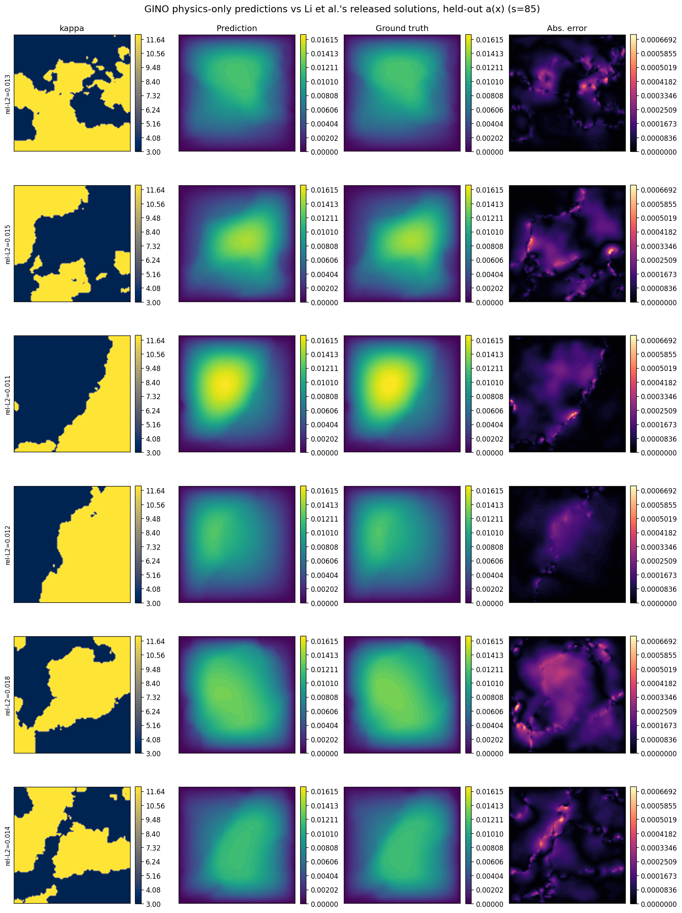
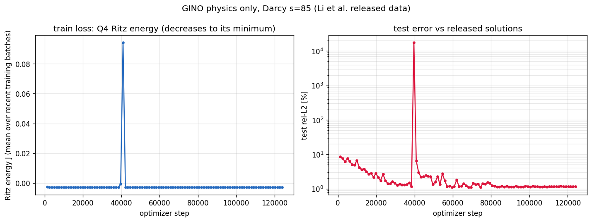
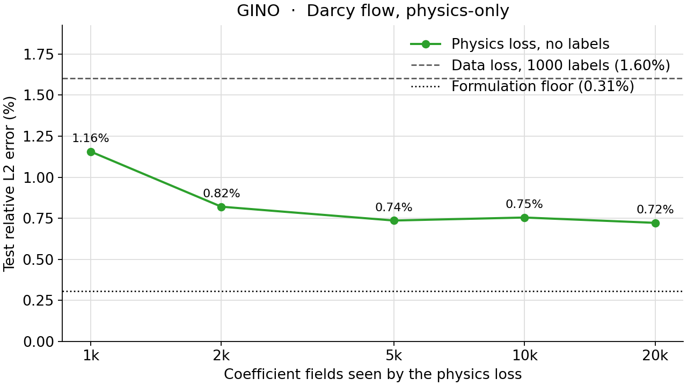

<!--
SPDX-FileCopyrightText: 2026 ZenteiQ AiTech Innovations Pvt. Ltd.
License notice: Documentation text and diagrams on this page are licensed
under CC BY 4.0. Source-code examples are licensed under LGPL-3.0-only
unless the example states otherwise.
-->

# Tutorial: Darcy Flow, Physics-Only, with GINO

In this tutorial you train a [GINO](../../theory_guide/operator_learning.md#gino) [[1]](#ref1) to solve
the **Darcy flow** benchmark **without any labelled solution**. Given a
piecewise-constant permeability $a(x) \in \{3, 12\}$ on the unit square,
the network predicts the pressure $u$ of $-\nabla\cdot(a\nabla u) = 1$,
$u = 0$ on the boundary. It is trained only on the finite-element Ritz energy [[3]](#ref3)
of this equation, whose minimiser is the solution: the training solutions of
the dataset are never read. The released solutions are used only to score the
200 test fields. The whole tutorial is one script, [`scripts/tutorials/darcyphysics_gino.py`](../../../scripts/tutorials/darcyphysics_gino.py). It uses only
the public ScireX API ([`scirex.losses.Q4Galerkin`](../../api/losses.md#scirex.losses.Q4Galerkin), the [`scirex.config.GINODarcy2d`](../../api/config.md#scirex.config.GINODarcy2d) preset, [`scirex.layers.kdtree_neighbor_search`](../../api/layers.md#scirex.layers.kdtree_neighbor_search) and [`neighbors_to_segments`](../../api/layers.md#scirex.layers.neighbors_to_segments), [`scirex.models.GINO`](../../api/models.md#scirex.models.GINO), [`scirex.training.adamw_cx`](../../api/training.md#scirex.training.adamw_cx), [`scirex.utils.count_model_params`](../../api/utils.md#scirex.utils.count_model_params)) plus NumPy, SciPy, JAX and optax. The
code on this page is copied from that script.

## Summary

| | |
|---|---|
| Problem | Steady Darcy flow $-\nabla\cdot(a\nabla u) = 1$, $u = 0$ on the boundary of the unit square; permeability in, pressure out, trained without labels |
| Model | GINO, [`scirex.models.GINO`](../../api/models.md#scirex.models.GINO). Benchmark size: [`GINODarcy2d`](../../api/config.md#scirex.config.GINODarcy2d) preset with an FNO [[2]](#ref2) processor of 31 channels, 5 layers and `(16, 16)` modes, GNO radii `0.16 * 16 / 84` and `0.175 * 16 / 84`, 2,801,340 parameters (complex weights counted as two). Smoke size: FNO processor of 16 channels, 2 layers and `(12, 12)` modes, GNO channel MLPs `[32, 32]`, 97,308 parameters |
| Loss | Q4 Ritz energy of the PDE on the 85 × 85 nodes (84 × 84 bilinear elements), majority coefficient per element, exact boundary condition. No solution enters the loss |
| Data | [Li et al.'s](../../dataset_guide/darcy_2d.md) `piececonst_r421_N1024_smooth1.mat` (training coefficients, first 1000; their solutions are not read) and `smooth2.mat` (first 200 test pairs), strided 421 -> 85. Smoke: 100 training fields, 20 test fields |
| Optimiser | Complex-aware AdamW ([`adamw_cx`](../../api/training.md#scirex.training.adamw_cx)), peak lr 1e-3 on a cosine one-cycle schedule, weight decay 1e-4, eps 1e-8, global-norm clipping 1.0, batch 16, no loss scale |
| Steps, full run | 124,000 (2000 epochs of 62 steps) |
| Metric | Relative L2 error per test field against the released solutions, at the released sample points, averaged over the 200 test fields |
| Full-run values | 1.156% on the 1000 released fields; 0.722% with 20k fields (1000 released + 19k sampled, no labels). Formulation floor 0.31%. Data-driven reference: 1.603% ([this repository's data-driven GINO](../../benchmarks/darcy/results/comparative.md#gino), 1000 labels); no published result |

## Setup

The setup is the same as in the [FNO tutorial](DarcyPhysics_FNO.md#setup).

## The problem

The problem, the data and the metric are the same as in the [FNO tutorial](DarcyPhysics_FNO.md#the-problem).

**GINO in one paragraph.** GINO (geometry-informed neural operator) is built for irregular point clouds. A graph neural operator (GNO) layer integrates the input over a ball of radius `in_gno_radius` around each point of a regular latent grid, an FNO processes that grid, and a second GNO layer brings the result back to the query points. Here the points, the latent grid and the queries are all the 85 × 85 mesh nodes, so the GNO layers act as learned local averaging around an FNO. The [theory guide](../../theory_guide/operator_learning.md#gino) has the details.

## Step-by-step walkthrough

The explanations of the steps that are the same for every model are in the [FNO tutorial](DarcyPhysics_FNO.md#step-by-step-walkthrough). This page keeps the code and the text that is specific to the model.

### 1. Setup

Imports, the seed, the data split, the training recipe and the two model
sizes. `PROTOCOL` holds the benchmark's data split
([`scripts/benchmarks/darcy/_config.py`](../../../scripts/benchmarks/darcy/_config.py)); `RECIPE` holds the physics-only
GINO recipe of [`scripts/benchmarks/darcy_physics/train_gino.py`](../../../scripts/benchmarks/darcy_physics/train_gino.py).
`SIZES["full"]` is the benchmark's GINO; `SIZES["smoke"]` is small enough for a
CPU. `FE_PRECISION` keeps the finite-element contractions at full float32
precision: on a GPU, JAX's default TF32 matrix products perturb the Q4
Jacobians by up to 5%.

<!-- tutorial-snippet -->
```python
from __future__ import annotations

import argparse
import os
import platform
from pathlib import Path
from time import perf_counter

import flax
import jax
import jax.numpy as jnp
import matplotlib
import matplotlib.pyplot as plt
import numpy as np
import optax
from scipy.io import loadmat
from scipy.sparse import coo_matrix
from scipy.sparse.linalg import spsolve

import scirex
from scirex.config import GINODarcy2d
from scirex.layers import kdtree_neighbor_search, neighbors_to_segments
from scirex.losses import Q4Galerkin
from scirex.models import GINO
from scirex.training import adamw_cx
from scirex.utils import count_model_params

matplotlib.use("Agg")  # write figures to files, no display needed
# Keep float32, also if float64 was enabled earlier in the process.
jax.config.update("jax_enable_x64", False)
```

<!-- tutorial-snippet -->
```python
SEED = 0

# The data split of the Darcy benchmark (scripts/benchmarks/darcy/_config.py).
PROTOCOL = dict(
    train_file="piececonst_r421_N1024_smooth1.mat",
    test_file="piececonst_r421_N1024_smooth2.mat",
    n_train=1000,
    n_test=200,
    subsample_rate=5,  # 421 -> 85 nodes per side
)

# The physics-only GINO recipe (scripts/benchmarks/darcy_physics/train_gino.py):
# 2000 epochs of 62 steps = 124,000 steps on a cosine one-cycle schedule.
RECIPE = dict(
    epochs=2000,
    batch_size=16,
    learning_rate=1e-3,
    weight_decay=1e-4,
    grad_clip=1.0,
    adam_eps=1e-8,
)

# Model sizes. "full" is the benchmark's GINO (2,801,340 parameters, matched to
# Transolver's 2,826,945). "smoke" is a tiny GINO that trains on a CPU.
SIZES = dict(
    full=dict(hidden_channels=31, modes=16, n_layers=5),
    smoke=dict(
        hidden_channels=16,
        modes=12,
        n_layers=2,
        in_gno_channel_mlp_hidden_layers=[32, 32],
        out_gno_channel_mlp_hidden_layers=[32, 32],
    ),
)

# Finite-element contractions at full float32 precision (on a GPU, JAX's
# default TF32 matmuls perturb the Q4 Jacobians by up to 5%).
FE_PRECISION = "highest"
```

<!-- tutorial-snippet -->
```python
def print_environment(seed: int) -> None:
    """Print the versions, the devices and the seed, so a run can be repeated."""
    print(f"python {platform.python_version()} | numpy {np.__version__}")
    print(f"scirex {scirex.__version__}")
    print(
        f"jax {jax.__version__} | flax {flax.__version__} | optax {optax.__version__}"
    )
    print(f"devices: {jax.devices()}")
    print(f"SEED = {seed}")
```

### 2. Load the data

<!-- tutorial-snippet -->
```python
def majority_per_cell(a_native: np.ndarray, resolution: int) -> np.ndarray:
    """``(n, N, N)`` native node values -> ``(n, resolution, resolution)``:
    the more frequent of the two values over the nodes each cell covers."""
    rate = (a_native.shape[1] - 1) // resolution
    blocks = np.lib.stride_tricks.sliding_window_view(
        a_native, (rate + 1, rate + 1), axis=(1, 2)
    )[:, ::rate, ::rate]
    lo, hi = float(a_native.min()), float(a_native.max())
    return np.where(blocks.mean(axis=(-2, -1)) >= 0.5 * (lo + hi), hi, lo)
```

<!-- tutorial-snippet -->
```python
def load_darcy(data_dir: Path, n_train: int, n_test: int, rate: int = 5) -> dict:
    """Training coefficients (nodes and cells) and test coefficients and solutions."""
    out = {}
    for name, file, n in (
        ("train", PROTOCOL["train_file"], n_train),
        ("test", PROTOCOL["test_file"], n_test),
    ):
        path = Path(data_dir) / file
        if not path.is_file():
            raise FileNotFoundError(f"{path} not found")
        keys = ("coeff",) if name == "train" else ("coeff", "sol")
        raw = loadmat(path.as_posix(), variable_names=keys)
        if raw["coeff"].shape[0] < n:
            raise ValueError(f"{path} has only {raw['coeff'].shape[0]} samples")
        a_native = raw["coeff"][:n].astype(np.float32)
        out[f"a_{name}"] = a_native[:, ::rate, ::rate]
        if name == "train":
            resolution = out["a_train"].shape[1] - 1
            out["cells_train"] = majority_per_cell(a_native, resolution)
            out["a_range"] = (float(a_native.min()), float(a_native.max()))
        else:
            out["u_test"] = raw["sol"][:n, ::rate, ::rate].astype(np.float32)
    print(
        f"coefficient fields: {n_train} train (no solutions) / {n_test} test | "
        f"nodes {out['a_train'].shape[1:]} | cells {out['cells_train'].shape[1:]} | "
        f"values {out['a_range']}"
    )
    return out
```

### 3. The physics loss

<!-- tutorial-snippet -->
```python
def build_q4_mesh(resolution: int):
    """Nodes, CCW quads and boundary mask of the uniform grid on [0, 1]^2."""
    xs = np.linspace(0.0, 1.0, resolution + 1, dtype=np.float32)
    gx, gy = np.meshgrid(xs, xs, indexing="ij")
    xy = np.stack([gx.ravel(), gy.ravel()], axis=-1)
    i, j = np.meshgrid(np.arange(resolution), np.arange(resolution), indexing="ij")
    n0 = (i * (resolution + 1) + j).ravel()
    quad = np.stack([n0, n0 + resolution + 1, n0 + resolution + 2, n0 + 1], axis=1)
    boundary = (xy == 0.0).any(axis=1) | (xy == 1.0).any(axis=1)
    return xy, quad.astype(np.int32), boundary
```

<!-- tutorial-snippet -->
```python
def shape_at_gauss() -> np.ndarray:
    """Bilinear shape functions of the 4 element nodes at the 2x2 Gauss
    points, ``(Q, 4)``, in ``Q4Galerkin``'s point and node order."""
    g = 1.0 / np.sqrt(3.0)
    gauss = np.array([[-g, -g], [g, -g], [g, g], [-g, g]])
    corners = np.array([[-1, -1], [1, -1], [1, 1], [-1, 1]])
    return (
        0.25
        * (1 + gauss[:, None, 0] * corners[None, :, 0])
        * (1 + gauss[:, None, 1] * corners[None, :, 1])
    )
```

<!-- tutorial-snippet -->
```python
def make_ritz_energy(galerkin: Q4Galerkin):
    """Return ``energy(u_batch, cells_batch)``: the mean Ritz energy of a batch."""
    shape = jnp.asarray(shape_at_gauss(), dtype=jnp.float32)
    _, _, det_j = galerkin.physical_grad_and_jacobian()
    weight = jnp.abs(det_j)  # (Q, T): Gauss weights are 1

    def kappa(cells, point):
        resolution = cells.shape[0]
        i = jnp.clip(
            jnp.floor(point[0] * resolution).astype(jnp.int32), 0, resolution - 1
        )
        j = jnp.clip(
            jnp.floor(point[1] * resolution).astype(jnp.int32), 0, resolution - 1
        )
        return cells[i, j]

    def energy_one(u, cells):
        stiffness = 0.5 * galerkin.grad_energy(u, kappa, cells)
        u_at_gauss = jnp.einsum("qp,tp->qt", shape, u[galerkin.quad])
        return stiffness - jnp.sum(weight * u_at_gauss)

    def energy(u_batch, cells_batch):
        return jnp.mean(jax.vmap(energy_one)(u_batch, cells_batch))

    return energy
```

### 4. Boundary condition and output scale

<!-- tutorial-snippet -->
```python
def torsion_output_scale(
    galerkin: Q4Galerkin, boundary, a_range
) -> tuple[float, float]:
    """``(c, m)``: std and mean of the Q4 torsion function over ``sqrt(a_lo a_hi)``."""
    dn_dx, dn_dy, det_j = (
        np.asarray(v, np.float64) for v in galerkin.physical_grad_and_jacobian()
    )
    w = np.abs(det_j)[..., None, None]  # (Q, T, 1, 1)
    local_k = np.sum(
        w
        * (
            dn_dx[..., :, None] * dn_dx[..., None, :]
            + dn_dy[..., :, None] * dn_dy[..., None, :]
        ),
        axis=0,
    )  # (T, 4, 4)
    local_f = np.einsum("qt,qp->tp", np.abs(det_j), shape_at_gauss())  # int of N_i
    quad = np.asarray(galerkin.quad)
    n = galerkin.n_nodes
    rows, cols = np.repeat(quad, 4, axis=1).ravel(), np.tile(quad, (1, 4)).ravel()
    stiffness = coo_matrix((local_k.ravel(), (rows, cols)), shape=(n, n)).tolil()
    load = np.zeros(n)
    np.add.at(load, quad.ravel(), local_f.ravel())
    stiffness[boundary, :] = 0.0
    stiffness[boundary, boundary] = 1.0
    load[boundary] = 0.0
    phi = spsolve(stiffness.tocsr(), load) / np.sqrt(a_range[0] * a_range[1])
    return float(phi.std()), float(phi.mean())
```

<!-- tutorial-snippet -->
```python
def sin_boundary_factor(xy: np.ndarray) -> np.ndarray:
    """``sin(pi x) sin(pi y)``: zero on the boundary, one at the centre."""
    return np.sin(np.pi * xy[:, 0]) * np.sin(np.pi * xy[:, 1])
```

### 5. Scoring points

<!-- tutorial-snippet -->
```python
def cell_centre_interpolation(n_side: int, rate: int) -> np.ndarray:
    """``(n_side, n_side)`` 1D interpolation from the nodes to the sample points."""
    n_native = rate * (n_side - 1) + 1
    nodes = np.linspace(0.0, 1.0, n_side)
    points = (rate * np.arange(n_side) + 0.5) / n_native
    eye = np.eye(n_side)
    return np.stack(
        [np.interp(points, nodes, eye[:, j]) for j in range(n_side)], axis=1
    )
```

### 6. Normalise the input

The coefficient gets a per-pixel unit Gaussian (one mean and one standard deviation per node, `eps = 1e-5`), fitted on the training coefficients
only. There is no output normaliser: $c$ and $m$ play that role.

<!-- tutorial-snippet -->
```python
class PixelNormalizer:
    """``(v - mean) / (std + eps)`` with a mean and a std per grid point."""

    def __init__(self, train: np.ndarray, eps: float = 1e-5) -> None:
        self.mean = train.mean(axis=0, keepdims=True)
        self.std = train.std(axis=0, keepdims=True)
        self.eps = eps

    def encode(self, v):
        return (v - self.mean) / (self.std + self.eps)
```

### 7. Geometry

GINO works on point clouds. Here every field has the same points, the 85 × 85
mesh nodes in the mesh's order, and the same latent grid for its FNO
processor, so the neighbour lists are built once. Each GNO layer sums over the
points within a radius of its query point; the benchmark scales the preset's
radii 0.16 and 0.175 (tuned at resolution 16) to the grid spacing,
`0.16 * 16 / 84` and `0.175 * 16 / 84`. [`kdtree_neighbor_search`](../../api/layers.md#scirex.layers.kdtree_neighbor_search) finds the
neighbours and [`neighbors_to_segments`](../../api/layers.md#scirex.layers.neighbors_to_segments) turns them into the form the GNO
layers take.

<!-- tutorial-snippet -->
```python
def gno_radii(n_side: int) -> tuple[float, float]:
    """The input and output GNO radii for an ``n_side x n_side`` grid."""
    return 0.16 * 16.0 / (n_side - 1), 0.175 * 16.0 / (n_side - 1)
```

<!-- tutorial-snippet -->
```python
def build_geometry(xy: np.ndarray, n_side: int) -> dict:
    """Points, latent grid and neighbour lists of the mesh nodes ``xy``."""
    in_radius, out_radius = gno_radii(n_side)
    neighbors = {
        name: neighbors_to_segments(kdtree_neighbor_search(xy, xy, radius))
        for name, radius in (("neighbors_in", in_radius), ("neighbors_out", out_radius))
    }
    edges = int(neighbors["neighbors_in"]["neighbors_index"].shape[0])
    print(
        f"geometry: {len(xy)} points | radii {in_radius:.4f}, {out_radius:.4f} | "
        f"input-graph edges {edges:,} ({edges / len(xy):.1f} per point)"
    )
    return dict(
        input_geom=jnp.asarray(xy)[None],
        latent_queries=jnp.asarray(xy.reshape(n_side, n_side, 2))[None],
        output_queries=jnp.asarray(xy)[None],
        **neighbors,
    )
```

### 8. Build the model

[`GINODarcy2d`](../../api/config.md#scirex.config.GINODarcy2d) in [`scirex.config`](../../api/config.md) is the GINO preset for this problem. The script takes its values, sets the radii and the FNO size of the run, and passes them to [`GINO`](../../api/models.md#scirex.models.GINO). The input is the normalised coefficient at every node, `(batch, 85 * 85, 1)`. [`count_model_params`](../../api/utils.md#scirex.utils.count_model_params) counts a complex weight of the FNO processor as two real numbers.

<!-- tutorial-snippet -->
```python
def build_model(size: dict, geometry: dict, n_side: int, seed: int):
    """Build GINO from the preset, initialise it and print the parameter count."""
    config = dict(GINODarcy2d().to_dict())
    config.pop("model_arch")
    config["in_channels"] = config.pop("data_channels")
    config["in_gno_radius"], config["out_gno_radius"] = gno_radii(n_side)
    config["fno_hidden_channels"] = size["hidden_channels"]
    config["fno_n_layers"] = size["n_layers"]
    config["fno_n_modes"] = [size["modes"], size["modes"]]
    for key in (
        "in_gno_channel_mlp_hidden_layers",
        "out_gno_channel_mlp_hidden_layers",
    ):
        config[key] = size.get(key, config[key])
    model = GINO(**config)
    init_key = jax.random.split(jax.random.PRNGKey(seed))[1]
    x0 = jnp.zeros((1, n_side * n_side, 1), dtype=jnp.float32)
    params = model.init(init_key, x=x0, **geometry)
    print(f"GINO {size} | parameters: {count_model_params(params):,}")
    return model, params
```

### 9. Loss

<!-- tutorial-snippet -->
```python
def make_predict_nodes(model, geometry: dict, c: float, m: float, boundary_factor):
    """Encoded ``(B, H * W)`` coefficient -> ``(B, H * W)`` nodal pressure."""

    def predict_nodes(params, a_enc):
        out = model.apply(params, x=a_enc[..., None], **geometry)[..., 0]
        return (c * out + m) * boundary_factor

    return predict_nodes
```

<!-- tutorial-snippet -->
```python
def make_loss(predict_nodes, energy):
    """Return ``loss_fn(params, a_enc, cells) -> Ritz energy``."""

    def loss_fn(params, a_enc, cells):
        u = predict_nodes(params, a_enc)
        with jax.default_matmul_precision(FE_PRECISION):
            return energy(u, cells)

    return loss_fn
```

### 10. Optimiser

The FNO processor of GINO has complex spectral weights, so the complex-aware [`adamw_cx`](../../api/training.md#scirex.training.adamw_cx) is used, after clipping the global gradient norm at 1.0, on a cosine one-cycle learning rate over the whole run. `optax.inject_hyperparams` would otherwise give the learning rate, the betas, `eps` and the decay the highest dtype of the parameters, complex64, so it is told to keep them float32 (`hyperparam_dtype`). The benchmark script `train_gino.py` does not pass `hyperparam_dtype` yet; its values are complex with a zero imaginary part, which does not change its numbers.

<!-- tutorial-snippet -->
```python
def make_optimizer(recipe: dict, total_steps: int):
    """Gradient clipping, then ``adamw_cx`` on a cosine one-cycle schedule."""
    schedule = optax.cosine_onecycle_schedule(
        transition_steps=total_steps, peak_value=recipe["learning_rate"]
    )
    return optax.chain(
        optax.clip_by_global_norm(recipe["grad_clip"]),
        optax.inject_hyperparams(adamw_cx, hyperparam_dtype=jnp.float32)(
            learning_rate=schedule,
            weight_decay=recipe["weight_decay"],
            eps=recipe["adam_eps"],
        ),
    )
```

### 11. Train

Batches of 16 coefficient fields in a new random order every epoch. At initialisation 52% of GINO's gradient components are below Adam's `eps = 1e-8` (FNO: 98%, WNO: 95%). The physics-only FNO and WNO multiply the loss by the interior node count; GINO keeps the data-driven recipe (`loss_scale = 1`), because with that scale its global gradient norm would be 29 instead of 0.0042 and the clipping at 1.0 would act on every step. A scaled variant was not tested. Every `eval_every` steps the mean training energy and the
test error are logged. No step is selected by the test error: the final
weights are the result. JAX compiles the step on its first call, so the first
steps are slower than the others.

<!-- tutorial-snippet -->
```python
def train(
    model,
    params,
    key,
    data,
    predict_nodes,
    loss_fn,
    scorer,
    epochs,
    loss_scale,
    eval_every,
    recipe=RECIPE,
):
    """Train for ``epochs`` epochs. Return the final parameters and the history."""
    a_train, cells_train = data["a_train_enc"], data["cells_train"]
    bs = recipe["batch_size"]
    n_train = len(a_train)
    steps_per_epoch = max(n_train // bs, 1)
    tx = make_optimizer(recipe, steps_per_epoch * epochs)
    opt_state = tx.init(params)

    @jax.jit
    def train_step(params, opt_state, a_enc, cells):
        loss, grads = jax.value_and_grad(
            lambda p: loss_scale * loss_fn(p, a_enc, cells)
        )(params)
        updates, opt_state = tx.update(grads, opt_state, params)
        return optax.apply_updates(params, updates), opt_state, loss / loss_scale

    history, window, step, t0 = [], [], 0, perf_counter()
    total = steps_per_epoch * epochs
    for _ in range(epochs):
        key, sub = jax.random.split(key)
        perm = np.asarray(jax.random.permutation(sub, n_train))
        for b in range(steps_per_epoch):
            idx = perm[b * bs : (b + 1) * bs]
            params, opt_state, loss = train_step(
                params,
                opt_state,
                jnp.asarray(a_train[idx]),
                jnp.asarray(cells_train[idx]),
            )
            window.append(float(loss))
            step += 1
            if step % eval_every and step != total:
                continue
            test = scorer(params)["test_rel_l2"]
            history.append(
                dict(
                    step=step,
                    energy=float(np.mean(window)),
                    test_rel_l2=test,
                    secs=perf_counter() - t0,
                )
            )
            window = []
            print(
                f"step {step}/{total}: energy={history[-1]['energy']:.4e} "
                f"test_rel_l2={test:.4f} elapsed={history[-1]['secs']:.1f}s"
            )
    return params, history
```

### 12. Evaluate

<!-- tutorial-snippet -->
```python
def make_scorer(predict_nodes, data, to_points, batch_size: int = 20):
    """Return ``scorer(params) -> dict`` of test errors and predictions."""
    a_test, u_test = data["a_test_enc"], data["u_test"]
    n_side = u_test.shape[1]

    @jax.jit
    def predict(params, a_enc):
        u = predict_nodes(params, a_enc).reshape(-1, n_side, n_side)
        mapped = jnp.einsum(
            "ij,bjk,lk->bil", to_points, u, to_points, precision="highest"
        )
        return mapped, u

    def scorer(params):
        mapped, nodes = (
            np.concatenate(parts)
            for parts in zip(
                *(
                    predict(params, jnp.asarray(a_test[i : i + batch_size]))
                    for i in range(0, len(a_test), batch_size)
                )
            )
        )
        flat = u_test.reshape(len(u_test), -1)

        def errors(pred):
            pred = pred.reshape(len(pred), -1)
            return np.linalg.norm(pred - flat, axis=1) / np.linalg.norm(flat, axis=1)

        e = errors(mapped)
        return dict(
            test_rel_l2=float(e.mean()),
            test_rel_l2_nodes=float(errors(nodes).mean()),
            errors=e,
            predictions=mapped,
        )

    return scorer
```

### 13. Plot

<!-- tutorial-snippet -->
```python
def plot_prediction(a, truth, pred, path: Path, title: str) -> None:
    """Save coefficient, true pressure, predicted pressure and absolute error."""
    lim = (float(truth.min()), float(truth.max()))
    panels = [
        ("Input: permeability a", a, "viridis", None),
        ("Truth: pressure u", truth, "jet", lim),
        ("Prediction: pressure u", pred, "jet", lim),
        ("Absolute error", np.abs(pred - truth), "magma", None),
    ]
    fig, axes = plt.subplots(1, 4, figsize=(18, 4.2), constrained_layout=True)
    for ax, (name, values, cmap, vlim) in zip(axes, panels):
        vmin, vmax = vlim if vlim else (None, None)
        im = ax.imshow(
            values.T,
            origin="lower",
            extent=(0, 1, 0, 1),
            cmap=cmap,
            vmin=vmin,
            vmax=vmax,
        )
        ax.set_title(name)
        ax.set_xlabel("x")
        ax.set_ylabel("y")
        fig.colorbar(im, ax=ax, shrink=0.85)
    fig.suptitle(title)
    fig.savefig(path, dpi=120)
    plt.close(fig)
```

<!-- tutorial-snippet -->
```python
def plot_loss(history: list[dict], path: Path) -> None:
    """Save the training Ritz energy and the test error per logged step."""
    steps = [h["step"] for h in history]
    fig, (ax0, ax1) = plt.subplots(1, 2, figsize=(11, 4), constrained_layout=True)
    ax0.plot(steps, [h["energy"] for h in history], marker="o")
    ax0.set_xlabel("optimiser step")
    ax0.set_ylabel("Ritz energy J (training, mean over the window)")
    ax0.grid(True, alpha=0.3)
    ax1.plot(steps, [100 * h["test_rel_l2"] for h in history], marker="o", color="C3")
    ax1.set_xlabel("optimiser step")
    ax1.set_ylabel("test relative L2 [%]")
    ax1.set_yscale("log")
    ax1.grid(True, alpha=0.3, which="both")
    fig.savefig(path, dpi=120)
    plt.close(fig)
```

The complete script is [`scripts/tutorials/darcyphysics_gino.py`](../../../scripts/tutorials/darcyphysics_gino.py).

## Run it

Smoke run (CPU, under a minute, no GPU needed):

```bash
CUDA_VISIBLE_DEVICES= JAX_PLATFORMS=cpu python scripts/tutorials/darcyphysics_gino.py --data-dir ~/data/darcy --smoke
```

Full protocol (1000 coefficient fields, benchmark-size GINO, 124,000 steps;
use a GPU):

```bash
python scripts/tutorials/darcyphysics_gino.py --data-dir ~/data/darcy
```

The other flags are `--epochs`, `--seed`, `--eval-every` (steps between
logged evaluations), `--out-dir` (default
`outputs/darcyphysics_gino_tutorial`) and, for the smoke run, `--n-train` and
`--n-test`.

This is the output of the smoke run on a CPU (smoke run, CPU, 100 train / 20
test fields, not a benchmark number). The wall time was 50 s,
measured with `time`; a CUDA plugin message printed when the GPUs are hidden
and library deprecation warnings are left out:

```text
python 3.12.3 | numpy 1.26.4
scirex 1.0.0rc1
jax 0.6.2 | flax 0.10.7 | optax 0.2.8
devices: [CpuDevice(id=0)]
SEED = 0
coefficient fields: 100 train (no solutions) / 20 test | nodes (85, 85) | cells (84, 84) | values (3.0, 12.0)
data loading: 5.7s
label-free output scale c=0.00367 offset m=0.00572
geometry: 7225 points | radii 0.0305, 0.0333 | input-graph edges 148,005 (20.5 per point)
GINO {'hidden_channels': 16, 'modes': 12, 'n_layers': 2, 'in_gno_channel_mlp_hidden_layers': [32, 32], 'out_gno_channel_mlp_hidden_layers': [32, 32]} | parameters: 97,308
step 10/60: energy=-2.2151e-03 test_rel_l2=0.2869 elapsed=7.4s
step 20/60: energy=-2.2849e-03 test_rel_l2=0.2566 elapsed=12.8s
step 30/60: energy=-2.3530e-03 test_rel_l2=0.2615 elapsed=18.2s
step 40/60: energy=-2.4184e-03 test_rel_l2=0.2329 elapsed=23.5s
step 50/60: energy=-2.4346e-03 test_rel_l2=0.2248 elapsed=28.9s
step 60/60: energy=-2.4510e-03 test_rel_l2=0.2202 elapsed=34.5s
test relative L2: 0.2202 at the released points | 0.2224 at the nodes
figures in out/gino_smoke | total time 46.6s
```

## Results

### Full run

The next figures were not made by this script. They come from the benchmark
runner ([`scripts/benchmarks/darcy_physics/train_gino.py`](../../../scripts/benchmarks/darcy_physics/train_gino.py)) and are the
committed results of the **full run** on the 1000 released coefficient fields
(124,000 (2000 epochs of 62 steps) steps, benchmark-size GINO, seed 0): six test fields with the
permeability, the prediction, the released solution and the absolute error.



Training energy and test error of the same run:



The training energy and the test error fall over the first 40,000 steps. One evaluation, at step 39,680, shows a transient blow-up: the test error is 178 (17,800%) and the training energy is positive. Two evaluations later the error is back at 3.0%, and the run ends at 1.156%. The benchmark page does not discuss this event; the final weights are not affected by it.

Because the loss needs coefficient fields only, the benchmark also trains on
extra fields drawn from the data's own law (no solutions are generated), with
the same number of steps. Test relative L2 of the final model:

| Coefficient fields seen by the physics loss | At the released points (metric) | At the nodes |
|---|---|---|
| 1k (released only) | 1.156% | 1.309% |
| 2k = 1k + 1k sampled | 0.820% | 1.026% |
| 5k = 1k + 4k sampled | 0.736% | 1.014% |
| 10k = 1k + 9k sampled | 0.755% | 1.024% |
| 20k = 1k + 19k sampled | 0.722% | 1.001% |



| Reference | Test relative L2 |
|---|---|
| This model, physics only, 1000 released fields | 1.156% |
| This model, physics only, best with extra fields (20k) | **0.722%** |
| Data-driven, 1000 labels | 1.603% ([this repository's data-driven GINO](../../benchmarks/darcy/results/comparative.md#gino), 1000 labels); no published result |
| Formulation floor (exact Q4 solve) | 0.31% |

The extra fields come from `sample_piecewise_coefficient`, which is not part
of the public API, so this tutorial does not draw them; the benchmark script
does (`--extra-coefficients`).

## Troubleshooting

The common problems are listed in the [FNO tutorial](DarcyPhysics_FNO.md#troubleshooting).

## Next steps

- Compare with the other architectures on the same physics loss:
  [FNO](DarcyPhysics_FNO.md), [WNO](DarcyPhysics_WNO.md), [Transolver](DarcyPhysics_Transolver.md) and the
  [comparison page](../../benchmarks/darcy_physics/results/comparative.md).
- Read the [Darcy Flow, Physics-Only results](../../benchmarks/darcy_physics/results/comparative.md#gino) for the
  runs with extra coefficient fields and the compute cost, and the
  [setup page](../../benchmarks/darcy_physics/results/setup.md) for the floor and the
  sampler checks.
- Train the same GINO with labels: the
  [data-driven GINO benchmark](../../benchmarks/darcy/results/comparative.md#gino).
- Learn how the model works in the [theory guide](../../theory_guide/operator_learning.md#gino)
  and see its arguments in the [API reference](../../api/models.md); the losses
  are in the [losses API](../../api/losses.md).

## References

1. <span id="ref1"></span>Li et al., *Geometry-Informed Neural Operator for Large-Scale 3D PDEs*, NeurIPS 2023. <https://arxiv.org/abs/2309.00583>

2. <span id="ref2"></span>Li et al., *Fourier Neural Operator for Parametric Partial Differential Equations*, ICLR 2021. <https://arxiv.org/abs/2010.08895>

3. <span id="ref3"></span>E and Yu, *The Deep Ritz Method: A Deep Learning-Based Numerical Algorithm for Solving Variational Problems*, Communications in Mathematics and Statistics 6, 1-12 (2018). <https://arxiv.org/abs/1710.00211>
