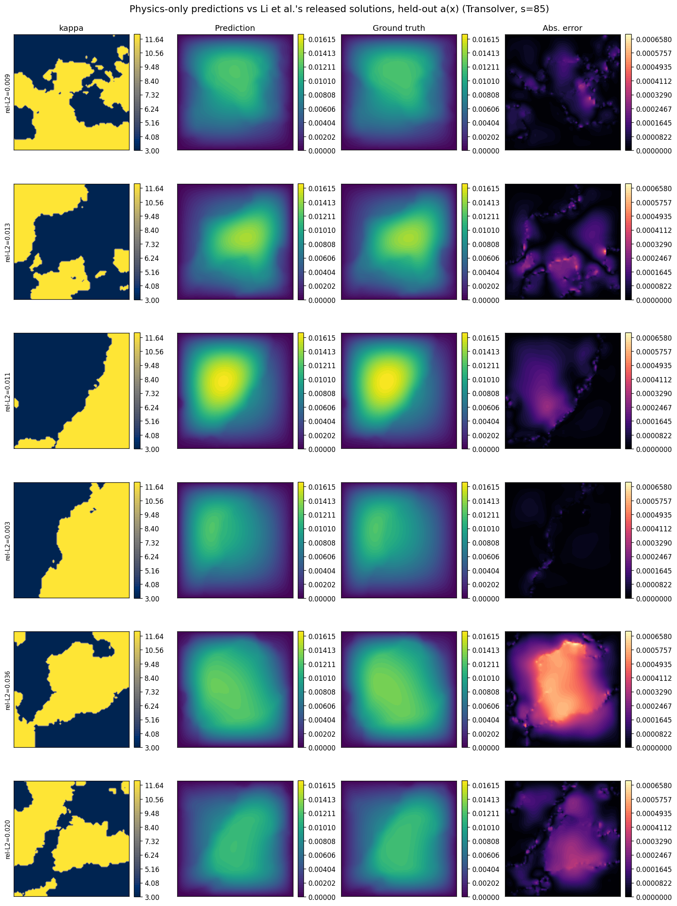
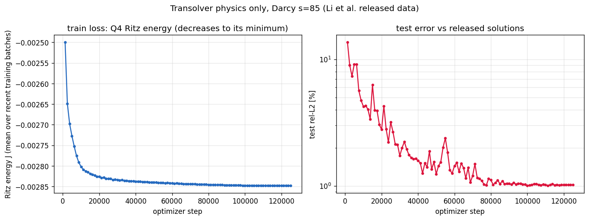
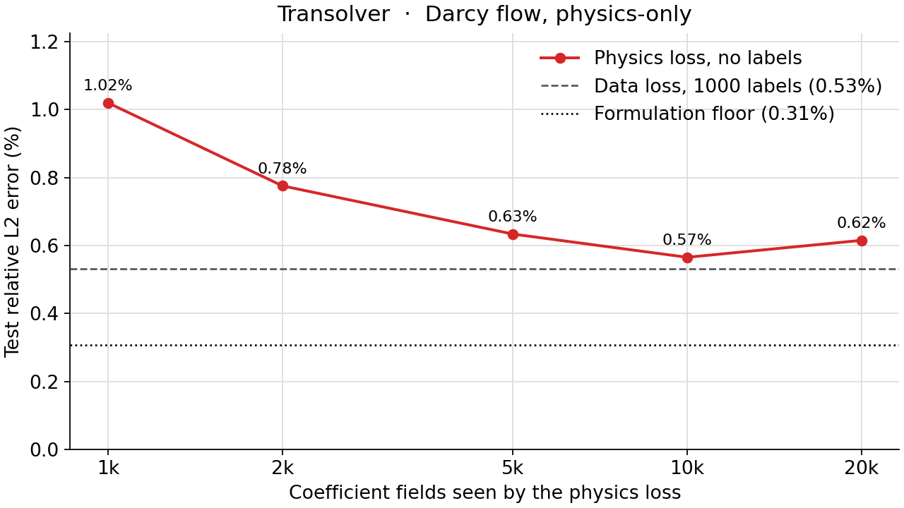

<!--
SPDX-FileCopyrightText: 2026 ZenteiQ AiTech Innovations Pvt. Ltd.
License notice: Documentation text and diagrams on this page are licensed
under CC BY 4.0. Source-code examples are licensed under LGPL-3.0-only
unless the example states otherwise.
-->

# Tutorial: Darcy Flow, Physics-Only, with Transolver

In this tutorial you train a [Transolver](../../theory_guide/operator_learning.md#transolver) to solve
the **Darcy flow** benchmark **without any labelled solution**. Given a
piecewise-constant permeability $a(x) \in \{3, 12\}$ on the unit square,
the network predicts the pressure $u$ of $-\nabla\cdot(a\nabla u) = 1$,
$u = 0$ on the boundary. It is trained only on the finite-element Ritz energy [[3]](#ref3)
of this equation, whose minimiser is the solution: the training solutions of
the dataset are never read. The released solutions are used only to score the
200 test fields. The whole tutorial is one script, [`scripts/tutorials/darcyphysics_transolver.py`](../../../scripts/tutorials/darcyphysics_transolver.py). It uses only
the public ScireX API ([`scirex.losses.Q4Galerkin`](../../api/losses.md#scirex.losses.Q4Galerkin), [`scirex.models.Transolver`](../../api/models.md#scirex.models.Transolver), [`scirex.utils.count_model_params`](../../api/utils.md#scirex.utils.count_model_params)) plus NumPy, SciPy, JAX and optax. The
code on this page is copied from that script.

## Summary

| | |
|---|---|
| Problem | Steady Darcy flow $-\nabla\cdot(a\nabla u) = 1$, $u = 0$ on the boundary of the unit square; permeability in, pressure out, trained without labels |
| Model | Transolver, [`scirex.models.Transolver`](../../api/models.md#scirex.models.Transolver). Benchmark size: `n_hidden=128, n_layers=8, n_head=8, slice_num=64, ref=8, mlp_ratio=1`, `geometry="structured_2d"`, unified positions, 2,826,945 parameters. Smoke size: `n_hidden=32, n_layers=2, n_head=4, slice_num=16, ref=8, mlp_ratio=1`, 50,697 parameters |
| Loss | Q4 Ritz energy of the PDE on the 85 × 85 nodes (84 × 84 bilinear elements), majority coefficient per element, exact boundary condition. No solution enters the loss |
| Data | [Li et al.'s](../../dataset_guide/darcy_2d.md) `piececonst_r421_N1024_smooth1.mat` (training coefficients, first 1000; their solutions are not read) and `smooth2.mat` (first 200 test pairs), strided 421 -> 85. Smoke: 100 training fields, 20 test fields |
| Optimiser | AdamW, peak lr 1e-3 on a cosine one-cycle schedule, weight decay 1e-5, eps 1e-8, global-norm clipping 0.1, batch 4, no loss scale (the data-driven recipe of [[1]](#ref1)) |
| Steps, full run | 125,000 (500 epochs of 250 steps) |
| Metric | Relative L2 error per test field against the released solutions, at the released sample points, averaged over the 200 test fields |
| Full-run values | 1.020% on the 1000 released fields; 0.565% with 10k fields (1000 released + 9k sampled, no labels). Formulation floor 0.31%. Data-driven reference: 0.532% ([this repository's data-driven Transolver](../../benchmarks/darcy/results/comparative.md#transolver), 1000 labels); 0.57% in [[1]](#ref1) |

## Setup

The setup is the same as in the [FNO tutorial](DarcyPhysics_FNO.md#setup) [[2]](#ref2).

## The problem

The problem, the data and the metric are the same as in the [FNO tutorial](DarcyPhysics_FNO.md#the-problem).

**Transolver in one paragraph.** Attention over all 7225 nodes would cost $O(N^2)$. Transolver instead softly assigns the nodes to a small number of learned slices (`slice_num`), lets the slices attend to each other, and sends the result back to every node. The cost grows linearly with $N$, and the same network runs on grids, meshes and point clouds. The [theory guide](../../theory_guide/operator_learning.md#transolver) has the details.

## Step-by-step walkthrough

The explanations of the steps that are the same for every model are in the [FNO tutorial](DarcyPhysics_FNO.md#step-by-step-walkthrough). This page keeps the code and the text that is specific to the model.

### 1. Setup

Imports, the seed, the data split, the training recipe and the two model
sizes. `PROTOCOL` holds the benchmark's data split
([`scripts/benchmarks/darcy/_config.py`](../../../scripts/benchmarks/darcy/_config.py)); `RECIPE` holds the physics-only
Transolver recipe of [`scripts/benchmarks/darcy_physics/train_transolver.py`](../../../scripts/benchmarks/darcy_physics/train_transolver.py).
`SIZES["full"]` is the benchmark's Transolver; `SIZES["smoke"]` is small enough for a
CPU. `FE_PRECISION` keeps the finite-element contractions at full float32
precision: on a GPU, JAX's default TF32 matrix products perturb the Q4
Jacobians by up to 5%.

<!-- tutorial-snippet -->
```python
from __future__ import annotations

import argparse
import os
import platform
from pathlib import Path
from time import perf_counter

import flax
import jax
import jax.numpy as jnp
import matplotlib
import matplotlib.pyplot as plt
import numpy as np
import optax
from scipy.io import loadmat
from scipy.sparse import coo_matrix
from scipy.sparse.linalg import spsolve

import scirex
from scirex.losses import Q4Galerkin
from scirex.models import Transolver
from scirex.utils import count_model_params

matplotlib.use("Agg")  # write figures to files, no display needed
# Keep float32, also if float64 was enabled earlier in the process.
jax.config.update("jax_enable_x64", False)
```

<!-- tutorial-snippet -->
```python
SEED = 0

# The data split of the Darcy benchmark (scripts/benchmarks/darcy/_config.py).
PROTOCOL = dict(
    train_file="piececonst_r421_N1024_smooth1.mat",
    test_file="piececonst_r421_N1024_smooth2.mat",
    n_train=1000,
    n_test=200,
    subsample_rate=5,  # 421 -> 85 nodes per side
)

# The physics-only Transolver recipe
# (scripts/benchmarks/darcy_physics/train_transolver.py), the data-driven
# recipe of Wu et al. (2024, Table 8): 500 epochs of 250 steps = 125,000
# steps on a cosine one-cycle schedule.
RECIPE = dict(
    epochs=500,
    batch_size=4,
    learning_rate=1e-3,
    weight_decay=1e-5,
    max_grad_norm=0.1,
)

# Model sizes. "full" is the benchmark's Transolver (2,826,945 parameters, the
# size every model of the benchmark is matched to). "smoke" is a tiny
# Transolver that trains on a CPU.
SIZES = dict(
    full=dict(n_hidden=128, n_layers=8, n_head=8, slice_num=64, ref=8, mlp_ratio=1),
    smoke=dict(n_hidden=32, n_layers=2, n_head=4, slice_num=16, ref=8, mlp_ratio=1),
)

# Finite-element contractions at full float32 precision (on a GPU, JAX's
# default TF32 matmuls perturb the Q4 Jacobians by up to 5%).
FE_PRECISION = "highest"
```

<!-- tutorial-snippet -->
```python
def print_environment(seed: int) -> None:
    """Print the versions, the devices and the seed, so a run can be repeated."""
    print(f"python {platform.python_version()} | numpy {np.__version__}")
    print(f"scirex {scirex.__version__}")
    print(
        f"jax {jax.__version__} | flax {flax.__version__} | optax {optax.__version__}"
    )
    print(f"devices: {jax.devices()}")
    print(f"SEED = {seed}")
```

### 2. Load the data

<!-- tutorial-snippet -->
```python
def majority_per_cell(a_native: np.ndarray, resolution: int) -> np.ndarray:
    """``(n, N, N)`` native node values -> ``(n, resolution, resolution)``:
    the more frequent of the two values over the nodes each cell covers."""
    rate = (a_native.shape[1] - 1) // resolution
    blocks = np.lib.stride_tricks.sliding_window_view(
        a_native, (rate + 1, rate + 1), axis=(1, 2)
    )[:, ::rate, ::rate]
    lo, hi = float(a_native.min()), float(a_native.max())
    return np.where(blocks.mean(axis=(-2, -1)) >= 0.5 * (lo + hi), hi, lo)
```

<!-- tutorial-snippet -->
```python
def load_darcy(data_dir: Path, n_train: int, n_test: int, rate: int = 5) -> dict:
    """Training coefficients (nodes and cells) and test coefficients and solutions."""
    out = {}
    for name, file, n in (
        ("train", PROTOCOL["train_file"], n_train),
        ("test", PROTOCOL["test_file"], n_test),
    ):
        path = Path(data_dir) / file
        if not path.is_file():
            raise FileNotFoundError(f"{path} not found")
        keys = ("coeff",) if name == "train" else ("coeff", "sol")
        raw = loadmat(path.as_posix(), variable_names=keys)
        if raw["coeff"].shape[0] < n:
            raise ValueError(f"{path} has only {raw['coeff'].shape[0]} samples")
        a_native = raw["coeff"][:n].astype(np.float32)
        out[f"a_{name}"] = a_native[:, ::rate, ::rate]
        if name == "train":
            resolution = out["a_train"].shape[1] - 1
            out["cells_train"] = majority_per_cell(a_native, resolution)
            out["a_range"] = (float(a_native.min()), float(a_native.max()))
        else:
            out["u_test"] = raw["sol"][:n, ::rate, ::rate].astype(np.float32)
    print(
        f"coefficient fields: {n_train} train (no solutions) / {n_test} test | "
        f"nodes {out['a_train'].shape[1:]} | cells {out['cells_train'].shape[1:]} | "
        f"values {out['a_range']}"
    )
    return out
```

### 3. The physics loss

<!-- tutorial-snippet -->
```python
def build_q4_mesh(resolution: int):
    """Nodes, CCW quads and boundary mask of the uniform grid on [0, 1]^2."""
    xs = np.linspace(0.0, 1.0, resolution + 1, dtype=np.float32)
    gx, gy = np.meshgrid(xs, xs, indexing="ij")
    xy = np.stack([gx.ravel(), gy.ravel()], axis=-1)
    i, j = np.meshgrid(np.arange(resolution), np.arange(resolution), indexing="ij")
    n0 = (i * (resolution + 1) + j).ravel()
    quad = np.stack([n0, n0 + resolution + 1, n0 + resolution + 2, n0 + 1], axis=1)
    boundary = (xy == 0.0).any(axis=1) | (xy == 1.0).any(axis=1)
    return xy, quad.astype(np.int32), boundary
```

<!-- tutorial-snippet -->
```python
def shape_at_gauss() -> np.ndarray:
    """Bilinear shape functions of the 4 element nodes at the 2x2 Gauss
    points, ``(Q, 4)``, in ``Q4Galerkin``'s point and node order."""
    g = 1.0 / np.sqrt(3.0)
    gauss = np.array([[-g, -g], [g, -g], [g, g], [-g, g]])
    corners = np.array([[-1, -1], [1, -1], [1, 1], [-1, 1]])
    return (
        0.25
        * (1 + gauss[:, None, 0] * corners[None, :, 0])
        * (1 + gauss[:, None, 1] * corners[None, :, 1])
    )
```

<!-- tutorial-snippet -->
```python
def make_ritz_energy(galerkin: Q4Galerkin):
    """Return ``energy(u_batch, cells_batch)``: the mean Ritz energy of a batch."""
    shape = jnp.asarray(shape_at_gauss(), dtype=jnp.float32)
    _, _, det_j = galerkin.physical_grad_and_jacobian()
    weight = jnp.abs(det_j)  # (Q, T): Gauss weights are 1

    def kappa(cells, point):
        resolution = cells.shape[0]
        i = jnp.clip(
            jnp.floor(point[0] * resolution).astype(jnp.int32), 0, resolution - 1
        )
        j = jnp.clip(
            jnp.floor(point[1] * resolution).astype(jnp.int32), 0, resolution - 1
        )
        return cells[i, j]

    def energy_one(u, cells):
        stiffness = 0.5 * galerkin.grad_energy(u, kappa, cells)
        u_at_gauss = jnp.einsum("qp,tp->qt", shape, u[galerkin.quad])
        return stiffness - jnp.sum(weight * u_at_gauss)

    def energy(u_batch, cells_batch):
        return jnp.mean(jax.vmap(energy_one)(u_batch, cells_batch))

    return energy
```

### 4. Boundary condition and output scale

<!-- tutorial-snippet -->
```python
def torsion_output_scale(
    galerkin: Q4Galerkin, boundary, a_range
) -> tuple[float, float]:
    """``(c, m)``: std and mean of the Q4 torsion function over ``sqrt(a_lo a_hi)``."""
    dn_dx, dn_dy, det_j = (
        np.asarray(v, np.float64) for v in galerkin.physical_grad_and_jacobian()
    )
    w = np.abs(det_j)[..., None, None]  # (Q, T, 1, 1)
    local_k = np.sum(
        w
        * (
            dn_dx[..., :, None] * dn_dx[..., None, :]
            + dn_dy[..., :, None] * dn_dy[..., None, :]
        ),
        axis=0,
    )  # (T, 4, 4)
    local_f = np.einsum("qt,qp->tp", np.abs(det_j), shape_at_gauss())  # int of N_i
    quad = np.asarray(galerkin.quad)
    n = galerkin.n_nodes
    rows, cols = np.repeat(quad, 4, axis=1).ravel(), np.tile(quad, (1, 4)).ravel()
    stiffness = coo_matrix((local_k.ravel(), (rows, cols)), shape=(n, n)).tolil()
    load = np.zeros(n)
    np.add.at(load, quad.ravel(), local_f.ravel())
    stiffness[boundary, :] = 0.0
    stiffness[boundary, boundary] = 1.0
    load[boundary] = 0.0
    phi = spsolve(stiffness.tocsr(), load) / np.sqrt(a_range[0] * a_range[1])
    return float(phi.std()), float(phi.mean())
```

<!-- tutorial-snippet -->
```python
def sin_boundary_factor(xy: np.ndarray) -> np.ndarray:
    """``sin(pi x) sin(pi y)``: zero on the boundary, one at the centre."""
    return np.sin(np.pi * xy[:, 0]) * np.sin(np.pi * xy[:, 1])
```

### 5. Scoring points

<!-- tutorial-snippet -->
```python
def cell_centre_interpolation(n_side: int, rate: int) -> np.ndarray:
    """``(n_side, n_side)`` 1D interpolation from the nodes to the sample points."""
    n_native = rate * (n_side - 1) + 1
    nodes = np.linspace(0.0, 1.0, n_side)
    points = (rate * np.arange(n_side) + 0.5) / n_native
    eye = np.eye(n_side)
    return np.stack(
        [np.interp(points, nodes, eye[:, j]) for j in range(n_side)], axis=1
    )
```

### 6. Normalise the input

The coefficient gets one mean and one standard deviation for the whole field (Transolver's `UnitTransformer`, `+1e-8` on the std), fitted on the training coefficients
only. There is no output normaliser: $c$ and $m$ play that role.

<!-- tutorial-snippet -->
```python
class GlobalNormalizer:
    """``(v - mean) / std`` with one mean and one std (``+ 1e-8``) for the field."""

    def __init__(self, train: np.ndarray, eps: float = 1e-8) -> None:
        self.mean = train.mean()
        self.std = train.std() + eps

    def encode(self, v):
        return (v - self.mean) / self.std
```

### 7. Build the model

Transolver takes the fields flattened to `(batch, 85 * 85, 1)` as `fx`. `geometry="structured_2d"` with `unified_pos=True` computes the node positions from `H` and `W` (distances to a `ref x ref` reference grid), so `x` is only a placeholder that carries the batch size. All the weights are real.

<!-- tutorial-snippet -->
```python
def build_model(size: dict, n_side: int, seed: int):
    """Build the Transolver, initialise it and print the parameter count."""
    model = Transolver(
        space_dim=2,
        fun_dim=1,
        out_dim=1,
        unified_pos=True,
        geometry="structured_2d",
        H=n_side,
        W=n_side,
        kernel=3,
        dropout_rate=0.0,
        time_input=False,
        **size,
    )
    n_points = n_side * n_side
    init_key = jax.random.split(jax.random.PRNGKey(seed))[1]
    params = model.init(
        init_key,
        x=jnp.zeros((1, n_points, 2), dtype=jnp.float32),
        fx=jnp.zeros((1, n_points, 1), dtype=jnp.float32),
    )
    print(f"Transolver {size} | parameters: {count_model_params(params):,}")
    return model, params
```

### 8. Loss

<!-- tutorial-snippet -->
```python
def make_predict_nodes(model, c: float, m: float, boundary_factor):
    """Encoded ``(B, H * W, 1)`` coefficient -> ``(B, H * W)`` nodal pressure."""

    def predict_nodes(params, a_enc):
        x = jnp.zeros((a_enc.shape[0], a_enc.shape[1], 2), dtype=a_enc.dtype)
        out = model.apply(params, x=x, fx=a_enc)[:, :, 0]
        return (c * out + m) * boundary_factor

    return predict_nodes
```

<!-- tutorial-snippet -->
```python
def make_loss(predict_nodes, energy):
    """Return ``loss_fn(params, a_enc, cells) -> Ritz energy``."""

    def loss_fn(params, a_enc, cells):
        u = predict_nodes(params, a_enc)
        with jax.default_matmul_precision(FE_PRECISION):
            return energy(u, cells)

    return loss_fn
```

### 9. Optimiser

Transolver's weights are all real, so this is plain `optax.adamw` (`eps = 1e-8`, its default) with weight decay 1e-5, after clipping the global gradient norm at 0.1, on a cosine one-cycle learning rate over the whole run: the data-driven recipe, unchanged.

<!-- tutorial-snippet -->
```python
def make_optimizer(recipe: dict, total_steps: int):
    """Gradient clipping, then AdamW on a cosine one-cycle schedule."""
    schedule = optax.cosine_onecycle_schedule(
        transition_steps=total_steps, peak_value=recipe["learning_rate"]
    )
    return optax.chain(
        optax.clip_by_global_norm(recipe["max_grad_norm"]),
        optax.adamw(learning_rate=schedule, weight_decay=recipe["weight_decay"]),
    )
```

### 10. Train

Batches of 4 coefficient fields in a new random order every epoch. The physics-only FNO and WNO multiply the energy by the interior node count, because most of their gradients are below Adam's `eps` at initialisation. The benchmark trains Transolver on the unscaled energy (`loss_scale = 1`) with its data-driven recipe; the share of its gradients below `eps` is not reported (not yet measured). Every `eval_every` steps the mean training energy and the
test error are logged. No step is selected by the test error: the final
weights are the result. JAX compiles the step on its first call, so the first
steps are slower than the others.

<!-- tutorial-snippet -->
```python
def train(
    model,
    params,
    key,
    data,
    predict_nodes,
    loss_fn,
    scorer,
    epochs,
    loss_scale,
    eval_every,
    recipe=RECIPE,
):
    """Train for ``epochs`` epochs. Return the final parameters and the history."""
    a_train, cells_train = data["a_train_enc"], data["cells_train"]
    bs = recipe["batch_size"]
    n_train = len(a_train)
    steps_per_epoch = max(n_train // bs, 1)
    tx = make_optimizer(recipe, steps_per_epoch * epochs)
    opt_state = tx.init(params)

    @jax.jit
    def train_step(params, opt_state, a_enc, cells):
        loss, grads = jax.value_and_grad(
            lambda p: loss_scale * loss_fn(p, a_enc, cells)
        )(params)
        updates, opt_state = tx.update(grads, opt_state, params)
        return optax.apply_updates(params, updates), opt_state, loss / loss_scale

    history, window, step, t0 = [], [], 0, perf_counter()
    total = steps_per_epoch * epochs
    for _ in range(epochs):
        key, sub = jax.random.split(key)
        perm = np.asarray(jax.random.permutation(sub, n_train))
        for b in range(steps_per_epoch):
            idx = perm[b * bs : (b + 1) * bs]
            params, opt_state, loss = train_step(
                params,
                opt_state,
                jnp.asarray(a_train[idx]),
                jnp.asarray(cells_train[idx]),
            )
            window.append(float(loss))
            step += 1
            if step % eval_every and step != total:
                continue
            test = scorer(params)["test_rel_l2"]
            history.append(
                dict(
                    step=step,
                    energy=float(np.mean(window)),
                    test_rel_l2=test,
                    secs=perf_counter() - t0,
                )
            )
            window = []
            print(
                f"step {step}/{total}: energy={history[-1]['energy']:.4e} "
                f"test_rel_l2={test:.4f} elapsed={history[-1]['secs']:.1f}s"
            )
    return params, history
```

### 11. Evaluate

<!-- tutorial-snippet -->
```python
def make_scorer(predict_nodes, data, to_points, batch_size: int = 20):
    """Return ``scorer(params) -> dict`` of test errors and predictions."""
    a_test, u_test = data["a_test_enc"], data["u_test"]
    n_side = u_test.shape[1]

    @jax.jit
    def predict(params, a_enc):
        u = predict_nodes(params, a_enc).reshape(-1, n_side, n_side)
        mapped = jnp.einsum(
            "ij,bjk,lk->bil", to_points, u, to_points, precision="highest"
        )
        return mapped, u

    def scorer(params):
        mapped, nodes = (
            np.concatenate(parts)
            for parts in zip(
                *(
                    predict(params, jnp.asarray(a_test[i : i + batch_size]))
                    for i in range(0, len(a_test), batch_size)
                )
            )
        )
        flat = u_test.reshape(len(u_test), -1)

        def errors(pred):
            pred = pred.reshape(len(pred), -1)
            return np.linalg.norm(pred - flat, axis=1) / np.linalg.norm(flat, axis=1)

        e = errors(mapped)
        return dict(
            test_rel_l2=float(e.mean()),
            test_rel_l2_nodes=float(errors(nodes).mean()),
            errors=e,
            predictions=mapped,
        )

    return scorer
```

### 12. Plot

<!-- tutorial-snippet -->
```python
def plot_prediction(a, truth, pred, path: Path, title: str) -> None:
    """Save coefficient, true pressure, predicted pressure and absolute error."""
    lim = (float(truth.min()), float(truth.max()))
    panels = [
        ("Input: permeability a", a, "viridis", None),
        ("Truth: pressure u", truth, "jet", lim),
        ("Prediction: pressure u", pred, "jet", lim),
        ("Absolute error", np.abs(pred - truth), "magma", None),
    ]
    fig, axes = plt.subplots(1, 4, figsize=(18, 4.2), constrained_layout=True)
    for ax, (name, values, cmap, vlim) in zip(axes, panels):
        vmin, vmax = vlim if vlim else (None, None)
        im = ax.imshow(
            values.T,
            origin="lower",
            extent=(0, 1, 0, 1),
            cmap=cmap,
            vmin=vmin,
            vmax=vmax,
        )
        ax.set_title(name)
        ax.set_xlabel("x")
        ax.set_ylabel("y")
        fig.colorbar(im, ax=ax, shrink=0.85)
    fig.suptitle(title)
    fig.savefig(path, dpi=120)
    plt.close(fig)
```

<!-- tutorial-snippet -->
```python
def plot_loss(history: list[dict], path: Path) -> None:
    """Save the training Ritz energy and the test error per logged step."""
    steps = [h["step"] for h in history]
    fig, (ax0, ax1) = plt.subplots(1, 2, figsize=(11, 4), constrained_layout=True)
    ax0.plot(steps, [h["energy"] for h in history], marker="o")
    ax0.set_xlabel("optimiser step")
    ax0.set_ylabel("Ritz energy J (training, mean over the window)")
    ax0.grid(True, alpha=0.3)
    ax1.plot(steps, [100 * h["test_rel_l2"] for h in history], marker="o", color="C3")
    ax1.set_xlabel("optimiser step")
    ax1.set_ylabel("test relative L2 [%]")
    ax1.set_yscale("log")
    ax1.grid(True, alpha=0.3, which="both")
    fig.savefig(path, dpi=120)
    plt.close(fig)
```

The complete script is [`scripts/tutorials/darcyphysics_transolver.py`](../../../scripts/tutorials/darcyphysics_transolver.py).

## Run it

Smoke run (CPU, under a minute, no GPU needed):

```bash
CUDA_VISIBLE_DEVICES= JAX_PLATFORMS=cpu python scripts/tutorials/darcyphysics_transolver.py --data-dir ~/data/darcy --smoke
```

Full protocol (1000 coefficient fields, benchmark-size Transolver, 125,000 steps;
use a GPU):

```bash
python scripts/tutorials/darcyphysics_transolver.py --data-dir ~/data/darcy
```

The other flags are `--epochs`, `--seed`, `--eval-every` (steps between
logged evaluations), `--out-dir` (default
`outputs/darcyphysics_transolver_tutorial`) and, for the smoke run, `--n-train` and
`--n-test`.

This is the output of the smoke run on a CPU (smoke run, CPU, 100 train / 20
test fields, not a benchmark number). The wall time was 45 s,
measured with `time`; a CUDA plugin message printed when the GPUs are hidden
and library deprecation warnings are left out:

```text
python 3.12.3 | numpy 1.26.4
scirex 1.0.0rc1
jax 0.6.2 | flax 0.10.7 | optax 0.2.8
devices: [CpuDevice(id=0)]
SEED = 0
coefficient fields: 100 train (no solutions) / 20 test | nodes (85, 85) | cells (84, 84) | values (3.0, 12.0)
data loading: 5.9s
label-free output scale c=0.00367 offset m=0.00572
Transolver {'n_hidden': 32, 'n_layers': 2, 'n_head': 4, 'slice_num': 16, 'ref': 8, 'mlp_ratio': 1} | parameters: 50,697
step 10/250: energy=-1.7767e-03 test_rel_l2=0.4373 elapsed=2.6s
step 20/250: energy=-2.1972e-03 test_rel_l2=0.2880 elapsed=3.9s
step 30/250: energy=-2.2051e-03 test_rel_l2=0.3642 elapsed=5.1s
step 40/250: energy=-2.2286e-03 test_rel_l2=0.3088 elapsed=6.3s
step 50/250: energy=-2.2455e-03 test_rel_l2=0.3407 elapsed=7.6s
step 60/250: energy=-2.2207e-03 test_rel_l2=0.3123 elapsed=8.8s
step 70/250: energy=-2.2683e-03 test_rel_l2=0.3272 elapsed=10.1s
step 80/250: energy=-2.2805e-03 test_rel_l2=0.3316 elapsed=11.3s
step 90/250: energy=-2.2871e-03 test_rel_l2=0.3052 elapsed=12.6s
step 100/250: energy=-2.3404e-03 test_rel_l2=0.2719 elapsed=13.9s
step 110/250: energy=-2.3237e-03 test_rel_l2=0.3249 elapsed=15.1s
step 120/250: energy=-2.3208e-03 test_rel_l2=0.2888 elapsed=16.4s
step 130/250: energy=-2.4072e-03 test_rel_l2=0.2800 elapsed=17.7s
step 140/250: energy=-2.4351e-03 test_rel_l2=0.2509 elapsed=19.0s
step 150/250: energy=-2.3892e-03 test_rel_l2=0.2576 elapsed=20.2s
step 160/250: energy=-2.4614e-03 test_rel_l2=0.2259 elapsed=21.5s
step 170/250: energy=-2.4343e-03 test_rel_l2=0.2198 elapsed=22.8s
step 180/250: energy=-2.4205e-03 test_rel_l2=0.2130 elapsed=24.1s
step 190/250: energy=-2.4767e-03 test_rel_l2=0.2320 elapsed=25.3s
step 200/250: energy=-2.4959e-03 test_rel_l2=0.2208 elapsed=26.6s
step 210/250: energy=-2.5101e-03 test_rel_l2=0.2198 elapsed=27.9s
step 220/250: energy=-2.5093e-03 test_rel_l2=0.2131 elapsed=29.2s
step 230/250: energy=-2.5455e-03 test_rel_l2=0.2135 elapsed=30.5s
step 240/250: energy=-2.5415e-03 test_rel_l2=0.2099 elapsed=31.7s
step 250/250: energy=-2.4672e-03 test_rel_l2=0.2103 elapsed=33.0s
test relative L2: 0.2103 at the released points | 0.2116 at the nodes
figures in out/transolver_smoke | total time 43.0s
```

## Results

### Full run

The next figures were not made by this script. They come from the benchmark
runner ([`scripts/benchmarks/darcy_physics/train_transolver.py`](../../../scripts/benchmarks/darcy_physics/train_transolver.py)) and are the
committed results of the **full run** on the 1000 released coefficient fields
(125,000 (500 epochs of 250 steps) steps, benchmark-size Transolver, seed 0): six test fields with the
permeability, the prediction, the released solution and the absolute error.



Training energy and test error of the same run:



The training energy falls steadily and flattens after about 80,000 steps. The test error falls with it, noisily, from about 14% to 1.020% at the end, with no late drift.

Because the loss needs coefficient fields only, the benchmark also trains on
extra fields drawn from the data's own law (no solutions are generated), with
the same number of steps. Test relative L2 of the final model:

| Coefficient fields seen by the physics loss | At the released points (metric) | At the nodes |
|---|---|---|
| 1k (released only) | 1.020% | 1.187% |
| 2k = 1k + 1k sampled | 0.776% | 0.979% |
| 5k = 1k + 4k sampled | 0.634% | 0.910% |
| 10k = 1k + 9k sampled | 0.565% | 0.865% |
| 20k = 1k + 19k sampled | 0.615% | 0.909% |



| Reference | Test relative L2 |
|---|---|
| This model, physics only, 1000 released fields | 1.020% |
| This model, physics only, best with extra fields (10k) | **0.565%** |
| Data-driven, 1000 labels | 0.532% ([this repository's data-driven Transolver](../../benchmarks/darcy/results/comparative.md#transolver), 1000 labels); 0.57% in [[1]](#ref1) |
| Formulation floor (exact Q4 solve) | 0.31% |

The extra fields come from `sample_piecewise_coefficient`, which is not part
of the public API, so this tutorial does not draw them; the benchmark script
does (`--extra-coefficients`).

## Troubleshooting

The common problems are listed in the [FNO tutorial](DarcyPhysics_FNO.md#troubleshooting).

## Next steps

- Compare with the other architectures on the same physics loss:
  [FNO](DarcyPhysics_FNO.md), [WNO](DarcyPhysics_WNO.md), [GINO](DarcyPhysics_GINO.md) and the
  [comparison page](../../benchmarks/darcy_physics/results/comparative.md).
- Read the [Darcy Flow, Physics-Only results](../../benchmarks/darcy_physics/results/comparative.md#transolver) for the
  runs with extra coefficient fields and the compute cost, and the
  [setup page](../../benchmarks/darcy_physics/results/setup.md) for the floor and the
  sampler checks.
- Train the same Transolver with labels: the
  [data-driven Transolver benchmark](../../benchmarks/darcy/results/comparative.md#transolver).
- Learn how the model works in the [theory guide](../../theory_guide/operator_learning.md#transolver)
  and see its arguments in the [API reference](../../api/models.md); the losses
  are in the [losses API](../../api/losses.md).

## References

1. <span id="ref1"></span>Wu et al., *Transolver: A Fast Transformer Solver for PDEs on General Geometries*, ICML 2024. <https://arxiv.org/abs/2402.02366>

2. <span id="ref2"></span>Li et al., *Fourier Neural Operator for Parametric Partial Differential Equations*, ICLR 2021. <https://arxiv.org/abs/2010.08895>

3. <span id="ref3"></span>E and Yu, *The Deep Ritz Method: A Deep Learning-Based Numerical Algorithm for Solving Variational Problems*, Communications in Mathematics and Statistics 6, 1-12 (2018). <https://arxiv.org/abs/1710.00211>
