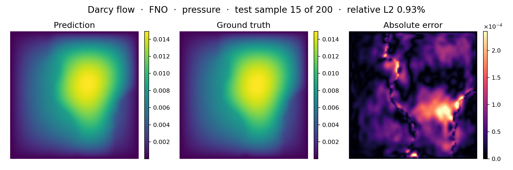

<!--
SPDX-FileCopyrightText: 2026 ZenteiQ AiTech Innovations Pvt. Ltd.
License notice: Documentation text and diagrams on this page are licensed
under CC BY 4.0. Source-code examples are licensed under LGPL-3.0-only
unless the example states otherwise.
-->

# Tutorial: Darcy Flow with FNO

In this tutorial you train a [Fourier Neural Operator](../../theory_guide/operator_learning.md#fno) (FNO) on **Darcy flow**: given
the permeability of a two-phase porous medium on the unit square, predict the
steady pressure. The data are the released `piececonst_r421_N1024`
files of [[1]](#ref1), strided from 421 × 421 to 85 × 85, the benchmark of the FNO, WNO and
Transolver papers. The whole tutorial is one script,
[`scripts/tutorials/darcy_fno.py`](../../../scripts/tutorials/darcy_fno.py). It uses only the public ScireX API
([`scirex.models.FNO`](../../api/models.md#scirex.models.FNO), [`scirex.training.adamw_cx`](../../api/training.md#scirex.training.adamw_cx),
[`scirex.utils.count_model_params`](../../api/utils.md#scirex.utils.count_model_params)), SciPy to read the data and plain JAX and optax for the training
loop. The code on this page is copied from that script.

## Summary

| | |
|---|---|
| Problem | Steady 2D Darcy flow, $-\nabla\cdot(a\nabla u) = 1$ on $(0, 1)^2$ with $u = 0$ on the boundary: permeability in, pressure out |
| Model | FNO, [`scirex.models.FNO`](../../api/models.md#scirex.models.FNO). Benchmark size: `modes=20` (`n_modes=(20, 20)`), `hidden_channels=40`, `n_layers=4`, the FNO's default (x, y) grid channels, 2,836,281 parameters. Smoke size: `modes=12, hidden_channels=16, n_layers=2`, 88,385 parameters |
| Data | `piececonst_r421_N1024_smooth1.mat` (train) and `smooth2.mat` (test), 1024 samples each on a 421 × 421 grid, about 1.7 GB each. Benchmark: first 1000 / first 200 samples, strided to 85 × 85. Smoke: 100 train / 20 test |
| Recipe | AdamW with the complex-aware [`adamw_cx`](../../api/training.md#scirex.training.adamw_cx), no weight decay, learning rate 1e-3 halved every 100 epochs, batch size 20, 500 epochs (25,000 steps), seed 0 |
| Normalisation | one mean and one standard deviation per grid point (per-pixel), fitted on the training samples |
| Metric | Relative L2 error per test sample, in physical units, averaged over the 200 test samples |
| Full-run value | 1.109% (last epoch). The paper [[1]](#ref1) reports 0.98% to 1.09% for FNO at resolutions 85 to 421, with their own, smaller model |

## Setup

Install the library from a clone of the repository (see [Install](../../install/index.md)):

```bash
pip install -e ".[all]"
```

### Data

The data are not bundled and not downloaded automatically. Download
`piececonst_r421_N1024_smooth1.mat` and `piececonst_r421_N1024_smooth2.mat`
(about 1.7 GB each) from the FNO data release of [[1]](#ref1); the WNO repository
([TapasTripura/WNO](https://github.com/TapasTripura/WNO)) links them as
"Dataset-2". Put both in one folder and pass it as `--data-dir`, or set
`DARCY_DATA_DIR`. See the [dataset guide](../../dataset_guide/darcy_2d.md) for
the source and the download.

These are not the `.pt` files of Zenodo record 12784353 that
[`scirex.data.load_darcy_pt`](../../api/data.md#scirex.data.load_darcy_pt) reads: those are published at resolutions 16 to
421 but not at 85, the benchmark's resolution. The smoke run reads the same
two files and only keeps fewer samples.

## The problem

Darcy's law for flow through a porous medium with permeability $a(x)$ and a
constant source gives the elliptic problem

$$
-\nabla \cdot \big(a(x)\,\nabla u(x)\big) = 1, \quad x \in (0, 1)^2, \qquad u(x) = 0 \ \text{on } \partial(0, 1)^2 .
$$

The permeability is a two-phase medium: a Gaussian random field thresholded
to the values 12 and 3, so every sample has its own pattern of sharp
interfaces. The authors of [[1]](#ref1) solved each sample with a second-order finite-difference
scheme on a 421 × 421 grid. The model never sees the equation. It learns the map

$$
\mathcal G_\theta : a \in \mathbb R^{85\times85} \;\mapsto\; \hat u \in \mathbb R^{85\times85}
$$

from 1000 solved examples. The equation is linear in $u$, but the map from $a$
to $u$ is not. The [dataset guide](../../dataset_guide/darcy_2d.md) has the
details of the data.

The input and the target are normalised with one mean and one standard deviation per grid point (per-pixel), fitted on the training samples. The network
predicts a normalised pressure, which is decoded before the loss. The metric is
the relative L2 error of each test sample in physical units,

$$
e_i = \frac{\lVert \hat u_i - u_i\rVert_2}{\lVert u_i\rVert_2},
\qquad \text{metric} = \frac{1}{N_{\text{test}}}\sum_{i=1}^{N_{\text{test}}} e_i ,
$$

and the training loss is

$$
\mathcal L_B = \frac{1}{|B|}\sum_{i\in B} e_i .
$$

The loss of a batch $B$ is the mean of the per-sample errors $e_i$, so the loss and the metric are the same quantity.

**Fourier Neural Operator in one paragraph.** An FNO layer adds a pointwise linear map to a
convolution done in Fourier space: it takes the FFT of the hidden channels,
keeps only the lowest `n_modes` frequencies, multiplies each kept frequency by
a learned complex matrix and transforms back. One layer therefore couples
every grid point with every other, at the cost of an FFT. The pressure of
Darcy flow is smooth, so a few low frequencies describe most of it; the
permeability jumps between 3 and 12, and its sharp interfaces are what a
truncated Fourier series represents worst. The
[theory guide](../../theory_guide/operator_learning.md#fno) has the details.

## Step-by-step walkthrough

### 1. Setup

Imports, the seed, the data split, the training recipe and the two model
sizes. `PROTOCOL` and `RECIPE` hold the same values as `PROTOCOL` and
`RUNS["fno"].opt` in [`scripts/benchmarks/darcy/_config.py`](../../../scripts/benchmarks/darcy/_config.py): 500 epochs, batch size 20, AdamW ([`adamw_cx`](../../api/training.md#scirex.training.adamw_cx)) with a learning rate of 1e-3 halved every 100 epochs and no weight decay, relative L2 loss.
`SIZES["full"]` is the benchmark's FNO; `SIZES["smoke"]` is small enough
for a CPU.

<!-- tutorial-snippet -->
```python
from __future__ import annotations

import argparse
import os
import platform
from pathlib import Path
from time import perf_counter

import flax
import jax
import jax.numpy as jnp
import matplotlib
import matplotlib.pyplot as plt
import numpy as np
import optax
from scipy.io import loadmat

import scirex
from scirex.models import FNO
from scirex.training import adamw_cx
from scirex.utils import count_model_params

matplotlib.use("Agg")  # write figures to files, no display needed
# Keep float32, also if float64 was enabled earlier in the process.
jax.config.update("jax_enable_x64", False)
```

<!-- tutorial-snippet -->
```python
SEED = 0

# Data split of the Darcy benchmark, the same values as PROTOCOL in
# scripts/benchmarks/darcy/_config.py.
PROTOCOL = dict(
    train_file="piececonst_r421_N1024_smooth1.mat",
    test_file="piececonst_r421_N1024_smooth2.mat",
    n_train=1000,
    n_test=200,
    subsample_rate=5,  # 421 -> 85, as in Li et al.'s own code
)

# FNO's training recipe on this benchmark, RUNS["fno"].opt in the same file:
# Adam(W) with no weight decay, lr 1e-3 halved every 100 epochs, batch 20.
RECIPE = dict(
    learning_rate=1e-3,
    weight_decay=0.0,
    adam_eps=1e-8,
    decay_epochs=100,
    decay_rate=0.5,
    batch_size=20,
    epochs=500,
)

# Model sizes. "full" is the benchmark's FNO (2,836,281 parameters, matched to
# Transolver's 2,826,945). "smoke" is a tiny FNO that trains on a CPU.
SIZES = dict(
    full=dict(modes=20, hidden_channels=40, n_layers=4),
    smoke=dict(modes=12, hidden_channels=16, n_layers=2),
)
```

`print_environment` records the library versions, the devices JAX sees and the seed;
see [how the tutorials work](../index.md#how-the-tutorials-work).

<!-- tutorial-snippet -->
```python
def print_environment(seed: int) -> None:
    """Print the versions, the devices and the seed, so a run can be repeated."""
    print(f"python {platform.python_version()} | numpy {np.__version__}")
    print(f"scirex {scirex.__version__}")
    print(
        f"jax {jax.__version__} | flax {flax.__version__} | optax {optax.__version__}"
    )
    print(f"devices: {jax.devices()}")
    print(f"SEED = {seed}")
```
### 2. Load the data

`load_darcy` reads `coeff` (the permeability) and `sol` (the pressure) of
the first `n_train` samples of `smooth1` and the first `n_test` of `smooth2`,
and keeps every 5th grid point, 421 -> 85. Both come back as `(n, 85, 85)`
float32 arrays. SciPy reads a whole `.mat` file at once, so loading takes
about 11 s whatever the number of samples.

<!-- tutorial-snippet -->
```python
def load_darcy(
    data_dir: Path, n_train: int, n_test: int, subsample_rate: int = 5
) -> dict:
    """Read the split: ``a`` and ``u`` as ``(n, s, s)`` float32 arrays."""
    out = {}
    for name, file, n in (
        ("train", PROTOCOL["train_file"], n_train),
        ("test", PROTOCOL["test_file"], n_test),
    ):
        path = Path(data_dir) / file
        if not path.is_file():
            raise FileNotFoundError(f"{path} not found")
        raw = loadmat(path.as_posix(), variable_names=("coeff", "sol"))
        if raw["coeff"].shape[0] < n:
            raise ValueError(f"{path} has only {raw['coeff'].shape[0]} samples")
        r = subsample_rate
        out[f"a_{name}"] = raw["coeff"][:n, ::r, ::r].astype(np.float32)
        out[f"u_{name}"] = raw["sol"][:n, ::r, ::r].astype(np.float32)
    print(
        f"samples: {n_train} train / {n_test} test | grid {out['a_train'].shape[1:]} | "
        f"permeability values {np.unique(out['a_train'])} | "
        f"pressure range [{out['u_train'].min():.4f}, {out['u_train'].max():.4f}]"
    )
    return out
```

### 3. Normalise

`PixelNormalizer` fits one mean and one standard deviation per grid point,
over the training samples, with `eps = 1e-5`, as in [[1]](#ref1):
[`UnitGaussianNormalizer`](../../api/data.md#scirex.data.UnitGaussianNormalizer). The inputs are encoded once. The targets are not:
the network's output is decoded instead, so the loss and the metric are in
physical units.

<!-- tutorial-snippet -->
```python
class PixelNormalizer:
    """``(v - mean) / (std + eps)`` with a mean and a std per grid point."""

    def __init__(self, train: np.ndarray, eps: float = 1e-5) -> None:
        self.mean = train.mean(axis=0, keepdims=True)
        self.std = train.std(axis=0, keepdims=True)
        self.eps = eps

    def encode(self, v):
        return (v - self.mean) / (self.std + self.eps)

    def decode(self, v):
        return v * (self.std + self.eps) + self.mean
```

### 4. Build the model

[`FNO`](../../api/models.md#scirex.models.FNO) is a Flax module: the parameters are a separate pytree, created by
`init` and used by `apply`. It is channels-first, so a batch is
`(batch, 1, 85, 85)`, one channel for the permeability. With its default
`positional_embedding`, FNO appends the (x, y) coordinates of the grid as two
more channels. `n_modes=(20, 20)` keeps 20 Fourier modes along each axis in
total. [`count_model_params`](../../api/utils.md#scirex.utils.count_model_params) counts a complex weight as two real numbers.
`build_model` also returns the random key left over after initialisation; the
training loop draws its batch order from it.

<!-- tutorial-snippet -->
```python
def build_model(size: dict, sample: np.ndarray, seed: int):
    """Build the FNO, initialise it on one sample and print the parameter count."""
    model = FNO(
        in_channels=1,
        out_channels=1,
        hidden_channels=size["hidden_channels"],
        n_modes=(size["modes"], size["modes"]),
        n_layers=size["n_layers"],
    )
    key, init_key = jax.random.split(jax.random.PRNGKey(seed))
    params = model.init(init_key, jnp.asarray(sample)[None])
    print(f"FNO {size} | parameters: {count_model_params(params):,}")
    return model, params, key
```

### 5. Loss

The loss from [The problem](#the-problem): the mean of the per-sample
relative L2 errors on the decoded pressure.

<!-- tutorial-snippet -->
```python
def rel_l2_per_sample(pred, true):
    """``||pred - true|| / ||true||`` per sample, over all grid points."""
    b = pred.shape[0]
    diff = jnp.linalg.norm(pred.reshape(b, -1) - true.reshape(b, -1), axis=1)
    return diff / jnp.maximum(jnp.linalg.norm(true.reshape(b, -1), axis=1), 1e-12)
```

<!-- tutorial-snippet -->
```python
def make_loss(model, u_norm: PixelNormalizer):
    """Return ``loss_fn(params, a, u) -> mean relative L2`` in physical units."""

    def loss_fn(params, a, u):
        pred = u_norm.decode(model.apply(params, a))  # (batch, 1, s, s)
        return jnp.mean(rel_l2_per_sample(pred, u))

    return loss_fn
```

### 6. Optimiser

FNO's spectral weights are complex. For a real loss $L$ and a complex weight
$w$, `jax.grad` returns $\partial L/\partial w$, the conjugate of the
steepest-ascent direction that optax assumes, so plain `optax.adamw` would
move the imaginary parts of those weights the wrong way. [`adamw_cx`](../../api/training.md#scirex.training.adamw_cx)
conjugates complex gradients first and keeps Adam's second moment real; real
weights are updated exactly as by AdamW. The [Pipe FNO tutorial](../Others/Pipe_FNO.md)
measures the difference. The learning rate is halved every 100 epochs, as in
the FNO paper.

`optax.inject_hyperparams` gives its hyperparameters the highest dtype in the
parameter tree, which is `complex64` here, so `hyperparam_dtype=jnp.float32`
keeps the learning rate, betas, eps and weight decay real. Without it the
values are the same but every update becomes complex. The benchmark's
`train.py` does not pass it yet.

<!-- tutorial-snippet -->
```python
def make_optimizer(recipe: dict, steps_per_epoch: int):
    """``adamw_cx`` on a step-decay learning rate."""
    schedule = optax.exponential_decay(
        init_value=recipe["learning_rate"],
        transition_steps=steps_per_epoch * recipe["decay_epochs"],
        decay_rate=recipe["decay_rate"],
        staircase=True,
    )
    return optax.inject_hyperparams(adamw_cx, hyperparam_dtype=jnp.float32)(
        learning_rate=schedule,
        weight_decay=recipe["weight_decay"],
        eps=recipe["adam_eps"],
    )
```

### 7. Train

Batches of 20 samples in a new random order every epoch, one optimiser step
per batch. As in `train.py`, the random order comes from `jax.random` with the
key left over from initialisation, and the last incomplete batch is dropped.
Every `eval_every` epochs the test samples are scored, to draw the error
curve. There is no validation split, so no epoch is selected by its test
error: the weights after the last epoch are the result. JAX compiles the step
on its first call, so the first epoch is slower than the others.

<!-- tutorial-snippet -->
```python
def train(model, params, key, data, u_norm, epochs, eval_every=10, recipe=RECIPE):
    """Train for ``epochs`` epochs. Return the final parameters and the history."""
    a_train, u_train = jnp.asarray(data["a_train"]), jnp.asarray(data["u_train"])
    bs = recipe["batch_size"]
    n_train = a_train.shape[0]
    steps_per_epoch = max(n_train // bs, 1)
    tx = make_optimizer(recipe, steps_per_epoch)
    opt_state = tx.init(params)
    loss_fn = make_loss(model, u_norm)

    @jax.jit
    def train_step(params, opt_state, a, u):
        loss, grads = jax.value_and_grad(loss_fn)(params, a, u)
        updates, opt_state = tx.update(grads, opt_state, params)
        return optax.apply_updates(params, updates), opt_state, loss

    history = []
    for epoch in range(epochs):
        t0 = perf_counter()
        key, sub = jax.random.split(key)
        perm = jax.random.permutation(sub, n_train)
        total = 0.0
        for b in range(steps_per_epoch):
            idx = perm[b * bs : (b + 1) * bs]
            params, opt_state, loss = train_step(
                params, opt_state, a_train[idx], u_train[idx]
            )
            total += float(loss)
        secs = perf_counter() - t0
        if epoch % eval_every == 0 or epoch == epochs - 1:
            test = evaluate(model, params, data, u_norm)["test_rel_l2"]
            history.append(
                dict(epoch=epoch, train_loss=total / steps_per_epoch, test_rel_l2=test)
            )
            print(
                f"epoch {epoch}: train_loss={total / steps_per_epoch:.4f} "
                f"test_rel_l2={test:.4f} epoch_time={secs:.1f}s"
            )
    return params, history
```

### 8. Evaluate

The relative L2 error of every test sample, in physical units. The mean is
the benchmark's number. The median, the 90th percentile and the worst sample
show how the error is spread over the test samples.

<!-- tutorial-snippet -->
```python
def evaluate(model, params, data, u_norm, batch_size: int = 20) -> dict:
    """Per-sample relative L2 on the test samples, and the predictions."""
    predict = jax.jit(lambda p, a: u_norm.decode(model.apply(p, a)))
    a_test, u_test = data["a_test"], data["u_test"]
    preds = np.concatenate(
        [
            np.asarray(predict(params, jnp.asarray(a_test[i : i + batch_size])))
            for i in range(0, len(a_test), batch_size)
        ]
    )
    errors = np.asarray(rel_l2_per_sample(jnp.asarray(preds), jnp.asarray(u_test)))
    return dict(
        test_rel_l2=float(errors.mean()),
        median=float(np.median(errors)),
        p90=float(np.percentile(errors, 90)),
        worst=float(errors.max()),
        errors=errors,
        predictions=preds[:, 0],
    )
```

### 9. Plot

The standard figure for this benchmark has four panels for one test sample:
the input permeability, the true pressure, the predicted pressure (same
colour scale as the truth) and the absolute error. The script plots the test
sample with the median error. A second figure shows the training loss and the
test error per epoch.

<!-- tutorial-snippet -->
```python
def plot_prediction(a, truth, pred, path: Path, title: str) -> None:
    """Save permeability, true pressure, predicted pressure and absolute error."""
    lim = (float(truth.min()), float(truth.max()))
    panels = [
        ("Input: permeability a", a, "viridis", None),
        ("Truth: pressure u", truth, "jet", lim),
        ("Prediction: pressure u", pred, "jet", lim),
        ("Absolute error", np.abs(pred - truth), "magma", None),
    ]
    fig, axes = plt.subplots(1, 4, figsize=(18, 4.2), constrained_layout=True)
    for ax, (name, values, cmap, vlim) in zip(axes, panels):
        vmin, vmax = vlim if vlim else (None, None)
        im = ax.imshow(
            values, cmap=cmap, vmin=vmin, vmax=vmax, origin="lower", extent=(0, 1, 0, 1)
        )
        ax.set_title(name)
        ax.set_xlabel("x")
        ax.set_ylabel("y")
        fig.colorbar(im, ax=ax, shrink=0.85)
    fig.suptitle(title)
    fig.savefig(path, dpi=120)
    plt.close(fig)
```

<!-- tutorial-snippet -->
```python
def plot_loss(history: list[dict], path: Path) -> None:
    """Save the training loss and the test relative L2 per epoch."""
    epochs = [h["epoch"] for h in history]
    fig, ax = plt.subplots(figsize=(6, 4))
    ax.plot(epochs, [h["train_loss"] for h in history], marker="o", label="train loss")
    ax.plot(epochs, [h["test_rel_l2"] for h in history], marker="o", label="test")
    ax.set_xlabel("epoch")
    ax.set_ylabel("relative L2 (mean over samples)")
    ax.set_yscale("log")
    ax.legend()
    ax.grid(True, alpha=0.3)
    fig.savefig(path, dpi=120, bbox_inches="tight")
    plt.close(fig)
```

The complete script is [`scripts/tutorials/darcy_fno.py`](../../../scripts/tutorials/darcy_fno.py).

## Run it

Smoke run (CPU, no GPU needed):

```bash
CUDA_VISIBLE_DEVICES= JAX_PLATFORMS=cpu python scripts/tutorials/darcy_fno.py --data-dir ~/data/darcy --smoke
```

Full protocol (1000 training samples, benchmark-size FNO; use a GPU):

```bash
python scripts/tutorials/darcy_fno.py --data-dir ~/data/darcy
```

The other flags are `--epochs`, `--seed`, `--out-dir` (default
`outputs/darcy_fno_tutorial`) and, for the smoke run, `--n-train` and
`--n-test`.

This is the output of the smoke run (smoke run, CPU, 100 train / 20 test samples,
not a benchmark number), run with `--out-dir out/fno_smoke`. The wall time
was 28 s, measured with `time`; JAX's message that it found
no GPU and library deprecation warnings are left out:

```text
python 3.12.3 | numpy 1.26.4
scirex 1.0.0rc1
jax 0.6.2 | flax 0.10.7 | optax 0.2.8
devices: [CpuDevice(id=0)]
SEED = 0
samples: 100 train / 20 test | grid (85, 85) | permeability values [ 3. 12.] | pressure range [-0.0000, 0.0159]
data loading: 10.8s
FNO {'modes': 12, 'hidden_channels': 16, 'n_layers': 2} | parameters: 88,385
epoch 0: train_loss=0.2445 test_rel_l2=0.2611 epoch_time=2.0s
epoch 1: train_loss=0.2398 test_rel_l2=0.2558 epoch_time=1.3s
epoch 2: train_loss=0.2338 test_rel_l2=0.2486 epoch_time=1.4s
epoch 3: train_loss=0.2253 test_rel_l2=0.2378 epoch_time=1.4s
epoch 4: train_loss=0.2124 test_rel_l2=0.2214 epoch_time=1.4s
test relative L2: mean 0.2214 | median 0.2155 | p90 0.2654 | worst 0.2882
figures in out/fno_smoke | total time 25.6s
```

## Results

### Full run

The next figures were not made by this script. They come from the benchmark
runner (`train.py` and `infer.py`) and are the committed results of the **full
run** (1000 training and 200 test samples, benchmark-size FNO). The figure shows one held-out test sample (the title names it and its
relative L2 error): the prediction, the ground truth and the absolute error. It is drawn
by [`scripts/benchmarks/make_figures.py`](../../../scripts/benchmarks/make_figures.py) from the checkpoint.



| Model, same data and split, each with its own recipe | Parameters | Test relative L2 | Training time |
|---|---|---|---|
| [Transolver](../../benchmarks/darcy/results/comparative.md#transolver) | 2,826,945 | 0.532% (seed 2; mean of seeds 0 to 4: 0.556%) | ~42 min |
| **FNO (this tutorial)** | 2,836,281 | **1.109%** | ~4.6 min |
| [GINO](../../benchmarks/darcy/results/comparative.md#gino) | 2,801,340 | 1.603% (last epoch; lowest during training 1.470%) | ~89 min |
| [WNO](../../benchmarks/darcy/results/comparative.md#wno) | 2,829,601 | 2.020% | ~21 min |

The test errors are the mean over the 200 test samples after the last epoch
(the standard deviation over the samples is 0.636% for FNO).
Only the parameter count is matched: each model keeps its own paper's recipe,
so batch size, step count, loss and normalisation differ, and the table shows
each architecture at this size with its own recipe, not a pure architecture
effect.

## Troubleshooting

- **`FileNotFoundError: .../piececonst_r421_N1024_smooth1.mat not found`.**
  `--data-dir` does not hold the two `.mat` files. The `.pt` files of the
  Zenodo record are a different release and are not read by this script.
- **`ValueError: ... has only N samples`.** You asked for more samples than a
  file holds; each file has 1024.
- **Loading takes about 11 s even for a few samples.** SciPy reads the whole
  `.mat` file (1.7 GB) before the samples are selected. Reading from a network
  drive is slower; copy the files to a local disk.

## Next steps

- Compare with the other architectures on the same data: [WNO](../Others/Darcy_WNO.md), [GINO](../Others/Darcy_GINO.md), [Transolver](../Others/Darcy_Transolver.md)
  and the [comparison page](../../benchmarks/darcy/results/comparative.md).
- Read the [Darcy Flow results](../../benchmarks/darcy/results/comparative.md#fno) for the
  figures and the compute cost, and the
  [dataset guide](../../dataset_guide/darcy_2d.md) for the data.
- Learn how FNO works in the [theory guide](../../theory_guide/operator_learning.md#fno)
  and see its arguments in the [API reference](../../api/models.md).
- Train without any solution data: the physics-only Darcy benchmark
  ([setup](../../benchmarks/darcy_physics/results/setup.md)) uses the same files, split
  and metric.
- See the [quickstart](../../user_guide/quickstart.md) and the
  [training guide](../../user_guide/training.md) for the [`Trainer`](../../api/experimental.md#scirex.experimental.training.Trainer).

## References

1. <span id="ref1"></span>Li et al., *Fourier Neural Operator for Parametric Partial Differential Equations*, ICLR 2021. <https://arxiv.org/abs/2010.08895>
