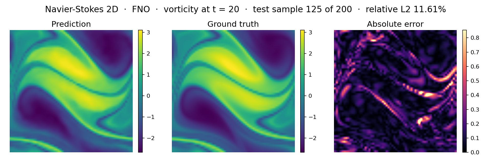
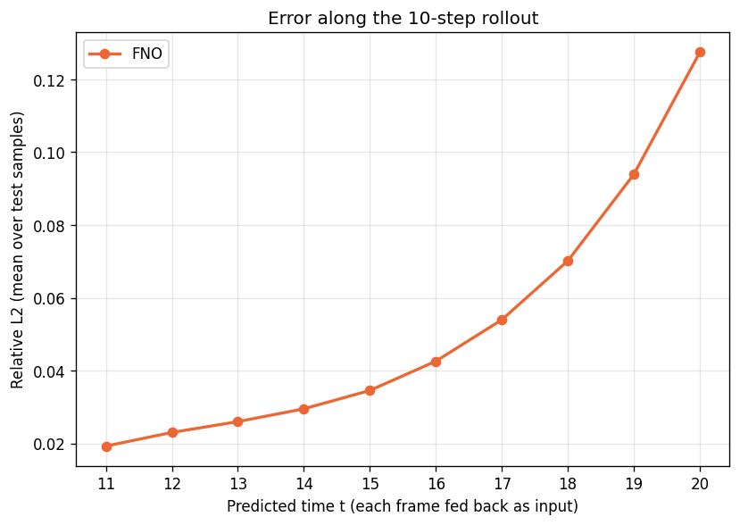
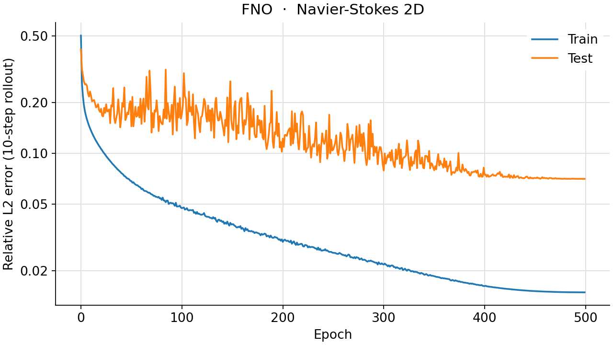
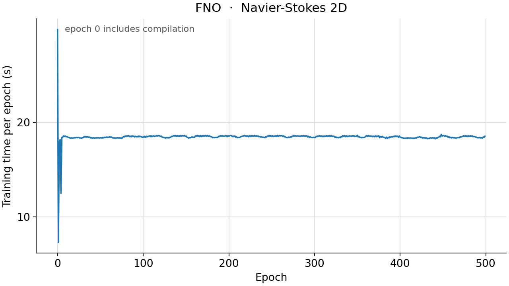

<!--
SPDX-FileCopyrightText: 2026 ZenteiQ AiTech Innovations Pvt. Ltd.
License notice: Documentation text and diagrams on this page are licensed
under CC BY 4.0. Source-code examples are licensed under LGPL-3.0-only
unless the example states otherwise.
-->

# Tutorial: Navier-Stokes 2D (Turbulence) with FNO

In this tutorial you train a [Fourier Neural Operator](../../theory_guide/operator_learning.md#fno)
(FNO) on the **Navier-Stokes 2D** benchmark: given ten frames of the vorticity
of a 2D turbulent flow, predict the next ten, one frame at a time, each
prediction fed back as the newest input. The grid is periodic, like the FFT
of the FNO. The whole tutorial is one script,
[`scripts/tutorials/navierstokes_fno.py`](../../../scripts/tutorials/navierstokes_fno.py). It uses only the public ScireX API
([`scirex.models.FNO`](../../api/models.md#scirex.models.FNO), [`scirex.training.adamw_cx`](../../api/training.md#scirex.training.adamw_cx),
[`scirex.utils.count_model_params`](../../api/utils.md#scirex.utils.count_model_params)), SciPy to read the data and plain JAX and
optax. The code on this page is copied from that script.

## Summary

| | |
|---|---|
| Problem | 2D incompressible Navier-Stokes in vorticity form on a periodic 64 × 64 grid, viscosity 1e-5: 10 frames in, the next 10 out, one at a time |
| Model | FNO, [`scirex.models.FNO`](../../api/models.md#scirex.models.FNO). Benchmark size: `hidden_channels=98, n_modes=(16, 16), n_layers=4`, grid channels appended, 11,183,467 parameters. Smoke size: `hidden_channels=16, n_modes=(12, 12), n_layers=2`, 88,673 parameters |
| Data | `NavierStokes_V1e-5_N1200_T20.mat` (FNO data release, about 413 MB), 1200 flows of 20 frames. Benchmark: first 1000 train / last 200 test. Smoke: 20 train / 4 test |
| Optimiser | Complex-aware AdamW ([`adamw_cx`](../../api/training.md#scirex.training.adamw_cx)), eps 1e-8, weight decay 1e-5, no gradient clipping, cosine one-cycle learning rate with peak 1e-3, batch size 2 |
| Metric | Relative L2 error of each test flow over its 10 rolled-out frames, averaged over the test flows |
| Full-run values | 0.0705 (one seed). Transolver [[2]](#ref2) paper, its own model: 0.0900. Copying the last input frame: 0.7481 |

## Setup

Install the library from a clone of the repository (see [Install](../../install/index.md)):

```bash
pip install -e ".[all]"
```

### Data

The dataset is not bundled and not downloaded automatically. Download
`NavierStokes_V1e-5_N1200_T20.mat` (about 413 MB) from the FNO data release;
the Transolver repository links it in the "Navier-Stokes" row of its
`PDE-Solving-StandardBenchmark` README
([thuml/Transolver](https://github.com/thuml/Transolver)). Put it in a folder
and pass that folder as `--data-dir`, or set `NS_DATA_DIR`. ScireX does not
redistribute the file; see the [dataset guide](../../dataset_guide/navier_stokes.md)
for its checksum.

The file is MATLAB 5 format, so `scipy.io.loadmat` reads it. It holds `u`,
the vorticity at $t = 1 \dots 20$, `(1200, 64, 64, 20)`, plus the initial
field `a` and the times `t`, which are not used. For the smoke run you do not
need to copy anything: the script reads the file and keeps only the flows it
uses.

## The problem

Each sample is one 2D incompressible flow on the unit torus (periodic in $x$
and $y$), started from a random vorticity field and driven by a fixed
forcing ([[1]](#ref1)). The vorticity $w = \partial_x u_y - \partial_y u_x$
follows

$$
\partial_t w + \mathbf u \cdot \nabla w = \nu \Delta w + f, \qquad \nabla \cdot \mathbf u = 0 ,
$$

with viscosity $\nu = 10^{-5}$, so the flow is close to inviscid and
develops thin filaments. The file stores the vorticity on a 64 × 64 grid at
$t = 1, 2, \dots, 20$. The model never sees the equation. It learns to step
the flow forward from 1000 solved examples. The
[dataset guide](../../dataset_guide/navier_stokes.md) has the shapes, ranges and
known limits of the file.

The model is a one-step map from the last ten frames to the next one,

$$
\mathcal G_\theta : (w_{t-9}, \dots, w_t) \in \mathbb R^{64\times64\times10} \;\mapsto\; \hat w_{t+1} \in \mathbb R^{64\times64} .
$$

**Training with teacher forcing.** Given the true frames 1-10, the model
predicts frame 11; then, given the true frames 2-11, frame 12; and so on to
frame 20. Every step sees true history, so the ten steps are independent. The
loss of a batch $B$ sums the relative L2 error of every predicted frame,

$$
\mathcal L_B = \sum_{i\in B}\sum_{t=11}^{20} \frac{\lVert \hat w_{i,t} - w_{i,t}\rVert_2}{\lVert w_{i,t}\rVert_2} .
$$

**Evaluation with a rollout.** The model predicts frame 11 from the true
frames 1-10, then frame 12 from frames 2-10 and its own frame 11, and so on:
from frame 11 on, it sees only its own predictions. That is how the model
would be used, and errors can grow along the rollout. The metric is the
relative L2 error of each test flow over all ten rolled-out frames at once,
$e_i = \lVert \hat w_{i,11:20} - w_{i,11:20}\rVert_2 / \lVert w_{i,11:20}\rVert_2$,
averaged over the test flows. There is no normalisation: the vorticity is
used as stored.

The baseline any model must beat is to copy the last input frame ten times.
On the 200 test flows it scores 0.7481.

**FNO in one paragraph.** An FNO layer adds a pointwise linear map to a
convolution done in Fourier space: it takes the FFT of the hidden channels,
keeps only the lowest `n_modes` frequencies, multiplies each kept frequency by
a learned complex matrix and transforms back. One layer therefore couples
every grid point with every other at the cost of an FFT, and the FFT's
periodicity matches the periodic domain of this flow. `n_modes=(16, 16)`
keeps 8 positive and 8 negative frequencies along the first axis and 8 along
the second (the real FFT stores only the non-negative ones). That truncation
is also its limit: the thin filaments of the vorticity live at higher
frequencies. The
[theory guide](../../theory_guide/operator_learning.md#fno) has the details.

## Step-by-step walkthrough

### 1. Setup

Imports, the seed, the training settings and the two model sizes. `PROTOCOL`
holds the benchmark's training settings (the same values as in
[`scripts/benchmarks/navier_stokes/_config.py`](../../../scripts/benchmarks/navier_stokes/_config.py), the Transolver paper's recipe,
which every model on this benchmark shares): 500 epochs, batch size 2, AdamW
with a peak learning rate of 1e-3 on a one-cycle schedule, weight decay 1e-5
and no gradient clipping. `SIZES["full"]` is the benchmark's FNO;
`SIZES["smoke"]` is small enough for a CPU.

<!-- tutorial-snippet -->
```python
from __future__ import annotations

import argparse
import os
import platform
from pathlib import Path
from time import perf_counter

import flax
import jax
import jax.numpy as jnp
import matplotlib
import matplotlib.pyplot as plt
import numpy as np
import optax
import scipy.io

import scirex
from scirex.models import FNO
from scirex.training import adamw_cx
from scirex.utils import count_model_params

matplotlib.use("Agg")  # write figures to files, no display needed
# Keep float32, also if float64 was enabled earlier in the process.
jax.config.update("jax_enable_x64", False)
```

<!-- tutorial-snippet -->
```python
SEED = 0
DATA_FILE = "NavierStokes_V1e-5_N1200_T20.mat"

# Training settings of the Navier-Stokes benchmark, the same values as
# PROTOCOL in scripts/benchmarks/navier_stokes/_config.py (the Transolver
# paper's recipe, used by every model).
PROTOCOL = dict(
    ntrain=1000,
    ntest=200,
    t_in=10,
    t_out=10,
    epochs=500,
    batch_size=2,
    learning_rate=1e-3,
    weight_decay=1e-5,
    adam_eps=1e-8,
    pct_start=0.3,
    div_factor=25.0,
    final_div_factor=1e4,
)

# Model sizes. "full" is the benchmark's FNO (11,183,467 parameters, matched
# to Transolver's 11,232,321). "smoke" is a tiny FNO that trains on a CPU.
SIZES = dict(
    full=dict(hidden_channels=98, n_modes=(16, 16), n_layers=4),
    smoke=dict(hidden_channels=16, n_modes=(12, 12), n_layers=2),
)
```

`print_environment` records the library versions, the devices JAX sees and the seed;
see [how the tutorials work](../index.md#how-the-tutorials-work).

<!-- tutorial-snippet -->
```python
def print_environment(seed: int) -> None:
    """Print the versions, the devices and the seed, so a run can be repeated."""
    print(f"python {platform.python_version()} | numpy {np.__version__}")
    print(f"scirex {scirex.__version__}")
    print(
        f"jax {jax.__version__} | flax {flax.__version__} | optax {optax.__version__}"
    )
    print(f"devices: {jax.devices()}")
    print(f"SEED = {seed}")
```

### 2. Load the data

`load_ns` reads `u` and splits it as the benchmark does: the first `ntrain`
flows train, the last `ntest` of the file test. Frames 1-10 are the history
`a_*`, `(n, 64, 64, 10)`, and frames 11-20 the targets `u_*`,
`(n, 64, 64, 10)`. Nothing is normalised.

<!-- tutorial-snippet -->
```python
def load_ns(data_path: Path, ntrain: int, ntest: int, t_in: int, t_out: int) -> dict:
    """Read the split. History ``(n, 64, 64, t_in)``, targets ``(n, 64, 64, t_out)``."""
    u = scipy.io.loadmat(str(data_path), variable_names=["u"])["u"]
    n, h, w, t = u.shape
    if ntrain + ntest > n or t_in + t_out > t:
        raise ValueError(
            f"need {ntrain} + {ntest} <= {n} samples, {t_in} + {t_out} <= {t} frames"
        )
    out = {}
    for name, part in (("train", u[:ntrain]), ("test", u[n - ntest :])):
        part = part.astype(np.float32)
        out[f"a_{name}"] = part[..., :t_in]
        out[f"u_{name}"] = part[..., t_in : t_in + t_out]
    print(
        f"samples: {ntrain} train / {ntest} test | grid {h}x{w} | "
        f"{t_in} frames in, {t_out} out | "
        f"vorticity range [{out['a_train'].min():.2f}, {out['a_train'].max():.2f}]"
    )
    return out
```

### 3. Build the model

[`FNO`](../../api/models.md#scirex.models.FNO) is a Flax module: the parameters are a separate pytree, created by
`init` and used by `apply`. It is channels-first, so the history is moved to
`(batch, 10, 64, 64)`: the ten frames are the input channels.
`positional_embedding="grid"`, the default, appends the $x$ and $y$
coordinates as two more channels. [`count_model_params`](../../api/utils.md#scirex.utils.count_model_params) counts a complex
weight as two real numbers. `make_step` wraps the layout, so the rest of the
script only sees channels-last histories `(batch, 64, 64, 10)`.

<!-- tutorial-snippet -->
```python
def build_model(size: dict, t_in: int, sample: np.ndarray, seed: int):
    """Build the FNO, initialise it on one history and print the parameter count."""
    model = FNO(in_channels=t_in, out_channels=1, **size)
    x0 = jnp.asarray(sample)[None].transpose(0, 3, 1, 2)
    params = model.init(jax.random.PRNGKey(seed), x0)
    print(f"FNO {size} | parameters: {count_model_params(params):,}")
    return model, params
```

<!-- tutorial-snippet -->
```python
def make_step(model):
    """``step(params, history) -> next frame``, both channels-last."""

    def step(params, fx):
        out = model.apply(params, fx.transpose(0, 3, 1, 2))  # (batch, 1, H, W)
        return out.transpose(0, 2, 3, 1)

    return step
```

### 4. Loss

The loss and the metric from [The problem](#the-problem): the relative L2
error of each sample, here of one frame or of a whole rollout.

<!-- tutorial-snippet -->
```python
def rel_l2_per_sample(pred, true):
    """``||pred - true|| / ||true||`` per sample, over all remaining axes."""
    b = pred.shape[0]
    diff = jnp.linalg.norm(pred.reshape(b, -1) - true.reshape(b, -1), axis=1)
    return diff / jnp.linalg.norm(true.reshape(b, -1), axis=1)
```

### 5. Teacher forcing and rollout

`teacher_forced` is the training loss: at every step the history is rebuilt
from the true frames, so no step depends on an earlier prediction.
`rollout` is the evaluation: every prediction is appended to the history and
the oldest frame dropped, so from the second step on the model sees its own
output. Both are plain Python loops over the ten steps, which JAX unrolls
when it compiles them.

<!-- tutorial-snippet -->
```python
def teacher_forced(step, params, fx, yy):
    """Loss (summed over steps and batch) with the true history at every step."""
    loss = 0.0
    for t in range(yy.shape[-1]):
        pred = step(params, fx)
        loss = loss + jnp.sum(rel_l2_per_sample(pred, yy[..., t : t + 1]))
        fx = jnp.concatenate([fx[..., 1:], yy[..., t : t + 1]], axis=-1)
    return loss
```

<!-- tutorial-snippet -->
```python
def rollout(step, params, fx, t_out: int):
    """``t_out`` frames, each step fed the model's own previous predictions."""
    preds = []
    for _ in range(t_out):
        pred = step(params, fx)
        preds.append(pred)
        fx = jnp.concatenate([fx[..., 1:], pred], axis=-1)
    return jnp.concatenate(preds, axis=-1)
```

### 6. Optimiser for complex weights

The spectral weights of an FNO are complex. For a real loss $L$ and a complex
weight $w$, `jax.grad` returns $\partial L/\partial w$, the complex conjugate
of the steepest-ascent direction that every optax transform assumes it is
given, so plain `optax.adamw` moves the imaginary part of every spectral
weight the wrong way. [`adamw_cx`](../../api/training.md#scirex.training.adamw_cx) conjugates complex gradients first and keeps
Adam's second moment real; real weights are updated exactly as by AdamW.

`optax.inject_hyperparams` lets the learning rate follow the one-cycle
schedule. By default it casts the hyperparameters (learning rate, betas, eps,
weight decay) to the highest dtype among the parameters, which is complex64
for an FNO. Every update, the real weights' included, would then be complex
with a zero imaginary part, and `apply_updates` would cast it back with a
deprecation warning that JAX will turn into an error.
`hyperparam_dtype=jnp.float32` keeps them real. `optimizer="adamw"` swaps in
plain optax AdamW so that you can see the difference (see
[Results](#results)).

<!-- tutorial-snippet -->
```python
def make_optimizer(protocol: dict, total_steps: int, optimizer: str = "adamw_cx"):
    """AdamW on a cosine one-cycle schedule (``"adamw_cx"`` or plain ``"adamw"``)."""
    schedule = optax.cosine_onecycle_schedule(
        transition_steps=total_steps,
        peak_value=protocol["learning_rate"],
        pct_start=protocol["pct_start"],
        div_factor=protocol["div_factor"],
        final_div_factor=protocol["final_div_factor"],
    )
    builder = dict(adamw_cx=adamw_cx, adamw=optax.adamw)[optimizer]
    tx = optax.inject_hyperparams(builder, hyperparam_dtype=jnp.float32)(
        learning_rate=schedule,
        weight_decay=protocol["weight_decay"],
        eps=protocol["adam_eps"],
    )
    return tx, schedule
```

### 7. Train

Batches of 2 flows in a new random order every epoch, one optimiser step per
batch. After every epoch the test flows are rolled out and scored, to draw the
error curve. There is no validation split, so no epoch is selected by its test
error: the weights after the last epoch are the result, as in the benchmark.
The logged training error is the teacher-forced error per frame; the test
error is the rollout error over ten frames, so the two are not on the same
footing. JAX compiles the step on its first call, so the first epoch is slower
than the others.

<!-- tutorial-snippet -->
```python
def train(model, params, data, epochs, seed, protocol=PROTOCOL, optimizer="adamw_cx"):
    """Train for ``epochs`` epochs. Return the final parameters and the history."""
    a_train, u_train = data["a_train"], data["u_train"]
    a_test, u_test = data["a_test"], data["u_test"]
    bs, t_out = protocol["batch_size"], protocol["t_out"]
    ntrain = len(a_train)
    tx, _ = make_optimizer(protocol, -(-ntrain // bs) * epochs, optimizer)
    opt_state = tx.init(params)
    step = make_step(model)

    @jax.jit
    def train_step(params, opt_state, fx, yy):
        loss, grads = jax.value_and_grad(lambda p: teacher_forced(step, p, fx, yy))(
            params
        )
        updates, opt_state = tx.update(grads, opt_state, params)
        return optax.apply_updates(params, updates), opt_state, loss

    @jax.jit
    def test_error(params, fx, yy):
        return jnp.sum(rel_l2_per_sample(rollout(step, params, fx, t_out), yy))

    rng = np.random.default_rng(seed)
    history = []
    for epoch in range(epochs):
        t0 = perf_counter()
        order = rng.permutation(ntrain)
        train_total = 0.0
        for i in range(0, ntrain, bs):
            idx = order[i : i + bs]
            params, opt_state, loss = train_step(
                params, opt_state, jnp.asarray(a_train[idx]), jnp.asarray(u_train[idx])
            )
            train_total += float(loss)
        secs = perf_counter() - t0
        test_total = sum(
            float(test_error(params, a_test[i : i + bs], u_test[i : i + bs]))
            for i in range(0, len(a_test), bs)
        )
        history.append(
            dict(
                epoch=epoch,
                train_step_rel_l2=train_total / ntrain / t_out,
                test_rel_l2=test_total / len(a_test),
                secs=secs,
            )
        )
        print(
            f"epoch {epoch}: train_step_rel_l2={history[-1]['train_step_rel_l2']:.4f} "
            f"test_rel_l2={history[-1]['test_rel_l2']:.4f} epoch_time={secs:.1f}s"
        )
    return params, history
```

### 8. Evaluate

The rollout error of every test flow over its ten frames: the mean is the
benchmark's number, and the median, 90th percentile and worst flow show the
spread. The error of each frame on its own shows how it grows along the
rollout. The same scores for copying the last input frame give the baseline.

<!-- tutorial-snippet -->
```python
def evaluate(model, params, data, t_out: int, batch_size: int = 2) -> dict:
    """Rollout error per test flow and per time step, and the predictions."""
    step = make_step(model)
    predict = jax.jit(lambda p, fx: rollout(step, p, fx, t_out))
    a_test, u_test = data["a_test"], data["u_test"]
    preds = np.concatenate(
        [
            np.asarray(predict(params, jnp.asarray(a_test[i : i + batch_size])))
            for i in range(0, len(a_test), batch_size)
        ]
    )
    copy_last = np.repeat(a_test[..., -1:], t_out, axis=-1)

    def scores(pred):
        whole = np.asarray(rel_l2_per_sample(jnp.asarray(pred), jnp.asarray(u_test)))
        steps = [
            float(np.mean(rel_l2_per_sample(pred[..., t], u_test[..., t])))
            for t in range(t_out)
        ]
        return whole, steps

    errors, per_step = scores(preds)
    baseline, baseline_per_step = scores(copy_last)
    return dict(
        test_rel_l2=float(errors.mean()),
        median=float(np.median(errors)),
        p90=float(np.percentile(errors, 90)),
        worst=float(errors.max()),
        copy_last_frame=float(baseline.mean()),
        per_step=per_step,
        copy_last_frame_per_step=baseline_per_step,
        errors=errors,
        predictions=preds,
    )
```

### 9. Plot

The standard figure for this benchmark has four panels for one test flow: the
input (the last history frame, $t = 10$), the true and the predicted
vorticity at the end of the rollout ($t = 20$, same colour scale) and the
absolute error. The script plots the test flow with the median error. A
second figure shows the error of every rolled-out frame against the
baseline, and a third the error per epoch.

<!-- tutorial-snippet -->
```python
def plot_prediction(history_frame, truth, pred, path: Path, title: str) -> None:
    """Save input, true vorticity, predicted vorticity and absolute error."""
    lim = float(np.abs(truth).max())
    panels = [
        ("Input: vorticity at t = 10", history_frame, "RdBu_r", (-lim, lim)),
        ("Truth: vorticity at t = 20", truth, "RdBu_r", (-lim, lim)),
        ("Prediction: vorticity at t = 20", pred, "RdBu_r", (-lim, lim)),
        ("Absolute error at t = 20", np.abs(pred - truth), "magma", None),
    ]
    fig, axes = plt.subplots(1, 4, figsize=(18, 4.5), constrained_layout=True)
    for ax, (name, values, cmap, vlim) in zip(axes, panels):
        vmin, vmax = vlim if vlim else (None, None)
        im = ax.imshow(values.T, origin="lower", cmap=cmap, vmin=vmin, vmax=vmax)
        ax.set_title(name)
        ax.set_axis_off()
        fig.colorbar(im, ax=ax, shrink=0.8)
    fig.suptitle(title)
    fig.savefig(path, dpi=120)
    plt.close(fig)
```

<!-- tutorial-snippet -->
```python
def plot_rollout(per_step: list[float], baseline: list[float], path: Path) -> None:
    """Save the mean relative L2 of every rolled-out frame, with the baseline."""
    times = np.arange(11, 11 + len(per_step))
    fig, ax = plt.subplots(figsize=(6, 4))
    ax.plot(times, per_step, marker="o", label="model (rollout)")
    ax.plot(times, baseline, marker="s", label="copy the last input frame")
    ax.set_xlabel("time step t")
    ax.set_ylabel("relative L2 of the frame (mean over test flows)")
    ax.set_yscale("log")
    ax.legend()
    ax.grid(True, alpha=0.3)
    fig.savefig(path, dpi=120, bbox_inches="tight")
    plt.close(fig)
```

<!-- tutorial-snippet -->
```python
def plot_loss(history: list[dict], path: Path) -> None:
    """Save the teacher-forced training error and the rollout test error per epoch."""
    epochs = [h["epoch"] for h in history]
    fig, ax = plt.subplots(figsize=(6, 4))
    ax.plot(epochs, [h["train_step_rel_l2"] for h in history], marker="o",
            label="train (teacher forced, per step)")  # fmt: skip
    ax.plot(epochs, [h["test_rel_l2"] for h in history], marker="o",
            label="test (rollout, 10 frames)")  # fmt: skip
    ax.set_xlabel("epoch")
    ax.set_ylabel("relative L2 (mean over flows)")
    ax.set_yscale("log")
    ax.legend()
    ax.grid(True, alpha=0.3)
    fig.savefig(path, dpi=120, bbox_inches="tight")
    plt.close(fig)
```

The complete script is [`scripts/tutorials/navierstokes_fno.py`](../../../scripts/tutorials/navierstokes_fno.py).

## Run it

Smoke run (CPU, no GPU needed):

```bash
CUDA_VISIBLE_DEVICES= JAX_PLATFORMS=cpu python scripts/tutorials/navierstokes_fno.py --data-dir ~/data/navier_stokes --smoke
```

Full protocol (1000 training flows, benchmark-size FNO, 500 epochs; use a
GPU):

```bash
python scripts/tutorials/navierstokes_fno.py --data-dir ~/data/navier_stokes
```

The other flags are `--epochs`, `--seed`, `--out-dir` (default
`outputs/navierstokes_fno_tutorial`), `--optimizer` ([`adamw_cx`](../../api/training.md#scirex.training.adamw_cx), the default, or `adamw`) and, for the
smoke run, `--n-train` and `--n-test`.

This is the output of the smoke run on a CPU (smoke run, CPU, 20 train / 4
test flows, not a benchmark number). The wall time was 11.0 s,
measured with `time`; library deprecation warnings are left out:

```text
python 3.12.3 | numpy 1.26.4
scirex 1.0.0rc1
jax 0.6.2 | flax 0.10.7 | optax 0.2.8
devices: [CpuDevice(id=0)]
SEED = 0
samples: 20 train / 4 test | grid 64x64 | 10 frames in, 10 out | vorticity range [-2.03, 1.91]
data loading: 0.2s
FNO {'hidden_channels': 16, 'n_modes': (12, 12), 'n_layers': 2} | parameters: 88,673
epoch 0: train_step_rel_l2=1.0034 test_rel_l2=0.9961 epoch_time=3.8s
epoch 1: train_step_rel_l2=0.9614 test_rel_l2=0.9845 epoch_time=0.5s
epoch 2: train_step_rel_l2=0.9251 test_rel_l2=0.9801 epoch_time=0.5s
test relative L2 (rollout): mean 0.9801 | median 0.9795 | p90 0.9820 | worst 0.9827
copy the last input frame: 0.7329
per step: 0.914 0.936 0.954 0.965 0.971 0.980 0.996 1.001 1.003 1.000
figures in outputs/navierstokes_fno_tutorial | total time 10.2s
```

## Results

### Full run

The next figures were not made by this script. They come from the benchmark
runner (`train.py` and `infer.py`) and are the committed results of the
**full 500-epoch run** (1000 training and 200 test flows, benchmark-size
FNO, seed 0, one NVIDIA RTX PRO 6000 Blackwell). `infer.py` draws
one test flow (the figure title names it and its relative L2 error): the
prediction, the ground truth and the absolute error at the last step,
$t = 20$.



Error of every rolled-out frame, mean over the test flows:



Training and test error per epoch:



Seconds per epoch (in `metrics.json`, the first epoch took 39.5 s and
the median epoch 18.0 s):



| Model, same data, recipe and seed | Parameters | Mean | Median | 90th percentile | Worst | Training time |
|---|---|---|---|---|---|---|
| [GINO](../../benchmarks/navier_stokes/results/comparative.md#gino) | 11,297,041 | 0.0666 | 0.0603 | 0.1157 | 0.2485 | 3.9 h |
| **FNO (this tutorial)** | 11,183,467 | 0.0705 | 0.0631 | 0.1228 | 0.2779 | 2.5 h |
| [Transolver](../../benchmarks/navier_stokes/results/comparative.md#transolver) | 11,232,321 | 0.0872 | 0.0796 | 0.1298 | 0.3617 | 25.2 h |
| [WNO](../../benchmarks/navier_stokes/results/comparative.md#wno) | 11,312,957 | 0.3198 | 0.3050 | 0.4536 | 0.6159 | 8.7 h |
| Copy the last input frame | | 0.7481 | | | | |

Error of each rolled-out frame, mean over the 200 test flows:

| Time t | 11 | 12 | 14 | 16 | 18 | 20 |
|---|---|---|---|---|---|---|
| GINO | 0.0203 | 0.0232 | 0.0290 | 0.0406 | 0.0658 | 0.1206 |
| FNO | 0.0192 | 0.0230 | 0.0295 | 0.0426 | 0.0702 | 0.1275 |
| Transolver | 0.0109 | 0.0192 | 0.0367 | 0.0579 | 0.0927 | 0.1501 |
| WNO | 0.0614 | 0.0929 | 0.1770 | 0.2741 | 0.3720 | 0.4665 |
| Copy last frame | 0.2037 | 0.3593 | 0.6116 | 0.7807 | 0.8718 | 0.8554 |

## Troubleshooting

- **`FileNotFoundError: ... NavierStokes_V1e-5_N1200_T20.mat`.** `--data-dir`
  must be the folder that holds the file, not the file itself.
- **`ValueError: need ... <= ...`.** You asked for more flows than the file
  has: `--n-train` plus `--n-test` must not exceed 1200.
- **The rollout error is above the copy-last-frame baseline.** That is normal
  for the default smoke run: 3 epochs of 10 batches are 30 optimiser steps,
  and the one-cycle schedule starts at 1/25 of the peak learning rate. Train
  on more flows for more epochs, as in the longer smoke run above.

## Next steps

- Compare with the other architectures on the same data:
  [Transolver](../../benchmarks/navier_stokes/results/comparative.md#transolver),
  [GINO](../../benchmarks/navier_stokes/results/comparative.md#gino),
  [FNO](../../benchmarks/navier_stokes/results/comparative.md#fno),
  [WNO](../../benchmarks/navier_stokes/results/comparative.md#wno) and the
  [comparison page](../../benchmarks/navier_stokes/results/comparative.md).
- Read the [Navier-Stokes 2D results](../../benchmarks/navier_stokes/results/comparative.md#fno) for the
  checkpoint, the compute cost and the notes on the run, and the
  [dataset guide](../../dataset_guide/navier_stokes.md) for the file.
- Learn how FNO works in the [theory guide](../../theory_guide/operator_learning.md#fno) and
  see its arguments in the [API reference](../../api/models.md).
- Try a steady problem on a deformed mesh: the [Pipe FNO tutorial](../Others/Pipe_FNO.md).

## References

1. <span id="ref1"></span>Li et al., *Fourier Neural Operator for Parametric Partial Differential Equations*, ICLR 2021. <https://arxiv.org/abs/2010.08895>

2. <span id="ref2"></span>Wu et al., *Transolver: A Fast Transformer Solver for PDEs on General Geometries*, ICML 2024. <https://arxiv.org/abs/2402.02366>
