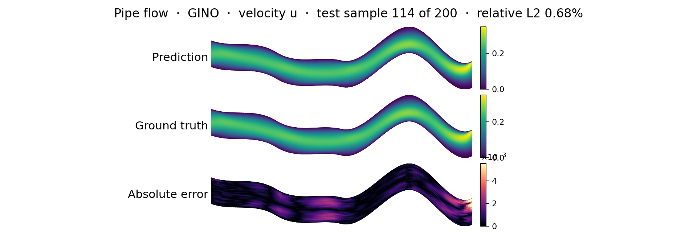
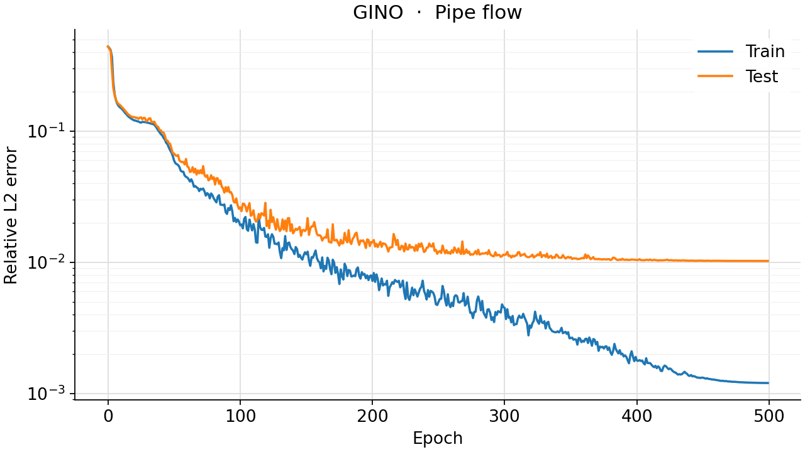
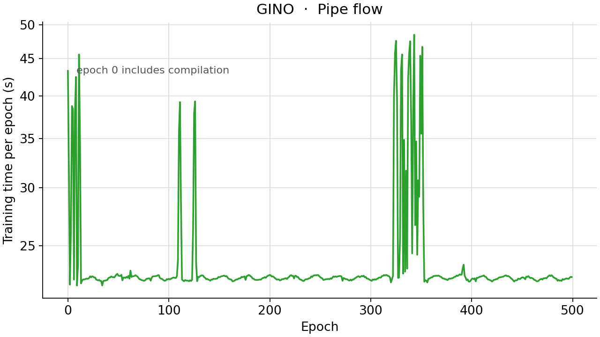

<!--
SPDX-FileCopyrightText: 2026 ZenteiQ AiTech Innovations Pvt. Ltd.
License notice: Documentation text and diagrams on this page are licensed
under CC BY 4.0. Source-code examples are licensed under LGPL-3.0-only
unless the example states otherwise.
-->

# Tutorial: Pipe Flow with GINO

In this tutorial you train a [Geometry-Informed Neural Operator](../../theory_guide/operator_learning.md#gino)
(GINO [[1]](#ref1)) on the **Pipe [[2]](#ref2)** benchmark: given the mesh of a pipe whose centreline is
bent differently in every sample, predict the steady horizontal velocity at
every mesh node. Unlike the FNO and WNO tutorials, GINO does not treat the
mesh as a rectangle in index space: it works on the physical positions of the
nodes, through a radius graph built for every sample. The whole tutorial is
one script, [`scripts/tutorials/pipe_gino.py`](../../../scripts/tutorials/pipe_gino.py). It uses only the public ScireX
API ([`scirex.models.GINO`](../../api/models.md#scirex.models.GINO), [`scirex.layers.build_neighbor_graph`](../../api/layers.md#scirex.layers.build_neighbor_graph),
[`scirex.layers.edge_index_to_neighbors`](../../api/layers.md#scirex.layers.edge_index_to_neighbors),
[`scirex.training.optim.scale_by_adam_cx`](../../api/training.md#scirex.training.optim.scale_by_adam_cx), [`scirex.utils.count_model_params`](../../api/utils.md#scirex.utils.count_model_params))
and plain NumPy, JAX and optax. The code on this page is copied from that
script.

## Summary

| | |
|---|---|
| Problem | Steady, incompressible flow through a deformed 2D pipe: mesh coordinates in, horizontal velocity out |
| Model | GINO, [`scirex.models.GINO`](../../api/models.md#scirex.models.GINO), one sample at a time. Benchmark size: GNO radius 0.05 in and out, FNO processor `fno_n_modes=(16, 16), fno_hidden_channels=48, fno_n_layers=4, fno_lifting_channel_ratio=4`, other settings at their defaults, 3,001,956 parameters. Smoke size: radius 0.1, `fno_n_modes=(8, 8), fno_hidden_channels=12, fno_n_layers=2, fno_lifting_channel_ratio=2`, GNO MLPs `(16, 16)` and `(32, 16)`, 38,160 parameters |
| Graphs | One radius graph per sample, mesh to mesh, at most 32 neighbours per node, used by both GNO layers. Benchmark: about 306,000 to 311,000 edges per sample. Smoke (65 × 65 nodes, radius 0.1): 76,185 to 79,027 |
| Data | Geo-FNO Pipe (`Pipe_X.npy`, `Pipe_Y.npy`, `Pipe_Q.npy`, about 1.5 GB), 2310 samples on a 129 × 129 mesh. Benchmark: first 1000 train / last 200 of the first 1200 test. Smoke: 32 train / 8 test, every second node |
| Optimiser | Complex-aware AdamW ([`scale_by_adam_cx`](../../api/training.md#scirex.training.optim.scale_by_adam_cx), the FNO processor has complex weights), eps 1e-8, weight decay 1e-5, gradient-norm clip 0.1, cosine one-cycle learning rate with peak 1e-3; the gradients of 8 samples are summed before each step |
| Metric | Relative L2 error per test sample, in physical units, averaged over the test samples |
| Full-run values | 1.024% best of seeds 0, 1 and 2 (the released checkpoint), 1.603% ± 0.972% mean ± sample std (seed 0 is about 2.6 times worse than seeds 1 and 2) |

## Setup

The setup is the same as in the [FNO tutorial](../Others/Pipe_FNO.md#setup).

### Data

`Pipe_Q.npy` must be the complete file, `(2310, 3, 129, 129)`. Some copies of
the release contain only `Pipe_Q_interp_x.npy`, an older interpolated target,
which is a different field. This tutorial and the benchmark both read
`Pipe_Q.npy` and fail if it is missing. For the smoke run you do not need to
copy anything: the script memory-maps the files and reads only the samples it
uses.

## The problem

The problem, the data and the metric are the same as in the [FNO tutorial](../Others/Pipe_FNO.md#the-problem).

The geometry is given as the coordinates of the 129 × 129 body-fitted mesh,
so the model is a map from the $(x, y)$ positions of the $N = 129^2$ nodes to
the horizontal velocity $u$ at those nodes,

$$
\mathcal G_\theta : \mathbf X \in \mathbb R^{N\times 2} \;\mapsto\; \hat u \in \mathbb R^{N}.
$$

The coordinates are standardised with one mean and one standard deviation per
channel, fitted on the training samples,
$\tilde{\mathbf X} = (\mathbf X - \boldsymbol\mu_X)/(\boldsymbol\sigma_X + 10^{-8})$,
and so is the velocity. The network predicts a standardised velocity, which
is decoded, $\hat u = \sigma_u \hat{\tilde u} + \mu_u$, before the loss.

The loss of a batch $B$ and the metric are the relative L2 error per sample in
physical units, over all $N = 129^2$ nodes:

$$
e_i = \frac{\lVert \hat u_i - u_i\rVert_2}{\lVert u_i\rVert_2}, \qquad
\mathcal L_B = \sum_{i\in B} e_i, \qquad
\text{metric} = \frac{1}{N_{\text{test}}}\sum_{i=1}^{N_{\text{test}}} e_i .
$$

**GINO in one paragraph.** GINO has three stages. A graph neural operator
(GNO) layer gathers the data at the input points onto a latent grid: for every
latent point it integrates a learned kernel over the input points within a
radius. An FNO processor then works on the latent grid, where FFTs are cheap.
A second GNO layer gathers the result back onto the output points. The kernels
are MLPs of the point coordinates, so the model works on any set of points.
Here the input and output points are the mesh nodes and the latent grid is
the sample's own mesh, so both GNO layers use the same radius graph. The
[theory guide](../../theory_guide/operator_learning.md#gino) has the details.

## Step-by-step walkthrough

The explanations of the steps that are the same for every model are in the [FNO tutorial](../Others/Pipe_FNO.md#step-by-step-walkthrough). This page keeps the code and the text that is specific to the model.

### 1. Setup

Imports, the seed, the training settings and the two model sizes. `PROTOCOL`
holds the benchmark's training settings (the same values as in
[`scripts/benchmarks/pipe/_config.py`](../../../scripts/benchmarks/pipe/_config.py), which every model on this benchmark
shares): 500 epochs, batch size 8, AdamW with a peak learning rate of 1e-3, a
one-cycle schedule, weight decay 1e-5 and a gradient-norm clip of 0.1.
`SIZES["full"]` is the benchmark's GINO; `SIZES["smoke"]` is small enough for
a CPU.

<!-- tutorial-snippet -->
```python
from __future__ import annotations

import argparse
import os
import platform
from pathlib import Path
from time import perf_counter

import flax
import jax
import jax.numpy as jnp
import matplotlib
import matplotlib.pyplot as plt
import numpy as np
import optax

import scirex
from scirex.layers import build_neighbor_graph, edge_index_to_neighbors
from scirex.models import GINO
from scirex.training.optim import scale_by_adam_cx
from scirex.utils import count_model_params

matplotlib.use("Agg")  # write figures to files, no display needed
# Keep float32, also if float64 was enabled earlier in the process.
jax.config.update("jax_enable_x64", False)
```

<!-- tutorial-snippet -->
```python
SEED = 0

# Training settings of the Pipe benchmark, the same values as PROTOCOL in
# scripts/benchmarks/pipe/_config.py (Transolver's recipe, used by every model).
PROTOCOL = dict(
    ntrain=1000,
    ntest=200,
    n_total=1200,
    epochs=500,
    batch_size=8,
    learning_rate=1e-3,
    weight_decay=1e-5,
    adam_eps=1e-8,
    pct_start=0.3,
    div_factor=25.0,
    final_div_factor=1e4,
    max_grad_norm=0.1,
)

# Model sizes. "full" is the benchmark's GINO (3,001,956 parameters, matched
# to Transolver's 3,073,985); every other setting is GINO's default. "smoke"
# is a tiny GINO that trains on a CPU: smaller FNO and GNO MLPs. The smoke run
# also keeps only every second mesh node (``--stride 2``), so its radius is
# doubled to keep about as many neighbours per node.
SIZES = dict(
    full=dict(
        in_gno_radius=0.05,
        out_gno_radius=0.05,
        fno_n_modes=(16, 16),
        fno_hidden_channels=48,
        fno_n_layers=4,
        fno_lifting_channel_ratio=4,
    ),
    smoke=dict(
        in_gno_radius=0.1,
        out_gno_radius=0.1,
        fno_n_modes=(8, 8),
        fno_hidden_channels=12,
        fno_n_layers=2,
        fno_lifting_channel_ratio=2,
        in_gno_channel_mlp_hidden_layers=(16, 16),
        out_gno_channel_mlp_hidden_layers=(32, 16),
    ),
)

# Neighbour graphs keep at most the 32 nearest neighbours of every node within
# the radius, as in the benchmark.
MAX_NUM_NEIGHBORS = 32
```

<!-- tutorial-snippet -->
```python
def print_environment(seed: int) -> None:
    """Print the versions, the devices and the seed, so a run can be repeated."""
    print(f"python {platform.python_version()} | numpy {np.__version__}")
    print(f"scirex {scirex.__version__}")
    print(
        f"jax {jax.__version__} | flax {flax.__version__} | optax {optax.__version__}"
    )
    print(f"devices: {jax.devices()}")
    print(f"SEED = {seed}")
```

### 2. Load the data

`load_pipe` memory-maps the three files and reads only the training and test
samples: the first `ntrain` of the file for training, the last `ntest` of the
first `n_total` for testing, as in the benchmark. The coordinates come back as
`(n, H, W, 2)` and the target, channel 0 of `Pipe_Q.npy`, as `(n, H, W)`.
`stride` keeps every `stride`-th node along both mesh axes. A GINO step costs
about the number of graph edges, so the smoke run keeps every second node
(65 × 65) and doubles the radius to 0.1, which keeps about as many neighbours
per node; the full mode uses every node, as the benchmark does.

<!-- tutorial-snippet -->
```python
def load_pipe(
    data_dir: Path, ntrain: int, ntest: int, n_total: int = 1200, stride: int = 1
) -> dict:
    """Read the split. Coordinates ``(n, H, W, 2)``, velocity ``(n, H, W)``."""
    data_dir = Path(data_dir)
    xs = np.load(data_dir / "Pipe_X.npy", mmap_mode="r")
    ys = np.load(data_dir / "Pipe_Y.npy", mmap_mode="r")
    q = np.load(data_dir / "Pipe_Q.npy", mmap_mode="r")
    if q.shape[0] < n_total or ntrain + ntest > n_total:
        raise ValueError(f"need {ntrain} + {ntest} <= {n_total} <= {q.shape[0]}")
    split = dict(train=np.arange(ntrain), test=np.arange(n_total - ntest, n_total))
    out = {}
    for name, idx in split.items():
        coords = np.stack(
            [xs[idx][:, ::stride, ::stride], ys[idx][:, ::stride, ::stride]], axis=-1
        )
        out[f"x_{name}"] = coords.astype(np.float32)
        out[f"y_{name}"] = np.asarray(q[idx, 0][:, ::stride, ::stride], np.float32)
    print(
        f"samples: {ntrain} train / {ntest} test | mesh {out['x_train'].shape[1:3]} | "
        f"velocity range [{out['y_train'].min():.3f}, {out['y_train'].max():.3f}]"
    )
    return out
```

### 3. Normalise

<!-- tutorial-snippet -->
```python
class UnitGaussian:
    """``(v - mean) / (std + 1e-8)`` with one mean and std per channel."""

    def __init__(self, train: np.ndarray, axes: tuple[int, ...]) -> None:
        self.mean = train.mean(axis=axes, keepdims=True)[0]
        self.std = train.std(axis=axes, keepdims=True)[0] + 1e-8

    def encode(self, v):
        return (v - self.mean) / self.std

    def decode(self, v):
        return v * self.std + self.mean
```

### 4. Build the neighbour graphs

[`build_neighbor_graph(pos, pos, radius, "radius", ...)`](../../api/layers.md#scirex.layers.build_neighbor_graph) returns the edges from
every node to the nodes within `radius`, keeping the 32 nearest. All graphs
are padded to the length of the largest, so that every sample has the same
array shapes and the training step compiles once; padding edges point one
past the last node and are ignored. [`edge_index_to_neighbors`](../../api/layers.md#scirex.layers.edge_index_to_neighbors) turns an edge
list into the arrays the GNO layers use: the neighbour index of every edge,
its query node and the number of neighbours of every node. The graphs are
built once, before training. The radius applies to the normalised
coordinates, so the number of edges depends on the training samples the
normaliser was fitted on.

<!-- tutorial-snippet -->
```python
def build_graphs(coords: np.ndarray, radius: float) -> list[dict]:
    """One radius graph per sample of ``(n, N, 2)`` coordinates, all of one length."""
    edges = [
        build_neighbor_graph(
            pos, pos, radius, "radius", max_num_neighbors=MAX_NUM_NEIGHBORS
        )
        for pos in coords
    ]
    max_edges = max(e.shape[1] for e in edges)
    graphs = []
    for pos, e in zip(coords, edges):
        padded = np.full((2, max_edges), len(pos), dtype=np.int32)
        padded[:, : e.shape[1]] = e
        nbrs = edge_index_to_neighbors(jnp.asarray(padded), num_query=len(pos))
        graphs.append({k: np.asarray(v) for k, v in nbrs.items()})
    return graphs
```

### 5. Build the model

[`GINO`](../../api/models.md#scirex.models.GINO) is a Flax module: the parameters are a separate pytree, created by
`init` and used by `apply`. `model_inputs` builds its keyword arguments for
one sample: the node coordinates as the input geometry and as the output
queries, the sample's own mesh as the latent grid of the FNO processor, a
constant node feature (the geometry enters only through the coordinates) and
the graph for both GNO layers. `gno_coord_dim=2` because the coordinates are
2D. [`count_model_params`](../../api/utils.md#scirex.utils.count_model_params) counts each complex weight of the FNO processor as
two real numbers.

<!-- tutorial-snippet -->
```python
def build_model(size: dict, pos: np.ndarray, graph: dict, grid, seed: int):
    """Build the GINO, initialise it on one sample and print the parameter count."""
    model = GINO(in_channels=1, out_channels=1, gno_coord_dim=2, **size)
    params = model.init(jax.random.PRNGKey(seed), **model_inputs(pos, graph, grid))
    print(f"GINO {size} | parameters: {count_model_params(params):,}")
    return model, params
```

<!-- tutorial-snippet -->
```python
def model_inputs(pos, graph: dict, grid) -> dict:
    """GINO's keyword arguments for one sample with ``N`` nodes at ``pos``."""
    pos = jnp.asarray(pos)[None]  # (1, N, 2)
    nbrs = {k: jnp.asarray(v) for k, v in graph.items()}
    return dict(
        input_geom=pos,
        latent_queries=pos.reshape(1, *grid, 2),
        output_queries=pos,
        x=jnp.ones((1, pos.shape[1], 1), dtype=jnp.float32),
        neighbors_in=nbrs,
        neighbors_out=nbrs,
    )
```

### 6. Loss

The loss from [The problem](#the-problem) for one sample: the relative L2
error on the decoded velocity. The loss of a batch is the sum over its
samples.

<!-- tutorial-snippet -->
```python
def rel_l2_per_sample(pred, true):
    """``||pred - true|| / ||true||`` per sample, over all nodes."""
    b = pred.shape[0]
    diff = jnp.linalg.norm(pred.reshape(b, -1) - true.reshape(b, -1), axis=1)
    return diff / jnp.linalg.norm(true.reshape(b, -1), axis=1)
```

<!-- tutorial-snippet -->
```python
def make_loss(model, y_norm: UnitGaussian, grid):
    """Return ``loss_fn(params, inputs, y) -> relative L2`` of one sample."""

    def loss_fn(params, inputs, y):
        out = model.apply(params, **inputs)[0, :, 0].reshape(grid)  # (H, W)
        return jnp.sum(rel_l2_per_sample(y_norm.decode(out)[None], y[None]))

    return loss_fn
```

### 7. Optimiser for complex weights

The FNO processor inside GINO has complex spectral weights. For a real loss
$L$ and a complex weight $w$, `jax.grad` returns $\partial L/\partial w$, the
complex conjugate of the steepest-ascent direction that optax transforms
assume, so plain `optax.adamw` moves the imaginary part of every spectral
weight the wrong way. [`scale_by_adam_cx`](../../api/training.md#scirex.training.optim.scale_by_adam_cx) conjugates complex gradients first
and keeps Adam's second moment real; real weights, which are most of GINO's,
are updated exactly as by AdamW. The [FNO tutorial](../Others/Pipe_FNO.md#6-optimiser-for-complex-weights)
shows the effect on this data. `optimizer="adamw"` swaps in optax's own Adam
scaling for comparison.

<!-- tutorial-snippet -->
```python
def make_optimizer(protocol: dict, total_steps: int, optimizer: str = "adamw_cx"):
    """AdamW on a cosine one-cycle schedule, after gradient clipping.

    ``"adamw_cx"`` (the benchmark's) is complex-aware; ``"adamw"`` is plain optax.
    """
    scale_by_adam = dict(
        adamw_cx=scale_by_adam_cx(eps=protocol["adam_eps"]),
        adamw=optax.scale_by_adam(eps=protocol["adam_eps"]),
    )[optimizer]
    schedule = optax.cosine_onecycle_schedule(
        transition_steps=total_steps,
        peak_value=protocol["learning_rate"],
        pct_start=protocol["pct_start"],
        div_factor=protocol["div_factor"],
        final_div_factor=protocol["final_div_factor"],
    )
    tx = optax.chain(
        optax.clip_by_global_norm(protocol["max_grad_norm"]),
        scale_by_adam,
        optax.add_decayed_weights(protocol["weight_decay"]),
        optax.scale_by_learning_rate(schedule),
    )
    return tx, schedule
```

### 8. Train

GINO takes one sample at a time, because every sample has its own graph. The
benchmark's recipe is one optimiser step per batch of 8, and the loss of a
batch is a sum over its samples, so its gradient is the sum of the samples'
gradients: `train` adds the gradients of 8 samples and then takes one step,
125 steps per epoch on the full split, like every other model. After every
epoch the test samples are scored, to draw the error curve. There is no
validation split, so no epoch is selected by its test error: the weights
after the last epoch are the result, as in the benchmark.

<!-- tutorial-snippet -->
```python
def train(
    model, params, data, y_norm, epochs, seed, protocol=PROTOCOL, optimizer="adamw_cx"
):
    """Train for ``epochs`` epochs. Return the final parameters and the history."""
    grid = data["grid"]
    bs = protocol["batch_size"]
    ntrain = len(data["y_train"])
    tx, _ = make_optimizer(protocol, -(-ntrain // bs) * epochs, optimizer)
    opt_state = tx.init(params)
    loss_fn = make_loss(model, y_norm, grid)
    grad_step = jax.jit(jax.value_and_grad(loss_fn))
    add_grads = jax.jit(lambda a, b: jax.tree_util.tree_map(jnp.add, a, b))
    eval_step = jax.jit(loss_fn)

    @jax.jit
    def apply_grads(params, opt_state, grads):
        updates, opt_state = tx.update(grads, opt_state, params)
        return optax.apply_updates(params, updates), opt_state

    def inputs(split, i):
        return model_inputs(data[f"pos_{split}"][i], data[f"graph_{split}"][i], grid)

    rng = np.random.default_rng(seed)
    history = []
    for epoch in range(epochs):
        t0 = perf_counter()
        order = rng.permutation(ntrain)
        train_total = 0.0
        for start in range(0, ntrain, bs):
            grads = None
            for i in order[start : start + bs]:
                loss, g = grad_step(
                    params, inputs("train", i), jnp.asarray(data["y_train"][i])
                )
                grads = g if grads is None else add_grads(grads, g)
                train_total += float(loss)
            params, opt_state = apply_grads(params, opt_state, grads)
        secs = perf_counter() - t0
        test_total = sum(
            float(eval_step(params, inputs("test", i), jnp.asarray(y)))
            for i, y in enumerate(data["y_test"])
        )
        history.append(
            dict(
                epoch=epoch,
                train_rel_l2=train_total / ntrain,
                test_rel_l2=test_total / len(data["y_test"]),
                secs=secs,
            )
        )
        print(
            f"epoch {epoch}: train_rel_l2={history[-1]['train_rel_l2']:.4f} "
            f"test_rel_l2={history[-1]['test_rel_l2']:.4f} epoch_time={secs:.1f}s"
        )
    return params, history
```

### 9. Evaluate

<!-- tutorial-snippet -->
```python
def evaluate(model, params, data, y_norm) -> dict:
    """Per-sample relative L2 on the test samples, and the predictions."""
    grid = data["grid"]
    predict = jax.jit(
        lambda p, inputs: y_norm.decode(model.apply(p, **inputs)[0, :, 0].reshape(grid))
    )
    preds = np.stack(
        [
            np.asarray(predict(params, model_inputs(pos, graph, grid)))
            for pos, graph in zip(data["pos_test"], data["graph_test"])
        ]
    )
    errors = np.asarray(
        rel_l2_per_sample(jnp.asarray(preds), jnp.asarray(data["y_test"]))
    )
    return dict(
        test_rel_l2=float(errors.mean()),
        median=float(np.median(errors)),
        p90=float(np.percentile(errors, 90)),
        worst=float(errors.max()),
        errors=errors,
        predictions=preds,
    )
```

### 10. Plot

<!-- tutorial-snippet -->
```python
def plot_prediction(coords, truth, pred, path: Path, title: str) -> None:
    """Save input, true velocity, predicted velocity and absolute error."""
    xx, yy = coords[..., 0], coords[..., 1]
    lim = (float(truth.min()), float(truth.max()))
    panels = [
        ("Input: y coordinate of the mesh", yy, "coolwarm", None),
        ("Truth: horizontal velocity", truth, "jet", lim),
        ("Prediction: horizontal velocity", pred, "jet", lim),
        ("Absolute error", np.abs(pred - truth), "magma", None),
    ]
    fig, axes = plt.subplots(4, 1, figsize=(10, 9), constrained_layout=True)
    for ax, (name, values, cmap, vlim) in zip(axes, panels):
        vmin, vmax = vlim if vlim else (None, None)
        mesh = ax.pcolormesh(
            xx, yy, values, cmap=cmap, vmin=vmin, vmax=vmax, shading="gouraud"
        )
        ax.set_title(name)
        ax.set_aspect("equal")
        ax.set_xlabel("x")
        ax.set_ylabel("y")
        fig.colorbar(mesh, ax=ax, shrink=0.8)
    fig.suptitle(title)
    fig.savefig(path, dpi=120)
    plt.close(fig)
```

<!-- tutorial-snippet -->
```python
def plot_loss(history: list[dict], path: Path) -> None:
    """Save the training and test relative L2 per epoch."""
    epochs = [h["epoch"] for h in history]
    fig, ax = plt.subplots(figsize=(6, 4))
    ax.plot(epochs, [h["train_rel_l2"] for h in history], marker="o", label="train")
    ax.plot(epochs, [h["test_rel_l2"] for h in history], marker="o", label="test")
    ax.set_xlabel("epoch")
    ax.set_ylabel("relative L2 (mean over samples)")
    ax.set_yscale("log")
    ax.legend()
    ax.grid(True, alpha=0.3)
    fig.savefig(path, dpi=120, bbox_inches="tight")
    plt.close(fig)
```

The complete script is [`scripts/tutorials/pipe_gino.py`](../../../scripts/tutorials/pipe_gino.py).

## Run it

Smoke run (CPU, about half a minute, no GPU needed):

```bash
CUDA_VISIBLE_DEVICES= JAX_PLATFORMS=cpu python scripts/tutorials/pipe_gino.py --data-dir ~/data/pipe --smoke
```

Full protocol (1000 training samples on every node, benchmark-size GINO, 500
epochs; use a GPU):

```bash
python scripts/tutorials/pipe_gino.py --data-dir ~/data/pipe
```

The other flags are `--epochs`, `--seed`, `--out-dir` (default
`outputs/pipe_gino_tutorial`), `--optimizer` ([`adamw_cx`](../../api/training.md#scirex.training.adamw_cx), the default, or
`adamw`), `--stride` (default 2 with `--smoke`, otherwise 1) and, for the
smoke run, `--n-train` and `--n-test`.

This is the output of the smoke run on a CPU (smoke run, CPU, 32 train / 8
test samples, not a benchmark number). The wall time was 31.4 s, measured with
`time`; library deprecation warnings are left out:

```text
python 3.12.3 | numpy 1.26.4
scirex 1.0.0rc1
jax 0.6.2 | flax 0.10.7 | optax 0.2.8
devices: [CpuDevice(id=0)]
SEED = 0
samples: 32 train / 8 test | mesh (65, 65) | velocity range [-0.499, 0.358]
data loading: 0.0s
graphs: 1.6s | edges per sample: min 76,185, max 79,027 | padded to 79,027
GINO {'in_gno_radius': 0.1, 'out_gno_radius': 0.1, 'fno_n_modes': (8, 8), 'fno_hidden_channels': 12, 'fno_n_layers': 2, 'fno_lifting_channel_ratio': 2, 'in_gno_channel_mlp_hidden_layers': (16, 16), 'out_gno_channel_mlp_hidden_layers': (32, 16)} | parameters: 38,160
epoch 0: train_rel_l2=0.4734 test_rel_l2=0.4673 epoch_time=5.6s
epoch 1: train_rel_l2=0.4618 test_rel_l2=0.4527 epoch_time=4.0s
epoch 2: train_rel_l2=0.4516 test_rel_l2=0.4492 epoch_time=2.9s
epoch 3: train_rel_l2=0.4497 test_rel_l2=0.4487 epoch_time=3.1s
epoch 4: train_rel_l2=0.4494 test_rel_l2=0.4486 epoch_time=3.1s
test relative L2: mean 0.4486 | median 0.4448 | p90 0.4679 | worst 0.4690
figures in outputs/pipe_gino_tutorial | total time 30.1s
```

## Results

### Full run

The next figures were not made by this script. They come from the benchmark
runner (`train.py` and `infer.py`) and are the committed results of the **full
500-epoch runs** (1000 training and 200 test samples on all 129 × 129 nodes,
benchmark-size GINO, one NVIDIA RTX PRO 6000 Blackwell). `infer.py` draws one
test sample (the figure title names it and its relative L2 error): ground
truth, prediction and absolute error.



Training loss and test relative L2 per epoch of seed 0:



Seconds per epoch of the same run (the first epoch includes compilation; in
`metrics.json`, the first epoch took 32.1 s and the median epoch 22.7 s):



| Relative L2 over the 200 test samples, last epoch | Mean | Median | 90th percentile | Worst |
|---|---|---|---|---|
| Seed 0 | 2.725% | 2.438% | 4.469% | 10.81% |
| **Seed 1 (best)** | **1.024%** | **0.672%** | **1.801%** | **6.88%** |
| Seed 2 | 1.061% | 0.788% | 1.506% | 7.21% |
| Mean ± std over seeds | 1.603% ± 0.972% | | | |

| Model, same data, recipe and seeds | Parameters | Best of 3 seeds | Mean ± std (3 seeds) | Training time per seed |
|---|---|---|---|---|
| [Transolver](../../benchmarks/pipe/results/comparative.md#transolver) [[3]](#ref3) | 3,073,985 | 0.424% | 0.460% ± 0.031% | ~2 h |
| [WNO](../../benchmarks/pipe/results/comparative.md#wno) | 3,102,157 | 0.529% | 0.541% ± 0.012% | ~11 min |
| [FNO](../../benchmarks/pipe/results/comparative.md#fno) | 2,999,629 | 0.934% | 0.960% ± 0.023% | ~19 min |
| **GINO (this tutorial)** | 3,001,956 | **1.024%** | 1.603% ± 0.972% | ~3.2 h |
| [Transolver, tuned recipe (released checkpoint)](../../benchmarks/pipe/results/comparative.md#tuned-recipe) | 3,073,985 | **0.386%** | 0.406% ± 0.034% | ~2-3.5 h |

## Troubleshooting

- **`FileNotFoundError: ... Pipe_Q.npy`.** `--data-dir` does not hold the
  three files, or your copy of the release has only `Pipe_Q_interp_x.npy`.
  That file is a different target and is not a substitute; get `Pipe_Q.npy`.
- **`ValueError: need ... <= ...`.** You asked for more samples than the split
  allows: `--n-train` plus `--n-test` must not exceed 1200.
- **The script is slow even with `--smoke`.** A GINO step costs about the
  number of graph edges. Keep `--stride 2` (the smoke default) on a CPU. The
  smoke radius, 0.1, is set for every second node: with `--smoke --stride 1`
  it applies to all 129 × 129 nodes, the graphs grow to about 532,000 edges
  and the default smoke run took 116 s instead of 31 s. For all nodes use the
  benchmark's radius, 0.05, in `SIZES["smoke"]`.

## Next steps

- Compare with the other architectures on the same data:
  [Transolver](../../benchmarks/pipe/results/comparative.md#transolver),
  [WNO](../../benchmarks/pipe/results/comparative.md#wno), [FNO](../../benchmarks/pipe/results/comparative.md#fno) and the
  [comparison page](../../benchmarks/pipe/results/comparative.md). The
  [FNO tutorial](../Others/Pipe_FNO.md) shows the optimiser for complex weights in
  detail.
- Read the [Pipe Flow results](../../benchmarks/pipe/results/comparative.md#gino) for the per-seed
  results, the seed-to-seed spread and the compute cost, and the
  [dataset guide](../../dataset_guide/pipe.md) for the files.
- Learn how GINO works in the [theory guide](../../theory_guide/operator_learning.md#gino) and see
  its arguments in the [API reference](../../api/models.md); the graph functions
  are in the [layers API](../../api/layers.md).
- See the [quickstart](../../user_guide/quickstart.md) and the
  [training guide](../../user_guide/training.md) for the [`Trainer`](../../api/experimental.md#scirex.experimental.training.Trainer).
- Try GINO where it has no grid to compete with: [AirfRANS](../../benchmarks/airfrans/results/comparative.md#gino),
  [ShapeNetCar](../../benchmarks/shapenetcar/results/comparative.md#gino) or
  [Car-CFD](../../benchmarks/car_cfd/results/comparative.md#gino).

## References

1. <span id="ref1"></span>Li et al., *Geometry-Informed Neural Operator for Large-Scale 3D PDEs*, NeurIPS 2023. <https://arxiv.org/abs/2309.00583>

2. <span id="ref2"></span>Li et al., *Fourier Neural Operator with Learned Deformations for PDEs on General Geometries* (Geo-FNO), Journal of Machine Learning Research 24(388), 2023. <https://arxiv.org/abs/2207.05209>

3. <span id="ref3"></span>Wu et al., *Transolver: A Fast Transformer Solver for PDEs on General Geometries*, ICML 2024. <https://arxiv.org/abs/2402.02366>
