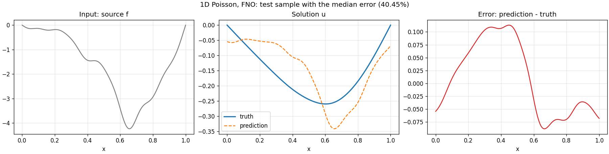
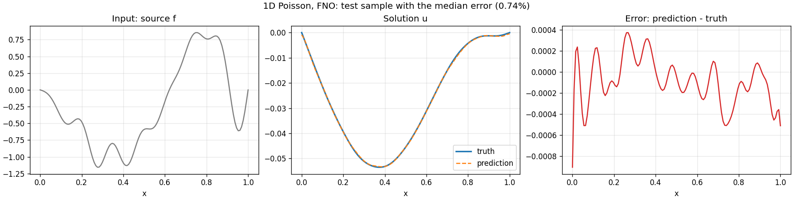
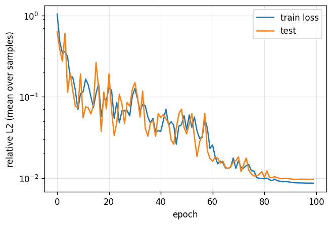

<!--
SPDX-FileCopyrightText: 2026 ZenteiQ AiTech Innovations Pvt. Ltd.
License notice: Documentation text and diagrams on this page are licensed
under CC BY 4.0. Source-code examples are licensed under LGPL-3.0-only
unless the example states otherwise.
-->

# Worked example: 1D Poisson with FNO

This is the worked example of [Add a new example](Overview.md). It trains a
[Fourier Neural Operator](../../theory_guide/operator_learning.md#fno) (FNO) to solve the **1D
Poisson equation**: given a source term $f$ on the unit interval, predict the
solution $u$. Every source is a random sine series, so the exact solution is
known in closed form and the data are generated in a fraction of a second,
with nothing to download. The whole example is one script,
[`scripts/tutorials/poisson1d_fno.py`](../../../scripts/tutorials/poisson1d_fno.py), and its tests are
[`tests/docs/test_tutorial_poisson1d_fno.py`](../../../tests/docs/test_tutorial_poisson1d_fno.py). The script uses only the public
ScireX API ([`scirex.models.FNO`](../../api/models.md#scirex.models.FNO), [`scirex.training.adamw_cx`](../../api/training.md#scirex.training.adamw_cx),
[`scirex.utils.count_model_params`](../../api/utils.md#scirex.utils.count_model_params)) and plain JAX and optax for the training
loop. The code on this page is copied from that script.

The example has every piece the guide asks of a new example, in small form:

| Piece the guide asks for | Where it is in this example |
|---|---|
| Data loader ([Add a problem](Add_a_Problem.md)) | `poisson1d_dataset` and `load_data` |
| Config with checked keys | `DEFAULT_CONFIG` and `make_config` |
| Model | [`scirex.models.FNO`](../../api/models.md#scirex.models.FNO), built by `build_model` |
| `train.py` | `train`, then `save_run` |
| `infer.py` | `load_run`, then `evaluate` (the `--infer` flag) |
| Required tests ([Required tests](Required_Tests.md)) | [`tests/docs/test_tutorial_poisson1d_fno.py`](../../../tests/docs/test_tutorial_poisson1d_fno.py) |

## What you will learn

1. How to generate a dataset with an exact solution, so the error of the
   model is the only error.
2. How to keep every setting in one config whose keys are checked, so a
   typo fails instead of being ignored.
3. How to build [`scirex.models.FNO`](../../api/models.md#scirex.models.FNO) for a 1D field and train it with the
   complex-aware AdamW [`scirex.training.adamw_cx`](../../api/training.md#scirex.training.adamw_cx).
4. How to save a checkpoint, load it again and evaluate it, the way a
   benchmark's `train.py` and `infer.py` split the work.

!!! note "A teaching example, not a benchmark"
    1D Poisson with smooth sources is an easy problem. The example is here to
    show the structure of a new example and to run in CI in seconds. Its
    error is not a result to compare models with.

## At a glance

| | |
|---|---|
| Problem | $-u''(x) = f(x)$ on $(0, 1)$, $u(0) = u(1) = 0$: source in, solution out |
| Model | FNO, [`scirex.models.FNO`](../../api/models.md#scirex.models.FNO), `n_modes=(16,)`, `hidden_channels=32`, `n_layers=4`, the FNO's default x-coordinate channel, 86,817 parameters. The smoke run uses the same model |
| Data | Generated by the script: 1000 training and 200 test sources on 128 grid points, from different seeds. Smoke: 200 / 50 |
| Recipe | [`adamw_cx`](../../api/training.md#scirex.training.adamw_cx), learning rate 3e-3 with a cosine decay to zero, weight decay 1e-4, batch size 50, 100 epochs (2,000 steps), seed 0. Smoke: 10 epochs |
| Normalisation | none; the loss is relative, so the scale of $u$ does not matter |
| Hardware | CPU only (`CUDA_VISIBLE_DEVICES=` and `JAX_PLATFORMS=cpu`, AMD Ryzen Threadripper 7960X, 48 logical cores, shared with other jobs). No GPU used |
| Runtime, smoke | 6 s wall time for the whole script (measured) |
| Runtime, full | 72 s wall time for the whole script (measured) |
| Metric | Relative L2 error per test sample, averaged over the test samples |
| Full-run value | 0.0096 (0.96 %), median 0.0073, worst 0.0438 |
| Smoke-run value | 0.4371 (10 epochs on 200 samples; it checks that the pipeline works) |
| Versions | Python 3.12.3, scirex from this repository (version 1.0.0rc1 in `pyproject.toml`), jax 0.6.2, flax 0.10.7, optax 0.2.8, numpy 1.26.4, matplotlib 3.9.4 |

## Prerequisites and install

Install ScireX from the repository root, as for every tutorial:

```bash
pip install -e ".[dev]"
```

The example needs nothing beyond ScireX's own dependencies: JAX, Flax, optax,
NumPy and Matplotlib. It runs on a CPU.

## The problem

Find $u$ on $[0, 1]$ with

$$
-u''(x) = f(x), \qquad u(0) = u(1) = 0 .
$$

The operator to learn maps $f$ to $u$. It is linear, and in the sine basis it
is diagonal: since $-(\sin k\pi x)'' = (k\pi)^2 \sin k\pi x$, a source

$$
f(x) = \sum_{k=1}^{K} c_k \sin(k\pi x)
\quad\text{has the solution}\quad
u(x) = \sum_{k=1}^{K} \frac{c_k}{(k\pi)^2} \sin(k\pi x).
$$

A Fourier layer multiplies the low Fourier modes of its input by learned
weights, which is close to what this operator does, so the FNO has an easy
time here. That is the point: the example is about the structure, not about
a hard problem.

## Get the data

There is nothing to download. `poisson1d_dataset` draws $c_k \sim
\mathcal{N}(0, 1)/k$ for $k = 1, \dots, 16$, so high frequencies are weaker,
and evaluates $f$ and the exact $u$ on 128 evenly spaced points, both ends
included. The training sources use the seed, the test sources the seed plus
one, so the two sets differ.

## Step-by-step walkthrough

### 1. The config

Every setting is in one dictionary. `make_config` returns it with some keys
overridden and refuses a key it does not know, so `--set epoch=10` (a typo
for `epochs`) fails with the list of allowed keys instead of training with
the default.

<!-- tutorial-snippet -->
```python
DEFAULT_CONFIG = dict(
    # problem
    n_points=128,  # grid points on [0, 1], both ends included
    n_terms=16,  # sine terms in every source f
    n_train=1000,
    n_test=200,
    # model
    modes=16,
    hidden_channels=32,
    n_layers=4,
    # training recipe
    learning_rate=3e-3,
    weight_decay=1e-4,
    batch_size=50,
    epochs=100,
)

# The --smoke run: fewer samples and epochs, the same model.
SMOKE = dict(n_train=200, n_test=50, epochs=10)


def make_config(**overrides) -> dict:
    """``DEFAULT_CONFIG`` with ``overrides`` applied. Unknown keys are an error."""
    unknown = sorted(set(overrides) - set(DEFAULT_CONFIG))
    if unknown:
        raise ValueError(
            f"unknown config key(s) {unknown}; allowed keys: {sorted(DEFAULT_CONFIG)}"
        )
    return {**DEFAULT_CONFIG, **overrides}
```

The script also prints its environment, so a run can be repeated:

<!-- tutorial-snippet -->
```python
def print_environment(seed: int) -> None:
    """Print the versions, the devices and the seed, so a run can be repeated."""
    print(f"python {platform.python_version()} | numpy {np.__version__}")
    print(f"scirex {scirex.__version__}")
```

### 2. The data loader

`poisson1d_dataset` is the whole data pipeline. It returns channels-first
arrays, `(n_samples, 1, n_points)`, which is the layout [`FNO`](../../api/models.md#scirex.models.FNO) expects.

<!-- tutorial-snippet -->
```python
def poisson1d_dataset(n_samples: int, n_points: int, n_terms: int, seed: int) -> dict:
    """Sources ``f`` and exact solutions ``u``, each ``(n_samples, 1, n_points)``."""
    rng = np.random.default_rng(seed)
    x = np.linspace(0.0, 1.0, n_points)
    k = np.arange(1, n_terms + 1)
    c = rng.normal(size=(n_samples, n_terms)) / k
    basis = np.sin(np.pi * k[:, None] * x[None, :])  # (n_terms, n_points)
    f = c @ basis
    u = (c / (np.pi * k) ** 2) @ basis
```

`load_data` builds the split from the config:

<!-- tutorial-snippet -->
```python
def load_data(config: dict, seed: int) -> dict:
    """The train and test split of the example."""
    train = poisson1d_dataset(
        config["n_train"], config["n_points"], config["n_terms"], seed
    )
    test = poisson1d_dataset(
        config["n_test"], config["n_points"], config["n_terms"], seed + 1
    )
```

### 3. The model

The length of `n_modes` sets the dimension, so `n_modes=(16,)` is a 1D FNO.
The FNO appends the x coordinate as one more input channel by default.
[`count_model_params`](../../api/utils.md#scirex.utils.count_model_params) counts a complex weight as two real parameters.

<!-- tutorial-snippet -->
```python
def build_model(config: dict, seed: int):
    """Build the FNO, initialise it and print the parameter count."""
    model = FNO(
        in_channels=1,
        out_channels=1,
        hidden_channels=config["hidden_channels"],
        n_modes=(config["modes"],),
        n_layers=config["n_layers"],
    )
    key, init_key = jax.random.split(jax.random.PRNGKey(seed))
    sample = jnp.zeros((1, 1, config["n_points"]), jnp.float32)
    params = model.init(init_key, sample)
    print(f"FNO 1D | parameters: {count_model_params(params):,}")
    return model, params, key
```

[`FNO`](../../api/models.md#scirex.models.FNO) refuses a constructor argument it does not declare, so a misspelt model
key in a config fails here with a `TypeError`.

### 4. The loss

The relative L2 error of each sample, averaged over the batch. It does not
depend on the scale of $u$, so the targets need no normalisation.

<!-- tutorial-snippet -->
```python
def rel_l2_per_sample(pred, true):
    """``||pred - true|| / ||true||`` per sample, over all grid points."""
    b = pred.shape[0]
    diff = jnp.linalg.norm(pred.reshape(b, -1) - true.reshape(b, -1), axis=1)
    return diff / jnp.maximum(jnp.linalg.norm(true.reshape(b, -1), axis=1), 1e-12)


def make_loss(model):
    """Return ``loss_fn(params, f, u) -> mean relative L2``."""

    def loss_fn(params, f, u):
        return jnp.mean(rel_l2_per_sample(model.apply(params, f), u))

    return loss_fn
```

### 5. The optimiser

FNO's spectral weights are complex. [`adamw_cx`](../../api/training.md#scirex.training.adamw_cx) is AdamW that handles complex
gradients correctly; for real weights it is plain AdamW.

<!-- tutorial-snippet -->
```python
def make_optimizer(config: dict, steps_per_epoch: int):
    """``adamw_cx`` on a cosine learning-rate decay."""
    schedule = optax.cosine_decay_schedule(
        init_value=config["learning_rate"],
        decay_steps=steps_per_epoch * config["epochs"],
    )
    return optax.inject_hyperparams(adamw_cx, hyperparam_dtype=jnp.float32)(
        learning_rate=schedule, weight_decay=config["weight_decay"]
    )
```

### 6. Training

One jitted step per batch, a new random order every epoch, and the test
error after every epoch for the loss curve. `predict` is compiled once here
and passed to `evaluate`.

<!-- tutorial-snippet -->
```python
def train(model, params, key, data, config):
    """Train for ``config["epochs"]`` epochs. Return the parameters and the history."""
    f_train, u_train = jnp.asarray(data["f_train"]), jnp.asarray(data["u_train"])
    bs = config["batch_size"]
    n_train = f_train.shape[0]
    steps_per_epoch = max(n_train // bs, 1)
    tx = make_optimizer(config, steps_per_epoch)
    opt_state = tx.init(params)
    loss_fn = make_loss(model)
    predict = jax.jit(model.apply)  # compiled once, reused every epoch

    @jax.jit
    def train_step(params, opt_state, f, u):
        loss, grads = jax.value_and_grad(loss_fn)(params, f, u)
        updates, opt_state = tx.update(grads, opt_state, params)
        return optax.apply_updates(params, updates), opt_state, loss
```

### 7. Evaluation

<!-- tutorial-snippet -->
```python
def evaluate(predict, params, data) -> dict:
    """Per-sample relative L2 on the test samples, and the predictions."""
    preds = np.asarray(predict(params, jnp.asarray(data["f_test"])))
    errors = np.asarray(
        rel_l2_per_sample(jnp.asarray(preds), jnp.asarray(data["u_test"]))
    )
```

### 8. Checkpoint: the line between `train.py` and `infer.py`

`save_checkpoint` writes the weights (`fno_params.bytes`) and the constructor
arguments (`fno_metadata.msgpack`); the config goes next to them as JSON, so
inference rebuilds the same test split.

<!-- tutorial-snippet -->
```python
def save_run(model, params, config: dict, seed: int, folder: Path) -> None:
    """Write the checkpoint and the config of a run to ``folder``."""
    folder.mkdir(parents=True, exist_ok=True)
    model.save_checkpoint(folder, "fno", params)
    (folder / "config.json").write_text(
        json.dumps(dict(config=config, seed=seed), indent=2)
    )
```

`from_checkpoint` needs a parameter tree of the right shape to restore into,
so `load_run` builds the model once to get it. The restored weights are NumPy
arrays; they are turned back into JAX arrays, because FNO's spectral layer
refuses NumPy weights outside `jax.jit`.

<!-- tutorial-snippet -->
```python
def load_run(folder: Path):
    """Return ``(model, params, config, seed)`` saved by ``save_run``."""
    saved = json.loads((folder / "config.json").read_text())
    config = make_config(**saved["config"])
    _, template, _ = build_model(config, saved["seed"])
    model, params = FNO.from_checkpoint(folder, "fno", template)
    params = jax.tree_util.tree_map(jnp.asarray, params)
    return model, params, config, saved["seed"]
```

### 9. Plots and the command line

`def plot_prediction(...)` draws the source, the true and predicted solution
and the error for the test sample with the median error; `def plot_loss(...)`
draws the training loss and the test error per epoch. `--set key=value`
overrides config keys, through `parse_overrides`:

<!-- tutorial-snippet -->
```python
def parse_overrides(pairs: list[str]) -> dict:
    """Turn ``["epochs=5", "learning_rate=1e-3"]`` into a dict of numbers."""
    out = {}
    for pair in pairs:
        key, _, value = pair.partition("=")
        out[key] = float(value) if any(c in value for c in ".e") else int(value)
    return out
```

`def main(...)` trains, saves the run, loads it back and evaluates the loaded
model, so every training run also checks the checkpoint. With `--infer` it
only loads and evaluates:

<!-- tutorial-snippet -->
```python
    if args.infer:
        model, params, config, seed = load_run(out_dir)
        data = load_data(config, seed)
    else:
        overrides = {**(SMOKE if args.smoke else {}), **parse_overrides(args.set)}
        config = make_config(**overrides)
        data = load_data(config, args.seed)
        model, params, key = build_model(config, args.seed)
        params, history = train(model, params, key, data, config)
        save_run(model, params, config, args.seed, out_dir)
        plot_loss(history, out_dir / "loss.png")
        model, params, _, _ = load_run(out_dir)
```

## Run it

From the repository root, on a CPU:

```bash
CUDA_VISIBLE_DEVICES= JAX_PLATFORMS=cpu python scripts/tutorials/poisson1d_fno.py --smoke
```

The smoke run took 6 s wall time and ended with

```text
test relative L2: mean 0.4371 | median 0.4040 | p90 0.6374 | worst 1.0998
```

Ten epochs on 200 samples are not enough to fit the operator; the run only
checks that data, model, training, checkpoint and inference work together.
Its prediction for the median test sample:



To run the tests of the example, which include this smoke run:

```bash
pytest tests/docs/test_tutorial_poisson1d_fno.py
```

They took 12.6 s on the CPU above.

## Results

The full run (no `--smoke`) trains for 100 epochs on 1000 samples:

```bash
CUDA_VISIBLE_DEVICES= JAX_PLATFORMS=cpu python scripts/tutorials/poisson1d_fno.py
```

It took 72 s wall time on the CPU above (about 0.65 s per epoch after the first,
which compiles) and ended with

```text
test relative L2: mean 0.0096 | median 0.0073 | p90 0.0171 | worst 0.0438
```





`--infer` on the saved run gives the same numbers in 2.5 s.

## Interpretation and limits

- A mean relative error under 1 % on a linear operator that is diagonal in
  the sine basis is expected; it shows the pipeline is right, not that FNO is
  good at hard problems.
- The error is largest near $x = 0$ and $x = 1$. The FNO's Fourier layers
  assume a periodic signal, and $u$ is not periodic on $[0, 1]$ in general
  (its slopes at the two ends differ); the boundary values themselves are not
  enforced by the model.
- The loss curve is not smooth in the middle of the run: with a learning
  rate of 3e-3 the test error goes up for some epochs before the cosine decay
  brings it down.
- One seed only, so the page gives no spread over seeds.

## Reproduce at full scale

The full run above is the full scale of this example; it needs no GPU. To
change it, override config keys:

```bash
python scripts/tutorials/poisson1d_fno.py --set n_train=4000 epochs=200 --out-dir outputs/poisson_big
python scripts/tutorials/poisson1d_fno.py --infer --out-dir outputs/poisson_big
```

## Troubleshooting

- **`ValueError: unknown config key(s) ['epoch']`**: a misspelt key in
  `--set`. The message lists the allowed keys.
- **`TypeError: FNO.__init__() got an unexpected keyword argument`**: a model
  argument that FNO does not have. Check the name against the
  [`FNO` API page](../../api/models.md).
- **`ValueError: Got unexpected weight type of class ndarray`**: the weights
  came from `from_checkpoint` and were not turned back into JAX arrays before
  calling `model.apply` outside `jax.jit`. Use `load_run`, which does it.
- **Every epoch is slow, not only the first**: `jax.jit` is being created
  inside the loop. Compile once and reuse the function, as `train` does with
  `predict`.
- **`FileNotFoundError` with `--infer`**: there is no saved run in
  `--out-dir`. Train first with the same `--out-dir`.

## Next steps

- [Add a model](Add_a_Model.md): replace the FNO by a model of your own.
- [Add a problem](Add_a_Problem.md): turn the example into a benchmark with
  `train.py`, `infer.py` and a problem card.
- [Required tests](Required_Tests.md) and the [PR checklist](PR_Checklist.md).
- [Darcy flow with FNO](../FNO/Darcy_FNO.md): the same structure on a 2D
  benchmark with downloaded data.

## References

- Z. Li, N. Kovachki, K. Azizzadenesheli, B. Liu, K. Bhattacharya, A. Stuart,
  A. Anandkumar. *Fourier Neural Operator for Parametric Partial Differential
  Equations.* ICLR 2021. [arXiv:2010.08895](https://arxiv.org/abs/2010.08895)
