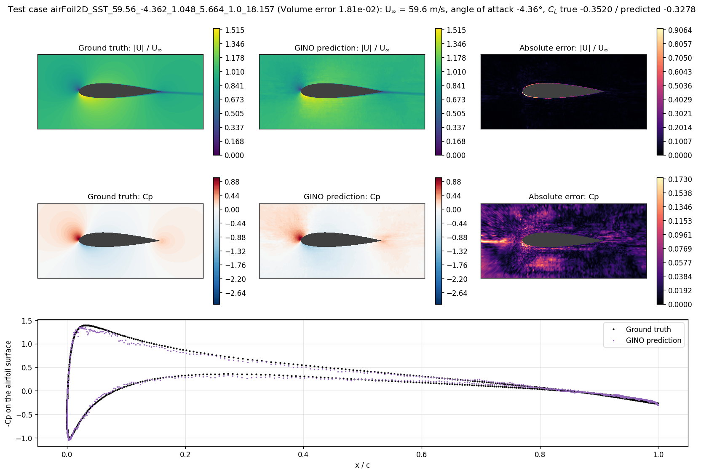
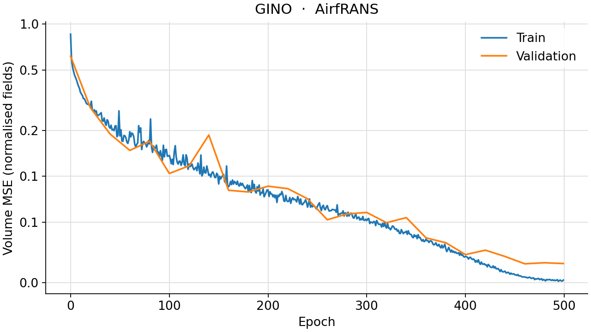
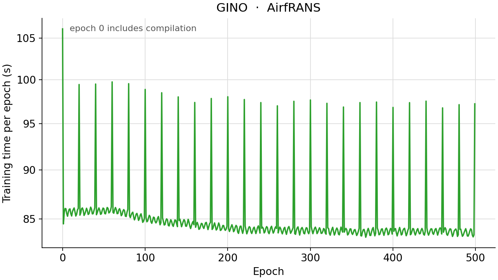

<!--
SPDX-FileCopyrightText: 2026 ZenteiQ AiTech Innovations Pvt. Ltd.
License notice: Documentation text and diagrams on this page are licensed
under CC BY 4.0. Source-code examples are licensed under LGPL-3.0-only
unless the example states otherwise.
-->

# Tutorial: AirfRANS (Airfoil Flow) with GINO

In this tutorial you train a [Geometry-Informed Neural Operator](../../theory_guide/operator_learning.md#gino)
(GINO) on **AirfRANS [[2]](#ref2)**: given the CFD mesh of an airfoil case and its inflow,
predict the steady velocity, pressure and turbulent viscosity at every one of
its roughly 180,000 nodes, and the lift that follows from them. Every case has
its own airfoil, inflow and mesh. GINO handles that with two graph operators:
one lifts the mesh onto a regular latent grid, an FNO processes the grid, and
the other brings the result back to every node. The whole tutorial is one
script, [`scripts/tutorials/airfrans_gino.py`](../../../scripts/tutorials/airfrans_gino.py). It uses only the public ScireX
API ([`scirex.data.load_airfrans`](../../api/data.md#scirex.data.load_airfrans), [`scirex.models.GINO`](../../api/models.md#scirex.models.GINO),
[`scirex.training.optim.scale_by_adam_cx`](../../api/training.md#scirex.training.optim.scale_by_adam_cx), [`scirex.utils.count_model_params`](../../api/utils.md#scirex.utils.count_model_params)),
`vtk` and SciPy for the geometry and the forces, and plain JAX and optax. The
code on this page is copied from that script, and every piece of it is checked
against the benchmark's GINO trainer by [`tests/docs/test_tutorial_airfrans_gino.py`](../../../tests/docs/test_tutorial_airfrans_gino.py).

## Summary

| | |
|---|---|
| Problem | Steady 2D RANS flow (k-ω SST) around an airfoil: node features in, `(Ux, Uy, p, nut)` at every node out |
| Model | GINO, [`scirex.models.GINO`](../../api/models.md#scirex.models.GINO): input GNO → FNO on a latent grid over x ∈ [−2, 4], y ∈ [−1.5, 1.5] chords → output GNO, with the distance to the airfoil as a latent channel and each node's features in the decoder. Benchmark size: 128 × 64 latent grid, input GNO radius 0.16 (up to 128 neighbours), output GNO radius 0.15 (up to 32), FNO 4 layers × 48 channels, modes 21 × 16, lifting ratio 4, output kernel MLP (512, 362), 3,894,069 parameters. Smoke size: 64 × 32 grid, up to 32 / 16 neighbours, FNO 2 layers × 16 channels, modes 16 × 12, lifting ratio 2, kernel MLP (64, 64), 174,171 parameters |
| Data | AirfRANS `Dataset/` (about 15 GB unpacked), "full" task: 800 train / 200 test cases, 158,000 to 197,000 nodes per case in the cases read here. Smoke: 8 / 2 cases |
| Training | Random subsets of 32,000 nodes (smoke: 8,000) per case per step, one case per step, [`scale_by_adam_cx`](../../api/training.md#scirex.training.optim.scale_by_adam_cx) (β 0.9 / 0.999, eps 1e-8) with a cosine one-cycle learning rate (peak 1e-3), XLA's default matmul precision, 500 epochs |
| Metric | The official Transolver AirfRANS metrics over the test cases: Volume and Surf (normalised MSE on non-wall and wall nodes), C_L relative error, Spearman's ρ of C_L |
| Full-run values | Volume 0.0254, Surf 0.00158, C_L 0.0752, ρ_L 0.99806. Paper ([[1]](#ref1)), GINO: 0.0297, 0.0482, 0.1821, 0.9958; Transolver: 0.0037, 0.0142, 0.1030, 0.9978 |

## Setup

The setup is the same as in the [WNO tutorial](AirfRANS_WNO.md#setup).

### Data

The dataset is not bundled and not downloaded automatically. Get the AirfRANS
`Dataset/` folder (about 15 GB unpacked) from the AirfRANS release
([github.com/Extrality/AirfRANS](https://github.com/Extrality/AirfRANS); the
`airfrans` Python package downloads it with `airfrans.dataset.download`). The
folder holds `manifest.json`, which lists the case ids of every task, and one
folder per case with `<case>_internal.vtu`, `<case>_aerofoil.vtp` and
`<case>_freestream.vtp`. Pass the `Dataset` folder as `--data-dir`, or set
`AIRFRANS_DATA_DIR`. AirfRANS is distributed by its authors; see the
[dataset guide](../../dataset_guide/airfrans.md) for the source. ScireX does not
redistribute it. Its licence is stated on the [Hugging Face repositories](https://huggingface.co/zenteiq-ai).

For the smoke run you do not need to copy anything: the script writes a small
`manifest_small.json` with the first cases of each split, the loader reads
only those, and it caches their features as `.npz` files in `--cache-dir`
(default `<out-dir>/cache`).

## The problem

The problem, the data and the metric are the same as in the [WNO tutorial](AirfRANS_WNO.md#the-problem).

with ν = 1.56e-5 m²/s, inflow speeds from 31 to 94 m/s and angles of attack
from −5° to 15°. The turbulent viscosity ν_t (`nut`) comes from the SST
model. The model never sees these equations. It learns the map from a case's
geometry and inflow to its fields from 800 solved examples. The
[dataset guide](../../dataset_guide/airfrans.md) has the file layout, the tasks
and where to get it.

$$
\mathcal G_\theta : \big(\mathbf p \in \mathbb R^{N\times 2},\ \mathbf x \in \mathbb R^{N\times 7}\big) \;\mapsto\; \hat{\mathbf y} \in \mathbb R^{N\times 4},
$$

from the node positions $\mathbf p$ and the loader's 7 node features
$\mathbf x$ (position, signed distance, direction to the nearest airfoil
point, and the inflow velocity read from the far-field boundary) to
$(U_x, U_y, p, \nu_t)$. Features and targets are standardised with the mean
and standard deviation over all nodes of the training cases (`coef_norm`).

The training loss is the official `MSE_weighted` on standardised fields, with
$\mathcal S$ the surface nodes and $\mathcal V$ the others:

$$
\mathcal L = \frac14\sum_{c=1}^{4}\frac{1}{|\mathcal V|}\sum_{k\in\mathcal V}\big(\hat y_{k,c}-y_{k,c}\big)^2
+ \frac14\sum_{c=1}^{4}\frac{1}{|\mathcal S|}\sum_{k\in\mathcal S}\big(\hat y_{k,c}-y_{k,c}\big)^2 .
$$

During training $\mathcal S$ is the loader's `surf` mask (nodes within 1e-5 of
an airfoil point), as in the benchmark run. That mask also catches the first
off-wall mesh layers: in the first three test cases it holds about 5,000
nodes, of which about 1,000 are on the wall. The scores use the exact wall
nodes, the mesh nodes that coincide with an airfoil point.

The scores are the official ones of the Transolver paper
(`utils/metrics.py::Results_test`). Each case is predicted on its full mesh,
the wall values `Ux = Uy = nut = 0` are imposed, and the standardised fields
are compared:

$$
\text{Volume} = \frac14\sum_{c}\overline{(\hat y_c-y_c)^2}\Big|_{\mathcal V}, \qquad
\text{Surf} = \frac14\sum_{c}\overline{(\hat y_c-y_c)^2}\Big|_{\mathcal S}, \qquad
\text{C}_L\text{ error} = \frac{|C_L - \hat C_L|}{|C_L|},
$$

each averaged over the test cases, and Spearman's ρ_L between the true and
predicted $C_L$ over them. $C_L$ integrates the pressure and the wall shear
stress over the airfoil. These are **mean squared errors, not relative L2
errors**. With the wall values imposed, Surf is in effect the wall-pressure
MSE / 4; the [AirfRANS results page](../../benchmarks/airfrans/results/comparative.md#the-metric)
explains why the paper's Surf may be the wall-pressure MSE itself, which would
make every Surf on this page 4 times larger. GINO's scores use the loader's
normalisation (the mean and standard deviation of the raw targets over its 800
training cases, accumulated in float32); the Transolver and WNO runs use the
official one, over their 720 training cases and accumulated in float64.

**GINO in one paragraph.** An input graph neural operator (GNO) evaluates, at
every node of a regular latent grid, an integral over the mesh nodes within a
radius: a kernel MLP weighs each neighbour by its relative position. An FNO
then mixes the latent grid globally with truncated Fourier transforms, and an
output GNO integrates the latent field around every queried mesh node. The
graphs are radius graphs, so the model works on any point cloud, and the
latent grid lets the FNO do the long-range mixing cheaply. The
[theory guide](../../theory_guide/operator_learning.md#gino) has the details.

## Step-by-step walkthrough

The explanations of the steps that are the same for every model are in the [WNO tutorial](AirfRANS_WNO.md#step-by-step-walkthrough). This page keeps the code and the text that is specific to the model.

### 1. Setup

Imports, the seed and the training settings. `PROTOCOL` holds the settings of
the benchmark's GINO run ([`scripts/benchmarks/airfrans/_gino.py`](../../../scripts/benchmarks/airfrans/_gino.py) with
`GINO_ARGS` in `_config.py`): the recipe that the Transolver paper applies to
its AirfRANS baselines, for 500 epochs. `SIZES["full"]` is the published GINO,
matched in size to the paper's Transolver; `SIZES["smoke"]` is small enough
for a CPU. The script keeps JAX's 64-bit mode off: the model is meant to run in float32.

<!-- tutorial-snippet -->
```python
from __future__ import annotations

import argparse
import json
import os
import platform
from pathlib import Path
from time import perf_counter

import flax
import jax
import jax.numpy as jnp
import matplotlib
import matplotlib.pyplot as plt
import numpy as np
import optax
import vtk
from matplotlib.colors import TwoSlopeNorm
from matplotlib.tri import Triangulation
from scipy.spatial import cKDTree
from scipy.stats import spearmanr
from vtk.util.numpy_support import numpy_to_vtk, vtk_to_numpy

import scirex
from scirex.data import load_airfrans
from scirex.models import GINO
from scirex.training.optim import scale_by_adam_cx
from scirex.utils import count_model_params

matplotlib.use("Agg")  # write figures to files, no display needed
```

<!-- tutorial-snippet -->
```python
# The model is meant to run in float32, also if float64 was enabled earlier
# in the process.
jax.config.update("jax_enable_x64", False)
```

<!-- tutorial-snippet -->
```python
SEED = 0
NU = 1.56e-5  # kinematic viscosity of the AirfRANS simulations
# The latent grid's box, Transolver's reference box: x in [-2, 4],
# y in [-1.5, 1.5] chords.
BOX = ((-2.0, 4.0), (-1.5, 1.5))
# Wall nodes coincide exactly with airfoil points; the first off-wall layer is
# more than 1.7e-6 chord away.
WALL_TOL = 1e-7

# Training settings of the benchmark's GINO run (scripts/benchmarks/airfrans/
# _gino.py with _config.GINO_ARGS): the recipe the Transolver paper applies to
# its AirfRANS baselines, for 500 epochs.
PROTOCOL = dict(
    n_points=32_000,
    epochs=500,
    learning_rate=1e-3,
    pct_start=0.3,
    div_factor=25.0,
    final_div_factor=1e4,
    surf_weight=1.0,
    test_every=20,
)

# Model sizes. "full" is the benchmark's GINO (3,894,069 parameters, matched
# to the paper's Transolver, 3,893,572). "smoke" is a small GINO for a CPU.
SIZES = dict(
    full=dict(
        latent_res=(128, 64),
        in_radius=0.16,
        out_radius=0.15,
        in_k=128,
        out_k=32,
        fno_modes=(21, 16),
        fno_hidden=48,
        fno_layers=4,
        fno_lifting_ratio=4,
        out_gno_mlp=(512, 362),
    ),
    smoke=dict(
        latent_res=(64, 32),
        in_radius=0.16,
        out_radius=0.15,
        in_k=32,
        out_k=16,
        fno_modes=(16, 12),
        fno_hidden=16,
        fno_layers=2,
        fno_lifting_ratio=2,
        out_gno_mlp=(64, 64),
    ),
)
```

<!-- tutorial-snippet -->
```python
def print_environment(seed: int) -> None:
    """Print the versions, the devices and the seed, so a run can be repeated."""
    print(f"python {platform.python_version()} | numpy {np.__version__}")
    print(f"scirex {scirex.__version__} | vtk {vtk.vtkVersion.GetVTKVersion()}")
    print(
        f"jax {jax.__version__} | flax {flax.__version__} | optax {optax.__version__}"
    )
    print(f"devices: {jax.devices()}")
    print(f"SEED = {seed}")
```

### 2. Load the data

[`load_airfrans(task="full")`](../../api/data.md#scirex.data.load_airfrans) reads the official 800 / 200 split from the
manifest, normalises the features and targets with the statistics of the
training nodes and returns `coef_norm` to undo it. `write_small_manifest`
makes a manifest with the first cases of each split for a small run.

<!-- tutorial-snippet -->
```python
def write_small_manifest(data_dir: Path, out: Path, n_train: int, n_test: int) -> Path:
    """A ``manifest.json`` with the first ``n_train`` / ``n_test`` full-task cases."""
    manifest = json.loads((Path(data_dir) / "manifest.json").read_text())
    small = dict(
        full_train=manifest["full_train"][:n_train],
        full_test=manifest["full_test"][:n_test],
    )
    out.parent.mkdir(parents=True, exist_ok=True)
    out.write_text(json.dumps(small))
    return out
```

<!-- tutorial-snippet -->
```python
def load_data(data_dir: Path, cache_dir: Path, manifest: Path | None) -> dict:
    """The full-task split and its normalisation; prints what was read."""
    data = load_airfrans(
        data_dir, cache_dir=cache_dir, task="full", manifest_path=manifest
    )
    n_nodes = [len(s["x"]) for s in data["train"] + data["test"]]
    print(
        f"cases: {len(data['train'])} train / {len(data['test'])} test | "
        f"nodes per case: min {min(n_nodes)}, max {max(n_nodes)}"
    )
    return data
```

### 3. Build the model

`build_model` is the benchmark's GINO. `latent_grid` places the latent nodes
over the box, and `latent_sdf` gives each latent node its distance to the
nearest airfoil-surface node, the extra latent channel.

<!-- tutorial-snippet -->
```python
def build_model(size: dict) -> GINO:
    """The benchmark's GINO at the size ``size``."""
    return GINO(
        in_channels=7,
        out_channels=4,
        gno_coord_dim=2,
        fno_in_channels=7,
        latent_feature_channels=1,
        gno_use_open3d=False,
        in_gno_radius=size["in_radius"],
        out_gno_radius=size["out_radius"],
        fno_n_modes=tuple(size["fno_modes"]),
        fno_hidden_channels=size["fno_hidden"],
        fno_n_layers=size["fno_layers"],
        fno_lifting_channel_ratio=size["fno_lifting_ratio"],
        out_gno_channel_mlp_hidden_layers=tuple(size["out_gno_mlp"]),
        out_query_feature_channels=7,
    )
```

<!-- tutorial-snippet -->
```python
def latent_grid(res) -> np.ndarray:
    """``(res_x, res_y, 2)`` latent node positions over ``BOX``."""
    gx = np.linspace(*BOX[0], res[0], dtype=np.float32)
    gy = np.linspace(*BOX[1], res[1], dtype=np.float32)
    return np.stack(np.meshgrid(gx, gy, indexing="ij"), axis=-1)
```

<!-- tutorial-snippet -->
```python
def latent_sdf(sample: dict, lq: np.ndarray) -> np.ndarray:
    """Distance from every latent node to the nearest airfoil-surface node."""
    d, _ = cKDTree(sample["pos"][sample["surf"]]).query(lq.reshape(-1, 2))
    return d.reshape(*lq.shape[:-1], 1).astype(np.float32)
```

### 4. Neighbour graphs

The node subset changes at every step, so the graphs are rebuilt inside the
jitted step. `radius_neighbors` finds, for every query, the `k` nearest
sources and keeps those within the radius, in fixed-size arrays so that the
step compiles once. `make_forward` builds both graphs and calls the model;
output nodes outside the latent box (about 0.9% of the mesh) are clamped to
it. `init_params` initialises the model on random points, as the benchmark
does, and counts the parameters, each complex FNO weight as two.

<!-- tutorial-snippet -->
```python
def radius_neighbors(sources, queries, radius, k, chunk=512) -> dict:
    """The ``k`` nearest sources within ``radius`` of each query, as GINO's
    neighbour layout; empty slots get segment id ``n_queries``."""
    n_q = queries.shape[0]
    k = min(k, sources.shape[0])
    pad = (-n_q) % chunk
    qp = jnp.concatenate([queries, jnp.zeros((pad, queries.shape[1]), queries.dtype)])

    def block(qb):
        d2 = jnp.sum((qb[:, None, :] - sources[None, :, :]) ** 2, axis=-1)
        neg, idx = jax.lax.top_k(-d2, k)
        return idx, -neg <= radius * radius

    idx, valid = jax.lax.map(block, qp.reshape(-1, chunk, queries.shape[1]))
    idx, valid = idx.reshape(-1, k)[:n_q], valid.reshape(-1, k)[:n_q]
    seg = jnp.where(valid, jnp.arange(n_q, dtype=jnp.int32)[:, None], n_q)
    return {
        "neighbors_index": jnp.where(valid, idx, 0).reshape(-1).astype(jnp.int32),
        "segment_ids": seg.reshape(-1).astype(jnp.int32),
        "counts": valid.sum(axis=1).astype(jnp.int32),
    }
```

<!-- tutorial-snippet -->
```python
def make_forward(model: GINO, lq: jnp.ndarray, size: dict):
    """``forward(params, x, pos, lat) -> (N, 4)`` for one node subset."""
    lq_flat = lq.reshape(-1, 2)
    lo = jnp.array([BOX[0][0], BOX[1][0]], jnp.float32)
    hi = jnp.array([BOX[0][1], BOX[1][1]], jnp.float32)

    def forward(params, x, pos, lat):
        out_q = jnp.clip(pos, lo, hi)
        nbrs_in = radius_neighbors(pos, lq_flat, size["in_radius"], size["in_k"])
        nbrs_out = radius_neighbors(lq_flat, out_q, size["out_radius"], size["out_k"])
        out = model.apply(
            params,
            input_geom=pos[None],
            latent_queries=lq[None],
            output_queries=out_q[None],
            x=x[None],
            latent_features=lat[None],
            neighbors_in=nbrs_in,
            neighbors_out=nbrs_out,
            output_query_features=x[None],
        )
        return out[0]

    return forward
```

<!-- tutorial-snippet -->
```python
def init_params(model: GINO, lq: jnp.ndarray, size: dict, seed: int, n: int):
    """Initialise on ``n`` random points, as the benchmark, and count parameters."""
    key = jax.random.PRNGKey(seed)
    pos = jax.random.uniform(key, (n, 2), minval=-1.0, maxval=1.0)
    x = jnp.zeros((n, 7), jnp.float32)
    params = model.init(
        key,
        input_geom=pos[None],
        latent_queries=lq[None],
        output_queries=pos[None],
        x=x[None],
        latent_features=jnp.zeros((*lq.shape[:-1], 1), jnp.float32)[None],
        neighbors_in=radius_neighbors(
            pos, lq.reshape(-1, 2), size["in_radius"], size["in_k"]
        ),
        neighbors_out=radius_neighbors(
            lq.reshape(-1, 2), pos, size["out_radius"], size["out_k"]
        ),
        output_query_features=x[None],
    )
    print(f"GINO | parameters: {count_model_params(params):,}")
    return params
```

### 5. Loss

The loss from [The problem](#the-problem): the volume MSE plus the surface
MSE, each averaged over the 4 channels.

<!-- tutorial-snippet -->
```python
def region_losses(out, y, surf, weight):
    """Volume + ``weight`` x surface MSE, and the two parts."""
    d2 = (out - y) ** 2
    s = surf.astype(out.dtype)[:, None]
    l_surf = jnp.mean(jnp.sum(d2 * s, 0) / (jnp.sum(s) + 1e-8))
    l_vol = jnp.mean(jnp.sum(d2 * (1 - s), 0) / (jnp.sum(1 - s) + 1e-8))
    return l_vol + weight * l_surf, (l_vol, l_surf)
```

### 6. Optimiser for complex weights

The FNO inside GINO has complex spectral weights. For a real loss and a
complex weight $w$, `jax.grad` returns $\partial L/\partial w$, the complex
conjugate of the steepest-ascent direction that optax transforms assume, so
plain Adam would move the imaginary parts the wrong way. [`scale_by_adam_cx`](../../api/training.md#scirex.training.optim.scale_by_adam_cx)
conjugates complex gradients first and keeps Adam's second moment real;
real weights are updated exactly as by Adam. The learning rate follows
`optax.cosine_onecycle_schedule` over `(n_train + 1) × epochs` steps, as the
official recipe. There is no weight decay, clipping or EMA in this run.

<!-- tutorial-snippet -->
```python
def make_optimizer(protocol: dict, total_steps: int):
    """Complex-aware Adam on a cosine one-cycle schedule."""
    schedule = optax.cosine_onecycle_schedule(
        transition_steps=total_steps,
        peak_value=protocol["learning_rate"],
        pct_start=protocol["pct_start"],
        div_factor=protocol["div_factor"],
        final_div_factor=protocol["final_div_factor"],
    )
    tx = optax.chain(
        scale_by_adam_cx(b1=0.9, b2=0.999, eps=1e-8),
        optax.scale_by_learning_rate(schedule),
    )
    return tx, schedule
```

### 7. Train

One case per step, in a new random order every epoch, and a fresh random
subset of `n_points` nodes of it at every step. Every 20 epochs (and at the
last) the test cases are scored on one random subset each, for the loss curve
only: nothing is selected by it, and the weights after the last epoch are the
result. The first step compiles the model and both neighbour searches, so the
first epoch is slower than the others.

<!-- tutorial-snippet -->
```python
def train(forward, params, train_set, test_set, lats, epochs, protocol=PROTOCOL):
    """Train for ``epochs`` epochs. Return the final parameters and the history."""
    p = protocol
    tx, _ = make_optimizer(p, (len(train_set) + 1) * epochs)
    opt_state = tx.init(params)

    def loss_fn(params, x, y, surf, pos, lat):
        return region_losses(forward(params, x, pos, lat), y, surf, p["surf_weight"])

    @jax.jit
    def train_step(params, opt_state, x, y, surf, pos, lat):
        (loss, aux), grads = jax.value_and_grad(loss_fn, has_aux=True)(
            params, x, y, surf, pos, lat
        )
        updates, opt_state = tx.update(grads, opt_state, params)
        return optax.apply_updates(params, updates), opt_state, loss, aux

    eval_step = jax.jit(loss_fn)
    rng = np.random.default_rng(0)

    def batch(s):
        n = min(p["n_points"], len(s["x"]))
        idx = rng.choice(len(s["x"]), size=n, replace=False)
        arrays = (jnp.asarray(s[k][idx]) for k in ("x", "y", "surf", "pos"))
        return (*arrays, lats[s["case_id"]])

    history = []
    for epoch in range(epochs):
        t0 = perf_counter()
        stats = []
        for i in rng.permutation(len(train_set)):
            params, opt_state, loss, (lv, ls) = train_step(
                params, opt_state, *batch(train_set[i])
            )
            stats.append((loss, lv, ls))
        tr = np.asarray(jnp.stack([jnp.stack(s) for s in stats])).mean(0)
        row = dict(epoch=epoch, train_vol=float(tr[1]), train_surf=float(tr[2]))
        if epoch % p["test_every"] == 0 or epoch == epochs - 1:
            ev = [eval_step(params, *batch(s))[1] for s in test_set]
            row["test_vol"] = float(np.mean([float(v) for v, _ in ev]))
            row["test_surf"] = float(np.mean([float(s) for _, s in ev]))
        row["secs"] = perf_counter() - t0
        history.append(row)
        msg = f"epoch {epoch}: train vol={tr[1]:.5f} surf={tr[2]:.5f}"
        if "test_vol" in row:
            msg += f" | test vol={row['test_vol']:.5f} surf={row['test_surf']:.5f}"
        print(f"{msg} | epoch_time={row['secs']:.1f}s")
    return params, history
```

### 8. Evaluate with the official metrics

`predict_full_mesh` is the official inference: random subsets until every node
has been hit, each node's predictions averaged. `wall_mask` finds the exact
wall nodes. `lift_drag` integrates the pressure and the wall shear stress
(from the VTK gradient of the velocity) over the airfoil and rotates the force
by the angle of attack. `evaluate` imposes the wall values and computes the
four scores over the test cases.

<!-- tutorial-snippet -->
```python
def predict_full_mesh(forward_jit, params, s, lat, n_points, rng) -> np.ndarray:
    """Random ``n_points`` passes until every node is covered, averaged."""
    n = s["x"].shape[0]
    acc = np.zeros(s["y"].shape, np.float64)
    hits = np.zeros(n, np.int64)
    while (hits == 0).any():
        idx = rng.choice(n, size=min(n_points, n), replace=False)
        out = forward_jit(
            params, jnp.asarray(s["x"][idx]), jnp.asarray(s["pos"][idx]), lat
        )
        acc[idx] += np.asarray(out)
        hits[idx] += 1
    return (acc / hits[:, None]).astype(np.float32)
```

<!-- tutorial-snippet -->
```python
def read_vtk(path: Path):
    """A ``.vtu`` (volume) or ``.vtp`` (surface) file as a VTK data set."""
    reader = (
        vtk.vtkXMLUnstructuredGridReader()
        if str(path).endswith(".vtu")
        else vtk.vtkXMLPolyDataReader()
    )
    reader.SetFileName(str(path))
    reader.Update()
    return reader.GetOutput()
```

<!-- tutorial-snippet -->
```python
def wall_mask(sample: dict, data_dir: Path) -> np.ndarray:
    """The mesh nodes that coincide with a point of ``<case>_aerofoil.vtp``."""
    cid = sample["case_id"]
    foil = read_vtk(Path(data_dir) / cid / f"{cid}_aerofoil.vtp")
    d, _ = cKDTree(vtk_to_numpy(foil.GetPoints().GetData())[:, :2]).query(sample["pos"])
    return d < WALL_TOL
```

<!-- tutorial-snippet -->
```python
def lift_drag(internal, aerofoil, U, p, surf, u_inf, angle_deg) -> np.ndarray:
    """``(C_D, C_L)`` from pressure and wall shear stress on the airfoil cells."""
    mesh_pts = vtk_to_numpy(internal.GetPoints().GetData())[surf, :2]
    foil_pts = vtk_to_numpy(aerofoil.GetPoints().GetData())[:, :2]
    _, order = cKDTree(mesh_pts).query(foil_pts)
    grid = vtk.vtkUnstructuredGrid()
    grid.ShallowCopy(internal)
    u3 = np.zeros((U.shape[0], 3), np.float64)
    u3[:, :2] = U
    arr = numpy_to_vtk(u3, deep=True)
    arr.SetName("Upred")
    grid.GetPointData().AddArray(arr)
    gf = vtk.vtkGradientFilter()
    gf.SetInputData(grid)
    gf.SetInputArrayToProcess(0, 0, 0, 0, "Upred")
    gf.SetResultArrayName("grad")
    gf.Update()
    g = vtk_to_numpy(gf.GetOutput().GetPointData().GetArray("grad"))
    jac = g.reshape(-1, 3, 3)[surf, :2, :2][order]
    p_s = p[surf][order]
    normals = vtk_to_numpy(aerofoil.GetPointData().GetArray("Normals"))[:, :2]
    S = 0.5 * (jac + jac.transpose(0, 2, 1))
    S = S - np.trace(S, axis1=1, axis2=2)[:, None, None] * np.eye(2)[None] / 3
    wss = ((2 * NU * S) * (-normals)[:, None, :]).sum(axis=2)
    lines = vtk_to_numpy(aerofoil.GetLines().GetData()).reshape(-1, 3)[:, 1:]
    cd = aerofoil.GetCellData()
    length = (
        vtk_to_numpy(cd.GetArray("Length"))
        if cd.GetArray("Length") is not None
        else np.linalg.norm(foil_pts[lines[:, 0]] - foil_pts[lines[:, 1]], axis=1)
    )
    p_c = p_s[lines].mean(axis=1)
    n_c = normals[lines].mean(axis=1)
    wss_c = wss[lines].mean(axis=1)
    force = (wss_c * length[:, None]).sum(0) - (
        -p_c[:, None] * n_c * length[:, None]
    ).sum(0)
    a = np.deg2rad(angle_deg)
    basis = np.array([[np.cos(a), np.sin(a)], [-np.sin(a), np.cos(a)]])
    return 2 * (basis @ force) / u_inf**2
```

<!-- tutorial-snippet -->
```python
def evaluate(forward_jit, params, test_set, lats, coef_norm, data_dir, n_points):
    """Official scores of every test case and their means; predictions."""
    _, _, mean_out, std_out = coef_norm
    zero_norm = (0.0 - mean_out) / (std_out + 1e-8)
    rng = np.random.default_rng(0)
    rows, preds = [], []
    for s in test_set:
        cid = s["case_id"]
        pred = predict_full_mesh(forward_jit, params, s, lats[cid], n_points, rng)
        surf = wall_mask(s, data_dir)
        pred[surf, 0:2] = zero_norm[0:2]
        pred[surf, 3] = zero_norm[3]
        d2 = (pred - s["y"]) ** 2
        internal = read_vtk(Path(data_dir) / cid / f"{cid}_internal.vtu")
        aerofoil = read_vtk(Path(data_dir) / cid / f"{cid}_aerofoil.vtp")
        u_inf, angle = float(cid.split("_")[2]), float(cid.split("_")[3])
        y_true = s["y"] * (std_out + 1e-8) + mean_out
        y_pred = pred * (std_out + 1e-8) + mean_out
        cl_t = lift_drag(
            internal, aerofoil, y_true[:, :2], y_true[:, 2], surf, u_inf, angle
        )[1]
        cl_p = lift_drag(
            internal, aerofoil, y_pred[:, :2], y_pred[:, 2], surf, u_inf, angle
        )[1]
        rows.append(dict(case=cid, volume=float(d2[~surf].mean()),
                         surf=float(d2[surf].mean()), cl_true=cl_t, cl_pred=cl_p,
                         relerr_cl=abs((cl_t - cl_p) / cl_t)))  # fmt: skip
        preds.append(y_pred)
    g = lambda key: np.array([r[key] for r in rows])  # noqa: E731
    summary = dict(
        volume=float(g("volume").mean()),
        surf=float(g("surf").mean()),
        relerr_cl=float(g("relerr_cl").mean()),
        spearman_cl=float(spearmanr(g("cl_true"), g("cl_pred"))[0]),
    )
    return summary, rows, preds
```

Coverage inference is the expensive part on a CPU. A node is hit with
probability $n/N$ per pass, so covering all $N$ nodes takes about
$(N/n)\ln N$ passes, about 12 hits per node on average, and the total cost
hardly depends on the subset size $n$. In the default smoke run it takes
about a minute per test case.

### 9. Plot

The standard figure for this benchmark has four panels around the airfoil of
one test case: an input, the true and the predicted pressure coefficient
$C_p = p / (\tfrac12 U_\infty^2)$ on one colour scale, and the absolute error.
The input panel shows the signed distance, AirfRANS's `implicit_distance`,
which is negative in the fluid. Below them, $-C_p$ on the wall nodes, whose
enclosed area is essentially the lift. The script plots the test case with the
median Volume error. A second figure shows the losses per epoch.

<!-- tutorial-snippet -->
```python
def plot_prediction(data_dir, s, y_true, y_pred, sdf, path: Path, title: str) -> None:
    """Save input, true Cp, predicted Cp, absolute error and surface -Cp."""
    cid = s["case_id"]
    internal = read_vtk(Path(data_dir) / cid / f"{cid}_internal.vtu")
    quads = vtk_to_numpy(internal.GetCells().GetConnectivityArray()).reshape(-1, 4)
    tri = np.concatenate([quads[:, [0, 1, 2]], quads[:, [0, 2, 3]]])
    P = s["pos"]
    c = P[tri].mean(1)
    keep = (c[:, 0] > WINDOW[0] - 0.1) & (c[:, 0] < WINDOW[1] + 0.1)
    keep &= np.abs(c[:, 1]) < WINDOW[3] + 0.1
    T = Triangulation(P[:, 0], P[:, 1], tri[keep])
    q = 0.5 * float(cid.split("_")[2]) ** 2
    truth, model = y_true[:, 2] / q, y_pred[:, 2] / q
    cp_norm = TwoSlopeNorm(vmin=-3.0, vcenter=0.0, vmax=1.0)
    panels = [
        ("Input: signed distance", sdf, "viridis", {}),
        ("Truth: Cp", np.clip(truth, -3, 1), "RdBu_r", dict(norm=cp_norm)),
        ("Prediction: Cp", np.clip(model, -3, 1), "RdBu_r", dict(norm=cp_norm)),
        ("Absolute error: Cp", np.abs(model - truth), "magma", {}),
    ]
    fig = plt.figure(figsize=(18, 8))
    gs = fig.add_gridspec(2, 4, height_ratios=[1, 0.9], hspace=0.3, wspace=0.15)
    for j, (name, values, cmap, kw) in enumerate(panels):
        ax = fig.add_subplot(gs[0, j])
        im = ax.tripcolor(
            T, values, shading="gouraud", cmap=cmap, rasterized=True, **kw
        )
        ax.set_xlim(WINDOW[0], WINDOW[1])
        ax.set_ylim(WINDOW[2], WINDOW[3])
        ax.set_aspect("equal")
        ax.set_facecolor("0.3")  # the airfoil, which has no mesh nodes inside
        ax.set_xticks([])
        ax.set_yticks([])
        ax.set_title(name)
        fig.colorbar(im, ax=ax, fraction=0.03, pad=0.02)
    ax = fig.add_subplot(gs[1, :])
    wall = wall_mask(s, data_dir)
    order = np.argsort(P[wall, 0])
    xs = P[wall, 0][order]
    ax.plot(xs, -truth[wall][order], ".", ms=3, color="0.15", label="truth")
    ax.plot(xs, -model[wall][order], ".", ms=2, color="#9467bd", label="prediction")
    ax.set_xlabel("x / c")
    ax.set_ylabel("-Cp on the airfoil surface")
    ax.grid(alpha=0.3)
    ax.legend()
    fig.suptitle(title)
    fig.savefig(path, dpi=120, bbox_inches="tight")
    plt.close(fig)
```

<!-- tutorial-snippet -->
```python
def plot_loss(history: list[dict], path: Path) -> None:
    """Save the training and test losses per epoch."""
    fig, ax = plt.subplots(figsize=(6.5, 4))
    ep = [h["epoch"] for h in history]
    ax.plot(ep, [h["train_vol"] for h in history], marker="o", label="train, volume")
    ax.plot(ep, [h["train_surf"] for h in history], marker="o", label="train, surface")
    te = [h for h in history if "test_vol" in h]
    ax.plot(
        [h["epoch"] for h in te],
        [h["test_vol"] for h in te],
        "s--",
        label="test, volume",
    )
    ax.plot(
        [h["epoch"] for h in te],
        [h["test_surf"] for h in te],
        "s--",
        label="test, surface",
    )
    ax.set_xlabel("epoch")
    ax.set_ylabel("MSE (normalised fields)")
    ax.set_yscale("log")
    ax.legend(fontsize=8)
    ax.grid(True, alpha=0.3)
    fig.savefig(path, dpi=120, bbox_inches="tight")
    plt.close(fig)
```

The complete script is [`scripts/tutorials/airfrans_gino.py`](../../../scripts/tutorials/airfrans_gino.py).

## Run it

Smoke run (CPU, about two and a half minutes, no GPU needed):

```bash
CUDA_VISIBLE_DEVICES= JAX_PLATFORMS=cpu python scripts/tutorials/airfrans_gino.py --data-dir ~/data/AirfRANS/Dataset --smoke
```

Full protocol (800 / 200 cases, benchmark-size GINO, 500 epochs; use a GPU):

```bash
python scripts/tutorials/airfrans_gino.py --data-dir ~/data/AirfRANS/Dataset
```

The other flags are `--epochs`, `--seed`, `--out-dir` (default
`outputs/airfrans_gino_tutorial`), `--cache-dir` (default `<out-dir>/cache`),
`--n-points` and, for the smoke run, `--n-train` and `--n-test`.

This is the output of the smoke run on a CPU (smoke run, CPU, 8 train / 2 test
cases, not a benchmark number). The wall time was 152.3 s,
measured with `time`; library deprecation warnings and the loader's progress
lines are left out.

```text
python 3.12.3 | numpy 1.26.4
scirex 1.0.0rc1 | vtk 9.7.0
jax 0.6.2 | flax 0.10.7 | optax 0.2.8
devices: [CpuDevice(id=0)]
SEED = 0
cases: 8 train / 2 test | nodes per case: min 163156, max 197146
data loading: 4.6s
GINO | parameters: 174,171
epoch 0: train vol=1.02663 surf=0.98438 | test vol=1.28587 surf=1.40477 | epoch_time=3.6s
epoch 1: train vol=1.01610 surf=0.91827 | epoch_time=1.9s
epoch 2: train vol=0.97780 surf=0.77341 | test vol=1.22545 surf=1.30225 | epoch_time=2.3s
evaluation: 123.9s
Volume 1.20667 | Surf 0.99953 | C_L rel. error 0.7333 | Spearman rho_L -1.0000
figures in outputs/airfrans_gino_tutorial | total time 149.5s
```

## Results

### Full run

The next figures were not made by this script. They come from the benchmark
runner (`train.py --run gino` and `infer.py`) and are the committed results of
the **full 500-epoch run** (800 training cases, benchmark-size GINO, one
NVIDIA RTX PRO 6000 Blackwell). The test case,
`airFoil2D_SST_59.56_-4.362_1.048_5.664_1.0_18.157`, is the one drawn on the
Transolver benchmark page, so the two figures compare directly.



Volume and surface MSE per epoch: training every epoch, test every 20 epochs
(logged for monitoring only):



Seconds per epoch of the same run (about 84 s per epoch; most of it is the
neighbour search, rebuilt for every subset):



| Official metrics over the 200 test cases | GINO, this repository | GINO, paper [[3]](#ref3) | Transolver, paper [[1]](#ref1) |
|---|---|---|---|
| Volume (normalised MSE) ↓ | 0.0254 | 0.0297 | 0.0037 |
| Surf (normalised MSE) ↓ | 0.00158 | 0.0482 | 0.0142 |
| C_L (relative error) ↓ | 0.0752 | 0.1821 | 0.1030 |
| Spearman ρ_L ↑ | 0.99806 | 0.9958 | 0.9978 |

| Model, same data and metrics | Parameters | Volume | Surf | C_L error | ρ_L |
|---|---|---|---|---|---|
| [Transolver](../../benchmarks/airfrans/results/comparative.md#transolver) | 3,894,596 | 0.00131 | 0.00046 | 0.0265 | 0.99959 |
| [WNO](../../benchmarks/airfrans/results/comparative.md#wno) | 3,964,728 | 0.00446 | 0.00145 | 0.0297 | 0.99958 |
| **GINO (this tutorial, its own recipe)** | 3,894,069 | **0.0254** | **0.00158** | **0.0752** | **0.99806** |

## Troubleshooting

- **`ImportError: ... requires 'vtk' ... Install the 'benchmark' extra`.** The
  loader needs `vtk`. Run `pip install -e ".[benchmark]"`.
- **`KeyError: 'full_train'`.** The manifest has no "full" task. `--data-dir`
  must be the `Dataset` folder of the AirfRANS release, the one that holds
  `manifest.json`.
- **Evaluation takes minutes per case on a CPU.** That is the coverage
  inference (see step 8): about 12 hits per node on average. Use fewer test
  cases (`--n-test`) for quick checks, or a GPU.

## Next steps

- Compare with the other architectures on the same data:
  [Transolver](../../benchmarks/airfrans/results/comparative.md#transolver),
  [WNO](../../benchmarks/airfrans/results/comparative.md#wno) and the
  [comparison page](../../benchmarks/airfrans/results/comparative.md); the
  [Transolver tutorial](../Transolver/AirfRANS_Transolver.md) and
  [WNO tutorial](../Others/AirfRANS_WNO.md) walk through them.
- Read the [AirfRANS results](../../benchmarks/airfrans/results/comparative.md#gino) for the
  per-channel errors, the lift breakdown and the compute cost, and the
  [dataset guide](../../dataset_guide/airfrans.md) for the files and tasks.
- Learn how GINO works in the [theory guide](../../theory_guide/operator_learning.md#gino) and see
  its arguments in the [API reference](../../api/models.md); the optimiser is in
  the [training API](../../api/training.md).
- Try GINO on a 3D problem: the [ShapeNetCar benchmark](../../benchmarks/shapenetcar/results/comparative.md#gino).

## References

1. <span id="ref1"></span>Wu et al., *Transolver: A Fast Transformer Solver for PDEs on General Geometries*, ICML 2024. <https://arxiv.org/abs/2402.02366>

2. <span id="ref2"></span>Bonnet et al., *AirfRANS: High Fidelity Computational Fluid Dynamics Dataset for Approximating Reynolds-Averaged Navier-Stokes Solutions*, NeurIPS 2022, Datasets and Benchmarks. <https://arxiv.org/abs/2212.07564>

3. <span id="ref3"></span>Li et al., *Geometry-Informed Neural Operator for Large-Scale 3D PDEs*, NeurIPS 2023. <https://arxiv.org/abs/2309.00583>
