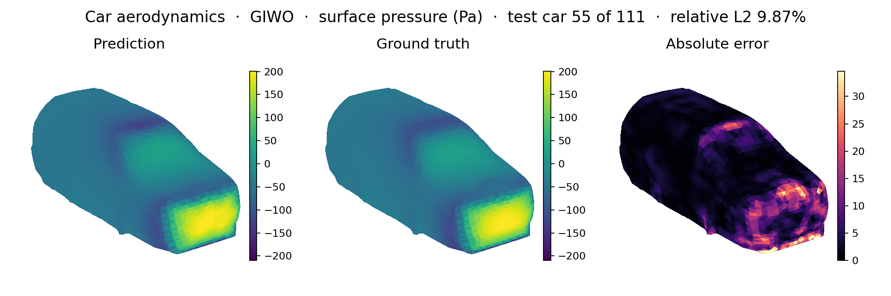
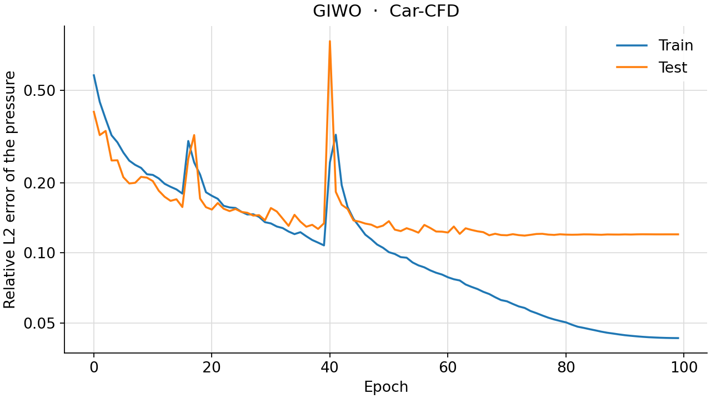
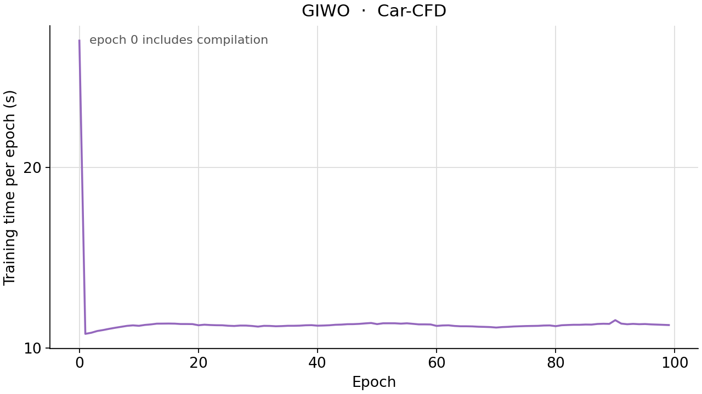

<!--
SPDX-FileCopyrightText: 2026 ZenteiQ AiTech Innovations Pvt. Ltd.
License notice: Documentation text and diagrams on this page are licensed
under CC BY 4.0. Source-code examples are licensed under LGPL-3.0-only
unless the example states otherwise.
-->

# Tutorial: Car-CFD (Car Surface Pressure) with GIWO

In this tutorial you train a GIWO on **Car-CFD**, the car benchmark of the
GINO paper ([[1]](#ref1)): given the shape of a car, predict the
steady pressure at each of the 3,586 vertices of its surface mesh. GIWO is
[GINO](../../theory_guide/operator_learning.md#gino) with one part swapped: the Fourier (FNO)
layers on the latent grid become [wavelet (WNO)](../../theory_guide/operator_learning.md#wno) [[3]](#ref3)
layers. Everything around them is GINO's decoder-only shell: the car's signed
distance function (SDF) on a regular latent grid is the input, and a graph
kernel carries the latent field out to the surface vertices. GIWO is not a
published architecture; the benchmark built it to ask whether a wavelet
operator on the latent grid does better or worse than a Fourier one. The
whole tutorial is one script, [`scripts/tutorials/carcfd_giwo.py`](../../../scripts/tutorials/carcfd_giwo.py). It uses
only the public ScireX API ([`scirex.models.GINO`](../../api/models.md#scirex.models.GINO), [`scirex.models.WNO`](../../api/models.md#scirex.models.WNO),
[`scirex.layers.kdtree_neighbor_search`](../../api/layers.md#scirex.layers.kdtree_neighbor_search), [`scirex.training.adamw_cx`](../../api/training.md#scirex.training.adamw_cx),
[`scirex.utils.count_model_params`](../../api/utils.md#scirex.utils.count_model_params)), NumPy and open3d for the data, and plain
JAX and optax for the training loop. The code on this page is copied from
that script.

## Summary

| | |
|---|---|
| Problem | Steady external flow around a car ([[2]](#ref2)): car geometry in, surface pressure at 3,586 mesh vertices out |
| Model | GIWO: GINO's decoder-only shell around a [`scirex.models.WNO`](../../api/models.md#scirex.models.WNO). Benchmark size: 64³ latent grid, 4 db4 wavelet layers with 3 levels, width 29, output graph kernel of radius 0.033, 74,197,232 parameters (GINO: 75,917,953). Smoke size: 8³ grid, 2 wavelet layers with 1 level, width 8, radius 0.3, 379,273 parameters |
| Data | neuraloperator's processed Car-CFD (Zenodo record 13936501, CC BY 4.0, 198 MB), 611 cars. Benchmark: the GINO paper's 500 train / 111 test. Smoke: the first 8 train / first 4 test cars |
| Optimiser | Adam ([`adamw_cx`](../../api/training.md#scirex.training.adamw_cx), no weight decay, β₂ 0.999, ε 1e-6), peak learning rate 8e-3 (chosen on a validation split), one epoch of linear warm-up, cosine decay to 0, 100 epochs, one car per step |
| Metric | Relative L2 error of the de-normalised surface pressure per car, averaged over the test cars (the GINO paper's metric) |
| Full-run values | 12.01% (final epoch; best epoch 11.86%). This repository's GINO at the same budget: 8.37%; GINO paper [[1]](#ref1): 7.12% |

## Setup

The setup is the same as in the [GINO tutorial](../GINO/CarCFD_GINO.md#setup).

### Data

This gives `processed-car-pressure-data/` with `train.txt` and `test.txt` (the
GINO paper's 500 / 111 split, comma-separated car ids) and
`data/data/<id>/tri_mesh.ply` and `press.npy` for each of the 611 cars. Pass
that folder as `--data-dir`, or set `CARCFD_DATA_DIR`. The benchmark's own
loader takes the folder *above* it as `--data-root`. ScireX does not
redistribute the data; see the [dataset guide](../../dataset_guide/car_cfd.md).

## The problem

The problem, the data and the metric are the same as in the [GINO tutorial](../GINO/CarCFD_GINO.md#the-problem).

Only the car surface and the pressure on it are in the data. The model never
sees the equation: it learns the map from the car's shape to its surface
pressure from 500 solved cars. The
[problem card](../../benchmarks/car_cfd/README.md) has every parameter and the
open questions, for example the unit of the stored pressure and the
length unit of the meshes.

As for GINO, the car enters as its SDF $s$ on a regular $R^3$ grid spanning
one bounding box of all cars, linearly mapped to $[10^{-6}, 1]$ with the
minimum and maximum of the training cars, and the pressure is standardised
with one scalar mean and standard deviation,
$\tilde p = (p - \mu)/(\sigma + 10^{-7})$. The model is the map

$$
\mathcal G_\theta : s \in \mathbb R^{R\times R\times R} \;\mapsto\; \hat{\tilde p} \in \mathbb R^{3586} ,
$$

evaluated at the car's own vertices. The training loss of one car is the
relative L2 error of the normalised pressure, and the test metric is the same
error on the de-normalised pressure, averaged over the $N_\mathrm{test}$ test
cars:

$$
\mathcal L = \frac{\lVert \hat{\tilde p} - \tilde p\rVert_2}{\lVert \tilde p\rVert_2 + \varepsilon}, \qquad
E_\mathrm{test} = \frac{1}{N_\mathrm{test}}\sum_{k=1}^{N_\mathrm{test}} \frac{\lVert \hat p_k - p_k\rVert_2}{\lVert p_k\rVert_2 + \varepsilon}, \qquad \varepsilon = 10^{-8} .
$$

**GIWO in one paragraph.** GINO mixes information over its latent grid with
FNO layers: a Fourier transform, a learned multiplier on the lowest modes, an
inverse transform. A WNO layer does the same with a discrete wavelet
transform: it splits the field into subbands (smooth and detail parts) over
`level` halvings of the grid, multiplies the coarsest subbands by learned
weights and transforms back. Wavelets are local in space as well as in scale,
where Fourier modes are global. GIWO keeps everything else of GINO, so a
comparison of the two at the same parameter count isolates the latent
operator. The [WNO theory guide](../../theory_guide/operator_learning.md#wno) has the details of
the wavelet layer.

## Step-by-step walkthrough

The explanations of the steps that are the same for every model are in the [GINO tutorial](../GINO/CarCFD_GINO.md#step-by-step-walkthrough). This page keeps the code and the text that is specific to the model.

### 1. Setup

Imports, the precision setting, the seed, the training settings and the two
model sizes. `PROTOCOL` holds the benchmark's `giwo_val` settings (the same
values as in [`scripts/benchmarks/car_cfd/_config.py`](../../../scripts/benchmarks/car_cfd/_config.py)). `SIZES["full"]` is the
benchmark's GIWO; `SIZES["smoke"]` is small enough for a CPU.

<!-- tutorial-snippet -->
```python
from __future__ import annotations

import argparse
import os
import platform
from pathlib import Path
from time import perf_counter

import flax
import jax
import jax.numpy as jnp
import matplotlib
import matplotlib.pyplot as plt
import numpy as np
import open3d as o3d
import optax
from matplotlib.colors import Normalize
from mpl_toolkits.mplot3d.art3d import Poly3DCollection

import scirex
from scirex.layers import kdtree_neighbor_search
from scirex.models import GINO, WNO
from scirex.training import adamw_cx
from scirex.utils import count_model_params

matplotlib.use("Agg")  # write figures to files, no display needed
```

The committed Car-CFD runs were computed with JAX's 64-bit mode on. An earlier version of the
library switched it on as a side effect of importing [`GINO`](../../api/models.md#scirex.models.GINO); 1.0 does not.
The script sets it explicitly, so that it computes as those runs did. Data and weights stay float32.

<!-- tutorial-snippet -->
```python
# The committed Car-CFD runs were computed with jax_enable_x64 on (an earlier
# version of the library turned it on as a side effect of importing GINO; 1.0
# does not). Setting it explicitly keeps the tutorial in the numerics of those
# runs. The data and the weights are still float32.
jax.config.update("jax_enable_x64", True)
```

<!-- tutorial-snippet -->
```python
SEED = 0

# Training settings of the benchmark's "giwo_val" run, the same values as
# PROTOCOL and RUNS["giwo_val"] in scripts/benchmarks/car_cfd/_config.py: the
# GINO paper's split and 100 epochs, Adam (adamw_cx with no weight decay;
# GIWO's weights are all real, so this is plain Adam), a peak learning rate of
# 8e-3 chosen on a validation split, one epoch of linear warm-up from 0 and
# cosine decay to 0, one car per step.
PROTOCOL = dict(
    n_train=500,
    n_test=111,
    n_epochs=100,
    learning_rate=8e-3,
    warmup_epochs=1,
    weight_decay=0.0,
    adam_b2=0.999,
    adam_eps=1e-6,
)

# Model sizes. "full" is the benchmark's GIWO, sized to GINO's parameter
# budget: GINO's decoder-only shell (output graph kernel of radius 0.033)
# around a 4-layer db4 WNO with 3 decomposition levels and width 29 on the
# 64^3 latent grid, 74,197,232 parameters (GINO: 75,917,953). "smoke" is a
# tiny GIWO on an 8^3 grid that trains on a CPU: on a CPU the wavelet
# library's 3-D transform costs about 5 s per training step at 16^3 and
# 0.15 s at 8^3. Its larger radius keeps about as many latent points per
# vertex (about two grid spacings) as 0.033 does on the 64^3 grid.
SIZES = dict(
    full=dict(
        latent_res=64,
        width=29,
        wno_n_layers=4,
        wno_level=3,
        wno_projection_hidden_channels=128,
        out_gno_radius=0.033,
        out_gno_channel_mlp_hidden_layers=(512, 256),
    ),
    smoke=dict(
        latent_res=8,
        width=8,
        wno_n_layers=2,
        wno_level=1,
        wno_projection_hidden_channels=32,
        out_gno_radius=0.3,
        out_gno_channel_mlp_hidden_layers=(64, 32),
    ),
)

# The stored pressure has 3,682 entries per car and the mesh 3,586 vertices.
# The benchmark keeps entries 0-15 and 112-3681 so that the two match; the
# source of this slice does not say why (see the Car-CFD problem card).
KEEP = np.r_[0:16, 112:3682]
```

<!-- tutorial-snippet -->
```python
def print_environment(seed: int) -> None:
    """Print the versions, the devices and the seed, so a run can be repeated."""
    print(f"python {platform.python_version()} | numpy {np.__version__}")
    print(f"scirex {scirex.__version__} | open3d {o3d.__version__}")
    print(
        f"jax {jax.__version__} | flax {flax.__version__} | optax {optax.__version__}"
    )
    print(f"devices: {jax.devices()}")
    print(f"SEED = {seed}")
```

### 2. Load the data

`read_ids` and `car_folder` find the cars. `load_cars` does what the
benchmark's loader does: one bounding box over all loaded cars scales the
vertices into [0, 1]; the SDF of each car is computed by open3d's ray-casting
scene on a regular grid spanning that box and mapped to [1e-6, 1] with the
training cars' minimum and maximum; the pressure is standardised with one
scalar mean and standard deviation of all loaded cars, train and test
together, as in neuraloperator's reference loader. The stored pressure has
3,682 entries per car and the mesh 3,586 vertices; the benchmark keeps
entries 0 to 15 and 112 to 3,681 (`KEEP`).

<!-- tutorial-snippet -->
```python
def read_ids(data_dir: Path, split: str, n: int) -> list[str]:
    """The first ``n`` car ids of ``train.txt`` or ``test.txt``."""
    ids = (Path(data_dir) / f"{split}.txt").read_text().split(",")
    return [i.strip() for i in ids[:n]]
```

<!-- tutorial-snippet -->
```python
def car_folder(data_dir: Path, car_id: str) -> Path:
    """``data/<id>``, or ``data/data/<id>`` as in the Zenodo archive."""
    folder = Path(data_dir) / "data" / car_id
    return folder if folder.exists() else Path(data_dir) / "data" / "data" / car_id
```

<!-- tutorial-snippet -->
```python
def load_cars(data_dir: Path, n_train: int, n_test: int, latent_res: int) -> dict:
    """Meshes, SDF on the latent grid and normalised pressure of one split."""
    ids = read_ids(data_dir, "train", n_train) + read_ids(data_dir, "test", n_test)
    meshes = []
    for car_id in ids:
        mesh = o3d.io.read_triangle_mesh(
            str(car_folder(data_dir, car_id) / "tri_mesh.ply")
        )
        mesh.compute_triangle_normals()
        mesh.compute_vertex_normals()
        meshes.append(mesh)
    lo = np.min([m.get_min_bound() for m in meshes], axis=0)
    hi = np.max([m.get_max_bound() for m in meshes], axis=0)
    axes = [np.linspace(lo[k], hi[k], latent_res) for k in range(3)]
    grid = np.stack(np.meshgrid(*axes, indexing="ij"), axis=-1).astype(np.float32)

    cars, raw_press = [], []
    for car_id, mesh in zip(ids, meshes):
        scene = o3d.t.geometry.RaycastingScene()
        scene.add_triangles(o3d.t.geometry.TriangleMesh.from_legacy(mesh))
        cars.append(
            dict(
                id=car_id,
                vertices=((np.asarray(mesh.vertices) - lo) / (hi - lo)).astype(
                    np.float32
                ),
                normals=np.asarray(mesh.vertex_normals).astype(np.float32),
                triangles=np.asarray(mesh.triangles),
                sdf=scene.compute_signed_distance(grid).numpy(),
            )
        )
        raw_press.append(np.load(car_folder(data_dir, car_id) / "press.npy"))

    d_min = min(c["sdf"].min() for c in cars[:n_train])
    d_max = max(c["sdf"].max() for c in cars[:n_train])
    press = np.stack(raw_press).astype(np.float32)
    # One scalar mean and std over every stored entry of every loaded car. The
    # benchmark's streaming normaliser ends with sqrt(var) * N / (N - 1); the
    # same factor is used here (it changes the std by 4e-7 at full size).
    n = press.size
    mean = press.mean(dtype=np.float64)
    std = np.sqrt(press.var(dtype=np.float64)) * n / (n - 1)
    for car, p in zip(cars, press):
        sdf = (car.pop("sdf") - d_min) / (d_max - d_min)
        car["sdf"] = ((1 - 1e-6) * sdf + 1e-6)[..., None]
        car["press"] = ((p - mean) / (std + 1e-7))[KEEP].astype(np.float32)
    print(
        f"cars: {n_train} train / {n_test} test | vertices per car: "
        f"{len(cars[0]['vertices'])} | latent grid {latent_res}^3 | "
        f"pressure mean {mean:.3f}, std {std:.3f}"
    )
    return dict(
        train=cars[:n_train],
        test=cars[n_train:],
        latent_queries=((grid - lo) / (hi - lo)).astype(np.float32),
        press_mean=float(mean),
        press_scale=float(std + 1e-7),
        box=(lo, hi),  # to draw the cars in mesh coordinates
        sdf_zero=float((1 - 1e-6) * (0 - d_min) / (d_max - d_min) + 1e-6),
    )
```

### 3. Neighbour lists

GIWO's output graph kernel is GINO's: it sums, for every vertex, over the grid
points within `out_gno_radius`. Each car sits at its own place in the grid,
so each needs its own lists, built once before training with a KD-tree.
Padding every list to the longest one, with dummy edges that point at grid
point 0 and belong to an extra segment that the sum drops, gives every car the
same shapes, so the step compiles once.

<!-- tutorial-snippet -->
```python
def attach_neighbors(
    cars: list[dict], latent_queries: np.ndarray, radius: float
) -> int:
    """Store padded output-kernel neighbour lists in every car; return their length."""
    grid = latent_queries.reshape(-1, 3)
    raw = [kdtree_neighbor_search(grid, c["vertices"], radius) for c in cars]
    max_edges = max(len(r["neighbors_index"]) for r in raw)
    for car, r in zip(cars, raw):
        counts = np.diff(r["neighbors_row_splits"])
        n_vertices, pad = len(counts), max_edges - len(r["neighbors_index"])
        car["neighbors_out"] = dict(
            neighbors_index=np.concatenate(
                [r["neighbors_index"], np.zeros(pad, np.int32)]
            ),
            segment_ids=np.concatenate(
                [np.repeat(np.arange(n_vertices, dtype=np.int32), counts),
                 np.full(pad, n_vertices, np.int32)]
            ),
            counts=counts.astype(np.int32),
        )  # fmt: skip
    return max_edges
```

### 4. Build the model

`DecoderGIWO` subclasses the public [`GINO`](../../api/models.md#scirex.models.GINO), so the decoder-only shell is
GINO's own code: no input graph kernel (`use_in_gno=False`), the SDF as the
one-channel latent input, the output graph kernel and the projection head.
Only `latent_embedding`, the step on the latent grid, is replaced by one
channels-last [`WNO`](../../api/models.md#scirex.models.WNO). GINO's own lifting and FNO layers are still declared by
`GINO.setup` but never called, so they own no parameters (the tutorial's
tests check this).

The benchmark builds the same model in [`scripts/benchmarks/car_cfd/_giwo.py`](../../../scripts/benchmarks/car_cfd/_giwo.py)
and also swaps the wavelet library's 3-D transform for a separable one, the
same transform computed as three 1-D passes, through a hook that is not public
API. This script keeps the library's own transform. The two agree to float32
rounding (the tutorial's tests compare them), but the library's transform is
slower: the benchmark's config measured about 1.1 s against 0.17 s per
training car on an NVIDIA GB10 for the full model, and on this tutorial's CPU
it costs about 5 s per step on a 16³ grid and 0.15 s on 8³, which is why the
smoke size uses 8³.

A wavelet layer's weights are shaped by the coarsest subband of the whole
grid, not by a fixed mode count, so on the 64³ grid the width and the number
of levels trade off: width 29 at 3 levels (14³ subbands) is the closest to
GINO's budget, against GINO's width 64 (see the
[sizing notes](../../benchmarks/car_cfd/results/comparative.md#sizing) for the other choices).

<!-- tutorial-snippet -->
```python
class DecoderGIWO(GINO, name="carcfd_tutorial_giwo"):
    """GINO's decoder-only shell around a WNO on the latent grid."""

    wno_size: tuple = (64, 64, 64)
    wno_level: int = 3
    wno_n_layers: int = 4
    wno_projection_hidden_channels: int = 128

    def setup(self) -> None:
        super().setup()
        self.wno = WNO(
            in_channels=self.latent_feature_channels,
            out_channels=self.fno_hidden_channels,
            hidden_channels=self.fno_hidden_channels,
            n_layers=self.wno_n_layers,
            level=self.wno_level,
            size=tuple(self.wno_size),
            wavelet="db4",
            mode="symmetric",
            compute_dtype=jnp.float32,
            projection_hidden_channels=self.wno_projection_hidden_channels,
        )

    def latent_embedding(self, in_p, ada_in=None):
        """``(batch, n1, n2, n3, c)`` -> ``(batch, hidden, n1, n2, n3)``, as GINO's."""
        del ada_in
        return jnp.moveaxis(self.wno(in_p), -1, 1)
```

<!-- tutorial-snippet -->
```python
def gino_inputs(car: dict, latent_queries: np.ndarray) -> dict:
    """The keyword arguments of ``GINO.__call__`` for one car (batch of one)."""
    v = jnp.asarray(car["vertices"])[None]
    return dict(
        input_geom=v,
        latent_queries=jnp.asarray(latent_queries)[None],
        output_queries=v,
        latent_features=jnp.asarray(car["sdf"])[None],
        neighbors_out={k: jnp.asarray(a) for k, a in car["neighbors_out"].items()},
    )
```

<!-- tutorial-snippet -->
```python
def build_model(size: dict, car: dict, latent_queries: np.ndarray, seed: int):
    """Build GIWO, initialise it on one car and print its size."""
    model = DecoderGIWO(
        in_channels=0,
        out_channels=1,
        latent_feature_channels=1,
        use_in_gno=False,
        fno_hidden_channels=size["width"],
        fno_channel_mlp_expansion=1.0,
        fno_resolution_scaling_factor=1,
        out_gno_radius=size["out_gno_radius"],
        out_gno_channel_mlp_hidden_layers=size["out_gno_channel_mlp_hidden_layers"],
        wno_size=(size["latent_res"],) * 3,
        wno_level=size["wno_level"],
        wno_n_layers=size["wno_n_layers"],
        wno_projection_hidden_channels=size["wno_projection_hidden_channels"],
    )
    params = model.init(jax.random.PRNGKey(seed), **gino_inputs(car, latent_queries))
    print(f"GIWO {size} | parameters: {count_model_params(params):,}")
    return model, params
```

### 5. Loss

<!-- tutorial-snippet -->
```python
def rel_l2(pred, true, eps: float = 1e-8):
    """``||pred - true|| / (||true|| + eps)`` over all vertices of one car."""
    return jnp.linalg.norm((pred - true).ravel()) / (
        jnp.linalg.norm(true.ravel()) + eps
    )
```

<!-- tutorial-snippet -->
```python
def make_loss(model):
    """Return ``loss_fn(params, car_inputs, press) -> relative L2``."""

    def loss_fn(params, inputs, press):
        out = model.apply(params, **inputs)[0, :, 0]
        return rel_l2(out, press)

    return loss_fn
```

### 6. Optimiser

Adam, built as in the benchmark: [`adamw_cx`](../../api/training.md#scirex.training.adamw_cx) with no weight decay inside
`optax.inject_hyperparams`, with the learning rate given as a per-step
schedule: a linear warm-up from 0 to the peak over the first epoch, then
cosine decay to 0 at the last step. GIWO's weights are all real (the wavelet
weights are real), so [`adamw_cx`](../../api/training.md#scirex.training.adamw_cx) is plain Adam here. The peak of 8e-3 was
chosen on a validation split of the training cars; 1.6e-2 diverged (see the
[learning-rate searches](../../benchmarks/car_cfd/results/comparative.md#learning-rate-searches)).

<!-- tutorial-snippet -->
```python
def make_optimizer(protocol: dict, steps_per_epoch: int, epochs: int):
    """Adam with a linear warm-up and cosine decay, one value per step."""
    warmup = int(protocol["warmup_epochs"] * steps_per_epoch)
    schedule = optax.warmup_cosine_decay_schedule(
        init_value=0.0,
        peak_value=protocol["learning_rate"],
        warmup_steps=warmup,
        # At least one step of decay, so that a one-epoch run is valid too.
        decay_steps=max(steps_per_epoch * epochs, warmup + 1),
        end_value=0.0,
    )

    def make_tx(learning_rate, weight_decay):
        return adamw_cx(
            learning_rate,
            weight_decay=weight_decay,
            b2=protocol["adam_b2"],
            eps=protocol["adam_eps"],
        )

    tx = optax.inject_hyperparams(make_tx, hyperparam_dtype=jnp.float32)(
        learning_rate=schedule, weight_decay=protocol["weight_decay"]
    )
    return tx, schedule
```

### 7. Train

One car per step, in a new random order every epoch. After every epoch the
test cars are scored, to draw the error curve; no epoch is selected by it, and
the reported weights are those after the last epoch. JAX compiles the step on
its first call, so the first epoch is slower than the others.

<!-- tutorial-snippet -->
```python
def train(model, params, data, epochs, seed, protocol=PROTOCOL):
    """Train for ``epochs`` epochs. Return the final parameters and the history."""
    q = data["latent_queries"]
    tx, _ = make_optimizer(protocol, len(data["train"]), epochs)
    opt_state = tx.init(params)
    loss_fn = make_loss(model)
    predict = make_predict(model)

    @jax.jit
    def train_step(params, opt_state, inputs, press):
        loss, grads = jax.value_and_grad(loss_fn)(params, inputs, press)
        updates, opt_state = tx.update(grads, opt_state, params)
        return optax.apply_updates(params, updates), opt_state, loss

    rng = np.random.default_rng(seed)
    history = []
    for epoch in range(epochs):
        t0 = perf_counter()
        losses = []
        for i in rng.permutation(len(data["train"])):
            car = data["train"][i]
            params, opt_state, loss = train_step(
                params, opt_state, gino_inputs(car, q), jnp.asarray(car["press"])
            )
            losses.append(float(loss))
        secs = perf_counter() - t0
        test = evaluate(predict, params, data)["test_rel_l2"]
        history.append(
            dict(
                epoch=epoch,
                train_rel_l2=float(np.mean(losses)),
                test_rel_l2=test,
                secs=secs,
            )
        )
        print(
            f"epoch {epoch}: train_rel_l2={history[-1]['train_rel_l2']:.4f} "
            f"test_rel_l2={test:.4f} epoch_time={secs:.1f}s"
        )
    return params, history
```

### 8. Evaluate

`make_predict` jits the forward pass once. `evaluate` de-normalises
prediction and truth and takes the relative L2 error per car: the mean is the
GINO paper's metric, and the median, the 90th percentile and the worst car
show how it is spread.

<!-- tutorial-snippet -->
```python
def make_predict(model):
    """The jitted forward pass, ``predict(params, inputs)`` -> normalised pressure."""
    return jax.jit(lambda params, inputs: model.apply(params, **inputs)[0, :, 0])
```

<!-- tutorial-snippet -->
```python
def evaluate(predict, params, data) -> dict:
    """De-normalised relative L2 per test car, and the de-normalised predictions."""
    q, mean, scale = data["latent_queries"], data["press_mean"], data["press_scale"]
    errors, preds = [], []
    for car in data["test"]:
        pred = np.asarray(predict(params, gino_inputs(car, q))) * scale + mean
        true = car["press"] * scale + mean
        errors.append(float(rel_l2(jnp.asarray(pred), jnp.asarray(true))))
        preds.append(pred)
    errors = np.asarray(errors)
    return dict(
        test_rel_l2=float(errors.mean()),
        median=float(np.median(errors)),
        p90=float(np.percentile(errors, 90)),
        worst=float(errors.max()),
        errors=errors,
        predictions=preds,
    )
```

### 9. Plot

The standard figure for this benchmark has four panels for one test car: an
input, the true surface pressure, the predicted surface pressure (same colour
scale as the truth) and the absolute error. The input panel shows the SDF on
the latent grid's middle plane across the car's width, which is what GIWO
reads, with the car's outline where the SDF is zero. The cars are drawn in
mesh coordinates from the benchmark's three-quarter view, every triangle
coloured by the mean of its three vertex values. A second figure shows the
error per epoch.

<!-- tutorial-snippet -->
```python
def draw_surface(ax, vertices, triangles, values, cmap, norm) -> None:
    """One car, upright: mesh axes (width, height, length) drawn as (x, z, y)."""
    pts = vertices[:, [0, 2, 1]]
    faces = values[triangles].mean(axis=1)
    ax.add_collection3d(
        Poly3DCollection(
            pts[triangles], facecolors=plt.get_cmap(cmap)(norm(faces)), edgecolor="none"
        )
    )
    for setter, k in ((ax.set_xlim, 0), (ax.set_ylim, 1), (ax.set_zlim, 2)):
        setter(pts[:, k].min(), pts[:, k].max())
    ax.set_box_aspect(np.ptp(pts, axis=0))
    ax.view_init(elev=20.0, azim=-60.0)
    ax.set_axis_off()
```

<!-- tutorial-snippet -->
```python
def plot_prediction(car, pred, true, data, path: Path, title: str) -> None:
    """Save the SDF input, true and predicted pressure, and the absolute error."""
    lo, hi = data["box"]
    fig = plt.figure(figsize=(19, 4.6))
    ax = fig.add_subplot(1, 4, 1)
    sdf = car["sdf"][car["sdf"].shape[0] // 2, :, :, 0]  # (height, length)
    extent = (lo[2], hi[2], lo[1], hi[1])
    im = ax.imshow(sdf, origin="lower", cmap="coolwarm", extent=extent)
    ax.contour(sdf, levels=[data["sdf_zero"]], colors="k", extent=extent)
    ax.set_title("Input: SDF, middle plane\n(black line: SDF = 0)")
    ax.set_xlabel("length (mesh units)")
    ax.set_ylabel("height (mesh units)")
    fig.colorbar(im, ax=ax, shrink=0.5)
    vertices = car["vertices"] * (hi - lo) + lo
    lim = Normalize(vmin=float(true.min()), vmax=float(true.max()))
    err = np.abs(pred - true)
    panels = [
        ("Truth: pressure", true, "jet", lim),
        ("Prediction: pressure", pred, "jet", lim),
        ("Absolute error", err, "magma", Normalize(vmin=0.0, vmax=float(err.max()))),
    ]
    for k, (name, values, cmap, norm) in enumerate(panels, start=2):
        ax = fig.add_subplot(1, 4, k, projection="3d")
        draw_surface(ax, vertices, car["triangles"], values, cmap, norm)
        ax.set_title(name)
        fig.colorbar(plt.cm.ScalarMappable(norm=norm, cmap=cmap), ax=ax, shrink=0.6)
    fig.suptitle(title)
    fig.savefig(path, dpi=120, bbox_inches="tight")
    plt.close(fig)
```

<!-- tutorial-snippet -->
```python
def plot_loss(history: list[dict], path: Path) -> None:
    """Save the training and test relative L2 per epoch."""
    epochs = [h["epoch"] for h in history]
    fig, ax = plt.subplots(figsize=(6, 4))
    ax.plot(
        epochs,
        [h["train_rel_l2"] for h in history],
        marker="o",
        label="train (normalised)",
    )
    ax.plot(
        epochs,
        [h["test_rel_l2"] for h in history],
        marker="o",
        label="test (de-normalised)",
    )
    ax.set_xlabel("epoch")
    ax.set_ylabel("relative L2 (mean over cars)")
    ax.set_yscale("log")
    ax.legend()
    ax.grid(True, alpha=0.3)
    fig.savefig(path, dpi=120, bbox_inches="tight")
    plt.close(fig)
```

The complete script is [`scripts/tutorials/carcfd_giwo.py`](../../../scripts/tutorials/carcfd_giwo.py).

## Run it

Smoke run (CPU, about 15 s, no GPU needed):

```bash
CUDA_VISIBLE_DEVICES= JAX_PLATFORMS=cpu python scripts/tutorials/carcfd_giwo.py \
    --data-dir ~/data/car-pressure-data/processed-car-pressure-data --smoke
```

Full protocol (500 / 111 cars, benchmark-size GIWO, 100 epochs; use a GPU):

```bash
python scripts/tutorials/carcfd_giwo.py \
    --data-dir ~/data/car-pressure-data/processed-car-pressure-data
```

The other flags are `--epochs`, `--lr` (the peak learning rate), `--seed`,
`--out-dir` (default `outputs/carcfd_giwo_tutorial`) and, for the smoke run,
`--n-train` and `--n-test`.

This is the output of the smoke run on a CPU (smoke run, CPU, 8 train / 4
test cars, not a benchmark number). The wall time was 16.6 s,
measured with `time`, on a machine shared with other jobs (load average
4.46 at the start); library warnings are left out:

```text
python 3.12.3 | numpy 1.26.4
scirex 1.0.0rc1 | open3d 0.19.0
jax 0.6.2 | flax 0.10.7 | optax 0.2.8
devices: [CpuDevice(id=0)]
SEED = 0
cars: 8 train / 4 test | vertices per car: 3586 | latent grid 8^3 | pressure mean -37.211, std 46.393
data loading and neighbour search: 0.2s | edges per car: 115,927
GIWO {'latent_res': 8, 'width': 8, 'wno_n_layers': 2, 'wno_level': 1, 'wno_projection_hidden_channels': 32, 'out_gno_radius': 0.3, 'out_gno_channel_mlp_hidden_layers': (64, 32)} | parameters: 379,273
epoch 0: train_rel_l2=0.9548 test_rel_l2=0.6866 epoch_time=2.0s
epoch 1: train_rel_l2=0.7694 test_rel_l2=0.5575 epoch_time=1.3s
epoch 2: train_rel_l2=0.6573 test_rel_l2=0.5371 epoch_time=1.3s
epoch 3: train_rel_l2=0.6659 test_rel_l2=0.5311 epoch_time=1.3s
epoch 4: train_rel_l2=0.6042 test_rel_l2=0.5225 epoch_time=1.2s
test relative L2: mean 0.5225 | median 0.5033 | p90 0.6168 | worst 0.6555
figures in outputs/carcfd_giwo_tutorial | total time 15.1s
```

## Results

### Full run

The next figures were not made by this script. They come from the benchmark
runner (`train.py` and `infer.py`) and are the committed results of the **full
100-epoch run** `giwo_val` (500 training and 111 test cars, benchmark-size
GIWO, one NVIDIA RTX PRO 6000 Blackwell). `infer.py` draws one test
car (the figure title names it): truth, prediction and absolute error. The prediction reproduces the
stagnation pressure on the front face; the error is concentrated along the
edges of the front face.



Training and test relative L2 per epoch. Both curves jump twice, at about
epochs 17 and 41, at the high peak learning rate, and recover; in the second
half the training error keeps falling while the test error levels off at
about 12%:



Seconds per epoch of the same run (the first epoch includes compilation; in
`metrics.json`, the first epoch took 32.5 s and the mean is 11.1 s):



| Test relative L2, 111 test cars | Train | Test | Best test (epoch) |
|---|---|---|---|
| GINO (decoder), GINO paper [[1]](#ref1) | 6.37% | 7.12% | |
| GINO `paper` run of this repository | 3.55% | 8.37% | 8.31% (91) |
| **`giwo_val` (this tutorial's full mode)** | 4.30% | **12.01%** | 11.86% (73) |

| Model, same protocol and split, about 75 M parameters each | Test relative L2 |
|---|---|
| [GINO](../GINO/CarCFD_GINO.md) | 8.37% |
| [Transolver](../Others/CarCFD_Transolver.md) | 6.81% |
| **GIWO** | **12.01%** |

The train column is the relative L2 of the normalised pressure that the model
trains on, a different metric from the test column.

## Troubleshooting

The common problems are listed in the [GINO tutorial](../GINO/CarCFD_GINO.md#troubleshooting).

## Next steps

- Compare with the other architectures on the same benchmark:
  [GINO](../GINO/CarCFD_GINO.md), the same shell with an FNO, and
  [Transolver](../Others/CarCFD_Transolver.md), which reads the surface points directly;
  the [comparison page](../../benchmarks/car_cfd/results/comparative.md) puts the three
  side by side.
- Read the [Car-CFD GIWO results](../../benchmarks/experimental/car_cfd_giwo.md) for the width
  and level choices and the learning-rate screens, and the
  [problem card](../../benchmarks/car_cfd/README.md) for every parameter.
- Learn how the wavelet layer works in the [WNO theory guide](../../theory_guide/operator_learning.md#wno)
  and GINO's shell in the [GINO theory guide](../../theory_guide/operator_learning.md#gino); see
  the arguments in the [API reference](../../api/models.md).
- Try a GIWO on the same car shapes with the Transolver paper's protocol:
  [ShapeNetCar (GIWO)](../../benchmarks/experimental/shapenetcar_giwo.md).

## References

1. <span id="ref1"></span>Li et al., *Geometry-Informed Neural Operator for Large-Scale 3D PDEs*, NeurIPS 2023. <https://arxiv.org/abs/2309.00583>

2. <span id="ref2"></span>Umetani and Bickel, *Learning Three-Dimensional Flow for Interactive Aerodynamic Design*, ACM Transactions on Graphics 37(4), 2018. <https://doi.org/10.1145/3197517.3201325>

3. <span id="ref3"></span>Tripura and Chakraborty, *Wavelet Neural Operator for Solving Parametric Partial Differential Equations in Computational Mechanics Problems*, Computer Methods in Applied Mechanics and Engineering 404, 115783 (2023). <https://arxiv.org/abs/2205.02191>
