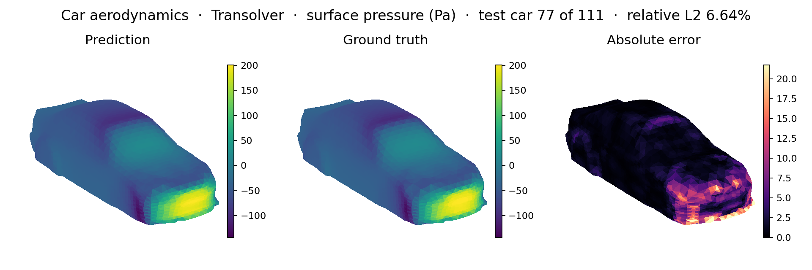
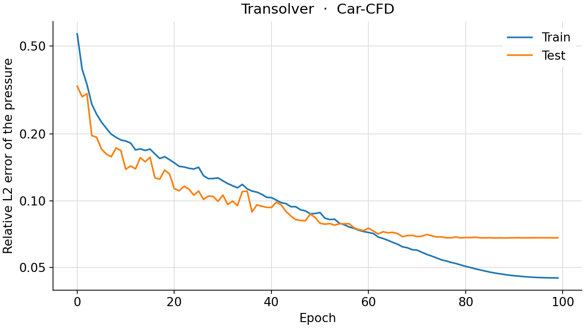
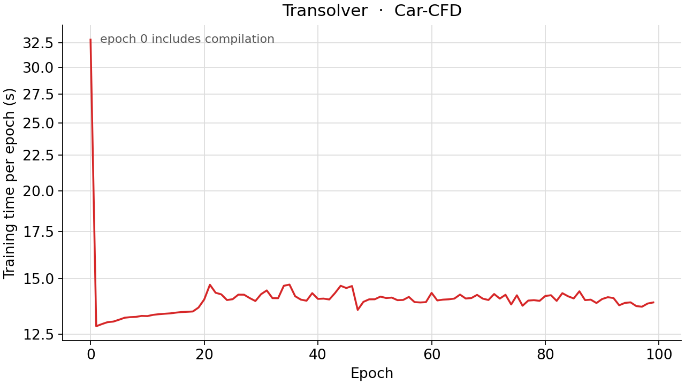

<!--
SPDX-FileCopyrightText: 2026 ZenteiQ AiTech Innovations Pvt. Ltd.
License notice: Documentation text and diagrams on this page are licensed
under CC BY 4.0. Source-code examples are licensed under LGPL-3.0-only
unless the example states otherwise.
-->

# Tutorial: Car-CFD (Car Surface Pressure) with Transolver

In this tutorial you train a [Transolver](../../theory_guide/operator_learning.md#transolver) [[3]](#ref3) on
**Car-CFD**, the car benchmark of the GINO paper ([[1]](#ref1)):
given the shape of a car, predict the steady pressure at each of the 3,586
vertices of its surface mesh. Every car is a different ShapeNet model in the
same wind tunnel. Transolver needs no grid: each vertex is one token, with
its position and unit normal as features, and attention runs over a small set
of learned "slices" of similar points. The whole tutorial is one script,
[`scripts/tutorials/carcfd_transolver.py`](../../../scripts/tutorials/carcfd_transolver.py). It uses only the public ScireX API
([`scirex.models.Transolver`](../../api/models.md#scirex.models.Transolver), [`scirex.training.adamw_cx`](../../api/training.md#scirex.training.adamw_cx),
[`scirex.utils.count_model_params`](../../api/utils.md#scirex.utils.count_model_params)), NumPy and open3d for the data, and plain
JAX and optax for the training loop. The code on this page is copied from
that script.

## Summary

| | |
|---|---|
| Problem | Steady external flow around a car ([[2]](#ref2)): car geometry in, surface pressure at 3,586 mesh vertices out |
| Model | Transolver, [`scirex.models.Transolver`](../../api/models.md#scirex.models.Transolver), irregular geometry, input per vertex = position (3) + unit normal (3). Benchmark size: the Transolver paper's car shape (8 layers, 8 heads, MLP ratio 2, 32 slices) widened to `n_hidden=1136`, GINO's parameter budget: 75,481,841 parameters. Smoke size: `n_hidden=64, n_layers=2, n_head=4, mlp_ratio=2, slice_num=16`, 70,121 parameters |
| Data | neuraloperator's processed Car-CFD (Zenodo record 13936501, CC BY 4.0, 198 MB), 611 cars. Benchmark: the GINO paper's 500 train / 111 test. Smoke: the first 8 train / first 4 test cars |
| Optimiser | Adam ([`adamw_cx`](../../api/training.md#scirex.training.adamw_cx), no weight decay, β₂ 0.999, ε 1e-6), peak learning rate 1e-4 (chosen on a validation split), one epoch of linear warm-up, cosine decay to 0, 100 epochs, one car per step |
| Metric | Relative L2 error of the de-normalised surface pressure per car, averaged over the test cars (the GINO paper's metric) |
| Full-run values | 6.81% (seed 0, final epoch; best epoch 6.79%). GINO paper [[1]](#ref1), GINO decoder: 7.12%; this repository's GINO: 8.37% |

## Setup

The setup is the same as in the [GINO tutorial](../GINO/CarCFD_GINO.md#setup).

### Data

This gives `processed-car-pressure-data/` with `train.txt` and `test.txt` (the
GINO paper's 500 / 111 split, comma-separated car ids) and
`data/data/<id>/tri_mesh.ply` and `press.npy` for each of the 611 cars. Pass
that folder as `--data-dir`, or set `CARCFD_DATA_DIR`. The benchmark's own
loader takes the folder *above* it as `--data-root`. ScireX does not
redistribute the data; see the [dataset guide](../../dataset_guide/car_cfd.md).

## The problem

The problem, the data and the metric are the same as in the [GINO tutorial](../GINO/CarCFD_GINO.md#the-problem).

Only the car surface and the pressure on it are in the data. The model never
sees the equation: it learns the map from the car's shape to its surface
pressure from 500 solved cars. The
[problem card](../../benchmarks/car_cfd/README.md) has every parameter and the
open questions, for example the unit of the stored pressure and the
length unit of the meshes.

Each car enters as its $N = 3586$ vertices, with features
$\mathbf x_i = (x_i, y_i, z_i, n_{x,i}, n_{y,i}, n_{z,i})$: the position,
scaled into [0, 1] with one bounding box of all cars, and the unit vertex
normal. This is the Transolver paper's car input (position, signed distance,
normal) without the signed distance, which is zero on the surface where the
pressure lives. The pressure is standardised with one scalar mean and
standard deviation, $\tilde p = (p - \mu)/(\sigma + 10^{-7})$, and the model
is the map

$$
\mathcal G_\theta : \mathbf x \in \mathbb R^{N\times 6} \;\mapsto\; \hat{\tilde p} \in \mathbb R^{N} .
$$

The training loss of one car is the relative L2 error of the normalised
pressure, and the test metric is the same error on the de-normalised
pressure, averaged over the $N_\mathrm{test}$ test cars:

$$
\mathcal L = \frac{\lVert \hat{\tilde p} - \tilde p\rVert_2}{\lVert \tilde p\rVert_2 + \varepsilon}, \qquad
E_\mathrm{test} = \frac{1}{N_\mathrm{test}}\sum_{k=1}^{N_\mathrm{test}} \frac{\lVert \hat p_k - p_k\rVert_2}{\lVert p_k\rVert_2 + \varepsilon}, \qquad \varepsilon = 10^{-8} .
$$

**Transolver in one paragraph.** Attention over all $N$ points would cost
$O(N^2)$. Transolver instead softly assigns the points to a small number of
learned slices (`slice_num`), lets the slices attend to each other, and sends
the result back to every point. The cost grows linearly with $N$, and the same
network runs on grids, meshes and point clouds. Unlike GINO it needs no latent
grid and no graph: it reads the surface points directly. The
[theory guide](../../theory_guide/operator_learning.md#transolver) has the details.

## Step-by-step walkthrough

The explanations of the steps that are the same for every model are in the [GINO tutorial](../GINO/CarCFD_GINO.md#step-by-step-walkthrough). This page keeps the code and the text that is specific to the model.

### 1. Setup

Imports, the precision setting, the seed, the training settings and the two
model sizes. `PROTOCOL` holds the benchmark's `transolver_val` settings (the
same values as in [`scripts/benchmarks/car_cfd/_config.py`](../../../scripts/benchmarks/car_cfd/_config.py)). `SIZES["full"]`
is the benchmark's Transolver; `SIZES["smoke"]` is small enough for a CPU.

<!-- tutorial-snippet -->
```python
from __future__ import annotations

import argparse
import os
import platform
from pathlib import Path
from time import perf_counter

import flax
import jax
import jax.numpy as jnp
import matplotlib
import matplotlib.pyplot as plt
import numpy as np
import open3d as o3d
import optax
from matplotlib.colors import Normalize
from mpl_toolkits.mplot3d.art3d import Poly3DCollection

import scirex
from scirex.models import Transolver
from scirex.training import adamw_cx
from scirex.utils import count_model_params

matplotlib.use("Agg")  # write figures to files, no display needed
```

The committed Car-CFD runs (the Transolver included) were computed with JAX's 64-bit mode on. An earlier version of the
library switched it on as a side effect of importing [`GINO`](../../api/models.md#scirex.models.GINO); 1.0 does not.
The script sets it explicitly, so that it computes as those runs did. Data and weights stay float32.

<!-- tutorial-snippet -->
```python
# The committed Car-CFD runs were computed with jax_enable_x64 on (an earlier
# version of the library turned it on as a side effect of importing GINO; 1.0
# does not). Setting it explicitly keeps the tutorial in the numerics of those
# runs. The data and the weights are still float32.
jax.config.update("jax_enable_x64", True)
```

<!-- tutorial-snippet -->
```python
SEED = 0

# Training settings of the benchmark's "transolver_val" run, the same values
# as PROTOCOL and RUNS["transolver_val"] in scripts/benchmarks/car_cfd/_config.py:
# the GINO paper's split and 100 epochs, Adam (adamw_cx with no weight decay;
# Transolver has only real weights, so this is plain Adam), a peak learning
# rate of 1e-4 chosen on a validation split, one epoch of linear warm-up from
# 0 and cosine decay to 0, one car per step.
PROTOCOL = dict(
    n_train=500,
    n_test=111,
    n_epochs=100,
    learning_rate=1e-4,
    warmup_epochs=1,
    weight_decay=0.0,
    adam_b2=0.999,
    adam_eps=1e-6,
)

# Model sizes. "full" is the benchmark's Transolver: the Transolver paper's
# car shape (8 layers, 8 heads, MLP ratio 2, 32 slices) widened to GINO's
# parameter budget, 75,481,841 parameters (GINO: 75,917,953). "smoke" is a
# tiny Transolver that trains on a CPU.
SIZES = dict(
    full=dict(n_hidden=1136, n_layers=8, n_head=8, mlp_ratio=2, slice_num=32),
    smoke=dict(n_hidden=64, n_layers=2, n_head=4, mlp_ratio=2, slice_num=16),
)

# The stored pressure has 3,682 entries per car and the mesh 3,586 vertices.
# The benchmark keeps entries 0-15 and 112-3681 so that the two match; the
# source of this slice does not say why (see the Car-CFD problem card).
KEEP = np.r_[0:16, 112:3682]
```

<!-- tutorial-snippet -->
```python
def print_environment(seed: int) -> None:
    """Print the versions, the devices and the seed, so a run can be repeated."""
    print(f"python {platform.python_version()} | numpy {np.__version__}")
    print(f"scirex {scirex.__version__} | open3d {o3d.__version__}")
    print(
        f"jax {jax.__version__} | flax {flax.__version__} | optax {optax.__version__}"
    )
    print(f"devices: {jax.devices()}")
    print(f"SEED = {seed}")
```

### 2. Load the data

`read_ids` and `car_folder` find the cars. `load_cars` does what the
benchmark's loader does for Transolver: one bounding box over all loaded cars
scales the vertices into [0, 1]; open3d computes the unit vertex normals; the
pressure is standardised with one scalar mean and standard deviation of all
loaded cars, train and test together, as in neuraloperator's reference loader.
The stored pressure has 3,682 entries per car and the mesh 3,586 vertices; the
benchmark keeps entries 0 to 15 and 112 to 3,681 (`KEEP`). The benchmark's
loader also computes a signed distance function on a token 8³ grid that
Transolver never reads, so it is left out here.

<!-- tutorial-snippet -->
```python
def read_ids(data_dir: Path, split: str, n: int) -> list[str]:
    """The first ``n`` car ids of ``train.txt`` or ``test.txt``."""
    ids = (Path(data_dir) / f"{split}.txt").read_text().split(",")
    return [i.strip() for i in ids[:n]]
```

<!-- tutorial-snippet -->
```python
def car_folder(data_dir: Path, car_id: str) -> Path:
    """``data/<id>``, or ``data/data/<id>`` as in the Zenodo archive."""
    folder = Path(data_dir) / "data" / car_id
    return folder if folder.exists() else Path(data_dir) / "data" / "data" / car_id
```

<!-- tutorial-snippet -->
```python
def load_cars(data_dir: Path, n_train: int, n_test: int) -> dict:
    """Positions, normals and normalised pressure of one split."""
    ids = read_ids(data_dir, "train", n_train) + read_ids(data_dir, "test", n_test)
    meshes = []
    for car_id in ids:
        path = car_folder(data_dir, car_id) / "tri_mesh.ply"
        mesh = o3d.io.read_triangle_mesh(str(path))
        mesh.compute_triangle_normals()
        mesh.compute_vertex_normals()
        meshes.append(mesh)
    lo = np.min([m.get_min_bound() for m in meshes], axis=0)
    hi = np.max([m.get_max_bound() for m in meshes], axis=0)

    cars = []
    for car_id, mesh in zip(ids, meshes):
        vertices = (np.asarray(mesh.vertices) - lo) / (hi - lo)
        cars.append(
            dict(
                id=car_id,
                vertices=vertices.astype(np.float32),
                normals=np.asarray(mesh.vertex_normals).astype(np.float32),
                triangles=np.asarray(mesh.triangles),
            )
        )
    press = np.stack(
        [np.load(car_folder(data_dir, i) / "press.npy") for i in ids]
    ).astype(np.float32)
    # One scalar mean and std over every stored entry of every loaded car. The
    # benchmark's streaming normaliser ends with sqrt(var) * N / (N - 1); the
    # same factor is used here (it changes the std by 4e-7 at full size).
    n = press.size
    mean = press.mean(dtype=np.float64)
    std = np.sqrt(press.var(dtype=np.float64)) * n / (n - 1)
    for car, p in zip(cars, press):
        car["press"] = ((p - mean) / (std + 1e-7))[KEEP].astype(np.float32)
    print(
        f"cars: {n_train} train / {n_test} test | vertices per car: "
        f"{len(cars[0]['vertices'])} | pressure mean {mean:.3f}, std {std:.3f}"
    )
    return dict(
        train=cars[:n_train],
        test=cars[n_train:],
        press_mean=float(mean),
        press_scale=float(std + 1e-7),
        box=(lo, hi),  # to draw the cars in mesh coordinates
    )
```

### 3. Build the model

`transolver_input` stacks the six features of every vertex into one sequence
of shape `(1, 3586, 6)`. `fun_dim=0` because there is no input function, and
`geometry="irregular"` because the points are not on a grid. [`Transolver`](../../api/models.md#scirex.models.Transolver) is a
Flax module: `init` creates the parameters and `apply` uses them.

<!-- tutorial-snippet -->
```python
def transolver_input(car: dict) -> jnp.ndarray:
    """``(1, n_vertices, 6)``: position and unit normal of every vertex."""
    return jnp.asarray(np.concatenate([car["vertices"], car["normals"]], axis=-1))[None]
```

<!-- tutorial-snippet -->
```python
def build_model(size: dict, car: dict, seed: int):
    """Build the Transolver, initialise it on one car and print its size."""
    model = Transolver(space_dim=6, fun_dim=0, out_dim=1, geometry="irregular", **size)
    params = model.init(jax.random.PRNGKey(seed), x=transolver_input(car))
    print(f"Transolver {size} | parameters: {count_model_params(params):,}")
    return model, params
```

### 4. Loss

<!-- tutorial-snippet -->
```python
def rel_l2(pred, true, eps: float = 1e-8):
    """``||pred - true|| / (||true|| + eps)`` over all vertices of one car."""
    diff = jnp.linalg.norm((pred - true).ravel())
    return diff / (jnp.linalg.norm(true.ravel()) + eps)
```

<!-- tutorial-snippet -->
```python
def make_loss(model):
    """Return ``loss_fn(params, x, press) -> relative L2``."""

    def loss_fn(params, x, press):
        return rel_l2(model.apply(params, x=x)[0, :, 0], press)

    return loss_fn
```

### 5. Optimiser

Adam, built as in the benchmark: [`adamw_cx`](../../api/training.md#scirex.training.adamw_cx) with no weight decay inside
`optax.inject_hyperparams`, with the learning rate given as a per-step
schedule: a linear warm-up from 0 to the peak over the first epoch, then
cosine decay to 0 at the last step. Transolver's weights are all real, so
[`adamw_cx`](../../api/training.md#scirex.training.adamw_cx) is plain Adam here. At 75 million parameters the Transolver paper's
own peak of 1e-3 diverged, and 1e-4 was chosen on a validation split of the
training cars (see the [learning-rate searches](../../benchmarks/car_cfd/results/comparative.md#learning-rate-searches)).

<!-- tutorial-snippet -->
```python
def make_optimizer(protocol: dict, steps_per_epoch: int, epochs: int):
    """Adam with a linear warm-up and cosine decay, one value per step."""
    warmup = int(protocol["warmup_epochs"] * steps_per_epoch)
    schedule = optax.warmup_cosine_decay_schedule(
        init_value=0.0,
        peak_value=protocol["learning_rate"],
        warmup_steps=warmup,
        # At least one step of decay, so that a one-epoch run is valid too.
        decay_steps=max(steps_per_epoch * epochs, warmup + 1),
        end_value=0.0,
    )

    def make_tx(learning_rate, weight_decay):
        return adamw_cx(
            learning_rate,
            weight_decay=weight_decay,
            b2=protocol["adam_b2"],
            eps=protocol["adam_eps"],
        )

    tx = optax.inject_hyperparams(make_tx, hyperparam_dtype=jnp.float32)(
        learning_rate=schedule, weight_decay=protocol["weight_decay"]
    )
    return tx, schedule
```

### 6. Train

One car per step, in a new random order every epoch. After every epoch the
test cars are scored, to draw the error curve; no epoch is selected by it, and
the reported weights are those after the last epoch. JAX compiles the step on
its first call, so the first epoch is slower than the others.

<!-- tutorial-snippet -->
```python
def train(model, params, data, epochs, seed, protocol=PROTOCOL):
    """Train for ``epochs`` epochs. Return the final parameters and the history."""
    tx, schedule = make_optimizer(protocol, len(data["train"]), epochs)
    opt_state = tx.init(params)
    loss_fn = make_loss(model)
    predict = make_predict(model)

    @jax.jit
    def train_step(params, opt_state, x, press):
        loss, grads = jax.value_and_grad(loss_fn)(params, x, press)
        updates, opt_state = tx.update(grads, opt_state, params)
        return optax.apply_updates(params, updates), opt_state, loss

    rng = np.random.default_rng(seed)
    history = []
    for epoch in range(epochs):
        t0 = perf_counter()
        losses = []
        for i in rng.permutation(len(data["train"])):
            car = data["train"][i]
            params, opt_state, loss = train_step(
                params, opt_state, transolver_input(car), jnp.asarray(car["press"])
            )
            losses.append(float(loss))
        secs = perf_counter() - t0
        test = evaluate(predict, params, data)["test_rel_l2"]
        history.append(
            dict(
                epoch=epoch,
                train_rel_l2=float(np.mean(losses)),
                test_rel_l2=test,
                lr=float(schedule((epoch + 1) * len(data["train"]))),
                secs=secs,
            )
        )
        print(
            f"epoch {epoch}: train_rel_l2={history[-1]['train_rel_l2']:.4f} "
            f"test_rel_l2={test:.4f} epoch_time={secs:.1f}s"
        )
    return params, history
```

### 7. Evaluate

`make_predict` jits the forward pass once. `evaluate` de-normalises
prediction and truth and takes the relative L2 error per car: the mean is the
GINO paper's metric, and the median, the 90th percentile and the worst car
show how it is spread.

<!-- tutorial-snippet -->
```python
def make_predict(model):
    """The jitted forward pass, ``predict(params, x)`` -> normalised pressure."""
    return jax.jit(lambda params, x: model.apply(params, x=x)[0, :, 0])
```

<!-- tutorial-snippet -->
```python
def evaluate(predict, params, data) -> dict:
    """De-normalised relative L2 per test car, and the de-normalised predictions."""
    mean, scale = data["press_mean"], data["press_scale"]
    errors, preds = [], []
    for car in data["test"]:
        pred = np.asarray(predict(params, transolver_input(car))) * scale + mean
        true = car["press"] * scale + mean
        errors.append(float(rel_l2(jnp.asarray(pred), jnp.asarray(true))))
        preds.append(pred)
    errors = np.asarray(errors)
    return dict(
        test_rel_l2=float(errors.mean()),
        median=float(np.median(errors)),
        p90=float(np.percentile(errors, 90)),
        worst=float(errors.max()),
        errors=errors,
        predictions=preds,
    )
```

### 8. Plot

The standard figure for this benchmark has four panels for one test car: an
input, the true surface pressure, the predicted surface pressure (same colour
scale as the truth) and the absolute error. The input panel shows the
component of the unit normal along the car's length, one of the six features
the model reads. The cars are drawn in mesh coordinates from the benchmark's
three-quarter view, every triangle coloured by the mean of its three vertex
values. A second figure shows the error per epoch.

<!-- tutorial-snippet -->
```python
def draw_surface(ax, vertices, triangles, values, cmap, norm) -> None:
    """One car, upright: mesh axes (width, height, length) drawn as (x, z, y)."""
    pts = vertices[:, [0, 2, 1]]
    faces = values[triangles].mean(axis=1)
    ax.add_collection3d(
        Poly3DCollection(
            pts[triangles], facecolors=plt.get_cmap(cmap)(norm(faces)), edgecolor="none"
        )
    )
    for setter, k in ((ax.set_xlim, 0), (ax.set_ylim, 1), (ax.set_zlim, 2)):
        setter(pts[:, k].min(), pts[:, k].max())
    ax.set_box_aspect(np.ptp(pts, axis=0))
    ax.view_init(elev=20.0, azim=-60.0)
    ax.set_axis_off()
```

<!-- tutorial-snippet -->
```python
def plot_prediction(car, pred, true, data, path: Path, title: str) -> None:
    """Save an input, true and predicted pressure, and the absolute error."""
    lo, hi = data["box"]
    vertices = car["vertices"] * (hi - lo) + lo
    err = np.abs(pred - true)
    lim = Normalize(vmin=float(true.min()), vmax=float(true.max()))
    panels = [
        ("Input: normal along length", car["normals"][:, 2], "coolwarm",
         Normalize(vmin=-1.0, vmax=1.0)),
        ("Truth: pressure", true, "jet", lim),
        ("Prediction: pressure", pred, "jet", lim),
        ("Absolute error", err, "magma", Normalize(vmin=0.0, vmax=float(err.max()))),
    ]  # fmt: skip
    fig = plt.figure(figsize=(19, 4.6))
    for k, (name, values, cmap, norm) in enumerate(panels, start=1):
        ax = fig.add_subplot(1, 4, k, projection="3d")
        draw_surface(ax, vertices, car["triangles"], values, cmap, norm)
        ax.set_title(name)
        fig.colorbar(plt.cm.ScalarMappable(norm=norm, cmap=cmap), ax=ax, shrink=0.6)
    fig.suptitle(title)
    fig.savefig(path, dpi=120, bbox_inches="tight")
    plt.close(fig)
```

<!-- tutorial-snippet -->
```python
def plot_loss(history: list[dict], path: Path) -> None:
    """Save the training and test relative L2 per epoch."""
    epochs = [h["epoch"] for h in history]
    fig, ax = plt.subplots(figsize=(6, 4))
    ax.plot(
        epochs,
        [h["train_rel_l2"] for h in history],
        marker="o",
        label="train (normalised)",
    )
    ax.plot(
        epochs,
        [h["test_rel_l2"] for h in history],
        marker="o",
        label="test (de-normalised)",
    )
    ax.set_xlabel("epoch")
    ax.set_ylabel("relative L2 (mean over cars)")
    ax.set_yscale("log")
    ax.legend()
    ax.grid(True, alpha=0.3)
    fig.savefig(path, dpi=120, bbox_inches="tight")
    plt.close(fig)
```

The complete script is [`scripts/tutorials/carcfd_transolver.py`](../../../scripts/tutorials/carcfd_transolver.py).

## Run it

Smoke run (CPU, a few seconds, no GPU needed):

```bash
CUDA_VISIBLE_DEVICES= JAX_PLATFORMS=cpu python scripts/tutorials/carcfd_transolver.py \
    --data-dir ~/data/car-pressure-data/processed-car-pressure-data --smoke
```

Full protocol (500 / 111 cars, benchmark-size Transolver, 100 epochs; use a
GPU):

```bash
python scripts/tutorials/carcfd_transolver.py \
    --data-dir ~/data/car-pressure-data/processed-car-pressure-data
```

The other flags are `--epochs`, `--lr` (the peak learning rate), `--seed`,
`--out-dir` (default `outputs/carcfd_transolver_tutorial`) and, for the smoke
run, `--n-train` and `--n-test`.

This is the output of the smoke run on a CPU (smoke run, CPU, 8 train / 4
test cars, not a benchmark number). The wall time was 6.1 s,
measured with `time`, on a machine shared with other jobs (load average
4.67 at the start); library warnings are left out:

```text
python 3.12.3 | numpy 1.26.4
scirex 1.0.0rc1 | open3d 0.19.0
jax 0.6.2 | flax 0.10.7 | optax 0.2.8
devices: [CpuDevice(id=0)]
SEED = 0
cars: 8 train / 4 test | vertices per car: 3586 | pressure mean -37.211, std 46.393
data loading: 0.0s
Transolver {'n_hidden': 64, 'n_layers': 2, 'n_head': 4, 'mlp_ratio': 2, 'slice_num': 16} | parameters: 70,121
epoch 0: train_rel_l2=1.1125 test_rel_l2=0.8301 epoch_time=0.9s
epoch 1: train_rel_l2=1.0453 test_rel_l2=0.7838 epoch_time=0.1s
epoch 2: train_rel_l2=0.9671 test_rel_l2=0.7229 epoch_time=0.1s
epoch 3: train_rel_l2=0.9233 test_rel_l2=0.7083 epoch_time=0.1s
epoch 4: train_rel_l2=0.9014 test_rel_l2=0.7054 epoch_time=0.1s
test relative L2: mean 0.7054 | median 0.7205 | p90 0.7314 | worst 0.7358
figures in outputs/carcfd_transolver_tutorial | total time 4.6s
```

## Results

### Full run

The next figures were not made by this script. They come from the benchmark
runner (`train.py` and `infer.py`) and are the committed results of the **full
100-epoch run** `transolver_val` (seed 0, 500 training and 111 test cars,
benchmark-size Transolver, one NVIDIA RTX PRO 6000 Blackwell). `infer.py`
draws one test car (the figure title names it): truth, prediction and absolute error. The
prediction reproduces the stagnation pressure on the front face and the
suction around its edges; the remaining error sits on the front face.



Training and test relative L2 per epoch. The test error falls through most of
the run, passes the GINO paper's 7.12% at about epoch 65 and levels off at
about 6.8% as the cosine schedule brings the learning rate to zero:



Seconds per epoch of the same run (the first epoch includes compilation; in
`metrics.json`, the first epoch took 32.9 s and the mean is 14.1 s):



| Test relative L2, 111 test cars | Train | Test | Best test (epoch) |
|---|---|---|---|
| GINO (decoder), GINO paper [[1]](#ref1) | 6.37% | 7.12% | |
| GINO `paper` run of this repository | 3.55% | 8.37% | 8.31% (91) |
| **`transolver_val`, seed 0 (this tutorial's full mode)** | 4.49% | **6.81%** | 6.79% (88) |

| Model, same protocol and split, about 75 M parameters each | Test relative L2 |
|---|---|
| [GINO](../GINO/CarCFD_GINO.md) | 8.37% |
| **Transolver** | **6.81%** |
| [GIWO](../Others/CarCFD_GIWO.md) | 12.01% |

The train column is the relative L2 of the normalised pressure that the model
trains on, a different metric from the test column.

## Troubleshooting

The common problems are listed in the [GINO tutorial](../GINO/CarCFD_GINO.md#troubleshooting).

## Next steps

- Compare with the other architectures on the same benchmark:
  [GINO](../GINO/CarCFD_GINO.md), the paper's own model on a latent grid, and
  [GIWO](../Others/CarCFD_GIWO.md), GINO with a wavelet operator; the
  [comparison page](../../benchmarks/car_cfd/results/comparative.md) puts the three side
  by side.
- Read the [Car-CFD results](../../benchmarks/car_cfd/results/comparative.md#transolver)
  for the learning-rate screens, and the
  [problem card](../../benchmarks/car_cfd/README.md) for every parameter.
- Learn how Transolver works in the [theory guide](../../theory_guide/operator_learning.md#transolver)
  and see its arguments in the [API reference](../../api/models.md).
- Try Transolver on the same car shapes with the Transolver paper's own
  protocol, velocity and pressure: [ShapeNetCar with Transolver](../Transolver/ShapeNetCar_Transolver.md).

## References

1. <span id="ref1"></span>Li et al., *Geometry-Informed Neural Operator for Large-Scale 3D PDEs*, NeurIPS 2023. <https://arxiv.org/abs/2309.00583>

2. <span id="ref2"></span>Umetani and Bickel, *Learning Three-Dimensional Flow for Interactive Aerodynamic Design*, ACM Transactions on Graphics 37(4), 2018. <https://doi.org/10.1145/3197517.3201325>

3. <span id="ref3"></span>Wu et al., *Transolver: A Fast Transformer Solver for PDEs on General Geometries*, ICML 2024. <https://arxiv.org/abs/2402.02366>
