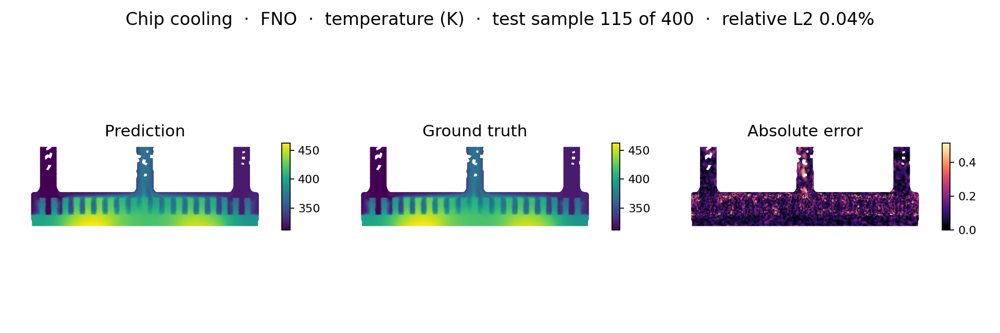
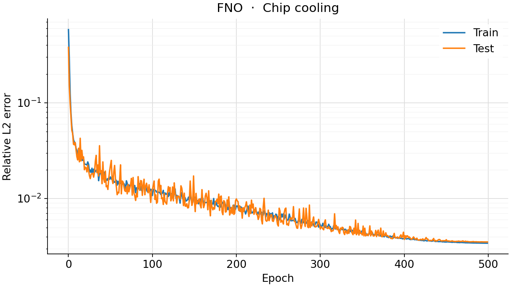
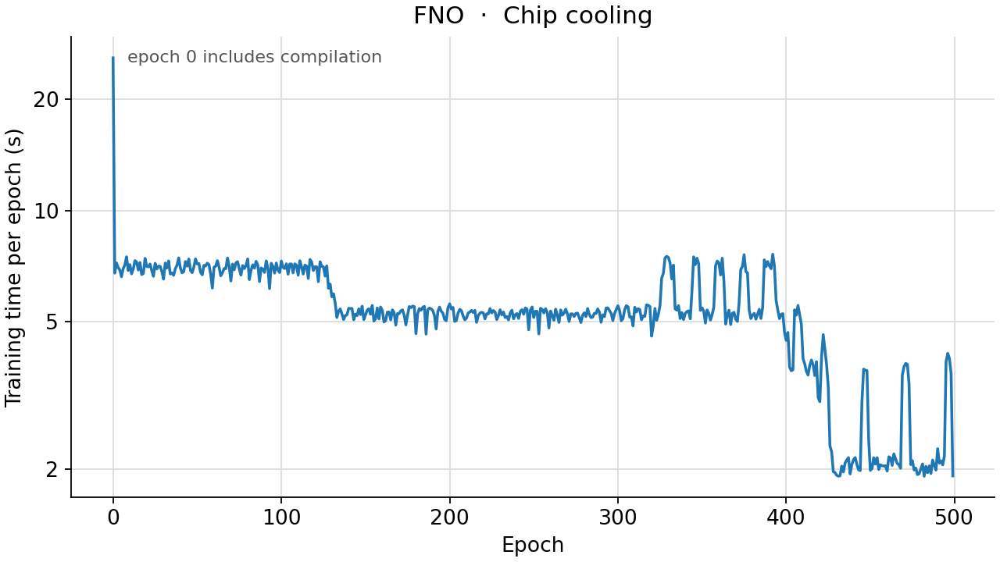

<!--
SPDX-FileCopyrightText: 2026 ZenteiQ AiTech Innovations Pvt. Ltd.
License notice: Documentation text and diagrams on this page are licensed
under CC BY 4.0. Source-code examples are licensed under LGPL-3.0-only
unless the example states otherwise.
-->

# Tutorial: Chip Cooling with FNO

In this tutorial you train a [Fourier Neural Operator](../../theory_guide/operator_learning.md#fno)
(FNO [[2]](#ref2)) on the **chip cooling** benchmark: given the six boundary conditions of
a liquid-cooled cold plate that carries two chips, predict the steady
temperature on the central plane of the plate. The data are 2000 CFD
simulations on an unstructured mesh; the FNO needs a regular grid, so the
temperature is interpolated onto one, and a mask marks the grid cells that
lie inside the plate. The whole tutorial is one script,
[`scripts/tutorials/chipcooling_fno.py`](../../../scripts/tutorials/chipcooling_fno.py). It uses only the public ScireX API
([`scirex.models.FNO`](../../api/models.md#scirex.models.FNO), [`scirex.training.adamw_cx`](../../api/training.md#scirex.training.adamw_cx),
[`scirex.utils.count_model_params`](../../api/utils.md#scirex.utils.count_model_params)) and plain NumPy, SciPy, JAX and optax. The
code on this page is copied from that script.

## Summary

| | |
|---|---|
| Problem | Steady temperature on the central plane of a liquid-cooled dual-chip cold plate: six boundary conditions in, temperature field out |
| Model | FNO, [`scirex.models.FNO`](../../api/models.md#scirex.models.FNO): `n_modes=(24, 24), hidden_channels=27`, 7 input channels, the class defaults otherwise (grid positional embedding), 1,829,496 parameters. The smoke run uses the same model |
| Data | [[1]](#ref1): 2000 ANSYS Fluent simulations, 11,110 mesh nodes on the plane. Benchmark: first 1600 train / last 400 test, interpolated to 128 × 256. Smoke: 64 train / 16 test, on 64 × 128 |
| Optimiser | [`adamw_cx`](../../api/training.md#scirex.training.adamw_cx) (AdamW for complex weights), eps 1e-6, weight decay 1e-4, cosine learning rate from 1e-3 to 0 set every epoch, batch size 8, seed 42 |
| Metric | In kelvin, over the in-domain grid cells of the 400 test simulations: R², RMSE, MAE, maximum absolute error, and the mean relative L2 error per simulation |
| Full-run values | R² 0.999987, RMSE 0.167 K, MAE 0.122 K, max AE 2.873 K, relative L2 4.1e-4. POD-NN of [[1]](#ref1): R² 0.998, MAE 1.534 K, max AE 8.849 K |

## Setup

Install the library from a clone of the repository (see [Install](../../install/index.md)):

```bash
pip install -e ".[all]"
```

### Data

The dataset is not bundled and not downloaded automatically. [[1]](#ref1)
archived it on Dryad ([doi:10.5061/dryad.k0p2ngfp5](https://doi.org/10.5061/dryad.k0p2ngfp5)),
under CC0. The script reads the layout that the repository's loader reads: one
folder with `model_setup.json` (the parameters of all 2000 simulations under
`doe_configuration`) and `sim_0001.npz` to `sim_2000.npz` (one simulation
each; the arrays `yz-mid|temperature` and `yz-mid|coordinates` are used). Pass
that folder as `--data-dir`, or set `CHIPCOOLING_DATA_DIR`, the variable the
benchmark reads too. See the [dataset guide](../../dataset_guide/chip_cooling.md)
for the source and the download.

All 2000 files must be present, because the i-th file belongs to the i-th
parameter row, but the script opens only the files it uses: the first
`ntrain` and the last `ntest`. A smoke run reads 80 files of about 0.7 MB.

## The problem

A copper cold plate with an array of pin fins carries two chips. Coolant
enters through two inlets and leaves through one central outlet. Each
simulation is a steady 3D CFD solution (incompressible RANS with the k-ω SST
model, coupled with the energy equation, in ANSYS Fluent); the dataset keeps
the temperature on the central plane, which cuts through both chips and the
main flow path. Six boundary conditions change between simulations, sampled
by Latin hypercube:

| Parameter | Range in the data |
|---|---|
| Heat flux of chip 1 and of chip 2 | 0.8 to 1.0 MW/m² (1280 to 1600 W on the 0.0016 m² die) |
| Mass flow rate of inlet 1 and of inlet 2 | 5 to 10 g/s |
| Temperature of inlet 1 and of inlet 2 | 300 to 340 K |

The geometry is the same in every simulation; only these six numbers change.
The model is a map

$$
\mathcal G_\theta : \mathbf p \in \mathbb R^{6} \;\mapsto\; T \in \mathbb R^{H\times W},
$$

from the parameters to the temperature on an $H \times W$ grid. The
[dataset guide](../../dataset_guide/chip_cooling.md) has the setup and the known limits.

**From the mesh to a grid.** The 11,110 nodes of the plane are scattered, and
the plane is not a rectangle: it is the band of pin fins plus three channels
(the two inlets and the outlet). The temperature is interpolated linearly onto
a regular grid over the bounding box, and a mask $M$ marks the cells that
contain at least one node. On the 128 × 256 grid of the benchmark, 23% of the
cells are in the domain; on the 64 × 128 grid of the smoke run, whose cells are
larger, 47% are.

**Inputs, targets and loss.** Each parameter is standardised with the training
mean and standard deviation and broadcast over the grid as one constant
channel; the mask is a seventh channel. The target is standardised with one
mean and one standard deviation over the in-domain cells of the training
fields, $\tilde T = (T - \mu_T)/\sigma_T$. The loss of a batch $B$ is the
relative L2 error over its in-domain cells:

$$
\mathcal L_B = \sqrt{\frac{\sum_{i\in B}\sum_{c} M_c\,(\hat{\tilde T}_{i,c}-\tilde T_{i,c})^2}{\sum_{i\in B}\sum_{c} M_c\,\tilde T_{i,c}^2}} .
$$

The metrics are in kelvin over the in-domain cells: R², RMSE and MAE pooled
over all cells of all test simulations, the largest absolute error, and the
relative L2 error $\lVert \hat T_i - T_i\rVert / \lVert T_i\rVert$ of each
simulation, averaged. A field of 300 to 500 K has a large norm, so its
relative L2 error is small; the errors in kelvin are easier to read. As a
**baseline**, the mean of the training fields predicts the same field for every
test simulation: it gets the layout of the hot and cold regions right and
ignores the parameters.

**FNO in one paragraph.** An FNO layer adds a pointwise linear map to a
convolution done in Fourier space: it takes the FFT of the hidden channels,
keeps the lowest `n_modes` frequencies, multiplies each by a learned complex
matrix and transforms back. One layer couples every cell with every other.
Here the input channels are constant except the mask, so the network relies
on the grid coordinates that [`FNO`](../../api/models.md#scirex.models.FNO) appends by default (`positional_embedding`)
to know where it is. The [theory guide](../../theory_guide/operator_learning.md#fno) has the
details.

## Step-by-step walkthrough

### 1. Setup

Imports, the seed, the training settings and the model. `PROTOCOL` holds the
benchmark's settings (the same values as `PROTOCOL` and `RUNS["fno"].opt` in
[`scripts/benchmarks/chip_cooling/_config.py`](../../../scripts/benchmarks/chip_cooling/_config.py)): 1600 / 400 simulations, a
128 × 256 grid, 500 epochs, batch size 8, a peak learning rate of 1e-3 and
weight decay 1e-4. `ARCH` is the benchmark's FNO. Its parameter count does not
depend on the grid, so the smoke run uses it too, on a coarser grid.

<!-- tutorial-snippet -->
```python
from __future__ import annotations

import argparse
import json
import math
import os
import platform
import re
from pathlib import Path
from time import perf_counter

import flax
import jax
import jax.numpy as jnp
import matplotlib
import matplotlib.pyplot as plt
import numpy as np
import optax
from scipy.interpolate import LinearNDInterpolator, NearestNDInterpolator
from scipy.spatial import Delaunay

import scirex
from scirex.models import FNO
from scirex.training import adamw_cx
from scirex.utils import count_model_params

matplotlib.use("Agg")  # write figures to files, no display needed
# Keep float32, also if float64 was enabled earlier in the process.
jax.config.update("jax_enable_x64", False)
```

<!-- tutorial-snippet -->
```python
SEED = 42

# The chip cooling benchmark's settings, the same values as PROTOCOL and
# RUNS["fno"].opt in scripts/benchmarks/chip_cooling/_config.py.
PROTOCOL = dict(
    ntrain=1600,
    ntest=400,
    grid=(128, 256),
    epochs=500,
    batch_size=8,
    learning_rate=1e-3,
    weight_decay=1e-4,
)

# The benchmark's FNO (1,829,496 parameters, matched to Transolver's
# 1,807,561). The smoke run uses it too: its parameter count does not depend
# on the grid, and on a coarser grid it trains on a CPU in minutes.
ARCH = dict(n_modes=(24, 24), hidden_channels=27)

# The six parameters, in the loader's order: sorted by boundary condition,
# then by parameter name.
PARAM_LABELS = [
    "chip 1 heat flux",
    "chip 2 heat flux",
    "inlet 1 mass flow",
    "inlet 1 temperature",
    "inlet 2 mass flow",
    "inlet 2 temperature",
]
FIELD_KEY = "yz-mid|temperature"
COORD_KEY = "yz-mid|coordinates"
```

`print_environment` records the library versions, the devices JAX sees and the seed;
see [how the tutorials work](../index.md#how-the-tutorials-work).

<!-- tutorial-snippet -->
```python
def print_environment(seed: int) -> None:
    """Print the versions, the devices and the seed, so a run can be repeated."""
    print(f"python {platform.python_version()} | numpy {np.__version__}")
    print(f"scirex {scirex.__version__}")
    print(
        f"jax {jax.__version__} | flax {flax.__version__} | optax {optax.__version__}"
    )
    print(f"devices: {jax.devices()}")
    print(f"SEED = {seed}")
```

### 2. Load the data

`load_chip_cooling` reads the six parameters of every simulation from
`model_setup.json`, in the loader's order (sorted by boundary condition, then
by name: chip 1 and chip 2 heat flux, then mass flow and temperature of inlet
1 and of inlet 2), sorts the `sim_*.npz` files by number and reads the
temperature and the node coordinates of the training and test simulations
only.

<!-- tutorial-snippet -->
```python
def load_chip_cooling(data_dir: Path, ntrain: int, ntest: int) -> dict:
    """Parameters ``(n, 6)``, temperatures ``(n, 11110)`` in K and coordinates."""
    data_dir = Path(data_dir)
    doe = json.loads((data_dir / "model_setup.json").read_text())["doe_configuration"]
    columns = [
        doe[bc][name]
        for bc in sorted(doe)
        for name in sorted(doe[bc])
        if isinstance(doe[bc][name], list)
    ]
    parameters = np.asarray(columns, dtype=np.float32).T  # (2000, 6)
    files = sorted(
        data_dir.glob("sim_*.npz"), key=lambda p: int(re.search(r"\d+", p.stem)[0])
    )
    if len(files) != len(parameters) or ntrain + ntest > len(files):
        raise ValueError(
            f"{len(files)} simulation files for {len(parameters)} parameter rows; "
            f"need ntrain + ntest <= {len(files)}"
        )
    rows = dict(train=np.arange(ntrain), test=np.arange(len(files) - ntest, len(files)))
    out = {}
    for name, idx in rows.items():
        fields = []
        for i in idx:
            with np.load(files[i], allow_pickle=False) as d:
                fields.append(np.asarray(d[FIELD_KEY], dtype=np.float32))
                coords = np.asarray(d[COORD_KEY], dtype=np.float32)
        out[f"params_{name}"] = parameters[idx]
        out[f"T_{name}"] = np.stack(fields)
    out["coords"] = coords
    print(
        f"simulations: {ntrain} train / {ntest} test | {coords.shape[0]} mesh nodes | "
        f"T range [{out['T_train'].min():.1f}, {out['T_train'].max():.1f}] K"
    )
    return out
```

### 3. Put the fields on a grid

`domain_mask` marks the grid cells that contain at least one mesh node.
`rasterise` interpolates every field linearly, fills the in-domain cells the
linear interpolation misses with the nearest node's value, and sets the cells
outside the domain to 0. The benchmark does the same with
`scipy.interpolate.griddata`, which builds a Delaunay triangulation of the
nodes for every field; here the triangulation is built once and reused,
which gives the same values (the tests check this) and is faster.

<!-- tutorial-snippet -->
```python
def domain_mask(coords: np.ndarray, y_grid: np.ndarray, z_grid: np.ndarray):
    """``(H, W)`` mask: True where at least one mesh node falls in the cell."""

    def edges(g):
        e = np.empty(len(g) + 1)
        e[1:-1] = 0.5 * (g[:-1] + g[1:])
        e[0], e[-1] = g[0] - 0.5 * (g[1] - g[0]), g[-1] + 0.5 * (g[-1] - g[-2])
        return e

    iy = np.searchsorted(edges(y_grid), coords[:, 1], side="right") - 1
    iz = np.searchsorted(edges(z_grid), coords[:, 2], side="right") - 1
    ok = (iy >= 0) & (iy < len(y_grid)) & (iz >= 0) & (iz < len(z_grid))
    mask = np.zeros((len(y_grid), len(z_grid)), dtype=bool)
    mask[iy[ok], iz[ok]] = True
    return mask
```

<!-- tutorial-snippet -->
```python
def rasterise(coords: np.ndarray, fields: np.ndarray, grid: tuple[int, int]) -> dict:
    """Fields ``(n, n_nodes)`` -> ``(n, H, W)`` on a grid, 0 outside the mask."""
    y, z = coords[:, 1], coords[:, 2]
    y_grid = np.linspace(y.min(), y.max(), grid[0])
    z_grid = np.linspace(z.min(), z.max(), grid[1])
    zg, yg = np.meshgrid(z_grid, y_grid)
    mask = domain_mask(coords, y_grid, z_grid)
    nodes = np.stack([z, y], axis=-1)
    tri = Delaunay(nodes)  # one triangulation for every field
    out = np.zeros((len(fields), *grid), dtype=np.float32)
    for i, f in enumerate(fields):
        vals = LinearNDInterpolator(tri, f)(zg, yg)
        missing = mask & ~np.isfinite(vals)
        if missing.any():
            vals[missing] = NearestNDInterpolator(nodes, f)(zg, yg)[missing]
        out[i] = np.where(mask, vals, 0.0)
    return dict(fields=out, mask=mask, y_grid=y_grid, z_grid=z_grid)
```

### 4. Inputs and normalisation

`grid_inputs` broadcasts the six parameters over the grid and adds the mask.
`normalise` standardises the parameter channels and the in-domain target
cells with the statistics of the training split, and keeps the targets at 0
outside the domain.

<!-- tutorial-snippet -->
```python
def grid_inputs(params: np.ndarray, mask: np.ndarray) -> np.ndarray:
    """``(n, 6)`` parameters -> ``(n, 7, H, W)``: six constant channels and the mask."""
    x = np.zeros((len(params), 7, *mask.shape), dtype=np.float32)
    x[:, :6] = params[:, :, None, None]
    x[:, 6] = mask
    return x
```

<!-- tutorial-snippet -->
```python
def normalise(data: dict, grid: dict) -> dict:
    """Standardised inputs and targets; the statistics come from the training split."""
    mask = grid["mask"]
    x_train = grid_inputs(data["params_train"], mask)
    x_test = grid_inputs(data["params_test"], mask)
    x_mean = x_train[:, :6].mean(axis=(0, 2, 3), keepdims=True)
    x_std = x_train[:, :6].std(axis=(0, 2, 3), keepdims=True) + 1e-8
    for x in (x_train, x_test):
        x[:, :6] = (x[:, :6] - x_mean) / x_std
    y_train, y_test = grid["fields_train"], grid["fields_test"]
    y_mean = float(y_train[:, mask].mean())
    y_std = float(y_train[:, mask].std()) + 1e-8

    def encode(y):
        return np.where(mask, (y - y_mean) / y_std, 0.0)[:, None].astype(np.float32)

    return dict(
        x_train=x_train,
        x_test=x_test,
        y_train=encode(y_train),
        y_test=encode(y_test),
        y_mean=y_mean,
        y_std=y_std,
    )
```

### 5. Build the model

[`FNO`](../../api/models.md#scirex.models.FNO) is a Flax module: the parameters are a separate pytree, created by
`init` and used by `apply`. It is channels-first, so a batch is
`(batch, 7, H, W)`. The key comes from splitting `PRNGKey(seed)`, as in the
benchmark, so the same seed gives the same initial weights.
[`count_model_params`](../../api/utils.md#scirex.utils.count_model_params) counts a complex weight as two real numbers.

<!-- tutorial-snippet -->
```python
def build_model(arch: dict, sample: np.ndarray, seed: int):
    """Build the FNO, initialise it on one sample and print the parameter count."""
    model = FNO(in_channels=7, out_channels=1, **arch)
    _, key = jax.random.split(jax.random.PRNGKey(seed))
    params = model.init(key, x=jnp.zeros((1, *sample.shape), dtype=jnp.float32))
    print(f"FNO {arch} | parameters: {count_model_params(params):,}")
    return model, params
```

### 6. Loss

The loss from [The problem](#the-problem): the relative L2 error over the
in-domain cells of the whole batch, on the standardised temperature.

<!-- tutorial-snippet -->
```python
def masked_rel_l2(pred, target, mask):
    """Relative L2 over the batch, counting only the cells where ``mask`` is set."""
    m = mask.astype(pred.dtype)
    num = jnp.sum(((pred - target) ** 2) * m)
    return jnp.sqrt(num / (jnp.sum((target**2) * m) + 1e-12))
```

<!-- tutorial-snippet -->
```python
def make_loss(model, mask: np.ndarray):
    """Return ``loss_fn(params, x, y) -> masked relative L2``."""
    m = jnp.asarray(mask)[None, None]

    def loss_fn(params, x, y):
        return masked_rel_l2(model.apply(params, x=x), y, m)

    return loss_fn
```

### 7. Optimiser for complex weights

The spectral weights of an FNO are complex. For a real loss $L$ and a complex
weight $w$, `jax.grad` returns $\partial L/\partial w$, the complex conjugate
of the steepest-ascent direction that optax transforms assume, so plain
`optax.adamw` moves the imaginary part of every spectral weight the wrong way.
[`adamw_cx`](../../api/training.md#scirex.training.adamw_cx) conjugates complex gradients first and keeps Adam's second moment
real; real weights are updated exactly as by AdamW. The learning rate is an
injected hyperparameter so that the training loop can set it every epoch.
`hyperparam_dtype=jnp.float32` keeps the injected values real; without it they
take the highest dtype among the weights, complex64 here. The benchmark's
`train.py` leaves it out, so its updates are complex with a zero imaginary
part (the same issue was fixed in the Navier-Stokes benchmark). With
`optimizer="adamw"` the script uses plain `optax.adamw`, with the same eps,
so that you can see the difference (see [Results](#results)).

<!-- tutorial-snippet -->
```python
def make_optimizer(protocol: dict, optimizer: str = "adamw_cx"):
    """AdamW with the learning rate exposed as an injected hyperparameter.

    ``"adamw_cx"`` (the benchmark's) is complex-aware; ``"adamw"`` is plain optax.
    """
    builder = dict(adamw_cx=adamw_cx, adamw=optax.adamw)[optimizer]
    return optax.inject_hyperparams(builder, hyperparam_dtype=jnp.float32)(
        learning_rate=protocol["learning_rate"],
        weight_decay=protocol["weight_decay"],
        eps=1e-6,  # adamw_cx's default, which the benchmark uses
    )
```

<!-- tutorial-snippet -->
```python
def cosine_lr(protocol: dict, epoch: int, epochs: int) -> float:
    """Learning rate of ``epoch``: a cosine from the peak to 0 over ``epochs``."""
    return protocol["learning_rate"] * (1 + math.cos(math.pi * epoch / epochs)) / 2
```

### 8. Train

Batches of 8 in a new random order every epoch, from NumPy's global generator
seeded once, as in the benchmark; one optimiser step per batch. After every
epoch the test simulations are scored with the same loss, to draw the error
curve. There is no validation split, so no epoch is selected: the weights after
the last epoch are the result. JAX compiles the step on its first call, so the
first epoch is slower than the others.

<!-- tutorial-snippet -->
```python
def train(
    model, params, norm, mask, epochs, seed, protocol=PROTOCOL, optimizer="adamw_cx"
):
    """Train for ``epochs`` epochs. Return the final parameters and the history."""
    tx = make_optimizer(protocol, optimizer)
    opt_state = tx.init(params)
    loss_fn = make_loss(model, mask)

    @jax.jit
    def train_step(params, opt_state, x, y):
        loss, grads = jax.value_and_grad(loss_fn)(params, x, y)
        updates, opt_state = tx.update(grads, opt_state, params)
        return optax.apply_updates(params, updates), opt_state, loss

    eval_step = jax.jit(loss_fn)
    bs = protocol["batch_size"]
    x_train, y_train = norm["x_train"], norm["y_train"]
    x_test, y_test = norm["x_test"], norm["y_test"]
    np.random.seed(seed)  # noqa: NPY002  (the benchmark's batch order)
    history = []
    for epoch in range(epochs):
        t0 = perf_counter()
        lr = cosine_lr(protocol, epoch, epochs)
        opt_state.hyperparams["learning_rate"] = jnp.asarray(lr, dtype=jnp.float32)
        order = np.arange(len(x_train))
        np.random.shuffle(order)  # noqa: NPY002
        losses = []
        for i in range(0, len(order), bs):
            b = order[i : i + bs]
            params, opt_state, loss = train_step(
                params, opt_state, jnp.asarray(x_train[b]), jnp.asarray(y_train[b])
            )
            losses.append(float(loss))
        secs = perf_counter() - t0
        test = [
            float(
                eval_step(params, jnp.asarray(x_test[i : i + bs]), y_test[i : i + bs])
            )
            for i in range(0, len(x_test), bs)
        ]
        history.append(
            dict(
                epoch=epoch,
                train_loss=float(np.mean(losses)),
                test_loss=float(np.mean(test)),
                lr=lr,
                secs=secs,
            )
        )
        print(
            f"epoch {epoch}: train_loss={history[-1]['train_loss']:.4f} "
            f"test_loss={history[-1]['test_loss']:.4f} lr={lr:.2e} "
            f"epoch_time={secs:.1f}s"
        )
    return params, history
```

### 9. Evaluate

`field_metrics` computes the benchmark's metrics in kelvin; `evaluate`
decodes the predictions, scores them and the mean-field baseline on the
in-domain cells, and returns the predictions with NaN outside the domain, for
the plot.

<!-- tutorial-snippet -->
```python
def field_metrics(pred: np.ndarray, true: np.ndarray) -> dict:
    """Metrics of ``(n, n_points)`` predictions in kelvin."""
    err = pred - true
    return dict(
        R2=float(1.0 - np.sum(err**2) / np.sum((true - true.mean()) ** 2)),
        RMSE=float(np.sqrt(np.mean(err**2))),
        MAE=float(np.mean(np.abs(err))),
        max_AE=float(np.max(np.abs(err))),
        rel_l2=float(
            np.mean(np.linalg.norm(err, axis=1) / np.linalg.norm(true, axis=1))
        ),
    )
```

<!-- tutorial-snippet -->
```python
def evaluate(model, params, norm, grid, batch_size: int = 8) -> dict:
    """Test metrics in kelvin on the in-domain cells, a baseline and the predictions."""
    predict = jax.jit(lambda p, x: model.apply(p, x=x))
    x_test, mask = norm["x_test"], grid["mask"]
    pred = np.concatenate(
        [
            np.asarray(predict(params, jnp.asarray(x_test[i : i + batch_size])))[:, 0]
            for i in range(0, len(x_test), batch_size)
        ]
    )
    pred = pred * norm["y_std"] + norm["y_mean"]
    true = grid["fields_test"]
    baseline = np.broadcast_to(grid["fields_train"].mean(axis=0), true.shape)
    return dict(
        model=field_metrics(pred[:, mask], true[:, mask]),
        baseline=field_metrics(baseline[:, mask], true[:, mask]),
        predictions=np.where(mask, pred, np.nan),
    )
```

### 10. Plot

The figure has four panels for one test simulation: the input (the six
standardised parameters, the only thing that changes between simulations),
the true and the predicted temperature on one colour scale, and the absolute
error, on the grid in millimetres. Cells outside the domain are blank. A second
figure shows the loss per epoch.

<!-- tutorial-snippet -->
```python
def plot_prediction(params, truth, pred, grid, path: Path, title: str) -> None:
    """Save input parameters, true temperature, predicted temperature and error."""
    zg, yg = np.meshgrid(grid["z_grid"] * 1e3, grid["y_grid"] * 1e3)
    truth = np.where(grid["mask"], truth, np.nan)
    lim = (np.nanmin(truth), np.nanmax(truth))
    fig, axes = plt.subplots(
        1, 4, figsize=(22, 4), gridspec_kw=dict(width_ratios=[0.8, 1, 1, 1])
    )
    axes[0].barh(PARAM_LABELS[::-1], params[::-1], color="tab:gray")
    axes[0].set_title("Input: six parameters (standardised)")
    for ax, (name, values, cmap, vlim) in zip(
        axes[1:],
        [
            ("Truth: temperature (K)", truth, "inferno", lim),
            ("Prediction: temperature (K)", pred, "inferno", lim),
            ("Absolute error (K)", np.abs(pred - truth), "magma", None),
        ],
    ):
        vmin, vmax = vlim if vlim else (None, None)
        mesh = ax.pcolormesh(zg, yg, values, cmap=cmap, vmin=vmin, vmax=vmax)
        ax.set_title(name)
        ax.set_aspect("equal")
        ax.set_xlabel("z (mm)")
        ax.set_ylabel("y (mm)")
        fig.colorbar(mesh, ax=ax, shrink=0.8)
    fig.suptitle(title)
    fig.savefig(path, dpi=110, bbox_inches="tight")
    plt.close(fig)
```

<!-- tutorial-snippet -->
```python
def plot_loss(history: list[dict], path: Path) -> None:
    """Save the training and test loss per epoch."""
    epochs = [h["epoch"] for h in history]
    fig, ax = plt.subplots(figsize=(6, 4))
    ax.plot(epochs, [h["train_loss"] for h in history], marker="o", label="train")
    ax.plot(epochs, [h["test_loss"] for h in history], marker="o", label="test")
    ax.set_xlabel("epoch")
    ax.set_ylabel("masked relative L2 (standardised)")
    ax.set_yscale("log")
    ax.legend()
    ax.grid(True, alpha=0.3)
    fig.savefig(path, dpi=120, bbox_inches="tight")
    plt.close(fig)
```

The complete script is [`scripts/tutorials/chipcooling_fno.py`](../../../scripts/tutorials/chipcooling_fno.py).

## Run it

Smoke run (CPU, about 20 s, no GPU needed):

```bash
CUDA_VISIBLE_DEVICES= JAX_PLATFORMS=cpu python scripts/tutorials/chipcooling_fno.py --data-dir ~/data/chip_cooling --smoke
```

Full protocol (1600 training simulations, 128 × 256 grid, 500 epochs; use a
GPU):

```bash
python scripts/tutorials/chipcooling_fno.py --data-dir ~/data/chip_cooling
```

The other flags are `--epochs`, `--seed`, `--out-dir` (default
`outputs/chipcooling_fno_tutorial`), `--grid H W`, `--optimizer` ([`adamw_cx`](../../api/training.md#scirex.training.adamw_cx),
the default, or `adamw`) and, for the smoke run, `--n-train` and `--n-test`.

This is the output of the smoke run, run with `--out-dir out/fno_smoke`
(smoke run, CPU, 64 train / 16 test
simulations, not a benchmark number). The wall time was 22 s, measured with
`time`; library warnings, and a message from JAX's CUDA plugin about the hidden
GPUs, are left out:

```text
python 3.12.3 | numpy 1.26.4
scirex 1.0.0rc1
jax 0.6.2 | flax 0.10.7 | optax 0.2.8
ERROR:2026-11-02 19:07:44,409:jax._src.xla_bridge:444: Jax plugin configuration error: Exception when calling jax_plugins.xla_cuda12.initialize()
Traceback (most recent call last):
  File "<venv>/lib/python3.12/site-packages/jax/_src/xla_bridge.py", line 442, in discover_pjrt_plugins
    plugin_module.initialize()
  File "<venv>/lib/python3.12/site-packages/jax_plugins/xla_cuda12/__init__.py", line 324, in initialize
    _check_cuda_versions(raise_on_first_error=True)
  File "<venv>/lib/python3.12/site-packages/jax_plugins/xla_cuda12/__init__.py", line 281, in _check_cuda_versions
    local_device_count = cuda_versions.cuda_device_count()
                         ^^^^^^^^^^^^^^^^^^^^^^^^^^^^^^^^^
RuntimeError: jaxlib/cuda/versions_helpers.cc:113: operation cuInit(0) failed: CUDA_ERROR_NO_DEVICE
devices: [CpuDevice(id=0)]
SEED = 42
simulations: 64 train / 16 test | 11110 mesh nodes | T range [300.2, 515.0] K
data loading: 0.2s
rasterised to (64, 128): 3862 in-domain cells (47%) | 0.8s
FNO {'n_modes': (24, 24), 'hidden_channels': 27} | parameters: 1,829,496
epoch 0: train_loss=1.0010 test_loss=0.9994 lr=1.00e-03 epoch_time=3.5s
epoch 1: train_loss=0.9973 test_loss=0.9973 lr=9.05e-04 epoch_time=2.5s
epoch 2: train_loss=0.9938 test_loss=0.9955 lr=6.55e-04 epoch_time=2.5s
epoch 3: train_loss=0.9903 test_loss=0.9939 lr=3.45e-04 epoch_time=2.4s
epoch 4: train_loss=0.9877 test_loss=0.9931 lr=9.55e-05 epoch_time=2.5s
model   : R2 0.0112 | RMSE 47.693 K | MAE 41.542 K | max AE 113.10 K | rel L2 1.21e-01
baseline: R2 0.9369 | RMSE 12.053 K | MAE 10.028 K | max AE 33.37 K | rel L2 2.90e-02
<venv>/lib/python3.12/site-packages/matplotlib/_fontconfig_pattern.py:85: PyparsingDeprecationWarning: 'parseString' deprecated - use 'parse_string'
  parse = parser.parseString(pattern)
<venv>/lib/python3.12/site-packages/matplotlib/_fontconfig_pattern.py:89: PyparsingDeprecationWarning: 'resetCache' deprecated - use 'reset_cache'
  parser.resetCache()
<venv>/lib/python3.12/site-packages/matplotlib/_mathtext.py:2010: PyparsingDeprecationWarning: 'oneOf' deprecated - use 'one_of'
  p.space          = oneOf(self._space_widths)("space")
<venv>/lib/python3.12/site-packages/matplotlib/_mathtext.py:2020: PyparsingDeprecationWarning: 'leaveWhitespace' deprecated - use 'leave_whitespace'
  )("sym").leaveWhitespace()
<venv>/lib/python3.12/site-packages/matplotlib/_mathtext.py:1984: PyparsingDeprecationWarning: 'setName' deprecated - use 'set_name'
  val.setName(key)
<venv>/lib/python3.12/site-packages/matplotlib/_mathtext.py:1987: PyparsingDeprecationWarning: 'setParseAction' deprecated - use 'set_parse_action'
  val.setParseAction(getattr(self, key))
<venv>/lib/python3.12/site-packages/matplotlib/_mathtext.py:2088: PyparsingDeprecationWarning: 'endQuoteChar' argument is deprecated, use 'end_quote_char'
  p.text = cmd(r"\text", QuotedString('{', '\\', endQuoteChar="}"))
<venv>/lib/python3.12/site-packages/matplotlib/_mathtext.py:2146: PyparsingDeprecationWarning: 'unquoteResults' argument is deprecated, use 'unquote_results'
  p.math_string   = QuotedString('$', '\\', unquoteResults=False)
<venv>/lib/python3.12/site-packages/matplotlib/_mathtext.py:2170: PyparsingDeprecationWarning: 'parseString' deprecated - use 'parse_string'
  result = self._expression.parseString(s)
<venv>/lib/python3.12/site-packages/pyparsing/util.py:466: PyparsingDeprecationWarning: 'parseAll' argument is deprecated, use 'parse_all'
  return fn(self, *args, **kwargs)
<venv>/lib/python3.12/site-packages/matplotlib/_mathtext.py:2178: PyparsingDeprecationWarning: 'resetCache' deprecated - use 'reset_cache'
  ParserElement.resetCache()
figures in out/fno_smoke | total time 20.5s
```

## Results

### Full run

The next figures were not made by this script. They come from the benchmark
runner (`train.py` and `infer.py`) and are the committed results of the **full
500-epoch run** (1600 training and 400 test simulations, 128 × 256 grid, one
shared GPU). `infer.py` draws one test simulation (the figure title names it): prediction,
truth and absolute error.



Training and test loss per epoch of the same run (standardised units; the
final test loss is 0.0035):



Seconds per epoch of the same run (the first epoch includes compilation; in
`metrics.json`, the first epoch took 25.8 s and the median epoch 5.35 s):



| Model, 400 test simulations | Evaluated on | R² | RMSE (K) | MAE (K) | Max AE (K) | Relative L2 | Parameters |
|---|---|---|---|---|---|---|---|
| **FNO (this tutorial)** | in-domain cells of the 128 × 256 grid | **0.999987** | **0.167** | **0.122** | **2.873** | **4.1e-4** | 1,829,496 |
| [WNO](../../benchmarks/chip_cooling/results/comparative.md#wno) | in-domain cells of the 128 × 256 grid | 0.999640 | 0.893 | 0.640 | 9.122 | 2.3e-3 | 1,920,481 |
| [GINO](../../benchmarks/chip_cooling/results/comparative.md#gino) | all 11,110 mesh nodes | 0.999546 | 0.979 | 0.425 | 29.464 | 2.5e-3 | 1,821,028 |
| [Transolver](../../benchmarks/chip_cooling/results/comparative.md#transolver) | all 11,110 mesh nodes | 0.999419 | 1.107 | 0.665 | 16.207 | 2.8e-3 | 1,807,561 |
| POD-NN, 4 modes ([[1]](#ref1), reported) | the paper's evaluation | 0.998 | | 1.534 | 8.849 | | |

## Troubleshooting

- **`ValueError: ... simulation files for ... parameter rows`.** The folder
  must hold all 2000 `sim_*.npz` files next to `model_setup.json`, even though
  only some are read. Check `--data-dir`.
- **`FileNotFoundError: ... model_setup.json`.** `--data-dir` points at the
  wrong folder.
- **The loss stays near 1, or near 0.35.** Near 1 the model predicts the mean
  temperature; near 0.35 it predicts the mean field. Both are early stages
  that need more optimiser steps: more simulations or more epochs.

## Next steps

- Compare with the other architectures on the same data:
  [WNO](../../benchmarks/chip_cooling/results/comparative.md#wno),
  [GINO](../../benchmarks/chip_cooling/results/comparative.md#gino),
  [Transolver](../../benchmarks/chip_cooling/results/comparative.md#transolver) and the
  [comparison page](../../benchmarks/chip_cooling/results/comparative.md).
- Read the [Chip Cooling results](../../benchmarks/chip_cooling/results/comparative.md#fno) for the
  POD-NN comparison and the compute cost, and the
  [dataset guide](../../dataset_guide/chip_cooling.md) for the setup.
- Learn how the FNO works in the [theory guide](../../theory_guide/operator_learning.md#fno) and see
  its arguments in the [API reference](../../api/models.md); the optimiser is in
  the [training API](../../api/training.md).
- See the same model on a structured mesh in
  [Pipe flow with FNO](../Others/Pipe_FNO.md).

## References

1. <span id="ref1"></span>Curl and Hu, *Physically interpretable surrogate modeling of thermal fields in electronics cooling using combined proper orthogonal decomposition and neural networks*, AI Thermal Fluids 6, 100040 (2026). <https://doi.org/10.1016/j.aitf.2026.100040>

2. <span id="ref2"></span>Li et al., *Fourier Neural Operator for Parametric Partial Differential Equations*, ICLR 2021. <https://arxiv.org/abs/2010.08895>
