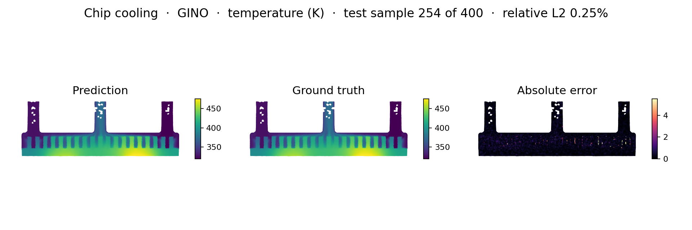
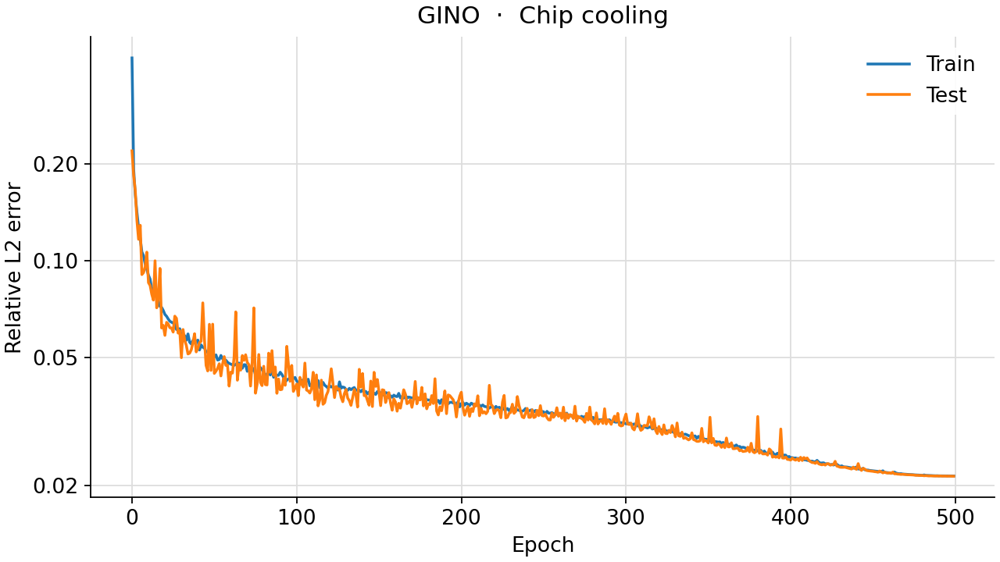
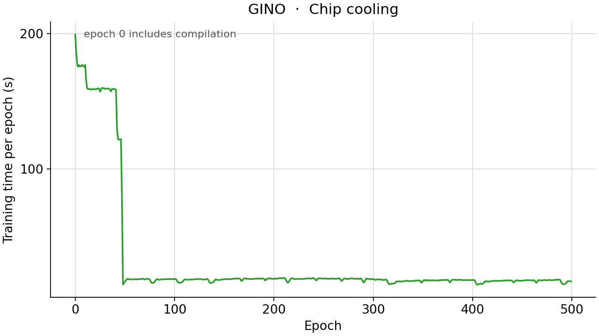

<!--
SPDX-FileCopyrightText: 2026 ZenteiQ AiTech Innovations Pvt. Ltd.
License notice: Documentation text and diagrams on this page are licensed
under CC BY 4.0. Source-code examples are licensed under LGPL-3.0-only
unless the example states otherwise.
-->

# Tutorial: Chip Cooling with GINO

In this tutorial you train a [Geometry-Informed Neural Operator](../../theory_guide/operator_learning.md#gino)
(GINO [[2]](#ref2)) on the **chip cooling** benchmark: given the six boundary conditions of
a liquid-cooled cold plate that carries two chips, predict the steady
temperature on the central plane of the plate. GINO works on the unstructured
CFD mesh directly, so, unlike the grid models, nothing is interpolated: a
graph operator moves information from the mesh nodes to a regular latent
grid, an FNO works on that grid, and a second graph operator brings the
result back to the nodes. The whole tutorial is one script,
[`scripts/tutorials/chipcooling_gino.py`](../../../scripts/tutorials/chipcooling_gino.py). It uses only the public ScireX API
([`scirex.models.GINO`](../../api/models.md#scirex.models.GINO), [`scirex.layers.kdtree_neighbor_search`](../../api/layers.md#scirex.layers.kdtree_neighbor_search),
[`scirex.training.adamw_cx`](../../api/training.md#scirex.training.adamw_cx), [`scirex.utils.count_model_params`](../../api/utils.md#scirex.utils.count_model_params)) and plain
NumPy, JAX and optax. The code on this page is copied from that script.

## Summary

| | |
|---|---|
| Problem | Steady temperature on the central plane of a liquid-cooled dual-chip cold plate: six boundary conditions in, temperature at the mesh nodes out |
| Model | GINO, [`scirex.models.GINO`](../../api/models.md#scirex.models.GINO). Benchmark size: a 64 × 128 latent grid, graph radius 0.05, input-graph MLP `(80, 80, 80)`, output-graph MLP `(512, 256)`, FNO with `fno_n_modes=(20, 20)`, 30 channels and 4 layers, 1,821,028 parameters. Smoke size: a 32 × 64 latent grid, radius 0.08, MLPs `(32, 32)` and `(64, 64)`, FNO with `(12, 12)` modes, 16 channels and 2 layers, 105,268 parameters |
| Data | [[1]](#ref1): 2000 ANSYS Fluent simulations, 11,110 mesh nodes on the plane. Benchmark: first 1600 train / last 400 test, all nodes. Smoke: 32 train / 8 test, every second node (5,555) |
| Optimiser | [`adamw_cx`](../../api/training.md#scirex.training.adamw_cx) (AdamW for complex weights), eps 1e-6, weight decay 1e-4, one simulation per step, cosine learning rate from 1e-3 to 0 stepped after every epoch, seed 42 |
| Metric | In kelvin, at all mesh nodes of the 400 test simulations: R², RMSE, MAE, maximum absolute error, and the mean relative L2 error per simulation |
| Full-run values | R² 0.999546, RMSE 0.979 K, MAE 0.425 K, max AE 29.464 K, relative L2 2.5e-3. POD-NN of [[1]](#ref1): R² 0.998, MAE 1.534 K, max AE 8.849 K |

## Setup

The setup is the same as in the [FNO tutorial](ChipCooling_FNO.md#setup).

## The problem

The problem, the data and the metric are the same as in the [FNO tutorial](ChipCooling_FNO.md#the-problem).

**On the mesh.** The plane is the band of pin fins plus three channels (the two
inlets and the outlet), not a rectangle, and its 11,110 nodes are scattered.
GINO takes them as they are. Their $(y, z)$ coordinates are scaled to the unit
square with their minimum and maximum, and a regular latent grid of
`latent_h x latent_w` points covers the same square. Two radius graphs link
them: every latent point gathers the nodes within `in_gno_radius`, and every
node gathers the latent points within `out_gno_radius`.

**Inputs, targets and loss.** The six parameters are standardised one by one
with the training mean and standard deviation and enter as **latent
features**: six constant channels on the latent grid. The nodes carry no
features of their own. The temperature is standardised with one mean and one
standard deviation over all nodes of the training simulations,
$\tilde T = (T - \mu_T)/\sigma_T$. The loss of one simulation is its relative
L2 error over all nodes:

$$
\mathcal L = \frac{\lVert \hat{\tilde T} - \tilde T\rVert_2}{\lVert \tilde T\rVert_2} .
$$

The metrics are in kelvin at the mesh nodes: R², RMSE and MAE pooled over all
nodes of all test simulations, the largest absolute error, and the relative L2
error of each simulation, averaged. A field of 300 to 500 K has a large norm,
so its relative L2 error is small; the errors in kelvin are easier to read. As
a **baseline**, the mean of the training fields predicts the same field for
every test simulation: it gets the layout of the hot and cold regions right and
ignores the parameters.

**GINO in one paragraph.** The input graph operator turns the node values (here
none, only the node positions) into features on the latent grid, by
integrating a learned kernel over the neighbours of every latent point. The FNO
in the middle mixes those features, and the latent features, over the whole
grid with complex spectral weights. The output graph operator integrates
another learned kernel over the latent neighbours of every node. The graphs are
the expensive part: each edge runs a small MLP. The
[theory guide](../../theory_guide/operator_learning.md#gino) has the details.

## Step-by-step walkthrough

The explanations of the steps that are the same for every model are in the [FNO tutorial](ChipCooling_FNO.md#step-by-step-walkthrough). This page keeps the code and the text that is specific to the model.

### 1. Setup

Imports, the seed, the training settings and the two model sizes. `PROTOCOL`
holds the benchmark's settings (the same values as `PROTOCOL` and
`RUNS["gino"].opt` in [`scripts/benchmarks/chip_cooling/_config.py`](../../../scripts/benchmarks/chip_cooling/_config.py)): 1600 / 400
simulations, 500 epochs, a peak learning rate of 1e-3 and weight decay 1e-4,
one simulation per step. `SIZES["full"]` is the same dict as
`RUNS["gino"].arch`; `SIZES["smoke"]` shrinks the latent grid, the graph MLPs
and the FNO so that a CPU can train it in minutes.

<!-- tutorial-snippet -->
```python
from __future__ import annotations

import argparse
import json
import math
import os
import platform
import re
from pathlib import Path
from time import perf_counter

import flax
import jax
import jax.numpy as jnp
import matplotlib
import matplotlib.pyplot as plt
import numpy as np
import optax

import scirex
from scirex.layers import kdtree_neighbor_search
from scirex.models import GINO
from scirex.training import adamw_cx
from scirex.utils import count_model_params

matplotlib.use("Agg")  # write figures to files, no display needed
# Keep float32, also if float64 was enabled earlier in the process.
jax.config.update("jax_enable_x64", False)
```

<!-- tutorial-snippet -->
```python
SEED = 42

# The chip cooling benchmark's settings, the same values as PROTOCOL and
# RUNS["gino"].opt in scripts/benchmarks/chip_cooling/_config.py.
PROTOCOL = dict(
    ntrain=1600,
    ntest=400,
    epochs=500,
    learning_rate=1e-3,
    weight_decay=1e-4,
)

# Model sizes. "full" is the benchmark's GINO (1,821,028 parameters, matched to
# Transolver's 1,807,561), the same dict as RUNS["gino"].arch. "smoke" is a
# smaller GINO, with a coarser latent grid, that trains on a CPU.
SIZES = dict(
    full=dict(
        latent_h=64,
        latent_w=128,
        latent_feature_channels=6,
        gno_coord_dim=2,
        gno_coord_embed_dim=16,
        in_gno_radius=0.05,
        out_gno_radius=0.05,
        in_gno_transform_type="linear",
        out_gno_transform_type="linear",
        in_gno_pos_embed_type=None,
        out_gno_pos_embed_type="transformer",
        gno_embed_channels=16,
        gno_embed_max_positions=600,
        in_gno_channel_mlp_hidden_layers=(80, 80, 80),
        out_gno_channel_mlp_hidden_layers=(512, 256),
        fno_n_modes=(20, 20),
        fno_hidden_channels=30,
        fno_lifting_channel_ratio=4,
        fno_n_layers=4,
        fno_use_channel_mlp=True,
        fno_channel_mlp_expansion=0.5,
        fno_norm="group_norm",
        fno_ada_in_features=8,
        fno_factorization=None,
        fno_rank=0.8,
        fno_domain_padding=0.0,
        projection_channel_ratio=4,
    ),
)
SIZES["smoke"] = dict(
    SIZES["full"],
    latent_h=32,
    latent_w=64,
    in_gno_radius=0.08,
    out_gno_radius=0.08,
    in_gno_channel_mlp_hidden_layers=(32, 32),
    out_gno_channel_mlp_hidden_layers=(64, 64),
    fno_n_modes=(12, 12),
    fno_hidden_channels=16,
    fno_n_layers=2,
)

# The six parameters, in the loader's order: sorted by boundary condition,
# then by parameter name.
PARAM_LABELS = [
    "chip 1 heat flux",
    "chip 2 heat flux",
    "inlet 1 mass flow",
    "inlet 1 temperature",
    "inlet 2 mass flow",
    "inlet 2 temperature",
]
FIELD_KEY = "yz-mid|temperature"
COORD_KEY = "yz-mid|coordinates"
```

<!-- tutorial-snippet -->
```python
def print_environment(seed: int) -> None:
    """Print the versions, the devices and the seed, so a run can be repeated."""
    print(f"python {platform.python_version()} | numpy {np.__version__}")
    print(f"scirex {scirex.__version__}")
    print(
        f"jax {jax.__version__} | flax {flax.__version__} | optax {optax.__version__}"
    )
    print(f"devices: {jax.devices()}")
    print(f"SEED = {seed}")
```

### 2. Load the data

<!-- tutorial-snippet -->
```python
def load_chip_cooling(data_dir: Path, ntrain: int, ntest: int) -> dict:
    """Parameters ``(n, 6)``, temperatures ``(n, 11110)`` in K and coordinates."""
    data_dir = Path(data_dir)
    doe = json.loads((data_dir / "model_setup.json").read_text())["doe_configuration"]
    columns = [
        doe[bc][name]
        for bc in sorted(doe)
        for name in sorted(doe[bc])
        if isinstance(doe[bc][name], list)
    ]
    parameters = np.asarray(columns, dtype=np.float32).T  # (2000, 6)
    files = sorted(
        data_dir.glob("sim_*.npz"), key=lambda p: int(re.search(r"\d+", p.stem)[0])
    )
    if len(files) != len(parameters) or ntrain + ntest > len(files):
        raise ValueError(
            f"{len(files)} simulation files for {len(parameters)} parameter rows; "
            f"need ntrain + ntest <= {len(files)}"
        )
    rows = dict(train=np.arange(ntrain), test=np.arange(len(files) - ntest, len(files)))
    out = {}
    for name, idx in rows.items():
        fields = []
        for i in idx:
            with np.load(files[i], allow_pickle=False) as d:
                fields.append(np.asarray(d[FIELD_KEY], dtype=np.float32))
                coords = np.asarray(d[COORD_KEY], dtype=np.float32)
        out[f"params_{name}"] = parameters[idx]
        out[f"T_{name}"] = np.stack(fields)
    out["coords"] = coords
    print(
        f"simulations: {ntrain} train / {ntest} test | {coords.shape[0]} mesh nodes | "
        f"T range [{out['T_train'].min():.1f}, {out['T_train'].max():.1f}] K"
    )
    return out
```

### 3. Normalise

`normalise` standardises the parameters and the temperature with the
statistics of the training split and scales the node coordinates to the unit
square, as the benchmark's `mesh_split` and `GINOSpec.prepare` do.

<!-- tutorial-snippet -->
```python
def normalise(data: dict) -> dict:
    """Standardised parameters and temperatures, and the scaled node coordinates."""
    p_mean = data["params_train"].mean(axis=0)
    p_std = data["params_train"].std(axis=0) + 1e-8
    t_mean = float(data["T_train"].mean())
    t_std = float(data["T_train"].std()) + 1e-8
    yz = data["coords"][:, 1:3]
    lo, hi = yz.min(axis=0), yz.max(axis=0)
    return dict(
        p_train=((data["params_train"] - p_mean) / p_std).astype(np.float32),
        p_test=((data["params_test"] - p_mean) / p_std).astype(np.float32),
        y_train=((data["T_train"] - t_mean) / t_std).astype(np.float32),
        y_test=((data["T_test"] - t_mean) / t_std).astype(np.float32),
        t_mean=t_mean,
        t_std=t_std,
        nodes=((yz - lo) / (hi - lo + 1e-8)).astype(np.float32),
    )
```

### 4. Build the graphs

`radius_graph` turns the k-d tree search into the flat arrays GINO takes:
`neighbors_index` (who), `segment_ids` (for which query) and `counts` (how
many per query). `build_geometry` makes the latent grid and the two graphs;
`latent_features` broadcasts the parameters over the latent grid. The tests
check that the graphs and features are equal to the benchmark's.

<!-- tutorial-snippet -->
```python
def radius_graph(points: np.ndarray, queries: np.ndarray, radius: float) -> dict:
    """For every query, the points within ``radius``, as flat index arrays."""
    nbrs = kdtree_neighbor_search(
        data=points, queries=queries, radius=radius, return_norm=False
    )
    counts = np.diff(np.asarray(nbrs["neighbors_row_splits"]))
    return dict(
        neighbors_index=np.asarray(nbrs["neighbors_index"]),
        segment_ids=np.repeat(np.arange(len(counts)), counts),
        counts=counts,
    )
```

<!-- tutorial-snippet -->
```python
def build_geometry(nodes: np.ndarray, arch: dict) -> dict:
    """The mesh, the latent grid and the two radius graphs, as GINO's inputs."""
    h, w = arch["latent_h"], arch["latent_w"]
    gy, gz = np.meshgrid(
        np.linspace(0, 1, h, dtype=np.float32),
        np.linspace(0, 1, w, dtype=np.float32),
        indexing="ij",
    )
    latent = np.stack([gy, gz], axis=-1)  # (h, w, 2)
    flat = latent.reshape(-1, 2)
    geometry = dict(
        input_geom=nodes[None],
        latent_queries=latent[None],
        output_queries=nodes[None],
        neighbors_in=radius_graph(nodes, flat, arch["in_gno_radius"]),
        neighbors_out=radius_graph(flat, nodes, arch["out_gno_radius"]),
    )
    n_in = len(geometry["neighbors_in"]["neighbors_index"])
    n_out = len(geometry["neighbors_out"]["neighbors_index"])
    print(f"graphs: {n_in:,} mesh->latent edges | {n_out:,} latent->mesh edges")
    return geometry
```

<!-- tutorial-snippet -->
```python
def latent_features(params: np.ndarray, arch: dict) -> np.ndarray:
    """``(n, 6)`` parameters -> ``(n, h, w, 6)``, constant over the latent grid."""
    shape = (len(params), arch["latent_h"], arch["latent_w"], params.shape[1])
    return np.broadcast_to(params[:, None, None, :], shape).astype(np.float32)
```

### 5. Build the model

`gino_kwargs` drops the latent grid size, which is not a constructor argument,
from the size dict. `in_channels=0` because the nodes carry no features;
`gno_use_open3d=False` and `gno_use_torch_scatter=False` keep the graph
operators in plain JAX. The model is initialised on the first training
simulation with `PRNGKey(seed)`, as in the benchmark.

<!-- tutorial-snippet -->
```python
def gino_kwargs(arch: dict) -> dict:
    """The constructor arguments of ``GINO``: ``arch`` without the latent grid size."""
    kw = {k: v for k, v in arch.items() if k not in ("latent_h", "latent_w")}
    kw["fno_n_modes"] = tuple(kw["fno_n_modes"])
    for k in ("in_gno_channel_mlp_hidden_layers", "out_gno_channel_mlp_hidden_layers"):
        kw[k] = list(kw[k])
    return kw
```

<!-- tutorial-snippet -->
```python
def build_model(arch: dict, geometry: dict, lf: np.ndarray, seed: int):
    """Build GINO, initialise it on one sample and print the parameter count."""
    model = GINO(
        in_channels=0,
        out_channels=1,
        gno_use_open3d=False,
        gno_use_torch_scatter=False,
        **gino_kwargs(arch),
    )
    params = model.init(jax.random.PRNGKey(seed), **geometry, latent_features=lf)
    print(f"GINO | parameters: {count_model_params(params):,}")
    return model, params
```

### 6. Loss

The loss from [The problem](#the-problem): the relative L2 error of one
simulation over all nodes, on the standardised temperature.

<!-- tutorial-snippet -->
```python
def rel_l2(pred, target):
    """``||pred - target|| / ||target||`` over all entries."""
    return jnp.sqrt(jnp.sum((pred - target) ** 2) / (jnp.sum(target**2) + 1e-12))
```

<!-- tutorial-snippet -->
```python
def make_loss(model, geometry: dict):
    """Return ``loss_fn(params, lf, y) -> relative L2`` for one simulation."""

    def loss_fn(params, lf, y):
        out = model.apply(params, **geometry, latent_features=lf)  # (1, n_nodes, 1)
        return rel_l2(out[0, :, 0], y)

    return loss_fn
```

### 7. Optimiser for complex weights

The FNO inside GINO has complex spectral weights. `jax.grad` returns the
complex conjugate of the descent direction that optax transforms assume, so the
benchmark trains with [`adamw_cx`](../../api/training.md#scirex.training.adamw_cx), which conjugates complex gradients first. The
learning rate is an injected hyperparameter so that the loop can change it
after every epoch. `hyperparam_dtype=jnp.float32` keeps the injected values
real; without it they take the highest dtype among the weights, complex64 here.
The benchmark's `train.py` leaves it out, so its updates are complex with a
zero imaginary part (the same issue was fixed in the Navier-Stokes benchmark).

<!-- tutorial-snippet -->
```python
def make_optimizer(protocol: dict):
    """``adamw_cx`` with the learning rate exposed as an injected hyperparameter."""
    return optax.inject_hyperparams(adamw_cx, hyperparam_dtype=jnp.float32)(
        learning_rate=protocol["learning_rate"],
        weight_decay=protocol["weight_decay"],
    )
```

<!-- tutorial-snippet -->
```python
def cosine_lr(protocol: dict, epoch: int, epochs: int) -> float:
    """Learning rate after ``epoch`` epochs: a cosine from the peak to 0."""
    return protocol["learning_rate"] * (1 + math.cos(math.pi * epoch / epochs)) / 2
```

### 8. Train

One simulation per optimiser step, in a new random order every epoch, from
NumPy's global generator seeded once, as in the benchmark. The cosine is
stepped after each epoch, so epoch 0 runs at the peak rate. After every epoch
the test simulations are scored with the same loss, to draw the error curve;
no epoch is selected by it, and the weights after the last epoch are the
result. JAX compiles the step on its first call, so the first epoch is slower
than the others.

<!-- tutorial-snippet -->
```python
def train(model, params, geometry, norm, lf, epochs, seed, protocol=PROTOCOL):
    """Train for ``epochs`` epochs. Return the final parameters and the history."""
    tx = make_optimizer(protocol)
    opt_state = tx.init(params)
    loss_fn = make_loss(model, geometry)

    @jax.jit
    def train_step(params, opt_state, lf, y):
        loss, grads = jax.value_and_grad(loss_fn)(params, lf, y)
        updates, opt_state = tx.update(grads, opt_state, params)
        return optax.apply_updates(params, updates), opt_state, loss

    eval_step = jax.jit(loss_fn)
    np.random.seed(seed)  # noqa: NPY002  (the benchmark's sample order)
    history = []
    for epoch in range(epochs):
        t0 = perf_counter()
        losses = []
        for i in np.random.permutation(len(norm["y_train"])):  # noqa: NPY002
            params, opt_state, loss = train_step(
                params, opt_state, lf["train"][i : i + 1], norm["y_train"][i]
            )
            losses.append(float(loss))
        secs = perf_counter() - t0
        test = [
            float(eval_step(params, lf["test"][i : i + 1], norm["y_test"][i]))
            for i in range(len(norm["y_test"]))
        ]
        lr = cosine_lr(protocol, epoch + 1, epochs)
        opt_state.hyperparams["learning_rate"] = jnp.asarray(lr, dtype=jnp.float32)
        history.append(
            dict(
                epoch=epoch,
                train_loss=float(np.mean(losses)),
                test_loss=float(np.mean(test)),
                lr=lr,
                secs=secs,
            )
        )
        print(
            f"epoch {epoch}: train_loss={history[-1]['train_loss']:.4f} "
            f"test_loss={history[-1]['test_loss']:.4f} next_lr={lr:.2e} "
            f"epoch_time={secs:.1f}s"
        )
    return params, history
```

### 9. Evaluate

`field_metrics` computes the benchmark's metrics in kelvin; `evaluate`
decodes the predictions and scores them and the mean-field baseline at the
mesh nodes.

<!-- tutorial-snippet -->
```python
def field_metrics(pred: np.ndarray, true: np.ndarray) -> dict:
    """Metrics of ``(n, n_points)`` predictions in kelvin."""
    err = pred - true
    return dict(
        R2=float(1.0 - np.sum(err**2) / np.sum((true - true.mean()) ** 2)),
        RMSE=float(np.sqrt(np.mean(err**2))),
        MAE=float(np.mean(np.abs(err))),
        max_AE=float(np.max(np.abs(err))),
        rel_l2=float(
            np.mean(np.linalg.norm(err, axis=1) / np.linalg.norm(true, axis=1))
        ),
    )
```

<!-- tutorial-snippet -->
```python
def evaluate(model, params, geometry, norm, lf, data) -> dict:
    """Test metrics in kelvin at the mesh nodes, a baseline and the predictions."""
    predict = jax.jit(lambda p, f: model.apply(p, **geometry, latent_features=f))
    pred = np.stack(
        [
            np.asarray(predict(params, lf["test"][i : i + 1]))[0, :, 0]
            for i in range(len(lf["test"]))
        ]
    )
    pred = pred * norm["t_std"] + norm["t_mean"]
    true = data["T_test"]
    baseline = np.broadcast_to(data["T_train"].mean(axis=0), true.shape)
    return dict(
        model=field_metrics(pred, true),
        baseline=field_metrics(baseline, true),
        predictions=pred,
    )
```

### 10. Plot

The figure has four panels for one test simulation: the input (the six
standardised parameters), the true and the predicted temperature on one colour
scale, and the absolute error, at the mesh nodes in millimetres. A second
figure shows the loss per epoch.

<!-- tutorial-snippet -->
```python
def plot_prediction(params, coords, truth, pred, path: Path, title: str) -> None:
    """Save input parameters, true temperature, predicted temperature and error."""
    z, y = coords[:, 2] * 1e3, coords[:, 1] * 1e3
    lim = (truth.min(), truth.max())
    fig, axes = plt.subplots(
        1, 4, figsize=(22, 4), gridspec_kw=dict(width_ratios=[0.8, 1, 1, 1])
    )
    axes[0].barh(PARAM_LABELS[::-1], params[::-1], color="tab:gray")
    axes[0].set_title("Input: six parameters (standardised)")
    for ax, (name, values, cmap, vlim) in zip(
        axes[1:],
        [
            ("Truth: temperature (K)", truth, "inferno", lim),
            ("Prediction: temperature (K)", pred, "inferno", lim),
            ("Absolute error (K)", np.abs(pred - truth), "magma", None),
        ],
    ):
        vmin, vmax = vlim if vlim else (None, None)
        sc = ax.scatter(z, y, c=values, s=2, cmap=cmap, vmin=vmin, vmax=vmax)
        ax.set_title(name)
        ax.set_aspect("equal")
        ax.set_xlabel("z (mm)")
        ax.set_ylabel("y (mm)")
        fig.colorbar(sc, ax=ax, shrink=0.8)
    fig.suptitle(title)
    fig.savefig(path, dpi=110, bbox_inches="tight")
    plt.close(fig)
```

<!-- tutorial-snippet -->
```python
def plot_loss(history: list[dict], path: Path) -> None:
    """Save the training and test loss per epoch."""
    epochs = [h["epoch"] for h in history]
    fig, ax = plt.subplots(figsize=(6, 4))
    ax.plot(epochs, [h["train_loss"] for h in history], marker="o", label="train")
    ax.plot(epochs, [h["test_loss"] for h in history], marker="o", label="test")
    ax.set_xlabel("epoch")
    ax.set_ylabel("relative L2 (standardised)")
    ax.set_yscale("log")
    ax.legend()
    ax.grid(True, alpha=0.3)
    fig.savefig(path, dpi=120, bbox_inches="tight")
    plt.close(fig)
```

The complete script is [`scripts/tutorials/chipcooling_gino.py`](../../../scripts/tutorials/chipcooling_gino.py).

## Run it

Smoke run (CPU, about 30 s, no GPU needed):

```bash
CUDA_VISIBLE_DEVICES= JAX_PLATFORMS=cpu python scripts/tutorials/chipcooling_gino.py --data-dir ~/data/chip_cooling --smoke
```

Full protocol (1600 training simulations, all nodes, benchmark-size GINO, 500
epochs; use a GPU):

```bash
python scripts/tutorials/chipcooling_gino.py --data-dir ~/data/chip_cooling
```

The other flags are `--epochs`, `--seed`, `--out-dir` (default
`outputs/chipcooling_gino_tutorial`), `--stride` (default 1, or 2 with
`--smoke`) and, for the smoke run, `--n-train` and `--n-test`.

This is the output of the smoke run, run with `--out-dir out/gino_smoke`
(smoke run, CPU, 32 train / 8 test simulations, not a benchmark number). The
wall time was 29 s, measured with `time`; library warnings, and a message from
JAX's CUDA plugin about the hidden GPUs, are left out:

```text
python 3.12.3 | numpy 1.26.4
scirex 1.0.0rc1
jax 0.6.2 | flax 0.10.7 | optax 0.2.8
ERROR:2026-11-02 19:54:54,357:jax._src.xla_bridge:444: Jax plugin configuration error: Exception when calling jax_plugins.xla_cuda12.initialize()
Traceback (most recent call last):
  File "<venv>/lib/python3.12/site-packages/jax/_src/xla_bridge.py", line 442, in discover_pjrt_plugins
    plugin_module.initialize()
  File "<venv>/lib/python3.12/site-packages/jax_plugins/xla_cuda12/__init__.py", line 324, in initialize
    _check_cuda_versions(raise_on_first_error=True)
  File "<venv>/lib/python3.12/site-packages/jax_plugins/xla_cuda12/__init__.py", line 281, in _check_cuda_versions
    local_device_count = cuda_versions.cuda_device_count()
                         ^^^^^^^^^^^^^^^^^^^^^^^^^^^^^^^^^
RuntimeError: jaxlib/cuda/versions_helpers.cc:113: operation cuInit(0) failed: CUDA_ERROR_NO_DEVICE
devices: [CpuDevice(id=0)]
SEED = 42
simulations: 32 train / 8 test | 11110 mesh nodes | T range [300.2, 512.6] K
stride 2: 5555 mesh nodes
data loading: 0.1s
graphs: 211,681 mesh->latent edges | 211,681 latent->mesh edges
graphs built in 0.0s
GINO | parameters: 105,268
epoch 0: train_loss=1.0953 test_loss=0.9835 next_lr=7.50e-04 epoch_time=6.9s
epoch 1: train_loss=0.9711 test_loss=0.9318 next_lr=2.50e-04 epoch_time=5.5s
epoch 2: train_loss=0.9086 test_loss=0.8800 next_lr=0.00e+00 epoch_time=5.5s
model   : R2 0.2241 | RMSE 40.402 K | MAE 35.162 K | max AE 96.66 K | rel L2 1.03e-01
baseline: R2 0.9111 | RMSE 13.680 K | MAE 11.596 K | max AE 36.06 K | rel L2 3.32e-02
figures in out/gino_smoke | total time 27.1s
```

## Results

### Full run

The next figures were not made by this script. They come from the benchmark
runner (`train.py` and `infer.py`) and are the committed results of the **full
500-epoch run** (1600 training and 400 test simulations, all nodes,
benchmark-size GINO, one shared GPU). `infer.py` draws one test simulation (the figure title names it): prediction,
truth and absolute error.



Training and test loss per epoch of the same run (standardised units; the
final test loss is 0.0214):



Seconds per epoch of the same run (the first epoch includes compilation; in
`metrics.json`, the first epoch took 198.7 s and the median epoch 56.7 s):



| Model, 400 test simulations | Evaluated on | R² | RMSE (K) | MAE (K) | Max AE (K) | Relative L2 | Parameters |
|---|---|---|---|---|---|---|---|
| [FNO](../Others/ChipCooling_FNO.md) | in-domain cells of the 128 × 256 grid | 0.999987 | 0.167 | 0.122 | 2.873 | 4.1e-4 | 1,829,496 |
| [WNO](../WNO/ChipCooling_WNO.md) | in-domain cells of the 128 × 256 grid | 0.999640 | 0.893 | 0.640 | 9.122 | 2.3e-3 | 1,920,481 |
| **GINO (this tutorial)** | all 11,110 mesh nodes | **0.999546** | **0.979** | **0.425** | **29.464** | **2.5e-3** | 1,821,028 |
| [Transolver](../../benchmarks/chip_cooling/results/comparative.md#transolver) | all 11,110 mesh nodes | 0.999419 | 1.107 | 0.665 | 16.207 | 2.8e-3 | 1,807,561 |
| POD-NN, 4 modes ([[1]](#ref1), reported) | the paper's evaluation | 0.998 | | 1.534 | 8.849 | | |

## Troubleshooting

- **`ValueError: ... simulation files for ... parameter rows`.** The folder
  must hold all 2000 `sim_*.npz` files next to `model_setup.json`, even though
  only some are read. Check `--data-dir`.
- **The loss stays near 0.4.** That is roughly the level of the mean field, and
  a small GINO on a few simulations does not get much further in minutes. The
  benchmark-size model passes it within its first epoch on a GPU.
- **A step takes more than a second on a CPU.** The graph MLPs run once per
  edge, and the benchmark size has hundreds of thousands of edges. Use
  `--smoke`, which also keeps every second node (`--stride 2`).

## Next steps

- Compare with the other architectures on the same data:
  [FNO](../Others/ChipCooling_FNO.md), [WNO](../WNO/ChipCooling_WNO.md),
  [Transolver](../../benchmarks/chip_cooling/results/comparative.md#transolver) and the
  [comparison page](../../benchmarks/chip_cooling/results/comparative.md).
- Read the [Chip Cooling results](../../benchmarks/chip_cooling/results/comparative.md#gino) for the
  error distribution, the POD-NN comparison and the compute cost, and the
  [dataset guide](../../dataset_guide/chip_cooling.md) for the setup.
- Learn how GINO works in the [theory guide](../../theory_guide/operator_learning.md#gino) and see
  its arguments in the [API reference](../../api/models.md); the graph helpers are
  in the [layers API](../../api/layers.md).
- See GINO on a deformed mesh in the [Pipe GINO benchmark](../../benchmarks/pipe/results/comparative.md#gino).

## References

1. <span id="ref1"></span>Curl and Hu, *Physically interpretable surrogate modeling of thermal fields in electronics cooling using combined proper orthogonal decomposition and neural networks*, AI Thermal Fluids 6, 100040 (2026). <https://doi.org/10.1016/j.aitf.2026.100040>

2. <span id="ref2"></span>Li et al., *Geometry-Informed Neural Operator for Large-Scale 3D PDEs*, NeurIPS 2023. <https://arxiv.org/abs/2309.00583>
