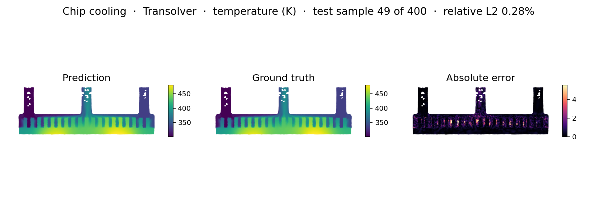
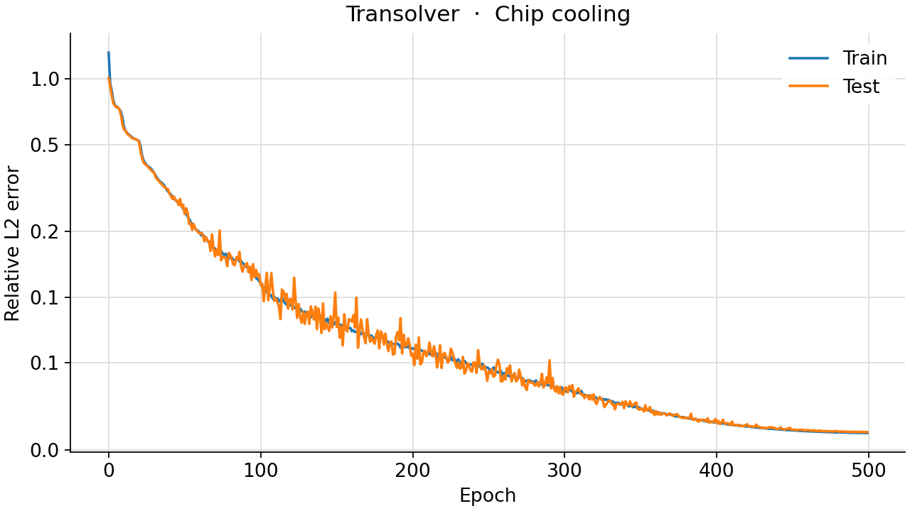
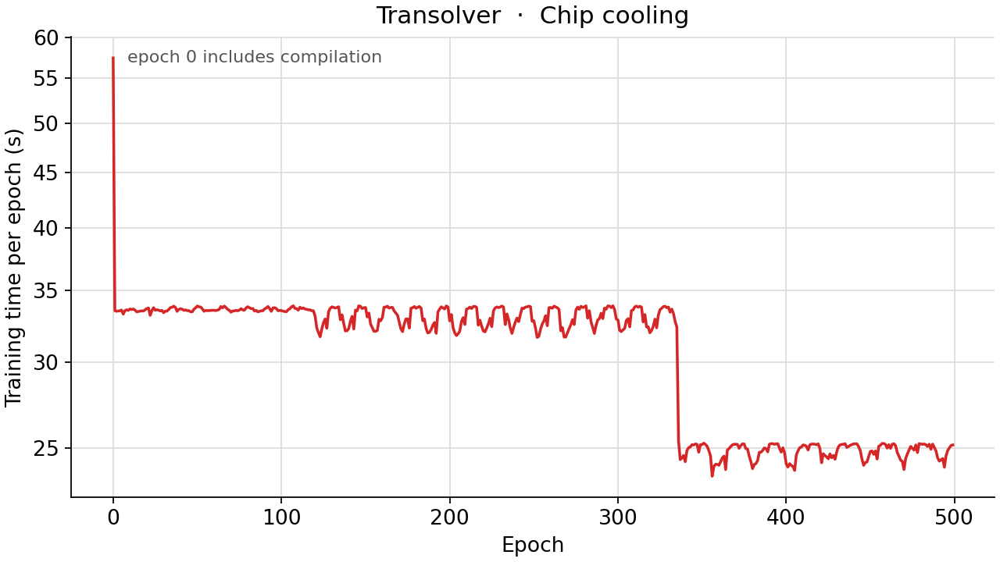

<!--
SPDX-FileCopyrightText: 2026 ZenteiQ AiTech Innovations Pvt. Ltd.
License notice: Documentation text and diagrams on this page are licensed
under CC BY 4.0. Source-code examples are licensed under LGPL-3.0-only
unless the example states otherwise.
-->

# Tutorial: Chip Cooling with Transolver

In this tutorial you train a [Transolver](../../theory_guide/operator_learning.md#transolver) [[2]](#ref2) on
the **chip cooling** benchmark: given the six boundary conditions of a
liquid-cooled cold plate that carries two chips, predict the steady
temperature on the central plane of the plate. Transolver works on the
unstructured CFD mesh directly: every mesh node is a token, with its position
and, here, the six parameters as its features. The whole tutorial is one
script, [`scripts/tutorials/chipcooling_transolver.py`](../../../scripts/tutorials/chipcooling_transolver.py). It uses only the public
ScireX API ([`scirex.models.Transolver`](../../api/models.md#scirex.models.Transolver), [`scirex.utils.count_model_params`](../../api/utils.md#scirex.utils.count_model_params)) and
plain NumPy, JAX and optax. The code on this page is copied from that script.

## Summary

| | |
|---|---|
| Problem | Steady temperature on the central plane of a liquid-cooled dual-chip cold plate: six boundary conditions in, temperature at the mesh nodes out |
| Model | Transolver, [`scirex.models.Transolver`](../../api/models.md#scirex.models.Transolver), `geometry="irregular"`, `space_dim=2`, `fun_dim=6`. Benchmark size: `n_layers=5, n_hidden=256, n_head=8, slice_num=32, mlp_ratio=1`, 1,807,561 parameters, the size the other three models are matched to. Smoke size: `n_layers=2, n_hidden=64, n_head=4, slice_num=16`, 53,865 parameters |
| Data | [[1]](#ref1): 2000 ANSYS Fluent simulations, 11,110 mesh nodes on the plane. Benchmark: first 1600 train / last 400 test, all nodes. Smoke: 32 train / 8 test, every second node (5,555) |
| Optimiser | Adam with weight decay 1e-6 added to the gradients, gradient-norm clip 1.0, learning rate warmed up linearly to 1e-4 over 50 epochs, then a cosine to 1e-6, batch size 4, seed 42 |
| Metric | In kelvin, at all mesh nodes of the 400 test simulations: R², RMSE, MAE, maximum absolute error, and the mean relative L2 error per simulation |
| Full-run values | R² 0.999419, RMSE 1.107 K, MAE 0.665 K, max AE 16.207 K, relative L2 2.8e-3. POD-NN of [[1]](#ref1): R² 0.998, MAE 1.534 K, max AE 8.849 K |

## Setup

The setup is the same as in the [FNO tutorial](ChipCooling_FNO.md#setup).

## The problem

The problem, the data and the metric are the same as in the [FNO tutorial](ChipCooling_FNO.md#the-problem).

**Tokens.** The plane is the band of pin fins plus three channels (the two
inlets and the outlet), and its 11,110 nodes are scattered. Every node is a
token. Its position is its $(y, z)$, scaled to the unit square with the
minimum and maximum of the coordinates. Its features are the six parameters,
each standardised with the training mean and standard deviation and repeated
at every node: the geometry is the same in every simulation, so the parameters
are what the model has to read. The temperature is standardised with one mean
and one standard deviation over all nodes of the training simulations,
$\tilde T = (T - \mu_T)/\sigma_T$.

**Loss and metrics.** The loss of a batch is the relative L2 error over all
nodes of all its simulations, $\lVert \hat{\tilde T} - \tilde T\rVert_2 /
\lVert \tilde T\rVert_2$. The metrics are in kelvin at the mesh nodes: R², RMSE
and MAE pooled over all nodes of all test simulations, the largest absolute
error, and the relative L2 error of each simulation, averaged. A field of 300
to 500 K has a large norm, so its relative L2 error is small; the errors in
kelvin are easier to read. As a **baseline**, the mean of the training fields
predicts the same field for every test simulation: it gets the layout of the
hot and cold regions right and ignores the parameters.

**Transolver in one paragraph.** Attention over all $N$ nodes would cost
$O(N^2)$. Every Transolver layer instead softly assigns the nodes to
`slice_num` learned slices, lets the slices attend to each other and sends the
result back to every node, so the cost grows linearly with $N$ and the same
network runs on grids, meshes and point clouds. All weights are real. The
[theory guide](../../theory_guide/operator_learning.md#transolver) has the details.

## Step-by-step walkthrough

The explanations of the steps that are the same for every model are in the [FNO tutorial](ChipCooling_FNO.md#step-by-step-walkthrough). This page keeps the code and the text that is specific to the model.

### 1. Setup

Imports, the seed, the training settings and the two model sizes. `PROTOCOL`
holds the benchmark's settings (the same values as `PROTOCOL` and
`RUNS["transolver"].opt` in [`scripts/benchmarks/chip_cooling/_config.py`](../../../scripts/benchmarks/chip_cooling/_config.py)): 1600
/ 400 simulations, 500 epochs, batch size 4, a peak learning rate of 1e-4
after 50 warmup epochs, a floor of 1e-6, weight decay 1e-6 and a gradient clip
of 1. `SIZES["full"]` is the same dict as `RUNS["transolver"].arch`;
`SIZES["smoke"]` has fewer and narrower layers and fewer slices.

<!-- tutorial-snippet -->
```python
from __future__ import annotations

import argparse
import json
import os
import platform
import re
from pathlib import Path
from time import perf_counter

import flax
import jax
import jax.numpy as jnp
import matplotlib
import matplotlib.pyplot as plt
import numpy as np
import optax

import scirex
from scirex.models import Transolver
from scirex.utils import count_model_params

matplotlib.use("Agg")  # write figures to files, no display needed
# Keep float32, also if float64 was enabled earlier in the process.
jax.config.update("jax_enable_x64", False)
```

<!-- tutorial-snippet -->
```python
SEED = 42

# The chip cooling benchmark's settings, the same values as PROTOCOL and
# RUNS["transolver"].opt in scripts/benchmarks/chip_cooling/_config.py.
PROTOCOL = dict(
    ntrain=1600,
    ntest=400,
    epochs=500,
    batch_size=4,
    learning_rate=1e-4,
    weight_decay=1e-6,
    grad_clip=1.0,
    warmup_epochs=50,
    lr_floor=1e-6,
)

# Model sizes. "full" is the benchmark's Transolver (1,807,561 parameters, the
# size the other three models are matched to), the same dict as
# RUNS["transolver"].arch. "smoke" is a smaller Transolver for a CPU.
SIZES = dict(
    full=dict(
        n_layers=5,
        n_hidden=256,
        n_head=8,
        mlp_ratio=1,
        dropout_rate=0.0,
        slice_num=32,
        ref=8,
        space_dim=2,
        fun_dim=6,
        out_dim=1,
        time_input=False,
        unified_pos=False,
        geometry="irregular",
    ),
)
SIZES["smoke"] = dict(SIZES["full"], n_layers=2, n_hidden=64, n_head=4, slice_num=16)

# The six parameters, in the loader's order: sorted by boundary condition,
# then by parameter name.
PARAM_LABELS = [
    "chip 1 heat flux",
    "chip 2 heat flux",
    "inlet 1 mass flow",
    "inlet 1 temperature",
    "inlet 2 mass flow",
    "inlet 2 temperature",
]
FIELD_KEY = "yz-mid|temperature"
COORD_KEY = "yz-mid|coordinates"
```

<!-- tutorial-snippet -->
```python
def print_environment(seed: int) -> None:
    """Print the versions, the devices and the seed, so a run can be repeated."""
    print(f"python {platform.python_version()} | numpy {np.__version__}")
    print(f"scirex {scirex.__version__}")
    print(
        f"jax {jax.__version__} | flax {flax.__version__} | optax {optax.__version__}"
    )
    print(f"devices: {jax.devices()}")
    print(f"SEED = {seed}")
```

### 2. Load the data

<!-- tutorial-snippet -->
```python
def load_chip_cooling(data_dir: Path, ntrain: int, ntest: int) -> dict:
    """Parameters ``(n, 6)``, temperatures ``(n, 11110)`` in K and coordinates."""
    data_dir = Path(data_dir)
    doe = json.loads((data_dir / "model_setup.json").read_text())["doe_configuration"]
    columns = [
        doe[bc][name]
        for bc in sorted(doe)
        for name in sorted(doe[bc])
        if isinstance(doe[bc][name], list)
    ]
    parameters = np.asarray(columns, dtype=np.float32).T  # (2000, 6)
    files = sorted(
        data_dir.glob("sim_*.npz"), key=lambda p: int(re.search(r"\d+", p.stem)[0])
    )
    if len(files) != len(parameters) or ntrain + ntest > len(files):
        raise ValueError(
            f"{len(files)} simulation files for {len(parameters)} parameter rows; "
            f"need ntrain + ntest <= {len(files)}"
        )
    rows = dict(train=np.arange(ntrain), test=np.arange(len(files) - ntest, len(files)))
    out = {}
    for name, idx in rows.items():
        fields = []
        for i in idx:
            with np.load(files[i], allow_pickle=False) as d:
                fields.append(np.asarray(d[FIELD_KEY], dtype=np.float32))
                coords = np.asarray(d[COORD_KEY], dtype=np.float32)
        out[f"params_{name}"] = parameters[idx]
        out[f"T_{name}"] = np.stack(fields)
    out["coords"] = coords
    print(
        f"simulations: {ntrain} train / {ntest} test | {coords.shape[0]} mesh nodes | "
        f"T range [{out['T_train'].min():.1f}, {out['T_train'].max():.1f}] K"
    )
    return out
```

### 3. Inputs and normalisation

`normalise` scales the node coordinates and standardises the parameters and
the temperature with the statistics of the training split. `tokens` builds the
positions `x` and the features `fx` of a batch. The tests check that both are
equal to the benchmark's `TransolverSpec.prepare`.

<!-- tutorial-snippet -->
```python
def normalise(data: dict) -> dict:
    """Positions ``(n_nodes, 2)``, standardised parameters and temperatures."""
    p_mean = data["params_train"].mean(axis=0)
    p_std = data["params_train"].std(axis=0) + 1e-8
    t_mean = float(data["T_train"].mean())
    t_std = float(data["T_train"].std()) + 1e-8
    yz = data["coords"][:, 1:3]
    lo, hi = yz.min(axis=0), yz.max(axis=0)
    return dict(
        nodes=((yz - lo) / (hi - lo + 1e-8)).astype(np.float32),
        p_train=((data["params_train"] - p_mean) / p_std).astype(np.float32),
        p_test=((data["params_test"] - p_mean) / p_std).astype(np.float32),
        y_train=((data["T_train"] - t_mean) / t_std).astype(np.float32)[..., None],
        y_test=((data["T_test"] - t_mean) / t_std).astype(np.float32)[..., None],
        t_mean=t_mean,
        t_std=t_std,
    )
```

<!-- tutorial-snippet -->
```python
def tokens(nodes: np.ndarray, params: np.ndarray) -> tuple[np.ndarray, np.ndarray]:
    """``x`` ``(b, n_nodes, 2)`` and ``fx`` ``(b, n_nodes, 6)`` for a batch."""
    b, n = len(params), len(nodes)
    x = np.broadcast_to(nodes, (b, n, 2))
    fx = np.broadcast_to(params[:, None, :], (b, n, params.shape[1]))
    return x, fx
```

### 4. Build the model

[`Transolver`](../../api/models.md#scirex.models.Transolver) is a Flax module: the parameters are a separate pytree, created
by `init` and used by `apply`. The key comes from splitting `PRNGKey(seed)`, as
in the benchmark, so the same seed gives the same initial weights.

<!-- tutorial-snippet -->
```python
def build_model(arch: dict, nodes: np.ndarray, params: np.ndarray, seed: int):
    """Build the Transolver, initialise it on one sample, print its parameter count."""
    model = Transolver(**arch)
    _, key = jax.random.split(jax.random.PRNGKey(seed))
    x, fx = tokens(nodes, params[:1])
    init = model.init(key, x=jnp.asarray(x), fx=jnp.asarray(fx))
    print(f"Transolver | parameters: {count_model_params(init):,}")
    return model, init
```

### 5. Loss

The loss from [The problem](#the-problem): the relative L2 error over all
nodes of the whole batch, on the standardised temperature.

<!-- tutorial-snippet -->
```python
def rel_l2(pred, target):
    """``||pred - target|| / ||target||`` over all entries."""
    return jnp.sqrt(jnp.sum((pred - target) ** 2) / (jnp.sum(target**2) + 1e-12))
```

<!-- tutorial-snippet -->
```python
def make_loss(model):
    """Return ``loss_fn(params, x, fx, y) -> relative L2`` of a batch."""

    def loss_fn(params, x, fx, y):
        return rel_l2(model.apply(params, x=x, fx=fx), y)

    return loss_fn
```

### 6. Optimiser

The benchmark's Transolver recipe: the gradient norm is clipped to 1, the
weight decay of 1e-6 is added to the gradients before Adam scales them (an L2
penalty, not AdamW's decoupled decay), and the learning rate rises linearly
from 0 to 1e-4 during the warmup and then falls on a cosine to 1e-6, at every
step. The warmup is 50 of the 500 epochs. A run of a few epochs would never
leave a 50-epoch warmup, so `make_optimizer` warms up for a tenth of the epochs
when that is shorter; for the full 500 epochs it is exactly the benchmark's 50,
and the tests compare the schedule with the benchmark's step by step.

<!-- tutorial-snippet -->
```python
def make_optimizer(protocol: dict, epochs: int, steps_per_epoch: int):
    """Clipped, L2-regularised Adam with a linear warmup and a cosine decay."""
    warmup_epochs = min(protocol["warmup_epochs"], max(1, epochs // 10))
    warmup = max(1, warmup_epochs * steps_per_epoch)
    decay = max(1, (epochs - warmup_epochs) * steps_per_epoch)
    lr = protocol["learning_rate"]
    schedule = optax.join_schedules(
        schedules=[
            optax.linear_schedule(0.0, lr, transition_steps=warmup),
            optax.cosine_decay_schedule(
                lr, decay_steps=decay, alpha=protocol["lr_floor"] / lr
            ),
        ],
        boundaries=[warmup],
    )
    tx = optax.chain(
        optax.clip_by_global_norm(protocol["grad_clip"]),
        optax.add_decayed_weights(protocol["weight_decay"]),
        optax.adam(schedule),
    )
    return tx, schedule
```

### 7. Train

Batches of 4 simulations in a new random order every epoch, one optimiser step
per batch. After every epoch the test simulations are scored with the same
loss, to draw the error curve; no epoch is selected by it, and the weights
after the last epoch are the result. JAX compiles the step on its first call,
so the first epoch is slower than the others.

<!-- tutorial-snippet -->
```python
def train(model, params, norm, epochs, seed, protocol=PROTOCOL):
    """Train for ``epochs`` epochs. Return the final parameters and the history."""
    bs = protocol["batch_size"]
    n = len(norm["p_train"])
    tx, schedule = make_optimizer(protocol, epochs, max(1, n // bs))
    opt_state = tx.init(params)
    loss_fn = make_loss(model)

    @jax.jit
    def train_step(params, opt_state, x, fx, y):
        loss, grads = jax.value_and_grad(loss_fn)(params, x, fx, y)
        updates, opt_state = tx.update(grads, opt_state, params)
        return optax.apply_updates(params, updates), opt_state, loss

    eval_step = jax.jit(loss_fn)

    def batch(p, y, idx):
        x, fx = tokens(norm["nodes"], p[idx])
        return jnp.asarray(x), jnp.asarray(fx), jnp.asarray(y[idx])

    rng = np.random.default_rng(seed)
    history, step = [], 0
    for epoch in range(epochs):
        t0 = perf_counter()
        order = rng.permutation(n)
        losses = []
        for i in range(0, n, bs):
            b = batch(norm["p_train"], norm["y_train"], order[i : i + bs])
            params, opt_state, loss = train_step(params, opt_state, *b)
            losses.append(float(loss))
            step += 1
        secs = perf_counter() - t0
        n_test = len(norm["p_test"])
        test = [
            float(
                eval_step(
                    params,
                    *batch(
                        norm["p_test"],
                        norm["y_test"],
                        np.arange(i, min(i + bs, n_test)),
                    ),
                )
            )
            for i in range(0, n_test, bs)
        ]
        history.append(
            dict(
                epoch=epoch,
                train_loss=float(np.mean(losses)),
                test_loss=float(np.mean(test)),
                lr=float(schedule(step)),
                secs=secs,
            )
        )
        print(
            f"epoch {epoch}: train_loss={history[-1]['train_loss']:.4f} "
            f"test_loss={history[-1]['test_loss']:.4f} lr={history[-1]['lr']:.2e} "
            f"epoch_time={secs:.1f}s"
        )
    return params, history
```

### 8. Evaluate

`field_metrics` computes the benchmark's metrics in kelvin; `evaluate`
decodes the predictions and scores them and the mean-field baseline at the
mesh nodes.

<!-- tutorial-snippet -->
```python
def field_metrics(pred: np.ndarray, true: np.ndarray) -> dict:
    """Metrics of ``(n, n_points)`` predictions in kelvin."""
    err = pred - true
    return dict(
        R2=float(1.0 - np.sum(err**2) / np.sum((true - true.mean()) ** 2)),
        RMSE=float(np.sqrt(np.mean(err**2))),
        MAE=float(np.mean(np.abs(err))),
        max_AE=float(np.max(np.abs(err))),
        rel_l2=float(
            np.mean(np.linalg.norm(err, axis=1) / np.linalg.norm(true, axis=1))
        ),
    )
```

<!-- tutorial-snippet -->
```python
def evaluate(model, params, norm, data) -> dict:
    """Test metrics in kelvin at the mesh nodes, a baseline and the predictions."""
    predict = jax.jit(lambda p, x, fx: model.apply(p, x=x, fx=fx))
    pred = []
    for i in range(len(norm["p_test"])):
        x, fx = tokens(norm["nodes"], norm["p_test"][i : i + 1])
        pred.append(
            np.asarray(predict(params, jnp.asarray(x), jnp.asarray(fx)))[0, :, 0]
        )
    pred = np.stack(pred) * norm["t_std"] + norm["t_mean"]
    true = data["T_test"]
    baseline = np.broadcast_to(data["T_train"].mean(axis=0), true.shape)
    return dict(
        model=field_metrics(pred, true),
        baseline=field_metrics(baseline, true),
        predictions=pred,
    )
```

### 9. Plot

The figure has four panels for one test simulation: the input (the six
standardised parameters), the true and the predicted temperature on one colour
scale, and the absolute error, at the mesh nodes in millimetres. A second
figure shows the loss per epoch.

<!-- tutorial-snippet -->
```python
def plot_prediction(params, coords, truth, pred, path: Path, title: str) -> None:
    """Save input parameters, true temperature, predicted temperature and error."""
    z, y = coords[:, 2] * 1e3, coords[:, 1] * 1e3
    lim = (truth.min(), truth.max())
    fig, axes = plt.subplots(
        1, 4, figsize=(22, 4), gridspec_kw=dict(width_ratios=[0.8, 1, 1, 1])
    )
    axes[0].barh(PARAM_LABELS[::-1], params[::-1], color="tab:gray")
    axes[0].set_title("Input: six parameters (standardised)")
    for ax, (name, values, cmap, vlim) in zip(
        axes[1:],
        [
            ("Truth: temperature (K)", truth, "inferno", lim),
            ("Prediction: temperature (K)", pred, "inferno", lim),
            ("Absolute error (K)", np.abs(pred - truth), "magma", None),
        ],
    ):
        vmin, vmax = vlim if vlim else (None, None)
        sc = ax.scatter(z, y, c=values, s=2, cmap=cmap, vmin=vmin, vmax=vmax)
        ax.set_title(name)
        ax.set_aspect("equal")
        ax.set_xlabel("z (mm)")
        ax.set_ylabel("y (mm)")
        fig.colorbar(sc, ax=ax, shrink=0.8)
    fig.suptitle(title)
    fig.savefig(path, dpi=110, bbox_inches="tight")
    plt.close(fig)
```

<!-- tutorial-snippet -->
```python
def plot_loss(history: list[dict], path: Path) -> None:
    """Save the training and test loss per epoch."""
    epochs = [h["epoch"] for h in history]
    fig, ax = plt.subplots(figsize=(6, 4))
    ax.plot(epochs, [h["train_loss"] for h in history], marker="o", label="train")
    ax.plot(epochs, [h["test_loss"] for h in history], marker="o", label="test")
    ax.set_xlabel("epoch")
    ax.set_ylabel("relative L2 (standardised)")
    ax.set_yscale("log")
    ax.legend()
    ax.grid(True, alpha=0.3)
    fig.savefig(path, dpi=120, bbox_inches="tight")
    plt.close(fig)
```

The complete script is [`scripts/tutorials/chipcooling_transolver.py`](../../../scripts/tutorials/chipcooling_transolver.py).

## Run it

Smoke run (CPU, about 10 s, no GPU needed):

```bash
CUDA_VISIBLE_DEVICES= JAX_PLATFORMS=cpu python scripts/tutorials/chipcooling_transolver.py --data-dir ~/data/chip_cooling --smoke
```

Full protocol (1600 training simulations, all nodes, benchmark-size
Transolver, 500 epochs; use a GPU):

```bash
python scripts/tutorials/chipcooling_transolver.py --data-dir ~/data/chip_cooling
```

The other flags are `--epochs`, `--seed`, `--out-dir` (default
`outputs/chipcooling_transolver_tutorial`), `--stride` (default 1, or 2 with
`--smoke`) and, for the smoke run, `--n-train` and `--n-test`.

This is the output of the smoke run, run with
`--out-dir out/transolver_smoke` (smoke run, CPU, 32 train / 8 test
simulations, not a benchmark number). The wall time was 11 s, measured with
`time`; library warnings, and a message from JAX's CUDA plugin about the hidden
GPUs, are left out:

```text
python 3.12.3 | numpy 1.26.4
scirex 1.0.0rc1
jax 0.6.2 | flax 0.10.7 | optax 0.2.8
ERROR:2026-11-02 20:08:05,229:jax._src.xla_bridge:444: Jax plugin configuration error: Exception when calling jax_plugins.xla_cuda12.initialize()
Traceback (most recent call last):
  File "<venv>/lib/python3.12/site-packages/jax/_src/xla_bridge.py", line 442, in discover_pjrt_plugins
    plugin_module.initialize()
  File "<venv>/lib/python3.12/site-packages/jax_plugins/xla_cuda12/__init__.py", line 324, in initialize
    _check_cuda_versions(raise_on_first_error=True)
  File "<venv>/lib/python3.12/site-packages/jax_plugins/xla_cuda12/__init__.py", line 281, in _check_cuda_versions
    local_device_count = cuda_versions.cuda_device_count()
                         ^^^^^^^^^^^^^^^^^^^^^^^^^^^^^^^^^
RuntimeError: jaxlib/cuda/versions_helpers.cc:113: operation cuInit(0) failed: CUDA_ERROR_NO_DEVICE
devices: [CpuDevice(id=0)]
SEED = 42
simulations: 32 train / 8 test | 11110 mesh nodes | T range [300.2, 512.6] K
stride 2: 5555 mesh nodes
data loading: 0.1s
Transolver | parameters: 53,865
epoch 0: train_loss=1.1292 test_loss=1.2124 lr=1.00e-04 epoch_time=2.1s
epoch 1: train_loss=1.0408 test_loss=1.1837 lr=8.55e-05 epoch_time=1.0s
epoch 2: train_loss=1.0214 test_loss=1.1367 lr=5.05e-05 epoch_time=1.0s
epoch 3: train_loss=1.0005 test_loss=1.1097 lr=1.55e-05 epoch_time=1.0s
epoch 4: train_loss=0.9948 test_loss=1.1045 lr=1.00e-06 epoch_time=1.0s
model   : R2 -0.2205 | RMSE 50.673 K | MAE 42.502 K | max AE 137.66 K | rel L2 1.28e-01
baseline: R2 0.9111 | RMSE 13.680 K | MAE 11.596 K | max AE 36.06 K | rel L2 3.32e-02
figures in out/transolver_smoke | total time 9.9s
```

## Results

### Full run

The next figures were not made by this script. They come from the benchmark
runner (`train.py` and `infer.py`) and are the committed results of the **full
500-epoch run** (1600 training and 400 test simulations, all nodes,
benchmark-size Transolver, one shared GPU). `infer.py` draws one test simulation (the figure title names it): prediction,
truth and absolute error.



Training and test loss per epoch of the same run (standardised units; the
final test loss is 0.0241):



Seconds per epoch of the same run (the first epoch includes compilation; in
`metrics.json`, the first epoch took 57.5 s and the median epoch 32.8 s):



| Model, 400 test simulations | Evaluated on | R² | RMSE (K) | MAE (K) | Max AE (K) | Relative L2 | Parameters |
|---|---|---|---|---|---|---|---|
| [FNO](../Others/ChipCooling_FNO.md) | in-domain cells of the 128 × 256 grid | 0.999987 | 0.167 | 0.122 | 2.873 | 4.1e-4 | 1,829,496 |
| [WNO](../WNO/ChipCooling_WNO.md) | in-domain cells of the 128 × 256 grid | 0.999640 | 0.893 | 0.640 | 9.122 | 2.3e-3 | 1,920,481 |
| [GINO](../Others/ChipCooling_GINO.md) | all 11,110 mesh nodes | 0.999546 | 0.979 | 0.425 | 29.464 | 2.5e-3 | 1,821,028 |
| **Transolver (this tutorial)** | all 11,110 mesh nodes | **0.999419** | **1.107** | **0.665** | **16.207** | **2.8e-3** | 1,807,561 |
| POD-NN, 4 modes ([[1]](#ref1), reported) | the paper's evaluation | 0.998 | | 1.534 | 8.849 | | |

## Troubleshooting

- **`ValueError: ... simulation files for ... parameter rows`.** The folder
  must hold all 2000 `sim_*.npz` files next to `model_setup.json`, even though
  only some are read. Check `--data-dir`.
- **The loss hardly moves in the first epochs.** The learning rate starts at 0
  and peaks at 1e-4 only after the warmup (a tenth of the epochs, 50 in the
  full run). Train for more epochs; the benchmark's own loss falls slowly for
  its first 41 epochs.
- **A negative R².** The prediction is worse than the mean of all test
  temperatures predicted everywhere. A nearly uniform prediction, as after a
  few steps, can score below 0.

## Next steps

- Compare with the other architectures on the same data:
  [FNO](../Others/ChipCooling_FNO.md), [WNO](../WNO/ChipCooling_WNO.md),
  [GINO](../Others/ChipCooling_GINO.md) and the
  [comparison page](../../benchmarks/chip_cooling/results/comparative.md).
- Read the [Chip Cooling results](../../benchmarks/chip_cooling/results/comparative.md#transolver)
  for the POD-NN comparison, the compute cost and the earlier 90-node run, and
  the [dataset guide](../../dataset_guide/chip_cooling.md) for the setup.
- Learn how Transolver works in the [theory guide](../../theory_guide/operator_learning.md#transolver)
  and see its arguments in the [API reference](../../api/models.md).
- See Transolver on 3D point clouds in
  [ShapeNetCar with Transolver](../Transolver/ShapeNetCar_Transolver.md).

## References

1. <span id="ref1"></span>Curl and Hu, *Physically interpretable surrogate modeling of thermal fields in electronics cooling using combined proper orthogonal decomposition and neural networks*, AI Thermal Fluids 6, 100040 (2026). <https://doi.org/10.1016/j.aitf.2026.100040>

2. <span id="ref2"></span>Wu et al., *Transolver: A Fast Transformer Solver for PDEs on General Geometries*, ICML 2024. <https://arxiv.org/abs/2402.02366>
