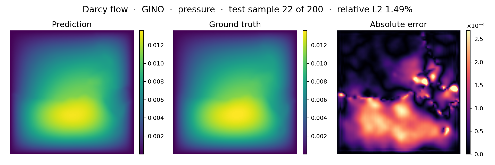

<!--
SPDX-FileCopyrightText: 2026 ZenteiQ AiTech Innovations Pvt. Ltd.
License notice: Documentation text and diagrams on this page are licensed
under CC BY 4.0. Source-code examples are licensed under LGPL-3.0-only
unless the example states otherwise.
-->

# Tutorial: Darcy Flow with GINO

In this tutorial you train a [Geometry-Informed Neural Operator](../../theory_guide/operator_learning.md#gino) (GINO) on **Darcy flow**: given
the permeability of a two-phase porous medium on the unit square, predict the
steady pressure. The data are the released `piececonst_r421_N1024`
files of [[1]](#ref1), strided from 421 × 421 to 85 × 85, the benchmark of the FNO, WNO and
Transolver papers. The whole tutorial is one script,
[`scripts/tutorials/darcy_gino.py`](../../../scripts/tutorials/darcy_gino.py). It uses only the public ScireX API
([`scirex.models.GINO`](../../api/models.md#scirex.models.GINO), the [`scirex.config.GINODarcy2d`](../../api/config.md#scirex.config.GINODarcy2d) preset,
[`scirex.layers.kdtree_neighbor_search`](../../api/layers.md#scirex.layers.kdtree_neighbor_search) and [`neighbors_to_segments`](../../api/layers.md#scirex.layers.neighbors_to_segments),
[`scirex.training.adamw_cx`](../../api/training.md#scirex.training.adamw_cx), [`scirex.utils.count_model_params`](../../api/utils.md#scirex.utils.count_model_params)), SciPy to read the data and plain JAX and optax for the training
loop. The code on this page is copied from that script.

## Summary

| | |
|---|---|
| Problem | Steady 2D Darcy flow, $-\nabla\cdot(a\nabla u) = 1$ on $(0, 1)^2$ with $u = 0$ on the boundary: permeability in, pressure out |
| Model | GINO, [`scirex.models.GINO`](../../api/models.md#scirex.models.GINO). Benchmark size: the [`GINODarcy2d`](../../api/config.md#scirex.config.GINODarcy2d) preset with an FNO of `hidden_channels=31`, `modes=16` (`fno_n_modes=[16, 16]`), `n_layers=5`, GNO radii 0.0305 and 0.0333, 2,801,340 parameters. Smoke size: FNO `hidden_channels=16, modes=12, n_layers=2`, GNO channel MLPs `[32, 32]`, 97,308 parameters |
| Data | `piececonst_r421_N1024_smooth1.mat` (train) and `smooth2.mat` (test), 1024 samples each on a 421 × 421 grid, about 1.7 GB each. Benchmark: first 1000 / first 200 samples, strided to 85 × 85. Smoke: 96 train / 20 test |
| Recipe | AdamW with the complex-aware [`adamw_cx`](../../api/training.md#scirex.training.adamw_cx), weight decay 1e-4, cosine one-cycle learning rate with peak 1e-3, gradient clipping 1.0, batch size 16, 2000 epochs (124,000 steps), relative L2 + 0.1 x gradient loss, seed 0 |
| Normalisation | one mean and one standard deviation per grid point (per-pixel), fitted on the training samples |
| Metric | Relative L2 error per test sample, in physical units, averaged over the 200 test samples |
| Full-run value | 1.603% (last epoch). GINO's paper ([[2]](#ref2)) targets 3D CFD and reports no comparable 2D Darcy number |

## Setup

The setup is the same as in the [FNO tutorial](../FNO/Darcy_FNO.md#setup).

## The problem

The problem, the data and the metric are the same as in the [FNO tutorial](../FNO/Darcy_FNO.md#the-problem).

The input and the target are normalised with one mean and one standard deviation per grid point (per-pixel), fitted on the training samples. The network
predicts a normalised pressure, which is decoded before the loss. The metric is
the relative L2 error of each test sample in physical units,

$$
e_i = \frac{\lVert \hat u_i - u_i\rVert_2}{\lVert u_i\rVert_2},
\qquad \text{metric} = \frac{1}{N_{\text{test}}}\sum_{i=1}^{N_{\text{test}}} e_i ,
$$

and the training loss is

$$
\mathcal L_B = \frac{1}{|B|}\sum_{i\in B} e_i + 0.1\left(\frac{1}{|B|}\sum_{i\in B} \frac{\lVert \partial_x \hat u_i - \partial_x u_i\rVert_2}{\lVert \partial_x u_i\rVert_2} + \frac{1}{|B|}\sum_{i\in B} \frac{\lVert \partial_y \hat u_i - \partial_y u_i\rVert_2}{\lVert \partial_y u_i\rVert_2}\right) .
$$

The loss of a batch $B$ adds to the mean relative error 0.1 times the relative errors of the x- and y-derivatives (Transolver's Darcy loss, [[3]](#ref3)). The derivatives are zero-padded central differences, and the outer ring of the prediction is set to zero first, because $u = 0$ on the boundary.

**Geometry-Informed Neural Operator in one paragraph.** GINO has three stages. A graph neural operator (GNO)
integrates the input over a ball around each point of a latent grid, an FNO
works on that latent grid, and a second GNO integrates the result back to the
query points. The GNOs are what let GINO take any point cloud. On Darcy flow
every sample lives on the same regular grid, which is also the latent grid,
so the GNOs only act as local smoothing kernels around an FNO; the problem
does not need GINO's geometry handling, and the tutorial shows how to wire it
up on a simple case. The
[theory guide](../../theory_guide/operator_learning.md#gino) has the details.

## Step-by-step walkthrough

The explanations of the steps that are the same for every model are in the [FNO tutorial](../FNO/Darcy_FNO.md#step-by-step-walkthrough). This page keeps the code and the text that is specific to the model.

### 1. Setup

Imports, the seed, the data split, the training recipe and the two model
sizes. `PROTOCOL` and `RECIPE` hold the same values as `PROTOCOL` and
`RUNS["gino"].opt` in [`scripts/benchmarks/darcy/_config.py`](../../../scripts/benchmarks/darcy/_config.py): 2000 epochs, batch size 16, AdamW ([`adamw_cx`](../../api/training.md#scirex.training.adamw_cx)) with weight decay 1e-4 on a cosine one-cycle learning rate with peak 1e-3, gradient clipping at 1.0, and the `relative L2 + 0.1 x gradient` loss.
`SIZES["full"]` is the benchmark's GINO; `SIZES["smoke"]` is small enough
for a CPU.

<!-- tutorial-snippet -->
```python
from __future__ import annotations

import argparse
import os
import platform
from pathlib import Path
from time import perf_counter

import flax
import jax
import jax.numpy as jnp
import matplotlib
import matplotlib.pyplot as plt
import numpy as np
import optax
from scipy.io import loadmat

import scirex
from scirex.config import GINODarcy2d
from scirex.layers import kdtree_neighbor_search, neighbors_to_segments
from scirex.models import GINO
from scirex.training import adamw_cx
from scirex.utils import count_model_params

matplotlib.use("Agg")  # write figures to files, no display needed
# Keep float32, also if float64 was enabled earlier in the process.
jax.config.update("jax_enable_x64", False)
```

<!-- tutorial-snippet -->
```python
SEED = 0

# Data split of the Darcy benchmark, the same values as PROTOCOL in
# scripts/benchmarks/darcy/_config.py.
PROTOCOL = dict(
    train_file="piececonst_r421_N1024_smooth1.mat",
    test_file="piececonst_r421_N1024_smooth2.mat",
    n_train=1000,
    n_test=200,
    subsample_rate=5,  # 421 -> 85, as in Li et al.'s own code
)

# GINO's training recipe on this benchmark, RUNS["gino"].opt in the same file:
# AdamW (adamw_cx) with weight decay 1e-4, cosine one-cycle lr with peak 1e-3,
# gradient clipping 1.0, batch 16, 2000 epochs, rel. L2 + 0.1 x gradient loss.
RECIPE = dict(
    learning_rate=1e-3,
    weight_decay=1e-4,
    adam_eps=1e-8,
    grad_clip=1.0,
    grad_loss_weight=0.1,
    batch_size=16,
    epochs=2000,
)

# Model sizes: the FNO inside GINO, and the hidden layers of the two GNO
# channel MLPs. "full" is the benchmark's GINO (2,801,340 parameters, matched
# to Transolver's 2,826,945), with the preset's GNO MLPs. "smoke" is a small
# GINO that trains on a CPU.
SIZES = dict(
    full=dict(hidden_channels=31, modes=16, n_layers=5),
    smoke=dict(
        hidden_channels=16,
        modes=12,
        n_layers=2,
        in_gno_channel_mlp_hidden_layers=[32, 32],
        out_gno_channel_mlp_hidden_layers=[32, 32],
    ),
)
```

<!-- tutorial-snippet -->
```python
def print_environment(seed: int) -> None:
    """Print the versions, the devices and the seed, so a run can be repeated."""
    print(f"python {platform.python_version()} | numpy {np.__version__}")
    print(f"scirex {scirex.__version__}")
    print(
        f"jax {jax.__version__} | flax {flax.__version__} | optax {optax.__version__}"
    )
    print(f"devices: {jax.devices()}")
    print(f"SEED = {seed}")
```
### 2. Load the data

<!-- tutorial-snippet -->
```python
def load_darcy(
    data_dir: Path, n_train: int, n_test: int, subsample_rate: int = 5
) -> dict:
    """Read the split: ``a`` and ``u`` as ``(n, s, s)`` float32 arrays."""
    out = {}
    for name, file, n in (
        ("train", PROTOCOL["train_file"], n_train),
        ("test", PROTOCOL["test_file"], n_test),
    ):
        path = Path(data_dir) / file
        if not path.is_file():
            raise FileNotFoundError(f"{path} not found")
        raw = loadmat(path.as_posix(), variable_names=("coeff", "sol"))
        if raw["coeff"].shape[0] < n:
            raise ValueError(f"{path} has only {raw['coeff'].shape[0]} samples")
        r = subsample_rate
        out[f"a_{name}"] = raw["coeff"][:n, ::r, ::r].astype(np.float32)
        out[f"u_{name}"] = raw["sol"][:n, ::r, ::r].astype(np.float32)
    print(
        f"samples: {n_train} train / {n_test} test | grid {out['a_train'].shape[1:]} | "
        f"permeability values {np.unique(out['a_train'])} | "
        f"pressure range [{out['u_train'].min():.4f}, {out['u_train'].max():.4f}]"
    )
    return out
```

### 3. Normalise

`PixelNormalizer` fits one mean and one standard deviation per grid point,
over the training samples, with `eps = 1e-5`, as in [[1]](#ref1):
[`UnitGaussianNormalizer`](../../api/data.md#scirex.data.UnitGaussianNormalizer). The inputs are encoded once. The targets are not:
the network's output is decoded instead, so the loss and the metric are in
physical units.

<!-- tutorial-snippet -->
```python
class PixelNormalizer:
    """``(v - mean) / (std + eps)`` with a mean and a std per grid point."""

    def __init__(self, train: np.ndarray, eps: float = 1e-5) -> None:
        self.mean = train.mean(axis=0, keepdims=True)
        self.std = train.std(axis=0, keepdims=True)
        self.eps = eps

    def encode(self, v):
        return (v - self.mean) / (self.std + self.eps)

    def decode(self, v):
        return v * (self.std + self.eps) + self.mean
```

### 4. Geometry

GINO works on point clouds. Here every sample has the same points, the 85 × 85
grid over $[0, 1]^2$ flattened in the same order as the fields, and the same
latent grid for its FNO, so the neighbour lists are built once. Each GNO layer
sums, for every query point, over the input points within a radius. The
preset's radii, 0.16 and 0.175, were tuned at resolution 16; the benchmark
scales them to the grid spacing, `0.16 * 16 / (s - 1)` and
`0.175 * 16 / (s - 1)`, about 2.6 and 2.8 grid spacings at $s = 85$.
[`kdtree_neighbor_search`](../../api/layers.md#scirex.layers.kdtree_neighbor_search) finds the neighbours and [`neighbors_to_segments`](../../api/layers.md#scirex.layers.neighbors_to_segments)
turns them into the form the GNO layers take. The input graph has 148,005
edges, 20.5 per point.

<!-- tutorial-snippet -->
```python
def gno_radii(n_side: int) -> tuple[float, float]:
    """The input and output GNO radii for an ``n_side x n_side`` grid."""
    return 0.16 * 16.0 / (n_side - 1), 0.175 * 16.0 / (n_side - 1)
```

<!-- tutorial-snippet -->
```python
def build_geometry(n_side: int) -> dict:
    """Points, latent grid and neighbour lists of the ``n_side x n_side`` grid."""
    xs = np.linspace(0.0, 1.0, n_side, dtype=np.float32)
    gx, gy = np.meshgrid(xs, xs, indexing="ij")
    xy = np.stack([gx.ravel(), gy.ravel()], axis=-1)  # (s * s, 2)
    in_radius, out_radius = gno_radii(n_side)
    neighbors = {
        name: neighbors_to_segments(kdtree_neighbor_search(xy, xy, radius))
        for name, radius in (("neighbors_in", in_radius), ("neighbors_out", out_radius))
    }
    edges = int(neighbors["neighbors_in"]["neighbors_index"].shape[0])
    print(
        f"geometry: {len(xy)} points | radii {in_radius:.4f}, {out_radius:.4f} | "
        f"input-graph edges {edges:,} ({edges / len(xy):.1f} per point)"
    )
    return dict(
        input_geom=jnp.asarray(xy)[None],
        latent_queries=jnp.asarray(xy.reshape(n_side, n_side, 2))[None],
        output_queries=jnp.asarray(xy)[None],
        **neighbors,
    )
```

### 5. Build the model

[`GINODarcy2d`](../../api/config.md#scirex.config.GINODarcy2d) in [`scirex.config`](../../api/config.md) is the GINO preset for this problem: one
input and one output channel, 2D coordinates, the GNO channel MLPs
(`[256, 512, 256]` in, `[512, 1024, 512]` out) and the FNO settings.
`build_model` takes its values, sets the radii and the FNO size of this run,
and passes them to [`GINO`](../../api/models.md#scirex.models.GINO). The input is the normalised permeability at every
point, `(batch, 85 * 85, 1)`. [`count_model_params`](../../api/utils.md#scirex.utils.count_model_params) counts a complex weight as
two real numbers. In smoke mode the GNO channel MLPs are also made smaller,
because on a CPU they dominate the cost: they run once per edge.

<!-- tutorial-snippet -->
```python
def build_model(size: dict, geometry: dict, n_side: int, seed: int):
    """Build GINO from the preset, initialise it and print the parameter count."""
    config = dict(GINODarcy2d().to_dict())
    config.pop("model_arch")
    config["in_channels"] = config.pop("data_channels")
    config["in_gno_radius"], config["out_gno_radius"] = gno_radii(n_side)
    config["fno_hidden_channels"] = size["hidden_channels"]
    config["fno_n_layers"] = size["n_layers"]
    config["fno_n_modes"] = [size["modes"], size["modes"]]
    for key in (
        "in_gno_channel_mlp_hidden_layers",
        "out_gno_channel_mlp_hidden_layers",
    ):
        config[key] = size.get(key, config[key])
    model = GINO(**config)
    key, init_key = jax.random.split(jax.random.PRNGKey(seed))
    x0 = jnp.zeros((1, n_side * n_side, 1), dtype=jnp.float32)
    params = model.init(init_key, x=x0, **geometry)
    print(f"GINO {size} | parameters: {count_model_params(params):,}")
    return model, params, key
```

### 6. Loss

The loss from [The problem](#the-problem): the mean relative L2 error of the
decoded pressure plus 0.1 times the relative errors of its derivatives.

<!-- tutorial-snippet -->
```python
def rel_l2_per_sample(pred, true):
    """``||pred - true|| / ||true||`` per sample, over all grid points."""
    b = pred.shape[0]
    diff = jnp.linalg.norm(pred.reshape(b, -1) - true.reshape(b, -1), axis=1)
    return diff / jnp.maximum(jnp.linalg.norm(true.reshape(b, -1), axis=1), 1e-12)
```

<!-- tutorial-snippet -->
```python
def central_diff(grid, dx: float):
    """Zero-padded central differences ``(d/dx, d/dy)`` of ``(batch, s, s)`` fields."""
    padded = jnp.pad(grid, ((0, 0), (1, 1), (1, 1)))
    grad_x = (padded[:, 1:-1, 2:] - padded[:, 1:-1, :-2]) / (2.0 * dx)
    grad_y = (padded[:, 2:, 1:-1] - padded[:, :-2, 1:-1]) / (2.0 * dx)
    return grad_x, grad_y
```

<!-- tutorial-snippet -->
```python
def gradient_loss(pred, true, dx: float):
    """Relative L2 of the x- and y-derivatives, with the prediction's border zeroed."""
    pred = pred.at[:, 0, :].set(0.0).at[:, -1, :].set(0.0)
    pred = pred.at[:, :, 0].set(0.0).at[:, :, -1].set(0.0)
    (px, py), (tx, ty) = central_diff(pred, dx), central_diff(true, dx)
    return jnp.mean(rel_l2_per_sample(px, tx)) + jnp.mean(rel_l2_per_sample(py, ty))
```

<!-- tutorial-snippet -->
```python
def make_loss(model, geometry, u_norm: PixelNormalizer, n_side: int, weight: float):
    """Return ``loss_fn(params, a, u) -> rel. L2 + weight x gradient loss``."""
    dx = 1.0 / n_side

    def loss_fn(params, a, u):
        out = model.apply(params, x=a[..., None], **geometry)[..., 0]
        pred = u_norm.decode(out)  # (batch, s * s)
        loss = jnp.mean(rel_l2_per_sample(pred, u))
        shape = (-1, n_side, n_side)
        return loss + weight * gradient_loss(pred.reshape(shape), u.reshape(shape), dx)

    return loss_fn
```

### 7. Optimiser

GINO's FNO has complex spectral weights. For a real loss $L$ and a complex
weight $w$, `jax.grad` returns $\partial L/\partial w$, the conjugate of the
steepest-ascent direction that optax assumes, so plain `optax.adamw` would
move the imaginary parts of those weights the wrong way. [`adamw_cx`](../../api/training.md#scirex.training.adamw_cx)
conjugates complex gradients first and keeps Adam's second moment real; real
weights are updated exactly as by AdamW. The learning rate follows a cosine
one-cycle schedule over the whole run, behind gradient clipping at a global
norm of 1.0.

`optax.inject_hyperparams` gives its hyperparameters the highest dtype in the
parameter tree, which is `complex64` here, so `hyperparam_dtype=jnp.float32`
keeps the learning rate, betas, eps and weight decay real. Without it the
values are the same but every update becomes complex. The benchmark's
`train.py` does not pass it yet.

<!-- tutorial-snippet -->
```python
def make_optimizer(recipe: dict, total_steps: int):
    """Gradient clipping, then ``adamw_cx`` on a cosine one-cycle learning rate."""
    schedule = optax.cosine_onecycle_schedule(
        transition_steps=total_steps, peak_value=recipe["learning_rate"]
    )
    adam = optax.inject_hyperparams(adamw_cx, hyperparam_dtype=jnp.float32)(
        learning_rate=schedule,
        weight_decay=recipe["weight_decay"],
        eps=recipe["adam_eps"],
    )
    return optax.chain(optax.clip_by_global_norm(recipe["grad_clip"]), adam)
```

### 8. Train

Batches of 16 samples in a new random order every epoch, one optimiser step
per batch. As in `train.py`, the random order comes from `jax.random` with the
key left over from initialisation, and the last incomplete batch is dropped.
Every `eval_every` epochs the test samples are scored, to draw the error
curve. There is no validation split, so no epoch is selected by its test
error: the weights after the last epoch are the result. JAX compiles the step
on its first call, so the first epoch is slower than the others.

<!-- tutorial-snippet -->
```python
def train(
    model, params, key, geometry, data, u_norm, epochs, eval_every=10, recipe=RECIPE
):
    """Train for ``epochs`` epochs. Return the final parameters and the history."""
    a_train, u_train = jnp.asarray(data["a_train"]), jnp.asarray(data["u_train"])
    bs = recipe["batch_size"]
    n_train = a_train.shape[0]
    n_side = round(np.sqrt(a_train.shape[1]))
    steps_per_epoch = max(n_train // bs, 1)
    tx = make_optimizer(recipe, steps_per_epoch * epochs)
    opt_state = tx.init(params)
    loss_fn = make_loss(model, geometry, u_norm, n_side, recipe["grad_loss_weight"])

    @jax.jit
    def train_step(params, opt_state, a, u):
        loss, grads = jax.value_and_grad(loss_fn)(params, a, u)
        updates, opt_state = tx.update(grads, opt_state, params)
        return optax.apply_updates(params, updates), opt_state, loss

    history = []
    for epoch in range(epochs):
        t0 = perf_counter()
        key, sub = jax.random.split(key)
        perm = jax.random.permutation(sub, n_train)
        total = 0.0
        for b in range(steps_per_epoch):
            idx = perm[b * bs : (b + 1) * bs]
            params, opt_state, loss = train_step(
                params, opt_state, a_train[idx], u_train[idx]
            )
            total += float(loss)
        secs = perf_counter() - t0
        if epoch % eval_every == 0 or epoch == epochs - 1:
            test = evaluate(model, params, geometry, data, u_norm)["test_rel_l2"]
            history.append(
                dict(epoch=epoch, train_loss=total / steps_per_epoch, test_rel_l2=test)
            )
            print(
                f"epoch {epoch}: train_loss={total / steps_per_epoch:.4f} "
                f"test_rel_l2={test:.4f} epoch_time={secs:.1f}s"
            )
    return params, history
```

### 9. Evaluate

<!-- tutorial-snippet -->
```python
def evaluate(model, params, geometry, data, u_norm, batch_size: int = 16) -> dict:
    """Per-sample relative L2 on the test samples, and the predictions."""
    predict = jax.jit(
        lambda p, a: u_norm.decode(model.apply(p, x=a[..., None], **geometry)[..., 0])
    )
    a_test, u_test = data["a_test"], data["u_test"]
    preds = np.concatenate(
        [
            np.asarray(predict(params, jnp.asarray(a_test[i : i + batch_size])))
            for i in range(0, len(a_test), batch_size)
        ]
    )
    errors = np.asarray(rel_l2_per_sample(jnp.asarray(preds), jnp.asarray(u_test)))
    return dict(
        test_rel_l2=float(errors.mean()),
        median=float(np.median(errors)),
        p90=float(np.percentile(errors, 90)),
        worst=float(errors.max()),
        errors=errors,
        predictions=preds,
    )
```

### 10. Plot

<!-- tutorial-snippet -->
```python
def plot_prediction(a, truth, pred, path: Path, title: str) -> None:
    """Save permeability, true pressure, predicted pressure and absolute error."""
    lim = (float(truth.min()), float(truth.max()))
    panels = [
        ("Input: permeability a", a, "viridis", None),
        ("Truth: pressure u", truth, "jet", lim),
        ("Prediction: pressure u", pred, "jet", lim),
        ("Absolute error", np.abs(pred - truth), "magma", None),
    ]
    fig, axes = plt.subplots(1, 4, figsize=(18, 4.2), constrained_layout=True)
    for ax, (name, values, cmap, vlim) in zip(axes, panels):
        vmin, vmax = vlim if vlim else (None, None)
        im = ax.imshow(
            values, cmap=cmap, vmin=vmin, vmax=vmax, origin="lower", extent=(0, 1, 0, 1)
        )
        ax.set_title(name)
        ax.set_xlabel("x")
        ax.set_ylabel("y")
        fig.colorbar(im, ax=ax, shrink=0.85)
    fig.suptitle(title)
    fig.savefig(path, dpi=120)
    plt.close(fig)
```

<!-- tutorial-snippet -->
```python
def plot_loss(history: list[dict], path: Path) -> None:
    """Save the training loss and the test relative L2 per epoch."""
    epochs = [h["epoch"] for h in history]
    fig, ax = plt.subplots(figsize=(6, 4))
    ax.plot(epochs, [h["train_loss"] for h in history], marker="o", label="train loss")
    ax.plot(epochs, [h["test_rel_l2"] for h in history], marker="o", label="test")
    ax.set_xlabel("epoch")
    ax.set_ylabel("loss / relative L2 (mean over samples)")
    ax.set_yscale("log")
    ax.legend()
    ax.grid(True, alpha=0.3)
    fig.savefig(path, dpi=120, bbox_inches="tight")
    plt.close(fig)
```

The complete script is [`scripts/tutorials/darcy_gino.py`](../../../scripts/tutorials/darcy_gino.py).

## Run it

Smoke run (CPU, no GPU needed):

```bash
CUDA_VISIBLE_DEVICES= JAX_PLATFORMS=cpu python scripts/tutorials/darcy_gino.py --data-dir ~/data/darcy --smoke
```

Full protocol (1000 training samples, benchmark-size GINO; use a GPU):

```bash
python scripts/tutorials/darcy_gino.py --data-dir ~/data/darcy
```

The other flags are `--epochs`, `--seed`, `--out-dir` (default
`outputs/darcy_gino_tutorial`) and, for the smoke run, `--n-train` and
`--n-test`.

This is the output of the smoke run (smoke run, CPU, 96 train / 20 test samples,
not a benchmark number), run with `--out-dir out/gino_smoke`. The wall time
was 41 s, measured with `time`; JAX's message that it found
no GPU and library deprecation warnings are left out:

```text
python 3.12.3 | numpy 1.26.4
scirex 1.0.0rc1
jax 0.6.2 | flax 0.10.7 | optax 0.2.8
devices: [CpuDevice(id=0)]
SEED = 0
samples: 96 train / 20 test | grid (85, 85) | permeability values [ 3. 12.] | pressure range [-0.0000, 0.0159]
geometry: 7225 points | radii 0.0305, 0.0333 | input-graph edges 148,005 (20.5 per point)
data loading and geometry: 11.3s
GINO {'hidden_channels': 16, 'modes': 12, 'n_layers': 2, 'in_gno_channel_mlp_hidden_layers': [32, 32], 'out_gno_channel_mlp_hidden_layers': [32, 32]} | parameters: 97,308
epoch 0: train_loss=0.4278 test_rel_l2=0.2667 epoch_time=4.4s
epoch 1: train_loss=0.3419 test_rel_l2=0.2511 epoch_time=2.9s
epoch 2: train_loss=0.3001 test_rel_l2=0.2104 epoch_time=2.8s
epoch 3: train_loss=0.2518 test_rel_l2=0.1730 epoch_time=2.9s
epoch 4: train_loss=0.2347 test_rel_l2=0.1673 epoch_time=2.7s
test relative L2: mean 0.1673 | median 0.1690 | p90 0.2026 | worst 0.2557
figures in out/gino_smoke | total time 38.0s
```

## Results

### Full run

The next figures were not made by this script. They come from the benchmark
runner (`train.py` and `infer.py`) and are the committed results of the **full
run** (1000 training and 200 test samples, benchmark-size GINO). The figure shows one held-out test sample (the title names it and its
relative L2 error): the prediction, the ground truth and the absolute error. It is drawn
by [`scripts/benchmarks/make_figures.py`](../../../scripts/benchmarks/make_figures.py) from the checkpoint.



| Model, same data and split, each with its own recipe | Parameters | Test relative L2 | Training time |
|---|---|---|---|
| [Transolver](../../benchmarks/darcy/results/comparative.md#transolver) | 2,826,945 | 0.532% (seed 2; mean of seeds 0 to 4: 0.556%) | ~42 min |
| [FNO](../../benchmarks/darcy/results/comparative.md#fno) | 2,836,281 | 1.109% | ~4.6 min |
| **GINO (this tutorial)** | 2,801,340 | **1.603% (last epoch; lowest during training 1.470%)** | ~89 min |
| [WNO](../../benchmarks/darcy/results/comparative.md#wno) | 2,829,601 | 2.020% | ~21 min |

The test errors are the mean over the 200 test samples after the last epoch
(the standard deviation over the samples is 0.853% for GINO).
Only the parameter count is matched: each model keeps its own paper's recipe,
so batch size, step count, loss and normalisation differ, and the table shows
each architecture at this size with its own recipe, not a pure architecture
effect.

## Troubleshooting

The common problems are listed in the [FNO tutorial](../FNO/Darcy_FNO.md#troubleshooting).

## Next steps

- Compare with the other architectures on the same data: [FNO](../FNO/Darcy_FNO.md), [WNO](../Others/Darcy_WNO.md), [Transolver](../Others/Darcy_Transolver.md)
  and the [comparison page](../../benchmarks/darcy/results/comparative.md).
- Read the [Darcy Flow results](../../benchmarks/darcy/results/comparative.md#gino) for the
  figures and the compute cost, and the
  [dataset guide](../../dataset_guide/darcy_2d.md) for the data.
- Learn how GINO works in the [theory guide](../../theory_guide/operator_learning.md#gino)
  and see its arguments in the [API reference](../../api/models.md).
- Train without any solution data: the physics-only Darcy benchmark
  ([setup](../../benchmarks/darcy_physics/results/setup.md)) uses the same files, split
  and metric.
- See the [quickstart](../../user_guide/quickstart.md) and the
  [training guide](../../user_guide/training.md) for the [`Trainer`](../../api/experimental.md#scirex.experimental.training.Trainer).

## References

1. <span id="ref1"></span>Li et al., *Fourier Neural Operator for Parametric Partial Differential Equations*, ICLR 2021. <https://arxiv.org/abs/2010.08895>

2. <span id="ref2"></span>Li et al., *Geometry-Informed Neural Operator for Large-Scale 3D PDEs*, NeurIPS 2023. <https://arxiv.org/abs/2309.00583>

3. <span id="ref3"></span>Wu et al., *Transolver: A Fast Transformer Solver for PDEs on General Geometries*, ICML 2024. <https://arxiv.org/abs/2402.02366>
