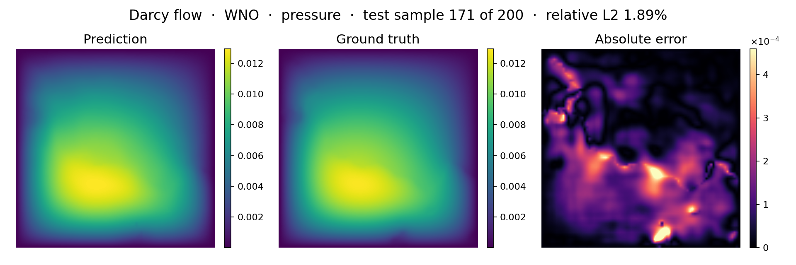

<!--
SPDX-FileCopyrightText: 2026 ZenteiQ AiTech Innovations Pvt. Ltd.
License notice: Documentation text and diagrams on this page are licensed
under CC BY 4.0. Source-code examples are licensed under LGPL-3.0-only
unless the example states otherwise.
-->

# Tutorial: Darcy Flow with WNO

In this tutorial you train a [Wavelet Neural Operator](../../theory_guide/operator_learning.md#wno) (WNO) on **Darcy flow**: given
the permeability of a two-phase porous medium on the unit square, predict the
steady pressure. The data are the released `piececonst_r421_N1024`
files of [[1]](#ref1), strided from 421 × 421 to 85 × 85, the benchmark of the FNO, WNO and
Transolver papers. The whole tutorial is one script,
[`scripts/tutorials/darcy_wno.py`](../../../scripts/tutorials/darcy_wno.py). It uses only the public ScireX API
([`scirex.models.WNO`](../../api/models.md#scirex.models.WNO), [`scirex.utils.count_model_params`](../../api/utils.md#scirex.utils.count_model_params)), SciPy to read the data and plain JAX and optax for the training
loop. The code on this page is copied from that script.

## Summary

| | |
|---|---|
| Problem | Steady 2D Darcy flow, $-\nabla\cdot(a\nabla u) = 1$ on $(0, 1)^2$ with $u = 0$ on the boundary: permeability in, pressure out |
| Model | WNO, [`scirex.models.WNO`](../../api/models.md#scirex.models.WNO). Benchmark size: `hidden_channels=28`, `level=4`, `wavelet="db6"`, `n_layers=4`, `padding=1`, (x, y) grid channels, float32 compute, 2,829,601 parameters. Smoke size: `hidden_channels=12, level=3, wavelet="db6", n_layers=2, padding=1`, 462,953 parameters |
| Data | `piececonst_r421_N1024_smooth1.mat` (train) and `smooth2.mat` (test), 1024 samples each on a 421 × 421 grid, about 1.7 GB each. Benchmark: first 1000 / first 200 samples, strided to 85 × 85. Smoke: 100 train / 20 test |
| Recipe | AdamW, weight decay 1e-6, learning rate 1e-3 halved every 50 epochs, batch size 20, 500 epochs (25,000 steps), seed 0 |
| Normalisation | one mean and one standard deviation per grid point (per-pixel), fitted on the training samples |
| Metric | Relative L2 error per test sample, in physical units, averaged over the 200 test samples |
| Full-run value | 2.020% (last epoch). The paper [[2]](#ref2) reports about 0.84%; the benchmark page notes that this is not reproducible from the paper's released code and data |

## Setup

The setup is the same as in the [FNO tutorial](../FNO/Darcy_FNO.md#setup).

## The problem

The problem, the data and the metric are the same as in the [FNO tutorial](../FNO/Darcy_FNO.md#the-problem).

The input and the target are normalised with one mean and one standard deviation per grid point (per-pixel), fitted on the training samples. The network
predicts a normalised pressure, which is decoded before the loss. The metric is
the relative L2 error of each test sample in physical units,

$$
e_i = \frac{\lVert \hat u_i - u_i\rVert_2}{\lVert u_i\rVert_2},
\qquad \text{metric} = \frac{1}{N_{\text{test}}}\sum_{i=1}^{N_{\text{test}}} e_i ,
$$

and the training loss is

$$
\mathcal L_B = \frac{1}{|B|}\sum_{i\in B} e_i .
$$

The loss of a batch $B$ is the mean of the per-sample errors $e_i$, so the loss and the metric are the same quantity.

**Wavelet Neural Operator in one paragraph.** A WNO layer adds a pointwise linear map to a
convolution done in wavelet space: it takes a multilevel discrete wavelet
transform of the hidden channels, multiplies the coarsest sub-bands by learned
weights and transforms back. Wavelets are local in space as well as in scale,
so a WNO can represent features at a given place, such as the interfaces of
the permeability, more directly than a truncated Fourier series. The
[theory guide](../../theory_guide/operator_learning.md#wno) has the details.

## Step-by-step walkthrough

The explanations of the steps that are the same for every model are in the [FNO tutorial](../FNO/Darcy_FNO.md#step-by-step-walkthrough). This page keeps the code and the text that is specific to the model.

### 1. Setup

Imports, the seed, the data split, the training recipe and the two model
sizes. `PROTOCOL` and `RECIPE` hold the same values as `PROTOCOL` and
`RUNS["wno"].opt` in [`scripts/benchmarks/darcy/_config.py`](../../../scripts/benchmarks/darcy/_config.py): 500 epochs, batch size 20, AdamW with a learning rate of 1e-3 halved every 50 epochs and weight decay 1e-6, relative L2 loss.
`SIZES["full"]` is the benchmark's WNO; `SIZES["smoke"]` is small enough
for a CPU.

<!-- tutorial-snippet -->
```python
from __future__ import annotations

import argparse
import os
import platform
from pathlib import Path
from time import perf_counter

import flax
import jax
import jax.numpy as jnp
import matplotlib
import matplotlib.pyplot as plt
import numpy as np
import optax
from scipy.io import loadmat

import scirex
from scirex.models import WNO
from scirex.utils import count_model_params

matplotlib.use("Agg")  # write figures to files, no display needed
# Keep float32, also if float64 was enabled earlier in the process.
jax.config.update("jax_enable_x64", False)
```

<!-- tutorial-snippet -->
```python
SEED = 0

# Data split of the Darcy benchmark, the same values as PROTOCOL in
# scripts/benchmarks/darcy/_config.py.
PROTOCOL = dict(
    train_file="piececonst_r421_N1024_smooth1.mat",
    test_file="piececonst_r421_N1024_smooth2.mat",
    n_train=1000,
    n_test=200,
    subsample_rate=5,  # 421 -> 85, as in Li et al.'s own code
)

# WNO's training recipe on this benchmark, RUNS["wno"].opt in the same file:
# AdamW with weight decay 1e-6, lr 1e-3 halved every 50 epochs, batch 20.
RECIPE = dict(
    learning_rate=1e-3,
    weight_decay=1e-6,
    adam_eps=1e-8,
    decay_epochs=50,
    decay_rate=0.5,
    batch_size=20,
    epochs=500,
)

# Model sizes. "full" is the benchmark's WNO (2,829,601 parameters, matched to
# Transolver's 2,826,945). "smoke" is a small WNO that trains on a CPU.
SIZES = dict(
    full=dict(hidden_channels=28, level=4, wavelet="db6", n_layers=4, padding=1),
    smoke=dict(hidden_channels=12, level=3, wavelet="db6", n_layers=2, padding=1),
)
```

<!-- tutorial-snippet -->
```python
def print_environment(seed: int) -> None:
    """Print the versions, the devices and the seed, so a run can be repeated."""
    print(f"python {platform.python_version()} | numpy {np.__version__}")
    print(f"scirex {scirex.__version__}")
    print(
        f"jax {jax.__version__} | flax {flax.__version__} | optax {optax.__version__}"
    )
    print(f"devices: {jax.devices()}")
    print(f"SEED = {seed}")
```
### 2. Load the data

<!-- tutorial-snippet -->
```python
def load_darcy(
    data_dir: Path, n_train: int, n_test: int, subsample_rate: int = 5
) -> dict:
    """Read the split: ``a`` and ``u`` as ``(n, s, s)`` float32 arrays."""
    out = {}
    for name, file, n in (
        ("train", PROTOCOL["train_file"], n_train),
        ("test", PROTOCOL["test_file"], n_test),
    ):
        path = Path(data_dir) / file
        if not path.is_file():
            raise FileNotFoundError(f"{path} not found")
        raw = loadmat(path.as_posix(), variable_names=("coeff", "sol"))
        if raw["coeff"].shape[0] < n:
            raise ValueError(f"{path} has only {raw['coeff'].shape[0]} samples")
        r = subsample_rate
        out[f"a_{name}"] = raw["coeff"][:n, ::r, ::r].astype(np.float32)
        out[f"u_{name}"] = raw["sol"][:n, ::r, ::r].astype(np.float32)
    print(
        f"samples: {n_train} train / {n_test} test | grid {out['a_train'].shape[1:]} | "
        f"permeability values {np.unique(out['a_train'])} | "
        f"pressure range [{out['u_train'].min():.4f}, {out['u_train'].max():.4f}]"
    )
    return out
```

### 3. Normalise

`PixelNormalizer` fits one mean and one standard deviation per grid point,
over the training samples, with `eps = 1e-5`, as in [[1]](#ref1):
[`UnitGaussianNormalizer`](../../api/data.md#scirex.data.UnitGaussianNormalizer). The inputs are encoded once. The targets are not:
the network's output is decoded instead, so the loss and the metric are in
physical units.

<!-- tutorial-snippet -->
```python
class PixelNormalizer:
    """``(v - mean) / (std + eps)`` with a mean and a std per grid point."""

    def __init__(self, train: np.ndarray, eps: float = 1e-5) -> None:
        self.mean = train.mean(axis=0, keepdims=True)
        self.std = train.std(axis=0, keepdims=True)
        self.eps = eps

    def encode(self, v):
        return (v - self.mean) / (self.std + self.eps)

    def decode(self, v):
        return v * (self.std + self.eps) + self.mean
```

### 4. Build the model

[`WNO`](../../api/models.md#scirex.models.WNO) is a Flax module: the parameters are a separate pytree, created by
`init` and used by `apply`. It is channels-last, so a batch is
`(batch, 85, 85, 1)`. `use_grid=True` appends the (x, y) coordinates of the
grid as two more channels, the reference code's `in_channel=3`. Each layer
takes a `level`-4 Daubechies-6 (`db6`) wavelet transform, multiplies the four
coarsest sub-bands (one approximation and three details) by learned weights
and transforms back, next to a pointwise linear path. `size` is the grid,
which fixes the shapes of those sub-bands, so a WNO is built for one
resolution; `padding=1` pads the grid by one point. WNO's own default
compute dtype is bfloat16; the reference code is float32, so we set
`compute_dtype`. All the weights of WNO are real.

<!-- tutorial-snippet -->
```python
def build_model(size: dict, sample: np.ndarray, seed: int):
    """Build the WNO, initialise it on one sample and print the parameter count."""
    model = WNO(
        in_channels=1,
        out_channels=1,
        hidden_channels=size["hidden_channels"],
        n_layers=size["n_layers"],
        level=size["level"],
        size=sample.shape[:2],
        wavelet=size["wavelet"],
        padding=size["padding"],
        use_grid=True,
        compute_dtype=jnp.float32,
    )
    key, init_key = jax.random.split(jax.random.PRNGKey(seed))
    params = model.init(init_key, jnp.asarray(sample)[None])
    print(f"WNO {size} | parameters: {count_model_params(params):,}")
    return model, params, key
```

### 5. Loss

The loss from [The problem](#the-problem): the mean of the per-sample
relative L2 errors on the decoded pressure.

<!-- tutorial-snippet -->
```python
def rel_l2_per_sample(pred, true):
    """``||pred - true|| / ||true||`` per sample, over all grid points."""
    b = pred.shape[0]
    diff = jnp.linalg.norm(pred.reshape(b, -1) - true.reshape(b, -1), axis=1)
    return diff / jnp.maximum(jnp.linalg.norm(true.reshape(b, -1), axis=1), 1e-12)
```

<!-- tutorial-snippet -->
```python
def make_loss(model, u_norm: PixelNormalizer):
    """Return ``loss_fn(params, a, u) -> mean relative L2`` in physical units."""

    def loss_fn(params, a, u):
        pred = u_norm.decode(model.apply(params, a))  # (batch, s, s, 1)
        return jnp.mean(rel_l2_per_sample(pred, u))

    return loss_fn
```

### 6. Optimiser

WNO's weights are all real, so optax's own AdamW is correct here (FNO and
GINO, which have complex weights, need [`scirex.training.adamw_cx`](../../api/training.md#scirex.training.adamw_cx)). The
learning rate is halved every 50 epochs and the weight decay is 1e-6, as in
the WNO reference code.

<!-- tutorial-snippet -->
```python
def make_optimizer(recipe: dict, steps_per_epoch: int):
    """AdamW on a step-decay learning rate."""
    schedule = optax.exponential_decay(
        init_value=recipe["learning_rate"],
        transition_steps=steps_per_epoch * recipe["decay_epochs"],
        decay_rate=recipe["decay_rate"],
        staircase=True,
    )
    return optax.inject_hyperparams(optax.adamw)(
        learning_rate=schedule,
        weight_decay=recipe["weight_decay"],
        eps=recipe["adam_eps"],
    )
```

### 7. Train

Batches of 20 samples in a new random order every epoch, one optimiser step
per batch. As in `train.py`, the random order comes from `jax.random` with the
key left over from initialisation, and the last incomplete batch is dropped.
Every `eval_every` epochs the test samples are scored, to draw the error
curve. There is no validation split, so no epoch is selected by its test
error: the weights after the last epoch are the result. JAX compiles the step
on its first call, so the first epoch is slower than the others.

<!-- tutorial-snippet -->
```python
def train(model, params, key, data, u_norm, epochs, eval_every=10, recipe=RECIPE):
    """Train for ``epochs`` epochs. Return the final parameters and the history."""
    a_train, u_train = jnp.asarray(data["a_train"]), jnp.asarray(data["u_train"])
    bs = recipe["batch_size"]
    n_train = a_train.shape[0]
    steps_per_epoch = max(n_train // bs, 1)
    tx = make_optimizer(recipe, steps_per_epoch)
    opt_state = tx.init(params)
    loss_fn = make_loss(model, u_norm)

    @jax.jit
    def train_step(params, opt_state, a, u):
        loss, grads = jax.value_and_grad(loss_fn)(params, a, u)
        updates, opt_state = tx.update(grads, opt_state, params)
        return optax.apply_updates(params, updates), opt_state, loss

    history = []
    for epoch in range(epochs):
        t0 = perf_counter()
        key, sub = jax.random.split(key)
        perm = jax.random.permutation(sub, n_train)
        total = 0.0
        for b in range(steps_per_epoch):
            idx = perm[b * bs : (b + 1) * bs]
            params, opt_state, loss = train_step(
                params, opt_state, a_train[idx], u_train[idx]
            )
            total += float(loss)
        secs = perf_counter() - t0
        if epoch % eval_every == 0 or epoch == epochs - 1:
            test = evaluate(model, params, data, u_norm)["test_rel_l2"]
            history.append(
                dict(epoch=epoch, train_loss=total / steps_per_epoch, test_rel_l2=test)
            )
            print(
                f"epoch {epoch}: train_loss={total / steps_per_epoch:.4f} "
                f"test_rel_l2={test:.4f} epoch_time={secs:.1f}s"
            )
    return params, history
```

### 8. Evaluate

<!-- tutorial-snippet -->
```python
def evaluate(model, params, data, u_norm, batch_size: int = 20) -> dict:
    """Per-sample relative L2 on the test samples, and the predictions."""
    predict = jax.jit(lambda p, a: u_norm.decode(model.apply(p, a)))
    a_test, u_test = data["a_test"], data["u_test"]
    preds = np.concatenate(
        [
            np.asarray(predict(params, jnp.asarray(a_test[i : i + batch_size])))
            for i in range(0, len(a_test), batch_size)
        ]
    )
    errors = np.asarray(rel_l2_per_sample(jnp.asarray(preds), jnp.asarray(u_test)))
    return dict(
        test_rel_l2=float(errors.mean()),
        median=float(np.median(errors)),
        p90=float(np.percentile(errors, 90)),
        worst=float(errors.max()),
        errors=errors,
        predictions=preds[..., 0],
    )
```

### 9. Plot

<!-- tutorial-snippet -->
```python
def plot_prediction(a, truth, pred, path: Path, title: str) -> None:
    """Save permeability, true pressure, predicted pressure and absolute error."""
    lim = (float(truth.min()), float(truth.max()))
    panels = [
        ("Input: permeability a", a, "viridis", None),
        ("Truth: pressure u", truth, "jet", lim),
        ("Prediction: pressure u", pred, "jet", lim),
        ("Absolute error", np.abs(pred - truth), "magma", None),
    ]
    fig, axes = plt.subplots(1, 4, figsize=(18, 4.2), constrained_layout=True)
    for ax, (name, values, cmap, vlim) in zip(axes, panels):
        vmin, vmax = vlim if vlim else (None, None)
        im = ax.imshow(
            values, cmap=cmap, vmin=vmin, vmax=vmax, origin="lower", extent=(0, 1, 0, 1)
        )
        ax.set_title(name)
        ax.set_xlabel("x")
        ax.set_ylabel("y")
        fig.colorbar(im, ax=ax, shrink=0.85)
    fig.suptitle(title)
    fig.savefig(path, dpi=120)
    plt.close(fig)
```

<!-- tutorial-snippet -->
```python
def plot_loss(history: list[dict], path: Path) -> None:
    """Save the training loss and the test relative L2 per epoch."""
    epochs = [h["epoch"] for h in history]
    fig, ax = plt.subplots(figsize=(6, 4))
    ax.plot(epochs, [h["train_loss"] for h in history], marker="o", label="train loss")
    ax.plot(epochs, [h["test_rel_l2"] for h in history], marker="o", label="test")
    ax.set_xlabel("epoch")
    ax.set_ylabel("relative L2 (mean over samples)")
    ax.set_yscale("log")
    ax.legend()
    ax.grid(True, alpha=0.3)
    fig.savefig(path, dpi=120, bbox_inches="tight")
    plt.close(fig)
```

The complete script is [`scripts/tutorials/darcy_wno.py`](../../../scripts/tutorials/darcy_wno.py).

## Run it

Smoke run (CPU, no GPU needed):

```bash
CUDA_VISIBLE_DEVICES= JAX_PLATFORMS=cpu python scripts/tutorials/darcy_wno.py --data-dir ~/data/darcy --smoke
```

Full protocol (1000 training samples, benchmark-size WNO; use a GPU):

```bash
python scripts/tutorials/darcy_wno.py --data-dir ~/data/darcy
```

The other flags are `--epochs`, `--seed`, `--out-dir` (default
`outputs/darcy_wno_tutorial`) and, for the smoke run, `--n-train` and
`--n-test`.

This is the output of the smoke run (smoke run, CPU, 100 train / 20 test samples,
not a benchmark number), run with `--out-dir out/wno_smoke`. The wall time
was 91 s, measured with `time`; JAX's message that it found
no GPU and library deprecation warnings are left out:

```text
python 3.12.3 | numpy 1.26.4
scirex 1.0.0rc1
jax 0.6.2 | flax 0.10.7 | optax 0.2.8
devices: [CpuDevice(id=0)]
SEED = 0
samples: 100 train / 20 test | grid (85, 85) | permeability values [ 3. 12.] | pressure range [-0.0000, 0.0159]
data loading: 11.3s
WNO {'hidden_channels': 12, 'level': 3, 'wavelet': 'db6', 'n_layers': 2, 'padding': 1} | parameters: 462,953
epoch 0: train_loss=0.2019 test_rel_l2=0.1984 epoch_time=13.5s
epoch 1: train_loss=0.1776 test_rel_l2=0.1837 epoch_time=13.2s
epoch 2: train_loss=0.1663 test_rel_l2=0.1819 epoch_time=12.8s
epoch 3: train_loss=0.1670 test_rel_l2=0.1811 epoch_time=13.0s
epoch 4: train_loss=0.1625 test_rel_l2=0.1792 epoch_time=12.8s
test relative L2: mean 0.1792 | median 0.1827 | p90 0.2176 | worst 0.2638
figures in out/wno_smoke | total time 89.1s
```

## Results

### Full run

The next figures were not made by this script. They come from the benchmark
runner (`train.py` and `infer.py`) and are the committed results of the **full
run** (1000 training and 200 test samples, benchmark-size WNO). The figure shows one held-out test sample (the title names it and its
relative L2 error): the prediction, the ground truth and the absolute error. It is drawn
by [`scripts/benchmarks/make_figures.py`](../../../scripts/benchmarks/make_figures.py) from the checkpoint.



| Model, same data and split, each with its own recipe | Parameters | Test relative L2 | Training time |
|---|---|---|---|
| [Transolver](../../benchmarks/darcy/results/comparative.md#transolver) | 2,826,945 | 0.532% (seed 2; mean of seeds 0 to 4: 0.556%) | ~42 min |
| [FNO](../../benchmarks/darcy/results/comparative.md#fno) | 2,836,281 | 1.109% | ~4.6 min |
| [GINO](../../benchmarks/darcy/results/comparative.md#gino) | 2,801,340 | 1.603% (last epoch; lowest during training 1.470%) | ~89 min |
| **WNO (this tutorial)** | 2,829,601 | **2.020%** | ~21 min |

The test errors are the mean over the 200 test samples after the last epoch
(the standard deviation over the samples is 0.748% for WNO).
Only the parameter count is matched: each model keeps its own paper's recipe,
so batch size, step count, loss and normalisation differ, and the table shows
each architecture at this size with its own recipe, not a pure architecture
effect.

## Troubleshooting

The common problems are listed in the [FNO tutorial](../FNO/Darcy_FNO.md#troubleshooting).

## Next steps

- Compare with the other architectures on the same data: [FNO](../FNO/Darcy_FNO.md), [GINO](../Others/Darcy_GINO.md), [Transolver](../Others/Darcy_Transolver.md)
  and the [comparison page](../../benchmarks/darcy/results/comparative.md).
- Read the [Darcy Flow results](../../benchmarks/darcy/results/comparative.md#wno) for the
  figures and the compute cost, and the
  [dataset guide](../../dataset_guide/darcy_2d.md) for the data.
- Learn how WNO works in the [theory guide](../../theory_guide/operator_learning.md#wno)
  and see its arguments in the [API reference](../../api/models.md).
- Train without any solution data: the physics-only Darcy benchmark
  ([setup](../../benchmarks/darcy_physics/results/setup.md)) uses the same files, split
  and metric.
- See the [quickstart](../../user_guide/quickstart.md) and the
  [training guide](../../user_guide/training.md) for the [`Trainer`](../../api/experimental.md#scirex.experimental.training.Trainer).

## References

1. <span id="ref1"></span>Li et al., *Fourier Neural Operator for Parametric Partial Differential Equations*, ICLR 2021. <https://arxiv.org/abs/2010.08895>

2. <span id="ref2"></span>Tripura and Chakraborty, *Wavelet Neural Operator for Solving Parametric Partial Differential Equations in Computational Mechanics Problems*, Computer Methods in Applied Mechanics and Engineering 404, 115783 (2023). <https://arxiv.org/abs/2205.02191>
