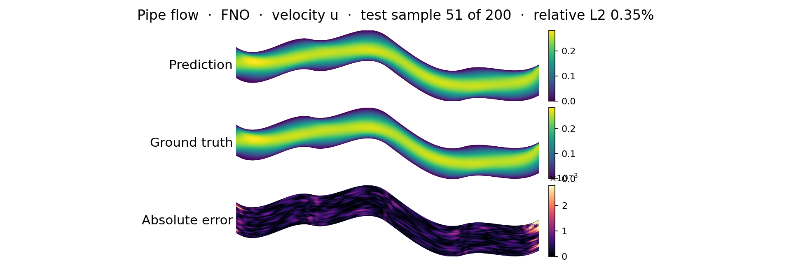
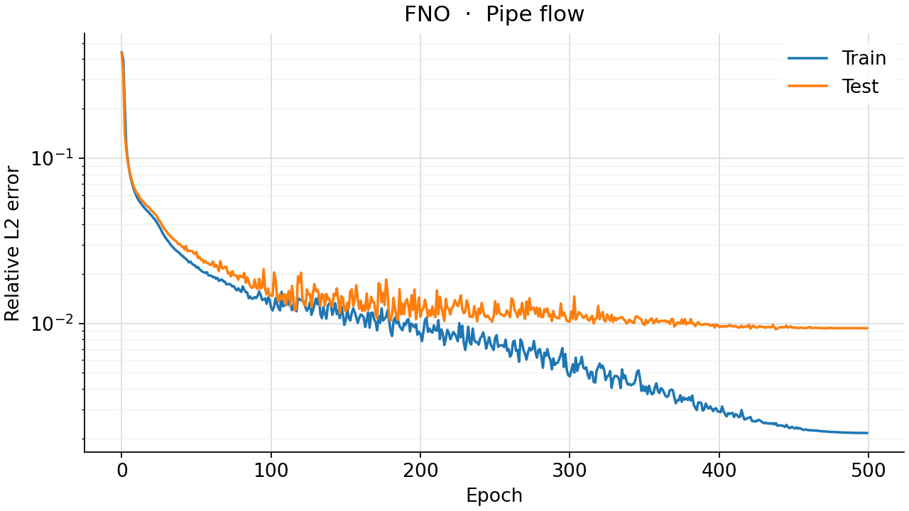
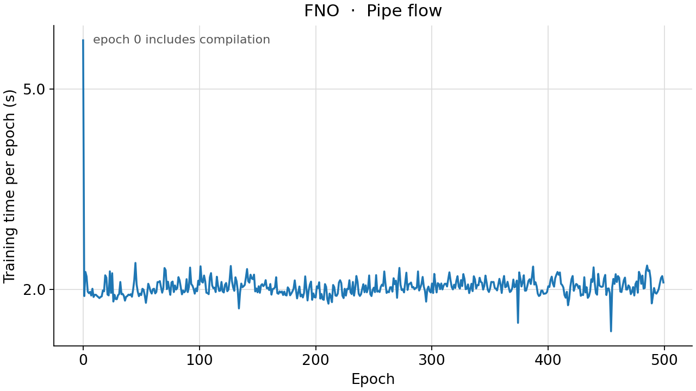

<!--
SPDX-FileCopyrightText: 2026 ZenteiQ AiTech Innovations Pvt. Ltd.
License notice: Documentation text and diagrams on this page are licensed
under CC BY 4.0. Source-code examples are licensed under LGPL-3.0-only
unless the example states otherwise.
-->

# Tutorial: Pipe Flow with FNO

In this tutorial you train a [Fourier Neural Operator](../../theory_guide/operator_learning.md#fno)
(FNO [[2]](#ref2)) on the **Pipe** benchmark: given the mesh of a pipe whose centreline is
bent differently in every sample, predict the steady horizontal velocity at
every mesh node. The mesh is a structured 129 × 129 grid that follows the
pipe, so the domain is curved in physical space but a rectangle in index
space, and that is what the FFT of the FNO works on. The whole tutorial is
one script, [`scripts/tutorials/pipe_fno.py`](../../../scripts/tutorials/pipe_fno.py). It uses only the public ScireX
API ([`scirex.models.FNO`](../../api/models.md#scirex.models.FNO), [`scirex.training.optim.scale_by_adam_cx`](../../api/training.md#scirex.training.optim.scale_by_adam_cx),
[`scirex.utils.count_model_params`](../../api/utils.md#scirex.utils.count_model_params)) and plain NumPy, JAX and optax. The code on
this page is copied from that script.

## Summary

| | |
|---|---|
| Problem | Steady, incompressible flow through a deformed 2D pipe: mesh coordinates in, horizontal velocity out |
| Model | FNO, [`scirex.models.FNO`](../../api/models.md#scirex.models.FNO). Benchmark size: `n_modes=(24, 22), hidden_channels=36, n_layers=4, projection_channel_ratio=4, domain_padding=8/129`, linear skip, no channel MLP, 2,999,629 parameters. Smoke size: `n_modes=(12, 12), hidden_channels=12, n_layers=2, projection_channel_ratio=2`, 49,405 parameters |
| Data | Geo-FNO Pipe (`Pipe_X.npy`, `Pipe_Y.npy`, `Pipe_Q.npy`, about 1.5 GB), 2310 samples on a 129 × 129 mesh. Benchmark: first 1000 train / last 200 of the first 1200 test. Smoke: 32 train / 8 test |
| Optimiser | Complex-aware AdamW ([`scale_by_adam_cx`](../../api/training.md#scirex.training.optim.scale_by_adam_cx)), eps 1e-8, weight decay 1e-5, gradient-norm clip 0.1, cosine one-cycle learning rate with peak 1e-3, batch size 8 |
| Metric | Relative L2 error per test sample, in physical units, averaged over the test samples |
| Full-run values | 0.934% best of seeds 0, 1 and 2 (the released checkpoint), 0.960% ± 0.023% mean ± sample std. Geo-FNO paper: 0.67% (its own recipe and size) |

## Setup

Install the library from a clone of the repository (see [Install](../../install/index.md)):

```bash
pip install -e ".[all]"
```

### Data

The dataset is not bundled and not downloaded automatically. Download
`Pipe_X.npy`, `Pipe_Y.npy` and `Pipe_Q.npy` from the Geo-FNO data release
(linked from [neuraloperator/Geo-FNO](https://github.com/neuraloperator/Geo-FNO);
the Transolver [[3]](#ref3) repository links the same files) into one folder, about 1.5 GB
in all. Pass that folder as `--data-dir`, or set `PIPE_DATA_DIR`. ScireX does
not redistribute the files; see the [dataset guide](../../dataset_guide/pipe.md)
for the source and the download.

`Pipe_Q.npy` must be the complete file, `(2310, 3, 129, 129)`. Some copies of
the release contain only `Pipe_Q_interp_x.npy`, an older interpolated target,
which is a different field. This tutorial and the benchmark both read
`Pipe_Q.npy` and fail if it is missing. For the smoke run you do not need to
copy anything: the script memory-maps the files and reads only the samples it
uses.

## The problem

Each sample is a pipe of length 10 and width 1 whose centreline is a smooth
random curve ([[1]](#ref1)). The flow in it is the steady, incompressible
Navier-Stokes flow

$$
(\mathbf u \cdot \nabla)\,\mathbf u = -\nabla p + \nu \nabla^2 \mathbf u, \qquad \nabla \cdot \mathbf u = 0 ,
$$

with a parabolic velocity profile at the inlet ($x = 0$, peak 0.25 on the
centreline), no slip on the walls and a fixed pressure at the outlet
($x = 10$). The model never sees the equation. It learns the map from the
geometry to the flow from 1000 solved examples. The
[dataset guide](../../dataset_guide/pipe.md) has the shapes, ranges and known
limits of the files.

The geometry is given as the coordinates of the 129 × 129 body-fitted mesh,
so the model is a map

$$
\mathcal G_\theta : \mathbf X \in \mathbb R^{129\times129\times 2} \;\mapsto\; \hat u \in \mathbb R^{129\times129},
$$

from the $(x, y)$ position of every node to the horizontal velocity $u$ at
that node. Both are standardised with one mean and one standard deviation per
channel, fitted on the training samples,
$\tilde{\mathbf X} = (\mathbf X - \boldsymbol\mu_X)/(\boldsymbol\sigma_X + 10^{-8})$.
The network predicts a standardised velocity, which is decoded,
$\hat u = \sigma_u \hat{\tilde u} + \mu_u$, before the loss.

The loss of a batch $B$ and the metric are the relative L2 error per sample in
physical units, over all $N = 129^2$ nodes:

$$
e_i = \frac{\lVert \hat u_i - u_i\rVert_2}{\lVert u_i\rVert_2}, \qquad
\mathcal L_B = \sum_{i\in B} e_i, \qquad
\text{metric} = \frac{1}{N_{\text{test}}}\sum_{i=1}^{N_{\text{test}}} e_i .
$$

**FNO in one paragraph.** An FNO layer adds a pointwise linear map to a
convolution done in Fourier space: it takes the FFT of the hidden channels,
keeps only the lowest `n_modes` frequencies, multiplies each kept frequency by
a learned complex matrix and transforms back. One layer therefore couples
every node with every other, at the cost of an FFT. On this data the FFT runs
over the mesh indices, so "low frequency" means smooth along and across the
pipe in index space, which is a good match for a smooth flow on a smooth
mesh. The [theory guide](../../theory_guide/operator_learning.md#fno) has the details.

## Step-by-step walkthrough

### 1. Setup

Imports, the seed, the training settings and the two model sizes. `PROTOCOL`
holds the benchmark's training settings (the same values as in
[`scripts/benchmarks/pipe/_config.py`](../../../scripts/benchmarks/pipe/_config.py), which every model on this benchmark
shares): 500 epochs, batch size 8, AdamW with a peak learning rate of 1e-3, a
one-cycle schedule, weight decay 1e-5 and a gradient-norm clip of 0.1.
`SIZES["full"]` is the benchmark's FNO; `SIZES["smoke"]` is small enough for a
CPU.

<!-- tutorial-snippet -->
```python
from __future__ import annotations

import argparse
import os
import platform
from pathlib import Path
from time import perf_counter

import flax
import jax
import jax.numpy as jnp
import matplotlib
import matplotlib.pyplot as plt
import numpy as np
import optax

import scirex
from scirex.models import FNO
from scirex.training.optim import scale_by_adam_cx
from scirex.utils import count_model_params

matplotlib.use("Agg")  # write figures to files, no display needed
# Keep float32, also if float64 was enabled earlier in the process.
jax.config.update("jax_enable_x64", False)
```

<!-- tutorial-snippet -->
```python
SEED = 0

# Training settings of the Pipe benchmark, the same values as PROTOCOL in
# scripts/benchmarks/pipe/_config.py (Transolver's recipe, used by every model).
PROTOCOL = dict(
    ntrain=1000,
    ntest=200,
    n_total=1200,
    epochs=500,
    batch_size=8,
    learning_rate=1e-3,
    weight_decay=1e-5,
    adam_eps=1e-8,
    pct_start=0.3,
    div_factor=25.0,
    final_div_factor=1e4,
    max_grad_norm=0.1,
)

# Model sizes. "full" is the benchmark's FNO (2,999,629 parameters, matched to
# Transolver's 3,073,985). "smoke" is a tiny FNO that trains on a CPU.
SIZES = dict(
    full=dict(
        n_modes=(24, 22),
        hidden_channels=36,
        n_layers=4,
        projection_channel_ratio=4,
        domain_padding=8 / 129,
        fno_skip="linear",
        use_channel_mlp=False,
    ),
    smoke=dict(
        n_modes=(12, 12),
        hidden_channels=12,
        n_layers=2,
        projection_channel_ratio=2,
        domain_padding=8 / 129,
        fno_skip="linear",
        use_channel_mlp=False,
    ),
)
```

`print_environment` records the library versions, the devices JAX sees and the seed;
see [how the tutorials work](../index.md#how-the-tutorials-work).

<!-- tutorial-snippet -->
```python
def print_environment(seed: int) -> None:
    """Print the versions, the devices and the seed, so a run can be repeated."""
    print(f"python {platform.python_version()} | numpy {np.__version__}")
    print(f"scirex {scirex.__version__}")
    print(
        f"jax {jax.__version__} | flax {flax.__version__} | optax {optax.__version__}"
    )
    print(f"devices: {jax.devices()}")
    print(f"SEED = {seed}")
```

### 2. Load the data

`load_pipe` memory-maps the three files and reads only the training and test
samples: the first `ntrain` of the file for training, the last `ntest` of the
first `n_total` for testing, as in the benchmark. The coordinates come back as
`(n, 129, 129, 2)` and the target, channel 0 of `Pipe_Q.npy`, as
`(n, 129, 129)`.

<!-- tutorial-snippet -->
```python
def load_pipe(data_dir: Path, ntrain: int, ntest: int, n_total: int = 1200) -> dict:
    """Read the split. Coordinates ``(n, 129, 129, 2)``, velocity ``(n, 129, 129)``."""
    data_dir = Path(data_dir)
    xs = np.load(data_dir / "Pipe_X.npy", mmap_mode="r")
    ys = np.load(data_dir / "Pipe_Y.npy", mmap_mode="r")
    q = np.load(data_dir / "Pipe_Q.npy", mmap_mode="r")
    if q.shape[0] < n_total or ntrain + ntest > n_total:
        raise ValueError(f"need {ntrain} + {ntest} <= {n_total} <= {q.shape[0]}")
    split = dict(train=np.arange(ntrain), test=np.arange(n_total - ntest, n_total))
    out = {}
    for name, idx in split.items():
        coords = np.stack([xs[idx], ys[idx]], axis=-1).astype(np.float32)
        out[f"x_{name}"] = coords
        out[f"y_{name}"] = np.asarray(q[idx, 0], dtype=np.float32)
    print(
        f"samples: {ntrain} train / {ntest} test | mesh {out['x_train'].shape[1:3]} | "
        f"velocity range [{out['y_train'].min():.3f}, {out['y_train'].max():.3f}]"
    )
    return out
```

### 3. Normalise

`UnitGaussian` fits one mean and one standard deviation per channel over the
sample and node axes, on the training samples only. The inputs are encoded
once. The targets are not: the network's output is decoded instead, so the
loss and the metric are in physical units.

<!-- tutorial-snippet -->
```python
class UnitGaussian:
    """``(v - mean) / (std + 1e-8)`` with one mean and std per channel."""

    def __init__(self, train: np.ndarray, axes: tuple[int, ...]) -> None:
        self.mean = train.mean(axis=axes, keepdims=True)[0]
        self.std = train.std(axis=axes, keepdims=True)[0] + 1e-8

    def encode(self, v):
        return (v - self.mean) / self.std

    def decode(self, v):
        return v * self.std + self.mean
```

### 4. Build the model

[`FNO`](../../api/models.md#scirex.models.FNO) is a Flax module: the parameters are a separate pytree, created by
`init` and used by `apply`. It is channels-first, so the coordinates are moved
to `(batch, 2, 129, 129)`. `positional_embedding=None` because the
coordinates already are the input; the default would append a regular grid in
index space. [`count_model_params`](../../api/utils.md#scirex.utils.count_model_params) counts a complex weight as two real numbers.

<!-- tutorial-snippet -->
```python
def build_model(size: dict, sample: np.ndarray, seed: int):
    """Build the FNO, initialise it on one sample and print the parameter count."""
    model = FNO(in_channels=2, out_channels=1, positional_embedding=None, **size)
    params = model.init(jax.random.PRNGKey(seed), jnp.asarray(sample)[None])
    print(f"FNO {size} | parameters: {count_model_params(params):,}")
    return model, params
```

<!-- tutorial-snippet -->
```python
def to_channels_first(coords: np.ndarray) -> np.ndarray:
    """``(n, H, W, 2)`` -> ``(n, 2, H, W)``, the layout ``FNO`` expects."""
    return np.ascontiguousarray(coords.transpose(0, 3, 1, 2))
```

### 5. Loss

The loss from [The problem](#the-problem): the relative L2 error of each
sample on the decoded velocity, summed over the batch.

<!-- tutorial-snippet -->
```python
def rel_l2_per_sample(pred, true):
    """``||pred - true|| / ||true||`` per sample, over all nodes."""
    b = pred.shape[0]
    diff = jnp.linalg.norm(pred.reshape(b, -1) - true.reshape(b, -1), axis=1)
    return diff / jnp.linalg.norm(true.reshape(b, -1), axis=1)
```

<!-- tutorial-snippet -->
```python
def make_loss(model, y_norm: UnitGaussian):
    """Return ``loss_fn(params, x, y) -> summed relative L2`` in physical units."""

    def loss_fn(params, x, y):
        out = model.apply(params, x)[:, 0]  # (batch, H, W)
        return jnp.sum(rel_l2_per_sample(y_norm.decode(out), y))

    return loss_fn
```

### 6. Optimiser for complex weights

The spectral weights of an FNO are complex. For a real loss $L$ and a complex
weight $w$, `jax.grad` returns $\partial L/\partial w$, the complex conjugate
of the steepest-ascent direction $\partial L/\partial \bar w$ that PyTorch
stores and that every optax transform assumes it is given:

```python
>>> jax.grad(lambda w: jnp.abs(w) ** 2)(jnp.complex64(1 + 1j))
Array(1.9999999-1.9999999j, dtype=complex64)   # steepest ascent of x² + y² at (1, 1) is 2+2j
```

With plain `optax.adamw` the real part of every spectral weight descends but
the imaginary part ascends. [`scale_by_adam_cx`](../../api/training.md#scirex.training.optim.scale_by_adam_cx) conjugates complex gradients
first and keeps Adam's second moment real ($|g|^2$); real weights are updated
exactly as by AdamW. `make_optimizer` chains it with the gradient clip, the
weight decay and the one-cycle learning rate, as the benchmark does.
`optimizer="adamw"` swaps in optax's own Adam scaling so that you can see the
difference (see [Results](#results)).

<!-- tutorial-snippet -->
```python
def make_optimizer(protocol: dict, total_steps: int, optimizer: str = "adamw_cx"):
    """AdamW on a cosine one-cycle schedule, after gradient clipping.

    ``"adamw_cx"`` (the benchmark's) is complex-aware; ``"adamw"`` is plain optax.
    """
    scale_by_adam = dict(
        adamw_cx=scale_by_adam_cx(eps=protocol["adam_eps"]),
        adamw=optax.scale_by_adam(eps=protocol["adam_eps"]),
    )[optimizer]
    schedule = optax.cosine_onecycle_schedule(
        transition_steps=total_steps,
        peak_value=protocol["learning_rate"],
        pct_start=protocol["pct_start"],
        div_factor=protocol["div_factor"],
        final_div_factor=protocol["final_div_factor"],
    )
    tx = optax.chain(
        optax.clip_by_global_norm(protocol["max_grad_norm"]),
        scale_by_adam,
        optax.add_decayed_weights(protocol["weight_decay"]),
        optax.scale_by_learning_rate(schedule),
    )
    return tx, schedule
```

### 7. Train

Batches of 8 samples in a new random order every epoch, one optimiser step per
batch. After every epoch the test samples are scored, to draw the error curve.
There is no validation split, so no epoch is selected by its test error: the
weights after the last epoch are the result, as in the benchmark. JAX compiles
the step on its first call, so the first epoch is slower than the others.

<!-- tutorial-snippet -->
```python
def train(
    model, params, data, y_norm, epochs, seed, protocol=PROTOCOL, optimizer="adamw_cx"
):
    """Train for ``epochs`` epochs. Return the final parameters and the history."""
    x_train, y_train = data["x_train"], data["y_train"]
    x_test, y_test = data["x_test"], data["y_test"]
    bs = protocol["batch_size"]
    ntrain = len(x_train)
    tx, _ = make_optimizer(protocol, -(-ntrain // bs) * epochs, optimizer)
    opt_state = tx.init(params)
    loss_fn = make_loss(model, y_norm)

    @jax.jit
    def train_step(params, opt_state, x, y):
        loss, grads = jax.value_and_grad(loss_fn)(params, x, y)
        updates, opt_state = tx.update(grads, opt_state, params)
        return optax.apply_updates(params, updates), opt_state, loss

    eval_step = jax.jit(loss_fn)

    rng = np.random.default_rng(seed)
    history = []
    for epoch in range(epochs):
        t0 = perf_counter()
        order = rng.permutation(ntrain)
        train_total = 0.0
        for i in range(0, ntrain, bs):
            idx = order[i : i + bs]
            params, opt_state, loss = train_step(
                params, opt_state, jnp.asarray(x_train[idx]), jnp.asarray(y_train[idx])
            )
            train_total += float(loss)
        secs = perf_counter() - t0
        test_total = sum(
            float(
                eval_step(params, jnp.asarray(x_test[i : i + bs]), y_test[i : i + bs])
            )
            for i in range(0, len(x_test), bs)
        )
        history.append(
            dict(
                epoch=epoch,
                train_rel_l2=train_total / ntrain,
                test_rel_l2=test_total / len(x_test),
                secs=secs,
            )
        )
        print(
            f"epoch {epoch}: train_rel_l2={history[-1]['train_rel_l2']:.4f} "
            f"test_rel_l2={history[-1]['test_rel_l2']:.4f} epoch_time={secs:.1f}s"
        )
    return params, history
```

### 8. Evaluate

The relative L2 error of every test sample, in physical units. The mean is the
benchmark's number. The median, the 90th percentile and the worst sample show
how the error is spread: a few hard geometries dominate the mean.

<!-- tutorial-snippet -->
```python
def evaluate(model, params, data, y_norm, batch_size: int = 8) -> dict:
    """Per-sample relative L2 on the test samples, and the predictions."""
    predict = jax.jit(lambda p, x: y_norm.decode(model.apply(p, x)[:, 0]))
    x_test, y_test = data["x_test"], data["y_test"]
    preds = np.concatenate(
        [
            np.asarray(predict(params, jnp.asarray(x_test[i : i + batch_size])))
            for i in range(0, len(x_test), batch_size)
        ]
    )
    errors = np.asarray(rel_l2_per_sample(jnp.asarray(preds), jnp.asarray(y_test)))
    return dict(
        test_rel_l2=float(errors.mean()),
        median=float(np.median(errors)),
        p90=float(np.percentile(errors, 90)),
        worst=float(errors.max()),
        errors=errors,
        predictions=preds,
    )
```

### 9. Plot

The standard figure for this benchmark has four panels on the physical mesh of
one test sample: an input, the true velocity, the predicted velocity (same
colour scale as the truth) and the absolute error. The input panel shows the
y coordinate of every node, which shows how the pipe bends. The script plots
the test sample with the median error. A second figure shows the error per
epoch.

<!-- tutorial-snippet -->
```python
def plot_prediction(coords, truth, pred, path: Path, title: str) -> None:
    """Save input, true velocity, predicted velocity and absolute error."""
    xx, yy = coords[..., 0], coords[..., 1]
    lim = (float(truth.min()), float(truth.max()))
    panels = [
        ("Input: y coordinate of the mesh", yy, "coolwarm", None),
        ("Truth: horizontal velocity", truth, "jet", lim),
        ("Prediction: horizontal velocity", pred, "jet", lim),
        ("Absolute error", np.abs(pred - truth), "magma", None),
    ]
    fig, axes = plt.subplots(4, 1, figsize=(10, 9), constrained_layout=True)
    for ax, (name, values, cmap, vlim) in zip(axes, panels):
        vmin, vmax = vlim if vlim else (None, None)
        mesh = ax.pcolormesh(
            xx, yy, values, cmap=cmap, vmin=vmin, vmax=vmax, shading="gouraud"
        )
        ax.set_title(name)
        ax.set_aspect("equal")
        ax.set_xlabel("x")
        ax.set_ylabel("y")
        fig.colorbar(mesh, ax=ax, shrink=0.8)
    fig.suptitle(title)
    fig.savefig(path, dpi=120)
    plt.close(fig)
```

<!-- tutorial-snippet -->
```python
def plot_loss(history: list[dict], path: Path) -> None:
    """Save the training and test relative L2 per epoch."""
    epochs = [h["epoch"] for h in history]
    fig, ax = plt.subplots(figsize=(6, 4))
    ax.plot(epochs, [h["train_rel_l2"] for h in history], marker="o", label="train")
    ax.plot(epochs, [h["test_rel_l2"] for h in history], marker="o", label="test")
    ax.set_xlabel("epoch")
    ax.set_ylabel("relative L2 (mean over samples)")
    ax.set_yscale("log")
    ax.legend()
    ax.grid(True, alpha=0.3)
    fig.savefig(path, dpi=120, bbox_inches="tight")
    plt.close(fig)
```

The complete script is [`scripts/tutorials/pipe_fno.py`](../../../scripts/tutorials/pipe_fno.py).

## Run it

Smoke run (CPU, a few seconds, no GPU needed):

```bash
CUDA_VISIBLE_DEVICES= JAX_PLATFORMS=cpu python scripts/tutorials/pipe_fno.py --data-dir ~/data/pipe --smoke
```

Full protocol (1000 training samples, benchmark-size FNO, 500 epochs; use a
GPU):

```bash
python scripts/tutorials/pipe_fno.py --data-dir ~/data/pipe
```

The other flags are `--epochs`, `--seed`, `--out-dir` (default
`outputs/pipe_fno_tutorial`), `--optimizer` ([`adamw_cx`](../../api/training.md#scirex.training.adamw_cx), the default, or
`adamw`) and, for the smoke run, `--n-train` and `--n-test`.

This is the output of the smoke run on a CPU (smoke run, CPU, 32 train / 8
test samples, not a benchmark number). The wall time was 6.4 s, measured with
`time`; library deprecation warnings are left out:

```text
python 3.12.3 | numpy 1.26.4
scirex 1.0.0rc1
jax 0.6.2 | flax 0.10.7 | optax 0.2.8
devices: [CpuDevice(id=0)]
SEED = 0
samples: 32 train / 8 test | mesh (129, 129) | velocity range [-0.614, 0.599]
data loading: 0.0s
FNO {'n_modes': (12, 12), 'hidden_channels': 12, 'n_layers': 2, 'projection_channel_ratio': 2, 'domain_padding': 0.06201550387596899, 'fno_skip': 'linear', 'use_channel_mlp': False} | parameters: 49,405
epoch 0: train_rel_l2=0.4478 test_rel_l2=0.4459 epoch_time=0.9s
epoch 1: train_rel_l2=0.4459 test_rel_l2=0.4427 epoch_time=0.5s
epoch 2: train_rel_l2=0.4427 test_rel_l2=0.4401 epoch_time=0.5s
epoch 3: train_rel_l2=0.4407 test_rel_l2=0.4388 epoch_time=0.5s
epoch 4: train_rel_l2=0.4398 test_rel_l2=0.4385 epoch_time=0.4s
test relative L2: mean 0.4385 | median 0.4354 | p90 0.4575 | worst 0.4592
figures in outputs/pipe_fno_tutorial | total time 5.6s
```

## Results

### Full run

The next figures were not made by this script. They come from the benchmark
runner (`train.py` and `infer.py`) and are the committed results of the **full
500-epoch runs** (1000 training and 200 test samples, benchmark-size FNO, one
NVIDIA RTX PRO 6000 Blackwell). `infer.py` draws one test sample (the figure title names it and its relative L2
error): ground truth, prediction and absolute error.



Training loss and test relative L2 per epoch of seed 0:



Seconds per epoch of the same run (the first epoch includes compilation; in
`metrics.json`, the first epoch took 4.5 s and the median epoch 2.0 s):



| Relative L2 over the 200 test samples, last epoch | Mean | Median | 90th percentile | Worst |
|---|---|---|---|---|
| Seed 0 | 0.979% | 0.407% | 2.723% | 10.38% |
| Seed 1 | 0.966% | 0.376% | 2.442% | 10.62% |
| **Seed 2 (best)** | **0.934%** | **0.354%** | **2.883%** | **9.52%** |
| Mean ± std over seeds | 0.960% ± 0.023% | | | |

| Model, same data, recipe and seeds | Parameters | Best of 3 seeds | Mean ± std (3 seeds) |
|---|---|---|---|
| [Transolver](../../benchmarks/pipe/results/comparative.md#transolver) | 3,073,985 | 0.424% | 0.460% ± 0.031% |
| [WNO](../../benchmarks/pipe/results/comparative.md#wno) | 3,102,157 | 0.529% | 0.541% ± 0.012% |
| **FNO (this tutorial)** | 2,999,629 | **0.934%** | 0.960% ± 0.023% |
| [GINO](../../benchmarks/pipe/results/comparative.md#gino) | 3,001,956 | 1.024% | 1.603% ± 0.972% |
| [Transolver, tuned recipe (released checkpoint)](../../benchmarks/pipe/results/comparative.md#tuned-recipe) | 3,073,985 | **0.386%** | 0.406% ± 0.034% |

## Troubleshooting

- **`FileNotFoundError: ... Pipe_Q.npy`.** `--data-dir` does not hold the
  three files, or your copy of the release has only `Pipe_Q_interp_x.npy`.
  That file is a different target and is not a substitute; get `Pipe_Q.npy`.
- **`ValueError: need ... <= ...`.** You asked for more samples than the split
  allows: `--n-train` plus `--n-test` must not exceed 1200.
- **The error stays near 0.44 for many epochs.** The one-cycle schedule starts
  at 1/25 of the peak learning rate and needs about 30% of the steps to reach
  it. With few samples there are few steps per epoch; train for more epochs.

## Next steps

- Compare with the other architectures on the same data:
  [Transolver](../../benchmarks/pipe/results/comparative.md#transolver),
  [WNO](../../benchmarks/pipe/results/comparative.md#wno), [GINO](../../benchmarks/pipe/results/comparative.md#gino) and the
  [comparison page](../../benchmarks/pipe/results/comparative.md).
- Read the [Pipe Flow results](../../benchmarks/pipe/results/comparative.md#fno) for the per-seed
  results, the compute cost and how the optimiser problem was found, and the
  [dataset guide](../../dataset_guide/pipe.md) for the files.
- Learn how the FNO works in the [theory guide](../../theory_guide/operator_learning.md#fno) and see
  its arguments in the [API reference](../../api/models.md); the optimiser is in
  the [training API](../../api/training.md).
- See the [quickstart](../../user_guide/quickstart.md) and the
  [training guide](../../user_guide/training.md) for the [`Trainer`](../../api/experimental.md#scirex.experimental.training.Trainer).
- Try another problem on a grid: [Navier-Stokes 2D](../../benchmarks/navier_stokes/results/comparative.md#fno)
  or [Darcy flow](../../benchmarks/darcy/results/comparative.md#fno).

## References

1. <span id="ref1"></span>Li et al., *Fourier Neural Operator with Learned Deformations for PDEs on General Geometries* (Geo-FNO), Journal of Machine Learning Research 24(388), 2023. <https://arxiv.org/abs/2207.05209>

2. <span id="ref2"></span>Li et al., *Fourier Neural Operator for Parametric Partial Differential Equations*, ICLR 2021. <https://arxiv.org/abs/2010.08895>

3. <span id="ref3"></span>Wu et al., *Transolver: A Fast Transformer Solver for PDEs on General Geometries*, ICML 2024. <https://arxiv.org/abs/2402.02366>
