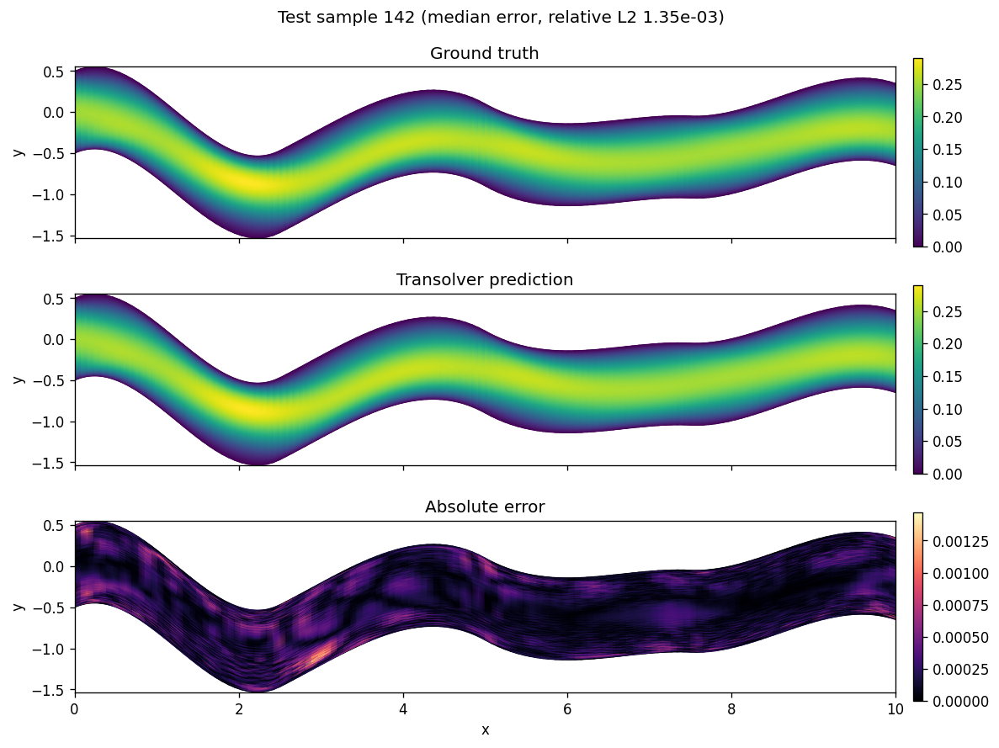
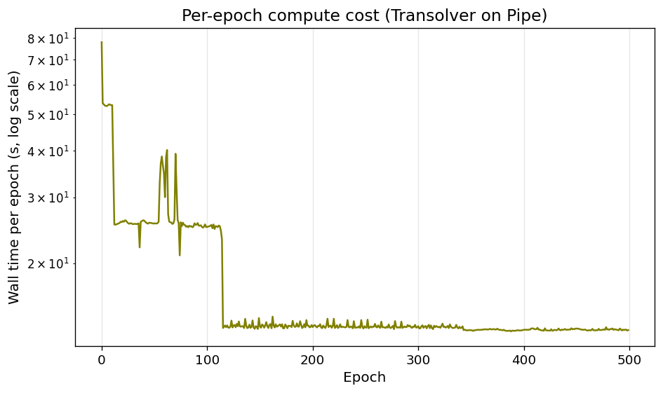

<!--
SPDX-FileCopyrightText: 2026 ZenteiQ AiTech Innovations Pvt. Ltd.
License notice: Documentation text and diagrams on this page are licensed
under CC BY 4.0. Source-code examples are licensed under LGPL-3.0-only
unless the example states otherwise.
-->

# Tutorial: Pipe Flow with Transolver

In this tutorial you train a [Transolver](../../theory_guide/operator_learning.md#transolver) on
the **Pipe [[2]](#ref2)** benchmark: given the mesh of a pipe whose centreline is bent
differently in every sample, predict the steady horizontal velocity at every
mesh node. Pipe is one of the standard benchmarks of the Transolver paper,
and this tutorial uses the paper's own launch-script model and training
recipe, with the numerics of its PyTorch code. The whole tutorial is one
script, [`scripts/tutorials/pipe_transolver.py`](../../../scripts/tutorials/pipe_transolver.py). It uses only the public
ScireX API ([`scirex.models.Transolver`](../../api/models.md#scirex.models.Transolver),
[`scirex.training.optim.scale_by_adam_cx`](../../api/training.md#scirex.training.optim.scale_by_adam_cx), [`scirex.utils.count_model_params`](../../api/utils.md#scirex.utils.count_model_params))
and plain NumPy, JAX and optax. The code on this page is copied from that
script.

## Summary

| | |
|---|---|
| Problem | Steady, incompressible flow through a deformed 2D pipe: mesh coordinates in, horizontal velocity out |
| Model | Transolver, [`scirex.models.Transolver`](../../api/models.md#scirex.models.Transolver), `geometry="structured_2d"`, PyTorch numerics. Paper size (launch script): `n_hidden=128, n_layers=8, n_head=8, mlp_ratio=2, slice_num=64`, 3,073,985 parameters. Smoke size: `n_hidden=32, n_layers=2, n_head=4, mlp_ratio=1, slice_num=16`, 46,665 parameters |
| Data | Geo-FNO Pipe (`Pipe_X.npy`, `Pipe_Y.npy`, `Pipe_Q.npy`, about 1.5 GB), 2310 samples on a 129 × 129 mesh. Benchmark: first 1000 train / last 200 of the first 1200 test. Smoke: 32 train / 8 test |
| Optimiser | AdamW (the benchmark's [`scale_by_adam_cx`](../../api/training.md#scirex.training.optim.scale_by_adam_cx), which is Adam for real weights), eps 1e-8, weight decay 1e-5, gradient-norm clip 0.1, cosine one-cycle learning rate with peak 1e-3, batch size 8 |
| Metric | Relative L2 error per test sample, in physical units, averaged over the test samples |
| Full-run values | This recipe: 0.424% best of seeds 0, 1 and 2, 0.460% ± 0.031% mean ± sample std. The released checkpoint uses a [tuned recipe](../../benchmarks/pipe/results/comparative.md#tuned-recipe), chosen on the test set: 0.386% (best seed), 0.406% ± 0.034% (mean). Paper ([[1]](#ref1)): 0.33% ± 0.02%; the paper's own PyTorch code run on the same files: 0.477% |

## Setup

The setup is the same as in the [FNO tutorial](Pipe_FNO.md#setup).

### Data

`Pipe_Q.npy` must be the complete file, `(2310, 3, 129, 129)`. Some copies of
the release contain only `Pipe_Q_interp_x.npy`, an older interpolated target,
which is a different field. The Transolver paper's own loader falls back to
it with only a warning; this tutorial and the benchmark both read
`Pipe_Q.npy` and fail if it is missing. For the smoke run you do not need to
copy anything: the script memory-maps the files and reads only the samples it
uses.

## The problem

The problem, the data and the metric are the same as in the [FNO tutorial](Pipe_FNO.md#the-problem).

The geometry is given as the coordinates of the 129 × 129 body-fitted mesh,
so the model is a map from the $(x, y)$ positions of the $N = 129^2$ nodes to
the horizontal velocity $u$ at those nodes,

$$
\mathcal G_\theta : \mathbf X \in \mathbb R^{N\times 2} \;\mapsto\; \hat u \in \mathbb R^{N}.
$$

The coordinates are standardised with one mean and one standard deviation per
channel, fitted on the training samples,
$\tilde{\mathbf X} = (\mathbf X - \boldsymbol\mu_X)/(\boldsymbol\sigma_X + 10^{-8})$,
and so is the velocity. The network predicts a standardised velocity, which
is decoded, $\hat u = \sigma_u \hat{\tilde u} + \mu_u$, before the loss.

The loss of a batch $B$ and the metric are the relative L2 error per sample in
physical units, over all $N = 129^2$ nodes:

$$
e_i = \frac{\lVert \hat u_i - u_i\rVert_2}{\lVert u_i\rVert_2}, \qquad
\mathcal L_B = \sum_{i\in B} e_i, \qquad
\text{metric} = \frac{1}{N_{\text{test}}}\sum_{i=1}^{N_{\text{test}}} e_i .
$$

**Transolver in one paragraph.** Attention over all $N$ nodes would cost
$O(N^2)$, about $2.8\times10^8$ pairs on this mesh. Transolver instead softly
assigns the nodes to a small number of learned slices (`slice_num`, 64 in the
paper's model), each a weighted average of the nodes that behave alike, runs
attention between the slices and sends the result back to every node. The
cost grows linearly with $N$. On a structured mesh the projection onto the
slices is a convolution on the grid, so neighbouring nodes inform each
other's assignment. The [theory guide](../../theory_guide/operator_learning.md#transolver) has the
details.

## Step-by-step walkthrough

The explanations of the steps that are the same for every model are in the [FNO tutorial](Pipe_FNO.md#step-by-step-walkthrough). This page keeps the code and the text that is specific to the model.

### 1. Setup

Imports, the seed, the training settings and the two model sizes. `PROTOCOL`
holds the benchmark's training settings (the same values as in
[`scripts/benchmarks/pipe/_config.py`](../../../scripts/benchmarks/pipe/_config.py), the paper's `exp_pipe.py` recipe, which
every model on this benchmark shares): 500 epochs, batch size 8, AdamW with a
peak learning rate of 1e-3, a one-cycle schedule, weight decay 1e-5 and a
gradient-norm clip of 0.1. `SIZES["full"]` is the model of the paper's launch
script, `Transolver_Pipe.sh`, not the smaller defaults of
`exp_pipe.py`'s command line (272,621 parameters); `SIZES["smoke"]` is small
enough for a CPU.

<!-- tutorial-snippet -->
```python
from __future__ import annotations

import argparse
import functools
import os
import platform
from pathlib import Path
from time import perf_counter

import flax
import jax
import jax.numpy as jnp
import matplotlib
import matplotlib.pyplot as plt
import numpy as np
import optax

import scirex
from scirex.models import Transolver
from scirex.training.optim import scale_by_adam_cx
from scirex.utils import count_model_params

matplotlib.use("Agg")  # write figures to files, no display needed
# Keep float32, also if float64 was enabled earlier in the process.
jax.config.update("jax_enable_x64", False)
```

<!-- tutorial-snippet -->
```python
SEED = 0

# Training settings of the Pipe benchmark, the same values as PROTOCOL in
# scripts/benchmarks/pipe/_config.py (Transolver's recipe, used by every model).
PROTOCOL = dict(
    ntrain=1000,
    ntest=200,
    n_total=1200,
    epochs=500,
    batch_size=8,
    learning_rate=1e-3,
    weight_decay=1e-5,
    adam_eps=1e-8,
    pct_start=0.3,
    div_factor=25.0,
    final_div_factor=1e4,
    max_grad_norm=0.1,
)

# Model sizes. "full" is the paper's launch-script Transolver
# (Transolver_Pipe.sh, 3,073,985 parameters), the size every other
# model on the benchmark is matched to. "smoke" is a tiny Transolver that
# trains on a CPU.
SIZES = dict(
    full=dict(
        n_hidden=128,
        n_layers=8,
        n_head=8,
        mlp_ratio=2,
        slice_num=64,
        ref=8,
        dropout_rate=0.0,
    ),
    smoke=dict(
        n_hidden=32,
        n_layers=2,
        n_head=4,
        mlp_ratio=1,
        slice_num=16,
        ref=8,
        dropout_rate=0.0,
    ),
)
```

<!-- tutorial-snippet -->
```python
def print_environment(seed: int) -> None:
    """Print the versions, the devices and the seed, so a run can be repeated."""
    print(f"python {platform.python_version()} | numpy {np.__version__}")
    print(f"scirex {scirex.__version__}")
    print(
        f"jax {jax.__version__} | flax {flax.__version__} | optax {optax.__version__}"
    )
    print(f"devices: {jax.devices()}")
    print(f"SEED = {seed}")
```

### 2. Load the data

`load_pipe` memory-maps the three files and reads only the training and test
samples: the first `ntrain` of the file for training, the last `ntest` of the
first `n_total` for testing, as in the benchmark. The coordinates come back as
`(n, H, W, 2)` and the target, channel 0 of `Pipe_Q.npy`, as `(n, H, W)`.
`stride` keeps every `stride`-th node along both mesh axes; it is 1, every
node, unless you ask for less. A step costs about the number of nodes, so
`--stride 2` (65 × 65 nodes) makes a longer smoke run affordable on a CPU.

<!-- tutorial-snippet -->
```python
def load_pipe(
    data_dir: Path, ntrain: int, ntest: int, n_total: int = 1200, stride: int = 1
) -> dict:
    """Read the split. Coordinates ``(n, H, W, 2)``, velocity ``(n, H, W)``."""
    data_dir = Path(data_dir)
    xs = np.load(data_dir / "Pipe_X.npy", mmap_mode="r")
    ys = np.load(data_dir / "Pipe_Y.npy", mmap_mode="r")
    q = np.load(data_dir / "Pipe_Q.npy", mmap_mode="r")
    if q.shape[0] < n_total or ntrain + ntest > n_total:
        raise ValueError(f"need {ntrain} + {ntest} <= {n_total} <= {q.shape[0]}")
    split = dict(train=np.arange(ntrain), test=np.arange(n_total - ntest, n_total))
    out = {}
    for name, idx in split.items():
        coords = np.stack(
            [xs[idx][:, ::stride, ::stride], ys[idx][:, ::stride, ::stride]], axis=-1
        )
        out[f"x_{name}"] = coords.astype(np.float32)
        out[f"y_{name}"] = np.asarray(q[idx, 0][:, ::stride, ::stride], np.float32)
    print(
        f"samples: {ntrain} train / {ntest} test | mesh {out['x_train'].shape[1:3]} | "
        f"velocity range [{out['y_train'].min():.3f}, {out['y_train'].max():.3f}]"
    )
    return out
```

### 3. Normalise

<!-- tutorial-snippet -->
```python
class UnitGaussian:
    """``(v - mean) / (std + 1e-8)`` with one mean and std per channel."""

    def __init__(self, train: np.ndarray, axes: tuple[int, ...]) -> None:
        self.mean = train.mean(axis=axes, keepdims=True)[0]
        self.std = train.std(axis=axes, keepdims=True)[0] + 1e-8

    def encode(self, v):
        return (v - self.mean) / self.std

    def decode(self, v):
        return v * self.std + self.mean
```

### 4. Build the model

[`Transolver`](../../api/models.md#scirex.models.Transolver) is a Flax module: the parameters are a separate pytree, created
by `init` and used by `apply`. It takes the nodes as a sequence,
`(batch, H * W, 2)`, and `geometry="structured_2d"` with `H` and `W` tells it
that the sequence is a mesh, so the projections onto the slices are
convolutions on it. `fun_dim=0` and `unified_pos=False`: the input is the
coordinates only (`ref` is then unused).

The remaining arguments match the paper's PyTorch code, as the benchmark
does: exact (erf) GELU instead of Flax's tanh approximation, LayerNorm eps
1e-5 instead of Flax's 1e-6, and PyTorch's default initialisation of the
slice convolutions (`conv_init="torch"`). The benchmark also applies the
reference's `initialize_weights`; that function lives in the benchmark's
private code, so the tutorial has its own copy, `match_reference_init`, a few
lines of JAX. It draws every linear kernel from $\mathcal N(0, 0.02^2)$,
except the slice projection of every block, which keeps its orthogonal
initialisation and is recognised by its Gram matrix. With the same seed, the
tutorial's full-size parameters are bit-for-bit those of the benchmark (a
test checks it).

<!-- tutorial-snippet -->
```python
def build_model(size: dict, sample: np.ndarray, grid, seed: int):
    """Build the Transolver, initialise it as the reference does, count parameters."""
    model = Transolver(
        space_dim=2,
        fun_dim=0,
        out_dim=1,
        unified_pos=False,
        geometry="structured_2d",
        H=grid[0],
        W=grid[1],
        act=functools.partial(jax.nn.gelu, approximate=False),
        layer_norm_epsilon=1e-5,
        conv_init="torch",
        **size,
    )
    params = model.init(jax.random.PRNGKey(seed), x=jnp.asarray(sample)[None], fx=None)
    params = match_reference_init(params, seed, size["n_layers"])
    print(f"Transolver {size} | parameters: {count_model_params(params):,}")
    return model, params
```

<!-- tutorial-snippet -->
```python
def match_reference_init(params, seed: int, n_layers: int):
    """Redraw every 2D linear kernel from N(0, 0.02^2), except orthogonal ones.

    The slice projection of each block (one per layer) is initialised
    orthogonally, in the reference as here; it is recognised by its Gram
    matrix. Convolution kernels (4D) are left as they are.
    """
    key = jax.random.PRNGKey(seed)
    count, kept = [0], [0]

    def redraw(path, leaf):
        if getattr(path[-1], "key", None) != "kernel" or leaf.ndim != 2:
            return leaf
        r, c = leaf.shape
        gram = leaf.T @ leaf if r >= c else leaf @ leaf.T
        if min(r, c) > 1 and jnp.allclose(gram, jnp.eye(min(r, c)), atol=1e-2):
            kept[0] += 1
            return leaf
        count[0] += 1
        return 0.02 * jax.random.normal(
            jax.random.fold_in(key, count[0]), leaf.shape, leaf.dtype
        )

    params = jax.tree_util.tree_map_with_path(redraw, params)
    if kept[0] != n_layers:
        raise RuntimeError(f"expected {n_layers} orthogonal kernels, found {kept[0]}")
    return params
```

### 5. Loss

The loss from [The problem](#the-problem): the relative L2 error of each
sample on the decoded velocity, summed over the batch.

<!-- tutorial-snippet -->
```python
def rel_l2_per_sample(pred, true):
    """``||pred - true|| / ||true||`` per sample, over all nodes."""
    b = pred.shape[0]
    diff = jnp.linalg.norm(pred.reshape(b, -1) - true.reshape(b, -1), axis=1)
    return diff / jnp.linalg.norm(true.reshape(b, -1), axis=1)
```

<!-- tutorial-snippet -->
```python
def make_loss(model, y_norm: UnitGaussian):
    """Return ``loss_fn(params, x, y) -> summed relative L2`` in physical units."""

    def loss_fn(params, x, y):
        out = model.apply(params, x=x, fx=None)[..., 0]  # (batch, H * W)
        return jnp.sum(rel_l2_per_sample(y_norm.decode(out), y))

    return loss_fn
```

### 6. Optimiser

The benchmark uses the complex-aware AdamW of [`scirex.training.optim`](../../api/training.md) for
every model, because FNO and GINO have complex spectral weights (see the
[FNO tutorial](../Others/Pipe_FNO.md#6-optimiser-for-complex-weights)). Transolver's
weights are all real, and for real weights [`scale_by_adam_cx`](../../api/training.md#scirex.training.optim.scale_by_adam_cx) is exactly
Adam's scaling, so this is the paper's AdamW. `make_optimizer` chains it with
the gradient clip, the weight decay and the one-cycle learning rate.

<!-- tutorial-snippet -->
```python
def make_optimizer(protocol: dict, total_steps: int):
    """AdamW on a cosine one-cycle schedule, after gradient clipping."""
    schedule = optax.cosine_onecycle_schedule(
        transition_steps=total_steps,
        peak_value=protocol["learning_rate"],
        pct_start=protocol["pct_start"],
        div_factor=protocol["div_factor"],
        final_div_factor=protocol["final_div_factor"],
    )
    tx = optax.chain(
        optax.clip_by_global_norm(protocol["max_grad_norm"]),
        scale_by_adam_cx(eps=protocol["adam_eps"]),
        optax.add_decayed_weights(protocol["weight_decay"]),
        optax.scale_by_learning_rate(schedule),
    )
    return tx, schedule
```

### 7. Train

Batches of 8 samples in a new random order every epoch, one optimiser step per
batch. After every epoch the test samples are scored, to draw the error curve.
There is no validation split, so no epoch is selected by its test error: the
weights after the last epoch are the result, as in the benchmark. (The
paper's script reports the best test error over training instead.) JAX compiles the
step on its first call, so the first epoch is slower than the others.

<!-- tutorial-snippet -->
```python
def train(model, params, data, y_norm, epochs, seed, protocol=PROTOCOL):
    """Train for ``epochs`` epochs. Return the final parameters and the history."""
    x_train, y_train = data["x_train"], data["y_train"]
    x_test, y_test = data["x_test"], data["y_test"]
    bs = protocol["batch_size"]
    ntrain = len(x_train)
    tx, _ = make_optimizer(protocol, -(-ntrain // bs) * epochs)
    opt_state = tx.init(params)
    loss_fn = make_loss(model, y_norm)

    @jax.jit
    def train_step(params, opt_state, x, y):
        loss, grads = jax.value_and_grad(loss_fn)(params, x, y)
        updates, opt_state = tx.update(grads, opt_state, params)
        return optax.apply_updates(params, updates), opt_state, loss

    eval_step = jax.jit(loss_fn)

    rng = np.random.default_rng(seed)
    history = []
    for epoch in range(epochs):
        t0 = perf_counter()
        order = rng.permutation(ntrain)
        train_total = 0.0
        for i in range(0, ntrain, bs):
            idx = order[i : i + bs]
            params, opt_state, loss = train_step(
                params, opt_state, jnp.asarray(x_train[idx]), jnp.asarray(y_train[idx])
            )
            train_total += float(loss)
        secs = perf_counter() - t0
        test_total = sum(
            float(
                eval_step(params, jnp.asarray(x_test[i : i + bs]), y_test[i : i + bs])
            )
            for i in range(0, len(x_test), bs)
        )
        history.append(
            dict(
                epoch=epoch,
                train_rel_l2=train_total / ntrain,
                test_rel_l2=test_total / len(x_test),
                secs=secs,
            )
        )
        print(
            f"epoch {epoch}: train_rel_l2={history[-1]['train_rel_l2']:.4f} "
            f"test_rel_l2={history[-1]['test_rel_l2']:.4f} epoch_time={secs:.1f}s"
        )
    return params, history
```

### 8. Evaluate

<!-- tutorial-snippet -->
```python
def evaluate(model, params, data, y_norm, batch_size: int = 8) -> dict:
    """Per-sample relative L2 on the test samples, and the predictions."""
    predict = jax.jit(lambda p, x: y_norm.decode(model.apply(p, x=x, fx=None)[..., 0]))
    x_test, y_test = data["x_test"], data["y_test"]
    preds = np.concatenate(
        [
            np.asarray(predict(params, jnp.asarray(x_test[i : i + batch_size])))
            for i in range(0, len(x_test), batch_size)
        ]
    )
    errors = np.asarray(rel_l2_per_sample(jnp.asarray(preds), jnp.asarray(y_test)))
    return dict(
        test_rel_l2=float(errors.mean()),
        median=float(np.median(errors)),
        p90=float(np.percentile(errors, 90)),
        worst=float(errors.max()),
        errors=errors,
        predictions=preds,
    )
```

### 9. Plot

<!-- tutorial-snippet -->
```python
def plot_prediction(coords, truth, pred, path: Path, title: str) -> None:
    """Save input, true velocity, predicted velocity and absolute error."""
    xx, yy = coords[..., 0], coords[..., 1]
    lim = (float(truth.min()), float(truth.max()))
    panels = [
        ("Input: y coordinate of the mesh", yy, "coolwarm", None),
        ("Truth: horizontal velocity", truth, "jet", lim),
        ("Prediction: horizontal velocity", pred, "jet", lim),
        ("Absolute error", np.abs(pred - truth), "magma", None),
    ]
    fig, axes = plt.subplots(4, 1, figsize=(10, 9), constrained_layout=True)
    for ax, (name, values, cmap, vlim) in zip(axes, panels):
        vmin, vmax = vlim if vlim else (None, None)
        mesh = ax.pcolormesh(
            xx, yy, values, cmap=cmap, vmin=vmin, vmax=vmax, shading="gouraud"
        )
        ax.set_title(name)
        ax.set_aspect("equal")
        ax.set_xlabel("x")
        ax.set_ylabel("y")
        fig.colorbar(mesh, ax=ax, shrink=0.8)
    fig.suptitle(title)
    fig.savefig(path, dpi=120)
    plt.close(fig)
```

<!-- tutorial-snippet -->
```python
def plot_loss(history: list[dict], path: Path) -> None:
    """Save the training and test relative L2 per epoch."""
    epochs = [h["epoch"] for h in history]
    fig, ax = plt.subplots(figsize=(6, 4))
    ax.plot(epochs, [h["train_rel_l2"] for h in history], marker="o", label="train")
    ax.plot(epochs, [h["test_rel_l2"] for h in history], marker="o", label="test")
    ax.set_xlabel("epoch")
    ax.set_ylabel("relative L2 (mean over samples)")
    ax.set_yscale("log")
    ax.legend()
    ax.grid(True, alpha=0.3)
    fig.savefig(path, dpi=120, bbox_inches="tight")
    plt.close(fig)
```

The complete script is [`scripts/tutorials/pipe_transolver.py`](../../../scripts/tutorials/pipe_transolver.py).

## Run it

Smoke run (CPU, a few seconds, no GPU needed):

```bash
CUDA_VISIBLE_DEVICES= JAX_PLATFORMS=cpu python scripts/tutorials/pipe_transolver.py --data-dir ~/data/pipe --smoke
```

Full protocol (1000 training samples, paper-size Transolver, 500 epochs; use
a GPU):

```bash
python scripts/tutorials/pipe_transolver.py --data-dir ~/data/pipe
```

The other flags are `--epochs`, `--seed`, `--out-dir` (default
`outputs/pipe_transolver_tutorial`), `--stride` (default 1) and, for the
smoke run, `--n-train` and `--n-test`.

This is the output of the smoke run on a CPU (smoke run, CPU, 32 train / 8
test samples, not a benchmark number). The wall time was 15.0 s,
measured with `time`; library deprecation warnings are left out:

```text
python 3.12.3 | numpy 1.26.4
scirex 1.0.0rc1
jax 0.6.2 | flax 0.10.7 | optax 0.2.8
devices: [CpuDevice(id=0)]
SEED = 0
samples: 32 train / 8 test | mesh (129, 129) | velocity range [-0.614, 0.599]
data loading: 0.0s
Transolver {'n_hidden': 32, 'n_layers': 2, 'n_head': 4, 'mlp_ratio': 1, 'slice_num': 16, 'ref': 8, 'dropout_rate': 0.0} | parameters: 46,665
epoch 0: train_rel_l2=0.4463 test_rel_l2=0.4463 epoch_time=2.8s
epoch 1: train_rel_l2=0.4447 test_rel_l2=0.4440 epoch_time=1.8s
epoch 2: train_rel_l2=0.4436 test_rel_l2=0.4417 epoch_time=1.7s
epoch 3: train_rel_l2=0.4430 test_rel_l2=0.4419 epoch_time=1.7s
epoch 4: train_rel_l2=0.4428 test_rel_l2=0.4416 epoch_time=1.8s
test relative L2: mean 0.4416 | median 0.4385 | p90 0.4598 | worst 0.4625
figures in outputs/pipe_transolver_tutorial | total time 14.2s
```

## Results

### Full run

The next figures were not made by this script. They come from the benchmark
runner (`train.py` and `infer.py`) and are the committed results of the **full
500-epoch runs** (1000 training and 200 test samples, paper-size Transolver,
one NVIDIA RTX PRO 6000 Blackwell). `infer.py` draws one test sample (the figure title names it and its relative L2
error): ground truth, prediction and absolute error.



Seconds per epoch of the same run (the first epoch includes compilation; in
`metrics.json`, the first epoch took 78.0 s and the median epoch 13.5 s):



| Relative L2 over the 200 test samples, last epoch | Mean | Median | 90th percentile | Worst |
|---|---|---|---|---|
| **Seed 0 (best)** | **0.424%** | **0.135%** | **0.636%** | **6.04%** |
| Seed 1 | 0.481% | 0.136% | 0.808% | 5.73% |
| Seed 2 | 0.475% | 0.143% | 1.023% | 6.10% |
| Mean ± std over seeds | 0.460% ± 0.031% | | | |

| Model, same data, recipe and seeds | Parameters | Best of 3 seeds | Mean ± std (3 seeds) | Training time per seed |
|---|---|---|---|---|
| **Transolver (this tutorial)** | 3,073,985 | **0.424%** | 0.460% ± 0.031% | ~2 h |
| [WNO](../../benchmarks/pipe/results/comparative.md#wno) | 3,102,157 | 0.529% | 0.541% ± 0.012% | ~11 min |
| [FNO](../../benchmarks/pipe/results/comparative.md#fno) | 2,999,629 | 0.934% | 0.960% ± 0.023% | ~19 min |
| [GINO](../../benchmarks/pipe/results/comparative.md#gino) | 3,001,956 | 1.024% | 1.603% ± 0.972% | ~3.2 h |
| [Transolver, tuned recipe (released checkpoint)](../../benchmarks/pipe/results/comparative.md#tuned-recipe) | 3,073,985 | **0.386%** | 0.406% ± 0.034% | ~2-3.5 h |
| Paper ([[1]](#ref1)) | 3,073,985 | 0.33% ± 0.02% | | as reported |

## Troubleshooting

- **`FileNotFoundError: ... Pipe_Q.npy`.** `--data-dir` does not hold the
  three files, or your copy of the release has only `Pipe_Q_interp_x.npy`.
  That file is a different target and is not a substitute; get `Pipe_Q.npy`.
- **`ValueError: need ... <= ...`.** You asked for more samples than the split
  allows: `--n-train` plus `--n-test` must not exceed 1200.
- **`RuntimeError: expected ... orthogonal kernels`.** `match_reference_init`
  found a different number of orthogonally initialised kernels than there are
  layers, so it could not tell the slice projections apart. This should not
  happen with the sizes here; if you change the model, check the init before
  you trust a run.

## Next steps

- Compare with the other architectures on the same data:
  [WNO](../../benchmarks/pipe/results/comparative.md#wno), [FNO](../../benchmarks/pipe/results/comparative.md#fno),
  [GINO](../../benchmarks/pipe/results/comparative.md#gino) and the
  [comparison page](../../benchmarks/pipe/results/comparative.md).
- Read the [Pipe Flow results](../../benchmarks/pipe/results/comparative.md#transolver) for the
  comparison with the paper's PyTorch code, the hyperparameter search and the
  compute cost, and the [dataset guide](../../dataset_guide/pipe.md) for the
  files.
- Learn how Transolver works in the [theory guide](../../theory_guide/operator_learning.md#transolver)
  and see its arguments in the [API reference](../../api/models.md).
- See the same model on an irregular point cloud in the
  [ShapeNetCar tutorial](../Transolver/ShapeNetCar_Transolver.md).
- See the [quickstart](../../user_guide/quickstart.md) and the
  [training guide](../../user_guide/training.md) for the [`Trainer`](../../api/experimental.md#scirex.experimental.training.Trainer).

## References

1. <span id="ref1"></span>Wu et al., *Transolver: A Fast Transformer Solver for PDEs on General Geometries*, ICML 2024. <https://arxiv.org/abs/2402.02366>

2. <span id="ref2"></span>Li et al., *Fourier Neural Operator with Learned Deformations for PDEs on General Geometries* (Geo-FNO), Journal of Machine Learning Research 24(388), 2023. <https://arxiv.org/abs/2207.05209>
