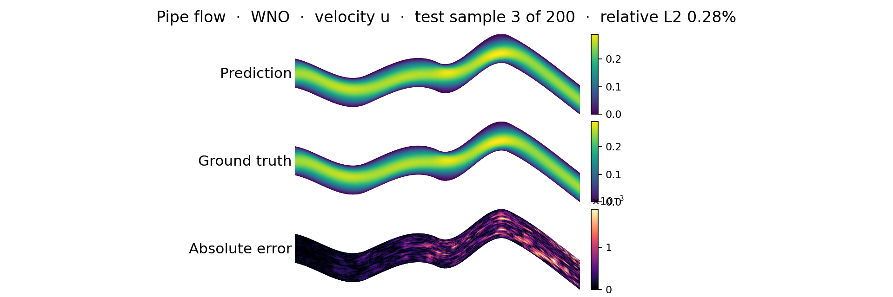
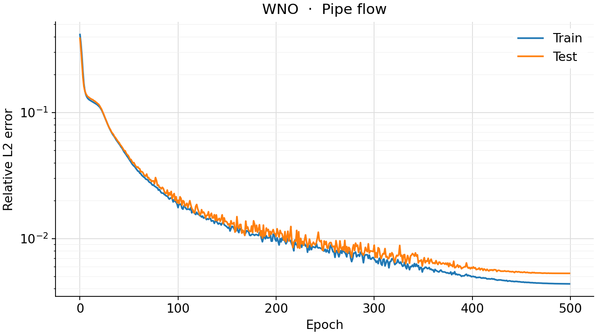
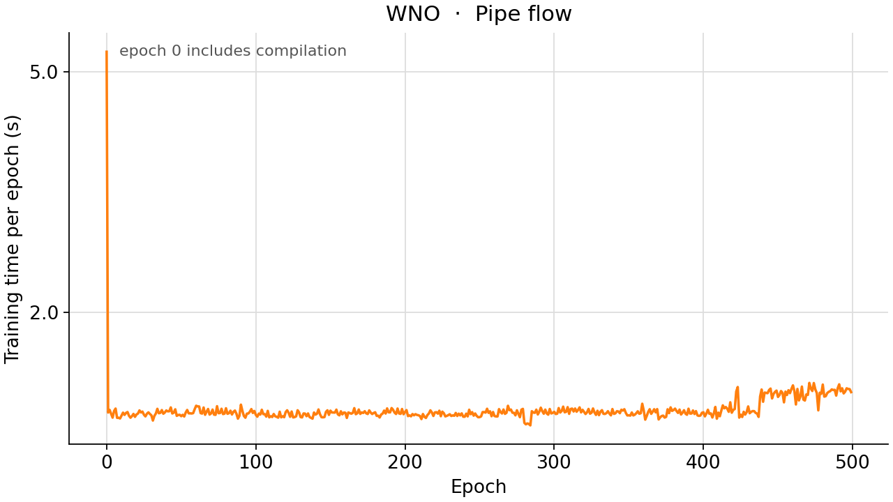

<!--
SPDX-FileCopyrightText: 2026 ZenteiQ AiTech Innovations Pvt. Ltd.
License notice: Documentation text and diagrams on this page are licensed
under CC BY 4.0. Source-code examples are licensed under LGPL-3.0-only
unless the example states otherwise.
-->

# Tutorial: Pipe Flow with WNO

In this tutorial you train a [Wavelet Neural Operator](../../theory_guide/operator_learning.md#wno)
(WNO [[1]](#ref1)) on the **Pipe [[2]](#ref2)** benchmark: given the mesh of a pipe whose centreline is
bent differently in every sample, predict the steady horizontal velocity at
every mesh node. The mesh is a structured 129 × 129 grid that follows the
pipe, so the domain is curved in physical space but a rectangle in index
space, and that is what the wavelet transform of the WNO works on. The whole
tutorial is one script, [`scripts/tutorials/pipe_wno.py`](../../../scripts/tutorials/pipe_wno.py). It uses only the
public ScireX API ([`scirex.models.WNO`](../../api/models.md#scirex.models.WNO),
[`scirex.training.optim.scale_by_adam_cx`](../../api/training.md#scirex.training.optim.scale_by_adam_cx), [`scirex.utils.count_model_params`](../../api/utils.md#scirex.utils.count_model_params))
and plain NumPy, JAX and optax. The code on this page is copied from that
script.

## Summary

| | |
|---|---|
| Problem | Steady, incompressible flow through a deformed 2D pipe: mesh coordinates in, horizontal velocity out |
| Model | WNO, [`scirex.models.WNO`](../../api/models.md#scirex.models.WNO), computed in float32. Benchmark size: `hidden_channels=20, n_layers=4, level=3, wavelet="db4", projection_hidden_channels=128`, 3,102,157 parameters. Smoke size: `hidden_channels=8, n_layers=2, level=3, projection_hidden_channels=32`, 248,297 parameters |
| Data | Geo-FNO Pipe (`Pipe_X.npy`, `Pipe_Y.npy`, `Pipe_Q.npy`, about 1.5 GB), 2310 samples on a 129 × 129 mesh. Benchmark: first 1000 train / last 200 of the first 1200 test. Smoke: 32 train / 8 test |
| Optimiser | AdamW (the benchmark's [`scale_by_adam_cx`](../../api/training.md#scirex.training.optim.scale_by_adam_cx), which is Adam for real weights), eps 1e-8, weight decay 1e-5, gradient-norm clip 0.1, cosine one-cycle learning rate with peak 1e-3, batch size 8 |
| Metric | Relative L2 error per test sample, in physical units, averaged over the test samples |
| Full-run values | 0.529% best of seeds 0, 1 and 2 (the released checkpoint), 0.541% ± 0.012% mean ± sample std. There is no published WNO result on Pipe |

## Setup

The setup is the same as in the [FNO tutorial](Pipe_FNO.md#setup).

### Data

`Pipe_Q.npy` must be the complete file, `(2310, 3, 129, 129)`. Some copies of
the release contain only `Pipe_Q_interp_x.npy`, an older interpolated target,
which is a different field. This tutorial and the benchmark both read
`Pipe_Q.npy` and fail if it is missing. For the smoke run you do not need to
copy anything: the script memory-maps the files and reads only the samples it
uses.

## The problem

The problem, the data and the metric are the same as in the [FNO tutorial](Pipe_FNO.md#the-problem).

The geometry is given as the coordinates of the 129 × 129 body-fitted mesh,
so the model is a map

$$
\mathcal G_\theta : \mathbf X \in \mathbb R^{129\times129\times 2} \;\mapsto\; \hat u \in \mathbb R^{129\times129},
$$

from the $(x, y)$ position of every node to the horizontal velocity $u$ at
that node. Both are standardised with one mean and one standard deviation per
channel, fitted on the training samples,
$\tilde{\mathbf X} = (\mathbf X - \boldsymbol\mu_X)/(\boldsymbol\sigma_X + 10^{-8})$.
The network predicts a standardised velocity, which is decoded,
$\hat u = \sigma_u \hat{\tilde u} + \mu_u$, before the loss.

The loss of a batch $B$ and the metric are the relative L2 error per sample in
physical units, over all $N = 129^2$ nodes:

$$
e_i = \frac{\lVert \hat u_i - u_i\rVert_2}{\lVert u_i\rVert_2}, \qquad
\mathcal L_B = \sum_{i\in B} e_i, \qquad
\text{metric} = \frac{1}{N_{\text{test}}}\sum_{i=1}^{N_{\text{test}}} e_i .
$$

**WNO in one paragraph.** A WNO layer adds a pointwise linear map to a
convolution done in wavelet space. It takes a discrete wavelet transform of
the hidden channels down to `level` (here 3: the 129 × 129 field becomes
coarse coefficients on about a 22 × 22 grid plus details at three scales),
multiplies each of the four coarsest subbands (approximation and three
details, 22 × 22 coefficients each) by a learned channel-mixing matrix per
coefficient, drops the finer details and transforms back. Wavelets
are localised in space as well as in scale, so unlike the global Fourier
modes of an FNO they can represent a feature in one part of the domain
without spreading it everywhere, and the weights are real. On this data the
transform runs over the mesh indices. The [theory guide](../../theory_guide/operator_learning.md#wno)
has the details.

## Step-by-step walkthrough

The explanations of the steps that are the same for every model are in the [FNO tutorial](Pipe_FNO.md#step-by-step-walkthrough). This page keeps the code and the text that is specific to the model.

### 1. Setup

Imports, the seed, the training settings and the two model sizes. `PROTOCOL`
holds the benchmark's training settings (the same values as in
[`scripts/benchmarks/pipe/_config.py`](../../../scripts/benchmarks/pipe/_config.py), which every model on this benchmark
shares): 500 epochs, batch size 8, AdamW with a peak learning rate of 1e-3, a
one-cycle schedule, weight decay 1e-5 and a gradient-norm clip of 0.1.
`SIZES["full"]` is the benchmark's WNO; `SIZES["smoke"]` is small enough for a
CPU.

<!-- tutorial-snippet -->
```python
from __future__ import annotations

import argparse
import os
import platform
from pathlib import Path
from time import perf_counter

import flax
import jax
import jax.numpy as jnp
import matplotlib
import matplotlib.pyplot as plt
import numpy as np
import optax

import scirex
from scirex.models import WNO
from scirex.training.optim import scale_by_adam_cx
from scirex.utils import count_model_params

matplotlib.use("Agg")  # write figures to files, no display needed
# Keep float32, also if float64 was enabled earlier in the process.
jax.config.update("jax_enable_x64", False)
```

<!-- tutorial-snippet -->
```python
SEED = 0

# Training settings of the Pipe benchmark, the same values as PROTOCOL in
# scripts/benchmarks/pipe/_config.py (Transolver's recipe, used by every model).
PROTOCOL = dict(
    ntrain=1000,
    ntest=200,
    n_total=1200,
    epochs=500,
    batch_size=8,
    learning_rate=1e-3,
    weight_decay=1e-5,
    adam_eps=1e-8,
    pct_start=0.3,
    div_factor=25.0,
    final_div_factor=1e4,
    max_grad_norm=0.1,
)

# Model sizes. "full" is the benchmark's WNO (3,102,157 parameters, matched to
# Transolver's 3,073,985). "smoke" is a tiny WNO that trains on a CPU.
SIZES = dict(
    full=dict(
        hidden_channels=20,
        n_layers=4,
        level=3,
        wavelet="db4",
        projection_hidden_channels=128,
    ),
    smoke=dict(
        hidden_channels=8,
        n_layers=2,
        level=3,
        wavelet="db4",
        projection_hidden_channels=32,
    ),
)
```

<!-- tutorial-snippet -->
```python
def print_environment(seed: int) -> None:
    """Print the versions, the devices and the seed, so a run can be repeated."""
    print(f"python {platform.python_version()} | numpy {np.__version__}")
    print(f"scirex {scirex.__version__}")
    print(
        f"jax {jax.__version__} | flax {flax.__version__} | optax {optax.__version__}"
    )
    print(f"devices: {jax.devices()}")
    print(f"SEED = {seed}")
```

### 2. Load the data

`load_pipe` memory-maps the three files and reads only the training and test
samples: the first `ntrain` of the file for training, the last `ntest` of the
first `n_total` for testing, as in the benchmark. The coordinates come back as
`(n, 129, 129, 2)` and the target, channel 0 of `Pipe_Q.npy`, as
`(n, 129, 129)`.

<!-- tutorial-snippet -->
```python
def load_pipe(data_dir: Path, ntrain: int, ntest: int, n_total: int = 1200) -> dict:
    """Read the split. Coordinates ``(n, 129, 129, 2)``, velocity ``(n, 129, 129)``."""
    data_dir = Path(data_dir)
    xs = np.load(data_dir / "Pipe_X.npy", mmap_mode="r")
    ys = np.load(data_dir / "Pipe_Y.npy", mmap_mode="r")
    q = np.load(data_dir / "Pipe_Q.npy", mmap_mode="r")
    if q.shape[0] < n_total or ntrain + ntest > n_total:
        raise ValueError(f"need {ntrain} + {ntest} <= {n_total} <= {q.shape[0]}")
    split = dict(train=np.arange(ntrain), test=np.arange(n_total - ntest, n_total))
    out = {}
    for name, idx in split.items():
        coords = np.stack([xs[idx], ys[idx]], axis=-1).astype(np.float32)
        out[f"x_{name}"] = coords
        out[f"y_{name}"] = np.asarray(q[idx, 0], dtype=np.float32)
    print(
        f"samples: {ntrain} train / {ntest} test | mesh {out['x_train'].shape[1:3]} | "
        f"velocity range [{out['y_train'].min():.3f}, {out['y_train'].max():.3f}]"
    )
    return out
```

### 3. Normalise

<!-- tutorial-snippet -->
```python
class UnitGaussian:
    """``(v - mean) / (std + 1e-8)`` with one mean and std per channel."""

    def __init__(self, train: np.ndarray, axes: tuple[int, ...]) -> None:
        self.mean = train.mean(axis=axes, keepdims=True)[0]
        self.std = train.std(axis=axes, keepdims=True)[0] + 1e-8

    def encode(self, v):
        return (v - self.mean) / self.std

    def decode(self, v):
        return v * self.std + self.mean
```

### 4. Build the model

[`WNO`](../../api/models.md#scirex.models.WNO) is a Flax module: the parameters are a separate pytree, created by
`init` and used by `apply`. It is channels-last, so the coordinates stay
`(batch, 129, 129, 2)`. `use_grid=False` because the coordinates already are
the input; the default would append a regular grid in index space. `size` is
the mesh that the wavelet weights are sized for: the learned weights act on
the coarse coefficients, so their number grows with the mesh, which is why
even the smoke WNO has 248,297 parameters. `compute_dtype` is the precision of
the activations; see [Compute precision](#5-loss) below.

<!-- tutorial-snippet -->
```python
def build_model(size: dict, sample: np.ndarray, seed: int, compute_dtype=jnp.float32):
    """Build the WNO, initialise it on one sample and print the parameter count."""
    model = WNO(
        in_channels=2,
        out_channels=1,
        size=sample.shape[:2],
        use_grid=False,
        compute_dtype=compute_dtype,
        **size,
    )
    params = model.init(jax.random.PRNGKey(seed), jnp.asarray(sample)[None])
    print(f"WNO {size} | parameters: {count_model_params(params):,}")
    return model, params
```

### 5. Loss

The loss from [The problem](#the-problem): the relative L2 error of each
sample on the decoded velocity, summed over the batch. The output is cast to
float32 before decoding, so that the loss and the metric are computed in
float32 whatever `compute_dtype` is.

<!-- tutorial-snippet -->
```python
def rel_l2_per_sample(pred, true):
    """``||pred - true|| / ||true||`` per sample, over all nodes."""
    b = pred.shape[0]
    diff = jnp.linalg.norm(pred.reshape(b, -1) - true.reshape(b, -1), axis=1)
    return diff / jnp.linalg.norm(true.reshape(b, -1), axis=1)
```

<!-- tutorial-snippet -->
```python
def make_loss(model, y_norm: UnitGaussian):
    """Return ``loss_fn(params, x, y) -> summed relative L2`` in physical units."""

    def loss_fn(params, x, y):
        out = model.apply(params, x)[..., 0].astype(jnp.float32)  # (batch, H, W)
        return jnp.sum(rel_l2_per_sample(y_norm.decode(out), y))

    return loss_fn
```

**Compute precision.** WNO computes in bfloat16 unless told otherwise.
bfloat16 keeps about three significant digits: rounding the 200 true test
fields to bfloat16 alone gives a mean relative L2 error of 0.166% (measured
on the test samples). That is a floor of about a third of the benchmark's
0.54%, so the benchmark computes in float32. Far from that floor the choice
does not matter: on the 30-epoch smoke run below, bfloat16 ends at 0.1206 and
float32 at 0.1205. `--compute-dtype bfloat16` lets you check it yourself.

### 6. Optimiser

The benchmark uses the complex-aware AdamW of [`scirex.training.optim`](../../api/training.md) for
every model, because FNO and GINO have complex spectral weights (see the
[FNO tutorial](../Others/Pipe_FNO.md#6-optimiser-for-complex-weights)). WNO's weights
are all real, and for real weights [`scale_by_adam_cx`](../../api/training.md#scirex.training.optim.scale_by_adam_cx) is exactly Adam's
scaling, so this is AdamW. `make_optimizer` chains it with the gradient clip,
the weight decay and the one-cycle learning rate.

<!-- tutorial-snippet -->
```python
def make_optimizer(protocol: dict, total_steps: int):
    """AdamW on a cosine one-cycle schedule, after gradient clipping."""
    schedule = optax.cosine_onecycle_schedule(
        transition_steps=total_steps,
        peak_value=protocol["learning_rate"],
        pct_start=protocol["pct_start"],
        div_factor=protocol["div_factor"],
        final_div_factor=protocol["final_div_factor"],
    )
    tx = optax.chain(
        optax.clip_by_global_norm(protocol["max_grad_norm"]),
        scale_by_adam_cx(eps=protocol["adam_eps"]),
        optax.add_decayed_weights(protocol["weight_decay"]),
        optax.scale_by_learning_rate(schedule),
    )
    return tx, schedule
```

### 7. Train

Batches of 8 samples in a new random order every epoch, one optimiser step per
batch. After every epoch the test samples are scored, to draw the error curve.
There is no validation split, so no epoch is selected by its test error: the
weights after the last epoch are the result, as in the benchmark. JAX compiles
the step on its first call, so the first epoch is slower than the others.

<!-- tutorial-snippet -->
```python
def train(model, params, data, y_norm, epochs, seed, protocol=PROTOCOL):
    """Train for ``epochs`` epochs. Return the final parameters and the history."""
    x_train, y_train = data["x_train"], data["y_train"]
    x_test, y_test = data["x_test"], data["y_test"]
    bs = protocol["batch_size"]
    ntrain = len(x_train)
    tx, _ = make_optimizer(protocol, -(-ntrain // bs) * epochs)
    opt_state = tx.init(params)
    loss_fn = make_loss(model, y_norm)

    @jax.jit
    def train_step(params, opt_state, x, y):
        loss, grads = jax.value_and_grad(loss_fn)(params, x, y)
        updates, opt_state = tx.update(grads, opt_state, params)
        return optax.apply_updates(params, updates), opt_state, loss

    eval_step = jax.jit(loss_fn)

    rng = np.random.default_rng(seed)
    history = []
    for epoch in range(epochs):
        t0 = perf_counter()
        order = rng.permutation(ntrain)
        train_total = 0.0
        for i in range(0, ntrain, bs):
            idx = order[i : i + bs]
            params, opt_state, loss = train_step(
                params, opt_state, jnp.asarray(x_train[idx]), jnp.asarray(y_train[idx])
            )
            train_total += float(loss)
        secs = perf_counter() - t0
        test_total = sum(
            float(
                eval_step(params, jnp.asarray(x_test[i : i + bs]), y_test[i : i + bs])
            )
            for i in range(0, len(x_test), bs)
        )
        history.append(
            dict(
                epoch=epoch,
                train_rel_l2=train_total / ntrain,
                test_rel_l2=test_total / len(x_test),
                secs=secs,
            )
        )
        print(
            f"epoch {epoch}: train_rel_l2={history[-1]['train_rel_l2']:.4f} "
            f"test_rel_l2={history[-1]['test_rel_l2']:.4f} epoch_time={secs:.1f}s"
        )
    return params, history
```

### 8. Evaluate

<!-- tutorial-snippet -->
```python
def evaluate(model, params, data, y_norm, batch_size: int = 8) -> dict:
    """Per-sample relative L2 on the test samples, and the predictions."""
    predict = jax.jit(
        lambda p, x: y_norm.decode(model.apply(p, x)[..., 0].astype(jnp.float32))
    )
    x_test, y_test = data["x_test"], data["y_test"]
    preds = np.concatenate(
        [
            np.asarray(predict(params, jnp.asarray(x_test[i : i + batch_size])))
            for i in range(0, len(x_test), batch_size)
        ]
    )
    errors = np.asarray(rel_l2_per_sample(jnp.asarray(preds), jnp.asarray(y_test)))
    return dict(
        test_rel_l2=float(errors.mean()),
        median=float(np.median(errors)),
        p90=float(np.percentile(errors, 90)),
        worst=float(errors.max()),
        errors=errors,
        predictions=preds,
    )
```

### 9. Plot

<!-- tutorial-snippet -->
```python
def plot_prediction(coords, truth, pred, path: Path, title: str) -> None:
    """Save input, true velocity, predicted velocity and absolute error."""
    xx, yy = coords[..., 0], coords[..., 1]
    lim = (float(truth.min()), float(truth.max()))
    panels = [
        ("Input: y coordinate of the mesh", yy, "coolwarm", None),
        ("Truth: horizontal velocity", truth, "jet", lim),
        ("Prediction: horizontal velocity", pred, "jet", lim),
        ("Absolute error", np.abs(pred - truth), "magma", None),
    ]
    fig, axes = plt.subplots(4, 1, figsize=(10, 9), constrained_layout=True)
    for ax, (name, values, cmap, vlim) in zip(axes, panels):
        vmin, vmax = vlim if vlim else (None, None)
        mesh = ax.pcolormesh(
            xx, yy, values, cmap=cmap, vmin=vmin, vmax=vmax, shading="gouraud"
        )
        ax.set_title(name)
        ax.set_aspect("equal")
        ax.set_xlabel("x")
        ax.set_ylabel("y")
        fig.colorbar(mesh, ax=ax, shrink=0.8)
    fig.suptitle(title)
    fig.savefig(path, dpi=120)
    plt.close(fig)
```

<!-- tutorial-snippet -->
```python
def plot_loss(history: list[dict], path: Path) -> None:
    """Save the training and test relative L2 per epoch."""
    epochs = [h["epoch"] for h in history]
    fig, ax = plt.subplots(figsize=(6, 4))
    ax.plot(epochs, [h["train_rel_l2"] for h in history], marker="o", label="train")
    ax.plot(epochs, [h["test_rel_l2"] for h in history], marker="o", label="test")
    ax.set_xlabel("epoch")
    ax.set_ylabel("relative L2 (mean over samples)")
    ax.set_yscale("log")
    ax.legend()
    ax.grid(True, alpha=0.3)
    fig.savefig(path, dpi=120, bbox_inches="tight")
    plt.close(fig)
```

The complete script is [`scripts/tutorials/pipe_wno.py`](../../../scripts/tutorials/pipe_wno.py).

## Run it

Smoke run (CPU, a few seconds, no GPU needed):

```bash
CUDA_VISIBLE_DEVICES= JAX_PLATFORMS=cpu python scripts/tutorials/pipe_wno.py --data-dir ~/data/pipe --smoke
```

Full protocol (1000 training samples, benchmark-size WNO, 500 epochs; use a
GPU):

```bash
python scripts/tutorials/pipe_wno.py --data-dir ~/data/pipe
```

The other flags are `--epochs`, `--seed`, `--out-dir` (default
`outputs/pipe_wno_tutorial`), `--compute-dtype` (`float32`, the default, or
`bfloat16`) and, for the smoke run, `--n-train` and `--n-test`.

This is the output of the smoke run on a CPU (smoke run, CPU, 32 train / 8
test samples, not a benchmark number). The wall time was 12.3 s, measured with
`time`; library deprecation warnings are left out:

```text
python 3.12.3 | numpy 1.26.4
scirex 1.0.0rc1
jax 0.6.2 | flax 0.10.7 | optax 0.2.8
devices: [CpuDevice(id=0)]
SEED = 0
samples: 32 train / 8 test | mesh (129, 129) | velocity range [-0.614, 0.599]
data loading: 0.0s
WNO {'hidden_channels': 8, 'n_layers': 2, 'level': 3, 'wavelet': 'db4', 'projection_hidden_channels': 32} | parameters: 248,297
epoch 0: train_rel_l2=0.4763 test_rel_l2=0.4725 epoch_time=2.0s
epoch 1: train_rel_l2=0.4642 test_rel_l2=0.4525 epoch_time=1.4s
epoch 2: train_rel_l2=0.4470 test_rel_l2=0.4391 epoch_time=1.3s
epoch 3: train_rel_l2=0.4369 test_rel_l2=0.4332 epoch_time=1.3s
epoch 4: train_rel_l2=0.4332 test_rel_l2=0.4320 epoch_time=1.4s
test relative L2: mean 0.4320 | median 0.4287 | p90 0.4493 | worst 0.4547
figures in outputs/pipe_wno_tutorial | total time 11.5s
```

## Results

### Full run

The next figures were not made by this script. They come from the benchmark
runner (`train.py` and `infer.py`) and are the committed results of the **full
500-epoch runs** (1000 training and 200 test samples, benchmark-size WNO, one
NVIDIA RTX PRO 6000 Blackwell). `infer.py` draws one test sample (the figure title names it and its relative L2
error): ground truth, prediction and absolute error.



Training loss and test relative L2 per epoch of seed 0:



Seconds per epoch of the same run (the first epoch includes compilation; in
`metrics.json`, the first epoch took 7.9 s and the median epoch 1.4 s):



| Relative L2 over the 200 test samples, last epoch | Mean | Median | 90th percentile | Worst |
|---|---|---|---|---|
| Seed 0 | 0.542% | 0.290% | 0.635% | 6.03% |
| Seed 1 | 0.552% | 0.288% | 0.659% | 5.99% |
| **Seed 2 (best)** | **0.529%** | **0.278%** | **0.601%** | **6.06%** |
| Mean ± std over seeds | 0.541% ± 0.012% | | | |

| Model, same data, recipe and seeds | Parameters | Best of 3 seeds | Mean ± std (3 seeds) | Training time per seed |
|---|---|---|---|---|
| [Transolver](../../benchmarks/pipe/results/comparative.md#transolver) [[3]](#ref3) | 3,073,985 | 0.424% | 0.460% ± 0.031% | ~2 h |
| **WNO (this tutorial)** | 3,102,157 | **0.529%** | 0.541% ± 0.012% | ~11 min |
| [FNO](../../benchmarks/pipe/results/comparative.md#fno) | 2,999,629 | 0.934% | 0.960% ± 0.023% | ~19 min |
| [GINO](../../benchmarks/pipe/results/comparative.md#gino) | 3,001,956 | 1.024% | 1.603% ± 0.972% | ~3.2 h |
| [Transolver, tuned recipe (released checkpoint)](../../benchmarks/pipe/results/comparative.md#tuned-recipe) | 3,073,985 | **0.386%** | 0.406% ± 0.034% | ~2-3.5 h |

## Troubleshooting

- **`FileNotFoundError: ... Pipe_Q.npy`.** `--data-dir` does not hold the
  three files, or your copy of the release has only `Pipe_Q_interp_x.npy`.
  That file is a different target and is not a substitute; get `Pipe_Q.npy`.
- **`ValueError: need ... <= ...`.** You asked for more samples than the split
  allows: `--n-train` plus `--n-test` must not exceed 1200.
- **`ModuleNotFoundError: No module named 'jaxwt'`.** The wavelet library is a
  core dependency; reinstall with `pip install -e .`.

## Next steps

- Compare with the other architectures on the same data:
  [Transolver](../../benchmarks/pipe/results/comparative.md#transolver),
  [FNO](../../benchmarks/pipe/results/comparative.md#fno), [GINO](../../benchmarks/pipe/results/comparative.md#gino) and the
  [comparison page](../../benchmarks/pipe/results/comparative.md). The
  [FNO tutorial](../Others/Pipe_FNO.md) is the same pipeline with complex weights.
- Read the [Pipe Flow results](../../benchmarks/pipe/results/comparative.md#wno) for the per-seed
  results, the compute cost and the precision study, and the
  [dataset guide](../../dataset_guide/pipe.md) for the files.
- Learn how the WNO works in the [theory guide](../../theory_guide/operator_learning.md#wno) and see
  its arguments in the [API reference](../../api/models.md).
- See the [quickstart](../../user_guide/quickstart.md) and the
  [training guide](../../user_guide/training.md) for the [`Trainer`](../../api/experimental.md#scirex.experimental.training.Trainer).
- Try another problem on a grid: [Navier-Stokes 2D](../../benchmarks/navier_stokes/results/comparative.md#wno)
  or [Darcy flow](../../benchmarks/darcy/results/comparative.md#wno).

## References

1. <span id="ref1"></span>Tripura and Chakraborty, *Wavelet Neural Operator for Solving Parametric Partial Differential Equations in Computational Mechanics Problems*, Computer Methods in Applied Mechanics and Engineering 404, 115783 (2023). <https://arxiv.org/abs/2205.02191>

2. <span id="ref2"></span>Li et al., *Fourier Neural Operator with Learned Deformations for PDEs on General Geometries* (Geo-FNO), Journal of Machine Learning Research 24(388), 2023. <https://arxiv.org/abs/2207.05209>

3. <span id="ref3"></span>Wu et al., *Transolver: A Fast Transformer Solver for PDEs on General Geometries*, ICML 2024. <https://arxiv.org/abs/2402.02366>
