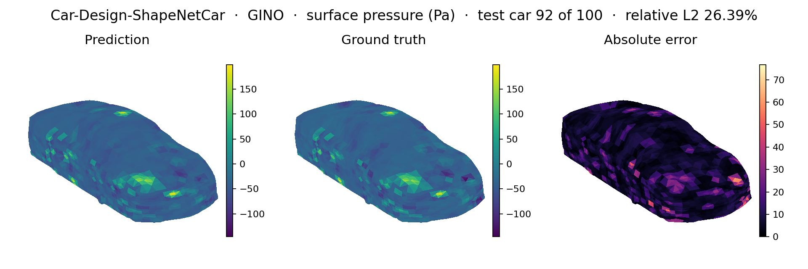
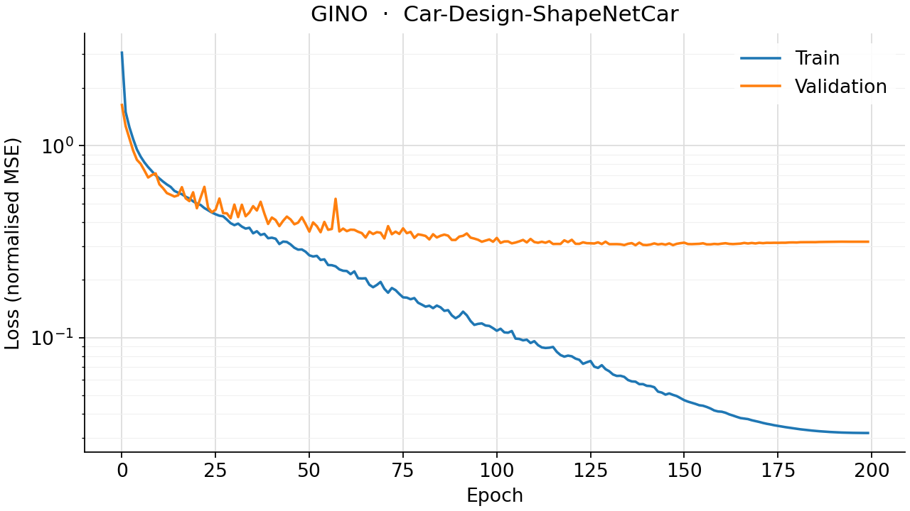
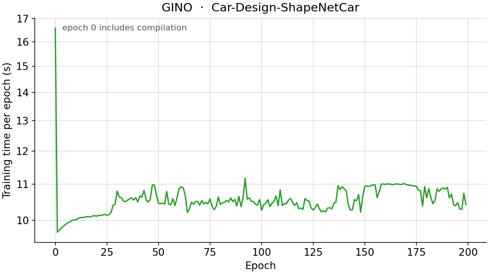

<!--
SPDX-FileCopyrightText: 2026 ZenteiQ AiTech Innovations Pvt. Ltd.
License notice: Documentation text and diagrams on this page are licensed
under CC BY 4.0. Source-code examples are licensed under LGPL-3.0-only
unless the example states otherwise.
-->

# Tutorial: ShapeNetCar (Car Aerodynamics) with GINO

In this tutorial you train a [GINO](../../theory_guide/operator_learning.md#gino) [[3]](#ref3), the
Geometry-Informed Neural Operator, on **ShapeNetCar**: given the 3D
point cloud of a car, predict the steady velocity around it and the pressure
on its surface. Every car is a different point cloud. GINO handles that with
a fixed regular grid: a graph neural operator carries each car's points onto
the grid, an FNO works on the grid, and a second graph neural operator
carries the result back onto the car's points. The whole tutorial is one
script, [`scripts/tutorials/shapenetcar_gino.py`](../../../scripts/tutorials/shapenetcar_gino.py). It uses only the public
ScireX API ([`scirex.data.load_shapenet_car`](../../api/data.md#scirex.data.load_shapenet_car), [`scirex.models.GINO`](../../api/models.md#scirex.models.GINO),
[`scirex.layers.kdtree_neighbor_search`](../../api/layers.md#scirex.layers.kdtree_neighbor_search), [`scirex.layers.neighbors_to_segments`](../../api/layers.md#scirex.layers.neighbors_to_segments),
[`scirex.utils.count_model_params`](../../api/utils.md#scirex.utils.count_model_params)) and plain JAX and optax for the training
loop. The code on this page is copied from that script. The data, loss and
metrics are those of the [Transolver tutorial](../Transolver/ShapeNetCar_Transolver.md) on
the same benchmark; this page focuses on what GINO adds.

## Summary

| | |
|---|---|
| Problem | Steady, incompressible external flow around a car: point cloud in, velocity and surface pressure out |
| Model | GINO, [`scirex.models.GINO`](../../api/models.md#scirex.models.GINO), wrapped for one car. Benchmark size (run `gino_wide_radius`): latent grid 10 × 10 × 10, `modes=6, width=57, n_layers=4`, graph-kernel MLP `(64, 64)`, radii 0.22 (in) and 1.2 (out), 3,852,494 parameters. Smoke size: latent grid 8 × 8 × 8, `modes=4, width=16, n_layers=2`, MLP `(32, 32)`, radii 0.22 and 0.6, 79,864 parameters |
| Data | Car-Design-ShapeNetCar (`mlcfd_data.zip`, about 2 GB zipped), 9 folds, about 889 cars. Fold 0: 789 train / 100 validation. Smoke: 4 train / 2 validation |
| Metric | Relative L2 error on the validation fold: velocity over all points (`rel_l2_volume`) and pressure over the surface points (`rel_l2_surface`) |
| Full-run values | `rel_l2_volume` 0.0730 and `rel_l2_surface` 0.2149. Transolver on the same benchmark: 0.0223 and 0.0767. The Transolver paper reports no GINO number |

## Setup

Install the library from a clone of the repository (see [Install](../../install/index.md)):

```bash
pip install -e ".[all]"
```

### Data

The dataset is not bundled and not downloaded automatically. Download and
unpack it once (about 2 GB zipped, about 6 GB of disk during extraction):

```bash
wget http://www.nobuyuki-umetani.com/publication/mlcfd_data.zip
unzip mlcfd_data.zip
cd mlcfd_data/training_data
for f in param*.tar.gz; do tar xzf "$f"; done
```

This gives `mlcfd_data/training_data/param0` to `param8`, each with one folder
per car. Pass the `training_data` folder (the one that directly contains
`param0` to `param8`) as `--data-dir`, or set `SHAPENETCAR_DATA`. The geometry
comes from ShapeNet and the flow solutions from [[1]](#ref1); ScireX does
not redistribute them. See the [dataset guide](../../dataset_guide/shapenetcar.md)
for the source and the download.

For the smoke run you do not need to copy anything. The loader holds out the
fold `fold_id` (default 0, the folder `param0`) as validation and trains on all
other folds, and it only lists the folders that exist. `build_subset` below
makes a small dataset from symlinks to the first complete cars of the real
`param0` and `param1`. Only the two `.vtk` files of each car are read, so a
copy of just those files (about 3 MB per car) is enough.

## The problem

Each car is one steady, incompressible flow, solved with a turbulence model
([[1]](#ref1)). The physical model of the dataset is

$$
(\mathbf u \cdot \nabla)\,\mathbf u = -\nabla p + \nu \nabla^2 \mathbf u, \qquad \nabla \cdot \mathbf u = 0 ,
$$

with a free-stream speed of 72 km/h (20 m/s) along $+z$, a no-slip car surface
and $\mathrm{Re} = 5\times10^{6}$. The fields are time-averaged, not laminar
solutions of this equation. The model never sees the equation. It learns the
map from geometry to fields from 789 solved examples. The problem card
([ShapeNetCar](../../benchmarks/shapenetcar/README.md)) has the full
list of parameters and the open questions, for example the value of
$\nu$ and the length unit of the coordinates.

For a car with $N$ points, the model is a map

$$
\mathcal G_\theta : \mathbf x \in \mathbb R^{N\times 7} \;\mapsto\; \hat{\mathbf y} \in \mathbb R^{N\times 4},
$$

where a point has the features $\mathbf x = (x, y, z, s, n_x, n_y, n_z)$:
position, signed distance $s$ to the car surface and surface normal. The
outputs are $\mathbf y = (u_x, u_y, u_z, p)$: velocity at every point and
pressure, which is defined on the car surface only. Inputs and targets are
standardised per channel with the mean and standard deviation of the training
cars, $\tilde{\mathbf y} = (\mathbf y - \boldsymbol\mu)/(\boldsymbol\sigma + 10^{-8})$.

The training loss for one car, on standardised fields, with $\mathcal S$ the set
of the $N_s$ surface points, is

$$
\mathcal L = \frac{1}{3N}\sum_{k=1}^{N}\sum_{c=1}^{3}\big(\hat{\tilde u}_{k,c}-\tilde u_{k,c}\big)^2
+ \lambda_p\,\frac{1}{\max(1,N_s)}\sum_{k\in\mathcal S}\big(\hat{\tilde p}_k-\tilde p_k\big)^2,\qquad \lambda_p = 0.5 .
$$

The reported errors are computed on de-standardised fields and averaged over
the validation cars:

$$
\mathrm{rel\_l2\_volume}=\frac{\lVert \hat{\mathbf u}-\mathbf u\rVert_2}{\lVert \mathbf u\rVert_2+10^{-8}}\ \text{(all points)},\qquad
\mathrm{rel\_l2\_surface}=\frac{\lVert \hat p-p\rVert_{2,\mathcal S}}{\lVert p\rVert_{2,\mathcal S}+10^{-8}} .
$$

**GINO in one paragraph.** Let $G$ be a fixed regular grid of $g^3$ points
over a box that holds every car. The input graph neural operator gives every
grid point $z \in G$ the average of a learned kernel over the car points within
radius $r_\text{in}$,

$$
v(z) = \frac{1}{|B_{r_\text{in}}(z)|}\sum_{x_j \in B_{r_\text{in}}(z)} \kappa_\phi\big(z, x_j, f(x_j)\big),
$$

where $f$ is the 4 non-coordinate features (signed distance and normal) and
the kernel $\kappa_\phi$ is an MLP of the positionally embedded coordinates.
An [FNO](../../theory_guide/operator_learning.md#fno) then mixes $v$ globally on the grid. The
output graph neural operator sums a second learned kernel over the grid points
within radius $r_\text{out}$ of every car point, and a pointwise MLP maps the
result to the 4 fields. The cost grows with the number of edges in the two
neighbour graphs, not with $N^2$. The [theory guide](../../theory_guide/operator_learning.md#gino)
has the details.

## Step-by-step walkthrough

### 1. Setup

Imports, the seed, the training settings, the two model sizes and the box of
the latent grid. `PROTOCOL` holds the training settings of the Transolver
paper for this benchmark (the same values as in
[`scripts/benchmarks/shapenetcar/_config.py`](../../../scripts/benchmarks/shapenetcar/_config.py)), which every model on this
benchmark is trained with: 200 epochs, Adam with a peak learning rate of 1e-3,
a one-cycle schedule (`pct_start` 0.3, `div_factor` 25, `final_div_factor`
1000) and a pressure weight of 0.5. `SIZES["full"]` is the benchmark's headline
GINO run, `gino_wide_radius`; `SIZES["smoke"]` is small enough for a CPU.
`DOMAIN_MIN` and `DOMAIN_MAX` are the extent of every fold-0 car in the
normalised coordinates, plus a 10% margin.

<!-- tutorial-snippet -->
```python
from __future__ import annotations

import argparse
import os
import platform
from pathlib import Path
from time import perf_counter

import flax
import flax.linen as nn
import jax
import jax.numpy as jnp
import matplotlib
import matplotlib.pyplot as plt
import numpy as np
import optax

import scirex
from scirex.data import load_shapenet_car
from scirex.layers import kdtree_neighbor_search, neighbors_to_segments
from scirex.models import GINO
from scirex.utils import count_model_params

matplotlib.use("Agg")  # write figures to files, no display needed
# Keep float32, also if float64 was enabled earlier in the process.
jax.config.update("jax_enable_x64", False)
```

<!-- tutorial-snippet -->
```python
SEED = 0

# Training settings of the Transolver paper's protocol for this benchmark,
# the same values as PROTOCOL in scripts/benchmarks/shapenetcar/_config.py.
# Every model on this benchmark is trained with them.
PROTOCOL = dict(
    n_epochs=200,
    learning_rate=1e-3,
    press_weight=0.5,
    pct_start=0.3,
    div_factor=25.0,
    final_div_factor=1000.0,
)

# Model sizes. "full" is the benchmark's headline GINO run, "gino_wide_radius"
# (3,852,494 parameters, matched to Transolver's 3,860,804). "smoke" is a tiny
# GINO with short neighbour radii that trains on a CPU.
SIZES = dict(
    full=dict(
        latent_grid=10,
        modes=6,
        width=57,
        n_layers=4,
        gno_mlp_hidden=(64, 64),
        in_gno_radius=0.22,
        out_gno_radius=1.2,
    ),
    smoke=dict(
        latent_grid=8,
        modes=4,
        width=16,
        n_layers=2,
        gno_mlp_hidden=(32, 32),
        in_gno_radius=0.22,
        out_gno_radius=0.6,
    ),
)

# The box the fixed latent grid spans, in the normalised coordinates that
# load_shapenet_car returns: the extent of every fold-0 car (train and
# validation) plus a 10 % margin, as in scripts/benchmarks/shapenetcar.
DOMAIN_MIN = np.array([-2.0, -2.5, -2.5], dtype=np.float32)
DOMAIN_MAX = np.array([2.0, 6.2, 2.7], dtype=np.float32)
```

`print_environment` records the library versions, the devices JAX sees and the seed;
see [how the tutorials work](../index.md#how-the-tutorials-work).

<!-- tutorial-snippet -->
```python
def print_environment(seed: int) -> None:
    """Print the versions, the devices and the seed, so a run can be repeated."""
    print(f"python {platform.python_version()} | numpy {np.__version__}")
    print(f"scirex {scirex.__version__}")
    print(
        f"jax {jax.__version__} | flax {flax.__version__} | optax {optax.__version__}"
    )
    print(f"devices: {jax.devices()}")
    print(f"SEED = {seed}")
```

### 2. Get a small data directory

`build_subset` creates `dst_dir/param0` with `n_val` symlinks (the validation
cars) and `dst_dir/param1` with `n_train` symlinks (the training cars). It only
picks cars that have both `quadpress_smpl.vtk` and `hexvelo_smpl.vtk`, because
a few car folders in the download contain no mesh files. Nothing is copied.

<!-- tutorial-snippet -->
```python
def build_subset(src_dir: Path, dst_dir: Path, n_train: int, n_val: int) -> dict:
    """Symlink ``n_val`` cars into ``dst_dir/param0``, ``n_train`` into ``param1``."""
    src_dir, dst_dir = Path(src_dir), Path(dst_dir)
    picked = {}
    for fold, count in (("param0", n_val), ("param1", n_train)):
        out = dst_dir / fold
        out.mkdir(parents=True, exist_ok=True)
        cars = [
            d
            for d in sorted((src_dir / fold).iterdir())
            if (d / "quadpress_smpl.vtk").exists() and (d / "hexvelo_smpl.vtk").exists()
        ]
        if len(cars) < count:
            raise ValueError(f"{src_dir / fold} has only {len(cars)} complete cars")
        picked[fold] = [d.name for d in cars[:count]]
        for old in out.iterdir():  # drop links left by an earlier, different subset
            if old.is_symlink() and old.name not in picked[fold]:
                old.unlink()
        for d in cars[:count]:
            link = out / d.name
            if not link.is_symlink() and not link.exists():
                link.symlink_to(d.resolve(), target_is_directory=True)
    return picked
```

### 3. Load the data

[`load_shapenet_car`](../../api/data.md#scirex.data.load_shapenet_car) returns a dict with `train` and `val` (lists of cars),
`coef_norm` and `model_kwargs`. `coef_norm` is the tuple
`(mean_in, std_in, mean_out, std_out)` of the training cars, already applied to
the inputs and targets, and you need it to go back to physical units. Each car
is a dict with `x` of shape `(N, 7)`, `y` of shape `(N, 4)`, `pos` of shape
`(N, 3)` and `surf`, a boolean mask that is true on the car surface. The first
read of a car parses the VTK files; the result is cached in `cache_dir`.

<!-- tutorial-snippet -->
```python
def load_data(data_dir: Path, cache_dir: Path | None, fold_id: int = 0) -> dict:
    """Load one train/validation split and print what was read."""
    data = load_shapenet_car(data_dir, fold_id=fold_id, cache_dir=cache_dir)
    n_points = [len(s["x"]) for s in data["train"] + data["val"]]
    print(
        f"cars: {len(data['train'])} train / {len(data['val'])} val | "
        f"points per car: min {min(n_points)}, max {max(n_points)}"
    )
    return data
```

### 4. Latent grid and neighbour lists

This is the step GINO adds. `build_latent_grid` makes the fixed grid, the same
for every car. `attach_neighbors` runs two KD-tree searches per car:
`neighbors_in` lists, for every grid point, the car points within
`in_gno_radius`; `neighbors_out` lists, for every car point, the grid points
within `out_gno_radius`. The search needs concrete numbers, so it runs once
before training, not inside the jitted step. A grid point far from a given car
finds no neighbours and contributes nothing for that car.

Every car finds a different number of neighbours, and JAX compiles a jitted
function once per input shape. `pad_neighbors` therefore extends every car's
lists to the longest one in the split; each padding edge points at an extra
segment, one past the last real query, which the reduction inside the graph
operator drops. The prediction is the same with and without padding, and the
training step is compiled once instead of once per car. The radii set the cost:
the smoke size has about 60,000 output edges per car, the benchmark's
`gino_wide_radius` about 920,000 (measured in `_config.py` on the first car of
fold 0).

<!-- tutorial-snippet -->
```python
def build_latent_grid(latent_grid: int) -> np.ndarray:
    """The ``(g, g, g, 3)`` regular grid over the fixed domain, axes (x, y, z)."""
    axes = [
        np.linspace(lo, hi, latent_grid, dtype=np.float32)
        for lo, hi in zip(DOMAIN_MIN, DOMAIN_MAX, strict=True)
    ]
    return np.stack(np.meshgrid(*axes, indexing="ij"), axis=-1)
```

<!-- tutorial-snippet -->
```python
def pad_neighbors(neighbors: dict, n_segments: int, max_edges: int) -> dict:
    """Pad the edge arrays to ``max_edges``; padding goes to segment ``n_segments``."""
    index = np.asarray(neighbors["neighbors_index"])
    segment_ids = np.asarray(neighbors["segment_ids"])
    n_pad = max_edges - index.shape[0]
    return {
        "neighbors_index": np.concatenate([index, np.zeros(n_pad, dtype=index.dtype)]),
        "segment_ids": np.concatenate(
            [segment_ids, np.full(n_pad, n_segments, dtype=segment_ids.dtype)]
        ),
        "counts": neighbors["counts"],
    }
```

<!-- tutorial-snippet -->
```python
def attach_neighbors(samples: list[dict], size: dict) -> dict:
    """Add padded ``neighbors_in``/``neighbors_out`` to every car, in place."""
    latent = build_latent_grid(size["latent_grid"]).reshape(-1, 3)
    raw = []
    for s in samples:
        pos = np.asarray(s["x"][:, :3], dtype=np.float32)
        n_in = neighbors_to_segments(
            kdtree_neighbor_search(
                data=pos, queries=latent, radius=size["in_gno_radius"]
            )
        )
        n_out = neighbors_to_segments(
            kdtree_neighbor_search(
                data=latent, queries=pos, radius=size["out_gno_radius"]
            )
        )
        raw.append((n_in, n_out, pos.shape[0]))
    max_in = max(int(n_in["neighbors_index"].shape[0]) for n_in, _, _ in raw)
    max_out = max(int(n_out["neighbors_index"].shape[0]) for _, n_out, _ in raw)
    for s, (n_in, n_out, n_car) in zip(samples, raw, strict=True):
        s["neighbors_in"] = pad_neighbors(n_in, latent.shape[0], max_in)
        s["neighbors_out"] = pad_neighbors(n_out, n_car, max_out)
    print(f"edges per car (padded): in {max_in:,} | out {max_out:,}")
    return dict(max_in=max_in, max_out=max_out)
```

### 5. Build the model

`CarGINO` wraps [`GINO`](../../api/models.md#scirex.models.GINO) for one car. The first 3 features (the coordinates)
become the input and output geometry, and the other 4 (signed distance and
normal) the input function. GINO embeds the coordinates itself inside both
graph operators, so they are not passed again as features.
`in_gno_transform_type="nonlinear_kernelonly"` feeds the kernel output to the
FNO directly. `fno_split_complex_params=True` stores the FNO's complex
spectral weights as real and imaginary pairs: every weight is real, so plain
`optax.adam`, as in the paper's protocol, updates them correctly (no
complex-aware optimiser is needed). The settings are those of the benchmark's
`GINOCarWrapper`; the parameter tree is identical, so the benchmark's
checkpoints load into it.

<!-- tutorial-snippet -->
```python
class CarGINO(nn.Module):
    """``scirex.models.GINO`` on one car: ``x`` (1, N, 7) -> (1, N, 4)."""

    latent_grid: int
    modes: int
    width: int
    n_layers: int
    gno_mlp_hidden: tuple[int, ...]
    in_gno_radius: float
    out_gno_radius: float
    out_dim: int = 4

    @nn.compact
    def __call__(self, x, neighbors_in, neighbors_out):
        pos, features = x[:, :, :3], x[:, :, 3:]
        latent = jnp.asarray(build_latent_grid(self.latent_grid))[None]
        return GINO(
            in_channels=features.shape[-1],
            out_channels=self.out_dim,
            gno_coord_dim=3,
            in_gno_radius=self.in_gno_radius,
            out_gno_radius=self.out_gno_radius,
            in_gno_transform_type="nonlinear_kernelonly",
            in_gno_channel_mlp_hidden_layers=self.gno_mlp_hidden,
            out_gno_channel_mlp_hidden_layers=self.gno_mlp_hidden,
            fno_n_modes=(self.modes, self.modes, self.modes),
            fno_hidden_channels=self.width,
            fno_n_layers=self.n_layers,
            fno_split_complex_params=True,
        )(
            input_geom=pos,
            latent_queries=latent,
            output_queries=pos,
            x=features,
            neighbors_in=neighbors_in,
            neighbors_out=neighbors_out,
        )
```

<!-- tutorial-snippet -->
```python
def build_model(size: dict, sample: dict, seed: int):
    """Build the GINO, initialise it on one car and print the parameter count."""
    model = CarGINO(**size)
    params = model.init(
        jax.random.PRNGKey(seed),
        jnp.asarray(sample["x"])[None],
        sample["neighbors_in"],
        sample["neighbors_out"],
    )
    print(f"GINO {size} | parameters: {count_model_params(params):,}")
    return model, params
```

### 6. Loss

The loss is the one from [The problem](#the-problem): the velocity error at
every point plus 0.5 times the pressure error at the surface points only. The
function returns the total and the two parts, so that we can log them.

<!-- tutorial-snippet -->
```python
def make_loss(model, press_weight: float):
    """Return ``loss_fn(params, x, y, surf, nbr_in, nbr_out) -> (total, parts)``."""

    def loss_fn(params, x, y, surf, neighbors_in, neighbors_out):
        out = model.apply(params, x, neighbors_in, neighbors_out)[0]
        surf_f = surf.astype(out.dtype)
        n_surf = jnp.maximum(1.0, surf_f.sum())
        loss_press = jnp.sum(surf_f * (out[:, -1] - y[:, -1]) ** 2) / n_surf
        loss_velo = jnp.mean((out[:, :-1] - y[:, :-1]) ** 2)
        total = loss_velo + press_weight * loss_press
        return total, (loss_press, loss_velo)

    return loss_fn
```

### 7. Train

One gradient step per car (batch size 1), in a new random order every epoch,
as in the reference implementation. `as_arrays` hands a car's inputs, targets
and neighbour lists to the jitted step. `optax.cosine_onecycle_schedule` raises
the learning rate over the first 30% of the steps and then lowers it. After
each epoch the validation cars are scored with the same loss.

<!-- tutorial-snippet -->
```python
def as_arrays(s: dict) -> tuple:
    """One car's model inputs and targets as JAX arrays."""
    return (
        jnp.asarray(s["x"])[None],
        jnp.asarray(s["y"]),
        jnp.asarray(s["surf"]),
        jax.tree_util.tree_map(jnp.asarray, s["neighbors_in"]),
        jax.tree_util.tree_map(jnp.asarray, s["neighbors_out"]),
    )
```

<!-- tutorial-snippet -->
```python
def train(model, params, train_samples, val_samples, epochs, seed, protocol=PROTOCOL):
    """Train for ``epochs`` epochs. Return the final parameters and the history."""
    total_steps = (len(train_samples) + 1) * epochs
    schedule = optax.cosine_onecycle_schedule(
        transition_steps=total_steps,
        peak_value=protocol["learning_rate"],
        pct_start=protocol["pct_start"],
        div_factor=protocol["div_factor"],
        final_div_factor=protocol["final_div_factor"],
    )
    tx = optax.adam(learning_rate=schedule)
    opt_state = tx.init(params)
    press_weight = protocol["press_weight"]
    loss_fn = make_loss(model, press_weight)

    @jax.jit
    def train_step(params, opt_state, x, y, surf, nbr_in, nbr_out):
        grads, aux = jax.grad(loss_fn, has_aux=True)(
            params, x, y, surf, nbr_in, nbr_out
        )
        updates, opt_state = tx.update(grads, opt_state, params)
        return optax.apply_updates(params, updates), opt_state, aux

    @jax.jit
    def eval_step(params, x, y, surf, nbr_in, nbr_out):
        return loss_fn(params, x, y, surf, nbr_in, nbr_out)[1]

    rng = np.random.default_rng(seed)
    history = []
    for epoch in range(epochs):
        t0 = perf_counter()
        press, velo = [], []
        for i in rng.permutation(len(train_samples)):
            params, opt_state, (p, v) = train_step(
                params, opt_state, *as_arrays(train_samples[i])
            )
            press.append(p)
            velo.append(v)
        train_press = float(jnp.mean(jnp.stack(press)))
        train_velo = float(jnp.mean(jnp.stack(velo)))
        secs = perf_counter() - t0

        val = [eval_step(params, *as_arrays(s)) for s in val_samples]
        val_press = float(jnp.mean(jnp.stack([p for p, _ in val])))
        val_velo = float(jnp.mean(jnp.stack([v for _, v in val])))
        history.append(
            dict(
                epoch=epoch,
                train_loss=train_velo + press_weight * train_press,
                val_loss=val_velo + press_weight * val_press,
                secs=secs,
            )
        )
        print(
            f"epoch {epoch}: train_loss={history[-1]['train_loss']:.5f} "
            f"val_loss={history[-1]['val_loss']:.5f} epoch_time={secs:.1f}s"
        )
    return params, history
```

### 8. Evaluate

The loss is on standardised fields and mixes velocity and pressure, so it is
useful to watch convergence but does not say how good the prediction is. The
reported error is the relative L2 error on de-normalised fields, averaged over
the validation cars. `evaluate` also returns the de-normalised predictions so
that we can plot them.

<!-- tutorial-snippet -->
```python
def rel_l2(pred: np.ndarray, truth: np.ndarray, eps: float = 1e-8) -> float:
    """Relative L2 error ``||pred - truth|| / (||truth|| + eps)``."""
    return float(np.linalg.norm(pred - truth) / (np.linalg.norm(truth) + eps))
```

<!-- tutorial-snippet -->
```python
def evaluate(model, params, samples, coef_norm) -> dict:
    """Mean relative L2 error of the velocity (all points) and surface pressure."""
    _, _, mean_out, std_out = coef_norm
    predict = jax.jit(lambda p, x, ni, no: model.apply(p, x, ni, no)[0])
    volume, surface, predictions = [], [], []
    for s in samples:
        x, _, _, nbr_in, nbr_out = as_arrays(s)
        out = np.asarray(predict(params, x, nbr_in, nbr_out))
        out_denorm = out * std_out + mean_out
        y_denorm = s["y"] * std_out + mean_out
        surf = s["surf"]
        volume.append(rel_l2(out_denorm[:, :-1], y_denorm[:, :-1]))
        surface.append(rel_l2(out_denorm[surf, -1], y_denorm[surf, -1]))
        predictions.append(out_denorm)
    return dict(
        rel_l2_volume=float(np.mean(volume)),
        rel_l2_surface=float(np.mean(surface)),
        predictions=predictions,
    )
```

### 9. Plot

The standard figure for this benchmark has four panels: an input, the true
surface pressure, the predicted surface pressure (same colour scale as the
truth) and the absolute error. Here the input panel shows the surface normal
along $y$. A second figure shows the loss per epoch.

<!-- tutorial-snippet -->
```python
def plot_surface_pressure(sample, pred_denorm, coef_norm, path: Path) -> None:
    """Save input, true pressure, predicted pressure and absolute error."""
    mean_in, std_in, mean_out, std_out = coef_norm
    surf = sample["surf"]
    pos = sample["pos"][surf]
    normal_y = (sample["x"][surf, 5] * std_in[5] + mean_in[5]).astype(float)
    truth = (sample["y"][surf, -1] * std_out[-1] + mean_out[-1]).astype(float)
    pred = pred_denorm[surf, -1]
    panels = [
        ("Input: surface normal y", normal_y, "coolwarm", None),
        ("Truth: pressure", truth, "jet", (truth.min(), truth.max())),
        ("Prediction: pressure", pred, "jet", (truth.min(), truth.max())),
        ("Absolute error", np.abs(pred - truth), "magma", None),
    ]
    fig = plt.figure(figsize=(18, 4.5))
    for k, (title, values, cmap, lim) in enumerate(panels, start=1):
        ax = fig.add_subplot(1, 4, k, projection="3d")
        vmin, vmax = lim if lim else (None, None)
        sc = ax.scatter(
            pos[:, 0],
            pos[:, 2],
            pos[:, 1],
            c=values,
            s=3,
            cmap=cmap,
            vmin=vmin,
            vmax=vmax,
        )
        ax.set_title(title)
        ax.set_axis_off()
        ax.view_init(elev=20, azim=-60)
        ax.set_box_aspect(np.ptp(pos[:, [0, 2, 1]], axis=0))
        fig.colorbar(sc, ax=ax, shrink=0.6)
    fig.suptitle("Car-Design-ShapeNetCar, GINO, one validation car")
    fig.savefig(path, dpi=120, bbox_inches="tight")
    plt.close(fig)
```

<!-- tutorial-snippet -->
```python
def plot_loss(history: list[dict], path: Path) -> None:
    """Save the training and validation loss per epoch."""
    epochs = [h["epoch"] for h in history]
    fig, ax = plt.subplots(figsize=(6, 4))
    ax.plot(epochs, [h["train_loss"] for h in history], marker="o", label="train")
    ax.plot(epochs, [h["val_loss"] for h in history], marker="o", label="validation")
    ax.set_xlabel("epoch")
    ax.set_ylabel("loss (velocity MSE + 0.5 x pressure MSE)")
    ax.set_yscale("log")
    ax.legend()
    ax.grid(True, alpha=0.3)
    fig.savefig(path, dpi=120, bbox_inches="tight")
    plt.close(fig)
```

The complete script is [`scripts/tutorials/shapenetcar_gino.py`](../../../scripts/tutorials/shapenetcar_gino.py).

## Run it

Smoke run (CPU, a few seconds, no GPU needed):

```bash
CUDA_VISIBLE_DEVICES= JAX_PLATFORMS=cpu python scripts/tutorials/shapenetcar_gino.py --data-dir ~/data/mlcfd_data/training_data --smoke
```

Full protocol (fold 0, benchmark-size GINO, 200 epochs; use a GPU):

```bash
python scripts/tutorials/shapenetcar_gino.py --data-dir ~/data/mlcfd_data/training_data
```

The other flags are `--epochs`, `--seed`, `--out-dir` (default
`outputs/shapenetcar_gino_tutorial`), `--cache-dir` (default `<out-dir>/cache`)
and, for the smoke subset, `--n-train` and `--n-val`.

This is the output of the smoke run on a CPU (smoke run, CPU, 4 train / 2
validation cars, not a benchmark number). The wall time was 9.2 s, measured
with `time`, with an empty cache; library deprecation warnings are left out:

```text
python 3.12.3 | numpy 1.26.4
scirex 1.0.0rc1
jax 0.6.2 | flax 0.10.7 | optax 0.2.8
devices: [CpuDevice(id=0)]
SEED = 0
subset in outputs/shapenetcar_gino_tutorial/subset: {'param0': ['100715345ee54d7ae38b52b4ee9d36a3', '10247b51a42b41603ffe0e5069bf1eb5'], 'param1': ['1dc58be25e1b6e5675cad724c63e222e', '1dc757e77f3cfad0253c03b7df20edd5', '1e2f9cb6b33c92ea82381b04bbe0ce6d', '1e54527efa629c37a047cd0a07d473f1']}
load_shapenet_car: reading 4 train sample(s)...
load_shapenet_car: train 4/4 (0.9s elapsed)
load_shapenet_car: reading 2 val sample(s)...
load_shapenet_car: val 2/2 (0.2s elapsed)
cars: 4 train / 2 val | points per car: min 32186, max 32186
edges per car (padded): in 3,430 | out 57,483
data loading and neighbour search: 2.4s
GINO {'latent_grid': 8, 'modes': 4, 'width': 16, 'n_layers': 2, 'gno_mlp_hidden': (32, 32), 'in_gno_radius': 0.22, 'out_gno_radius': 0.6} | parameters: 79,864
epoch 0: train_loss=4.95687 val_loss=4.03805 epoch_time=0.9s
epoch 1: train_loss=4.90971 val_loss=3.99581 epoch_time=0.2s
rel_l2_volume (velocity)  = 0.4560
rel_l2_surface (pressure) = 0.9147
figures in outputs/shapenetcar_gino_tutorial | total time 8.3s
WALL 9.22 s
```

## Results

### Full run

The next figures were not made by this script. They come from the benchmark
runner (`train.py` and `infer.py`) and are the committed results of the **full
200-epoch run** `gino_wide_radius` on fold 0 (789 training and 100 validation
cars, benchmark-size GINO, one NVIDIA RTX PRO 6000 Blackwell). `infer.py`
draws the surface pressure of a validation car: prediction, ground truth and
absolute error.



Training and validation loss per epoch of the same run:



Seconds per epoch of the same run (the first epoch includes compilation; in
`metrics.json`, epoch 0 took 16.6 s and the median epoch 10.5 s):



| Metric (validation fold 0, full 200-epoch run) | GINO (`gino_wide_radius`) | [Transolver](../../benchmarks/shapenetcar/results/comparative.md#transolver), same protocol | Paper Transolver ([[2]](#ref2)) |
|---|---|---|---|
| `rel_l2_volume` (velocity) | 0.0730 | 0.0223 | 0.0207 |
| `rel_l2_surface` (pressure) | 0.2149 | 0.0767 | 0.0745 |
| `c_d_mean_relative_drag_error` | 0.0779 | 0.0106 | 0.0103 |
| `rho_d_spearman_drag_correlation` | 0.6685 | 0.9928 | 0.9935 |

The two drag-coefficient rows come from `infer.py`; this tutorial does not
compute them.

## Troubleshooting

- **`ImportError: ... requires 'vtk' ... Install the 'benchmark' extra`.** The
  loader needs `vtk`. Run `pip install -e ".[benchmark]"`.
- **`ValueError: data_dir=... produced 0 train or 0 val samples`.** The folder
  does not contain `param0` to `param8` with car folders inside, or the
  `param*.tar.gz` files were not unpacked. Point `--data-dir` at
  `mlcfd_data/training_data`.
- **`ValueError: ... has only N complete cars`.** You asked `build_subset` for
  more cars than the source fold has. Lower `--n-train` or `--n-val`.

## Next steps

- Compare with the other architectures on the same data: the
  [Transolver tutorial](../Transolver/ShapeNetCar_Transolver.md), the
  [GIWO tutorial](../Others/ShapeNetCar_GIWO.md) (GINO with a wavelet operator on the
  grid) and the [comparison page](../../benchmarks/shapenetcar/results/comparative.md).
- Read the [ShapeNetCar results](../../benchmarks/shapenetcar/results/comparative.md#gino) for the
  radius study and the compute cost, and the
  [problem card](../../benchmarks/shapenetcar/README.md) for the settings of the run.
- Learn how GINO works in the [theory guide](../../theory_guide/operator_learning.md#gino) and see
  its arguments in the [API reference](../../api/models.md).
- Try GINO on a structured mesh: the [Pipe GINO benchmark](../../benchmarks/pipe/results/comparative.md#gino).

## References

1. <span id="ref1"></span>Umetani and Bickel, *Learning Three-Dimensional Flow for Interactive Aerodynamic Design*, ACM Transactions on Graphics 37(4), 2018. <https://doi.org/10.1145/3197517.3201325>

2. <span id="ref2"></span>Wu et al., *Transolver: A Fast Transformer Solver for PDEs on General Geometries*, ICML 2024. <https://arxiv.org/abs/2402.02366>

3. <span id="ref3"></span>Li et al., *Geometry-Informed Neural Operator for Large-Scale 3D PDEs*, NeurIPS 2023. <https://arxiv.org/abs/2309.00583>
