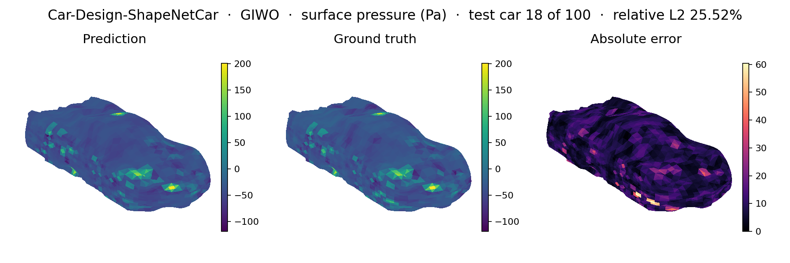
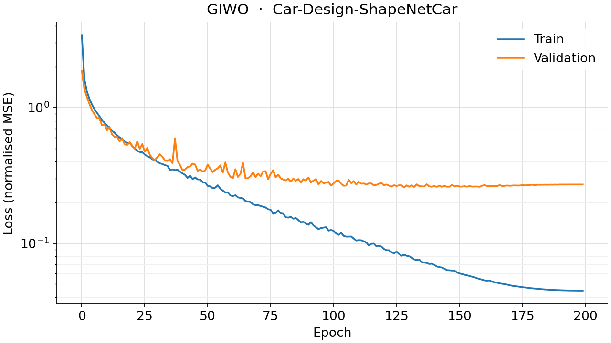
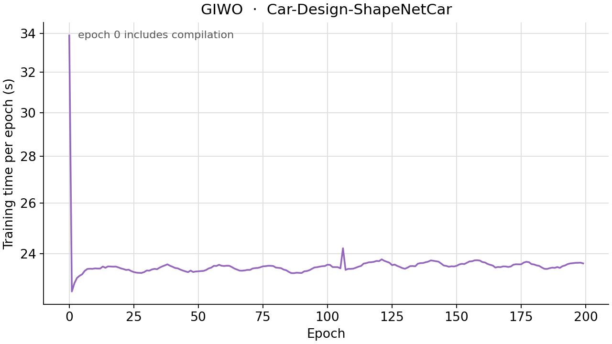

<!--
SPDX-FileCopyrightText: 2026 ZenteiQ AiTech Innovations Pvt. Ltd.
License notice: Documentation text and diagrams on this page are licensed
under CC BY 4.0. Source-code examples are licensed under LGPL-3.0-only
unless the example states otherwise.
-->

# Tutorial: ShapeNetCar (Car Aerodynamics) with GIWO

In this tutorial you train **GIWO**, a "Geo-WNO [[2]](#ref2)", on
**ShapeNetCar [[4]](#ref4)**: given the 3D point cloud of a car, predict the
steady velocity around it and the pressure on its surface. GIWO is this
repository's own architecture, not a published one. It keeps the outer shell
of [GINO](../Others/ShapeNetCar_GINO.md) [[3]](#ref3): a graph neural operator carries each car's
points onto a fixed regular grid, and a second one carries the result back
onto the car's points. On the grid it runs a
[Wavelet Neural Operator](../../theory_guide/operator_learning.md#wno) (WNO) instead of GINO's FNO.
The whole tutorial is one script, [`scripts/tutorials/shapenetcar_giwo.py`](../../../scripts/tutorials/shapenetcar_giwo.py).
GIWO itself lives in [`scirex.experimental`](../../api/experimental.md), which is not public API, so the
script assembles it from the public blocks [`scirex.layers.GNOBlock`](../../api/layers.md#scirex.layers.GNOBlock),
[`scirex.models.WNO`](../../api/models.md#scirex.models.WNO) and [`scirex.layers.ChannelMLP`](../../api/layers.md#scirex.layers.ChannelMLP); a test checks that it is
the benchmark's GIWO, weight for weight. Everything else is public API
([`scirex.data.load_shapenet_car`](../../api/data.md#scirex.data.load_shapenet_car), [`scirex.layers.kdtree_neighbor_search`](../../api/layers.md#scirex.layers.kdtree_neighbor_search),
[`scirex.layers.neighbors_to_segments`](../../api/layers.md#scirex.layers.neighbors_to_segments), [`scirex.utils.count_model_params`](../../api/utils.md#scirex.utils.count_model_params)) and
plain JAX and optax. The code on this page is copied from that script. The
data, loss and metrics are those of the
[Transolver tutorial](../Transolver/ShapeNetCar_Transolver.md), and the latent grid and
neighbour lists those of the [GINO tutorial](../Others/ShapeNetCar_GINO.md); this page
focuses on what GIWO changes.

## Summary

| | |
|---|---|
| Problem | Steady, incompressible external flow around a car: point cloud in, velocity and surface pressure out |
| Model | GIWO, assembled from [`GNOBlock`](../../api/layers.md#scirex.layers.GNOBlock), [`WNO`](../../api/models.md#scirex.models.WNO) and [`ChannelMLP`](../../api/layers.md#scirex.layers.ChannelMLP), wrapped for one car. Benchmark size (run `giwo_transolver_cost_matched`): latent grid 10 × 10 × 10, `width=15, n_layers=4`, wavelet `db4` at `level=1`, graph-kernel MLP `(64, 64)`, radii 0.3 (in) and 1.65 (out), 3,752,638 parameters. Smoke size: latent grid 8 × 8 × 8, `width=8, n_layers=2`, `db4` at `level=1`, MLP `(32, 32)`, radii 0.22 and 0.6, 381,484 parameters |
| Data | [Car-Design-ShapeNetCar](../../dataset_guide/shapenetcar.md) (`mlcfd_data.zip`, about 2 GB zipped), 9 folds, about 889 cars. Fold 0: 789 train / 100 validation. Smoke: 4 train / 2 validation |
| Metric | Relative L2 error on the validation fold: velocity over all points (`rel_l2_volume`) and pressure over the surface points (`rel_l2_surface`) |
| Full-run values | `rel_l2_volume` 0.0696 and `rel_l2_surface` 0.2018. On the same benchmark: Transolver 0.0223 and 0.0767, GINO 0.0730 and 0.2149. No published GIWO number exists |

## Setup

The setup is the same as in the [GINO tutorial](ShapeNetCar_GINO.md#setup).

### Data

For the smoke run you do not need to copy anything. The loader holds out the
fold `fold_id` (default 0, the folder `param0`) as validation and trains on all
other folds, and it only lists the folders that exist. `build_subset` below
makes a small dataset from symlinks to the first complete cars of the real
`param0` and `param1`. Only the two `.vtk` files of each car are read, so a
copy of just those files (about 3 MB per car) is enough.

## The problem

The problem, the data and the metric are the same as in the [GINO tutorial](ShapeNetCar_GINO.md#the-problem).

**GIWO in one paragraph.** Let $G$ be a fixed regular grid of $g^3$ points
over a box that holds every car. As in GINO, the input graph neural operator
gives every grid point $z \in G$ the average of a learned kernel over the car
points within radius $r_\text{in}$,

$$
v(z) = \frac{1}{|B_{r_\text{in}}(z)|}\sum_{x_j \in B_{r_\text{in}}(z)} \kappa_\phi\big(z, x_j, f(x_j)\big),
$$

where $f$ is the 4 non-coordinate features (signed distance and normal) and
the kernel $\kappa_\phi$ is an MLP of the positionally embedded coordinates.
A [WNO](../../theory_guide/operator_learning.md#wno) then works on $v$ on the grid: in every layer
it takes a discrete wavelet transform (here one level of the Daubechies-4
wavelet), multiplies the coefficients by learned weights and transforms back.
Wavelets are local in space and in scale, where Fourier modes are global. The
output graph neural operator sums a second learned kernel over the grid points
within radius $r_\text{out}$ of every car point, and a pointwise MLP maps the
result to the 4 fields. GIWO asks whether a different operator on the grid
closes GINO's gap to Transolver on this benchmark; see the
[ShapeNetCar results](../../benchmarks/shapenetcar/results/comparative.md#sizing).

## Step-by-step walkthrough

The explanations of the steps that are the same for every model are in the [GINO tutorial](ShapeNetCar_GINO.md#step-by-step-walkthrough). This page keeps the code and the text that is specific to the model.

### 1. Setup

Imports, the seed, the training settings, the two model sizes and the box of
the latent grid. `PROTOCOL` holds the training settings of the Transolver
paper for this benchmark (the same values as in
[`scripts/benchmarks/shapenetcar/_config.py`](../../../scripts/benchmarks/shapenetcar/_config.py)), which every model on this
benchmark is trained with: 200 epochs, Adam with a peak learning rate of 1e-3,
a one-cycle schedule (`pct_start` 0.3, `div_factor` 25, `final_div_factor`
1000) and a pressure weight of 0.5. `SIZES["full"]` is the benchmark's headline
GIWO run, `giwo_transolver_cost_matched`, whose neighbour radii were raised so
that an epoch costs about as much as Transolver's; `SIZES["smoke"]` is small
enough for a CPU.
`DOMAIN_MIN` and `DOMAIN_MAX` are the extent of every fold-0 car in the
normalised coordinates, plus a 10% margin.

<!-- tutorial-snippet -->
```python
from __future__ import annotations

import argparse
import os
import platform
from pathlib import Path
from time import perf_counter

import flax
import flax.linen as nn
import jax
import jax.numpy as jnp
import matplotlib
import matplotlib.pyplot as plt
import numpy as np
import optax

import scirex
from scirex.data import load_shapenet_car
from scirex.layers import (
    ChannelMLP,
    GNOBlock,
    kdtree_neighbor_search,
    neighbors_to_segments,
)
from scirex.models import WNO
from scirex.utils import count_model_params

matplotlib.use("Agg")  # write figures to files, no display needed
# Keep float32, also if float64 was enabled earlier in the process.
jax.config.update("jax_enable_x64", False)
```

<!-- tutorial-snippet -->
```python
SEED = 0

# Training settings of the Transolver paper's protocol for this benchmark,
# the same values as PROTOCOL in scripts/benchmarks/shapenetcar/_config.py.
# Every model on this benchmark is trained with them.
PROTOCOL = dict(
    n_epochs=200,
    learning_rate=1e-3,
    press_weight=0.5,
    pct_start=0.3,
    div_factor=25.0,
    final_div_factor=1000.0,
)

# Model sizes. "full" is the benchmark's headline GIWO run,
# "giwo_transolver_cost_matched" (3,752,638 parameters, 2.8 % below
# Transolver's 3,860,804, with neighbour radii raised so that an epoch costs
# about as much as Transolver's). "smoke" is a tiny GIWO with short neighbour
# radii that trains on a CPU.
SIZES = dict(
    full=dict(
        latent_grid=10,
        width=15,
        n_layers=4,
        level=1,
        wavelet="db4",
        gno_mlp_hidden=(64, 64),
        in_gno_radius=0.3,
        out_gno_radius=1.65,
    ),
    smoke=dict(
        latent_grid=8,
        width=8,
        n_layers=2,
        level=1,
        wavelet="db4",
        gno_mlp_hidden=(32, 32),
        in_gno_radius=0.22,
        out_gno_radius=0.6,
    ),
)

# The box the fixed latent grid spans, in the normalised coordinates that
# load_shapenet_car returns: the extent of every fold-0 car (train and
# validation) plus a 10 % margin, as in scripts/benchmarks/shapenetcar.
DOMAIN_MIN = np.array([-2.0, -2.5, -2.5], dtype=np.float32)
DOMAIN_MAX = np.array([2.0, 6.2, 2.7], dtype=np.float32)
```

<!-- tutorial-snippet -->
```python
def print_environment(seed: int) -> None:
    """Print the versions, the devices and the seed, so a run can be repeated."""
    print(f"python {platform.python_version()} | numpy {np.__version__}")
    print(f"scirex {scirex.__version__}")
    print(
        f"jax {jax.__version__} | flax {flax.__version__} | optax {optax.__version__}"
    )
    print(f"devices: {jax.devices()}")
    print(f"SEED = {seed}")
```

### 2. Get a small data directory

<!-- tutorial-snippet -->
```python
def build_subset(src_dir: Path, dst_dir: Path, n_train: int, n_val: int) -> dict:
    """Symlink ``n_val`` cars into ``dst_dir/param0``, ``n_train`` into ``param1``."""
    src_dir, dst_dir = Path(src_dir), Path(dst_dir)
    picked = {}
    for fold, count in (("param0", n_val), ("param1", n_train)):
        out = dst_dir / fold
        out.mkdir(parents=True, exist_ok=True)
        cars = [
            d
            for d in sorted((src_dir / fold).iterdir())
            if (d / "quadpress_smpl.vtk").exists() and (d / "hexvelo_smpl.vtk").exists()
        ]
        if len(cars) < count:
            raise ValueError(f"{src_dir / fold} has only {len(cars)} complete cars")
        picked[fold] = [d.name for d in cars[:count]]
        for old in out.iterdir():  # drop links left by an earlier, different subset
            if old.is_symlink() and old.name not in picked[fold]:
                old.unlink()
        for d in cars[:count]:
            link = out / d.name
            if not link.is_symlink() and not link.exists():
                link.symlink_to(d.resolve(), target_is_directory=True)
    return picked
```

### 3. Load the data

[`load_shapenet_car`](../../api/data.md#scirex.data.load_shapenet_car) returns a dict with `train` and `val` (lists of cars),
`coef_norm` and `model_kwargs`. `coef_norm` is the tuple
`(mean_in, std_in, mean_out, std_out)` of the training cars, already applied to
the inputs and targets, and you need it to go back to physical units. Each car
is a dict with `x` of shape `(N, 7)`, `y` of shape `(N, 4)`, `pos` of shape
`(N, 3)` and `surf`, a boolean mask that is true on the car surface. The first
read of a car parses the VTK files; the result is cached in `cache_dir`.

<!-- tutorial-snippet -->
```python
def load_data(data_dir: Path, cache_dir: Path | None, fold_id: int = 0) -> dict:
    """Load one train/validation split and print what was read."""
    data = load_shapenet_car(data_dir, fold_id=fold_id, cache_dir=cache_dir)
    n_points = [len(s["x"]) for s in data["train"] + data["val"]]
    print(
        f"cars: {len(data['train'])} train / {len(data['val'])} val | "
        f"points per car: min {min(n_points)}, max {max(n_points)}"
    )
    return data
```

### 4. Latent grid and neighbour lists

This step is the same as in the [GINO tutorial](../Others/ShapeNetCar_GINO.md).
`build_latent_grid` makes the fixed grid, the same for every car. `attach_neighbors` runs two KD-tree searches per car:
`neighbors_in` lists, for every grid point, the car points within
`in_gno_radius`; `neighbors_out` lists, for every car point, the grid points
within `out_gno_radius`. The search needs concrete numbers, so it runs once
before training, not inside the jitted step. A grid point far from a given car
finds no neighbours and contributes nothing for that car.

Every car finds a different number of neighbours, and JAX compiles a jitted
function once per input shape. `pad_neighbors` therefore extends every car's
lists to the longest one in the split; each padding edge points at an extra
segment, one past the last real query, which the reduction inside the graph
operator drops. The prediction is the same with and without padding, and the
training step is compiled once instead of once per car. The radii set the cost:
the smoke size has about 60,000 output edges per car, the benchmark's
`giwo_transolver_cost_matched` about 2,260,000 (measured in `_config.py` on the
first car of fold 0).

<!-- tutorial-snippet -->
```python
def build_latent_grid(latent_grid: int) -> np.ndarray:
    """The ``(g, g, g, 3)`` regular grid over the fixed domain, axes (x, y, z)."""
    axes = [
        np.linspace(lo, hi, latent_grid, dtype=np.float32)
        for lo, hi in zip(DOMAIN_MIN, DOMAIN_MAX, strict=True)
    ]
    return np.stack(np.meshgrid(*axes, indexing="ij"), axis=-1)
```

<!-- tutorial-snippet -->
```python
def pad_neighbors(neighbors: dict, n_segments: int, max_edges: int) -> dict:
    """Pad the edge arrays to ``max_edges``; padding goes to segment ``n_segments``."""
    index = np.asarray(neighbors["neighbors_index"])
    segment_ids = np.asarray(neighbors["segment_ids"])
    n_pad = max_edges - index.shape[0]
    return {
        "neighbors_index": np.concatenate([index, np.zeros(n_pad, dtype=index.dtype)]),
        "segment_ids": np.concatenate(
            [segment_ids, np.full(n_pad, n_segments, dtype=segment_ids.dtype)]
        ),
        "counts": neighbors["counts"],
    }
```

<!-- tutorial-snippet -->
```python
def attach_neighbors(samples: list[dict], size: dict) -> dict:
    """Add padded ``neighbors_in``/``neighbors_out`` to every car, in place."""
    latent = build_latent_grid(size["latent_grid"]).reshape(-1, 3)
    raw = []
    for s in samples:
        pos = np.asarray(s["x"][:, :3], dtype=np.float32)
        n_in = neighbors_to_segments(
            kdtree_neighbor_search(
                data=pos, queries=latent, radius=size["in_gno_radius"]
            )
        )
        n_out = neighbors_to_segments(
            kdtree_neighbor_search(
                data=latent, queries=pos, radius=size["out_gno_radius"]
            )
        )
        raw.append((n_in, n_out, pos.shape[0]))
    max_in = max(int(n_in["neighbors_index"].shape[0]) for n_in, _, _ in raw)
    max_out = max(int(n_out["neighbors_index"].shape[0]) for _, n_out, _ in raw)
    for s, (n_in, n_out, n_car) in zip(samples, raw, strict=True):
        s["neighbors_in"] = pad_neighbors(n_in, latent.shape[0], max_in)
        s["neighbors_out"] = pad_neighbors(n_out, n_car, max_out)
    print(f"edges per car (padded): in {max_in:,} | out {max_out:,}")
    return dict(max_in=max_in, max_out=max_out)
```

### 5. Build the model

GIWO is in [`scirex.experimental`](../../api/experimental.md), which is not public API, so [`GIWO`](../../api/experimental.md#scirex.experimental.giwo.GIWO) below
assembles it from public blocks with the same settings and the same submodule
names (`gno_in`, `wno`, `gno_out`, `projection`): the parameter tree is
identical and the benchmark's checkpoints load into it, which a test checks.
The input [`GNOBlock`](../../api/layers.md#scirex.layers.GNOBlock) averages the 4 features over the neighbours of every grid
point (`reduction="mean"`, `transform_type="nonlinear_kernelonly"`); it embeds
the coordinates itself (`pos_embedding_type="nerf"`). [`WNO`](../../api/models.md#scirex.models.WNO) runs on the
`(g, g, g)` grid in float32 with its own lifting and projection and appends
the grid coordinates as channels (`use_grid=True`). The output [`GNOBlock`](../../api/layers.md#scirex.layers.GNOBlock) sums
over the neighbours of every car point, and a pointwise [`ChannelMLP`](../../api/layers.md#scirex.layers.ChannelMLP) maps to
the 4 fields. `CarGIWO` splits a car's features into coordinates and input
function, as `CarGINO` does in the GINO tutorial.

All of GIWO's weights are real, so plain `optax.adam` is correct. Its parameter
count behaves differently from GINO's: the weights of a wavelet layer are
shaped from the whole coefficient array of the grid, not from a fixed number of
Fourier modes, so they grow with the grid and with the width. That is why the
smoke GIWO, at width 8 on an 8 × 8 × 8 grid, already has 381,484 parameters,
and why the benchmark could only match Transolver's budget to within 2.8%
(width 15; widths 14 and 16 miss by 15% and 10%).

<!-- tutorial-snippet -->
```python
class GIWO(nn.Module):
    """GNO-in -> WNO on the latent grid -> GNO-out -> pointwise projection."""

    in_channels: int
    out_channels: int
    latent_grid: int
    width: int
    n_layers: int
    level: int
    wavelet: str
    gno_mlp_hidden: tuple[int, ...]
    in_gno_radius: float
    out_gno_radius: float

    def setup(self) -> None:
        gno = dict(
            coord_dim=3,
            pos_embedding_type="nerf",
            pos_embedding_channels=32,
            pos_embedding_max_positions=10000,
            channel_mlp_layers=list(self.gno_mlp_hidden),
            channel_mlp_non_linearity=nn.gelu,
            use_torch_scatter_reduce=False,
            use_open3d_neighbor_search=True,
        )
        self.gno_in = GNOBlock(
            in_channels=self.in_channels,
            out_channels=self.width,
            radius=self.in_gno_radius,
            reduction="mean",
            weighting_fn=None,
            transform_type="nonlinear_kernelonly",
            **gno,
        )
        self.wno = WNO(
            in_channels=self.width,
            out_channels=self.width,
            hidden_channels=self.width,
            n_layers=self.n_layers,
            level=self.level,
            size=(self.latent_grid,) * 3,
            wavelet=self.wavelet,
            mode="symmetric",
            use_grid=True,
            compute_dtype=jnp.float32,
        )
        self.gno_out = GNOBlock(
            in_channels=self.width,
            out_channels=self.width,
            radius=self.out_gno_radius,
            reduction="sum",
            weighting_fn=None,
            transform_type="linear",
            **gno,
        )
        self.projection = ChannelMLP(
            in_channels=self.width,
            out_channels=self.out_channels,
            hidden_channels=4 * self.width,
            n_layers=2,
            n_dim=1,
        )

    def __call__(self, pos, latent, features, neighbors_in, neighbors_out):
        pos, latent = pos[0], latent[0]
        grid = latent.reshape(-1, 3)
        h = self.gno_in(y=pos, x=grid, f_y=features, neighbors=neighbors_in)
        h = self.wno(h.reshape(1, *latent.shape[:-1], -1))
        h = h.reshape(1, -1, self.width)
        out = self.gno_out(y=grid, x=pos, f_y=h, neighbors=neighbors_out)
        out = jnp.transpose(out, (0, 2, 1))
        return jnp.transpose(self.projection(out), (0, 2, 1))
```

<!-- tutorial-snippet -->
```python
class CarGIWO(nn.Module):
    """GIWO on one car: ``x`` (1, N, 7) -> (1, N, 4)."""

    latent_grid: int
    width: int
    n_layers: int
    level: int
    wavelet: str
    gno_mlp_hidden: tuple[int, ...]
    in_gno_radius: float
    out_gno_radius: float
    out_dim: int = 4

    @nn.compact
    def __call__(self, x, neighbors_in, neighbors_out):
        pos, features = x[:, :, :3], x[:, :, 3:]
        latent = jnp.asarray(build_latent_grid(self.latent_grid))[None]
        return GIWO(
            in_channels=features.shape[-1],
            out_channels=self.out_dim,
            latent_grid=self.latent_grid,
            width=self.width,
            n_layers=self.n_layers,
            level=self.level,
            wavelet=self.wavelet,
            gno_mlp_hidden=self.gno_mlp_hidden,
            in_gno_radius=self.in_gno_radius,
            out_gno_radius=self.out_gno_radius,
        )(pos, latent, features, neighbors_in, neighbors_out)
```

<!-- tutorial-snippet -->
```python
def build_model(size: dict, sample: dict, seed: int):
    """Build the GIWO, initialise it on one car and print the parameter count."""
    model = CarGIWO(**size)
    params = model.init(
        jax.random.PRNGKey(seed),
        jnp.asarray(sample["x"])[None],
        sample["neighbors_in"],
        sample["neighbors_out"],
    )
    print(f"GIWO {size} | parameters: {count_model_params(params):,}")
    return model, params
```

### 6. Loss

<!-- tutorial-snippet -->
```python
def make_loss(model, press_weight: float):
    """Return ``loss_fn(params, x, y, surf, nbr_in, nbr_out) -> (total, parts)``."""

    def loss_fn(params, x, y, surf, neighbors_in, neighbors_out):
        out = model.apply(params, x, neighbors_in, neighbors_out)[0]
        surf_f = surf.astype(out.dtype)
        n_surf = jnp.maximum(1.0, surf_f.sum())
        loss_press = jnp.sum(surf_f * (out[:, -1] - y[:, -1]) ** 2) / n_surf
        loss_velo = jnp.mean((out[:, :-1] - y[:, :-1]) ** 2)
        total = loss_velo + press_weight * loss_press
        return total, (loss_press, loss_velo)

    return loss_fn
```

### 7. Train

One gradient step per car (batch size 1), in a new random order every epoch,
as in the reference implementation. `as_arrays` hands a car's inputs, targets
and neighbour lists to the jitted step. `optax.cosine_onecycle_schedule` raises
the learning rate over the first 30% of the steps and then lowers it. After
each epoch the validation cars are scored with the same loss.

<!-- tutorial-snippet -->
```python
def as_arrays(s: dict) -> tuple:
    """One car's model inputs and targets as JAX arrays."""
    return (
        jnp.asarray(s["x"])[None],
        jnp.asarray(s["y"]),
        jnp.asarray(s["surf"]),
        jax.tree_util.tree_map(jnp.asarray, s["neighbors_in"]),
        jax.tree_util.tree_map(jnp.asarray, s["neighbors_out"]),
    )
```

<!-- tutorial-snippet -->
```python
def train(model, params, train_samples, val_samples, epochs, seed, protocol=PROTOCOL):
    """Train for ``epochs`` epochs. Return the final parameters and the history."""
    total_steps = (len(train_samples) + 1) * epochs
    schedule = optax.cosine_onecycle_schedule(
        transition_steps=total_steps,
        peak_value=protocol["learning_rate"],
        pct_start=protocol["pct_start"],
        div_factor=protocol["div_factor"],
        final_div_factor=protocol["final_div_factor"],
    )
    tx = optax.adam(learning_rate=schedule)
    opt_state = tx.init(params)
    press_weight = protocol["press_weight"]
    loss_fn = make_loss(model, press_weight)

    @jax.jit
    def train_step(params, opt_state, x, y, surf, nbr_in, nbr_out):
        grads, aux = jax.grad(loss_fn, has_aux=True)(
            params, x, y, surf, nbr_in, nbr_out
        )
        updates, opt_state = tx.update(grads, opt_state, params)
        return optax.apply_updates(params, updates), opt_state, aux

    @jax.jit
    def eval_step(params, x, y, surf, nbr_in, nbr_out):
        return loss_fn(params, x, y, surf, nbr_in, nbr_out)[1]

    rng = np.random.default_rng(seed)
    history = []
    for epoch in range(epochs):
        t0 = perf_counter()
        press, velo = [], []
        for i in rng.permutation(len(train_samples)):
            params, opt_state, (p, v) = train_step(
                params, opt_state, *as_arrays(train_samples[i])
            )
            press.append(p)
            velo.append(v)
        train_press = float(jnp.mean(jnp.stack(press)))
        train_velo = float(jnp.mean(jnp.stack(velo)))
        secs = perf_counter() - t0

        val = [eval_step(params, *as_arrays(s)) for s in val_samples]
        val_press = float(jnp.mean(jnp.stack([p for p, _ in val])))
        val_velo = float(jnp.mean(jnp.stack([v for _, v in val])))
        history.append(
            dict(
                epoch=epoch,
                train_loss=train_velo + press_weight * train_press,
                val_loss=val_velo + press_weight * val_press,
                secs=secs,
            )
        )
        print(
            f"epoch {epoch}: train_loss={history[-1]['train_loss']:.5f} "
            f"val_loss={history[-1]['val_loss']:.5f} epoch_time={secs:.1f}s"
        )
    return params, history
```

### 8. Evaluate

<!-- tutorial-snippet -->
```python
def rel_l2(pred: np.ndarray, truth: np.ndarray, eps: float = 1e-8) -> float:
    """Relative L2 error ``||pred - truth|| / (||truth|| + eps)``."""
    return float(np.linalg.norm(pred - truth) / (np.linalg.norm(truth) + eps))
```

<!-- tutorial-snippet -->
```python
def evaluate(model, params, samples, coef_norm) -> dict:
    """Mean relative L2 error of the velocity (all points) and surface pressure."""
    _, _, mean_out, std_out = coef_norm
    predict = jax.jit(lambda p, x, ni, no: model.apply(p, x, ni, no)[0])
    volume, surface, predictions = [], [], []
    for s in samples:
        x, _, _, nbr_in, nbr_out = as_arrays(s)
        out = np.asarray(predict(params, x, nbr_in, nbr_out))
        out_denorm = out * std_out + mean_out
        y_denorm = s["y"] * std_out + mean_out
        surf = s["surf"]
        volume.append(rel_l2(out_denorm[:, :-1], y_denorm[:, :-1]))
        surface.append(rel_l2(out_denorm[surf, -1], y_denorm[surf, -1]))
        predictions.append(out_denorm)
    return dict(
        rel_l2_volume=float(np.mean(volume)),
        rel_l2_surface=float(np.mean(surface)),
        predictions=predictions,
    )
```

### 9. Plot

<!-- tutorial-snippet -->
```python
def plot_surface_pressure(sample, pred_denorm, coef_norm, path: Path) -> None:
    """Save input, true pressure, predicted pressure and absolute error."""
    mean_in, std_in, mean_out, std_out = coef_norm
    surf = sample["surf"]
    pos = sample["pos"][surf]
    normal_y = (sample["x"][surf, 5] * std_in[5] + mean_in[5]).astype(float)
    truth = (sample["y"][surf, -1] * std_out[-1] + mean_out[-1]).astype(float)
    pred = pred_denorm[surf, -1]
    panels = [
        ("Input: surface normal y", normal_y, "coolwarm", None),
        ("Truth: pressure", truth, "jet", (truth.min(), truth.max())),
        ("Prediction: pressure", pred, "jet", (truth.min(), truth.max())),
        ("Absolute error", np.abs(pred - truth), "magma", None),
    ]
    fig = plt.figure(figsize=(18, 4.5))
    for k, (title, values, cmap, lim) in enumerate(panels, start=1):
        ax = fig.add_subplot(1, 4, k, projection="3d")
        vmin, vmax = lim if lim else (None, None)
        sc = ax.scatter(
            pos[:, 0],
            pos[:, 2],
            pos[:, 1],
            c=values,
            s=3,
            cmap=cmap,
            vmin=vmin,
            vmax=vmax,
        )
        ax.set_title(title)
        ax.set_axis_off()
        ax.view_init(elev=20, azim=-60)
        ax.set_box_aspect(np.ptp(pos[:, [0, 2, 1]], axis=0))
        fig.colorbar(sc, ax=ax, shrink=0.6)
    fig.suptitle("Car-Design-ShapeNetCar, GIWO, one validation car")
    fig.savefig(path, dpi=120, bbox_inches="tight")
    plt.close(fig)
```

<!-- tutorial-snippet -->
```python
def plot_loss(history: list[dict], path: Path) -> None:
    """Save the training and validation loss per epoch."""
    epochs = [h["epoch"] for h in history]
    fig, ax = plt.subplots(figsize=(6, 4))
    ax.plot(epochs, [h["train_loss"] for h in history], marker="o", label="train")
    ax.plot(epochs, [h["val_loss"] for h in history], marker="o", label="validation")
    ax.set_xlabel("epoch")
    ax.set_ylabel("loss (velocity MSE + 0.5 x pressure MSE)")
    ax.set_yscale("log")
    ax.legend()
    ax.grid(True, alpha=0.3)
    fig.savefig(path, dpi=120, bbox_inches="tight")
    plt.close(fig)
```

The complete script is [`scripts/tutorials/shapenetcar_giwo.py`](../../../scripts/tutorials/shapenetcar_giwo.py).

## Run it

Smoke run (CPU, a few seconds, no GPU needed):

```bash
CUDA_VISIBLE_DEVICES= JAX_PLATFORMS=cpu python scripts/tutorials/shapenetcar_giwo.py --data-dir ~/data/mlcfd_data/training_data --smoke
```

Full protocol (fold 0, benchmark-size GIWO, 200 epochs; use a GPU):

```bash
python scripts/tutorials/shapenetcar_giwo.py --data-dir ~/data/mlcfd_data/training_data
```

The other flags are `--epochs`, `--seed`, `--out-dir` (default
`outputs/shapenetcar_giwo_tutorial`), `--cache-dir` (default `<out-dir>/cache`)
and, for the smoke subset, `--n-train` and `--n-val`.

This is the output of the smoke run on a CPU (smoke run, CPU, 4 train / 2
validation cars, not a benchmark number). The wall time was 9.6 s, measured
with `time`, with an empty cache; library deprecation warnings are left out:

```text
python 3.12.3 | numpy 1.26.4
scirex 1.0.0rc1
jax 0.6.2 | flax 0.10.7 | optax 0.2.8
devices: [CpuDevice(id=0)]
SEED = 0
subset in outputs/shapenetcar_giwo_tutorial/subset: {'param0': ['100715345ee54d7ae38b52b4ee9d36a3', '10247b51a42b41603ffe0e5069bf1eb5'], 'param1': ['1dc58be25e1b6e5675cad724c63e222e', '1dc757e77f3cfad0253c03b7df20edd5', '1e2f9cb6b33c92ea82381b04bbe0ce6d', '1e54527efa629c37a047cd0a07d473f1']}
load_shapenet_car: reading 4 train sample(s)...
load_shapenet_car: train 4/4 (0.9s elapsed)
load_shapenet_car: reading 2 val sample(s)...
load_shapenet_car: val 2/2 (0.2s elapsed)
cars: 4 train / 2 val | points per car: min 32186, max 32186
edges per car (padded): in 3,430 | out 57,483
data loading and neighbour search: 2.4s
GIWO {'latent_grid': 8, 'width': 8, 'n_layers': 2, 'level': 1, 'wavelet': 'db4', 'gno_mlp_hidden': (32, 32), 'in_gno_radius': 0.22, 'out_gno_radius': 0.6} | parameters: 381,484
epoch 0: train_loss=5.43844 val_loss=4.44051 epoch_time=1.1s
epoch 1: train_loss=5.40570 val_loss=4.41125 epoch_time=0.3s
rel_l2_volume (velocity)  = 0.4533
rel_l2_surface (pressure) = 0.9750
figures in outputs/shapenetcar_giwo_tutorial | total time 8.7s
WALL 9.56 s
```

## Results

### Full run

The next figures were not made by this script. They come from the benchmark
runner (`train.py` and `infer.py`) and are the committed results of the **full
200-epoch run** `giwo_transolver_cost_matched` on fold 0 (789 training and 100
validation cars, benchmark-size GIWO, one NVIDIA RTX PRO 6000 Blackwell). `infer.py`
draws the surface pressure of a validation car: prediction, ground truth and
absolute error.



Training and validation loss per epoch of the same run:



Seconds per epoch of the same run (the first epoch includes compilation; in
`metrics.json`, epoch 0 took 33.9 s and the median epoch 23.5 s):



| Metric (validation fold 0, full 200-epoch run) | GIWO (`giwo_transolver_cost_matched`) | [GINO](../../benchmarks/shapenetcar/results/comparative.md#gino) (`gino_wide_radius`) | [Transolver](../../benchmarks/shapenetcar/results/comparative.md#transolver), same protocol | Paper Transolver ([[1]](#ref1)) |
|---|---|---|---|---|
| `rel_l2_volume` (velocity) | 0.0696 | 0.0730 | 0.0223 | 0.0207 |
| `rel_l2_surface` (pressure) | 0.2018 | 0.2149 | 0.0767 | 0.0745 |
| `c_d_mean_relative_drag_error` | 0.0660 | 0.0779 | 0.0106 | 0.0103 |
| `rho_d_spearman_drag_correlation` | 0.7870 | 0.6685 | 0.9928 | 0.9935 |

The two drag-coefficient rows come from `infer.py`; this tutorial does not
compute them.

## Troubleshooting

- **`ImportError: ... requires 'vtk' ... Install the 'benchmark' extra`.** The
  loader needs `vtk`. Run `pip install -e ".[benchmark]"`.
- **`ValueError: data_dir=... produced 0 train or 0 val samples`.** The folder
  does not contain `param0` to `param8` with car folders inside, or the
  `param*.tar.gz` files were not unpacked. Point `--data-dir` at
  `mlcfd_data/training_data`.
- **`ValueError: ... has only N complete cars`.** You asked `build_subset` for
  more cars than the source fold has. Lower `--n-train` or `--n-val`.

## Next steps

- Compare with the other architectures on the same data: the
  [GINO tutorial](../Others/ShapeNetCar_GINO.md), the
  [Transolver tutorial](../Transolver/ShapeNetCar_Transolver.md) and the
  [comparison page](../../benchmarks/shapenetcar/results/comparative.md).
- Read the [ShapeNetCar GIWO results](../../benchmarks/experimental/shapenetcar_giwo.md) for why
  GIWO is on this benchmark and its compute cost, and the
  [problem card](../../benchmarks/shapenetcar/README.md) for the settings of the run.
- Learn how the wavelet operator works in the [WNO theory guide](../../theory_guide/operator_learning.md#wno)
  and how the graph operators work in the [GINO theory guide](../../theory_guide/operator_learning.md#gino);
  see the arguments of [`WNO`](../../api/models.md#scirex.models.WNO) and [`GNOBlock`](../../api/layers.md#scirex.layers.GNOBlock) in the [API reference](../../api/models.md)
  and [layers reference](../../api/layers.md).
- Try the WNO on a structured mesh: the [Pipe WNO benchmark](../../benchmarks/pipe/results/comparative.md#wno).

## References

1. <span id="ref1"></span>Wu et al., *Transolver: A Fast Transformer Solver for PDEs on General Geometries*, ICML 2024. <https://arxiv.org/abs/2402.02366>

2. <span id="ref2"></span>Tripura and Chakraborty, *Wavelet Neural Operator for Solving Parametric Partial Differential Equations in Computational Mechanics Problems*, Computer Methods in Applied Mechanics and Engineering 404, 115783 (2023). <https://arxiv.org/abs/2205.02191>

3. <span id="ref3"></span>Li et al., *Geometry-Informed Neural Operator for Large-Scale 3D PDEs*, NeurIPS 2023. <https://arxiv.org/abs/2309.00583>

4. <span id="ref4"></span>Umetani and Bickel, *Learning Three-Dimensional Flow for Interactive Aerodynamic Design*, ACM Transactions on Graphics 37(4), 2018. <https://doi.org/10.1145/3197517.3201325>
