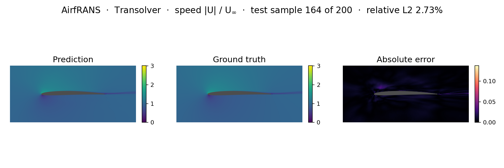
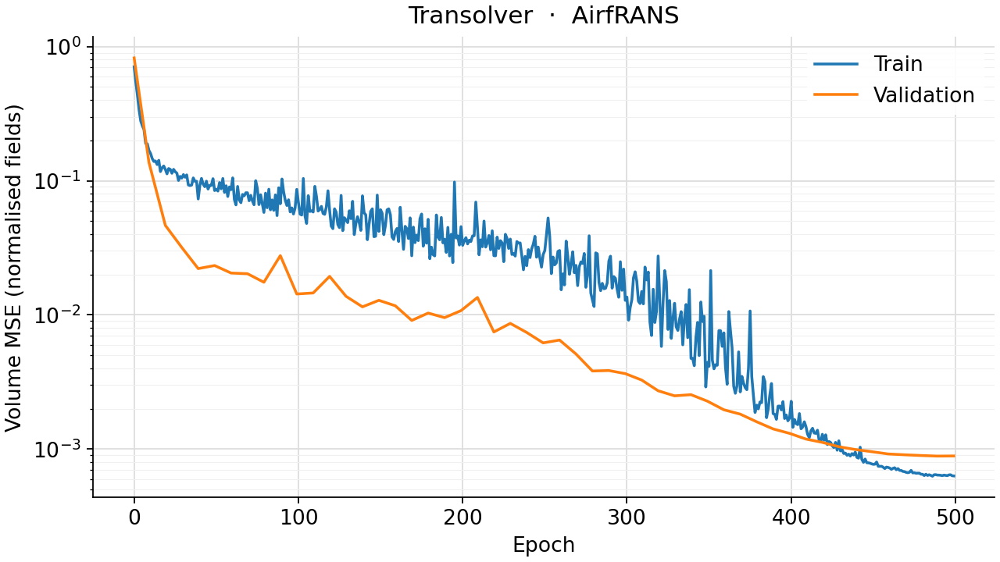
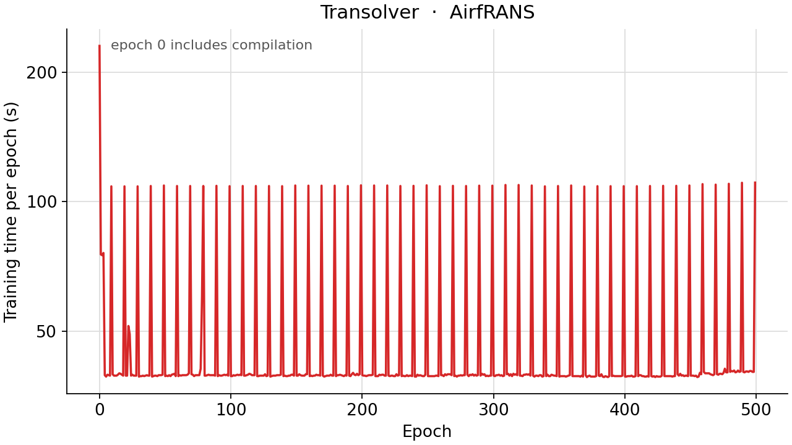

<!--
SPDX-FileCopyrightText: 2026 ZenteiQ AiTech Innovations Pvt. Ltd.
License notice: Documentation text and diagrams on this page are licensed
under CC BY 4.0. Source-code examples are licensed under LGPL-3.0-only
unless the example states otherwise.
-->

# Tutorial: AirfRANS (Airfoil Flow) with Transolver

In this tutorial you train a [Transolver](../../theory_guide/operator_learning.md#transolver) on
**AirfRANS [[2]](#ref2)**: given the CFD mesh of an airfoil case and its inflow, predict
the steady velocity, pressure and turbulent viscosity at every one of its
roughly 180,000 nodes, and the lift that follows from them. Every case has
its own airfoil, inflow and mesh, so the data are irregular point clouds. The
whole tutorial is one script, [`scripts/tutorials/airfrans_transolver.py`](../../../scripts/tutorials/airfrans_transolver.py). It
uses only the public ScireX API ([`scirex.models.Transolver`](../../api/models.md#scirex.models.Transolver),
[`scirex.utils.count_model_params`](../../api/utils.md#scirex.utils.count_model_params)), `vtk` to read the meshes, and plain NumPy,
SciPy, JAX and optax. The code on this page is copied from that script, and
every piece of it is checked against the benchmark's own code by
[`tests/docs/test_tutorial_airfrans_transolver.py`](../../../tests/docs/test_tutorial_airfrans_transolver.py).

## Summary

| | |
|---|---|
| Problem | Steady 2D RANS flow (k-ω SST) around an airfoil: node features in, `(Ux, Uy, p, nut)` at every node out |
| Model | Transolver, [`scirex.models.Transolver`](../../api/models.md#scirex.models.Transolver), unified position (8 × 8 reference grid), exact GELU, LayerNorm eps 1e-5, reference initialisation. Benchmark size: `n_hidden=256, n_layers=8, n_head=8, mlp_ratio=2, slice_num=32`, 3,894,596 parameters. Smoke size: `n_hidden=32, n_layers=2, n_head=4, mlp_ratio=2, slice_num=8`, 22,556 parameters |
| Data | AirfRANS `Dataset/` (about 15 GB unpacked), "full" task: 720 train / 80 validation / 200 test cases, 158,000 to 197,000 nodes per case in the cases read here. Smoke: 8 / 2 / 4 cases |
| Training | 32,000 random nodes per case per step, one case per step, Adam with `OneCycleLR` (peak 1e-3, β1 0.95 → 0.85 → 0.95), gradient clip at global norm 10, EMA of the weights (0.9995), FP32 matmuls, 500 epochs |
| Metric | The official Transolver AirfRANS metrics over the test cases: Volume and Surf (normalised MSE on non-wall and wall nodes), C_L relative error, Spearman's ρ of C_L |
| Full-run values | Volume 0.00131, Surf 0.00046, C_L 0.0265, ρ_L 0.99959. Paper ([[1]](#ref1)): 0.0037, 0.0142, 0.1030, 0.9978 |

## Setup

The setup is the same as in the [WNO tutorial](../Others/AirfRANS_WNO.md#setup).

### Data

The dataset is not bundled and not downloaded automatically. Get the AirfRANS
`Dataset/` folder (about 15 GB unpacked) from the AirfRANS release
([github.com/Extrality/AirfRANS](https://github.com/Extrality/AirfRANS); the
`airfrans` Python package downloads it with `airfrans.dataset.download`). The
folder holds `manifest.json`, which lists the case ids of every task, and one
folder per case with `<case>_internal.vtu` and `<case>_aerofoil.vtp`. Pass
the `Dataset` folder as `--data-dir`, or set `AIRFRANS_DATA_DIR`. AirfRANS is distributed by its authors; see the
[dataset guide](../../dataset_guide/airfrans.md) for the source. ScireX does not redistribute
it. Its licence is stated on the [Hugging Face repositories](https://huggingface.co/zenteiq-ai).

For the smoke run you do not need to copy anything: the script reads only the
cases it uses and caches their node features as `.npz` files in
`--cache-dir` (default `<out-dir>/cache`), so a second run does not parse the
VTK files again.

## The problem

The problem, the data and the metric are the same as in the [WNO tutorial](../Others/AirfRANS_WNO.md#the-problem).

with ν = 1.56e-5 m²/s, inflow speeds from 31 to 94 m/s and angles of attack
from −5° to 15°. The turbulent viscosity ν_t (`nut`) comes from the SST
model. The model never sees these equations. It learns the map from a case's
geometry and inflow to its fields from 720 solved examples. The
[dataset guide](../../dataset_guide/airfrans.md) has the file layout, the tasks
and where to get it.

$$
\mathcal G_\theta : \mathbf x \in \mathbb R^{N\times 9} \;\mapsto\; \hat{\mathbf y} \in \mathbb R^{N\times 4} .
$$

Seven of the features are the official Transolver ones: the position, the
inflow $U_\infty(\cos\alpha, \sin\alpha)$, minus the `implicit_distance`
field, and the wall normal on wall nodes (0 elsewhere). The benchmark adds
$\log_{10}(|d| + 10^{-6})$, where $d$ is the wall distance, and
$\log_{10} \mathrm{Re}$ with $\mathrm{Re} = U_\infty / \nu$. The targets are
divided by the inflow, $(U_x, U_y)/U_\infty$, $p/U_\infty^2$ and
$\nu_t/U_\infty$, and every feature and scaled target is standardised with
the mean and population standard deviation over all nodes of the training
cases.

The training loss is the official `MSE_weighted`, with $\mathcal S$ the wall
nodes and $\mathcal V$ the others, on standardised fields:

$$
\mathcal L = \frac14\sum_{c=1}^{4}\frac{1}{|\mathcal V|}\sum_{k\in\mathcal V}\big(\hat y_{k,c}-y_{k,c}\big)^2
+ \frac14\sum_{c=1}^{4}\frac{1}{|\mathcal S|}\sum_{k\in\mathcal S}\big(\hat y_{k,c}-y_{k,c}\big)^2 .
$$

The scores are the official ones of the Transolver paper
(`utils/metrics.py::Results_test`). Each case is predicted on its full mesh,
the wall values `Ux = Uy = nut = 0` are imposed, and the fields are compared
in the official normalisation, $z = (y - \mu)/(\sigma + 10^{-8})$, with the
mean $\mu$ and standard deviation $\sigma$ of the raw targets over the
training nodes:

$$
\text{Volume} = \frac14\sum_{c}\overline{(z(\hat y_c)-z(y_c))^2}\Big|_{\mathcal V}, \qquad
\text{Surf} = \frac14\sum_{c}\overline{(z(\hat y_c)-z(y_c))^2}\Big|_{\mathcal S}, \qquad
\text{C}_L\text{ error} = \frac{|C_L - \hat C_L|}{|C_L|},
$$

each averaged over the test cases, and Spearman's ρ_L between the true and
predicted $C_L$ over them. $C_L$ integrates the pressure and the wall shear
stress over the airfoil. These are **mean squared errors, not relative L2
errors**. With the wall values imposed, Surf is in effect the wall-pressure
MSE / 4; the [AirfRANS results page](../../benchmarks/airfrans/results/comparative.md#the-metric)
explains why the paper's Surf may be the wall-pressure MSE itself, which would
make every Surf on this page 4 times larger.

**Transolver in one paragraph.** Attention over all $N$ nodes would cost
$O(N^2)$. Transolver instead softly assigns the nodes to a small number of
learned slices (`slice_num`), lets the slices attend to each other, and sends
the result back to every node. The cost grows linearly with $N$, so a case
with 180,000 nodes is predicted in a few passes over 32,000-node subsets. With
`unified_pos=True`, each node's distances to an 8 × 8 grid of reference points
are concatenated to its features. The [theory guide](../../theory_guide/operator_learning.md#transolver)
has the details.

## Step-by-step walkthrough

The explanations of the steps that are the same for every model are in the [WNO tutorial](../Others/AirfRANS_WNO.md#step-by-step-walkthrough). This page keeps the code and the text that is specific to the model.

### 1. Setup

Imports, the seed and the training settings. `PROTOCOL` holds the benchmark's
settings (the same values as `PROTOCOL` in
[`scripts/benchmarks/airfrans/_config.py`](../../../scripts/benchmarks/airfrans/_config.py)): the official Transolver AirfRANS
recipe, plus the EMA, the gradient clipping, FP32 matmuls and 500 epochs.
`SIZES["full"]` is the benchmark's Transolver; `SIZES["smoke"]` is small
enough for a CPU. The script keeps JAX's 64-bit mode off, as the benchmark does: the model is meant to run
in float32.

<!-- tutorial-snippet -->
```python
from __future__ import annotations

import argparse
import functools
import json
import os
import platform
from pathlib import Path
from time import perf_counter

import flax
import jax
import jax.numpy as jnp
import matplotlib
import matplotlib.pyplot as plt
import numpy as np
import optax
import vtk
from matplotlib.colors import TwoSlopeNorm
from matplotlib.tri import Triangulation
from scipy.stats import spearmanr
from vtk.util.numpy_support import numpy_to_vtk, vtk_to_numpy

import scirex
from scirex.models import Transolver
from scirex.utils import count_model_params

matplotlib.use("Agg")  # write figures to files, no display needed
```

<!-- tutorial-snippet -->
```python
# Float32 is intended: in float64 the slice attention runs many times
# slower.
jax.config.update("jax_enable_x64", False)
```

<!-- tutorial-snippet -->
```python
SEED = 0
NU = 1.56e-5  # kinematic viscosity of the AirfRANS simulations
# The box of Transolver's unified-position reference grid: x in [-2, 4],
# y in [-1.5, 1.5] chords.
GRID_RANGE = ((-2.0, 4.0), (-1.5, 1.5))

# Training settings of the benchmark, the same values as PROTOCOL in
# scripts/benchmarks/airfrans/_config.py: the official Transolver AirfRANS
# recipe plus EMA, gradient clipping, FP32 matmuls and 500 epochs.
PROTOCOL = dict(
    n_val=80,
    subsample=32_000,
    epochs=500,
    lr=1e-3,
    pct_start=0.3,
    div_factor=25.0,
    final_div_factor=1e4,
    base_momentum=0.85,
    max_momentum=0.95,
    surf_weight=1.0,
    val_every=10,
    val_repeats=20,
    ema_decay=0.9995,
    grad_clip_global_norm=10.0,
    matmul_precision="highest",
)

# Model sizes. "full" is the benchmark's Transolver (3,894,596 parameters).
# "smoke" is a tiny Transolver that trains on a CPU.
SIZES = dict(
    full=dict(
        n_hidden=256,
        n_layers=8,
        n_head=8,
        mlp_ratio=2,
        slice_num=32,
        ref=8,
        layer_norm_epsilon=1e-5,
    ),
    smoke=dict(
        n_hidden=32,
        n_layers=2,
        n_head=4,
        mlp_ratio=2,
        slice_num=8,
        ref=8,
        layer_norm_epsilon=1e-5,
    ),
)
```

<!-- tutorial-snippet -->
```python
def print_environment(seed: int) -> None:
    """Print the versions, the devices and the seed, so a run can be repeated."""
    print(f"python {platform.python_version()} | numpy {np.__version__}")
    print(f"scirex {scirex.__version__} | vtk {vtk.vtkVersion.GetVTKVersion()}")
    print(
        f"jax {jax.__version__} | flax {flax.__version__} | optax {optax.__version__}"
    )
    print(f"devices: {jax.devices()}")
    print(f"SEED = {seed}")
```

### 2. Read the cases

`read_split` takes the official split from `manifest.json`: the last 80 cases
of `full_train` are the validation cases, as in the official `main.py`.
`read_case` builds the seven official node features of one case from its VTK
files. Wall nodes are those with `Ux == 0`, and their normal is matched to the
airfoil points by exact coordinates. `load_case` caches the result.

<!-- tutorial-snippet -->
```python
def read_split(data_dir: Path, n_val: int = 80) -> dict[str, list[str]]:
    """The official split: ``full_train[:-n_val]`` / ``[-n_val:]`` / ``full_test``."""
    manifest = json.loads((Path(data_dir) / "manifest.json").read_text())
    train = manifest["full_train"]
    return dict(train=train[:-n_val], val=train[-n_val:], test=manifest["full_test"])
```

<!-- tutorial-snippet -->
```python
def read_vtk(path: Path):
    """A ``.vtu`` (volume) or ``.vtp`` (surface) file as a VTK data set."""
    reader = (
        vtk.vtkXMLPolyDataReader()
        if str(path).endswith(".vtp")
        else vtk.vtkXMLUnstructuredGridReader()
    )
    reader.SetFileName(str(path))
    reader.Update()
    return reader.GetOutput()
```

<!-- tutorial-snippet -->
```python
def read_case(data_dir: Path, case_id: str) -> dict[str, np.ndarray]:
    """The official node features of one case, as the official ``dataset.py``.

    ``x7 = [x, y, U_inf cos a, U_inf sin a, -implicit_distance, n_x, n_y]``,
    ``y = [Ux, Uy, p, nut]``. Wall nodes are those with ``Ux == 0``; their
    normal is minus the airfoil normal, and every other node's is 0.
    """
    folder = Path(data_dir) / case_id
    internal = read_vtk(folder / f"{case_id}_internal.vtu")
    airfoil = read_vtk(folder / f"{case_id}_aerofoil.vtp")
    pts = vtk_to_numpy(internal.GetPoints().GetData())[:, :2].astype(np.float32)
    fields = internal.GetPointData()
    U = vtk_to_numpy(fields.GetArray("U"))
    p = vtk_to_numpy(fields.GetArray("p"))
    nut = vtk_to_numpy(fields.GetArray("nut"))
    sdf = vtk_to_numpy(fields.GetArray("implicit_distance"))
    surf = U[:, 0] == 0
    u_inf = float(case_id.split("_")[2])
    alpha = np.deg2rad(float(case_id.split("_")[3]))
    inflow = np.broadcast_to(
        np.array([np.cos(alpha), np.sin(alpha)]) * u_inf, (len(pts), 2)
    )
    normal = np.zeros((len(pts), 2))
    apts = vtk_to_numpy(airfoil.GetPoints().GetData())[:, :2].astype(np.float32)
    anormal = -vtk_to_numpy(airfoil.GetPointData().GetArray("Normals"))[:, :2]
    where = {tuple(q): i for i, q in enumerate(apts.tolist())}
    wall = np.flatnonzero(surf)
    normal[wall] = anormal[[where[tuple(q)] for q in pts[wall].tolist()]]
    x7 = np.concatenate([pts, inflow, -sdf[:, None], normal], axis=1).astype(np.float32)
    y = np.column_stack([U[:, 0], U[:, 1], p, nut]).astype(np.float32)
    return dict(x7=x7, y=y, pos=pts, surf=surf)
```

<!-- tutorial-snippet -->
```python
def load_case(data_dir: Path, cache_dir: Path, case_id: str) -> dict[str, np.ndarray]:
    """:func:`read_case`, cached as ``<cache_dir>/<case_id>.npz``."""
    path = Path(cache_dir) / f"{case_id}.npz"
    if path.exists():
        with np.load(path) as f:
            return {k: f[k] for k in f.files}
    case = read_case(data_dir, case_id)
    path.parent.mkdir(parents=True, exist_ok=True)
    np.savez(path, **case)
    return case
```

### 3. Features, target scaling and normalisation

`features` appends the two added features, `target_scale` gives the inflow
scaling of each target channel, and `fit_normalisation` accumulates the mean
and population standard deviation in float64 over every node of the training
cases. With about 130 million nodes in the full training set, float32 sums
would not be accurate enough. `prepare_case` returns what one case needs for
training and scoring, and `to_physical` undoes both steps.

<!-- tutorial-snippet -->
```python
def inflow_speed(x7: np.ndarray) -> float:
    return float(np.linalg.norm(x7[0, 2:4]))
```

<!-- tutorial-snippet -->
```python
def features(x7: np.ndarray) -> np.ndarray:
    """The 7 official features plus log10 wall distance and log10 Re."""
    log_d = np.log10(np.abs(x7[:, 4:5]) + 1e-6)
    log_re = np.full((len(x7), 1), np.log10(inflow_speed(x7) / NU))
    return np.concatenate([x7, log_d, log_re], axis=1).astype(np.float32)
```

<!-- tutorial-snippet -->
```python
def target_scale(u_inf: float) -> np.ndarray:
    """Per-channel divisor of the targets: U_inf, U_inf, U_inf^2, U_inf."""
    return np.array([u_inf, u_inf, u_inf**2, u_inf], np.float32)
```

<!-- tutorial-snippet -->
```python
def fit_normalisation(cases: list[dict]) -> dict[str, np.ndarray]:
    """Float64 mean and population std of the features and scaled targets."""
    n, sx, sxx, sy, syy = 0, 0.0, 0.0, 0.0, 0.0
    for c in cases:
        x = features(c["x7"]).astype(np.float64)
        y = (c["y"] / target_scale(inflow_speed(c["x7"]))).astype(np.float64)
        n += len(x)
        sx, sxx = sx + x.sum(0), sxx + (x**2).sum(0)
        sy, syy = sy + y.sum(0), syy + (y**2).sum(0)
    mx, my = sx / n, sy / n
    return dict(
        x_mean=mx.astype(np.float32),
        x_std=np.sqrt(np.maximum(sxx / n - mx**2, 0.0)).astype(np.float32),
        y_mean=my.astype(np.float32),
        y_std=np.sqrt(np.maximum(syy / n - my**2, 0.0)).astype(np.float32),
    )
```

<!-- tutorial-snippet -->
```python
def prepare_case(case: dict, norm: dict) -> dict[str, np.ndarray]:
    """Normalised inputs and targets of one case, plus what scoring needs."""
    scale = target_scale(inflow_speed(case["x7"]))
    x = (features(case["x7"]) - norm["x_mean"]) / (norm["x_std"] + 1e-8)
    y = (case["y"] / scale - norm["y_mean"]) / (norm["y_std"] + 1e-8)
    return dict(
        x=x.astype(np.float32),
        y=y.astype(np.float32),
        pos=case["pos"],
        surf=case["surf"],
        scale=scale,
    )
```

<!-- tutorial-snippet -->
```python
def to_physical(pred_norm: np.ndarray, scale: np.ndarray, norm: dict) -> np.ndarray:
    """Model output (normalised scaled targets) to ``(Ux, Uy, p, nut)``."""
    return (pred_norm * (norm["y_std"] + 1e-8) + norm["y_mean"]) * scale
```

### 4. Build the model

`build_model` is the Transolver of the official AirfRANS `main.py` with 9
inputs instead of 7, which adds 1,024 parameters to the paper's 3,893,572.
`init_params` initialises it on one node subset and then applies
`reference_init`, the official `Transolver._init_weights`: every 2D kernel is
redrawn from N(0, 0.02²), the orthogonal initialisation of the slice
projection included. `apply_model` predicts one subset of nodes.

<!-- tutorial-snippet -->
```python
def build_model(size: dict) -> Transolver:
    """The Transolver of the official AirfRANS ``main.py``, with 9 inputs."""
    return Transolver(
        space_dim=9,
        fun_dim=0,
        out_dim=4,
        unified_pos=True,
        concat_pos=True,
        geometry="irregular",
        grid_range=GRID_RANGE,
        dropout_rate=0.0,
        act=functools.partial(jax.nn.gelu, approximate=False),
        **size,
    )
```

<!-- tutorial-snippet -->
```python
def reference_init(params, key):
    """The official init: every 2D kernel ``N(0, 0.02^2)`` clipped at +-2."""
    leaves, treedef = jax.tree_util.tree_flatten_with_path(params)
    keys = jax.random.split(key, len(leaves))
    out = []
    for (path, leaf), k in zip(leaves, keys, strict=True):
        if jax.tree_util.keystr(path).endswith("['kernel']") and leaf.ndim == 2:
            leaf = jnp.clip(0.02 * jax.random.normal(k, leaf.shape, leaf.dtype), -2, 2)
        out.append(leaf)
    return jax.tree_util.tree_unflatten(treedef, out)
```

<!-- tutorial-snippet -->
```python
def init_params(model, seed: int, x: np.ndarray, pos: np.ndarray):
    """Initialise on one node subset, apply the reference init, count parameters."""
    k_init, k_ref = jax.random.split(jax.random.PRNGKey(seed))
    params = model.init(
        k_init, x=jnp.asarray(x)[None], fx=None, pos=jnp.asarray(pos)[None]
    )
    params = reference_init(params, k_ref)
    print(f"Transolver | parameters: {count_model_params(params):,}")
    return params
```

<!-- tutorial-snippet -->
```python
def apply_model(model, params, x, pos):
    """``(N, 4)`` normalised prediction for the nodes ``x``, ``pos``."""
    return model.apply(params, x=x[None], fx=None, pos=pos[None])[0]
```

### 5. Loss

The loss from [The problem](#the-problem): the volume MSE plus the wall MSE,
each averaged over the 4 channels.

<!-- tutorial-snippet -->
```python
def region_losses(out, y, surf):
    """Volume and wall MSE, each the mean over the 4 channels."""
    se = (out - y) ** 2
    w = surf[:, None].astype(jnp.float32)
    loss_surf = jnp.mean(jnp.sum(se * w, 0) / jnp.maximum(w.sum(), 1.0))
    loss_vol = jnp.mean(jnp.sum(se * (1 - w), 0) / jnp.maximum((1 - w).sum(), 1.0))
    return loss_vol, loss_surf
```

### 6. Optimiser and schedule

`onecycle` reproduces PyTorch's `OneCycleLR` with its defaults: the learning
rate rises from 1e-3 / 25 to 1e-3 over the first 30% of the steps and falls
to 1e-3 / 25 / 1e4, while Adam's β1 moves the other way, 0.95 → 0.85 → 0.95.
`optax.inject_hyperparams` makes both settable at every step. Transolver has
only real weights, so plain Adam is right here. `hyperparam_dtype=jnp.float32`
keeps the injected values float32 whatever the weights are: without it, optax
gives them the "highest" dtype of the parameters, which is complex for models
with spectral weights.

<!-- tutorial-snippet -->
```python
def onecycle(total_steps: int, p: dict):
    """``OneCycleLR`` as two functions of the 0-based step: lr and beta1."""
    init_lr = p["lr"] / p["div_factor"]
    min_lr = init_lr / p["final_div_factor"]
    end1, end2 = float(p["pct_start"] * total_steps) - 1, float(total_steps - 1)

    def cos(a, b, t):
        return b + (a - b) / 2.0 * (jnp.cos(jnp.pi * t) + 1)

    def lr(k):
        k = jnp.asarray(k, jnp.float32)
        return jnp.where(
            k <= end1,
            cos(init_lr, p["lr"], k / end1),
            cos(p["lr"], min_lr, (k - end1) / (end2 - end1)),
        )

    def beta1(k):
        k = jnp.asarray(k, jnp.float32)
        lo, hi = p["base_momentum"], p["max_momentum"]
        return jnp.where(
            k <= end1, cos(hi, lo, k / end1), cos(lo, hi, (k - end1) / (end2 - end1))
        )

    return lr, beta1
```

<!-- tutorial-snippet -->
```python
def make_optimizer():
    """Adam whose learning rate and beta1 are set at every step."""
    return optax.inject_hyperparams(optax.adam, hyperparam_dtype=jnp.float32)(
        learning_rate=1e-3, b1=0.95, b2=0.999, eps=1e-8
    )
```

### 7. Train

One case per step, in a new random order every epoch, and a fresh random
subset of 32,000 nodes of it at every step. The gradient is clipped at global
norm 10, which only cuts rare spikes, and the EMA of the weights is the model
that is evaluated. Every 10 epochs (and at the first and last) the EMA weights
are scored on the validation cases, on 20 random subsets each; this is logged
for the loss curve only. JAX compiles the step on its first call, so the first
epoch is slower than the others.

<!-- tutorial-snippet -->
```python
def train(model, params, train_cases, val_cases, epochs, seed, protocol=PROTOCOL):
    """Train for ``epochs`` epochs. Return the EMA weights and the history."""
    p = protocol
    rng = np.random.default_rng(seed)

    def sample(d):
        idx = rng.choice(len(d["x"]), min(p["subsample"], len(d["x"])), replace=False)
        return tuple(jnp.asarray(d[k][idx]) for k in ("x", "pos", "y", "surf"))

    lr_f, b1_f = onecycle((len(train_cases) + 1) * epochs, p)
    tx = make_optimizer()
    opt = tx.init(params)
    ema = params
    decay, clip, surf_w = p["ema_decay"], p["grad_clip_global_norm"], p["surf_weight"]

    def loss_fn(params, x, pos, y, surf):
        lv, ls = region_losses(apply_model(model, params, x, pos), y, surf)
        return lv + surf_w * ls, (lv, ls)

    @jax.jit
    def step(params, ema, opt, x, pos, y, surf, k):
        (_, (lv, ls)), grads = jax.value_and_grad(loss_fn, has_aux=True)(
            params, x, pos, y, surf
        )
        norm = optax.global_norm(grads)
        grads = jax.tree_util.tree_map(
            lambda g: g * jnp.minimum(1.0, clip / (norm + 1e-12)), grads
        )
        opt.hyperparams["learning_rate"] = lr_f(k)
        opt.hyperparams["b1"] = b1_f(k)
        updates, opt = tx.update(grads, opt, params)
        params = optax.apply_updates(params, updates)
        ema = jax.tree_util.tree_map(
            lambda e, q: decay * e + (1 - decay) * q, ema, params
        )
        return params, ema, opt, lv, ls

    evaluate_loss = jax.jit(lambda params, *b: loss_fn(params, *b)[1])

    history, k = [], 0
    for epoch in range(epochs):
        t0 = perf_counter()
        lvs, lss = [], []
        for i in rng.permutation(len(train_cases)):
            params, ema, opt, lv, ls = step(
                params, ema, opt, *sample(train_cases[i]), jnp.asarray(k, jnp.int32)
            )
            k += 1
            lvs.append(lv)
            lss.append(ls)
        row = dict(
            epoch=epoch,
            train_vol=float(jnp.mean(jnp.stack(lvs))),
            train_surf=float(jnp.mean(jnp.stack(lss))),
            secs=perf_counter() - t0,
        )
        if epoch % p["val_every"] == p["val_every"] - 1 or epoch in (0, epochs - 1):
            vals = [
                [float(v) for v in evaluate_loss(ema, *sample(d))]
                for _ in range(p["val_repeats"])
                for d in val_cases
            ]
            row["val_vol"], row["val_surf"] = (float(v) for v in np.mean(vals, 0))
        history.append(row)
        msg = (
            f"epoch {epoch}: train vol={row['train_vol']:.5f} "
            f"surf={row['train_surf']:.5f}"
        )
        if "val_vol" in row:
            msg += f" | val (EMA) vol={row['val_vol']:.5f} surf={row['val_surf']:.5f}"
        print(f"{msg} | epoch_time={row['secs']:.1f}s")
    return ema, history
```

The EMA decay of 0.9995 averages over about 2,000 steps. A smoke run has far
fewer (24 in the default one), so the script uses 0.99 there (about 100 steps)
unless `--ema-decay` says otherwise; with 0.9995 the evaluated weights of a
smoke run would be almost the initial ones.

### 8. Evaluate with the official metrics

`official_output_stats` computes the normalisation of the official scores
exactly as the official `dataset.py` does, with a running float64 update.
`cover_predict` is the official inference: random 32,000-node subsets until
every node has been hit, with each node's predictions averaged. `field_scores`
gives Volume and Surf of one case, and `force_coefficients` integrates the
pressure and the wall shear stress (from the VTK gradient of the velocity)
over the airfoil cells and rotates the force by the angle of attack.
`evaluate` puts them together over the test cases.

<!-- tutorial-snippet -->
```python
def official_output_stats(cases: list[dict]) -> tuple[np.ndarray, np.ndarray]:
    """Mean and std of the raw targets, as the official ``dataset.py``
    (a running float64 update, the variance around the float32 mean)."""
    n, mean = 0, 0.0
    for c in cases:
        k = len(c["y"])
        mean = mean + (c["y"].sum(0, dtype=np.float64) - k * mean) / (n + k)
        n += k
    mean = np.asarray(mean).astype(np.float32)
    n, var = 0, 0.0
    for c in cases:
        k = len(c["y"])
        var = var + (((c["y"] - mean) ** 2).sum(0, dtype=np.float64) - k * var) / (
            n + k
        )
        n += k
    return mean, np.sqrt(var).astype(np.float32)
```

<!-- tutorial-snippet -->
```python
def cover_predict(predict, n_nodes: int, subsample: int, rng) -> np.ndarray:
    """Average of random-subset predictions until every node is covered."""
    acc, hits = None, np.zeros(n_nodes)
    while (hits == 0).any():
        idx = rng.choice(n_nodes, min(subsample, n_nodes), replace=False)
        out = np.asarray(predict(idx), dtype=np.float64)
        if acc is None:
            acc = np.zeros((n_nodes, out.shape[1]))
        acc[idx] += out
        hits[idx] += 1
    return acc / hits[:, None]
```

<!-- tutorial-snippet -->
```python
def field_scores(pred, truth, surf, out_mean, out_std) -> dict:
    """Per-channel MSE in the official normalisation on volume / wall nodes."""
    z = lambda v: (v - out_mean) / (out_std + 1e-8)  # noqa: E731
    se = (z(pred) - z(truth)) ** 2
    vol, wall = se[~surf].mean(0), se[surf].mean(0)
    return dict(volume=float(vol.mean()), surf=float(wall.mean()))
```

<!-- tutorial-snippet -->
```python
def _set_array(ds, name: str, values: np.ndarray) -> None:
    arr = numpy_to_vtk(np.ascontiguousarray(values, dtype=np.float64), deep=True)
    arr.SetName(name)
    ds.GetPointData().RemoveArray(name)
    ds.GetPointData().AddArray(arr)
```

<!-- tutorial-snippet -->
```python
def force_coefficients(data_dir: Path, case_id: str, fields=None) -> np.ndarray:
    """``(C_D, C_L)`` of the true fields (``None``) or of ``(Ux, Uy, p, nut)``,
    as the official ``Compute_coefficients``."""
    folder = Path(data_dir) / case_id
    internal = read_vtk(folder / f"{case_id}_internal.vtu")
    airfoil = read_vtk(folder / f"{case_id}_aerofoil.vtp")
    U = vtk_to_numpy(internal.GetPointData().GetArray("U")).copy()
    pts = vtk_to_numpy(internal.GetPoints().GetData())[:, :2]
    wall = np.flatnonzero(U[:, 0] == 0)
    where = {tuple(q): i for i, q in enumerate(pts[wall].tolist())}
    apts = vtk_to_numpy(airfoil.GetPoints().GetData())[:, :2]
    order = np.array([wall[where[tuple(q)]] for q in apts.tolist()])
    if fields is not None:
        U[:, :2] = fields[:, :2]
        _set_array(internal, "U", U)
        _set_array(internal, "p", fields[:, 2])
    grad = vtk.vtkGradientFilter()
    grad.SetInputData(internal)
    grad.SetInputArrayToProcess(
        0, 0, 0, vtk.vtkDataObject.FIELD_ASSOCIATION_POINTS, "U"
    )
    grad.SetResultArrayName("grad")
    grad.SetFasterApproximation(False)
    grad.Update()
    jac = vtk_to_numpy(grad.GetOutput().GetPointData().GetArray("grad"))
    jac = jac.reshape(-1, 3, 3)[order, :2, :2]
    S = 0.5 * (jac + jac.transpose(0, 2, 1))
    S = S - S.trace(axis1=1, axis2=2).reshape(-1, 1, 1) * np.eye(2)[None] / 3
    normals = -vtk_to_numpy(airfoil.GetPointData().GetArray("Normals"))[:, :2]
    wss = (2 * NU * S * normals.reshape(-1, 1, 2)).sum(axis=2)
    _set_array(airfoil, "wallShearStress", wss)
    _set_array(airfoil, "p", vtk_to_numpy(internal.GetPointData().GetArray("p"))[order])
    ptc = vtk.vtkPointDataToCellData()
    ptc.SetInputData(airfoil)
    ptc.SetPassPointData(True)
    ptc.Update()
    cells = ptc.GetOutput().GetCellData()
    length = vtk_to_numpy(cells.GetArray("Length")).reshape(-1, 1)
    p_c = vtk_to_numpy(cells.GetArray("p"))[:, None]
    n_c = vtk_to_numpy(cells.GetArray("Normals"))[:, :2]
    wss_c = vtk_to_numpy(cells.GetArray("wallShearStress"))
    force = (wss_c * length).sum(0) - (-p_c * n_c * length).sum(0)
    a = np.deg2rad(float(case_id.split("_")[3]))
    rot = np.array([[np.cos(a), np.sin(a)], [-np.sin(a), np.cos(a)]])
    return 2 * (rot @ force) / float(case_id.split("_")[2]) ** 2
```

<!-- tutorial-snippet -->
```python
def evaluate(
    model, params, cases, case_ids, norm, out_stats, data_dir, protocol=PROTOCOL
):
    """Official scores of every case and their means; physical predictions."""
    predict = jax.jit(lambda q, x, pos: apply_model(model, q, x, pos))
    rng = np.random.default_rng(0)
    rows, preds = [], []
    for raw, cid in zip(cases, case_ids, strict=True):
        d = prepare_case(raw, norm)
        pred_n = cover_predict(
            lambda idx, d=d: predict(
                params, jnp.asarray(d["x"][idx]), jnp.asarray(d["pos"][idx])
            ),
            len(d["x"]),
            protocol["subsample"],
            rng,
        )
        pred = to_physical(pred_n, d["scale"], norm).astype(np.float64)
        pred[raw["surf"], 0] = pred[raw["surf"], 1] = pred[raw["surf"], 3] = 0.0
        scores = field_scores(pred, raw["y"], raw["surf"], *out_stats)
        cl_t = force_coefficients(data_dir, cid)[1]
        cl_p = force_coefficients(data_dir, cid, pred)[1]
        rows.append(dict(case=cid, **scores, cl_true=cl_t, cl_pred=cl_p,
                         relerr_cl=abs((cl_t - cl_p) / cl_t)))  # fmt: skip
        preds.append(pred.astype(np.float32))
    g = lambda key: np.array([r[key] for r in rows])  # noqa: E731
    summary = dict(
        volume=float(g("volume").mean()),
        surf=float(g("surf").mean()),
        relerr_cl=float(g("relerr_cl").mean()),
        spearman_cl=float(spearmanr(g("cl_true"), g("cl_pred"))[0]),
    )
    return summary, rows, preds
```

### 9. Plot

The standard figure for this benchmark has four panels around the airfoil of
one test case: an input, the true and the predicted pressure coefficient
$C_p = p / (\tfrac12 U_\infty^2)$ on one colour scale, and the absolute error.
The input panel shows the log wall distance, the feature that the benchmark
adds. Below them, $-C_p$ on the airfoil surface, whose enclosed area is
essentially the lift. The script plots the test case with the median Volume
error. A second figure shows the losses per epoch.

<!-- tutorial-snippet -->
```python
def plot_prediction(data_dir, case_id, raw, pred, path: Path, title: str) -> None:
    """Save input, true Cp, predicted Cp, absolute error and surface -Cp."""
    internal = read_vtk(Path(data_dir) / case_id / f"{case_id}_internal.vtu")
    quads = vtk_to_numpy(internal.GetCells().GetConnectivityArray()).reshape(-1, 4)
    tri = np.concatenate([quads[:, [0, 1, 2]], quads[:, [0, 2, 3]]])
    P = raw["pos"]
    c = P[tri].mean(1)
    keep = (c[:, 0] > WINDOW[0] - 0.1) & (c[:, 0] < WINDOW[1] + 0.1)
    keep &= np.abs(c[:, 1]) < WINDOW[3] + 0.1
    T = Triangulation(P[:, 0], P[:, 1], tri[keep])
    q = 0.5 * float(case_id.split("_")[2]) ** 2
    truth, model = raw["y"][:, 2] / q, pred[:, 2] / q
    cp_norm = TwoSlopeNorm(vmin=-3.0, vcenter=0.0, vmax=1.0)
    panels = [
        ("Input: log10 wall distance", np.log10(np.abs(raw["x7"][:, 4]) + 1e-6),
         "viridis", {}),
        ("Truth: Cp", np.clip(truth, -3, 1), "RdBu_r", dict(norm=cp_norm)),
        ("Prediction: Cp", np.clip(model, -3, 1), "RdBu_r", dict(norm=cp_norm)),
        ("Absolute error: Cp", np.abs(model - truth), "magma", {}),
    ]  # fmt: skip
    fig = plt.figure(figsize=(18, 8))
    gs = fig.add_gridspec(2, 4, height_ratios=[1, 0.9], hspace=0.3, wspace=0.15)
    for j, (name, values, cmap, kw) in enumerate(panels):
        ax = fig.add_subplot(gs[0, j])
        im = ax.tripcolor(
            T, values, shading="gouraud", cmap=cmap, rasterized=True, **kw
        )
        ax.set_xlim(WINDOW[0], WINDOW[1])
        ax.set_ylim(WINDOW[2], WINDOW[3])
        ax.set_aspect("equal")
        ax.set_facecolor("0.3")  # the airfoil, which has no mesh nodes inside
        ax.set_xticks([])
        ax.set_yticks([])
        ax.set_title(name)
        fig.colorbar(im, ax=ax, fraction=0.03, pad=0.02)
    ax = fig.add_subplot(gs[1, :])
    wall = raw["surf"]
    order = np.argsort(P[wall, 0])
    ax.plot(
        P[wall, 0][order], -truth[wall][order], ".", ms=3, color="0.15", label="truth"
    )
    ax.plot(
        P[wall, 0][order],
        -model[wall][order],
        ".",
        ms=2,
        color="#9467bd",
        label="prediction",
    )
    ax.set_xlabel("x / c")
    ax.set_ylabel("-Cp on the airfoil surface")
    ax.grid(alpha=0.3)
    ax.legend()
    fig.suptitle(title)
    fig.savefig(path, dpi=120, bbox_inches="tight")
    plt.close(fig)
```

<!-- tutorial-snippet -->
```python
def plot_loss(history: list[dict], path: Path) -> None:
    """Save the training and validation (EMA) losses per epoch."""
    fig, ax = plt.subplots(figsize=(6.5, 4))
    ep = [h["epoch"] for h in history]
    ax.plot(ep, [h["train_vol"] for h in history], marker="o", label="train, volume")
    ax.plot(ep, [h["train_surf"] for h in history], marker="o", label="train, surface")
    val = [h for h in history if "val_vol" in h]
    ax.plot(
        [h["epoch"] for h in val],
        [h["val_vol"] for h in val],
        "s--",
        label="validation (EMA), volume",
    )
    ax.plot(
        [h["epoch"] for h in val],
        [h["val_surf"] for h in val],
        "s--",
        label="validation (EMA), surface",
    )
    ax.set_xlabel("epoch")
    ax.set_ylabel("MSE (normalised targets)")
    ax.set_yscale("log")
    ax.legend(fontsize=8)
    ax.grid(True, alpha=0.3)
    fig.savefig(path, dpi=120, bbox_inches="tight")
    plt.close(fig)
```

The complete script is [`scripts/tutorials/airfrans_transolver.py`](../../../scripts/tutorials/airfrans_transolver.py).

## Run it

Smoke run (CPU, about half a minute, no GPU needed):

```bash
CUDA_VISIBLE_DEVICES= JAX_PLATFORMS=cpu python scripts/tutorials/airfrans_transolver.py --data-dir ~/data/AirfRANS/Dataset --smoke
```

Full protocol (720 / 80 / 200 cases, benchmark-size Transolver, 500 epochs;
use a GPU):

```bash
python scripts/tutorials/airfrans_transolver.py --data-dir ~/data/AirfRANS/Dataset
```

The other flags are `--epochs`, `--seed`, `--out-dir` (default
`outputs/airfrans_transolver_tutorial`), `--cache-dir` (default
`<out-dir>/cache`), `--ema-decay` and, for the smoke run, `--n-train`,
`--n-val` and `--n-test`.

This is the output of the smoke run on a CPU (smoke run, CPU, 8 train / 2
validation / 4 test cases, not a benchmark number). The wall time was 30.4 s,
measured with `time`; library deprecation warnings are left out. The 14 cases
were already in the operating system's file cache from an earlier run, so
reading them took 2.5 s; from the network file system on a cold cache, the
same read took 15.5 s in an earlier run.

```text
python 3.12.3 | numpy 1.26.4
scirex 1.0.0rc1 | vtk 9.7.0
jax 0.6.2 | flax 0.10.7 | optax 0.2.8
devices: [CpuDevice(id=0)]
SEED = 0
cases: 8 train / 2 val / 4 test | nodes per case: min 163156, max 197146
data loading: 2.5s
Transolver | parameters: 22,556
epoch 0: train vol=1.03548 surf=1.09185 | val (EMA) vol=2.61028 surf=3.93326 | epoch_time=1.8s
epoch 1: train vol=1.10870 surf=0.80228 | epoch_time=0.7s
epoch 2: train vol=1.11057 surf=0.80308 | val (EMA) vol=2.60895 surf=3.78249 | epoch_time=0.7s
evaluation: 11.0s
Volume 1.74750 | Surf 2.31993 | C_L rel. error 0.7495 | Spearman rho_L -0.8000
figures in outputs/airfrans_transolver_tutorial | total time 28.0s
```

## Results

### Full run

The next figures were not made by this script. They come from the benchmark
runner (`train.py` and `infer.py`) and are the committed results of the **full
500-epoch run** (720 training cases, benchmark-size Transolver, one NVIDIA RTX
PRO 6000 Blackwell). `infer.py` draws one test case (the figure title names it and its relative L2
error): the speed $|U|/U_\infty$ as prediction, ground truth and absolute error.



Training losses per epoch and the validation losses of the EMA weights every
10 epochs:



Seconds per epoch of the same run (the first epoch includes compilation and
data loading; in `metrics.json`, the first epoch took 230 s and the median
epoch 39 s):



| Official metrics over the 200 test cases | This repository | Paper ([[1]](#ref1)) |
|---|---|---|
| Volume (normalised MSE) ↓ | 0.00131 | 0.0037 |
| Surf (normalised MSE) ↓ | 0.00046 | 0.0142 |
| C_L (relative error) ↓ | 0.0265 | 0.1030 |
| Spearman ρ_L ↑ | 0.99959 | 0.9978 |

| Model, same data, recipe and metrics | Parameters | Volume | Surf | C_L error | ρ_L |
|---|---|---|---|---|---|
| **Transolver (this tutorial)** | 3,894,596 | **0.00131** | **0.00046** | **0.0265** | **0.99959** |
| [WNO](../../benchmarks/airfrans/results/comparative.md#wno) | 3,964,728 | 0.00446 | 0.00145 | 0.0297 | 0.99958 |
| [GINO](../../benchmarks/airfrans/results/comparative.md#gino) (its own recipe) | 3,894,069 | 0.0254 | 0.00158 | 0.0752 | 0.99806 |

## Troubleshooting

- **`ModuleNotFoundError: No module named 'vtk'`.** Install the `benchmark`
  extra: `pip install -e ".[benchmark]"`.
- **`FileNotFoundError: ... manifest.json`.** `--data-dir` must be the
  `Dataset` folder itself, the one that holds `manifest.json` and the case
  folders.
- **`KeyError` in `read_case`.** A wall node of the volume mesh did not match an
  airfoil point exactly. This happens only if the `.vtu` and `.vtp` files of a
  case do not belong together; check the download.

## Next steps

- Compare with the other architectures on the same data:
  [WNO](../../benchmarks/airfrans/results/comparative.md#wno), [GINO](../../benchmarks/airfrans/results/comparative.md#gino)
  and the [comparison page](../../benchmarks/airfrans/results/comparative.md); the
  [WNO tutorial](../Others/AirfRANS_WNO.md) and [GINO tutorial](../Others/AirfRANS_GINO.md) walk
  through them.
- Read the [AirfRANS results](../../benchmarks/airfrans/results/comparative.md#transolver)
  for the metric note, the per-channel errors and the compute cost, and the
  [dataset guide](../../dataset_guide/airfrans.md) for the files and tasks.
- Learn how Transolver works in the [theory guide](../../theory_guide/operator_learning.md#transolver)
  and see its arguments in the [API reference](../../api/models.md).
- Try Transolver on a 3D point cloud: the
  [ShapeNetCar tutorial](../Transolver/ShapeNetCar_Transolver.md).

## References

1. <span id="ref1"></span>Wu et al., *Transolver: A Fast Transformer Solver for PDEs on General Geometries*, ICML 2024. <https://arxiv.org/abs/2402.02366>

2. <span id="ref2"></span>Bonnet et al., *AirfRANS: High Fidelity Computational Fluid Dynamics Dataset for Approximating Reynolds-Averaged Navier-Stokes Solutions*, NeurIPS 2022, Datasets and Benchmarks. <https://arxiv.org/abs/2212.07564>
