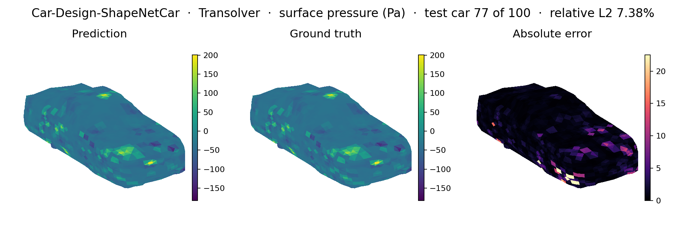
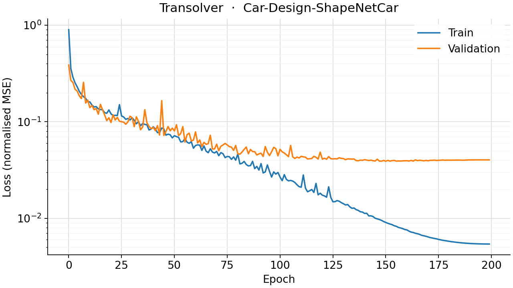
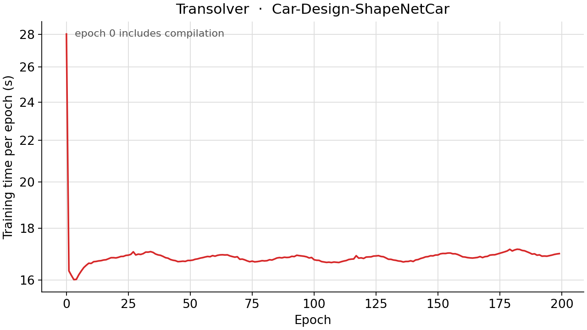

<!--
SPDX-FileCopyrightText: 2026 ZenteiQ AiTech Innovations Pvt. Ltd.
License notice: Documentation text and diagrams on this page are licensed
under CC BY 4.0. Source-code examples are licensed under LGPL-3.0-only
unless the example states otherwise.
-->

# Tutorial: ShapeNetCar (Car Aerodynamics) with Transolver

In this tutorial you train a [Transolver](../../theory_guide/operator_learning.md#transolver) on
**ShapeNetCar [[2]](#ref2)**: given the 3D point cloud of a car, predict the
steady velocity around it and the pressure on its surface. Every car is a
different mesh, so the data is a set of irregular point clouds, not a grid.
The whole tutorial is one script,
[`scripts/tutorials/shapenetcar_transolver.py`](../../../scripts/tutorials/shapenetcar_transolver.py). It uses only the public ScireX
API ([`scirex.data.load_shapenet_car`](../../api/data.md#scirex.data.load_shapenet_car), [`scirex.models.Transolver`](../../api/models.md#scirex.models.Transolver),
[`scirex.utils.count_model_params`](../../api/utils.md#scirex.utils.count_model_params)) and plain JAX and optax for the training
loop. The code on this page is copied from that script.

## Summary

| | |
|---|---|
| Problem | Steady, incompressible external flow around a car: point cloud in, velocity and surface pressure out |
| Model | Transolver, [`scirex.models.Transolver`](../../api/models.md#scirex.models.Transolver). Paper size: `n_hidden=256, n_layers=8, n_head=8, mlp_ratio=2, slice_num=32`, 3,860,804 parameters. Smoke size: `n_hidden=32, n_layers=2, n_head=4, mlp_ratio=2, slice_num=8`, 18,332 parameters |
| Data | [Car-Design-ShapeNetCar](../../dataset_guide/shapenetcar.md) (`mlcfd_data.zip`, about 2 GB zipped), 9 folds, about 889 cars. Fold 0: 789 train / 100 validation. Smoke: 4 train / 2 validation |
| Metric | Relative L2 error on the validation fold: velocity over all points (`rel_l2_volume`) and pressure over the surface points (`rel_l2_surface`) |
| Full-run values | `rel_l2_volume` 0.0223 and `rel_l2_surface` 0.0767. Paper ([[1]](#ref1)): 0.0207 and 0.0745 |

## Setup

The setup is the same as in the [GINO tutorial](../Others/ShapeNetCar_GINO.md#setup).

### Data

For the smoke run you do not need to copy anything. The loader holds out the
fold `fold_id` (default 0, the folder `param0`) as validation and trains on all
other folds, and it only lists the folders that exist. A directory that has a
small `param0` and a small `param1` is therefore a valid small dataset.
`build_subset` below makes one from symlinks to the first complete cars of the
real `param0` and `param1`.

## The problem

The problem, the data and the metric are the same as in the [GINO tutorial](../Others/ShapeNetCar_GINO.md#the-problem).

**Transolver in one paragraph.** Attention over all $N$ points would cost
$O(N^2)$. Transolver instead softly assigns the points to a small number of
learned slices (`slice_num`), lets the slices attend to each other, and sends
the result back to every point. The cost grows linearly with $N$, and the same
network runs on grids, meshes and point clouds. The
[theory guide](../../theory_guide/operator_learning.md#transolver) has the details.

## Step-by-step walkthrough

The explanations of the steps that are the same for every model are in the [GINO tutorial](../Others/ShapeNetCar_GINO.md#step-by-step-walkthrough). This page keeps the code and the text that is specific to the model.

### 1. Setup

Imports, the seed, the training settings and the two model sizes. `PROTOCOL`
holds the training settings of the Transolver paper for this benchmark (the same
values as in [`scripts/benchmarks/shapenetcar/_config.py`](../../../scripts/benchmarks/shapenetcar/_config.py)): 200 epochs, Adam with
a peak learning rate of 1e-3, a one-cycle schedule (`pct_start` 0.3,
`div_factor` 25, `final_div_factor` 1000) and a pressure weight of 0.5.
`SIZES["full"]` is the paper-size model; `SIZES["smoke"]` is small enough for
a CPU.

<!-- tutorial-snippet -->
```python
from __future__ import annotations

import argparse
import os
import platform
from pathlib import Path
from time import perf_counter

import flax
import jax
import jax.numpy as jnp
import matplotlib
import matplotlib.pyplot as plt
import numpy as np
import optax

import scirex
from scirex.data import load_shapenet_car
from scirex.models import Transolver
from scirex.utils import count_model_params

matplotlib.use("Agg")  # write figures to files, no display needed
# Keep float32, also if float64 was enabled earlier in the process.
jax.config.update("jax_enable_x64", False)
```

<!-- tutorial-snippet -->
```python
SEED = 0

# Training settings of the Transolver paper's protocol for this benchmark,
# the same values as PROTOCOL in scripts/benchmarks/shapenetcar/_config.py.
PROTOCOL = dict(
    n_epochs=200,
    learning_rate=1e-3,
    press_weight=0.5,
    pct_start=0.3,
    div_factor=25.0,
    final_div_factor=1000.0,
)

# Model sizes. "full" is the paper's size (3,860,804 parameters). "smoke" is a
# tiny model that trains on a CPU.
SIZES = dict(
    full=dict(n_hidden=256, n_layers=8, n_head=8, mlp_ratio=2, slice_num=32),
    smoke=dict(n_hidden=32, n_layers=2, n_head=4, mlp_ratio=2, slice_num=8),
)
```

<!-- tutorial-snippet -->
```python
def print_environment(seed: int) -> None:
    """Print the versions, the devices and the seed, so a run can be repeated."""
    print(f"python {platform.python_version()} | numpy {np.__version__}")
    print(f"scirex {scirex.__version__}")
    print(
        f"jax {jax.__version__} | flax {flax.__version__} | optax {optax.__version__}"
    )
    print(f"devices: {jax.devices()}")
    print(f"SEED = {seed}")
```

### 2. Get a small data directory

<!-- tutorial-snippet -->
```python
def build_subset(src_dir: Path, dst_dir: Path, n_train: int, n_val: int) -> dict:
    """Symlink ``n_val`` cars into ``dst_dir/param0``, ``n_train`` into ``param1``."""
    src_dir, dst_dir = Path(src_dir), Path(dst_dir)
    picked = {}
    for fold, count in (("param0", n_val), ("param1", n_train)):
        out = dst_dir / fold
        out.mkdir(parents=True, exist_ok=True)
        cars = [
            d
            for d in sorted((src_dir / fold).iterdir())
            if (d / "quadpress_smpl.vtk").exists() and (d / "hexvelo_smpl.vtk").exists()
        ]
        if len(cars) < count:
            raise ValueError(f"{src_dir / fold} has only {len(cars)} complete cars")
        picked[fold] = [d.name for d in cars[:count]]
        for old in out.iterdir():  # drop links left by an earlier, different subset
            if old.is_symlink() and old.name not in picked[fold]:
                old.unlink()
        for d in cars[:count]:
            link = out / d.name
            if not link.is_symlink() and not link.exists():
                link.symlink_to(d.resolve(), target_is_directory=True)
    return picked
```

### 3. Load the data

[`load_shapenet_car`](../../api/data.md#scirex.data.load_shapenet_car) returns a dict with `train` and `val` (lists of cars),
`coef_norm` and `model_kwargs`. `coef_norm` is the tuple
`(mean_in, std_in, mean_out, std_out)` of the training cars, already applied to
the inputs and targets, and you need it to go back to physical units. Each car
is a dict with `x` of shape `(N, 7)`, `y` of shape `(N, 4)`, `pos` of shape
`(N, 3)` and `surf`, a boolean mask that is true on the car surface. The cars
are not stacked into one array, because the loader does not assume that all
cars have the same number of points. The first read of a car parses the VTK
files and computes the signed distance and the normals; the result is cached
in `cache_dir`.

<!-- tutorial-snippet -->
```python
def load_data(data_dir: Path, cache_dir: Path | None, fold_id: int = 0) -> dict:
    """Load one train/validation split and print what was read."""
    data = load_shapenet_car(data_dir, fold_id=fold_id, cache_dir=cache_dir)
    n_points = [len(s["x"]) for s in data["train"] + data["val"]]
    print(
        f"cars: {len(data['train'])} train / {len(data['val'])} val | "
        f"points per car: min {min(n_points)}, max {max(n_points)}"
    )
    print(f"model_kwargs = {data['model_kwargs']}")
    return data
```

### 4. Build the model

[`Transolver`](../../api/models.md#scirex.models.Transolver) is a Flax module: the parameters are a separate pytree, created
by `init` and used by `apply`. We pass `fx=None` because the only input is the
7 point features. [`count_model_params`](../../api/utils.md#scirex.utils.count_model_params) is the public parameter counter.

<!-- tutorial-snippet -->
```python
def build_model(model_kwargs: dict, size: dict, sample: dict, seed: int):
    """Build the Transolver, initialise it on one car and print the parameter count."""
    model = Transolver(**model_kwargs, **size)
    x0 = jnp.asarray(sample["x"])[None, :, :]
    params = model.init(jax.random.PRNGKey(seed), x=x0, fx=None)
    print(f"Transolver {size} | parameters: {count_model_params(params):,}")
    return model, params
```

### 5. Loss

<!-- tutorial-snippet -->
```python
def make_loss(model, press_weight: float):
    """Return ``loss_fn(params, x, y, surf) -> (total, (loss_press, loss_velo))``."""

    def loss_fn(params, x, y, surf):
        out = model.apply(params, x=x, fx=None)[0]
        surf_f = surf.astype(out.dtype)
        n_surf = jnp.maximum(1.0, surf_f.sum())
        loss_press = jnp.sum(surf_f * (out[:, -1] - y[:, -1]) ** 2) / n_surf
        loss_velo = jnp.mean((out[:, :-1] - y[:, :-1]) ** 2)
        total = loss_velo + press_weight * loss_press
        return total, (loss_press, loss_velo)

    return loss_fn
```

### 6. Train

One gradient step per car (batch size 1), in a new random order every epoch,
as in the reference implementation. `jax.grad(..., has_aux=True)` gives the
gradient and the two loss parts, and `optax.cosine_onecycle_schedule` raises the
learning rate over the first 30% of the steps and then lowers it. After each
epoch the validation cars are scored with the same loss. JAX compiles the step on
its first call (and again for any new number of points), so the first epoch is
slower than the others.

<!-- tutorial-snippet -->
```python
def train(model, params, train_samples, val_samples, epochs, seed, protocol=PROTOCOL):
    """Train for ``epochs`` epochs. Return the final parameters and the history."""
    total_steps = (len(train_samples) + 1) * epochs
    schedule = optax.cosine_onecycle_schedule(
        transition_steps=total_steps,
        peak_value=protocol["learning_rate"],
        pct_start=protocol["pct_start"],
        div_factor=protocol["div_factor"],
        final_div_factor=protocol["final_div_factor"],
    )
    tx = optax.adam(learning_rate=schedule)
    opt_state = tx.init(params)
    press_weight = protocol["press_weight"]
    loss_fn = make_loss(model, press_weight)

    @jax.jit
    def train_step(params, opt_state, x, y, surf):
        grads, aux = jax.grad(loss_fn, has_aux=True)(params, x, y, surf)
        updates, opt_state = tx.update(grads, opt_state, params)
        return optax.apply_updates(params, updates), opt_state, aux

    @jax.jit
    def eval_step(params, x, y, surf):
        return loss_fn(params, x, y, surf)[1]

    def as_arrays(s):
        return jnp.asarray(s["x"])[None], jnp.asarray(s["y"]), jnp.asarray(s["surf"])

    rng = np.random.default_rng(seed)
    history = []
    for epoch in range(epochs):
        t0 = perf_counter()
        press, velo = [], []
        for i in rng.permutation(len(train_samples)):
            params, opt_state, (p, v) = train_step(
                params, opt_state, *as_arrays(train_samples[i])
            )
            press.append(p)
            velo.append(v)
        train_press = float(jnp.mean(jnp.stack(press)))
        train_velo = float(jnp.mean(jnp.stack(velo)))
        secs = perf_counter() - t0

        val = [eval_step(params, *as_arrays(s)) for s in val_samples]
        val_press = float(jnp.mean(jnp.stack([p for p, _ in val])))
        val_velo = float(jnp.mean(jnp.stack([v for _, v in val])))
        history.append(
            dict(
                epoch=epoch,
                train_loss=train_velo + press_weight * train_press,
                val_loss=val_velo + press_weight * val_press,
                secs=secs,
            )
        )
        print(
            f"epoch {epoch}: train_loss={history[-1]['train_loss']:.5f} "
            f"val_loss={history[-1]['val_loss']:.5f} epoch_time={secs:.1f}s"
        )
    return params, history
```

### 7. Evaluate

<!-- tutorial-snippet -->
```python
def rel_l2(pred: np.ndarray, truth: np.ndarray, eps: float = 1e-8) -> float:
    """Relative L2 error ``||pred - truth|| / (||truth|| + eps)``."""
    return float(np.linalg.norm(pred - truth) / (np.linalg.norm(truth) + eps))
```

<!-- tutorial-snippet -->
```python
def evaluate(model, params, samples, coef_norm) -> dict:
    """Mean relative L2 error of the velocity (all points) and surface pressure."""
    _, _, mean_out, std_out = coef_norm
    predict = jax.jit(lambda p, x: model.apply(p, x=x, fx=None)[0])
    volume, surface, predictions = [], [], []
    for s in samples:
        out = np.asarray(predict(params, jnp.asarray(s["x"])[None]))
        out_denorm = out * std_out + mean_out
        y_denorm = s["y"] * std_out + mean_out
        surf = s["surf"]
        volume.append(rel_l2(out_denorm[:, :-1], y_denorm[:, :-1]))
        surface.append(rel_l2(out_denorm[surf, -1], y_denorm[surf, -1]))
        predictions.append(out_denorm)
    return dict(
        rel_l2_volume=float(np.mean(volume)),
        rel_l2_surface=float(np.mean(surface)),
        predictions=predictions,
    )
```

### 8. Plot

<!-- tutorial-snippet -->
```python
def plot_surface_pressure(sample, pred_denorm, coef_norm, path: Path) -> None:
    """Save input, true pressure, predicted pressure and absolute error."""
    mean_in, std_in, mean_out, std_out = coef_norm
    surf = sample["surf"]
    pos = sample["pos"][surf]
    normal_y = (sample["x"][surf, 5] * std_in[5] + mean_in[5]).astype(float)
    truth = (sample["y"][surf, -1] * std_out[-1] + mean_out[-1]).astype(float)
    pred = pred_denorm[surf, -1]
    panels = [
        ("Input: surface normal y", normal_y, "coolwarm", None),
        ("Truth: pressure", truth, "jet", (truth.min(), truth.max())),
        ("Prediction: pressure", pred, "jet", (truth.min(), truth.max())),
        ("Absolute error", np.abs(pred - truth), "magma", None),
    ]
    fig = plt.figure(figsize=(18, 4.5))
    for k, (title, values, cmap, lim) in enumerate(panels, start=1):
        ax = fig.add_subplot(1, 4, k, projection="3d")
        vmin, vmax = lim if lim else (None, None)
        sc = ax.scatter(
            pos[:, 0],
            pos[:, 2],
            pos[:, 1],
            c=values,
            s=3,
            cmap=cmap,
            vmin=vmin,
            vmax=vmax,
        )
        ax.set_title(title)
        ax.set_axis_off()
        ax.view_init(elev=20, azim=-60)
        ax.set_box_aspect(np.ptp(pos[:, [0, 2, 1]], axis=0))
        fig.colorbar(sc, ax=ax, shrink=0.6)
    fig.suptitle("Car-Design-ShapeNetCar, one validation car")
    fig.savefig(path, dpi=120, bbox_inches="tight")
    plt.close(fig)
```

<!-- tutorial-snippet -->
```python
def plot_loss(history: list[dict], path: Path) -> None:
    """Save the training and validation loss per epoch."""
    epochs = [h["epoch"] for h in history]
    fig, ax = plt.subplots(figsize=(6, 4))
    ax.plot(epochs, [h["train_loss"] for h in history], marker="o", label="train")
    ax.plot(epochs, [h["val_loss"] for h in history], marker="o", label="validation")
    ax.set_xlabel("epoch")
    ax.set_ylabel("loss (velocity MSE + 0.5 x pressure MSE)")
    ax.set_yscale("log")
    ax.legend()
    ax.grid(True, alpha=0.3)
    fig.savefig(path, dpi=120, bbox_inches="tight")
    plt.close(fig)
```

The complete script is [`scripts/tutorials/shapenetcar_transolver.py`](../../../scripts/tutorials/shapenetcar_transolver.py).

## Run it

Smoke run (CPU, a few seconds, no GPU needed):

```bash
CUDA_VISIBLE_DEVICES= JAX_PLATFORMS=cpu python scripts/tutorials/shapenetcar_transolver.py --data-dir ~/data/mlcfd_data/training_data --smoke
```

Full protocol (fold 0, paper-size model, 200 epochs; use a GPU):

```bash
python scripts/tutorials/shapenetcar_transolver.py --data-dir ~/data/mlcfd_data/training_data
```

The other flags are `--epochs`, `--seed`, `--out-dir` (default
`outputs/shapenetcar_tutorial`), `--cache-dir` (default `<out-dir>/cache`) and,
for the smoke subset, `--n-train` and `--n-val`.

This is the output of the smoke run on a CPU (smoke run, CPU, 4 train / 2
validation cars, not a benchmark number). The wall time was 5.7 s, measured
with `time`, with an empty cache:

```text
python 3.10.20 | numpy 1.26.4
scirex 1.0.0rc1
jax 0.6.2 | flax 0.10.7 | optax 0.2.8
devices: [CpuDevice(id=0)]
SEED = 0
cars: 4 train / 2 val | points per car: min 32186, max 32186
model_kwargs = {'space_dim': 7, 'fun_dim': 0, 'out_dim': 4, 'unified_pos': False, 'geometry': 'irregular'}
data loading: 1.0s
Transolver {'n_hidden': 32, 'n_layers': 2, 'n_head': 4, 'mlp_ratio': 2, 'slice_num': 8} | parameters: 18,332
epoch 0: train_loss=4.88828 val_loss=3.41642 epoch_time=1.0s
epoch 1: train_loss=3.82056 val_loss=3.18786 epoch_time=0.3s
rel_l2_volume (velocity)  = 0.4604
rel_l2_surface (pressure) = 0.7584
figures in outputs/shapenetcar_tutorial | total time 5.0s
```

## Results

### Full run

The next figures were not made by this script. They come from the benchmark
runner (`train.py` and `infer.py`) and are the committed results of the **full
200-epoch run** on fold 0 (789 training and 100 validation cars, paper-size
model, one NVIDIA RTX PRO 6000 Blackwell). `infer.py` draws the surface pressure
of one validation car on the real quad mesh (the figure title names it): prediction, ground truth and
absolute error.



Training and validation loss per epoch of the same run:



Seconds per epoch of the same run (the first epoch includes compilation; in
`metrics.json`, epoch 0 took 28.0 s and epoch 199 took 17.0 s):



| Metric (validation fold 0, full 200-epoch run) | This repository | Paper ([[1]](#ref1)) |
|---|---|---|
| `rel_l2_volume` (velocity) | 0.0223 | 0.0207 |
| `rel_l2_surface` (pressure) | 0.0767 | 0.0745 |
| `c_d_mean_relative_drag_error` | 0.0106 | 0.0103 |
| `rho_d_spearman_drag_correlation` | 0.9928 | 0.9935 |

The two drag-coefficient rows come from `infer.py`; this tutorial does not
compute them.

## Troubleshooting

- **`ImportError: ... requires 'vtk' ... Install the 'benchmark' extra`.** The
  loader needs `vtk`. Run `pip install -e ".[benchmark]"`.
- **`ValueError: data_dir=... produced 0 train or 0 val samples`.** The folder
  does not contain `param0` to `param8` with car folders inside, or the
  `param*.tar.gz` files were not unpacked. Point `--data-dir` at
  `mlcfd_data/training_data`.
- **`load_shapenet_car: skipped N incomplete ... sample(s)`.** A few car folders
  in the download have no `.vtk` files. The loader skips them. This is expected
  unless N is a large part of a fold.

## Next steps

- Compare with the other architectures on the same data:
  [GINO](../../benchmarks/shapenetcar/results/comparative.md#gino), the
  experimental [GIWO](../../benchmarks/experimental/shapenetcar_giwo.md) and the
  [comparison page](../../benchmarks/shapenetcar/results/comparative.md).
- Read the [ShapeNetCar results](../../benchmarks/shapenetcar/results/comparative.md#transolver)
  for the checkpoint format, the drag-coefficient metrics and the compute cost,
  and the [problem card](../../benchmarks/shapenetcar/README.md) for the settings of the run.
- Learn how Transolver works in the [theory guide](../../theory_guide/operator_learning.md#transolver)
  and see its arguments in the [API reference](../../api/models.md).
- See the [quickstart](../../user_guide/quickstart.md) for the
  grid-based workflow (FNO on Darcy flow) and the
  [training guide](../../user_guide/training.md) for the [`Trainer`](../../api/experimental.md#scirex.experimental.training.Trainer).
- Try the same Transolver on another point-cloud problem:
  [Car-CFD](../../benchmarks/car_cfd/README.md).

## References

1. <span id="ref1"></span>Wu et al., *Transolver: A Fast Transformer Solver for PDEs on General Geometries*, ICML 2024. <https://arxiv.org/abs/2402.02366>

2. <span id="ref2"></span>Umetani and Bickel, *Learning Three-Dimensional Flow for Interactive Aerodynamic Design*, ACM Transactions on Graphics 37(4), 2018. <https://doi.org/10.1145/3197517.3201325>
