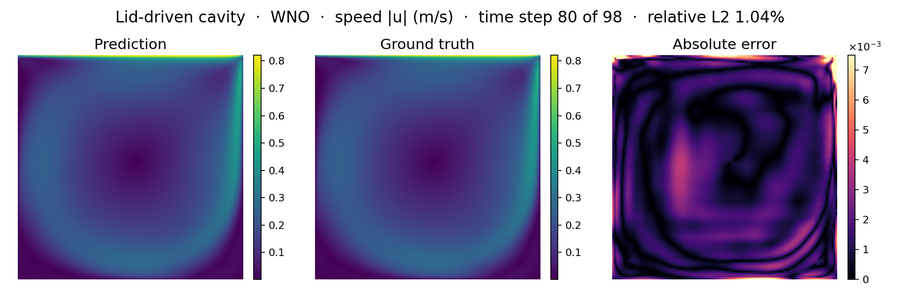
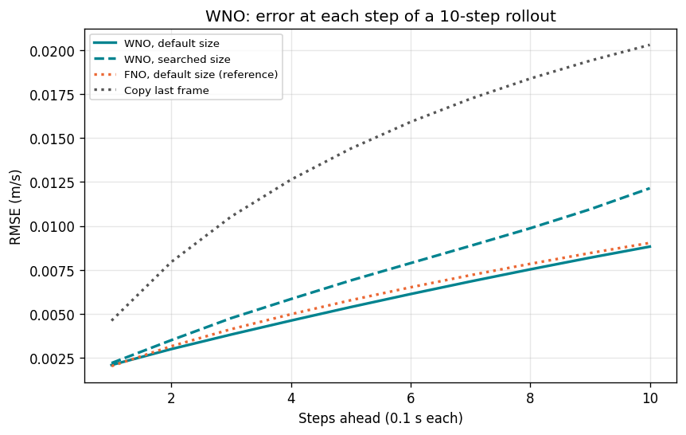
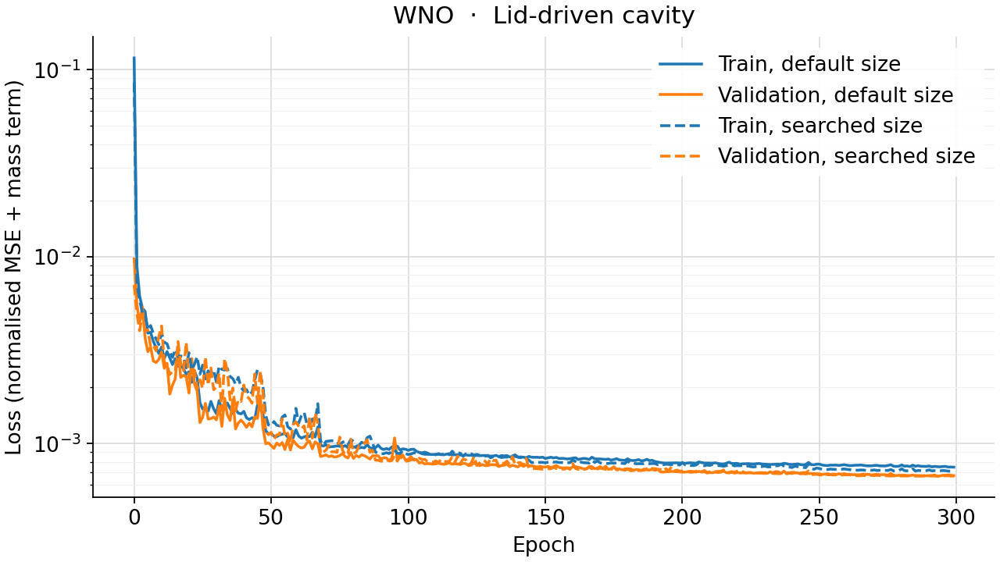
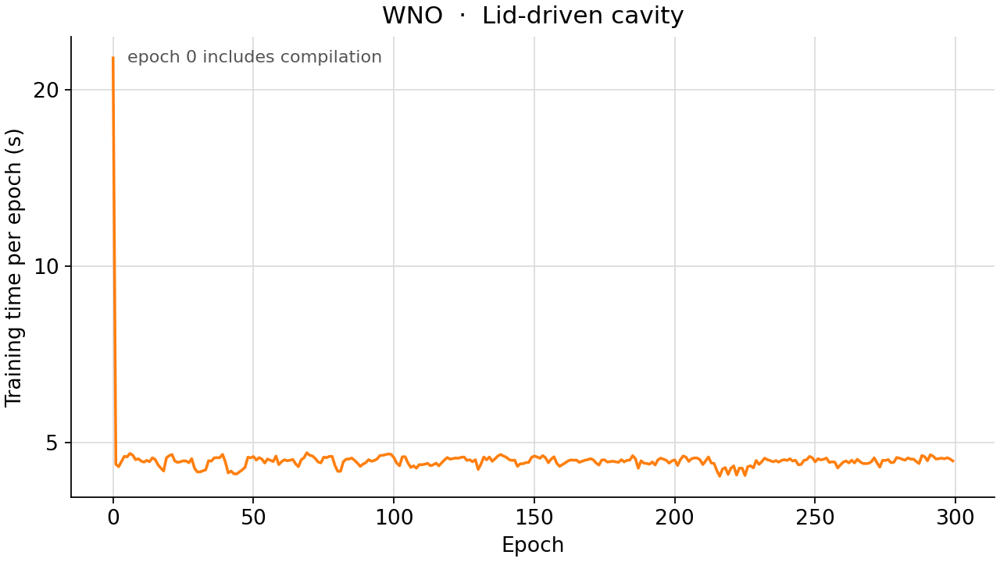

<!--
SPDX-FileCopyrightText: 2026 ZenteiQ AiTech Innovations Pvt. Ltd.
License notice: Documentation text and diagrams on this page are licensed
under CC BY 4.0. Source-code examples are licensed under LGPL-3.0-only
unless the example states otherwise.
-->

# Tutorial: Lid-Driven Cavity (Turbulent) with WNO

In this tutorial you forecast a **transient, turbulent lid-driven cavity**: a
0.1 m square box of fluid at rest, set in motion by its lid. Given the pressure
and velocity on a 128 × 128 cell grid at three consecutive times, 0.1 s apart,
the model predicts the next frame. It is trained on eight lid speeds and
tested on one it never saw, Re 10,000, as in [[1]](#ref1). The
model is a [Wavelet Neural Operator](../../theory_guide/operator_learning.md#wno) (WNO [[2]](#ref2)), [`scirex.models.WNO`](../../api/models.md#scirex.models.WNO), which is not in the paper: it takes the FNO's place with the same window, folded the same way, but works in a wavelet basis that is local in space as well as in scale. The whole tutorial is one script,
[`scripts/tutorials/cavity_wno.py`](../../../scripts/tutorials/cavity_wno.py). It uses only the public ScireX API
([`scirex.models.WNO`](../../api/models.md#scirex.models.WNO), [`scirex.data.UnitGaussianNormalizer`](../../api/data.md#scirex.data.UnitGaussianNormalizer), [`scirex.losses.FiniteDiff`](../../api/losses.md#scirex.losses.FiniteDiff), [`scirex.utils.count_model_params`](../../api/utils.md#scirex.utils.count_model_params)) and plain NumPy, JAX and optax. The code on this page is copied
from that script.

## Summary

| | |
|---|---|
| Problem | Transient, turbulent (RANS k-epsilon) flow in a 0.1 m lid-driven cavity: 3 past frames of (p, Ux, Uy) in, the next frame out |
| Model | WNO, [`scirex.models.WNO`](../../api/models.md#scirex.models.WNO) in a window adapter. Benchmark size (`wno_3to1`): `hidden_channels=21, n_layers=3, level=5`, wavelet `db6`, 1,042,073 parameters. Smoke size: `hidden_channels=8, n_layers=1, level=4`, wavelet `db6`, 84,651 parameters |
| Data | [[1]](#ref1), OpenFOAM `pisoFoam`, 128 × 128 cells, first 10 s at 0.1 s (101 frames per case). Train: Re 1,000, 2,000, 4,000, 6,000, 14,000, 16,000, 18,000, 20,000 (706 training and 78 validation windows). Test: Re 10,000 (98 windows). Smoke: 64 training and 16 validation windows, the full test case |
| Optimiser | Adam, learning rate 1e-3, halved after 10 epochs without a lower validation loss, early stop after 50, at most 300 epochs, batch size 8; the epoch with the lowest validation loss is kept |
| Metric | RMSE over p, Ux and Uy together on the Re 10,000 case, one step ahead and over 10 steps fed back, as in the paper. The unit of p is not confirmed. |
| Full-run values | One step 2.04e-3, 10 steps 6.04e-3. Copy last frame: 4.40e-3 and 1.50e-2 |

## Setup

The setup is the same as in the [FNO tutorial](../Others/Cavity_FNO.md#setup).

## The problem

The problem, the data and the metric are the same as in the [FNO tutorial](../Others/Cavity_FNO.md#the-problem).

**WNO in one paragraph.** A WNO layer takes a `level`-deep discrete wavelet transform of the hidden channels, learns a weight for every coefficient of the coarsest approximation band and its detail bands, and transforms back. A Fourier mode is global, so an FNO's weights cannot single out a place; a wavelet coefficient is local in space and in scale, so a WNO can treat the lid corner differently from the bottom wall. A deeper `level` leaves a smaller approximation band and fewer weights, as fewer Fourier modes do. The [theory guide](../../theory_guide/operator_learning.md#wno) has the details.

## Step-by-step walkthrough

The explanations of the steps that are the same for every model are in the [FNO tutorial](../Others/Cavity_FNO.md#step-by-step-walkthrough). This page keeps the code and the text that is specific to the model.

### 1. Setup

Imports, the seed, the split, the training settings and the two model sizes.
`PROTOCOL` holds the benchmark's settings (the same values as in
[`scripts/benchmarks/cavity/_config.py`](../../../scripts/benchmarks/cavity/_config.py), the paper's Sections 2.2 to 2.4).
`SIZES["full"]` is the benchmark's `wno_3to1`; `SIZES["smoke"]` is small
enough for a CPU.

<!-- tutorial-snippet -->
```python
from __future__ import annotations

import argparse
import os
import platform
from pathlib import Path
from time import perf_counter

import flax
import flax.linen as nn
import jax
import jax.numpy as jnp
import matplotlib
import matplotlib.pyplot as plt
import numpy as np
import optax

import scirex
from scirex.data import UnitGaussianNormalizer
from scirex.losses import FiniteDiff
from scirex.models import WNO
from scirex.utils import count_model_params

matplotlib.use("Agg")  # write figures to files, no display needed
# Keep float32, also if float64 was enabled earlier in the process.
jax.config.update("jax_enable_x64", False)
```

<!-- tutorial-snippet -->
```python
SEED = 0

# The paper's split (Costa Rocha et al. 2023, Sec. 2.2): eight lid speeds to
# train on, Re 10,000 to test on, Re 8,000 and 12,000 left out. A case "NNk"
# has Re NN,000 and a lid speed of NN / 10 m/s.
TRAIN_CASES = ("01k", "02k", "04k", "06k", "14k", "16k", "18k", "20k")
TEST_CASE = "10k"
N_STEPS = 101  # frames 0..100: the first 10 s, one frame every 0.1 s
DT = 0.1  # s
DOMAIN_SIZE = 0.1  # m
N_CELL = 128  # cells per side; the export samples the 129 x 129 corners
DX = DOMAIN_SIZE / N_CELL
FIELDS = ("p", "Ux", "Uy")
HORIZON = 10  # rollout length: 1 s

# Training settings of the benchmark, the same values as PROTOCOL in
# scripts/benchmarks/cavity/_config.py (the paper's Sections 2.2 to 2.4).
PROTOCOL = dict(
    n_in=3,
    n_out=1,
    learning_rate=1e-3,
    lr_factor=0.5,  # halve the learning rate ...
    lr_patience=10,  # ... after 10 epochs without a lower validation loss
    early_stop_patience=50,
    epochs=300,
    batch_size=8,
    mc_weight=0.1,  # weight of the mass-conservation term
    val_frac=0.1,
)

# Model sizes. "full" is the benchmark's wno_3to1 (1,042,073 parameters, 1.4 %
# below the FNO's 1,056,739, the closest a WNO gets). "smoke" is a tiny WNO
# that trains on a CPU.
SIZES = dict(
    full=dict(hidden_channels=21, n_layers=3, level=5),
    smoke=dict(hidden_channels=8, n_layers=1, level=4),
)
```

<!-- tutorial-snippet -->
```python
def print_environment(seed: int) -> None:
    """Print the versions, the devices and the seed, so a run can be repeated."""
    print(f"python {platform.python_version()} | numpy {np.__version__}")
    print(f"scirex {scirex.__version__}")
    print(
        f"jax {jax.__version__} | flax {flax.__version__} | optax {optax.__version__}"
    )
    print(f"devices: {jax.devices()}")
    print(f"SEED = {seed}")
```

### 2. From the CSV export to cell grids

<!-- tutorial-snippet -->
```python
def read_snapshot(path: Path) -> tuple[np.ndarray, np.ndarray]:
    """``(x, y)`` of the 129 x 129 corners on ``z = 0`` and their ``(p, Ux, Uy)``."""
    with open(path) as f:
        header = [h.strip().strip('"') for h in f.readline().split(",")]
    cols = [
        header.index(c) for c in ("p", "U:0", "U:1", "Points:0", "Points:1", "Points:2")
    ]
    table = np.loadtxt(path, delimiter=",", skiprows=1, usecols=cols, dtype=np.float32)
    table = table[np.isclose(table[:, 5], 0.0, rtol=0, atol=1e-6)]
    return table[:, 3:5], table[:, 0:3]
```

<!-- tutorial-snippet -->
```python
def corners_to_cells(pos: np.ndarray, fields: np.ndarray) -> np.ndarray:
    """Corner values ``(N, 3)`` -> cell values ``(128, 128, 3)``, rows along y."""
    ix = np.round(pos[:, 0] / DX).astype(np.int64)
    iy = np.round(pos[:, 1] / DX).astype(np.int64)
    corners = np.zeros((N_CELL + 1, N_CELL + 1, fields.shape[1]), np.float32)
    corners[iy, ix] = fields
    return 0.25 * (
        corners[:-1, :-1] + corners[1:, :-1] + corners[:-1, 1:] + corners[1:, 1:]
    )
```

<!-- tutorial-snippet -->
```python
def prepare_case(raw_dir: Path, case: str, cache_dir: Path) -> Path:
    """Write ``<cache_dir>/<case>.npz`` with ``grid`` ``(101, 128, 128, 3)`` once."""
    out = Path(cache_dir) / f"{case}.npz"
    if out.exists():
        return out
    frames = []
    for step in range(N_STEPS):
        pos, fields = read_snapshot(Path(raw_dir) / case / f"Data{case}0.{step}.csv")
        frames.append(corners_to_cells(pos, fields))
    out.parent.mkdir(parents=True, exist_ok=True)
    u_lid = np.float32(int(case[:2]) / 10.0)
    np.savez_compressed(
        out,
        grid=np.stack(frames),
        steps=np.arange(N_STEPS, dtype=np.int32),
        u_lid=u_lid,
    )
    return out
```

<!-- tutorial-snippet -->
```python
def load_case(cache_dir: Path, case: str) -> np.ndarray:
    """The ``(101, 128, 128, 3)`` frames of one case, in physical units."""
    with np.load(Path(cache_dir) / f"{case}.npz") as npz:
        return npz["grid"]
```

### 3. Windows and the split

<!-- tutorial-snippet -->
```python
def make_windows(grid: np.ndarray, n_in: int, n_out: int):
    """``(T, H, W, C)`` -> inputs ``(n, n_in, ...)`` and targets ``(n, n_out, ...)``."""
    n = grid.shape[0] - n_in - n_out + 1
    xs = np.stack([grid[i : i + n_in] for i in range(n)])
    ys = np.stack([grid[i + n_in : i + n_in + n_out] for i in range(n)])
    return xs, ys
```

<!-- tutorial-snippet -->
```python
def build_split(cache_dir: Path, protocol: dict, seed: int, n_train=None, n_val=None):
    """Normalised train and validation windows of the training cases."""
    pairs = [make_windows(load_case(cache_dir, c), protocol["n_in"], protocol["n_out"])
             for c in TRAIN_CASES]  # fmt: skip
    x = np.concatenate([p[0] for p in pairs])
    y = np.concatenate([p[1] for p in pairs])
    perm = np.random.default_rng(seed).permutation(len(x))
    n_val_all = max(1, round(protocol["val_frac"] * len(x)))
    val_idx, train_idx = perm[:n_val_all][:n_val], perm[n_val_all:][:n_train]
    norm = UnitGaussianNormalizer.create(axis=(0, 1, 2, 3)).fit(
        jnp.asarray(x[train_idx])
    )

    def enc(a):
        return np.asarray(norm.transform(jnp.asarray(a)), np.float32)

    print(
        f"windows: {len(train_idx)} train / {len(val_idx)} val "
        f"(of {len(x) - n_val_all} / {n_val_all}) from {len(TRAIN_CASES)} cases"
    )
    return dict(
        x_train=enc(x[train_idx]),
        y_train=enc(y[train_idx]),
        x_val=enc(x[val_idx]),
        y_val=enc(y[val_idx]),
        normalizer=norm,
    )
```

### 4. Build the model

[`WNO`](../../api/models.md#scirex.models.WNO) is channels-last, so the window is folded into 9 channels at every cell, exactly as for the FNO, and the WNO appends the cell coordinates itself. `size` is the 128 × 128 training grid, which the wavelet transform needs ahead of time to shape its subband weights. `compute_dtype=float32` replaces the model's bfloat16 default, as in the benchmark (measured there both faster and more accurate on this problem). All weights are real, so plain Adam is the right optimiser.

<!-- tutorial-snippet -->
```python
class WindowWNO(nn.Module):
    """``(B, n_in, H, W, 3)`` -> ``(B, n_out, H, W, 3)`` with the WNO."""

    n_out: int
    hidden_channels: int = 21
    n_layers: int = 3
    level: int = 5
    wavelet: str = "db6"

    @nn.compact
    def __call__(self, x):
        batch, steps, height, width, channels = x.shape
        stacked = x.transpose(0, 2, 3, 1, 4).reshape(
            batch, height, width, steps * channels
        )
        y = WNO(
            in_channels=steps * channels,
            out_channels=self.n_out * channels,
            hidden_channels=self.hidden_channels,
            n_layers=self.n_layers,
            level=self.level,
            size=(height, width),
            wavelet=self.wavelet,
            compute_dtype=jnp.float32,
        )(stacked)  # (B, H, W, n_out * C)
        y = y.reshape(batch, height, width, self.n_out, channels)
        return y.transpose(0, 3, 1, 2, 4)
```

<!-- tutorial-snippet -->
```python
def build_model(size: dict, n_out: int, sample: np.ndarray, seed: int):
    """Build the WNO, initialise it on one window and print the parameter count."""
    model = WindowWNO(n_out=n_out, **size)
    params = model.init(jax.random.PRNGKey(seed), jnp.asarray(sample)[None])
    print(f"WNO {size} | parameters: {count_model_params(params):,}")
    return model, params
```

### 5. Loss

<!-- tutorial-snippet -->
```python
_DIFF = FiniteDiff()
```

<!-- tutorial-snippet -->
```python
def divergence(vel):
    """``d Ux / dx + d Uy / dy`` of ``(..., H, W, 2)`` velocities in m/s."""
    dudx = _DIFF.derivative(vel[..., 0], axis=-1, spacing=DX, periodic=False)
    dvdy = _DIFF.derivative(vel[..., 1], axis=-2, spacing=DX, periodic=False)
    return dudx + dvdy
```

<!-- tutorial-snippet -->
```python
def make_loss(model, normalizer, mc_weight: float):
    """Return ``loss_fn(params, x, y) -> (total, (mse, mass_conservation))``."""

    def loss_fn(params, x, y):
        pred = model.apply(params, x)
        mse = jnp.mean((pred - y) ** 2)
        vel = normalizer.inverse_transform(pred)[..., 1:3]
        mc = jnp.mean(jnp.abs(divergence(vel))) * DOMAIN_SIZE / 1.0
        return mse + mc_weight * mc, (mse, mc)

    return loss_fn
```

### 6. Train

<!-- tutorial-snippet -->
```python
def train(model, params, data, epochs, seed, protocol=PROTOCOL):
    """Train; return the best-validation parameters and the history."""
    tx = optax.inject_hyperparams(optax.adam)(learning_rate=protocol["learning_rate"])
    opt_state = tx.init(params)
    loss_fn = make_loss(model, data["normalizer"], protocol["mc_weight"])

    @jax.jit
    def train_step(params, opt_state, x, y):
        (loss, _), grads = jax.value_and_grad(loss_fn, has_aux=True)(params, x, y)
        updates, opt_state = tx.update(grads, opt_state, params)
        return optax.apply_updates(params, updates), opt_state, loss

    val_loss = jax.jit(lambda p, x, y: loss_fn(p, x, y)[0])
    bs, lr = protocol["batch_size"], protocol["learning_rate"]
    x_tr, y_tr = data["x_train"], data["y_train"]
    rng = np.random.default_rng(seed)
    best = dict(loss=np.inf, epoch=0, params=params)
    since_best = since_drop = 0
    history = []
    for epoch in range(1, epochs + 1):
        t0 = perf_counter()
        order = rng.permutation(len(x_tr))
        losses = []
        for i in range(0, len(x_tr), bs):
            idx = order[i : i + bs]
            params, opt_state, loss = train_step(
                params, opt_state, jnp.asarray(x_tr[idx]), jnp.asarray(y_tr[idx])
            )
            losses.append(float(loss))
        val = np.mean([
            float(val_loss(params, jnp.asarray(data["x_val"][i : i + bs]),
                           jnp.asarray(data["y_val"][i : i + bs])))
            for i in range(0, len(data["x_val"]), bs)
        ])  # fmt: skip
        if val < best["loss"] - 1e-9:
            best = dict(loss=val, epoch=epoch, params=params)
            since_best = since_drop = 0
        else:
            since_best += 1
            since_drop += 1
        if since_drop >= protocol["lr_patience"]:  # ReduceLROnPlateau
            lr *= protocol["lr_factor"]
            opt_state.hyperparams["learning_rate"] = jnp.asarray(lr, jnp.float32)
            since_drop = 0
        secs = perf_counter() - t0
        history.append(
            dict(epoch=epoch, train_loss=float(np.mean(losses)), val_loss=float(val),
                 lr=lr, secs=secs)
        )  # fmt: skip
        print(
            f"epoch {epoch}: train_loss={history[-1]['train_loss']:.4e} "
            f"val_loss={val:.4e} lr={lr:.1e} epoch_time={secs:.1f}s"
        )
        if since_best >= protocol["early_stop_patience"]:
            print(f"early stop at epoch {epoch}")
            break
    print(f"best validation loss {best['loss']:.4e} at epoch {best['epoch']}")
    return best["params"], history
```

### 7. Evaluate

<!-- tutorial-snippet -->
```python
def rmse(a: np.ndarray, b: np.ndarray) -> float:
    """Root mean square of ``a - b`` over every element."""
    return float(np.sqrt(np.mean((np.asarray(a) - np.asarray(b)) ** 2)))
```

<!-- tutorial-snippet -->
```python
def evaluate(model, params, grid, normalizer, n_in: int, horizon: int = HORIZON):
    """One-step and rollout RMSE on one case, for the model and the baseline."""
    apply = jax.jit(model.apply)

    def predict(window):  # physical (B, n_in, H, W, C) -> physical (B, 1, H, W, C)
        out = apply(params, normalizer.transform(jnp.asarray(window)))
        return np.asarray(normalizer.inverse_transform(out))[:, :1]

    x, y = make_windows(grid, n_in, 1)
    one_step = np.concatenate([predict(x[i : i + 8]) for i in range(0, len(x), 8)])
    starts = np.arange(grid.shape[0] - n_in - horizon + 1)
    window = np.stack([grid[s : s + n_in] for s in starts])
    produced = []
    for _ in range(horizon):
        nxt = np.concatenate(
            [predict(window[i : i + 8]) for i in range(0, len(window), 8)]
        )
        produced.append(nxt[:, 0])
        window = np.concatenate([window[:, 1:], nxt], axis=1)
    truth = np.stack([grid[s + n_in : s + n_in + horizon] for s in starts], axis=1)
    last = np.stack([grid[s + n_in - 1] for s in starts])
    return dict(
        rmse=rmse(one_step, y),
        per_field={f: rmse(one_step[..., k], y[..., k]) for k, f in enumerate(FIELDS)},
        mean_abs_div=float(
            np.mean(np.abs(divergence(jnp.asarray(one_step[..., 1:3]))))
        ),
        baseline_rmse=rmse(x[:, -1:], y),
        rollout_rmse=rmse(np.stack(produced), truth),
        rollout_per_step=[rmse(p, t) for p, t in zip(produced, truth)],
        baseline_rollout_per_step=[rmse(last, t) for t in truth],
        baseline_rollout_rmse=rmse(np.broadcast_to(last, truth.shape), truth),
        one_step=one_step,
    )
```

### 8. Plot

<!-- tutorial-snippet -->
```python
def plot_prediction(last_input, truth, pred, path: Path, title: str) -> None:
    """Save input, true speed, predicted speed and absolute error."""

    def speed(f):
        return np.hypot(f[..., 1], f[..., 2])

    vmax = float(speed(truth).max())
    panels = [
        ("Input: |u| of the last input frame", speed(last_input), "viridis", (0, vmax)),
        ("Truth: |u|", speed(truth), "viridis", (0, vmax)),
        ("Prediction: |u|", speed(pred), "viridis", (0, vmax)),
        ("Absolute error of |u|", np.abs(speed(pred) - speed(truth)), "magma", None),
    ]
    fig, axes = plt.subplots(1, 4, figsize=(17, 4.2), constrained_layout=True)
    extent = (0, DOMAIN_SIZE, 0, DOMAIN_SIZE)
    for ax, (name, values, cmap, lim) in zip(axes, panels):
        vmin, vmax_ = lim if lim else (None, None)
        im = ax.imshow(
            values, origin="lower", extent=extent, cmap=cmap, vmin=vmin, vmax=vmax_
        )
        ax.set_title(name)
        ax.set_xlabel("x (m)")
        ax.set_ylabel("y (m)")
        fig.colorbar(im, ax=ax, shrink=0.8, label="m/s")
    fig.suptitle(title)
    fig.savefig(path, dpi=120)
    plt.close(fig)
```

<!-- tutorial-snippet -->
```python
def plot_rollout(per_step: list[float], baseline: list[float], path: Path) -> None:
    """Save the rollout RMSE per step, model and copy-last-frame baseline."""
    steps = np.arange(1, len(per_step) + 1)
    fig, ax = plt.subplots(figsize=(6, 4))
    ax.plot(steps * DT, per_step, marker="o", label="model, fed its own predictions")
    ax.plot(steps * DT, baseline, marker="s", ls="--", label="copy last frame")
    ax.set_xlabel("time ahead (s)")
    ax.set_ylabel("RMSE over p, Ux, Uy")
    ax.legend()
    ax.grid(True, alpha=0.3)
    fig.savefig(path, dpi=120, bbox_inches="tight")
    plt.close(fig)
```

<!-- tutorial-snippet -->
```python
def plot_loss(history: list[dict], path: Path) -> None:
    """Save the training and validation loss per epoch."""
    epochs = [h["epoch"] for h in history]
    fig, ax = plt.subplots(figsize=(6, 4))
    ax.plot(epochs, [h["train_loss"] for h in history], marker="o", label="train")
    ax.plot(epochs, [h["val_loss"] for h in history], marker="o", label="validation")
    ax.set_xlabel("epoch")
    ax.set_ylabel("loss (MSE + 0.1 x mass conservation)")
    ax.set_yscale("log")
    ax.legend()
    ax.grid(True, alpha=0.3)
    fig.savefig(path, dpi=120, bbox_inches="tight")
    plt.close(fig)
```

The complete script is [`scripts/tutorials/cavity_wno.py`](../../../scripts/tutorials/cavity_wno.py).

## Run it

Smoke run (CPU, no GPU needed):

```bash
CUDA_VISIBLE_DEVICES= JAX_PLATFORMS=cpu python scripts/tutorials/cavity_wno.py --cache-dir ~/data/cavity_paper --smoke
```

Full protocol (all training windows, benchmark-size WNO, up to 300
epochs; use a GPU):

```bash
python scripts/tutorials/cavity_wno.py --cache-dir ~/data/cavity_paper
```

With the raw CSV export instead of the cache, add `--data-dir
~/data/Transient_k-e`. The other flags are `--cache-dir` (default
`$CAVITY_CACHE_DIR`, else `Dataset_cache/cavity_paper`), `--data-dir`,
`--epochs`, `--seed`, `--out-dir` (default `outputs/cavity_wno_tutorial`),
`--plot-step` and, for the smoke run, `--n-train` and `--n-val`.

This is the output of the smoke run on a CPU (smoke run, CPU, 64 training / 16
validation windows, not a benchmark number). The wall time was
46.0 s, measured with `time`; library deprecation warnings are left
out:

```text
python 3.12.3 | numpy 1.26.4
scirex 1.0.0rc1
jax 0.6.2 | flax 0.10.7 | optax 0.2.8
devices: [CpuDevice(id=0)]
SEED = 0
windows: 64 train / 16 val (of 706 / 78) from 8 cases
data loading: 1.0s
WNO {'hidden_channels': 8, 'n_layers': 1, 'level': 4} | parameters: 84,651
epoch 1: train_loss=9.3629e-01 val_loss=5.9885e-01 lr=1.0e-03 epoch_time=5.1s
epoch 2: train_loss=4.5145e-01 val_loss=2.8567e-01 lr=1.0e-03 epoch_time=4.6s
epoch 3: train_loss=2.1811e-01 val_loss=1.2293e-01 lr=1.0e-03 epoch_time=4.5s
best validation loss 1.2293e-01 at epoch 3
Re 10,000, one step: RMSE 2.891e-02 (copy last frame 4.400e-03)
  per field: p 7.96e-03, Ux 4.02e-02, Uy 2.88e-02
Re 10,000, 10 steps: RMSE 6.695e-02 (copy last frame 1.496e-02)
figures in outputs/cavity_wno_tutorial | total time 45.3s
```

## Results

### Full run

The next figures were not made by this script. They come from the benchmark
runner (`train.py` and `infer.py`) and are the committed results of the
**full runs** on the benchmark's data (706 training and 78 validation windows,
benchmark-size models, one NVIDIA GB10 GPU). `infer.py` draws the speed on Re
10,000, one step ahead, for the default-size model at one time step of the test
case: the prediction, the ground truth and the absolute error. The title names
the time step and the relative L2 error of the speed on it.



RMSE per step when the predictions are fed back in:



Training and validation loss per epoch:



Seconds per epoch (the first epoch includes compilation; in `metrics.json`,
22.6 s for the first epoch and 4.6 s on average after it):



| Re 10,000, RMSE | One step | 10 steps fed back |
|---|---|---|
| **WNO, `wno_3to1` (1,042,073 parameters, this tutorial's full size)** | **2.04e-3** | **6.04e-3** |
| WNO, `best_wno_3to1` (1,333,155 parameters, hidden_channels=32, n_layers=1, level=4, the size search's winner) | 2.13e-3 | 7.92e-3 |
| Copy last frame | 4.40e-3 | 1.50e-2 |
| Paper | no result: the paper has no WNO | |

Per field, one step ahead, `wno_3to1`: p 3.91e-4, Ux 2.56e-3, Uy
2.41e-3 (velocity only 2.48e-3). The best epoch was 294
of 300. Over the 10 steps the error grows from 2.10e-3 at the
first step to 8.82e-3 at the tenth.

| Model, same data, protocol and parameter budget | Parameters | One step | 10 steps |
|---|---|---|---|
| [FNO](../../benchmarks/cavity/results/comparative.md#fno) | 1,056,739 | 1.97e-3 | 6.31e-3 |
| [WNO](../../benchmarks/cavity/results/comparative.md#wno) | 1,042,073 | 2.04e-3 | 6.04e-3 |
| [GINO](../../benchmarks/cavity/results/comparative.md#gino) | 1,058,861 | 1.95e-3 | 2.80e-3 |
| [Transolver](../../benchmarks/cavity/results/comparative.md#transolver) | 1,093,851 | 2.04e-3 | 7.66e-3 |

## Troubleshooting

The common problems are listed in the [FNO tutorial](../Others/Cavity_FNO.md#troubleshooting).

## Next steps

- Compare with the other architectures on the same data:
  [FNO](../../benchmarks/cavity/results/comparative.md#fno), [WNO](../../benchmarks/cavity/results/comparative.md#wno),
  [GINO](../../benchmarks/cavity/results/comparative.md#gino),
  [Transolver](../../benchmarks/cavity/results/comparative.md#transolver) and the
  [comparison page](../../benchmarks/cavity/results/comparative.md).
- Read the [Lid-Driven Cavity results](../../benchmarks/cavity/results/comparative.md#wno) for the
  size search and the compute cost, the
  [problem card](../../benchmarks/cavity/README.md) for every setting, and the
  [dataset guide](../../dataset_guide/cavity.md) for the export.
- Learn how the model works in the [theory guide](../../theory_guide/operator_learning.md#wno) and see its
  arguments in the [API reference](../../api/models.md).
- Try another time-dependent problem:
  [Navier-Stokes 2D](../../benchmarks/navier_stokes/results/comparative.md#wno).

## References

1. <span id="ref1"></span>Costa Rocha et al., *Deep Neural Network Modeling for CFD Simulations: Benchmarking the Fourier Neural Operator on the Lid-Driven Cavity Case*, Applied Sciences 13(5), 3165 (2023). <https://doi.org/10.3390/app13053165>

2. <span id="ref2"></span>Tripura and Chakraborty, *Wavelet Neural Operator for Solving Parametric Partial Differential Equations in Computational Mechanics Problems*, Computer Methods in Applied Mechanics and Engineering 404, 115783 (2023). <https://arxiv.org/abs/2205.02191>
