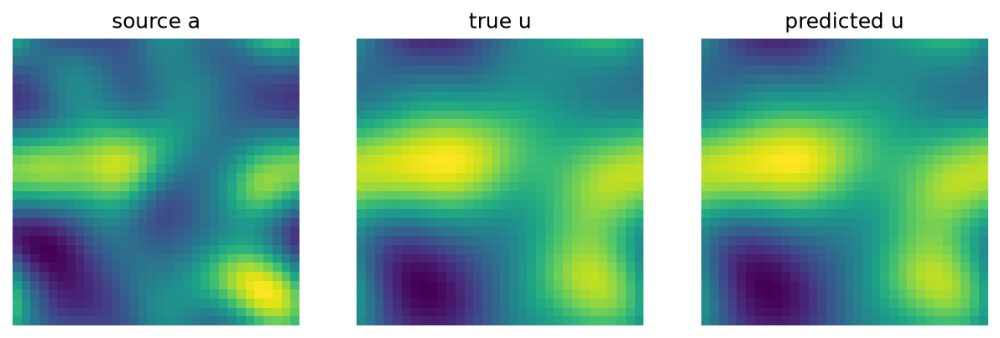

<!--
SPDX-FileCopyrightText: 2026 ZenteiQ AiTech Innovations Pvt. Ltd.
License notice: Documentation text and diagrams on this page are licensed
under CC BY 4.0. Source-code examples are licensed under LGPL-3.0-only
unless the example states otherwise.
-->

# Quickstart

This page trains a Fourier Neural Operator (FNO) from start to finish: it generates data, builds the
model, trains it, measures the error, saves a checkpoint, loads it back and predicts at a new
resolution. Every step is on this page, and the code blocks run in order as one script. It takes about a
minute on a laptop CPU and needs only [the install](../install/index.md).

**The problem.** A neural operator learns a map between functions. Here the map takes a source field
`a(x, y)` to the solution `u(x, y)` of the Poisson equation

```text
-laplace(u) = a     on the unit square, with periodic boundaries
```

An FFT solves this equation exactly, so the data is generated in a few lines and there is nothing to download.

## 1. Generate the data

```python
import jax
import jax.numpy as jnp
import numpy as np
import optax

from scirex.losses import LpLoss
from scirex.models import FNO
from scirex.training import adamw_cx


def make_dataset(n, res, seed):
    """Smooth random sources `a` and the exact solutions `u` of -laplace(u) = a."""
    rng = np.random.default_rng(seed)
    k = np.fft.fftfreq(res, d=1.0 / res) * 2 * np.pi        # angular wavenumbers
    k2 = k[:, None] ** 2 + k[None, :] ** 2
    k2[0, 0] = 1.0                                          # the mean mode is removed below
    smooth = np.exp(-(k2 / 40.0**2) * 8)                    # keeps the sources smooth
    a = np.fft.ifft2(np.fft.fft2(rng.standard_normal((n, res, res))) * smooth).real
    a = (a - a.mean(axis=(1, 2), keepdims=True)) / a.std(axis=(1, 2), keepdims=True)
    u_hat = np.fft.fft2(a) / k2
    u_hat[:, 0, 0] = 0.0
    u = np.fft.ifft2(u_hat).real
    u = u / u.std(axis=(1, 2), keepdims=True)
    # models take arrays shaped (batch, channels, height, width)
    return jnp.asarray(a[:, None], jnp.float32), jnp.asarray(u[:, None], jnp.float32)


x_train, y_train = make_dataset(256, 32, seed=0)   # 256 training examples on a 32 x 32 grid
x_test, y_test = make_dataset(64, 32, seed=1)      # 64 examples the model never sees
print(x_train.shape, y_train.shape)
```

```text
(256, 1, 32, 32) (256, 1, 32, 32)
```

## 2. Build the model

```python
model = FNO(n_modes=(12, 12), in_channels=1, out_channels=1, hidden_channels=32, n_layers=3)

params = model.init(jax.random.PRNGKey(0), x_train[:1])
print(sum(p.size for p in jax.tree_util.tree_leaves(params)), "parameters")
```

```text
269041 parameters
```

[`FNO`](../api/models.md#scirex.models.FNO) is a Flax model, and a Flax model holds no weights. `model.init` returns them as a separate tree, `params`, and
`model.apply(params, x)` runs the model with them. `n_modes` is the number of Fourier modes the layers keep in each
direction.

## 3. Choose the loss and the optimiser

```python
loss_fn = LpLoss(d=2, p=2, reduction="mean")     # relative L2 error, averaged over the batch
optimizer = adamw_cx(learning_rate=3e-3)         # AdamW that handles the complex Fourier weights
state = optimizer.init(params)


@jax.jit
def train_step(params, state, x, y):
    def loss(p):
        return loss_fn.rel(model.apply(p, x), y)

    value, grads = jax.value_and_grad(loss)(params)
    updates, state = optimizer.update(grads, state, params)
    return optax.apply_updates(params, updates), state, value


@jax.jit
def test_error(params):
    return loss_fn.rel(model.apply(params, x_test), y_test)
```

[`LpLoss`](../api/losses.md#scirex.losses.LpLoss) is the relative error between prediction and truth, and [`adamw_cx`](../api/training.md#scirex.training.adamw_cx) is the optimiser. `jax.jit` compiles each function once. `jax.value_and_grad` returns the loss and its gradient with respect to
`params`, and `optimizer.update` turns the gradient into a step.

## 4. Train

```python
batch_size, key = 32, jax.random.PRNGKey(1)
for epoch in range(40):
    key, subkey = jax.random.split(key)
    order = jax.random.permutation(subkey, x_train.shape[0])   # a new shuffle every epoch
    for i in range(0, x_train.shape[0], batch_size):
        idx = order[i : i + batch_size]
        params, state, value = train_step(params, state, x_train[idx], y_train[idx])
    if epoch % 10 == 0 or epoch == 39:
        print(f"epoch {epoch:2d}  train {float(value):.4f}  test {float(test_error(params)):.4f}")
```

```text
epoch  0  train 0.5181  test 0.4207
epoch 10  train 0.0481  test 0.0561
epoch 20  train 0.0314  test 0.0318
epoch 30  train 0.0262  test 0.0233
epoch 39  train 0.0136  test 0.0199
```

The numbers are relative L2 errors: 0.02 means the prediction is off by 2% of the size of the true solution. Your
numbers will differ slightly from run to run and between machines.

## 5. Save and load a checkpoint

```python
model.save_checkpoint("runs/poisson", "fno", params)
# runs/poisson/fno_params.bytes       the weights
# runs/poisson/fno_metadata.msgpack   the constructor arguments

restored_model, restored_params = FNO.from_checkpoint("runs/poisson", "fno", params)
prediction = restored_model.apply(restored_params, x_test)
print("test error after loading:", float(loss_fn.rel(prediction, y_test)))
```

```text
test error after loading: 0.0199
```

`FNO.from_checkpoint` builds the model from the saved arguments, so you need no code to recreate it. The last argument
is a template with the same structure as the weights, here the trained `params`.

## 6. Predict at a new resolution

An FNO acts on functions, so a model trained on a 32 × 32 grid can run on a finer grid without retraining:

```python
x_fine, y_fine = make_dataset(16, 64, seed=2)
fine_error = loss_fn.rel(restored_model.apply(restored_params, x_fine), y_fine)
print("error on a 64 x 64 grid:", float(fine_error))
```

```text
error on a 64 x 64 grid: 0.0219
```

## 7. Look at a prediction

```python
import matplotlib.pyplot as plt

fig, axes = plt.subplots(1, 3, figsize=(10, 3.2))
panels = [("source a", x_test[0, 0]), ("true u", y_test[0, 0]), ("predicted u", prediction[0, 0])]
for ax, (title, field) in zip(axes, panels):
    ax.imshow(field, cmap="viridis")
    ax.set_title(title)
    ax.axis("off")
fig.savefig("poisson_prediction.png", dpi=150, bbox_inches="tight")
```



The three panels show the source, the exact solution and the prediction for one test example. The last two are visually the same.

## What to try next

- **Your own data.** Replace `make_dataset` with arrays of the same shape,
  `(examples, channels, height, width)`. Nothing else changes.
- **A benchmark dataset.** The [Darcy flow tutorial](../tutorials/FNO/Darcy_FNO.md) trains the same model on a
  published dataset.
- **Another model.** [`WNO`](../api/models.md#scirex.models.WNO), [`GINO`](../api/models.md#scirex.models.GINO) and [`Transolver`](../api/models.md#scirex.models.Transolver) are built the same way. See [Choosing a model](../learn/problem_types.md#choosing-a-model).
- **No solution data.** [Physics-informed losses](../loss_guide/overview.md) train from the equation alone.
- **Your accelerator.** On a GPU install the same code runs on the GPU without changes.
