<!--
SPDX-FileCopyrightText: 2026 ZenteiQ AiTech Innovations Pvt. Ltd.
SPDX-License-Identifier: CC-BY-4.0
-->

# Benchmarks Gallery

> **Licensing:** This gallery's narrative and the ZenteiQ-generated figures and
> metrics under `doc/assets/benchmarks/` are licensed under **CC BY 4.0**. Any
> code shown is **LGPL-3.0-only** unless stated otherwise. The licences of the
> underlying datasets and of the model weights are stated on the
> [Hugging Face repositories](https://huggingface.co/zenteiq-ai).

This gallery shows nine benchmark problems, each trained and evaluated with
up to four neural-operator architectures (FNO, WNO, GINO, Transolver) at a
matched parameter budget. Each section below shows
the qualitative predictions and/or accuracy comparison for one problem, with
a link to its full model-comparison page for the complete tables, error
curves and compute-cost breakdown.

Model benchmark output directory: `doc/assets/benchmarks/`

## Summary

| Problem | Best model | Metric |
|---|---|---|
| [Darcy 2D](../doc/benchmarks/darcy/results/comparative.md) | Transolver | 0.532% rel. L2 |
| [Darcy 2D, physics-only](../doc/benchmarks/darcy_physics/results/comparative.md) | Transolver | 0.565% rel. L2, no labels (10k unlabelled fields) |
| [Pipe Flow](../doc/benchmarks/pipe/results/comparative.md) | Transolver | 0.386% rel. L2 (best of 3 seeds, tuned recipe) |
| [Navier-Stokes 2D](../doc/benchmarks/navier_stokes/results/comparative.md) | GINO | 6.66% rel. L2 (10-step rollout) |
| [Lid-Driven Cavity](../doc/benchmarks/cavity/results/comparative.md) | GINO | 1.95e-3 RMSE, one step ahead (default size) |
| [Chip Cooling](../doc/benchmarks/chip_cooling/results/comparative.md) | FNO | 0.122 K mean absolute error |
| [AirfRANS](../doc/benchmarks/airfrans/results/comparative.md) | Transolver | Volume 0.00131, Surf 0.00046 |
| [Car-Design-ShapeNetCar](../doc/benchmarks/shapenetcar/results/comparative.md) | Transolver | Volume 0.0223, Surf 0.0767 |
| [Car-CFD](../doc/benchmarks/car_cfd/results/comparative.md) | Transolver | 6.81% rel. L2 (seed 0) |

All relative-L2 and RMSE figures above are on each benchmark's held-out test
set; see each comparative page for the full per-model breakdown.

---

## Darcy 2D

Four operators mapping a piecewise-constant permeability field to the
steady-state pressure field of a 2D elliptic PDE, each matched to
Transolver's parameter count.

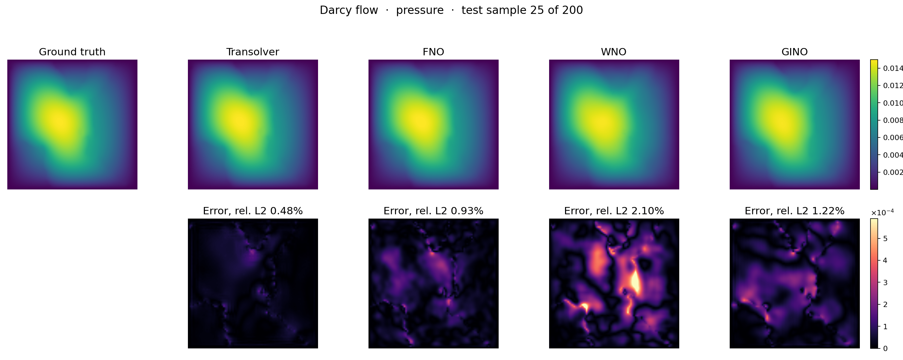

The best of them, Transolver, over training:

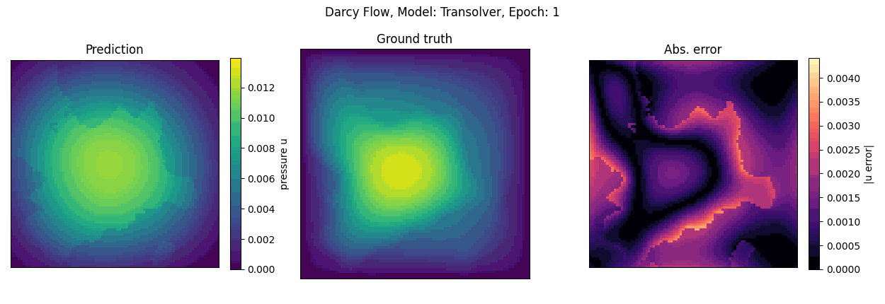

Full results: [Darcy Flow (Model Comparison)](../doc/benchmarks/darcy/results/comparative.md) · [Dataset guide](../doc/dataset_guide/darcy_2d.md)

The same four models trained without labels, on the Q4 Ritz energy of the
PDE, against the number of coefficient fields the loss sees (no solutions):

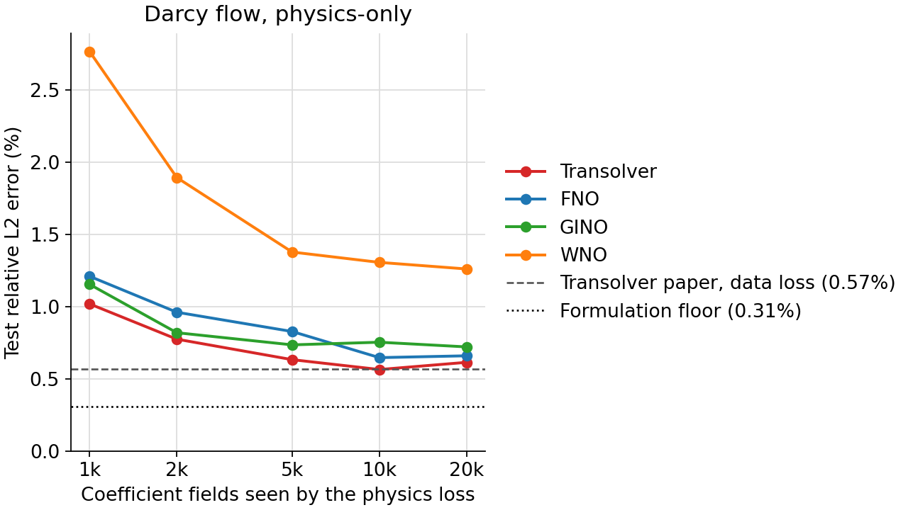

The best of them, Transolver on 10k unlabelled fields, across the test set
(from the lowest to the highest error):

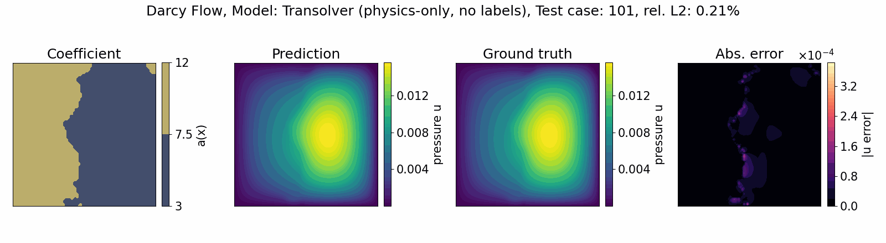

Full results: [Darcy Flow, Physics-only (Model Comparison)](../doc/benchmarks/darcy_physics/results/comparative.md) · [Setup](../doc/benchmarks/darcy_physics/results/setup.md)

---

## Chip Cooling

Four operators mapping 6 boundary-condition parameters of a dual-chip
liquid-cooled cold plate to its steady-state temperature field.

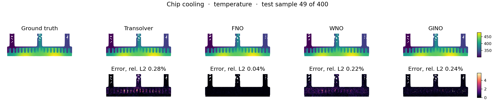

Full results: [Chip Cooling (Model Comparison)](../doc/benchmarks/chip_cooling/results/comparative.md) · [Dataset guide](../doc/dataset_guide/chip_cooling.md)

---

## Pipe Flow

Four operators mapping a deformed pipe's mesh coordinates to its
steady-state, incompressible 2D Navier-Stokes solution.

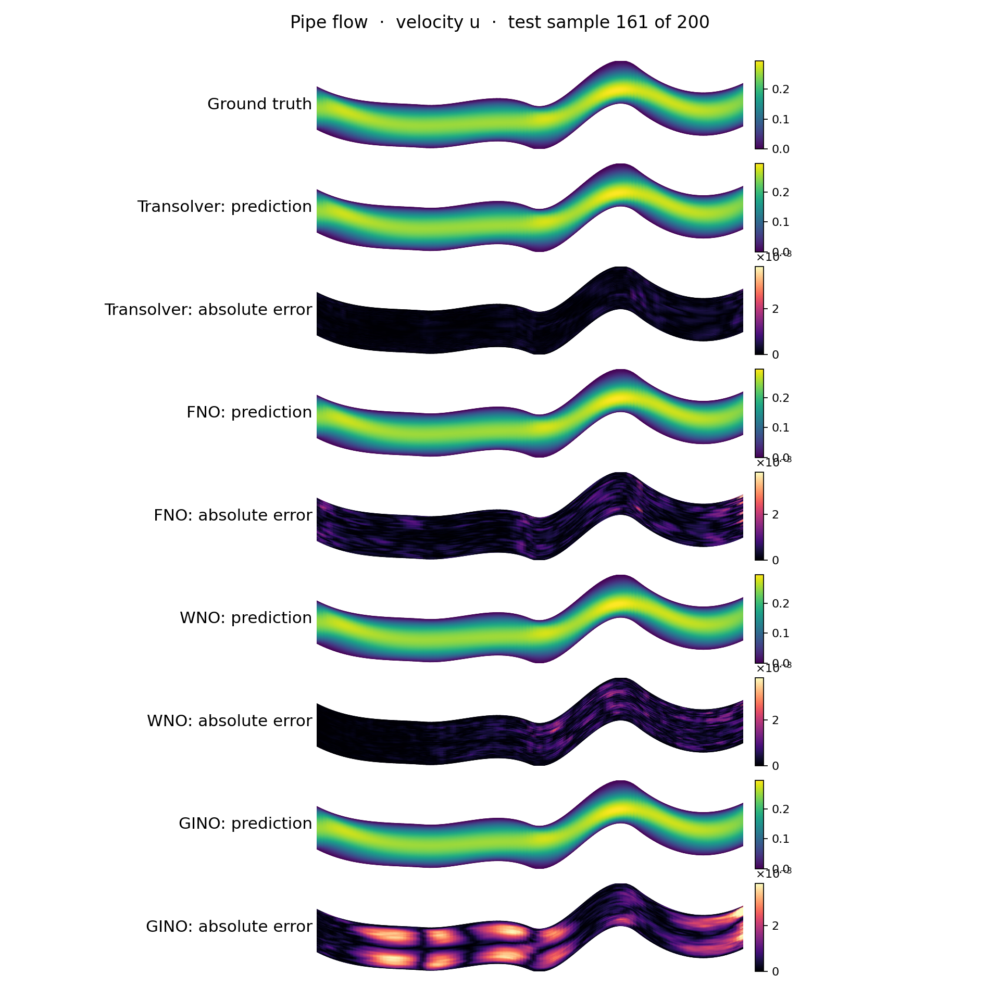

Full results: [Pipe Flow (Model Comparison)](../doc/benchmarks/pipe/results/comparative.md) · [Dataset guide](../doc/dataset_guide/pipe.md)

---

## Navier-Stokes 2D

Four operators forecasting 10 frames of 2D turbulent vorticity from the
previous 10, each prediction fed back as input, the FNO/Transolver
2D, incompressible Navier-Stokes benchmark at viscosity 1e-5.

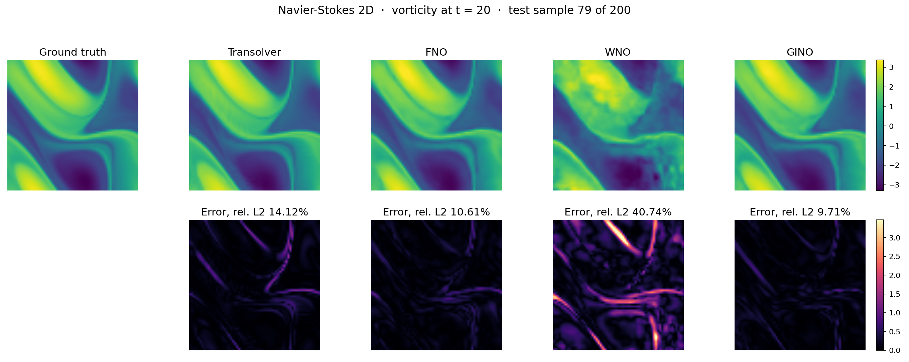

Full results: [Navier-Stokes 2D (Model Comparison)](../doc/benchmarks/navier_stokes/results/comparative.md) · [Dataset guide](../doc/dataset_guide/navier_stokes.md)

---

## AirfRANS

Three operators predicting velocity, pressure and turbulent viscosity over a
2-D airfoil's CFD mesh (~180,000 nodes), benchmarked against the Transolver
paper's own evaluation code.

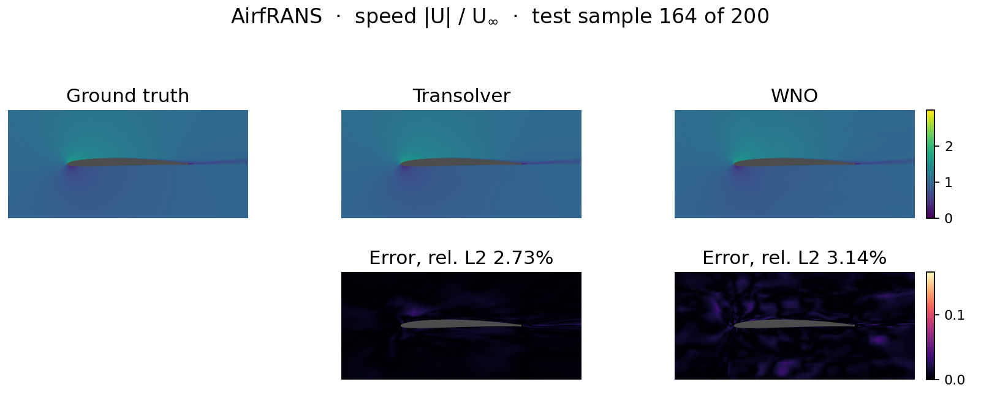

Full results: [AirfRANS (Model Comparison)](../doc/benchmarks/airfrans/results/comparative.md) · [Dataset guide](../doc/dataset_guide/airfrans.md)

---

## Lid-Driven Cavity

Four operators forecasting the next flow snapshot from a short window of
past snapshots, tested on a Reynolds number held out of training entirely
(the benchmark of [[1]](#ref1)).

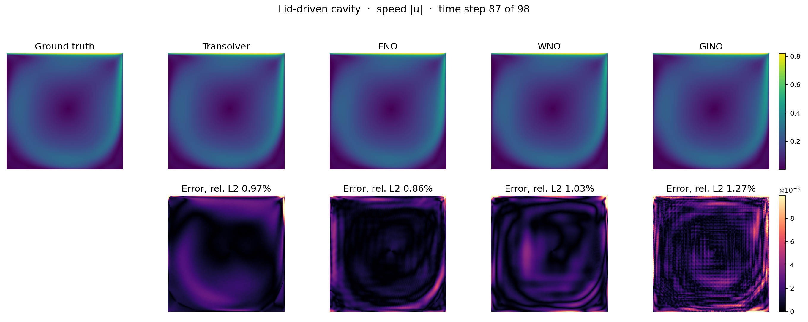

Full results: [Lid-Driven Cavity (Model Comparison)](../doc/benchmarks/cavity/results/comparative.md) · [Dataset guide](../doc/dataset_guide/cavity.md)

---

## Car-Design-ShapeNetCar

Two operators (Transolver and GINO) mapping a car's surface/near-volume point cloud to its
steady velocity and pressure field, the Transolver paper's own
Car-Design-ShapeNetCar benchmark.

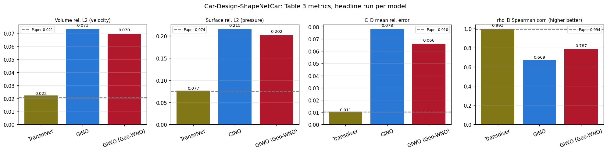

Full results: [Car-Design-ShapeNetCar (Model Comparison)](../doc/benchmarks/shapenetcar/results/comparative.md) · [Dataset guide](../doc/dataset_guide/shapenetcar.md)

---

## Car-CFD

Three operators (Transolver, GINO and GIWO) at ~75.9M parameters mapping a
3-D car to its surface pressure, under the GINO paper's own Car-CFD
protocol [[2]](#ref2). A different protocol from
Car-Design-ShapeNetCar above, which follows the Transolver paper's
point-cloud setup on the same car geometries.

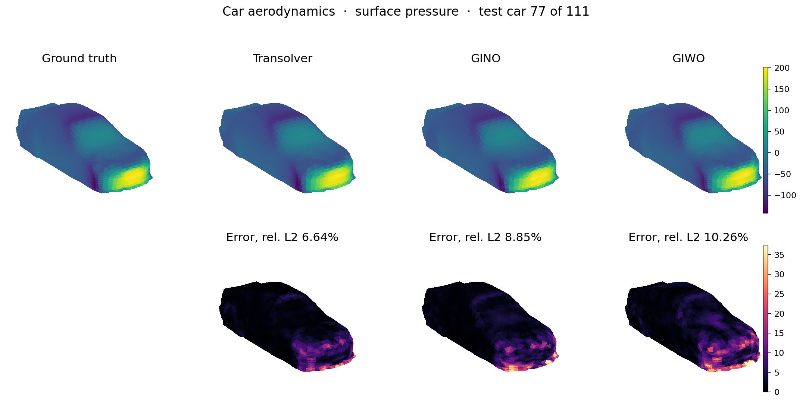

Full results: [Car-CFD (Model Comparison)](../doc/benchmarks/car_cfd/results/comparative.md) · [Dataset guide](../doc/dataset_guide/car_cfd.md)

## References

1. Costa Rocha et al., *Deep Neural Network Modeling for CFD Simulations: Benchmarking the Fourier Neural Operator on the Lid-Driven Cavity Case*, Applied Sciences 13(5), 3165 (2023). <https://doi.org/10.3390/app13053165>

2. Li et al., *Geometry-Informed Neural Operator for Large-Scale 3D PDEs*, NeurIPS 2023. <https://arxiv.org/abs/2309.00583>
